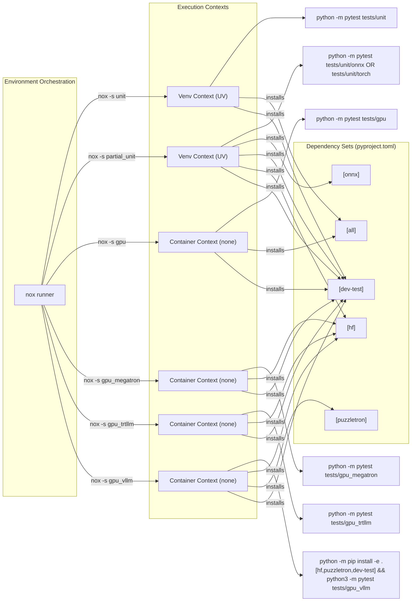
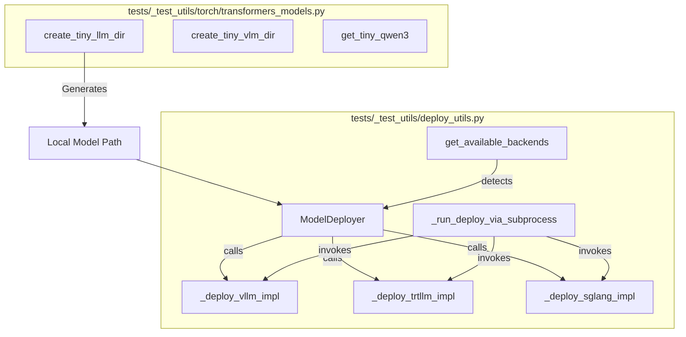

<!-- source: DeepWiki mcp.deepwiki.com · repo NVIDIA/Model-Optimizer · page 9.2 Testing Framework · fetched 2026-10-26 -->

# Testing Framework

<details>
<summary>Relevant source files</summary>

The following files were used as context for generating this wiki page:

- [.github/actions/cache-extensions/action.yml](.github/actions/cache-extensions/action.yml)
- [.github/codecov.yml](.github/codecov.yml)
- [.github/workflows/_example_tests_runner.yml](.github/workflows/_example_tests_runner.yml)
- [.github/workflows/_pr_gate.yml](.github/workflows/_pr_gate.yml)
- [.github/workflows/code_quality.yml](.github/workflows/code_quality.yml)
- [.github/workflows/example_tests.yml](.github/workflows/example_tests.yml)
- [.github/workflows/gpu_tests.yml](.github/workflows/gpu_tests.yml)
- [.github/workflows/pages.yml](.github/workflows/pages.yml)
- [.github/workflows/regression_tests.yml](.github/workflows/regression_tests.yml)
- [.github/workflows/release.yml](.github/workflows/release.yml)
- [.github/workflows/unit_tests.yml](.github/workflows/unit_tests.yml)
- [examples/gpt-oss/requirements.txt](examples/gpt-oss/requirements.txt)
- [examples/hf_ptq/scripts/huggingface_example.sh](examples/hf_ptq/scripts/huggingface_example.sh)
- [examples/hf_ptq/scripts/parser.sh](examples/hf_ptq/scripts/parser.sh)
- [examples/llm_eval/README.md](examples/llm_eval/README.md)
- [examples/llm_eval/lm_eval_hf.py](examples/llm_eval/lm_eval_hf.py)
- [examples/llm_eval/lm_eval_trtllm.py](examples/llm_eval/lm_eval_trtllm.py)
- [examples/llm_eval/requirements.txt](examples/llm_eval/requirements.txt)
- [examples/windows/accuracy_benchmark/README.md](examples/windows/accuracy_benchmark/README.md)
- [modelopt/torch/__init__.py](modelopt/torch/__init__.py)
- [modelopt/torch/utils/plugins/__init__.py](modelopt/torch/utils/plugins/__init__.py)
- [modelopt/torch/utils/plugins/prepare_megatron_data_blend.py](modelopt/torch/utils/plugins/prepare_megatron_data_blend.py)
- [noxfile.py](noxfile.py)
- [pyproject.toml](pyproject.toml)
- [tests/_test_utils/deploy_utils.py](tests/_test_utils/deploy_utils.py)
- [tests/_test_utils/examples/megatron_example_runner.py](tests/_test_utils/examples/megatron_example_runner.py)
- [tests/_test_utils/examples/run_command.py](tests/_test_utils/examples/run_command.py)
- [tests/conftest.py](tests/conftest.py)
- [tests/examples/cnn_qat/test_resnet50.py](tests/examples/cnn_qat/test_resnet50.py)
- [tests/examples/hf_ptq/test_deploy.py](tests/examples/hf_ptq/test_deploy.py)
- [tests/examples/llm_eval/test_llm_eval.py](tests/examples/llm_eval/test_llm_eval.py)
- [tests/examples/llm_eval/test_lm_eval_trtllm.py](tests/examples/llm_eval/test_lm_eval_trtllm.py)
- [tests/examples/megatron_bridge/conftest.py](tests/examples/megatron_bridge/conftest.py)
- [tests/gpu/_extensions/test_torch_extensions.py](tests/gpu/_extensions/test_torch_extensions.py)
- [tests/gpu_megatron/conftest.py](tests/gpu_megatron/conftest.py)
- [tests/gpu_megatron/torch/utils/plugins/test_prepare_megatron_data_blend.py](tests/gpu_megatron/torch/utils/plugins/test_prepare_megatron_data_blend.py)
- [tests/unit/test_example_run_command.py](tests/unit/test_example_run_command.py)

</details>


## Purpose and Scope

The NVIDIA Model Optimizer testing framework provides multi-layer validation to ensure code quality, hardware compatibility, and end-to-end workflow reliability. The framework is categorized into module-level unit tests, hardware-dependent GPU tests, and scenario-based example tests. It leverages `nox` for environment orchestration and GitHub Actions for continuous integration across multiple Python and PyTorch versions.

---

## Test Organization

The testing infrastructure is organized into distinct directories based on the scope of validation and hardware requirements.

### Test Categories

| Category | Location | Purpose | Hardware |
| :--- | :--- | :--- | :--- |
| **Unit Tests** | `tests/unit/` | Module-level logic and graph transformations | CPU |
| **GPU Tests** | `tests/gpu/` | Quantization kernels, calibration, and plugin integration | GPU (RTX6000/H100) |
| **GPU Megatron**| `tests/gpu_megatron/`| Distributed Megatron-Core integration | GPU (RTX6000/H100) |
| **GPU TRT-LLM** | `tests/gpu_trtllm/` | TensorRT-LLM deployment validation | GPU (RTX6000/H100) |
| **GPU vLLM** | `tests/gpu_vllm/` | vLLM integration and expert routing validation | GPU (RTX6000/H100) |
| **Example Tests**| `tests/examples/` | End-to-end validation of example scripts | GPU (RTX6000/H100) |

### Code Entity Association

The following diagram maps high-level test categories to the specific code entities and directories they validate.

**Test Category to Code Mapping**

```mermaid
graph TD
    subgraph "Natural Language Space"
        UT["Unit Testing"]
        GT["GPU Testing"]
        ET["Example Testing"]
        PI["Partial Installation Testing"]
        LT["Launcher Testing"]
        MT["MCP Testing"]
        ST["Skills Testing"]
    end

    subgraph "Code Entity Space"
        UT --> UT_ONNX["tests/unit/onnx/"]
        UT --> UT_TORCH["tests/unit/torch/"]
        UT --> UT_DEPLOY["tests/unit/torch/deploy/"]
        
        GT --> GT_QUANT["tests/gpu/"]
        GT --> GT_MEGATRON["tests/gpu_megatron/"]
        GT --> GT_TRTLLM["tests/gpu_trtllm/"]
        GT --> GT_VLLM["tests/gpu_vllm/"]
        
        ET --> ET_LLM["tests/examples/llm_distill/"]
        ET --> ET_SPEC["tests/examples/speculative_decoding/"]
        ET --> ET_ONNX["tests/examples/torch_onnx/"]
        ET --> ET_HFPTQ["tests/examples/hf_ptq/"]
        ET --> ET_LLMEVAL["tests/examples/llm_eval/"]
        ET --> ET_MEGATRON["tests/examples/megatron_bridge/"]
        ET --> ET_DIFFUSERS["tests/examples/diffusers/"]
        
        PI --> NOX_PARTIAL["noxfile.py: partial_unit(subset='onnx|torch')"]

        LT --> TOOLS_LAUNCHER["tools/launcher/"]
        MT --> TOOLS_MCP["tools/mcp/"]
        ST --> PLUGINS_SKILLS["plugins/modelopt/skills/"]
    end

    UT_TORCH -.-> M_TORCH["modelopt/torch/"]
    UT_ONNX -.-> M_ONNX["modelopt/onnx/"]
    GT_MEGATRON -.-> M_PLUGINS["modelopt/torch/quantization/plugins/"]
    ET_LLMEVAL -.-> EX_LLMEVAL["examples/llm_eval/"]
    ET_HFPTQ -.-> EX_HFPTQ["examples/hf_ptq/"]
    ET_MEGATRON -.-> EX_MEGATRON["examples/megatron_bridge/"]
    ET_DIFFUSERS -.-> EX_DIFFUSERS["examples/diffusers/"]
    LT -.-> TOOLS_LAUNCHER_CODE["tools/launcher/"]
    MT -.-> TOOLS_MCP_CODE["tools/mcp/"]
    ST -.-> PLUGINS_SKILLS_CODE["plugins/modelopt/skills/"]
```

Sources: [.github/workflows/unit_tests.yml:13-18](), [.github/workflows/gpu_tests.yml:34-37](), [.github/workflows/example_tests.yml:63-78](), [noxfile.py:79-98](), [.github/workflows/unit_tests.yml:140-156](), [.github/workflows/unit_tests.yml:157-179](), [.github/workflows/unit_tests.yml:180-196]()

---

## Test Environments (Nox)

The project uses `nox` to manage a matrix of test environments, ensuring compatibility across supported Python (3.10–3.14) and PyTorch (2.8–2.13) versions.

### Nox Configuration Matrix

The `noxfile.py` defines sessions for unit testing, GPU execution, and code quality.

| Session Group | Command | Purpose |
| :--- | :--- | :--- |
| `unit` | `nox -s unit` | CPU-based module testing across Python/Torch matrix [noxfile.py:66-76]() |
| `partial_unit` | `nox -s partial_unit` | Verifies imports with subset of dependencies (onnx vs torch) [noxfile.py:79-98]() |
| `gpu` | `nox -s gpu` | Standard GPU-accelerated tests (Inside Container) [noxfile.py:107-132]() |
| `gpu_megatron`| `nox -s gpu_megatron` | Distributed NeMo/Megatron-Core integration [noxfile.py:136-143]() |
| `gpu_trtllm` | `nox -s gpu_trtllm` | TensorRT-LLM deployment validation [noxfile.py:147-150]() |
| `gpu_vllm` | `nox -s gpu_vllm` | vLLM integration validation [noxfile.py:155-158]() |

**Nox Execution Flow**

Sources: [noxfile.py:32-35](), [noxfile.py:69-75](), [noxfile.py:107-108](), [pyproject.toml:114-128](), [noxfile.py:84-99](), [noxfile.py:120-121](), [noxfile.py:143](), [noxfile.py:150](), [noxfile.py:158]()

---

## CI/CD Pipeline Integration

The testing framework is integrated into GitHub Actions through specialized workflows for unit, GPU, and example validation.

### Workflow Architecture

1.  **Unit Tests (`unit_tests.yml`)**: Triggered on every PR. Executes a matrix of Python (3.10-3.14) and PyTorch (2.8-2.13) versions on Ubuntu and Windows runners. Also includes specific jobs for `launcher`, `mcp`, and `skills` tests. [.github/workflows/unit_tests.yml:60-124](), [.github/workflows/unit_tests.yml:140-156](), [.github/workflows/unit_tests.yml:157-179](), [.github/workflows/unit_tests.yml:180-196]()
2.  **GPU Tests (`gpu_tests.yml`)**: Triggered on PR pushes. Uses `linux-amd64-gpu-rtxpro6000` runners and specific NGC/Docker containers (e.g., `pytorch:26.05-py3`, `nemo:26.08`, `vllm-openai:v0.26.0`, `vllm-openai:v0.20.0`). [.github/workflows/gpu_tests.yml:39-65]()
3.  **Example Tests (`example_tests.yml`)**: Validates end-to-end scripts using `_example_tests_runner.yml`. Covers LLM Distill, QAT, Sparsity, Speculative Decoding, GPT-OSS, HF PTQ, LLM Eval, Megatron Bridge, Diffusers, and ONNX. [.github/workflows/example_tests.yml:109-175]()
4.  **Regression Tests (`regression_tests.yml`)**: A separate workflow for long-running or specific regression tests, not detailed in the provided files but implied by the overall structure.
5.  **Code Quality (`code_quality.yml`)**: Runs linting, formatting, and secret scanning checks. [.github/workflows/code_quality.yml:18-38]()
6.  **Docs (`pages.yml`)**: Builds and deploys documentation. [.github/workflows/pages.yml:25-39]()
7.  **Release (`release.yml`)**: Builds and uploads wheel files upon release publication. [.github/workflows/release.yml:10-25]()

### Test Utilities and Fixtures

The framework provides shared utilities for creating synthetic models and managing deployments.

**Synthetic Model Generation and Deployment Utilities**

Sources: [tests/_test_utils/torch/transformers_models.py:74-91](), [tests/_test_utils/torch/transformers_models.py:136-152](), [tests/_test_utils/deploy_utils.py:68-87](), [tests/_test_utils/deploy_utils.py:93-112](), [tests/_test_utils/deploy_utils.py:118-140](), [tests/_test_utils/deploy_utils.py:143-207](), [tests/_test_utils/deploy_utils.py:30-65]()

---

## Test Execution and Requirements

### Execution Commands

To run tests locally, users should install `nox` and `uv`:

```bash
# Install orchestration tools
pip install nox uv

# Run specific unit test combination
nox -s "unit-3.12(torch_213, tf_latest)"

# Run code quality checks (pre-commit)
nox -s pre_commit_all
```
Sources: [noxfile.py:18-24](), [pyproject.toml:114-128](), [.github/workflows/code_quality.yml:31-32]()

### Coverage and Quality Requirements

-   **Coverage**: Coverage is tracked across subprocesses using `COVERAGE_PROCESS_START`. Reports are uploaded to Codecov with flags (`unit`, `gpu`, `examples`). [.github/workflows/unit_tests.yml:68-76](), [.github/workflows/gpu_tests.yml:90-103](), [.github/workflows/_example_tests_runner.yml:78-100]()
-   **Linting**: Enforced via `ruff` with rules including `C4` (comprehensions), `D` (pydocstyle), `E/F` (pycodestyle/flakes), and `I` (isort). [pyproject.toml:102]()
-   **Version Compatibility**: The framework explicitly checks `torch` and `transformers` versions at runtime to warn about untested configurations. [modelopt/torch/__init__.py:43-69]()

### Hardware Detection
The framework includes utilities to detect available inference backends (TRT-LLM, vLLM, SGLang) to skip or run deployment tests accordingly.
Sources: [tests/_test_utils/deploy_utils.py:30-65]()

---

