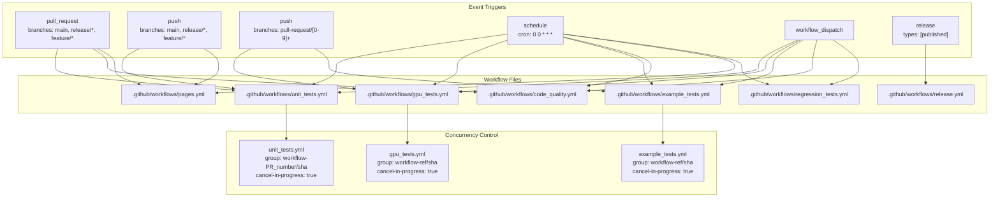
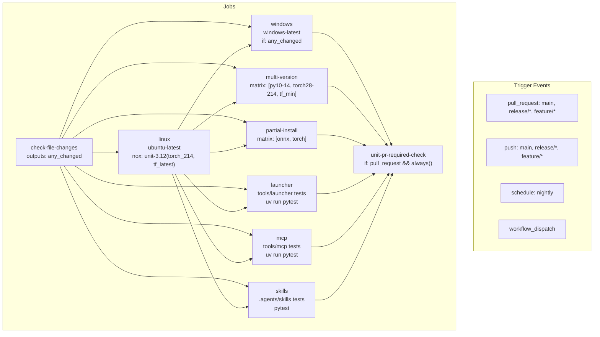
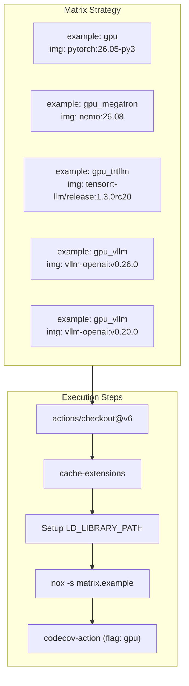

<!-- source: DeepWiki mcp.deepwiki.com · repo NVIDIA/Model-Optimizer · page 9.3 CI/CD Pipeline · fetched 2026-10-26 -->

# CI/CD Pipeline

Relevant source files

The following files were used as context for generating this wiki page:

- [.agents/review-guidelines/technical-blog.md](.agents/review-guidelines/technical-blog.md)
- [.dockerignore](.dockerignore)
- [.github/CODEOWNERS](.github/CODEOWNERS)
- [.github/actions/cache-extensions/action.yml](.github/actions/cache-extensions/action.yml)
- [.github/codecov.yml](.github/codecov.yml)
- [.github/workflows/_example_tests_runner.yml](.github/workflows/_example_tests_runner.yml)
- [.github/workflows/_pr_gate.yml](.github/workflows/_pr_gate.yml)
- [.github/workflows/bump_uv_lock.yml](.github/workflows/bump_uv_lock.yml)
- [.github/workflows/code_quality.yml](.github/workflows/code_quality.yml)
- [.github/workflows/example_tests.yml](.github/workflows/example_tests.yml)
- [.github/workflows/gpu_tests.yml](.github/workflows/gpu_tests.yml)
- [.github/workflows/pages.yml](.github/workflows/pages.yml)
- [.github/workflows/regression_tests.yml](.github/workflows/regression_tests.yml)
- [.github/workflows/release.yml](.github/workflows/release.yml)
- [.github/workflows/unit_tests.yml](.github/workflows/unit_tests.yml)
- [.gitlab/.gitlab-ci.yml](.gitlab/.gitlab-ci.yml)
- [docs/source/_ext/modelopt_autodoc_pydantic.py](docs/source/_ext/modelopt_autodoc_pydantic.py)
- [docs/source/_static/announcements.css](docs/source/_static/announcements.css)
- [docs/source/_static/announcements.js](docs/source/_static/announcements.js)
- [docs/source/_static/custom.css](docs/source/_static/custom.css)
- [docs/source/announcements/assets/autoquantize-qwen35-mmlu-effective-bits.png](docs/source/announcements/assets/autoquantize-qwen35-mmlu-effective-bits.png)
- [docs/source/announcements/autoquantize.rst](docs/source/announcements/autoquantize.rst)
- [docs/source/announcements/dspark-vs-domino.rst](docs/source/announcements/dspark-vs-domino.rst)
- [docs/source/announcements/github-pages-announcements.rst](docs/source/announcements/github-pages-announcements.rst)
- [docs/source/conf.py](docs/source/conf.py)
- [docs/source/deployment/1_tensorrt_llm.rst](docs/source/deployment/1_tensorrt_llm.rst)
- [docs/source/getting_started/2_installation.rst](docs/source/getting_started/2_installation.rst)
- [docs/source/index.rst](docs/source/index.rst)
- [examples/gpt-oss/requirements.txt](examples/gpt-oss/requirements.txt)
- [modelopt/onnx/quantization/extensions.py](modelopt/onnx/quantization/extensions.py)
- [modelopt/torch/__init__.py](modelopt/torch/__init__.py)
- [noxfile.py](noxfile.py)
- [pyproject.toml](pyproject.toml)
- [uv.lock](uv.lock)

This document describes the continuous integration and continuous deployment infrastructure for the NVIDIA Model Optimizer repository. It covers all GitHub Actions workflows, their trigger conditions, job dependencies, hardware configurations, and maintenance strategies. For information about the actual test content and organization, see [Testing Framework](#9.2). For contribution guidelines including pre-commit hooks, see [Contributing Guidelines](#9.1).

## Overview

The CI/CD pipeline implements a multi-stage validation strategy with several primary workflows:

1.  **Unit Tests**: CPU-based unit tests across multiple Python, PyTorch, and Transformers versions [`.github/workflows/unit_tests.yml:1-188`]().
2.  **GPU Tests**: GPU-accelerated tests for quantization, pruning, and framework plugins (Megatron-Core, TensorRT-LLM, vLLM) [`.github/workflows/gpu_tests.yml:1-104`]().
3.  **Example Tests**: End-to-end integration tests for PyTorch, TensorRT-LLM, NeMo, and ONNX examples [`.github/workflows/example_tests.yml:1-171`]().
4.  **Code Quality**: Secret scanning and pre-commit hook validation [`.github/workflows/code_quality.yml:1-33`]().
5.  **Documentation**: Sphinx documentation build and GitHub Pages deployment with PR previews [`.github/workflows/pages.yml:1-101`]().
6.  **Release**: Wheel building and GitHub release artifact upload [`.github/workflows/release.yml:1-26`]().
7.  **Regression Tests**: Nightly and on-demand regression suites for specific model optimizations [`.github/workflows/regression_tests.yml:1-72`]().

The pipeline employs cost optimization strategies including file change detection via `step-security/changed-files` [`.github/workflows/unit_tests.yml:45-59`]() and `dorny/paths-filter` [`.github/workflows/pages.yml:47-55`]().

Sources: [`.github/workflows/unit_tests.yml:1-188`](), [`.github/workflows/gpu_tests.yml:1-104`](), [`.github/workflows/example_tests.yml:1-171`](), [`.github/workflows/code_quality.yml:1-33`](), [`.github/workflows/pages.yml:1-101`](), [`.github/workflows/release.yml:1-26`](), [`.github/workflows/regression_tests.yml:1-72`]()

## Workflow Trigger Architecture

**Workflow Trigger Architecture**: Pull requests trigger lightweight validation (unit tests, code quality, docs). Expensive GPU and example tests are triggered on `push` to `pull-request/[0-9]+` branches (mirrored branches used for GPU runner access) [`.github/workflows/gpu_tests.yml:4-6`](). Nightly schedules ensure regression testing. All workflows implement concurrency groups to terminate stale runs [`.github/workflows/unit_tests.yml:24-27`]().

Sources: [`.github/workflows/unit_tests.yml:3-27`](), [`.github/workflows/gpu_tests.yml:3-15`](), [`.github/workflows/example_tests.yml:3-16`](), [`.github/workflows/code_quality.yml:3-15`](), [`.github/workflows/pages.yml:3-18`](), [`.github/workflows/release.yml:3-5`]()

## Unit Tests Workflow

The `unit_tests.yml` workflow provides CPU-based validation across multiple environment configurations using `nox` and `uv` [`.github/workflows/unit_tests.yml:70`]().

**Unit Tests Job Dependency Graph**: The workflow enforces sequential dependency starting with the primary Linux job with coverage [`.github/workflows/unit_tests.yml:60-81`](). Parallel matrix jobs validate different environment versions [`.github/workflows/unit_tests.yml:96-124`](). Specialized jobs test the `tools/launcher` [`.github/workflows/unit_tests.yml:139-155`](), the Model Context Protocol (`mcp`) server [`.github/workflows/unit_tests.yml:156-178`](), and AI agent skills [`.github/workflows/unit_tests.yml:179-191`]().

### Job Configuration Details

| Job | Runner | Condition | Nox Session / Command |
|-----|--------|-----------|-----------------------|
| `linux` | ubuntu-latest | - | `unit-3.12(torch_214, tf_latest)` [`.github/workflows/unit_tests.yml:70`]() |
| `windows` | windows-latest | if: any_changed | `unit-3.12(torch_214, tf_latest)` [`.github/workflows/unit_tests.yml:95`]() |
| `multi-version` | ubuntu-latest | if: any_changed | Matrix of py [3.10-3.14] and torch [2.8-2.14] [`.github/workflows/unit_tests.yml:105-116`]() |
| `partial-install` | ubuntu-latest | if: any_changed | `partial_unit(subset='onnx'/'torch')` [`.github/workflows/unit_tests.yml:139`]() |
| `launcher` | ubuntu-latest | if: any_changed | `uv run python3 -m pytest` in `tools/launcher` [`.github/workflows/unit_tests.yml:156`]() |
| `mcp` | ubuntu-latest | if: any_changed | `uv run python3 -m pytest` in `tools/mcp` [`.github/workflows/unit_tests.yml:179`]() |

Sources: [`.github/workflows/unit_tests.yml:30-191`](), [`noxfile.py:67-76`](), [`noxfile.py:81-99`]()

## GPU Tests Workflow

The `gpu_tests.yml` workflow implements GPU-accelerated testing using specialized NVIDIA containers. It uses a matrix strategy to test across different framework environments [`.github/workflows/gpu_tests.yml:42-64`]().

**GPU Test Matrix**:
- `gpu`: Validates core PyTorch quantization and pruning using the standard PyTorch container [`.github/workflows/gpu_tests.yml:46-50`]().
- `gpu_megatron`: Validates Megatron-Core integration using the NeMo container [`.github/workflows/gpu_tests.yml:51-53`]().
- `gpu_trtllm`: Validates TensorRT-LLM export and deployment [`.github/workflows/gpu_tests.yml:54-56`]().
- `gpu_vllm`: Validates vLLM integration, covering both legacy and new RoutedExperts layouts [`.github/workflows/gpu_tests.yml:58-64`]().

The workflow uses a composite action `cache-extensions` to reuse JIT-compiled CUDA extensions across runs [`.github/actions/cache-extensions/action.yml:1-25`]().

Sources: [`.github/workflows/gpu_tests.yml:39-104`](), [`.github/actions/cache-extensions/action.yml:1-25`]()

## Example Tests Workflow

The `example_tests.yml` workflow validates end-to-end examples. It utilizes a `pr-gate` job to perform granular file change detection, only running the "lanes" (torch, trtllm, megatron, onnx) that have relevant changes [`.github/workflows/example_tests.yml:23-99`]().

| Category | Runner | Container Image | Examples |
|----------|-------------|-----------------|----------|
| **PyTorch** | `rtxpro6000-latest` | `pytorch:26.07-py3` [`.github/workflows/example_tests.yml:121`]() | `llm_distill`, `llm_qat`, `llm_sparsity`, `specdec_bench`, `speculative_decoding` [`.github/workflows/example_tests.yml:115`]() |
| **TRT-LLM** | `rtxpro6000-latest` | `tensorrt-llm/release:1.3.0rc20` [`.github/workflows/example_tests.yml:141`]() | `gpt-oss`, `hf_ptq`, `llm_eval` [`.github/workflows/example_tests.yml:135`]() |
| **Megatron** | `rtxpro6000-latest` | `nemo:26.08` [`.github/workflows/example_tests.yml:156`]() | `megatron_bridge` [`.github/workflows/example_tests.yml:157`]() |
| **ONNX** | `rtxpro6000-latest` | `tensorrt:26.02-py3` [`.github/workflows/example_tests.yml:176`]() | `diffusers`, `torch_onnx`, `torch_trt` [`.github/workflows/example_tests.yml:170`]() |

**Reusable Runner Logic**: The `_example_tests_runner.yml` handles environment setup, uninstalls conflicting packages in NeMo containers [`.github/workflows/_example_tests_runner.yml:62-63`](), and installs project extras [`.github/workflows/_example_tests_runner.yml:74`](). It allows specific examples to fail without blocking the PR if they are listed in `vars.ALLOW_FAILURE_EXAMPLE_TESTS` [`.github/workflows/_example_tests_runner.yml:83-89`]().

Sources: [`.github/workflows/example_tests.yml:23-171`](), [`.github/workflows/_example_tests_runner.yml:1-101`]()

## Release and Documentation

### Wheel Release
The `release.yml` workflow automates package publication:
1.  **Validation**: Runs unit tests on Py 3.12 with Torch 2.14 [`.github/workflows/release.yml:16-17`]().
2.  **Build**: Executes `nox -s build_wheel` [`.github/workflows/release.yml:20`]().
3.  **Upload**: Attaches the wheel to the GitHub release using the `gh` CLI [`.github/workflows/release.yml:25`]().

### Documentation Pipeline
The `pages.yml` workflow manages Sphinx documentation:
- **Build**: Runs `nox -s docs` [`.github/workflows/pages.yml:33`]().
- **PR Preview**: Deploys a preview for PRs, excluding fork PRs due to token restrictions [`.github/workflows/pages.yml:56-80`]().
- **Production**: Deploys the `main` branch documentation to GitHub Pages while preserving preview subdirectories [`.github/workflows/pages.yml:83-101`]().

Sources: [`.github/workflows/release.yml:1-26`](), [`.github/workflows/pages.yml:1-101`]()

---

