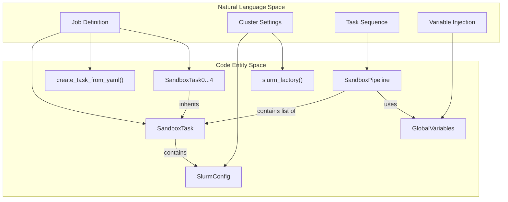
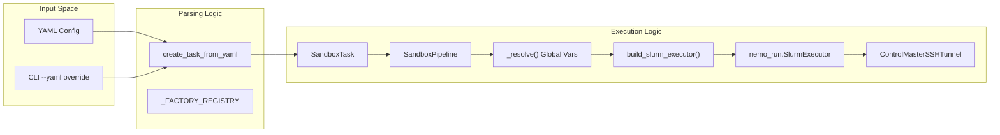

<!-- source: DeepWiki mcp.deepwiki.com · repo NVIDIA/Model-Optimizer · page 9.4 ModelOpt Launcher Tool · fetched 2026-10-26 -->

# ModelOpt Launcher Tool

Relevant source files

The following files were used as context for generating this wiki page:

- [examples/speculative_decoding/collect_hidden_states/compute_hidden_states_vllm.py](examples/speculative_decoding/collect_hidden_states/compute_hidden_states_vllm.py)
- [examples/speculative_decoding/doc/dflash.md](examples/speculative_decoding/doc/dflash.md)
- [examples/speculative_decoding/fsdp2_buffer_patch.py](examples/speculative_decoding/fsdp2_buffer_patch.py)
- [modelopt/torch/speculative/plugins/rdma_hidden_states_connector.py](modelopt/torch/speculative/plugins/rdma_hidden_states_connector.py)
- [tools/launcher/common/megatron_lm/export/export.sh](tools/launcher/common/megatron_lm/export/export.sh)
- [tools/launcher/common/megatron_lm/quantize/task.py](tools/launcher/common/megatron_lm/quantize/task.py)
- [tools/launcher/common/megatron_lm/train/sft.sh](tools/launcher/common/megatron_lm/train/sft.sh)
- [tools/launcher/common/query.py](tools/launcher/common/query.py)
- [tools/launcher/common/specdec/dflash_online_training.sh](tools/launcher/common/specdec/dflash_online_training.sh)
- [tools/launcher/common/specdec/vllm_smoke_test.sh](tools/launcher/common/specdec/vllm_smoke_test.sh)
- [tools/launcher/common/tensorrt_llm/eval.sh](tools/launcher/common/tensorrt_llm/eval.sh)
- [tools/launcher/common/tensorrt_llm/extra_llm_api_options.yaml](tools/launcher/common/tensorrt_llm/extra_llm_api_options.yaml)
- [tools/launcher/common/vllm/gpqa_sample.jsonl](tools/launcher/common/vllm/gpqa_sample.jsonl)
- [tools/launcher/common/vllm/query.sh](tools/launcher/common/vllm/query.sh)
- [tools/launcher/core.py](tools/launcher/core.py)
- [tools/launcher/docs/configuration.md](tools/launcher/docs/configuration.md)
- [tools/launcher/examples/Qwen/Qwen3-0.6B/hf_offline_eagle3.yaml](tools/launcher/examples/Qwen/Qwen3-0.6B/hf_offline_eagle3.yaml)
- [tools/launcher/examples/Qwen/Qwen3-0.6B/hf_online_eagle3.yaml](tools/launcher/examples/Qwen/Qwen3-0.6B/hf_online_eagle3.yaml)
- [tools/launcher/examples/Qwen/Qwen3-30B-A3B/hf_streaming_dflash_multi_node.yaml](tools/launcher/examples/Qwen/Qwen3-30B-A3B/hf_streaming_dflash_multi_node.yaml)
- [tools/launcher/examples/Qwen/Qwen3-30B-A3B/hf_streaming_eagle3_multi_node.yaml](tools/launcher/examples/Qwen/Qwen3-30B-A3B/hf_streaming_eagle3_multi_node.yaml)
- [tools/launcher/examples/Qwen/Qwen3-30B-A3B/megatron_lm_ptq.yaml](tools/launcher/examples/Qwen/Qwen3-30B-A3B/megatron_lm_ptq.yaml)
- [tools/launcher/examples/Qwen/Qwen3-8B/eagle3_quick_check.yaml](tools/launcher/examples/Qwen/Qwen3-8B/eagle3_quick_check.yaml)
- [tools/launcher/examples/Qwen/Qwen3-8B/hf_offline_eagle3.yaml](tools/launcher/examples/Qwen/Qwen3-8B/hf_offline_eagle3.yaml)
- [tools/launcher/examples/Qwen/Qwen3-8B/hf_offline_eagle3_ptq.yaml](tools/launcher/examples/Qwen/Qwen3-8B/hf_offline_eagle3_ptq.yaml)
- [tools/launcher/examples/Qwen/Qwen3-8B/hf_online_dflash.yaml](tools/launcher/examples/Qwen/Qwen3-8B/hf_online_dflash.yaml)
- [tools/launcher/examples/Qwen/Qwen3-8B/hf_online_eagle3.yaml](tools/launcher/examples/Qwen/Qwen3-8B/hf_online_eagle3.yaml)
- [tools/launcher/examples/Qwen/Qwen3-8B/hf_streaming_eagle3.yaml](tools/launcher/examples/Qwen/Qwen3-8B/hf_streaming_eagle3.yaml)
- [tools/launcher/examples/Qwen/Qwen3-8B/hf_streaming_eagle3_multi_node.yaml](tools/launcher/examples/Qwen/Qwen3-8B/hf_streaming_eagle3_multi_node.yaml)
- [tools/launcher/examples/Qwen/Qwen3-8B/hf_synth.yaml](tools/launcher/examples/Qwen/Qwen3-8B/hf_synth.yaml)
- [tools/launcher/examples/Qwen/Qwen3-8B/megatron_lm_ptq.yaml](tools/launcher/examples/Qwen/Qwen3-8B/megatron_lm_ptq.yaml)
- [tools/launcher/examples/meta-llama/Llama-3.2-1B-Instruct/megatron_lm_qad.yaml](tools/launcher/examples/meta-llama/Llama-3.2-1B-Instruct/megatron_lm_qad.yaml)
- [tools/launcher/examples/moonshotai/Kimi-K2.5/hf_eagle3_dryrun.yaml](tools/launcher/examples/moonshotai/Kimi-K2.5/hf_eagle3_dryrun.yaml)
- [tools/launcher/examples/moonshotai/Kimi-K2.5/hf_streaming_dflash.yaml](tools/launcher/examples/moonshotai/Kimi-K2.5/hf_streaming_dflash.yaml)
- [tools/launcher/examples/moonshotai/Kimi-K2.5/hf_streaming_dflash_multi_node.yaml](tools/launcher/examples/moonshotai/Kimi-K2.5/hf_streaming_dflash_multi_node.yaml)
- [tools/launcher/examples/moonshotai/Kimi-K2.5/hf_streaming_eagle3.yaml](tools/launcher/examples/moonshotai/Kimi-K2.5/hf_streaming_eagle3.yaml)
- [tools/launcher/examples/moonshotai/Kimi-K2.5/hf_streaming_eagle3_multi_node.yaml](tools/launcher/examples/moonshotai/Kimi-K2.5/hf_streaming_eagle3_multi_node.yaml)
- [tools/launcher/examples/nvidia/NVIDIA-Nemotron-3-Nano-30B-A3B-BF16/mbridge_prune.yaml](tools/launcher/examples/nvidia/NVIDIA-Nemotron-3-Nano-30B-A3B-BF16/mbridge_prune.yaml)
- [tools/launcher/examples/nvidia/NVIDIA-Nemotron-3-Nano-30B-A3B-BF16/mbridge_quantize.yaml](tools/launcher/examples/nvidia/NVIDIA-Nemotron-3-Nano-30B-A3B-BF16/mbridge_quantize.yaml)
- [tools/launcher/examples/nvidia/NVIDIA-Nemotron-3-Nano-30B-A3B-BF16/megatron_lm_ptq.yaml](tools/launcher/examples/nvidia/NVIDIA-Nemotron-3-Nano-30B-A3B-BF16/megatron_lm_ptq.yaml)
- [tools/launcher/examples/nvidia/NVIDIA-Nemotron-3-Nano-30B-A3B-BF16/megatron_lm_qad.yaml](tools/launcher/examples/nvidia/NVIDIA-Nemotron-3-Nano-30B-A3B-BF16/megatron_lm_qad.yaml)
- [tools/launcher/examples/nvidia/NVIDIA-Nemotron-3-Super-120B-A12B-BF16/megatron_bridge_import.yaml](tools/launcher/examples/nvidia/NVIDIA-Nemotron-3-Super-120B-A12B-BF16/megatron_bridge_import.yaml)
- [tools/launcher/examples/openai/gpt-oss-20b/hf_streaming_dflash_multi_node.yaml](tools/launcher/examples/openai/gpt-oss-20b/hf_streaming_dflash_multi_node.yaml)
- [tools/launcher/examples/smoke/hostname.yaml](tools/launcher/examples/smoke/hostname.yaml)
- [tools/launcher/launch.py](tools/launcher/launch.py)
- [tools/launcher/slurm_config.py](tools/launcher/slurm_config.py)
- [tools/launcher/tests/test_core.py](tools/launcher/tests/test_core.py)
- [tools/launcher/tests/test_core_extended.py](tools/launcher/tests/test_core_extended.py)
- [tools/launcher/tests/test_docker_execution.py](tools/launcher/tests/test_docker_execution.py)
- [tools/launcher/tests/test_examples_resolve.py](tools/launcher/tests/test_examples_resolve.py)
- [tools/launcher/tests/test_slurm_config.py](tools/launcher/tests/test_slurm_config.py)
- [tools/launcher/tests/test_slurm_executor.py](tools/launcher/tests/test_slurm_executor.py)
- [tools/launcher/tests/test_yaml_formats.py](tools/launcher/tests/test_yaml_formats.py)

The ModelOpt Launcher is a technical utility designed to streamline the submission of Post-Training Quantization (PTQ), training, and evaluation jobs to diverse environments, including Slurm clusters and local Docker containers. It leverages `nemo_run` to manage job orchestration, environment injection, and task dependencies.

## Overview and Purpose

The launcher provides a standardized way to define multi-stage pipelines using YAML configurations. It handles the complexities of:
*   **Environment Mapping**: Injecting consistent paths for Hugging Face caches, Triton caches, and model tokens [tools/launcher/core.py:42-72]().
*   **Cluster Agnosticism**: Using factories to define Slurm configurations that can be overridden via CLI or environment variables [tools/launcher/slurm_config.py:31-64]().
*   **Pipeline Orchestration**: Running sequences of tasks (e.g., PTQ followed by distillation) with shared global variables and execution slots [tools/launcher/core.py:110-156]().
*   **Cross-Framework Support**: Providing common shell wrappers for Megatron-LM, Hugging Face, and vLLM [tools/launcher/examples/nvidia/NVIDIA-Nemotron-3-Nano-30B-A3B-BF16/megatron_lm_qad.yaml:30-31](), [tools/launcher/common/megatron_lm/train/sft.sh:57-72](), [tools/launcher/examples/Qwen/Qwen3-8B/hf_synth.yaml:21-22]().

## Core Architecture

The tool is built around three primary entities: the `SandboxTask`, the `SandboxPipeline`, and the `SlurmConfig`.

### Launcher Entity Mapping
The following diagram illustrates how the logical concepts of the launcher map to specific classes and functions in the codebase.

**Launcher Logic to Code Entity Map**

Sources: [tools/launcher/core.py:110-156](), [tools/launcher/slurm_config.py:31-64](), [tools/launcher/core.py:159-175]()

### Data Flow and Job Submission
The launcher processes YAML files to build an execution graph. It uses `nemo_run` executors to dispatch these tasks.

**Job Execution Flow**

Sources: [tools/launcher/core.py:159-175](), [tools/launcher/slurm_config.py:69-109](), [tools/launcher/tests/test_slurm_executor.py:27-66]()

## Implementation Details

### Slurm Configuration
The `SlurmConfig` class is a cluster-agnostic dataclass that stores parameters for `srun` and container orchestration.

| Parameter | Default Value | Description |
| :--- | :--- | :--- |
| `container` | `nvcr.io/nvidia/tensorrt-llm/release:1.3.0rc20` | The Docker image used for the job [tools/launcher/slurm_config.py:78](). |
| `modelopt_install_path` | `/usr/local/lib/python3.12/dist-packages/modelopt` | Path where ModelOpt is installed inside the container [tools/launcher/slurm_config.py:79](). |
| `container_mounts` | `['{SLURM_HF_LOCAL}:/hf-local']` | Directories to mount into the container [tools/launcher/slurm_config.py:80-82](). |
| `nodes` | `1` | Number of Slurm nodes [tools/launcher/slurm_config.py:74](). |
| `gpus_per_node` | `1` | Number of GPUs per node (supports None for non-GRES clusters) [tools/launcher/slurm_config.py:56](). |

Sources: [tools/launcher/slurm_config.py:31-64](), [tools/launcher/slurm_config.py:69-109]()

### Pipeline Variable Interpolation
The launcher supports a special syntax `<<global_vars.X>>` within YAML files. This allows users to define a model path once and reuse it across multiple tasks.

*   **GlobalVariables**: Holds shared identifiers like `hf_model`, `hf_data`, and `hf_local` [tools/launcher/tests/test_core_extended.py:88-101]().
*   **Resolution**: The `SandboxPipeline` resolves these placeholders in `task.args` and `task.environment` during initialization [tools/launcher/tests/test_core_extended.py:88-101]().

### MFA and SSH Tunneling
For clusters requiring Multi-Factor Authentication (MFA), the launcher provides `ControlMasterSSHTunnel`. This shim reuses existing OpenSSH `ControlMaster` sockets instead of attempting fresh Paramiko-based authentication, which would otherwise fail on MFA-protected login nodes [tools/launcher/tests/test_slurm_executor.py:35-73]().

## Megatron-LM Workflows

The launcher is heavily used for Megatron-Core (MCore) optimization pipelines, spanning PTQ and Quantization-Aware Distillation (QAD).

### PTQ and Export Pipeline
A standard Megatron-LM PTQ pipeline (e.g., for Qwen3-8B) typically chains:
1.  **Quantization**: Runs `quantize.sh` to generate a quantized MCore checkpoint [tools/launcher/examples/Qwen/Qwen3-8B/megatron_lm_ptq.yaml:25-26]().
2.  **Export**: Converts the MCore checkpoint to Hugging Face format for inference engines [tools/launcher/examples/Qwen/Qwen3-8B/megatron_lm_ptq.yaml:67-68]().
3.  **Validation**: Queries the exported model using vLLM to ensure functional correctness [tools/launcher/examples/Qwen/Qwen3-8B/megatron_lm_ptq.yaml:67-77]().

### QAD (Quantization-Aware Distillation)
For high-precision low-bitwidth models (e.g., NVFP4), the launcher facilitates multi-node distillation:
*   **Teacher Import**: Converts HF BF16 weights to MCore [tools/launcher/examples/nvidia/NVIDIA-Nemotron-3-Nano-30B-A3B-BF16/megatron_lm_qad.yaml:29-34]().
*   **Student Distillation**: Trains the quantized student using the BF16 teacher as a reference, often utilizing `sft.sh` with `--modelopt-enabled` [tools/launcher/common/megatron_lm/train/sft.sh:27-28](), [tools/launcher/examples/nvidia/NVIDIA-Nemotron-3-Nano-30B-A3B-BF16/megatron_lm_qad.yaml:73-105]().

## Key Components and Functions

*   **`slurm_factory`**: A `nemo_run` factory that generates `SlurmConfig` objects from environment variables or CLI overrides [tools/launcher/slurm_config.py:69-109]().
*   **`create_task_from_yaml`**: Reads a YAML file, extracts the task definition, and uses a factory lookup to instantiate the `slurm_config` [tools/launcher/core.py:159-175]().
*   **`get_default_env`**: Returns standard environment variables like `TRITON_CACHE_DIR` and `HF_HOME` to ensure consistency across execution environments [tools/launcher/core.py:42-72]().
*   **`LLM.generate`**: An OpenAI-compatible client method used by query scripts to synthesize data or benchmark models [tools/launcher/common/query.py:62-85]().
*   **`_strip_thinking`**: A utility to remove `<think>` blocks from assistant turns during multi-turn data synthesis for models like EAGLE-3 [tools/launcher/common/query.py:34-41]().

Sources: [tools/launcher/core.py:42-175](), [tools/launcher/slurm_config.py:69-109](), [tools/launcher/common/query.py:34-85](), [tools/launcher/tests/test_slurm_executor.py:74-135]()

---

