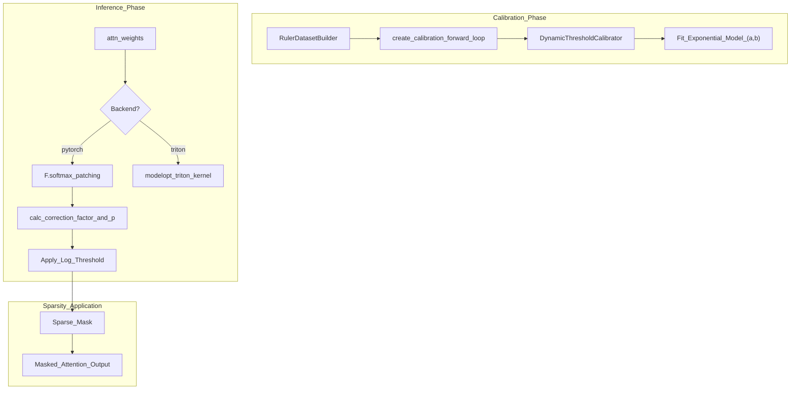
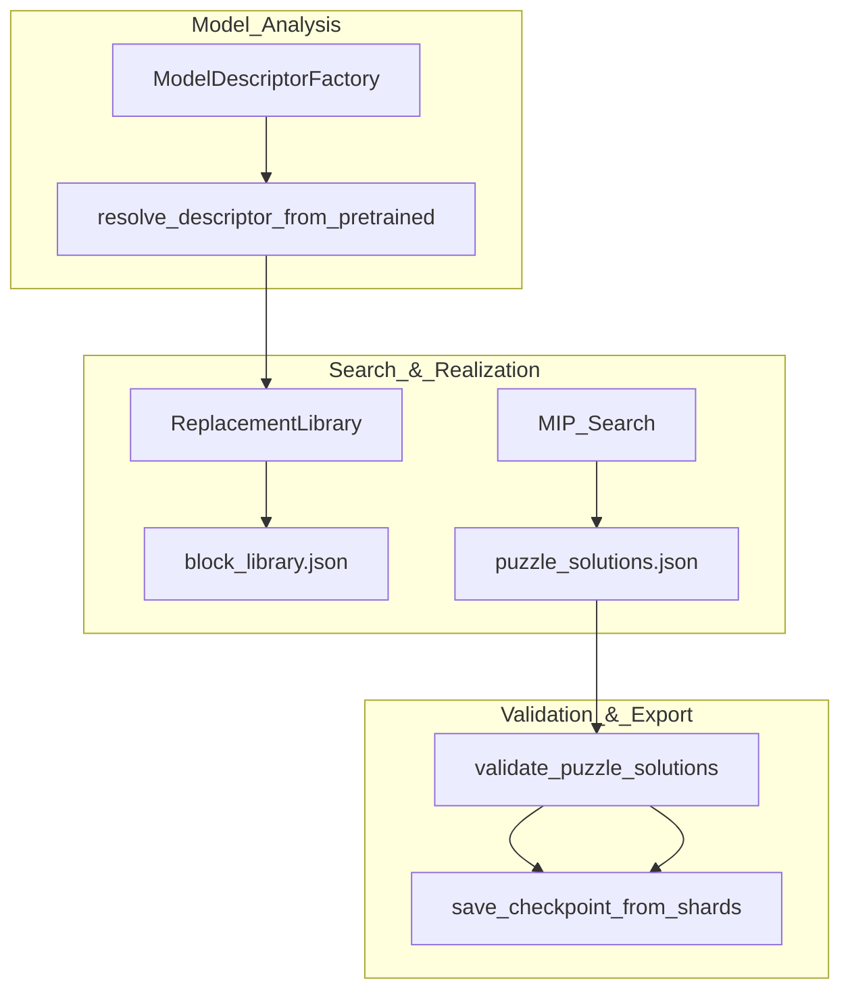

<!-- source: DeepWiki mcp.deepwiki.com · repo NVIDIA/Model-Optimizer · page 9.5 Experimental Features · fetched 2026-10-26 -->

# Experimental Features

<details>
<summary>Relevant source files</summary>

The following files were used as context for generating this wiki page:

- [examples/vllm_serve/sparse_attn_worker.py](examples/vllm_serve/sparse_attn_worker.py)
- [examples/vllm_serve/vllm_serve_sparse_attn.py](examples/vllm_serve/vllm_serve_sparse_attn.py)
- [modelopt/torch/kernels/common/attention/decode_attention.py](modelopt/torch/kernels/common/attention/decode_attention.py)
- [modelopt/torch/kernels/quantization/attention/bmm2_qdq.py](modelopt/torch/kernels/quantization/attention/bmm2_qdq.py)
- [modelopt/torch/opt/dynamic.py](modelopt/torch/opt/dynamic.py)
- [modelopt/torch/opt/hparam.py](modelopt/torch/opt/hparam.py)
- [modelopt/torch/sparsity/attention_sparsity/plugins/vllm.py](modelopt/torch/sparsity/attention_sparsity/plugins/vllm.py)
- [tests/gpu/torch/kernels/common/attention/test_triton_fa_paged.py](tests/gpu/torch/kernels/common/attention/test_triton_fa_paged.py)
- [tests/gpu_vllm/torch/quantization/test_vllm_dynamic_modules.py](tests/gpu_vllm/torch/quantization/test_vllm_dynamic_modules.py)
- [tests/gpu_vllm/torch/sparsity/attention_sparsity/test_sparse_attn_worker.py](tests/gpu_vllm/torch/sparsity/attention_sparsity/test_sparse_attn_worker.py)
- [tests/gpu_vllm/torch/sparsity/attention_sparsity/test_vllm_plugin.py](tests/gpu_vllm/torch/sparsity/attention_sparsity/test_vllm_plugin.py)
- [tests/unit/torch/opt/test_dynamic.py](tests/unit/torch/opt/test_dynamic.py)
- [tools/debugger/.gitignore](tools/debugger/.gitignore)
- [tools/debugger/CLAUDE.md](tools/debugger/CLAUDE.md)
- [tools/debugger/README.md](tools/debugger/README.md)
- [tools/debugger/client.sh](tools/debugger/client.sh)
- [tools/debugger/server.sh](tools/debugger/server.sh)

</details>


The `experimental` package contains research-stage optimization algorithms and novel techniques that are under active development. These features are provided for early access and evaluation but are not yet considered production-ready.

## Overview

Experimental features in the NVIDIA Model Optimizer serve as a sandbox for high-impact optimizations that may require custom kernels or unstable APIs. Current focus areas include:

*   **Dynamic Memory Sparsification (DMS):** A minimal, optimized implementation for KV-cache compression that learns a per-head eviction policy.
*   **Puzzletron:** A Local Neural Architecture Search (NAS) algorithm that finds optimal heterogeneous modifications to MLP and attention layers to satisfy memory or parameter constraints.
*   **Sparse Attention (Experimental Backends):** Novel sparse attention methods including `flash_skip_softmax` and `triton_sparse_softmax` that leverage fused kernels for block-wise sparsity.

Sources: [README.md:18-31](), [modelopt/torch/sparsity/attention_sparsity/config.py:34-156]()

---

## Sparse Attention Optimization

ModelOpt provides experimental sparse attention techniques designed to reduce the computational overhead of the attention mechanism in LLMs and VLMs. These methods use either PyTorch-based softmax patching or high-performance Triton kernels.

### Technical Implementation
Sparse attention is implemented by wrapping standard attention modules and applying a sparsity mask during the forward pass. The system supports multiple methods registered via the `SparseAttentionMethod` base class [modelopt/torch/sparsity/attention_sparsity/methods/registry.py:26-39]().

**Key Components:**
*   **Flash Skip-Softmax:** Implements row-level block-wise sparsity (typically 128x128 blocks) aligned with Flash Attention's online softmax [modelopt/torch/sparsity/attention_sparsity/methods/flash_skip_softmax.py:36-41](). It masks blocks where the attention score is significantly below the cumulative maximum [modelopt/torch/sparsity/attention_sparsity/methods/flash_skip_softmax.py:167-172]().
*   **Triton Sparse Softmax:** A fused kernel implementation supporting N:M sparsity (e.g., 2:4) and dense sink/recent tokens [modelopt/torch/sparsity/attention_sparsity/config.py:99-136]().
*   **Dynamic Threshold Calibrator:** Automatically determines optimal sparsity thresholds per layer to meet a `target_sparse_ratio` while maintaining accuracy [modelopt/torch/sparsity/attention_sparsity/calibration/calibrate.py:30-31]().

### Data Flow and Calibration
The calibration process uses a dataset (e.g., RULER) to measure attention distributions and fit an exponential model for dynamic thresholding [modelopt/torch/sparsity/attention_sparsity/methods/flash_skip_softmax.py:148-156]().

**System Entity Mapping**
| Component | Code Entity | Role |
| :--- | :--- | :--- |
| **Method Registry** | `register_sparse_method` | Decorator for adding new sparsity implementations [modelopt/torch/sparsity/attention_sparsity/methods/registry.py:165]() |
| **Config Class** | `SparseAttentionAttributeConfig` | Pydantic model for sparsity hyperparameters [modelopt/torch/sparsity/attention_sparsity/config.py:34]() |
| **Forward Loop** | `create_calibration_forward_loop` | Generates the forward pass for prefill/decode calibration [modelopt/torch/sparsity/attention_sparsity/calibration/calibrate.py:93]() |
| **Softmax Patch** | `FlashSkipSoftmax` | Logic for block-wise mask calculation [modelopt/torch/sparsity/attention_sparsity/methods/flash_skip_softmax.py:36]() |

**Sparse Attention Calibration and Execution Flow**

Sources: [modelopt/torch/sparsity/attention_sparsity/methods/flash_skip_softmax.py:117-180](), [modelopt/torch/sparsity/attention_sparsity/calibration/calibrate.py:93-146](), [modelopt/torch/sparsity/attention_sparsity/config.py:34-80]()

### Usage Example
Applying experimental sparse attention to a Hugging Face model involves selecting a configuration recipe and running calibration [examples/llm_sparsity/attention_sparsity/hf_sa.py:45-50]().

```python
import modelopt.torch.sparsity.attention_sparsity as mtsa
from modelopt.torch.sparsity.attention_sparsity.config import SKIP_SOFTMAX_CALIB

# Apply sparsification logic
model = mtsa.sparsify(model, SKIP_SOFTMAX_CALIB)

# Calibrate to find optimal thresholds
mtsa.calibrate(model, SKIP_SOFTMAX_CALIB)
```
Sources: [examples/llm_sparsity/attention_sparsity/hf_sa.py:167-182](), [modelopt/torch/sparsity/attention_sparsity/calibration/calibrate.py:16-32]()

### vLLM Integration for Sparse Attention

ModelOpt provides a plugin for integrating sparse attention with vLLM, allowing for efficient inference of sparse models. This integration focuses on swapping the attention implementation (`impl`) within vLLM's `Attention` module without replacing the entire module.

**Key Aspects:**
*   **No Module Replacement:** The original vLLM `Attention` module and its state remain intact. Only the internal `impl` object is replaced with a sparse-aware adapter.
*   **Backend-Matched Adapters:** The plugin provides adapters for both `FlashAttentionBackend` and `FlashInferBackend` to ensure compatibility with vLLM's chosen attention backend.
*   **Triton Kernel Utilization:** The `forward()` method of the sparse `impl` adapter calls the ModelOpt Triton kernel (`triton_attention` [modelopt/torch/kernels/common/attention/triton_fa.py]()) when a validated sparse transform is active.
*   **KV Cache Handling:** KV cache updates follow the native version-specific contract of the selected vLLM backend.
*   **Quantization Support:** The plugin also supports quantization of attention operations within vLLM, specifically for NVFP4 and FP8 E4M3 formats [modelopt/torch/sparsity/attention_sparsity/plugins/vllm.py:144-155]().

**Core Classes and Functions:**
*   `ModelOptSparseAttentionImpl`: The base class for sparse attention implementations that wraps the original vLLM attention `impl` and overrides its `forward` method to use the Triton kernel [modelopt/torch/sparsity/attention_sparsity/plugins/vllm.py:200-202]().
*   `_clone_sparse_impl`: A helper function to create a new `ModelOptSparseAttentionImpl` instance, preserving the runtime state of the original vLLM `impl` [modelopt/torch/sparsity/attention_sparsity/plugins/vllm.py:300-301]().
*   `_build_sparse_kw`: Converts checkpoint layer configurations into kernel-specific keyword arguments for sparsity [modelopt/torch/sparsity/attention_sparsity/plugins/vllm.py:115-134]().
*   `_resolve_skip_softmax_calibration`: Translates exported calibration parameters into the scalar threshold API for the Triton kernel [modelopt/torch/sparsity/attention_sparsity/plugins/vllm.py:72-113]().
*   `_p_qdq_from_layer`, `_v_qdq_from_layer`: Map enabled BMM2 quantizers to the kernel's QDQ mode and scalar amax values [modelopt/torch/sparsity/attention_sparsity/plugins/vllm.py:164-173]().

**vLLM Sparse Attention Integration Flow**
```mermaid
graph TD
    A[vLLM_LLM_Initialization] --> B{vLLM_Worker_Load_Model};
    B --> C[BaseWorker.load_model];
    C --> D[install_vllm_sparse_attention_from_checkpoint];
    D --> E[Iterate_Attention_Modules];
    E --> F[Original_vLLM_Attention_Impl];
    F --> G[ModelOptSparseAttentionImpl_Adapter];
    G --> H[Override_forward_method];
    H --> I[Triton_Sparse_Attention_Kernel];
    I --> J[KV_Cache_Update];
    J --> K[Quantization_Logic_(_bmm_qdq_from_layer)];
    K --> L[Triton_BMM2_QDQ_Kernel];
    H --> M[Output_Attention_Scores];

    subgraph "ModelOpt_Sparse_Attention_Impl_Details"
        G -- "_clone_sparse_impl" --> G_clone[Cloned_Impl_State];
        G_clone -- "_build_sparse_kw" --> G_sparse_kw[Sparsity_Kwargs];
        G_sparse_kw -- "_resolve_skip_softmax_calibration" --> G_calib[Calibrated_Thresholds];
        G_calib --> I;
        K --> L;
    end
```
The `ModelOptSparseAttentionImpl` [modelopt/torch/sparsity/attention_sparsity/plugins/vllm.py:200-202]() acts as a wrapper around the original vLLM attention implementation. Its `forward` method translates vLLM's attention metadata (e.g., `query_start_loc`, `seq_lens`) into the format expected by the ModelOpt Triton kernel (`triton_attention` [modelopt/torch/kernels/common/attention/triton_fa.py]()). This includes handling paged KV caches and applying sparsity and quantization parameters.

For example, in `test_prefill_matches_contiguous` [tests/gpu_vllm/torch/sparsity/attention_sparsity/test_vllm_plugin.py:109-169](), the `ModelOptSparseAttentionImpl`'s `forward` method is tested to ensure its output matches a direct call to `triton_attention` with contiguous inputs, verifying the metadata translation.

Sources: [modelopt/torch/sparsity/attention_sparsity/plugins/vllm.py:16-28](), [modelopt/torch/sparsity/attention_sparsity/plugins/vllm.py:200-202](), [modelopt/torch/sparsity/attention_sparsity/plugins/vllm.py:300-301](), [modelopt/torch/sparsity/attention_sparsity/plugins/vllm.py:115-134](), [modelopt/torch/sparsity/attention_sparsity/plugins/vllm.py:72-113](), [modelopt/torch/sparsity/attention_sparsity/plugins/vllm.py:164-173](), [modelopt/torch/kernels/common/attention/triton_fa.py](), [tests/gpu_vllm/torch/sparsity/attention_sparsity/test_vllm_plugin.py:109-169]()

---

## Puzzletron: Model Compression via NAS

Puzzletron is an experimental framework for model compression based on Local Neural Architecture Search (NAS) using Mixed Integer Programming (MIP). It aims to find optimal modifications like reducing FFN intermediate sizes or removing attention layers entirely.

### Architecture and Workflow
Puzzletron decomposes a model into subblocks and searches for the optimal combination of teacher and student (compressed) layers to meet a specific memory or parameter budget.

**Key Components:**
*   **Model Descriptors:** Resolves model-specific structures (e.g., Llama, Mistral, Qwen) to identify layers and subblocks.
*   **Replacement Library:** Constructs a database of available layer replacements (FFN, Attention) from trained checkpoints.
*   **Validation Pipeline:** Applies layer replacements to realize a compressed model and evaluates performance against the teacher.

**Puzzletron Entity Relationship**


Sources: [README.md:31-33](), [CONTRIBUTING.md:45-59]()

---

