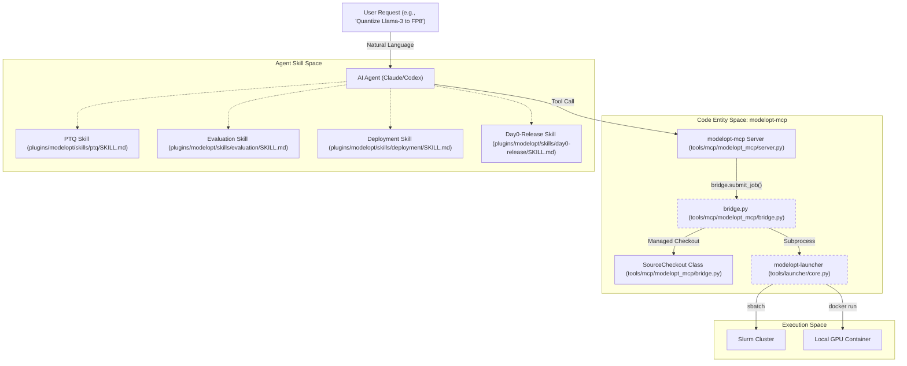
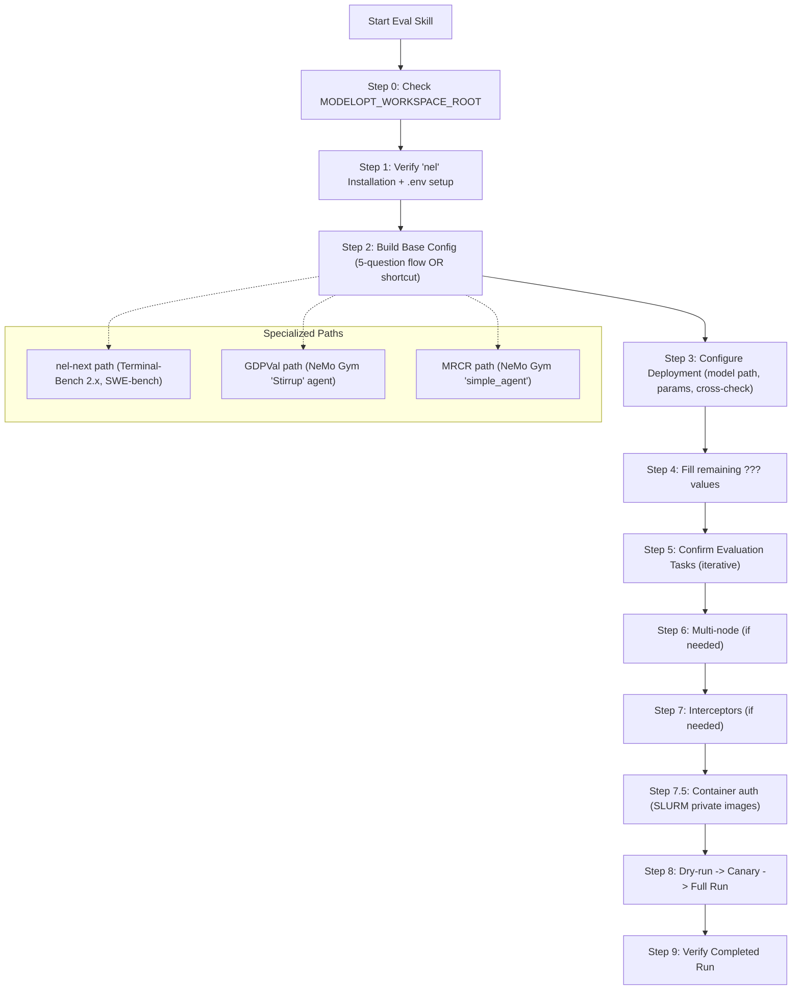

<!-- source: DeepWiki mcp.deepwiki.com · repo NVIDIA/Model-Optimizer · page 9.6 AI Agent Skills and MCP Integration · fetched 2026-10-26 -->

# AI Agent Skills and MCP Integration

Relevant source files

The following files were used as context for generating this wiki page:

- [.agents/TOOLING.md](.agents/TOOLING.md)
- [.coderabbit.yaml](.coderabbit.yaml)
- [.github/PULL_REQUEST_TEMPLATE.md](.github/PULL_REQUEST_TEMPLATE.md)
- [.github/actions/pr-merge-base/action.yml](.github/actions/pr-merge-base/action.yml)
- [.github/workflows/claude.yml](.github/workflows/claude.yml)
- [.github/workflows/claude_review.yml](.github/workflows/claude_review.yml)
- [.gitmodules](.gitmodules)
- [AGENTS.md](AGENTS.md)
- [CLAUDE.md](CLAUDE.md)
- [CONTRIBUTING.md](CONTRIBUTING.md)
- [README.md](README.md)
- [examples/diffusers/requirements.txt](examples/diffusers/requirements.txt)
- [plugins/modelopt/skills/compare-results/SKILL.md](plugins/modelopt/skills/compare-results/SKILL.md)
- [plugins/modelopt/skills/day0-release/SKILL.md](plugins/modelopt/skills/day0-release/SKILL.md)
- [plugins/modelopt/skills/evaluation/SKILL.md](plugins/modelopt/skills/evaluation/SKILL.md)
- [plugins/modelopt/skills/evaluation/recipes/env.example](plugins/modelopt/skills/evaluation/recipes/env.example)
- [plugins/modelopt/skills/evaluation/recipes/examples/gym/example_gdpval.yaml](plugins/modelopt/skills/evaluation/recipes/examples/gym/example_gdpval.yaml)
- [plugins/modelopt/skills/evaluation/recipes/examples/gym/example_mrcr.yaml](plugins/modelopt/skills/evaluation/recipes/examples/gym/example_mrcr.yaml)
- [plugins/modelopt/skills/evaluation/recipes/tasks/aa/scicode.md](plugins/modelopt/skills/evaluation/recipes/tasks/aa/scicode.md)
- [plugins/modelopt/skills/evaluation/recipes/tasks/aa/tau2_bench_telecom.md](plugins/modelopt/skills/evaluation/recipes/tasks/aa/tau2_bench_telecom.md)
- [plugins/modelopt/skills/evaluation/recipes/tasks/gym/gdpval.md](plugins/modelopt/skills/evaluation/recipes/tasks/gym/gdpval.md)
- [plugins/modelopt/skills/evaluation/recipes/tasks/gym/mrcr.md](plugins/modelopt/skills/evaluation/recipes/tasks/gym/mrcr.md)
- [plugins/modelopt/skills/evaluation/references/gym-gdpval.md](plugins/modelopt/skills/evaluation/references/gym-gdpval.md)
- [plugins/modelopt/skills/evaluation/references/quantization-benchmarks.md](plugins/modelopt/skills/evaluation/references/quantization-benchmarks.md)
- [plugins/modelopt/skills/evaluation/scripts/gdpval-sif.sh](plugins/modelopt/skills/evaluation/scripts/gdpval-sif.sh)
- [plugins/modelopt/skills/evaluation/tests/evals.json](plugins/modelopt/skills/evaluation/tests/evals.json)
- [tests/examples/diffusers/test_cache_diffusion.py](tests/examples/diffusers/test_cache_diffusion.py)
- [tests/examples/gpt-oss/test_gpt_oss_qat.py](tests/examples/gpt-oss/test_gpt_oss_qat.py)
- [tools/launcher/.gitignore](tools/launcher/.gitignore)
- [tools/launcher/CLAUDE.md](tools/launcher/CLAUDE.md)
- [tools/launcher/README.md](tools/launcher/README.md)
- [tools/launcher/__init__.py](tools/launcher/__init__.py)
- [tools/launcher/common/eagle3/dump_offline_data.sh](tools/launcher/common/eagle3/dump_offline_data.sh)
- [tools/launcher/common/smoke/hostname.sh](tools/launcher/common/smoke/hostname.sh)
- [tools/launcher/common/smoke/nvidia_smi.sh](tools/launcher/common/smoke/nvidia_smi.sh)
- [tools/launcher/examples/smoke/nvidia_smi.yaml](tools/launcher/examples/smoke/nvidia_smi.yaml)
- [tools/launcher/pyproject.toml](tools/launcher/pyproject.toml)
- [tools/mcp/.gitignore](tools/mcp/.gitignore)
- [tools/mcp/README.md](tools/mcp/README.md)
- [tools/mcp/SCOPE.md](tools/mcp/SCOPE.md)
- [tools/mcp/modelopt_mcp/__init__.py](tools/mcp/modelopt_mcp/__init__.py)
- [tools/mcp/modelopt_mcp/bridge.py](tools/mcp/modelopt_mcp/bridge.py)
- [tools/mcp/modelopt_mcp/server.py](tools/mcp/modelopt_mcp/server.py)
- [tools/mcp/pyproject.toml](tools/mcp/pyproject.toml)
- [tools/mcp/tests/__init__.py](tools/mcp/tests/__init__.py)
- [tools/mcp/tests/test_bridge.py](tools/mcp/tests/test_bridge.py)

NVIDIA Model Optimizer (ModelOpt) provides a specialized integration layer for AI agents (such as Claude Code or Codex) to automate complex model optimization workflows. This system consists of an **MCP (Model Context Protocol) Server** that exposes ModelOpt's capabilities as typed tools and an **Agent Skills** system that provides structured domain knowledge for tasks like Post-Training Quantization (PTQ), deployment, and evaluation.

## 1. Overview and Architecture

The integration bridges the gap between natural language instructions and the ModelOpt execution engine. It allows agents to discover optimization examples, verify hardware/software environments, submit optimization jobs to local or remote clusters, and monitor their progress.

### Data Flow and System Interaction

The following diagram illustrates how a user request flows through the AI Agent into the ModelOpt ecosystem.

**Natural Language to Code Entity Mapping**

Sources: [tools/mcp/README.md:1-30](), [tools/mcp/modelopt_mcp/bridge.py:16-32](), [AGENTS.md:10-13](), [plugins/modelopt/skills/evaluation/SKILL.md:1-4](), [plugins/modelopt/skills/day0-release/SKILL.md:1-4]()

## 2. The ModelOpt MCP Server

The MCP server (`modelopt-mcp`) acts as a thin Python bridge between agentic tool layers and the ModelOpt launcher orchestrator. It is designed to be installed via `uvx` and provides a standardized interface for job management.

### Key Implementation Entities

| Entity | Path | Role |
| :--- | :--- | :--- |
| `list_examples_impl` | [tools/mcp/modelopt_mcp/bridge.py:530-562]() | Enumerates bundled YAML recipes under `tools/launcher/examples/` with metadata extraction. |
| `verify_docker_setup_impl` | [tools/mcp/modelopt_mcp/bridge.py:389-436]() | Probes if a Docker daemon is reachable and if GPU passthrough is configured. |
| `verify_slurm_setup_impl` | [tools/mcp/modelopt_mcp/bridge.py:449-487]() | Probes SSH connectivity to a Slurm cluster login node. |
| `submit_job_impl` | [tools/mcp/modelopt_mcp/bridge.py:1000-1003]() | The primary tool entry point for launching optimization jobs. |
| `SourceCheckout` | [tools/mcp/modelopt_mcp/bridge.py:94-112]() | Manages a temporary git checkout of ModelOpt to ensure job reproducibility. |
| `job_status_impl` | [tools/mcp/modelopt_mcp/bridge.py:642-736]() | Reads `nemo_run` experiment directories for task completion or failure. |
| `job_logs_impl` | [tools/mcp/modelopt_mcp/bridge.py:749-790]() | Reads `log_<task>.out` from the experiment directory. |
| `wait_for_experiment_impl` | [tools/mcp/modelopt_mcp/bridge.py:803-839]() | Blocks until a job completes or fails, or a timeout is reached. |
| `provision_passwordless_ssh_dry_run_impl` | [tools/mcp/modelopt_mcp/bridge.py:852-900]() | Inspects `~/.ssh/` and suggests `ssh-keygen`/`ssh-copy-id` commands for passwordless SSH. |
| `read_cluster_artifact_impl` | [tools/mcp/modelopt_mcp/bridge.py:913-959]() | Pulls artifact content from the remote cluster via `nemo_run`'s tunnel. |
| `open_draft_pr_impl` | [tools/mcp/modelopt_mcp/bridge.py:972-990]() | Pushes the current branch and opens a draft PR using `gh pr create`. |

### Managed Source Checkouts
To ensure that an agent always uses the correct version of the library, the `submit_job_impl` function materializes a managed checkout. It resolves the `source_ref` (branch/tag/SHA) and initializes recursive submodules before execution [tools/mcp/modelopt_mcp/bridge.py:255-325](). This ensures that the exact version of ModelOpt used for the job is recorded and reproducible.

Sources: [tools/mcp/README.md:20-30](), [tools/mcp/README.md:62-79](), [tools/mcp/modelopt_mcp/bridge.py:94-112](), [tools/mcp/modelopt_mcp/bridge.py:389-436](), [tools/mcp/modelopt_mcp/bridge.py:449-487](), [tools/mcp/modelopt_mcp/bridge.py:530-562](), [tools/mcp/modelopt_mcp/bridge.py:642-736](), [tools/mcp/modelopt_mcp/bridge.py:749-790](), [tools/mcp/modelopt_mcp/bridge.py:803-839](), [tools/mcp/modelopt_mcp/bridge.py:852-900](), [tools/mcp/modelopt_mcp/bridge.py:913-959](), [tools/mcp/modelopt_mcp/bridge.py:972-990](), [tools/mcp/modelopt_mcp/bridge.py:1000-1003]()

## 3. Agent Skills System

Skills are structured directories containing `SKILL.md` files that provide "System Prompts" and domain-specific recipes to the AI agent. These are located in `plugins/modelopt/skills/` [AGENTS.md:10-13]().

### Evaluation Skill (NEL Integration)
The evaluation skill (`plugins/modelopt/skills/evaluation/SKILL.md`) guides agents through the **NeMo Evaluator Launcher (NEL)** workflow. It handles the transition from a quantized model to an accuracy benchmark (e.g., MMLU, GSM8K).

**Evaluation Workflow Logic**

Sources: [plugins/modelopt/skills/evaluation/SKILL.md:1-50](), [plugins/modelopt/skills/evaluation/SKILL.md:35-47](), [plugins/modelopt/skills/evaluation/SKILL.md:51-81]()

### GDPVal and Stirrup Agent Integration
For agentic benchmarks, the system integrates with **GDPVal** (NeMo Gym "Stirrup" agent). This involves:
*   **Sandboxing:** Using Apptainer SIF containers for safe code execution during evaluation [plugins/modelopt/skills/evaluation/references/gym-gdpval.md:65-75]().
*   **Process Reaping:** Using `setsid` and quoted heredocs in Slurm commands to prevent orphaned Ray workers from hanging jobs [plugins/modelopt/skills/evaluation/references/gym-gdpval.md:108-123]().
*   **Prerequisites:** Requires `HF_TOKEN`, `INFERENCE_API_KEY`, `TAVILY_API_KEY`, `INFERENCE_JUDGE_URL`, `GDPVAL_SIF_DIR`, and `NEMO_EVALUATOR_TRUST_PRE_CMD=1` in the `.env` file [plugins/modelopt/skills/evaluation/SKILL.md:66-72]().

### MRCR (NeMo Gym `simple_agent`) Path
The MRCR (Multi-Round Conversational Reasoning) path is another specialized NeMo Gym task. It is standalone, simpler than GDPVal, and does not involve SIF containers or judges.
*   **Configuration:** Starts from `recipes/examples/gym/example_mrcr.yaml` and requires selecting a variant (e.g., `config_n3_1m`) which sets context cap, dataset, and metric prefix [plugins/modelopt/skills/evaluation/SKILL.md:89-93]().
*   **Environment Variables:** Requires `HF_TOKEN`, `NEMO_EVALUATOR_TRUST_PRE_CMD=1`, and `NEMO_EVALUATOR_TRUST_UNLISTED_TASKS=1` in `.env` [plugins/modelopt/skills/evaluation/SKILL.md:94-98]().
*   **Gym Image:** Needs a git-backed Gym image, as the pin is newer than any image's baked Gym [plugins/modelopt/skills/evaluation/SKILL.md:99-102]().
*   **Long-context Deployment:** Involves specific vLLM settings like `--max-model-len 1100000` and `VLLM_ALLOW_LONG_MAX_MODEL_LEN=1` [plugins/modelopt/skills/evaluation/SKILL.md:103-106]().

### SciCode Evaluation
SciCode is a NeMo Skills code/reasoning benchmark with specific requirements:
*   **Context Length:** Requires at least `--max-model-len 65536`, with `--max-model-len 131072` preferred [plugins/modelopt/skills/evaluation/recipes/tasks/aa/scicode.md:14-19]().
*   **Parallelism:** Task-level `parallelism: 8` is required [plugins/modelopt/skills/evaluation/recipes/tasks/aa/scicode.md:20-21]().
*   **Repeats:** `num_repeats: 1` should be used, and the task submitted 8+ times, with the mean of valid runs reported [plugins/modelopt/skills/evaluation/recipes/tasks/aa/scicode.md:22-47]().

Sources: [plugins/modelopt/skills/evaluation/SKILL.md:51-81](), [plugins/modelopt/skills/evaluation/SKILL.md:82-107](), [plugins/modelopt/skills/evaluation/references/gym-gdpval.md:65-75](), [plugins/modelopt/skills/evaluation/references/gym-gdpval.md:108-123](), [plugins/modelopt/skills/evaluation/recipes/tasks/aa/scicode.md:14-47]()

## 4. Execution and Verification

Before submitting jobs, the MCP server provides verification tools to ensure the target environment is ready.

### Verification Logic
*   **Docker:** Runs `docker info` to check the daemon and probes for the `"nvidia"` runtime to ensure GPU passthrough is available [tools/mcp/modelopt_mcp/bridge.py:389-436]().
*   **Slurm:** Uses `ssh -o BatchMode=yes` to probe connectivity to the login node without requiring interactive password entry [tools/mcp/modelopt_mcp/bridge.py:449-487]().

### Job Submission Flow
When `submit_job_impl` is called, the bridge determines the executor based on the provided arguments:
1.  If `hf_local` is provided, it defaults to **Docker** mode [tools/mcp/README.md:13-14]().
2.  If `cluster_host` is provided, it uses **Slurm** mode via SSH tunneling [tools/mcp/README.md:14-15]().

Sources: [tools/mcp/README.md:13-15](), [tools/mcp/README.md:20-30](), [tools/mcp/modelopt_mcp/bridge.py:389-436](), [tools/mcp/modelopt_mcp/bridge.py:449-487](), [tools/mcp/modelopt_mcp/bridge.py:1000-1003]()

## 5. Development and Testing

The MCP server includes a comprehensive test suite in `tools/mcp/tests/` that mocks subprocess and filesystem interactions to validate the bridge logic.

*   **Bridge Tests:** `test_bridge.py` verifies metadata extraction from YAMLs and the parsing of experiment IDs from launcher output [tools/mcp/tests/test_bridge.py:44-90](). It also includes tests for Docker and Slurm setup verification, including scenarios where the daemon is unavailable or GPUs are not detected [tools/mcp/tests/test_bridge.py:91-176](), [tools/mcp/tests/test_bridge.py:177-181]().
*   **Status Tracking:** The system uses a filesystem-based status tracker (checking for `_DONE` files and `status_*.out` tokens like `failed` or `error`) to survive MCP server restarts [tools/mcp/modelopt_mcp/bridge.py:58-64](), [tools/mcp/modelopt_mcp/bridge.py:642-736]().

Sources: [tools/mcp/tests/test_bridge.py:1-100](), [tools/mcp/tests/test_bridge.py:91-176](), [tools/mcp/tests/test_bridge.py:177-181](), [tools/mcp/modelopt_mcp/bridge.py:16-32](), [tools/mcp/modelopt_mcp/bridge.py:58-64](), [tools/mcp/modelopt_mcp/bridge.py:642-736]()

---

