# Page: Overview

# Overview

<details>
<summary>Relevant source files</summary>

The following files were used as context for generating this wiki page:

- [.agents/TOOLING.md](.agents/TOOLING.md)
- [.coderabbit.yaml](.coderabbit.yaml)
- [.github/PULL_REQUEST_TEMPLATE.md](.github/PULL_REQUEST_TEMPLATE.md)
- [.github/actions/cache-extensions/action.yml](.github/actions/cache-extensions/action.yml)
- [.github/actions/pr-merge-base/action.yml](.github/actions/pr-merge-base/action.yml)
- [.github/codecov.yml](.github/codecov.yml)
- [.github/workflows/_example_tests_runner.yml](.github/workflows/_example_tests_runner.yml)
- [.github/workflows/_pr_gate.yml](.github/workflows/_pr_gate.yml)
- [.github/workflows/claude.yml](.github/workflows/claude.yml)
- [.github/workflows/claude_review.yml](.github/workflows/claude_review.yml)
- [.github/workflows/code_quality.yml](.github/workflows/code_quality.yml)
- [.github/workflows/example_tests.yml](.github/workflows/example_tests.yml)
- [.github/workflows/gpu_tests.yml](.github/workflows/gpu_tests.yml)
- [.github/workflows/pages.yml](.github/workflows/pages.yml)
- [.github/workflows/regression_tests.yml](.github/workflows/regression_tests.yml)
- [.github/workflows/release.yml](.github/workflows/release.yml)
- [.github/workflows/unit_tests.yml](.github/workflows/unit_tests.yml)
- [AGENTS.md](AGENTS.md)
- [CLAUDE.md](CLAUDE.md)
- [CONTRIBUTING.md](CONTRIBUTING.md)
- [README.md](README.md)
- [examples/diffusers/requirements.txt](examples/diffusers/requirements.txt)
- [examples/gpt-oss/requirements.txt](examples/gpt-oss/requirements.txt)
- [modelopt/torch/__init__.py](modelopt/torch/__init__.py)
- [noxfile.py](noxfile.py)
- [pyproject.toml](pyproject.toml)
- [tests/examples/diffusers/test_cache_diffusion.py](tests/examples/diffusers/test_cache_diffusion.py)
- [tests/examples/gpt-oss/test_gpt_oss_qat.py](tests/examples/gpt-oss/test_gpt_oss_qat.py)

</details>


## Purpose and Scope

This page provides a high-level introduction to NVIDIA Model Optimizer (**ModelOpt**), its architecture, supported optimization techniques, and ecosystem integration. It explains how Model Optimizer fits into the AI inference optimization workflow by bridging the gap between training frameworks and high-performance inference engines.

NVIDIA Model Optimizer is a unified model optimization and deployment toolkit designed to accelerate deep learning models using state-of-the-art techniques [pyproject.toml:18](). It supports inputs from [Hugging Face](https://huggingface.co/), [PyTorch](https://github.com/pytorch/pytorch), and [ONNX](https://github.com/onnx/onnx) [README.md:20]().

Sources: [README.md:20](), [pyproject.toml:18]()

---

## What is Model Optimizer

**NVIDIA Model Optimizer** (referred to as **Model Optimizer**, or **ModelOpt**) is a library comprising state-of-the-art model optimization techniques including quantization, pruning, Neural Architecture Search (NAS), distillation, speculative decoding, and sparsity to accelerate models [README.md:18-19]().

Model Optimizer provides Python APIs to easily compose these techniques and export optimized quantized checkpoints [README.md:22-23](). It is integrated with training ecosystems such as [NVIDIA Megatron-Bridge](https://github.com/NVIDIA-NeMo/Megatron-Bridge), [Megatron-LM](https://github.com/NVIDIA/Megatron-LM), and [Hugging Face Accelerate](https://github.com/huggingface/accelerate) [README.md:23-24]().

**Key Capabilities Overview:**

| Technique | Description | Key Code Entities / Subpackages |
|-----------|-------------|---------------------------------|
| **Quantization (PTQ/QAT)** | Post-training and training-aware compression using NVFP4, FP8, INT8, INT4. | `modelopt.torch.quantization` [modelopt/torch/__init__.py:36]() |
| **Pruning** | Width/depth pruning (Minitron) and heterogeneous pruning (Puzzletron). | `modelopt.torch.prune` [modelopt/torch/__init__.py:35](), `modelopt.torch.puzzletron` [pyproject.toml:89]() |
| **Distillation** | Knowledge transfer from teacher to student models. | `modelopt.torch.distill` [modelopt/torch/__init__.py:32]() |
| **Speculative Decoding** | Acceleration via draft modules (EAGLE, Medusa, DFlash). | `modelopt.torch.speculative` [modelopt/torch/__init__.py:38]() |
| **Sparsity** | Structured 2:4 sparsity and attention sparsity. | `modelopt.torch.sparsity` [modelopt/torch/__init__.py:37]() |
| **NAS** | Neural Architecture Search for optimal model structure. | `modelopt.torch.nas` [modelopt/torch/__init__.py:33]() |

Sources: [README.md:18-25](), [modelopt/torch/__init__.py:30-40](), [pyproject.toml:18](), [pyproject.toml:89]()

---

## System Architecture

Model Optimizer acts as an optimization middleware layer. It consumes models from high-level frameworks and produces optimized artifacts for deployment engines.

### Natural Language to Code Entity Mapping (Architecture)

Title: System Architecture and Code Entity Mapping

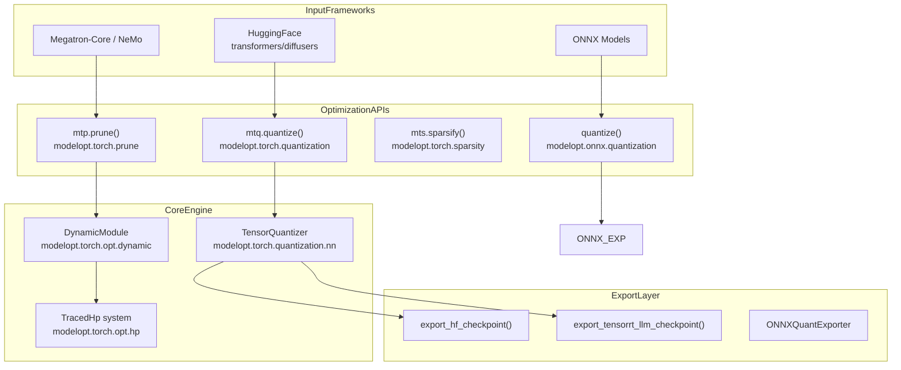

Sources: [README.md:18-26](), [modelopt/torch/__init__.py:30-40](), [pyproject.toml:55-74]()

---

## Optimization Workflow

Model Optimizer follows a structured three-stage workflow: **Input → Optimize → Export**.

1. **Input**: Load a model from Hugging Face, PyTorch, or ONNX [README.md:20]().
2. **Optimize**: Apply Post-Training Quantization (PTQ), Pruning, Distillation, or NAS via Python APIs [README.md:22]().
3. **Export**: Generate an optimized checkpoint ready for deployment in downstream inference engines like SGLang, TensorRT-LLM, or vLLM [README.md:25]().

### Data Flow and Code Entity Association

Title: Optimization Pipeline Data Flow

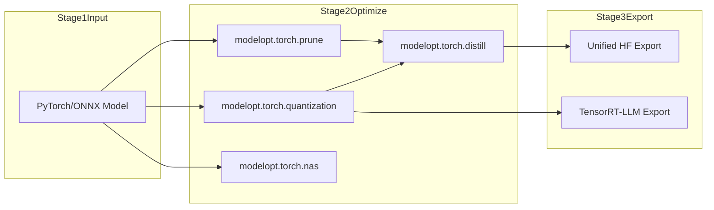

Sources: [README.md:18-26](), [modelopt/torch/__init__.py:30-40]()

---

## Supported Techniques

### Quantization
Model Optimizer supports Post-Training Quantization (PTQ) and Quantization-Aware Training (QAT) [README.md:38]().
* **Formats**: NVFP4, FP8, INT8, INT4, and MXFP8 [README.md:37]().
* **Algorithms**: SmoothQuant, AWQ, and SVDQuant.
* **Recipes**: Declarative YAML specifications for reproducible optimization workflows.

### Pruning and NAS
* **Minitron**: Support for width and depth pruning for Megatron-Core models, including GPT, Mamba, and MoE architectures [README.md:33]().
* **Puzzletron**: A specialized subpackage for advanced heterogeneous pruning and Neural Architecture Search (NAS) [README.md:34](), [pyproject.toml:89]().

### Speculative Decoding
Model Optimizer accelerates inference via draft modules using architectures like:
* **EAGLE**: Including EAGLE-1 and EAGLE-3 with Training-Time-Testing (TTT).
* **Medusa**: Parallel draft heads for reduced latency.

### Sparsity
* **Structured Sparsity**: Support for 2:4 structured sparsity.
* **Attention Sparsity**: Techniques to optimize attention mechanisms in Transformers.

Sources: [README.md:33-40](), [pyproject.toml:89]()

---

## Ecosystem Integration

Model Optimizer is integrated into the NVIDIA AI software stack and the broader open-source community:

* **Training Frameworks**: Native integration with Megatron-Core, NeMo 2.0, and Hugging Face Accelerate [README.md:24]().
* **Inference Engines**: Optimized checkpoints deploy directly into:
    * **TensorRT-LLM**: High-performance LLM inference [README.md:26]().
    * **vLLM & SGLang**: Popular open-source serving frameworks [README.md:26]().
    * **ONNX Runtime**: Deployment on Windows and other platforms [pyproject.toml:64-70]().
* **Model Types**: Supports Large Language Models (LLMs), Vision-Language Models (VLMs), and Diffusion models (Stable Diffusion, Flux) [README.md:26]().

Sources: [README.md:24-26](), [pyproject.toml:55-87]()

---

## Implementation Details

The `modelopt.torch` package organizes its features into specialized sub-modules initialized in a precise order to prevent circular dependencies [modelopt/torch/__init__.py:30-40](). Dependency management is handled modularly via `pyproject.toml` extras (`[onnx]`, `[hf]`, `[puzzletron]`, `[all]`) [pyproject.toml:54-138]().

For installation instructions, quickstart examples, and basic usage patterns, see [Getting Started](#1.1).
For details on top-level directory layouts, packaging, and configuration files, see [Repository Layout and Packaging](#1.2).

Sources: [modelopt/torch/__init__.py:30-40](), [pyproject.toml:54-138]()

---

# Page: Getting Started

# Getting Started

<details>
<summary>Relevant source files</summary>

The following files were used as context for generating this wiki page:

- [.agents/TOOLING.md](.agents/TOOLING.md)
- [.agents/review-guidelines/technical-blog.md](.agents/review-guidelines/technical-blog.md)
- [.coderabbit.yaml](.coderabbit.yaml)
- [.github/CODEOWNERS](.github/CODEOWNERS)
- [.github/PULL_REQUEST_TEMPLATE.md](.github/PULL_REQUEST_TEMPLATE.md)
- [.github/actions/pr-merge-base/action.yml](.github/actions/pr-merge-base/action.yml)
- [.github/workflows/bump_uv_lock.yml](.github/workflows/bump_uv_lock.yml)
- [.github/workflows/claude.yml](.github/workflows/claude.yml)
- [.github/workflows/claude_review.yml](.github/workflows/claude_review.yml)
- [AGENTS.md](AGENTS.md)
- [CLAUDE.md](CLAUDE.md)
- [CONTRIBUTING.md](CONTRIBUTING.md)
- [LICENSE_HEADER](LICENSE_HEADER)
- [README.md](README.md)
- [docs/source/_ext/modelopt_autodoc_pydantic.py](docs/source/_ext/modelopt_autodoc_pydantic.py)
- [docs/source/_static/announcements.css](docs/source/_static/announcements.css)
- [docs/source/_static/announcements.js](docs/source/_static/announcements.js)
- [docs/source/_static/custom.css](docs/source/_static/custom.css)
- [docs/source/announcements/assets/autoquantize-qwen35-mmlu-effective-bits.png](docs/source/announcements/assets/autoquantize-qwen35-mmlu-effective-bits.png)
- [docs/source/announcements/autoquantize.rst](docs/source/announcements/autoquantize.rst)
- [docs/source/announcements/dspark-vs-domino.rst](docs/source/announcements/dspark-vs-domino.rst)
- [docs/source/announcements/github-pages-announcements.rst](docs/source/announcements/github-pages-announcements.rst)
- [docs/source/conf.py](docs/source/conf.py)
- [docs/source/deployment/2_onnxruntime.rst](docs/source/deployment/2_onnxruntime.rst)
- [docs/source/getting_started/1_overview.rst](docs/source/getting_started/1_overview.rst)
- [docs/source/getting_started/2_installation.rst](docs/source/getting_started/2_installation.rst)
- [docs/source/getting_started/_installation_for_Linux.rst](docs/source/getting_started/_installation_for_Linux.rst)
- [docs/source/getting_started/windows/_installation_for_Windows.rst](docs/source/getting_started/windows/_installation_for_Windows.rst)
- [docs/source/getting_started/windows/_installation_standalone.rst](docs/source/getting_started/windows/_installation_standalone.rst)
- [docs/source/getting_started/windows/_installation_with_olive.rst](docs/source/getting_started/windows/_installation_with_olive.rst)
- [docs/source/guides/0_support_matrix.rst](docs/source/guides/0_support_matrix.rst)
- [docs/source/guides/windows_guides/_ONNX_PTQ_guide.rst](docs/source/guides/windows_guides/_ONNX_PTQ_guide.rst)
- [docs/source/index.rst](docs/source/index.rst)
- [docs/source/support/2_faqs.rst](docs/source/support/2_faqs.rst)
- [examples/diffusers/requirements.txt](examples/diffusers/requirements.txt)
- [examples/windows/README.md](examples/windows/README.md)
- [examples/windows/onnx_ptq/genai_llm/README.md](examples/windows/onnx_ptq/genai_llm/README.md)
- [examples/windows/onnx_ptq/genai_llm/quantize.py](examples/windows/onnx_ptq/genai_llm/quantize.py)
- [examples/windows/onnx_ptq/sam2/README.md](examples/windows/onnx_ptq/sam2/README.md)
- [examples/windows/torch_onnx/diffusers/README.md](examples/windows/torch_onnx/diffusers/README.md)
- [examples/windows/torch_onnx/diffusers/type_update_trt_custom_ops.py](examples/windows/torch_onnx/diffusers/type_update_trt_custom_ops.py)
- [modelopt/onnx/quantization/extensions.py](modelopt/onnx/quantization/extensions.py)
- [tests/examples/diffusers/test_cache_diffusion.py](tests/examples/diffusers/test_cache_diffusion.py)
- [tests/examples/gpt-oss/test_gpt_oss_qat.py](tests/examples/gpt-oss/test_gpt_oss_qat.py)
- [uv.lock](uv.lock)

</details>


This page provides installation instructions and basic usage examples to help you quickly start using NVIDIA Model Optimizer (ModelOpt). It covers installation methods, quickstart workflows for common optimization techniques, and basic API patterns for both Linux and Windows environments.

---

## Installation and Environment Setup

ModelOpt can be installed via `pip` from PyPI, from source, or used within pre-configured NVIDIA Docker containers.

### Installation Options

The following diagram illustrates the decision flow for choosing an installation method based on your environment and requirements.

**Installation Decision Flow**
```mermaid
graph TD
    "START"["Choose Installation Method"] --> "LINUX"["Linux"]
    "START"["Choose Installation Method"] --> "WINDOWS"["Windows"]
    
    "LINUX" --> "DOCKER"["Docker Recommended"]
    "LINUX" --> "PIP_LOCAL"["Local PIP/Conda"]
    
    "DOCKER" --> "TRTLLM_IMG"["nvcr.io/nvidia/tensorrt-llm/release"]
    "DOCKER" --> "PYTORCH_IMG"["nvcr.io/nvidia/pytorch"]
    "DOCKER" --> "NEMO_IMG"["nvcr.io/nvidia/nemo"]
    
    "PIP_LOCAL" --> "PIP_ALL"["pip install nvidia-modelopt[all]"]
    
    "WINDOWS" --> "WIN_PIP"["pip install nvidia-modelopt[onnx]"]
    
    "TRTLLM_IMG" --> "UPGRADE"["pip install -U nvidia-modelopt[all]"]
    "PYTORCH_IMG" --> "UPGRADE"
    "NEMO_IMG" --> "UPGRADE"
    "UPGRADE" --> "VERIFY"["python -c import modelopt"]
    "PIP_ALL" --> "VERIFY"
    "WIN_PIP" --> "VERIFY"
```
Sources: [docs/source/getting_started/_installation_for_Linux.rst:31-56](), [pyproject.toml:54-74](), [pyproject.toml:136]()

### Method 1: Install from PyPI (Linux)

Install the package with all dependencies for a complete experience:

```bash
pip install -U "nvidia-modelopt[all]"
```

If you require only specific modules to minimize the dependency footprint, use partial extras defined in `pyproject.toml`:

| Extra | Module / Use Case | Key Dependencies |
|-------|-------------------|------------------|
| `[onnx]` | `modelopt.onnx`, `modelopt.torch._deploy` | `onnx`, `onnxruntime-gpu`, `onnx-graphsurgeon` |
| `[hf]` | HuggingFace (Transformers, Diffusers) | `transformers`, `diffusers`, `accelerate` |
| `[puzzletron]` | `modelopt.torch.puzzletron` | `hydra-core`, `pandas`, `typeguard` |
| `[all]` | Full suite | All of the above |

**System Requirements:**
* **OS:** Linux (x86_64, aarch64) [docs/source/getting_started/_installation_for_Linux.rst:11-13]()
* **Python:** >=3.10, <3.15 [docs/source/getting_started/_installation_for_Linux.rst:15](), [uv.lock:3]()
* **PyTorch:** >=2.8 [docs/source/getting_started/_installation_for_Linux.rst:19]()
* **CUDA:** 12.x or 13.x [docs/source/getting_started/_installation_for_Linux.rst:17]()

Sources: [docs/source/getting_started/_installation_for_Linux.rst:10-26](), [pyproject.toml:54-96](), [uv.lock:1-3]()

### Method 2: Windows Installation

For Windows environments, ModelOpt primarily supports ONNX-based workflows via the `[onnx]` extra.

**Standalone Installation:**
```bash
pip install "nvidia-modelopt[onnx]"
```

For Windows ONNX Runtime usage, ModelOpt pins `onnxruntime-gpu` to compatible versions to ensure local RTX GPU support.

Sources: [pyproject.toml:64-70](), [docs/source/getting_started/_installation_for_Linux.rst:136](), [examples/windows/onnx_ptq/genai_llm/README.md:12-19]()

### Method 3: Docker Containers (Recommended for Linux)

NVIDIA provides pre-configured containers where ModelOpt is pre-installed. It is recommended to upgrade to the latest version inside the container using `pip install -U`.

*   **TensorRT-LLM:** `nvcr.io/nvidia/tensorrt-llm/release:<version>` [docs/source/getting_started/_installation_for_Linux.rst:35]()
*   **PyTorch:** `nvcr.io/nvidia/pytorch:<version>-py3` [docs/source/getting_started/_installation_for_Linux.rst:51]()
*   **NeMo:** `nvcr.io/nvidia/nemo:<version>` [docs/source/getting_started/_installation_for_Linux.rst:53]()

```bash
export PIP_CONSTRAINT=""
pip install -U "nvidia-modelopt[all]"
```

Sources: [docs/source/getting_started/_installation_for_Linux.rst:31-54]()

---

## Core API Namespace Mapping

ModelOpt's functionality is partitioned into namespaces that align with the underlying framework and optimization technique. The package initialization in `modelopt/torch/__init__.py` exposes these sub-packages.

**Code Entity Mapping: Optimization Namespaces**
```mermaid
graph LR
    subgraph "modelopt.torch"
        "torch_quant"["modelopt.torch.quantization"]
        "torch_prune"["modelopt.torch.prune"]
        "torch_distill"["modelopt.torch.distill"]
        "torch_spec"["modelopt.torch.speculative"]
        "torch_sparse"["modelopt.torch.sparsity"]
        "torch_nas"["modelopt.torch.nas"]
    end

    subgraph "modelopt.onnx"
        "onnx_quant"["modelopt.onnx.quantization"]
        "onnx_autocast"["modelopt.onnx.autocast"]
    end

    "torch_quant" --> "mtq_api"["mtq.quantize()"]
    "torch_prune" --> "mtp_api"["mtp.prune()"]
    "torch_spec" --> "mtsp_api"["mtsp.convert()"]
    "onnx_quant" --> "moq_api"["quantize()"]
```
Sources: [modelopt/torch/__init__.py:26-36](), [README.md:18-25]()

| Namespace | Role | Primary Use Case |
|-----------|------|------------------|
| `modelopt.torch.quantization` | PTQ/QAT for PyTorch | Quantizing LLMs/VLMs for TensorRT-LLM [README.md:25]() |
| `modelopt.torch.prune` | Model Pruning | Reducing model width/depth (Minitron) [README.md:18]() |
| `modelopt.torch.speculative` | Speculative Decoding | Training/Converting EAGLE or Medusa heads [README.md:18]() |
| `modelopt.torch.sparsity` | Sparsity | 2:4 structured sparsity [README.md:18]() |
| `modelopt.onnx.quantization` | ONNX Quantization | Quantizing ONNX graphs for TensorRT/ORT [examples/windows/onnx_ptq/genai_llm/README.md:12-19]() |

Sources: [modelopt/torch/__init__.py:26-36](), [README.md:18-22]()

---

## Quickstart: Post-Training Quantization (PTQ)

PTQ is the standard workflow for compressing models without retraining. The process typically involves three steps: `quantize` (inserting quantizers), `calibrate` (collecting statistics), and `export`.

### Basic PyTorch PTQ Workflow

The following example demonstrates a standard Hugging Face model quantization flow using `modelopt.torch.quantization` (aliased as `mtq`).

```python
import modelopt.torch.quantization as mtq
from transformers import AutoModelForCausalLM

# 1. Load model
model = AutoModelForCausalLM.from_pretrained("meta-llama/Llama-3.1-8B", device_map="auto")

# 2. Apply quantization mode (e.g., FP8)
# This replaces standard layers with quantized versions using a recipe
model = mtq.quantize(model, mtq.FP8_DEFAULT_CFG)

# 3. Calibrate
# Use a representative dataset to find optimal scaling factors
def calibration_loop(model):
    for batch in dataloader:
        model(batch)

mtq.calibrate(model, calibration_loop)

# 4. Export for deployment
from modelopt.torch.export import export_hf_checkpoint
export_hf_checkpoint(model, "./quantized_llama")
```

Sources: [README.md:22-25](), [modelopt/torch/__init__.py:32](), [examples/windows/onnx_ptq/genai_llm/quantize.py:29]()

---

## Accelerated Quantization with Triton Kernels

ModelOpt includes optimized kernels implemented with the Triton language that accelerate quantization operations by approximately 40% compared to default implementations. These are particularly beneficial for **AWQ** and **Quantization-aware Training (QAT)** workflows.

**Requirements for Triton Kernels:**
*   **Hardware:** CUDA device with compute capability >= 8.9 (e.g., RTX 40 series, RTX 6000 Ada, L40, H100) [docs/source/getting_started/_installation_for_Linux.rst:147]().
*   **Software:** `pip install triton` [docs/source/getting_started/_installation_for_Linux.rst:148]().

The optimized kernels are used automatically when compatible hardware and the `triton` package are detected.

Sources: [docs/source/getting_started/_installation_for_Linux.rst:138-151]()

---

## Verification and Testing

ModelOpt uses `nox` and `pytest` for its testing framework. The `noxfile.py` defines sessions for various environments, including CPU-only unit tests and specialized GPU sessions for Megatron or TensorRT-LLM.

| Test Suite | Command | Context |
|------------|---------|---------|
| Unit Tests | `nox -s unit` | General logic across Python versions |
| GPU Tests | `nox -s gpu` | Quantization kernels and GPU logic |
| Megatron | `nox -s gpu_megatron` | Distributed training/pruning in NeMo containers |
| TensorRT-LLM | `nox -s gpu_trtllm` | Export and deployment in TRT-LLM containers |

Sources: [noxfile.py:18-24](), [noxfile.py:69-150](), [CONTRIBUTING.md:24-31]()

### Manual Verification
To check if ModelOpt is correctly installed and its version is compatible with your environment:
```python
import modelopt.torch
print("ModelOpt initialized successfully")
```
Note that `modelopt.torch` performs version checks for `torch` and `transformers` at import time and will issue warnings if versions are outside the tested range.

Sources: [docs/source/getting_started/_installation_for_Linux.rst:153-156](), [modelopt/torch/__init__.py:43-69]()

---

# Page: Repository Layout and Packaging

# Repository Layout and Packaging

<details>
<summary>Relevant source files</summary>

The following files were used as context for generating this wiki page:

- [.agents/review-guidelines/technical-blog.md](.agents/review-guidelines/technical-blog.md)
- [.github/CODEOWNERS](.github/CODEOWNERS)
- [.github/actions/cache-extensions/action.yml](.github/actions/cache-extensions/action.yml)
- [.github/codecov.yml](.github/codecov.yml)
- [.github/workflows/_example_tests_runner.yml](.github/workflows/_example_tests_runner.yml)
- [.github/workflows/_pr_gate.yml](.github/workflows/_pr_gate.yml)
- [.github/workflows/bump_uv_lock.yml](.github/workflows/bump_uv_lock.yml)
- [.github/workflows/code_quality.yml](.github/workflows/code_quality.yml)
- [.github/workflows/example_tests.yml](.github/workflows/example_tests.yml)
- [.github/workflows/gpu_tests.yml](.github/workflows/gpu_tests.yml)
- [.github/workflows/pages.yml](.github/workflows/pages.yml)
- [.github/workflows/regression_tests.yml](.github/workflows/regression_tests.yml)
- [.github/workflows/release.yml](.github/workflows/release.yml)
- [.github/workflows/unit_tests.yml](.github/workflows/unit_tests.yml)
- [docs/source/_ext/modelopt_autodoc_pydantic.py](docs/source/_ext/modelopt_autodoc_pydantic.py)
- [docs/source/_static/announcements.css](docs/source/_static/announcements.css)
- [docs/source/_static/announcements.js](docs/source/_static/announcements.js)
- [docs/source/_static/custom.css](docs/source/_static/custom.css)
- [docs/source/announcements/assets/autoquantize-qwen35-mmlu-effective-bits.png](docs/source/announcements/assets/autoquantize-qwen35-mmlu-effective-bits.png)
- [docs/source/announcements/autoquantize.rst](docs/source/announcements/autoquantize.rst)
- [docs/source/announcements/dspark-vs-domino.rst](docs/source/announcements/dspark-vs-domino.rst)
- [docs/source/announcements/github-pages-announcements.rst](docs/source/announcements/github-pages-announcements.rst)
- [docs/source/conf.py](docs/source/conf.py)
- [docs/source/getting_started/2_installation.rst](docs/source/getting_started/2_installation.rst)
- [docs/source/index.rst](docs/source/index.rst)
- [examples/gpt-oss/requirements.txt](examples/gpt-oss/requirements.txt)
- [modelopt/onnx/quantization/extensions.py](modelopt/onnx/quantization/extensions.py)
- [modelopt/torch/__init__.py](modelopt/torch/__init__.py)
- [noxfile.py](noxfile.py)
- [pyproject.toml](pyproject.toml)
- [uv.lock](uv.lock)

</details>


## Purpose and Scope

This page provides a comprehensive technical reference for the repository layout, directory organization, packaging configuration, and dependency management architecture of the NVIDIA Model Optimizer (`nvidia-modelopt`) library. It details how source files, recipes, examples, tools, tests, and documentation are structured within the codebase, as well as how Python packaging (`pyproject.toml`) [pyproject.toml:1-163](), dependency locking (`uv.lock`) [uv.lock:1-40](), and task automation (`noxfile.py`) [noxfile.py:15-158]() operate.

---

## Top-Level Directory Layout

The Model Optimizer repository is structured around a core library package, configuration recipe sets, execution examples, internal tooling, and comprehensive test suites. 

The following diagram maps the natural language names of the repository's major top-level components to their corresponding code entities and directory paths:

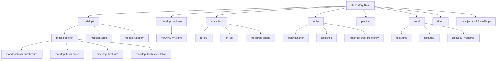
*Figure 1: Top-level repository layout mapped to code subpackages and modules.*

Sources: `pyproject.toml`, `modelopt/torch/__init__.py`, `noxfile.py`

### Subdirectory Descriptions

- **`modelopt/`**: The core library source tree. It contains framework-specific optimization backends, notably `modelopt.torch` for PyTorch models [modelopt/torch/__init__.py:16-40]() and `modelopt.onnx` for ONNX graph transformations, along with shared deployment utilities (`modelopt.deploy`).
- **`modelopt_recipes/`**: Houses declarative YAML-based quantization and optimization recipes (such as FP8 and NVFP4 configurations) [pyproject.toml:147](). These are dynamically loaded by the configuration and recipe loader systems.
- **`examples/`**: Contains end-to-end reference implementations demonstrating optimization workflows. Key directories include `hf_ptq`, `llm_qat`, `llm_distill`, `diffusers`, `megatron_bridge`, `speculative_decoding`, and `vllm_serve` [.github/workflows/example_tests.yml:64-77]().
- **`tools/`**: Operational utility scripts and specialized agent services, including the Slurm/Docker job submission utility (`tools/launcher`), the Model Context Protocol server (`tools/mcp`), and system resource tracking (`tools/resource_monitor.py`) [.github/workflows/unit_tests.yml:14-16]().
- **`plugins/`**: Integrations for external agent environments, including Claude AI agent skills and optimization assistant plugins [.github/workflows/unit_tests.yml:17-18]().
- **`experimental/`**: Sandbox space for bleeding-edge optimization research (such as Dynamic Memory Sparsification and implicit GEMM convolutions) that have not yet stabilized into the public API.
- **`tests/`**: Comprehensive testing suites categorized into CPU unit tests (`tests/unit`), GPU-accelerated functional tests (`tests/gpu`, `tests/gpu_megatron`, `tests/gpu_trtllm`, `tests/gpu_vllm`), shared testing utilities (`tests/_test_utils`), and example integration tests (`tests/examples`) [.github/workflows/example_tests.yml:59-77](), [.github/workflows/gpu_tests.yml:32-37]().
- **`docs/`**: Sphinx documentation source files, configuration (`conf.py`), and announcement assets [.github/workflows/pages.yml:52]().

---

## Packaging and Dependency Configuration

The library uses a modern, standards-compliant packaging configuration centered around `pyproject.toml` and built via `setuptools` with `setuptools-scm` for dynamic versioning [pyproject.toml:4-10]().

### Project Metadata and Core Dependencies

The package is published under the distribution name `nvidia-modelopt` [pyproject.toml:16](). It declares a strict Python requirement of `>=3.10,<3.15` [pyproject.toml:22]() and classifies support for CPython 3.10 through 3.13 [pyproject.toml:25-29](). 

Core runtime dependencies required for basic execution and PyTorch integration include fundamental numeric libraries, NVIDIA management bindings, and configuration parsers [pyproject.toml:34-52]():
- `ninja`: Speeds up compilation of custom C++/CUDA extensions [pyproject.toml:36]().
- `torch>=2.8`: Primary deep learning framework dependency [pyproject.toml:41]().
- `PyYAML>=6.0` and `omegaconf>=2.3.0`: Configuration file loading for recipes [pyproject.toml:44-45]().
- `pulp<4.0`: Linear programming solver backend utilized in neural architecture search and pruning algorithms [pyproject.toml:46]().
- `pydantic>=2.0`: Data validation for configuration schemas [pyproject.toml:47]().
- `safetensors`: Fast weight loading and serialization format [pyproject.toml:50]().

### Optional Feature Extras

To keep the core installation lightweight, specialized domain dependencies are isolated into optional feature extras defined in `pyproject.toml` [pyproject.toml:54-138]():

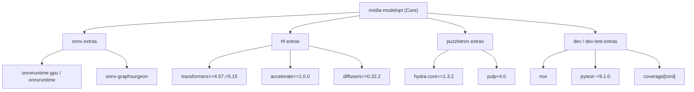
*Figure 2: Optional dependency graph showing feature extras and associated third-party libraries.*

Sources: `pyproject.toml`

- **`onnx`**: Enables ONNX optimization, graph surgery, and AutoQDQ tools by pulling in `onnx~=1.21.0`, `onnx-graphsurgeon>=0.6.1`, `polygraphy>=0.53.4`, and platform-conditional `onnxruntime-gpu` packages [pyproject.toml:55-74]().
- **`hf`**: Integrates Hugging Face ecosystem components including `transformers>=4.57,<5.15`, `accelerate>=1.0.0`, `diffusers>=0.32.2`, `datasets`, and `peft` [pyproject.toml:75-87]().
- **`puzzletron`**: Installs requirements for the local neural architecture search subpackage, including `hydra-core==1.3.2`, `fire`, and `pandas` [pyproject.toml:89-96]().
- **`dev-test`**: Test execution dependencies including `pytest~=9.1.0`, `pytest-cov`, `nox`, and `uv` [pyproject.toml:114-128]().
- **`all`**: Compound extra that aggregates `onnx`, `hf`, and `puzzletron` [pyproject.toml:136]().
- **`dev`**: Full development environment including `all`, `mlflow`, `dev-docs`, `dev-lint`, and `dev-test` [pyproject.toml:137]().

---

## Nox Automation and Test Orchestration

Task automation, virtual environment management, and test execution across multiple Python runtimes and framework versions are orchestrated using `noxfile.py` [noxfile.py:15-24](). Nox uses `uv` as its default virtual environment backend when available for rapid dependency resolution [noxfile.py:32]().

### Key Nox Sessions

- **`unit`**: Parametrized over Python versions (`3.10` through `3.14`), PyTorch versions (via `TORCH_VERSIONS`), and Transformers versions (via `TRANSFORMERS_VERSIONS`). It installs the package with `.[all,dev-test]` and executes CPU-isolated unit tests [noxfile.py:67-76]().
- **`partial_unit`**: Runs focused test subsets (`onnx`, `torch`, or `torch_deploy`) with restricted optional dependencies to verify modular installation boundaries [noxfile.py:79-100]().
- **`gpu`, `gpu_megatron`, `gpu_trtllm`, `gpu_vllm`**: Container-targeted sessions that bypass virtual environment creation (`venv_backend="none"`) to execute tests directly within pre-built NVIDIA container environments (`pytorch`, `nemo`, `tensorrt-llm`, and `vllm-openai`) [noxfile.py:102-158]().

Sources: `noxfile.py`

---

## CI/CD Pipeline Integration

Continuous Integration workflows defined under `.github/workflows/` automate repository verification, test matrix execution, code quality checks, and documentation generation:

- **`unit_tests.yml`**: Runs CPU unit tests across Linux and Windows runners, multi-version Python/PyTorch matrices, partial installations, and specialized tools (`tools/launcher`, `tools/mcp`) [.github/workflows/unit_tests.yml:60-180]().
- **`gpu_tests.yml`**: Triggers GPU-accelerated test suites (`gpu`, `gpu_megatron`, `gpu_trtllm`, `gpu_vllm`) inside specialized Docker containers with hardware acceleration [.github/workflows/gpu_tests.yml:39-104]().
- **`example_tests.yml`**: Gate-checks reference example scripts across PyTorch, TensorRT-LLM, Megatron, and ONNX lanes [.github/workflows/example_tests.yml:23-160]().
- **`code_quality.yml`**: Executes static analysis, linting (`ruff`, `mypy`), security scanning (`bandit`, `trufflehog`), and pre-commit hooks [.github/workflows/code_quality.yml:18-38]().
- **`pages.yml`**: Builds Sphinx documentation artifacts and handles GitHub Pages deployment and pull request previews [.github/workflows/pages.yml:25-96]().

Sources: `.github/workflows/unit_tests.yml`, `.github/workflows/gpu_tests.yml`, `.github/workflows/example_tests.yml`, `.github/workflows/code_quality.yml`, `.github/workflows/pages.yml`

---

# Page: Getting Started

# Getting Started

<details>
<summary>Relevant source files</summary>

The following files were used as context for generating this wiki page:

- [.agents/TOOLING.md](.agents/TOOLING.md)
- [.coderabbit.yaml](.coderabbit.yaml)
- [.github/PULL_REQUEST_TEMPLATE.md](.github/PULL_REQUEST_TEMPLATE.md)
- [.github/actions/pr-merge-base/action.yml](.github/actions/pr-merge-base/action.yml)
- [.github/workflows/claude.yml](.github/workflows/claude.yml)
- [.github/workflows/claude_review.yml](.github/workflows/claude_review.yml)
- [AGENTS.md](AGENTS.md)
- [CLAUDE.md](CLAUDE.md)
- [CONTRIBUTING.md](CONTRIBUTING.md)
- [README.md](README.md)
- [examples/diffusers/requirements.txt](examples/diffusers/requirements.txt)
- [tests/examples/diffusers/test_cache_diffusion.py](tests/examples/diffusers/test_cache_diffusion.py)
- [tests/examples/gpt-oss/test_gpt_oss_qat.py](tests/examples/gpt-oss/test_gpt_oss_qat.py)

</details>


This page provides a high-level overview of getting started with NVIDIA Model Optimizer (ModelOpt), covering installation paths, ecosystem integration, and basic workflow patterns. 

For comprehensive installation guides, environment troubleshooting, and deep-dive example walkthroughs, refer to the child pages:
* For Linux/Windows setup, optional dependencies, and Docker images, see [Installation and Environment Setup](#2.1).
* For a complete guide to the `examples/` directory (`hf_ptq`, `llm_qat`, `diffusers`, `megatron_bridge`, etc.), see [Example Catalog](#2.2).

---

## Installation and Environment Setup

ModelOpt can be installed via PyPI, from source, or utilized within pre-configured NVIDIA container images (`README.md:21-26`, `CONTRIBUTING.md:10-16`). The library provides optional dependency groups in `pyproject.toml` to tailor the installation footprint for specific frameworks like Hugging Face, ONNX, or Puzzletron.

**Natural Language to Code Entity: Environment and Installation Architecture**
```mermaid
graph TD
    "UserEnvironment"["User Environment"] --> "LinuxOS"["Linux (x86_64 / aarch64)"]
    "UserEnvironment" --> "WindowsOS"["Windows (ONNX/ORT)"]
    
    "LinuxOS" --> "DockerContainers"["NVIDIA Containers: nvcr.io/nvidia/tensorrt-llm/release"]
    "LinuxOS" --> "PipInstallation"["pip install nvidia-modelopt[all]"]
    
    subgraph "pyproject.toml Extras"
        "PipInstallation" --> "OnnxExtra"["modelopt.onnx"]
        "PipInstallation" --> "HfExtra"["Hugging Face (transformers, diffusers)"]
        "PipInstallation" --> "PuzzletronExtra"["modelopt.torch.puzzletron"]
    end
    
    "DockerContainers" --> "ModelOptCore"["import modelopt"]
    "PipInstallation" --> "ModelOptCore"
    "WindowsOS" --> "OnnxExtra"
```
Sources: [pyproject.toml:54-96](), [README.md:21-26](), [docs/source/getting_started/_installation_for_Linux.rst:11-56]()

For complete details on Linux and Windows installation extras, container version requirements, and package constraint management, see [Installation and Environment Setup](#2.1).

Sources: [pyproject.toml:54-96](), [README.md:21-26](), [docs/source/getting_started/_installation_for_Linux.rst:11-56]()

---

## Example Catalog

The repository includes an extensive set of production-ready examples under the `examples/` directory that demonstrate end-to-end compression, fine-tuning, and deployment pipelines. These span Hugging Face post-training quantization (`examples/hf_ptq`), quantization-aware training (`examples/llm_qat`), diffusion model acceleration (`examples/diffusers`), and Megatron-Core distributed optimizations (`examples/megatron_bridge`).

**Natural Language to Code Entity: Example Directories and Target Modules**
```mermaid
graph LR
    subgraph "examples/ Directory"
        "HfPtq"["examples/hf_ptq"] --> "ModelOptQuant"["modelopt.torch.quantization"]
        "LlmLlmQat"["examples/llm_qat"] --> "ModelOptQat"["modelopt.torch.quantization"]
        "Diffusers"["examples/diffusers"] --> "FastGen"["modelopt.torch.fastgen"]
        "MegatronBridge"["examples/megatron_bridge"] --> "MegatronCore"["Megatron-Core & NeMo"]
        "Puzzletron"["examples/puzzletron"] --> "NasPrune"["modelopt.torch.puzzletron"]
    end
```
Sources: [README.md:31-38](), [examples/diffusers/requirements.txt:1-2](), [tests/examples/gpt-oss/test_gpt_oss_qat.py:26-44]()

For a detailed index of every example pipeline, configuration flags, execution scripts, and hardware requirements, see [Example Catalog](#2.2).

Sources: [README.md:31-38](), [tests/examples/gpt-oss/test_gpt_oss_qat.py:26-44]()

---

## Core API Overview and Basic Usage

ModelOpt exposes functional and class-based interfaces structured by optimization paradigm under `modelopt.torch` and `modelopt.onnx` (`modelopt/torch/__init__.py:26-36`). 

| Optimization Domain | Primary Python Namespace | Key Entrypoint Function / Class |
|---------------------|--------------------------|---------------------------------|
| PyTorch Quantization | `modelopt.torch.quantization` | `mtq.quantize()`, `mtq.calibrate()` |
| Model Pruning | `modelopt.torch.prune` | `mtp.prune()` |
| Speculative Decoding | `modelopt.torch.speculative` | `mtsp.convert()` |
| ONNX Quantization | `modelopt.onnx.quantization` | `quantize()` |

### Quickstart Post-Training Quantization (PTQ)

The standard PTQ workflow applies quantization configs via `modelopt.torch.quantization` (aliased as `mtq`), calibrates scaling factors using a representative dataloader, and exports via `export_hf_checkpoint` (`README.md:21-26`, `modelopt/torch/__init__.py:32`):

```python
import modelopt.torch.quantization as mtq
from transformers import AutoModelForCausalLM

# Load model and apply quantization configuration
model = AutoModelForCausalLM.from_pretrained("meta-llama/Llama-3.1-8B", device_map="auto")
model = mtq.quantize(model, mtq.FP8_DEFAULT_CFG)

# Calibrate activation scaling factors
def calibration_loop(model):
    for batch in dataloader:
        model(batch)

mtq.calibrate(model, calibration_loop)

# Export optimized checkpoint
from modelopt.torch.export import export_hf_checkpoint
export_hf_checkpoint(model, "./quantized_llama")
```

Sources: [README.md:21-26](), [modelopt/torch/__init__.py:26-36]()

---

# Page: Installation and Environment Setup

# Installation and Environment Setup

<details>
<summary>Relevant source files</summary>

The following files were used as context for generating this wiki page:

- [.agents/review-guidelines/technical-blog.md](.agents/review-guidelines/technical-blog.md)
- [.github/CODEOWNERS](.github/CODEOWNERS)
- [.github/workflows/bump_uv_lock.yml](.github/workflows/bump_uv_lock.yml)
- [LICENSE_HEADER](LICENSE_HEADER)
- [docs/source/_ext/modelopt_autodoc_pydantic.py](docs/source/_ext/modelopt_autodoc_pydantic.py)
- [docs/source/_static/announcements.css](docs/source/_static/announcements.css)
- [docs/source/_static/announcements.js](docs/source/_static/announcements.js)
- [docs/source/_static/custom.css](docs/source/_static/custom.css)
- [docs/source/announcements/assets/autoquantize-qwen35-mmlu-effective-bits.png](docs/source/announcements/assets/autoquantize-qwen35-mmlu-effective-bits.png)
- [docs/source/announcements/autoquantize.rst](docs/source/announcements/autoquantize.rst)
- [docs/source/announcements/dspark-vs-domino.rst](docs/source/announcements/dspark-vs-domino.rst)
- [docs/source/announcements/github-pages-announcements.rst](docs/source/announcements/github-pages-announcements.rst)
- [docs/source/conf.py](docs/source/conf.py)
- [docs/source/deployment/2_onnxruntime.rst](docs/source/deployment/2_onnxruntime.rst)
- [docs/source/getting_started/1_overview.rst](docs/source/getting_started/1_overview.rst)
- [docs/source/getting_started/2_installation.rst](docs/source/getting_started/2_installation.rst)
- [docs/source/getting_started/_installation_for_Linux.rst](docs/source/getting_started/_installation_for_Linux.rst)
- [docs/source/getting_started/windows/_installation_for_Windows.rst](docs/source/getting_started/windows/_installation_for_Windows.rst)
- [docs/source/getting_started/windows/_installation_standalone.rst](docs/source/getting_started/windows/_installation_standalone.rst)
- [docs/source/getting_started/windows/_installation_with_olive.rst](docs/source/getting_started/windows/_installation_with_olive.rst)
- [docs/source/guides/0_support_matrix.rst](docs/source/guides/0_support_matrix.rst)
- [docs/source/guides/windows_guides/_ONNX_PTQ_guide.rst](docs/source/guides/windows_guides/_ONNX_PTQ_guide.rst)
- [docs/source/index.rst](docs/source/index.rst)
- [docs/source/support/2_faqs.rst](docs/source/support/2_faqs.rst)
- [examples/windows/README.md](examples/windows/README.md)
- [examples/windows/onnx_ptq/genai_llm/README.md](examples/windows/onnx_ptq/genai_llm/README.md)
- [examples/windows/onnx_ptq/genai_llm/quantize.py](examples/windows/onnx_ptq/genai_llm/quantize.py)
- [examples/windows/onnx_ptq/sam2/README.md](examples/windows/onnx_ptq/sam2/README.md)
- [examples/windows/torch_onnx/diffusers/README.md](examples/windows/torch_onnx/diffusers/README.md)
- [examples/windows/torch_onnx/diffusers/type_update_trt_custom_ops.py](examples/windows/torch_onnx/diffusers/type_update_trt_custom_ops.py)
- [modelopt/onnx/quantization/extensions.py](modelopt/onnx/quantization/extensions.py)
- [uv.lock](uv.lock)

</details>


## Purpose and Scope
This document details the environment configuration, dependency management, and installation workflows for NVIDIA Model Optimizer (`nvidia-modelopt`) across Linux and Windows platforms. It covers system prerequisites, NVIDIA NGC container images, local virtual environment setup via `pip` and `conda`, optional package extras (`[all]`, `[onnx]`, `[hf]`), execution provider configurations for ONNX Runtime, CUDA version switching (CUDA 12.x vs 13.x), and accelerated Triton kernel requirements.

Sources: [docs/source/getting_started/_installation_for_Linux.rst:1-147](), [docs/source/getting_started/windows/_installation_standalone.rst:1-128](), [examples/windows/README.md:1-127]()

---

## 1. System Requirements

Model Optimizer requires specific host environments depending on whether the target deployment uses PyTorch, TensorRT-LLM, or ONNX Runtime.

| Component | Linux Requirement | Windows Requirement |
| :--- | :--- | :--- |
| **Operating System** | Linux (x86_64, aarch64 / SBSA) | Windows 10/11 with RTX GPU |
| **Python Version** | `>=3.10, <3.15` | `>=3.10, <3.13` |
| **CUDA Toolkit** | CUDA 12.x, 13.x | CUDA 12.x, 13.x with matching cuDNN |
| **PyTorch** | `>=2.8` | PyTorch Windows builds |
| **C++ Build Tools** | GCC / G++ | Visual Studio 2022 / MSVC / C++ Build Tools |
| **Optional Runtimes** | TensorRT-LLM `>=1.0`, ONNX Runtime `1.24`, TensorRT `>=10.0` | ONNX Runtime (`onnxruntime-gpu`, `onnxruntime-directml`) |

Sources: [docs/source/getting_started/_installation_for_Linux.rst:5-27](), [docs/source/getting_started/windows/_installation_standalone.rst:9-18]()

---

## 2. Linux Environment Installation

### Containerized Environments (Recommended)
For full deployment workflows involving TensorRT and TensorRT-LLM, NVIDIA provides pre-built NGC container images with Model Optimizer pre-installed.

* **TensorRT-LLM Container**: `nvcr.io/nvidia/tensorrt-llm/release:<version>` — Includes TensorRT-LLM, TensorRT, and Model Optimizer.
* **PyTorch Container**: `nvcr.io/nvidia/pytorch:<version>-py3` — Optimized PyTorch stack.
* **NeMo Container**: `nvcr.io/nvidia/nemo:<version>` — Includes Megatron-Bridge and Megatron-LM.
* **TensorRT Container**: `nvcr.io/nvidia/tensorrt:<version>-py3` — High-performance ONNX and TensorRT workflows.

When using NGC containers, update Model Optimizer to the latest release and configure runtime environment paths:
```bash
export PIP_CONSTRAINT=""
export LD_LIBRARY_PATH="${LD_LIBRARY_PATH}:/usr/include:/usr/lib/x86_64-linux-gnu"
pip install -U "nvidia-modelopt[all]"
```

Sources: [docs/source/getting_started/_installation_for_Linux.rst:31-61](), [docs/source/getting_started/_installation_for_Linux.rst:98-101]()

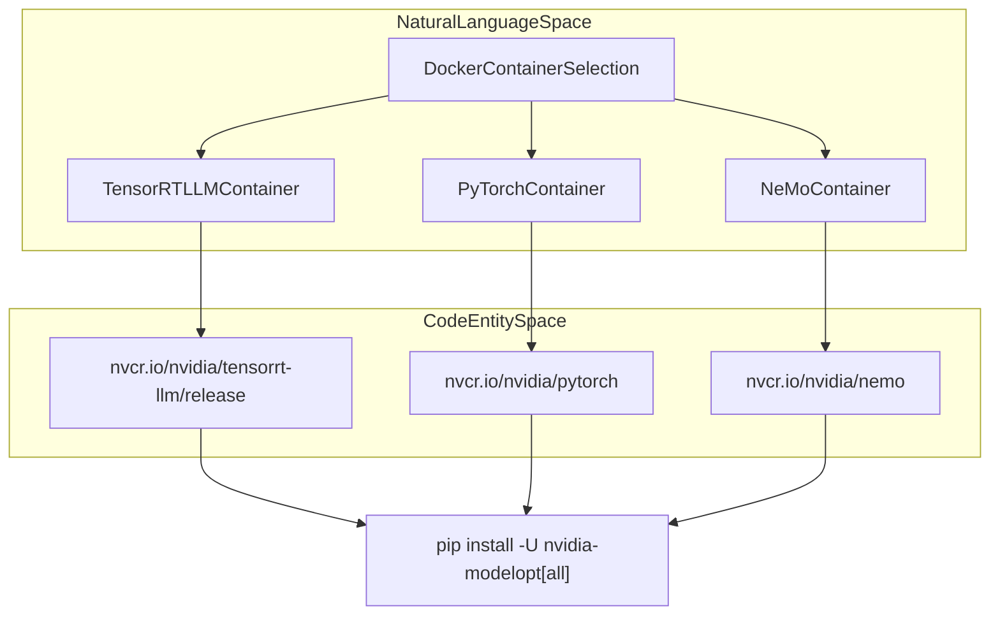
Sources: [docs/source/getting_started/_installation_for_Linux.rst:31-61](), [docs/source/getting_started/_installation_for_Linux.rst:98-101]()

### Local Python Virtual Environment
For local installations on Linux, set up a isolated `conda` environment with Python 3.12:
```bash
conda create -n modelopt python=3.12 pip
conda activate modelopt
```

Sources: [docs/source/getting_started/_installation_for_Linux.rst:62-73]()

---

## 3. Windows Standalone and Olive Installation

On Windows platforms, Model Optimizer (`ModelOpt-Windows`) delivers optimized ONNX models targeting ONNX Runtime (ORT) and DirectML (DML) execution providers on local RTX GPUs.

### Standalone Toolkit Installation
```bash
pip install "nvidia-modelopt[onnx]"
```
If installed without the `[onnx]` extra, only core PyTorch dependencies are included. ONNX model quantization and conversion require the `[onnx]` extra.

### Integration with Microsoft Olive
Model Optimizer integrates into Microsoft's Olive framework and ONNX Runtime GenAI:
```bash
pip install olive-ai[nvmo]
pip install onnxruntime-genai-cuda
```

Sources: [examples/windows/README.md:40-62](), [docs/source/getting_started/windows/_installation_standalone.rst:32-41]()

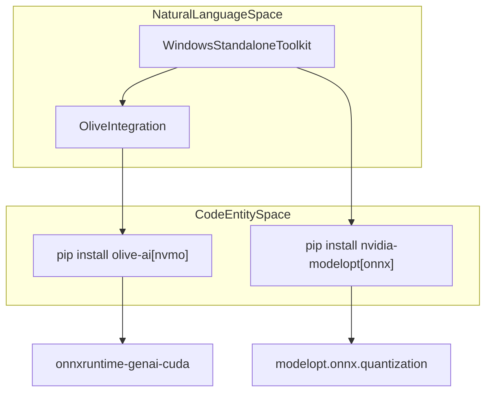
Sources: [examples/windows/README.md:40-62](), [docs/source/getting_started/windows/_installation_standalone.rst:32-41]()

---

## 4. Optional Dependencies and Extras

Model Optimizer modularizes its requirements to prevent bloating lightweight installations. The package defines optional extras managed via `pyproject.toml` and locked via `uv.lock`.

| Target Module / Feature | Optional Extra Flag | Description |
| :--- | :--- | :--- |
| **Full Installation** | `[all]` | Installs all optional backend and framework packages |
| **ONNX Quantization & Export** | `[onnx]` | Installs `onnx`, `onnxruntime`, and helper utilities (`modelopt.onnx`) |
| **Hugging Face Integration** | `[hf]` | Installs `transformers`, `diffusers`, and associated libraries |
| **Deploy Utilities** | `[onnx]` | Required for `modelopt.torch._deploy` |

To install specific subsets:
```bash
pip install "nvidia-modelopt[onnx,hf]"
```

Sources: [docs/source/getting_started/_installation_for_Linux.rst:102-133](), [uv.lock:1-40]()

---

## 5. CUDA Version Management & Execution Providers

### ONNX Runtime Execution Providers
During ONNX post-training quantization (PTQ) calibration, the base model executes via an ONNX Runtime Execution Provider (EP):
* `onnxruntime-gpu`: Provides the CUDA Execution Provider (default on Linux/Windows).
* `onnxruntime-directml`: Provides the DirectML Execution Provider (`dml`) for Windows DML flows.
* `onnxruntime-trt-rtx`: Provides the TensorRT-RTX Execution Provider.
* `onnxruntime`: Provides CPU fallback.

Sources: [docs/source/getting_started/windows/_installation_standalone.rst:42-50]()

### CUDA 12.x vs CUDA 13.x Switching
By default, installing `nvidia-modelopt[onnx]` pulls `cupy-cuda12x` and `onnxruntime-gpu` configured for CUDA 12.x. To target a CUDA 13.x host environment, execute the following migration commands:

```bash
python -m pip uninstall -y cupy-cuda12x onnxruntime-gpu
python -m pip install cupy-cuda13x "onnxruntime-gpu>=1.27"
```
Ensure that `CUDA_PATH`, `CUDA_HOME`, and `PATH` point to the CUDA 13 toolkit and that a compatible cuDNN 9 build is accessible.

Sources: [docs/source/getting_started/_installation_for_Linux.rst:134-137](), [docs/source/getting_started/windows/_installation_standalone.rst:69-90]()

---

## 6. Triton-Accelerated Quantization Kernels

Model Optimizer features custom Triton-implemented kernels that accelerate quantization operations (such as AWQ and QAT workflows) by approximately 40% over default implementations.

* **Hardware Requirement**: NVIDIA GPU with Compute Capability $\ge 8.9$ (e.g., RTX 40 series, RTX 6000 Ada, NVIDIA L40, or later).
* **Supported Formats**: NVFP4 quantization format (with expanded format support in subsequent releases).
* **Mocking & Build Configuration**: During Sphinx documentation builds, Triton and tensorrt_llm are mocked in `docs/source/conf.py` to prevent circular import failures on non-GPU build workers.

Sources: [docs/source/getting_started/_installation_for_Linux.rst:138-147](), [docs/source/conf.py:135-137]()

---

# Page: Example Catalog

# Example Catalog

<details>
<summary>Relevant source files</summary>

The following files were used as context for generating this wiki page:

- [examples/alpamayo/0417_16rows_train_set_for_calibration_25.10.parquet](examples/alpamayo/0417_16rows_train_set_for_calibration_25.10.parquet)
- [examples/alpamayo/README.md](examples/alpamayo/README.md)
- [examples/alpamayo/qad.py](examples/alpamayo/qad.py)
- [examples/alpamayo/quantize.py](examples/alpamayo/quantize.py)
- [examples/hf_ptq/README.md](examples/hf_ptq/README.md)
- [examples/hf_ptq/example_utils.py](examples/hf_ptq/example_utils.py)
- [examples/hf_ptq/hf_ptq.py](examples/hf_ptq/hf_ptq.py)
- [examples/hf_ptq/requirements.txt](examples/hf_ptq/requirements.txt)
- [examples/hf_ptq/scripts/huggingface_example.sh](examples/hf_ptq/scripts/huggingface_example.sh)
- [examples/hf_ptq/scripts/parser.sh](examples/hf_ptq/scripts/parser.sh)
- [examples/llm_eval/README.md](examples/llm_eval/README.md)
- [examples/llm_eval/lm_eval_hf.py](examples/llm_eval/lm_eval_hf.py)
- [examples/llm_eval/lm_eval_trtllm.py](examples/llm_eval/lm_eval_trtllm.py)
- [examples/llm_eval/requirements.txt](examples/llm_eval/requirements.txt)
- [examples/windows/accuracy_benchmark/README.md](examples/windows/accuracy_benchmark/README.md)
- [modelopt/torch/export/hf_export_handlers.py](modelopt/torch/export/hf_export_handlers.py)
- [modelopt/torch/export/registry.py](modelopt/torch/export/registry.py)
- [modelopt/torch/export/unified_export_hf_streaming.py](modelopt/torch/export/unified_export_hf_streaming.py)
- [modelopt_recipes/huggingface/qwen3_6_moe/auto_quantize/w4a16_nvfp4_fp8_module_spaces_at_6p0bits-active_moe.yaml](modelopt_recipes/huggingface/qwen3_6_moe/auto_quantize/w4a16_nvfp4_fp8_module_spaces_at_6p0bits-active_moe.yaml)
- [modelopt_recipes/ptq.md](modelopt_recipes/ptq.md)
- [tests/_test_utils/examples/megatron_example_runner.py](tests/_test_utils/examples/megatron_example_runner.py)
- [tests/_test_utils/examples/run_command.py](tests/_test_utils/examples/run_command.py)
- [tests/examples/alpamayo/test_qad.py](tests/examples/alpamayo/test_qad.py)
- [tests/examples/alpamayo/test_quantize.py](tests/examples/alpamayo/test_quantize.py)
- [tests/examples/hf_ptq/test_example_utils.py](tests/examples/hf_ptq/test_example_utils.py)
- [tests/examples/hf_ptq/test_hf_ptq_args.py](tests/examples/hf_ptq/test_hf_ptq_args.py)
- [tests/examples/llm_eval/test_llm_eval.py](tests/examples/llm_eval/test_llm_eval.py)
- [tests/examples/llm_eval/test_lm_eval_trtllm.py](tests/examples/llm_eval/test_lm_eval_trtllm.py)
- [tests/examples/megatron_bridge/conftest.py](tests/examples/megatron_bridge/conftest.py)
- [tests/gpu/_extensions/test_torch_extensions.py](tests/gpu/_extensions/test_torch_extensions.py)
- [tests/unit/test_example_run_command.py](tests/unit/test_example_run_command.py)
- [tests/unit/torch/export/test_export_registry.py](tests/unit/torch/export/test_export_registry.py)
- [tests/unit/torch/export/test_offload_export.py](tests/unit/torch/export/test_offload_export.py)

</details>


The `examples/` directory in NVIDIA Model Optimizer provides reference implementations, deployment templates, and benchmarking scripts for various optimization techniques across diverse model architectures and inference runtimes. This catalog serves as a guide to navigating and utilizing the examples tree, covering Hugging Face post-training quantization, LLM evaluation, diffusion models, speculative decoding, ONNX workflows, Megatron-Core integration, Neural Architecture Search (Puzzletron), and deployment integrations (`vllm_serve`, `windows`).

---

## 1. Hugging Face Post-Training Quantization (`hf_ptq`)

The `examples/hf_ptq/` directory provides end-to-end scripts for post-training quantization (PTQ) and checkpoint export for Hugging Face Transformers models (LLMs and Vision-Language Models).

### Key Components and Entry Points
- **`hf_ptq.py`**: The main executable script coordinating model loading, calibration, quantization, and export [examples/hf_ptq/hf_ptq.py:1-100]().
- **`example_utils.py`**: Helper utilities managing distributed states (`setup_distributed_args`, `DistributedState`), model path resolution (`_resolve_model_path`), custom file copying (`copy_custom_model_files`), and mixture-of-experts (MoE) weight loading (`load_mtp_weights`) [examples/hf_ptq/example_utils.py:115-170]().
- **`scripts/huggingface_example.sh`**: Bash wrapper script parsing configuration options, setting up environment variables, and invoking `hf_ptq.py` with appropriate command-line arguments [examples/hf_ptq/scripts/huggingface_example.sh:1-195]().

### Execution Flow and Data Flow

```mermaid
graph TD
    A["huggingface_example.sh"] -->|"invokes"| B["hf_ptq.py"]
    B -->|"calls"| C["example_utils.py:_resolve_model_path"]
    C -->|"loads model"| D["AutoModelForCausalLM.from_pretrained"]
    B -->|"builds calib dataloader"| E["make_calib_dataloader"]
    E -->|"feeds batches"| F["mtq.quantize"]
    F -->|"applies scales"| G["Quantized PyTorch Model"]
    G -->|"exports checkpoint"| H["export_hf_checkpoint"]
    
    subclass A,B,C,D,E,F,G,H code_space
```
*Diagram 1: `hf_ptq` execution and data flow mapping script entry points to core Model Optimizer functions.*

Sources: `examples/hf_ptq/hf_ptq.py`, `examples/hf_ptq/example_utils.py`, `examples/hf_ptq/scripts/huggingface_example.sh`

---

## 2. LLM Evaluation Harness (`llm_eval`)

The `examples/llm_eval/` directory integrates popular 3rd-party benchmarks (such as EleutherAI's `lm-evaluation-harness`) to evaluate quantized models directly in PyTorch or via TensorRT-LLM runtimes [examples/llm_eval/README.md:1-15]().

### Implementation Details
- **`lm_eval_hf.py`**: Overrides `HFLM.create_from_arg_obj` and `HFLM.create_from_arg_string` to inject Model Optimizer quantization (`quantize_model`), sparse attention (`sparsify_model`), and Puzzletron neural architecture search patchers (`deci_x_patcher`) [examples/llm_eval/lm_eval_hf.py:74-165]().
- **`lm_eval_trtllm.py`**: Interfaces with the TensorRT-LLM backend (`trtllm` >= 0.4.12) to evaluate quantized checkpoints directly using the TensorRT-LLM engine API [examples/llm_eval/README.md:110-123]().

```mermaid
graph TD
    A["lm_eval_hf.py:HFLM"] -->|"calls"| B["lm_eval_hf.py:create_from_arg_obj"]
    B -->|"checks quantization"| C["is_quantized"]
    B -->|"applies config"| D["quantization_utils.py:quantize_model"]
    D -->|"calls"| E["mtq.quantize"]
    B -->|"evaluates tasks"| F["HarnessCLI"]
    
    subclass A,B,C,D,E,F code_space
```
*Diagram 2: Evaluation harness patching flow for in-situ model quantization prior to benchmarking.*

Sources: `examples/llm_eval/lm_eval_hf.py`, `examples/llm_eval/README.md`

---

## 3. Specialized Example Catalog Tree

The remaining subdirectories under `examples/` target specialized optimization domains, hardware targets, and advanced inference frameworks:

| Directory | Primary Purpose | Key Utilities / Backends |
| :--- | :--- | :--- |
| **`llm_qat/`** | Quantization-Aware Training (QAT) workflows for LLMs. | Integrates with training frameworks and custom trainer loops. |
| **`llm_distill/`** | Knowledge distillation pipelines for compressing large language models. | Teacher-student loss calculation, layer mapping, and pruning integration. |
| **`diffusers/`** | Optimization and quantization of diffusion models (Stable Diffusion, Flux). | TensorRT export, distillation via `modelopt.torch.fastgen` (DMD2). |
| **`onnx_ptq/`** | ONNX model post-training quantization workflows. | QDQ pattern generation, `PrecisionConverter`, and ONNX Runtime integration. |
| **`speculative_decoding/`** | Training and benchmarking for speculative decoding draft models. | EAGLE-1/3, Medusa, DFlash, DSpark, and `specdec_bench`. |
| **`megatron_bridge/`** | Distributed quantization and pruning for Megatron-Core / NeMo models. | Transformer Engine integration, tensor/pipeline parallelism. |
| **`puzzletron/`** | Neural Architecture Search (NAS) and heterogeneous layer pruning. | MIP-based local NAS, FFN pruning, expert removal, and `anymodel` patchers. |
| **`windows/`** | Windows-specific deployment workflows using ONNX Runtime and GenAI. | Quantization and execution scripts tailored for Windows environments. |
| **`vllm_serve/`** | Deployment templates and serving guides for vLLM and SGLang. | Native quantization configuration loading and fakequant export compatibility. |

Sources: `examples/llm_eval/README.md`, `examples/hf_ptq/README.md`

---

# Page: PyTorch Optimization

# PyTorch Optimization

<details>
<summary>Relevant source files</summary>

The following files were used as context for generating this wiki page:

- [modelopt/torch/opt/plugins/mcore_dist_checkpointing.py](modelopt/torch/opt/plugins/mcore_dist_checkpointing.py)
- [modelopt/torch/quantization/_auto_quantize_cost.py](modelopt/torch/quantization/_auto_quantize_cost.py)
- [modelopt/torch/quantization/algorithms.py](modelopt/torch/quantization/algorithms.py)
- [modelopt/torch/quantization/conversion.py](modelopt/torch/quantization/conversion.py)
- [modelopt/torch/quantization/model_quant.py](modelopt/torch/quantization/model_quant.py)
- [modelopt/torch/quantization/nn/__init__.py](modelopt/torch/quantization/nn/__init__.py)
- [modelopt/torch/quantization/nn/modules/quant_linear.py](modelopt/torch/quantization/nn/modules/quant_linear.py)
- [modelopt/torch/quantization/nn/modules/quant_module.py](modelopt/torch/quantization/nn/modules/quant_module.py)
- [modelopt/torch/quantization/plugins/custom.py](modelopt/torch/quantization/plugins/custom.py)
- [modelopt/torch/quantization/plugins/transformer_engine.py](modelopt/torch/quantization/plugins/transformer_engine.py)
- [modelopt/torch/utils/plugins/megatron_calibration.py](modelopt/torch/utils/plugins/megatron_calibration.py)
- [tests/gpu_megatron/torch/quantization/plugins/test_transformer_engine.py](tests/gpu_megatron/torch/quantization/plugins/test_transformer_engine.py)
- [tests/unit/torch/quantization/plugins/test_huggingface.py](tests/unit/torch/quantization/plugins/test_huggingface.py)
- [tests/unit/torch/quantization/test_autoquant.py](tests/unit/torch/quantization/test_autoquant.py)
- [tests/unit/torch/quantization/test_calib.py](tests/unit/torch/quantization/test_calib.py)
- [tests/unit/torch/quantization/test_tensor_quant_cpu.py](tests/unit/torch/quantization/test_tensor_quant_cpu.py)

</details>


## Purpose and Scope

This page provides a high-level overview of PyTorch model optimization techniques available in NVIDIA Model Optimizer (**ModelOpt**). The PyTorch optimization subsystem enables neural network compression and acceleration through post-training quantization, quantization-aware training, pruning, knowledge distillation, speculative decoding, and sparsity techniques [modelopt/torch/quantization/model_quant.py:64-91](). These optimizations can be applied individually or chained together to achieve optimal latency-accuracy trade-offs.

**Related Child Pages:**
- For comprehensive PTQ guides, calibration, and algorithms (SmoothQuant, AWQ, SVDQuant), see [Post-Training Quantization (PTQ)](#3.1)
- For QAT workflows and trainer classes, see [Quantization-Aware Training (QAT)](#3.2)
- For pruning techniques including FastNAS, GradNAS, and Minitron, see [Model Pruning](#3.3)
- For knowledge distillation techniques, see [Knowledge Distillation](#3.4)
- For speculative decoding architectures (EAGLE, Medusa, DFlash), see [Speculative Decoding](#3.5)
- For 2:4 structured sparsity and attention sparsity, see [Sparsity and Structured Pruning](#3.6)

Sources: [modelopt/torch/quantization/model_quant.py:64-91]()

---

## Optimization Techniques Overview

Model Optimizer provides five primary optimization techniques for PyTorch models, each targeting different aspects of model efficiency and deployment constraints:

### Quantization

Quantization reduces model precision from FP32/FP16 to lower-bit formats like FP8, INT8, INT4, and NVFP4 [modelopt/torch/quantization/nn/modules/quant_linear.py:38-53](). ModelOpt supports both simulated (fake) quantization for training and real quantization for memory savings [modelopt/torch/quantization/nn/modules/quant_module.py:144-161]().

- **Post-Training Quantization (PTQ)**: Calibrates quantization parameters using a small representative dataset via `mtq.calibrate()` [modelopt/torch/quantization/model_quant.py:64-91](). Supported algorithms include `SmoothQuant`, `AWQ`, and `SVDQuant` [modelopt/torch/quantization/model_quant.py:64-91]().
- **Quantization-Aware Training (QAT)**: Fine-tunes the model with fake quantization enabled to recover accuracy [modelopt/torch/quantization/nn/modules/quant_module.py:131-161]().
- **Auto-Quantize**: Automatically searches for optimal per-layer quantization formats to satisfy constraints using gradient-based searchers [modelopt/torch/quantization/algorithms.py:35-41]().

For details, see [Post-Training Quantization (PTQ)](#3.1) and [Quantization-Aware Training (QAT)](#3.2).

### Pruning

Pruning removes redundant parameters or architectural components to reduce memory footprint and computational cost.

- **Minitron**: Width and depth pruning for Megatron-Core transformer models (GPT, Mamba, MoE).
- **NAS-based Pruning**: Includes FastNAS and GradNAS for automated subnet search within the `modelopt.torch.nas` subsystem.

For details, see [Model Pruning](#3.3).

### Knowledge Distillation

Knowledge distillation trains a smaller student model to mimic the logits and intermediate representations of a larger teacher model, assisting in accuracy recovery after aggressive pruning or quantization.

For details, see [Knowledge Distillation](#3.4).

### Speculative Decoding

Speculative decoding accelerates Large Language Model inference by employing smaller draft models or parallel draft heads to generate multiple candidate tokens per forward pass. Supported architectures include **EAGLE**, **Medusa**, and the **DFlash/DSpark** families.

For details, see [Speculative Decoding](#3.5).

### Sparsity

Sparsity techniques zero out specific weight configurations to accelerate execution on supported hardware accelerators, including 2:4 structured sparsity and attention-pattern sparsity.

For details, see [Sparsity and Structured Pruning](#3.6).

Sources: [modelopt/torch/quantization/model_quant.py:64-91](), [modelopt/torch/quantization/algorithms.py:35-41](), [modelopt/torch/quantization/nn/modules/quant_module.py:131-161]()

---

## Core Architecture and Code Mapping

The following diagrams map the high-level optimization abstractions to their corresponding classes and modules within the `modelopt.torch` codebase.

### Diagram: Optimization Subsystem Entity Mapping

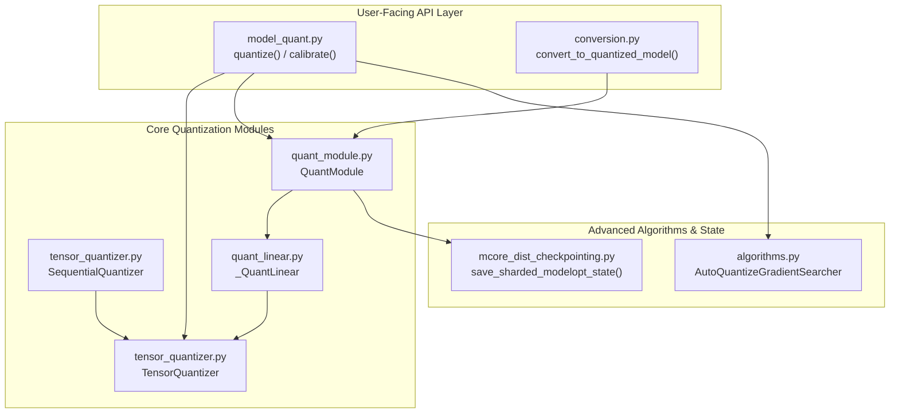

Sources: [modelopt/torch/quantization/model_quant.py:147-151](), [modelopt/torch/quantization/conversion.py:63-74](), [modelopt/torch/quantization/nn/modules/quant_module.py:41-60](), [modelopt/torch/quantization/nn/modules/quant_linear.py:38-53]()

### Diagram: Quantization and Calibration Workflow


Sources: [modelopt/torch/quantization/model_quant.py:64-129](), [modelopt/torch/quantization/conversion.py:63-74](), [modelopt/torch/quantization/nn/modules/quant_module.py:131-162]()

---

## State Management and Integration

Model Optimizer provides robust state management mechanisms to serialize, restore, and checkpoint optimized models across distributed training frameworks. 

- **State Persistence**: Optimization states (such as quantizer `amax` values, active hyperparameter choices, and search metadata) are tracked via `ModeloptStateManager` and can be restored using `restore_quantizer_state()` [modelopt/torch/quantization/conversion.py:125-170]().
- **Distributed Checkpointing**: For large-scale distributed training frameworks like Megatron-Core, specialized plugins handle sharded state dict saving and loading [modelopt/torch/opt/plugins/mcore_dist_checkpointing.py:67-110]().
- **Weight Folding**: Models can temporarily or permanently bake scaling factors and fake-quantization parameters directly into weights via `fold_weight()` to streamline inference execution [modelopt/torch/quantization/nn/modules/quant_module.py:131-162]().

Sources: [modelopt/torch/quantization/conversion.py:125-170](), [modelopt/torch/opt/plugins/mcore_dist_checkpointing.py:67-110](), [modelopt/torch/quantization/nn/modules/quant_module.py:131-162]()

---

## Next Steps

- For deep dives into PTQ calibration techniques, see [Post-Training Quantization (PTQ)](#3.1).
- For QAT workflows, see [Quantization-Aware Training (QAT)](#3.2).
- For pruning and NAS workflows, see [Model Pruning](#3.3).
- For deployment export pipelines, see [Export and Deployment](#8).

---

# Page: Post-Training Quantization (PTQ)

# Post-Training Quantization (PTQ)

<details>
<summary>Relevant source files</summary>

The following files were used as context for generating this wiki page:

- [examples/hf_ptq/README.md](examples/hf_ptq/README.md)
- [examples/hf_ptq/example_utils.py](examples/hf_ptq/example_utils.py)
- [examples/hf_ptq/hf_ptq.py](examples/hf_ptq/hf_ptq.py)
- [examples/hf_ptq/requirements.txt](examples/hf_ptq/requirements.txt)
- [modelopt/torch/export/hf_export_handlers.py](modelopt/torch/export/hf_export_handlers.py)
- [modelopt/torch/export/layerwise_export.py](modelopt/torch/export/layerwise_export.py)
- [modelopt/torch/export/model_config.py](modelopt/torch/export/model_config.py)
- [modelopt/torch/export/registry.py](modelopt/torch/export/registry.py)
- [modelopt/torch/export/unified_export_hf_streaming.py](modelopt/torch/export/unified_export_hf_streaming.py)
- [modelopt/torch/quantization/config.py](modelopt/torch/quantization/config.py)
- [modelopt/torch/quantization/mode.py](modelopt/torch/quantization/mode.py)
- [modelopt/torch/quantization/model_calib.py](modelopt/torch/quantization/model_calib.py)
- [modelopt/torch/quantization/nn/modules/tensor_quantizer.py](modelopt/torch/quantization/nn/modules/tensor_quantizer.py)
- [modelopt/torch/quantization/plugins/accelerate.py](modelopt/torch/quantization/plugins/accelerate.py)
- [modelopt/torch/quantization/utils/calib_utils.py](modelopt/torch/quantization/utils/calib_utils.py)
- [modelopt/torch/quantization/utils/core_utils.py](modelopt/torch/quantization/utils/core_utils.py)
- [modelopt/torch/quantization/utils/layerwise_calib.py](modelopt/torch/quantization/utils/layerwise_calib.py)
- [modelopt/torch/utils/dataset_utils.py](modelopt/torch/utils/dataset_utils.py)
- [modelopt/torch/utils/speech_dataset_utils.py](modelopt/torch/utils/speech_dataset_utils.py)
- [modelopt/torch/utils/vlm_dataset_utils.py](modelopt/torch/utils/vlm_dataset_utils.py)
- [modelopt_recipes/huggingface/qwen3_6_moe/auto_quantize/w4a16_nvfp4_fp8_module_spaces_at_6p0bits-active_moe.yaml](modelopt_recipes/huggingface/qwen3_6_moe/auto_quantize/w4a16_nvfp4_fp8_module_spaces_at_6p0bits-active_moe.yaml)
- [modelopt_recipes/ptq.md](modelopt_recipes/ptq.md)
- [tests/examples/hf_ptq/test_example_utils.py](tests/examples/hf_ptq/test_example_utils.py)
- [tests/examples/hf_ptq/test_hf_ptq_args.py](tests/examples/hf_ptq/test_hf_ptq_args.py)
- [tests/gpu/torch/quantization/conftest.py](tests/gpu/torch/quantization/conftest.py)
- [tests/gpu/torch/quantization/plugins/test_accelerate_gpu.py](tests/gpu/torch/quantization/plugins/test_accelerate_gpu.py)
- [tests/gpu/torch/quantization/test_fsdp2.py](tests/gpu/torch/quantization/test_fsdp2.py)
- [tests/gpu/torch/quantization/test_gptq.py](tests/gpu/torch/quantization/test_gptq.py)
- [tests/gpu/torch/quantization/test_layerwise_calibrate.py](tests/gpu/torch/quantization/test_layerwise_calibrate.py)
- [tests/gpu/torch/utils/test_model_load_utils.py](tests/gpu/torch/utils/test_model_load_utils.py)
- [tests/unit/torch/export/test_export_registry.py](tests/unit/torch/export/test_export_registry.py)
- [tests/unit/torch/export/test_offload_export.py](tests/unit/torch/export/test_offload_export.py)
- [tests/unit/torch/quantization/test_config_validation.py](tests/unit/torch/quantization/test_config_validation.py)
- [tests/unit/torch/quantization/test_layerwise_calibrate.py](tests/unit/torch/quantization/test_layerwise_calibrate.py)
- [tests/unit/torch/utils/test_dataset_utils.py](tests/unit/torch/utils/test_dataset_utils.py)

</details>


## Purpose and Scope

Post-Training Quantization (PTQ) is a model optimization technique that reduces the precision of model weights and activations after training to improve inference efficiency. This page covers the PTQ system in Model Optimizer, which enables quantization of HuggingFace and Megatron-Core models to various formats (FP8, INT8, INT4, NVFP4, MXFP8) using different calibration algorithms without requiring retraining.

The system focuses on high-performance deployment targets including TensorRT-LLM, vLLM, and SGLang.

Sources: [modelopt/torch/quantization/config.py:16-46](), [modelopt/torch/quantization/model_calib.py:70-80]()

## PTQ System Architecture

The PTQ system is built on a plugin architecture that allows it to support various model frameworks (HuggingFace, Megatron-Core) while sharing a common set of quantization algorithms and core modules.

### Component Relationship Diagram

This diagram bridges the natural language concepts to the specific code entities implementing them.

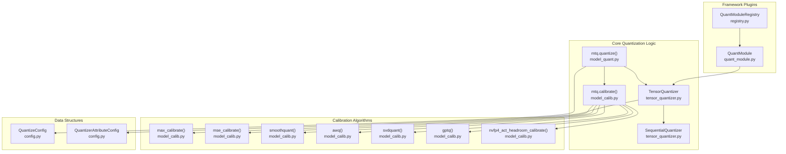

Sources: [modelopt/torch/quantization/model_calib.py:70-80](), [modelopt/torch/quantization/nn/modules/tensor_quantizer.py:136-182](), [modelopt/torch/quantization/config.py:35-60]()

## Quantization Workflow

The PTQ workflow follows a process of model conversion, calibration, and attribute validation.

```mermaid
graph LR
    subgraph "1. Conversion"
        Cfg["Select Config / Recipe<br/>load_recipe()"]
        Conv["convert_to_quantized_model()<br/>Replace nn.Linear -> QuantLinear"]
    end
    
    subgraph "2. Calibration"
        Stats["enable_stats_collection()<br/>Set if_calib=True"]
        Loop["forward_loop(model)<br/>Compute amax/stats"]
        Finish["finish_stats_collection()<br/>Set if_calib=False"]
    end
    
    subgraph "3. Post-Processing"
        Sync["sync_quantizer_amax_across_dp_ep()<br/>Distributed Sync"]
        Shared["_finalize_with_shared_state()<br/>Sync fusible groups"]
        Promote["promote_static_block_weight_quantizers()<br/>Materialize NVFP4 scales"]
    end
    
    Cfg --> Conv
    Conv --> Stats
    Stats --> Loop
    Loop --> Finish
    Finish --> Sync
    Sync --> Shared
    Shared --> Promote
```

Sources: [modelopt/torch/quantization/model_calib.py:117-159](), [modelopt/torch/quantization/utils/core_utils.py:43-90]()

## Quantization Formats and Recipes

Model Optimizer utilizes a recipe-based system to define quantization schemes. Recipes combine format selection, scope (which layers to quantize), and calibration algorithms.

### Supported Formats and Schemes

| Format | Example Recipe | Description | Target Hardware |
| :--- | :--- | :--- | :--- |
| **INT8** | `INT8_SMOOTHQUANT_CFG` | Per-channel weights, per-tensor activations | Generic GPU |
| **FP8** | `FP8_DEFAULT_CFG` | E4M3 format for weights and activations | H100+ |
| **INT4 AWQ** | `INT4_AWQ_CFG` | W4A16 weight-only with AWQ scaling | Generic GPU |
| **NVFP4** | `nvfp4_default-kv_fp8` | 4-bit floating point (E2M1) W4A4 | Blackwell |

Sources: [modelopt/torch/quantization/config.py:35-46](), [modelopt_recipes/ptq.md:33-60]()

### NVFP4 Activation Headroom
A specialized calibration algorithm for NVFP4 activations. It anchors the global scale to a low percentile of the per-block amax distribution, providing headroom to prevent saturation of larger activation values.
- **Implementation:** `NVFP4ActHeadroomCalibrator` referenced via `modelopt.torch.quantization.model_calib`
- **Parameters:** `rho` (headroom factor), `anchor_percentile`, and `upper_percentile`.

Sources: [modelopt/torch/quantization/model_calib.py:45-78]()

## Calibration Algorithms

Calibration determines the scaling factors (`amax`) to map values to the target range.

### Max Calibration
Computes the absolute maximum value seen during the forward pass.
- **Key Function:** `max_calibrate` defined in `model_calib.py`.
- **Shared State:** Automatically synchronizes `global_amax` for fusible sibling groups (Q/K/V, gate/up) to ensure consistent per-block scaling.

Sources: [modelopt/torch/quantization/model_calib.py:76-159]()

### MSE Calibration
Searches for an `amax` that minimizes the Mean Squared Error between the original and quantized tensor.
- **Implementation:** `MseCalibrator` defined in `calib/mse.py`.
- **FP8 Sweep:** Supports an optional `fp8_scale_sweep` to optimize scales specifically for FP8 backends.

Sources: [modelopt/torch/quantization/model_calib.py:45-78]()

### SmoothQuant
Migrates quantization difficulty from activations to weights using a per-channel scaling factor.
- **Key Function:** `smoothquant` defined in `model_calib.py`.
- **Logic:** Performs a calibration pass to collect activation statistics, then applies balancing factors to weights and activations.

Sources: [modelopt/torch/quantization/model_calib.py:70-80]()

### AWQ (Activation-Aware Weight Quantization)
Protects salient weights by scaling them based on activation magnitudes.
- **Key Function:** `awq` defined in `model_calib.py`.
- **Variants:** Supports lite, full, and clip configurations.

Sources: [modelopt/torch/quantization/model_calib.py:70-80](), [modelopt/torch/quantization/config.py:35-60]()

### SVDQuant
Handles outliers in 4-bit quantization by using Singular Value Decomposition to decompose weights.
- **Key Function:** `svdquant` defined in `model_calib.py`.
- **Dynamic Conversion:** Can replace `nn.Linear` with SVDQuant linear layers on-the-fly during calibration.

Sources: [modelopt/torch/quantization/model_calib.py:46-79]()

## TensorQuantizer: The Core Module

`TensorQuantizer` is the primary `nn.Module` for managing quantization state and execution.

### Code Entity Space Diagram

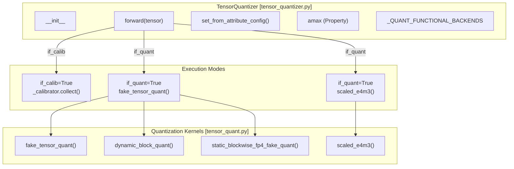

Sources: [modelopt/torch/quantization/nn/modules/tensor_quantizer.py:136-188](), [modelopt/torch/quantization/tensor_quant.py:57-64]()

### Key Features
- **Shared Quantizers:** Supports shared `global_amax` across multiple quantizers via `SharedWeightGlobalAmaxState`.
- **MoE Support:** `GroupedQuantizer` enables independent quantization for each expert in fused MoE layers.
- **Backend Registration:** Custom quantization backends can be registered via `register_quant_backend`.

Sources: [modelopt/torch/quantization/model_calib.py:144-158](), [modelopt/torch/quantization/nn/modules/tensor_quantizer.py:74-130]()

## Framework Integration

### Hugging Face Models
The PTQ system integrates with Hugging Face via specialized `QuantModule` implementations and model builders.
- **KV Cache Quantization:** Manages quantization for Q, K, V tensors with constant or dynamic scaling factors.
- **Calibration Loops:** Integrates with Hugging Face dataset utilities and tokenizers for automated calibration.

Sources: [examples/hf_ptq/hf_ptq.py:104-120](), [modelopt/torch/utils/dataset_utils.py:139-174]()

### Megatron-Core and Distributed Support
Supports distributed quantization for M-Core models, including ColumnParallel and RowParallel linear layers.
- **Distributed Sync:** Synchronizes scaling factors across Data Parallel (DP) and Expert Parallel (EP) ranks using distributed utilities.

Sources: [modelopt/torch/quantization/model_calib.py:27-42](), [modelopt/torch/quantization/utils/core_utils.py:27-30]()

---

# Page: Quantization-Aware Training (QAT)

# Quantization-Aware Training (QAT)

<details>
<summary>Relevant source files</summary>

The following files were used as context for generating this wiki page:

- [docs/source/guides/4_distillation.rst](docs/source/guides/4_distillation.rst)
- [examples/gpt-oss/configs/sft_full.yaml](examples/gpt-oss/configs/sft_full.yaml)
- [examples/gpt-oss/configs/sft_lora.yaml](examples/gpt-oss/configs/sft_lora.yaml)
- [examples/gpt-oss/sft.py](examples/gpt-oss/sft.py)
- [examples/llm_distill/README.md](examples/llm_distill/README.md)
- [examples/llm_distill/accelerate_config/fsdp2.yaml](examples/llm_distill/accelerate_config/fsdp2.yaml)
- [examples/llm_distill/main.py](examples/llm_distill/main.py)
- [examples/llm_distill/requirements.txt](examples/llm_distill/requirements.txt)
- [examples/llm_qat/ARGUMENTS.md](examples/llm_qat/ARGUMENTS.md)
- [examples/llm_qat/README.md](examples/llm_qat/README.md)
- [examples/llm_qat/llama_factory/launch_llamafactory.sh](examples/llm_qat/llama_factory/launch_llamafactory.sh)
- [examples/llm_qat/llama_factory/llama_factory.py](examples/llm_qat/llama_factory/llama_factory.py)
- [examples/llm_qat/quantize.py](examples/llm_qat/quantize.py)
- [modelopt/torch/distill/losses.py](modelopt/torch/distill/losses.py)
- [modelopt/torch/distill/plugins/huggingface.py](modelopt/torch/distill/plugins/huggingface.py)
- [modelopt/torch/quantization/plugins/transformers_trainer.py](modelopt/torch/quantization/plugins/transformers_trainer.py)
- [tests/examples/llm_distill/test_llm_distill.py](tests/examples/llm_distill/test_llm_distill.py)
- [tests/unit/torch/distill/plugins/test_huggingface_kd.py](tests/unit/torch/distill/plugins/test_huggingface_kd.py)

</details>


Quantization-Aware Training (QAT) simulates quantization effects during training to recover accuracy lost during low-precision conversion [examples/llm_qat/README.md:1-3](). Unlike Post-Training Quantization (PTQ, see [3.1]()), which quantizes a pre-trained model without additional training, QAT fine-tunes the model with simulated quantization operations in the forward pass. This allows the model weights to adapt to quantization constraints, achieving higher accuracy for aggressive formats like INT4 or FP4/NVFP4 on the NVIDIA Blackwell platform [examples/llm_qat/README.md:1-3]().

Model Optimizer provides comprehensive QAT support through:
- **Fake Quantization**: Modules that simulate quantization noise during training using Straight-Through Estimation (STE) [modelopt/torch/quantization/plugins/transformers_trainer.py:153-169]().
- **Trainer Plugins**: High-level classes like `QATTrainer` and `KDTrainer` for Hugging Face workflows [modelopt/torch/quantization/plugins/transformers_trainer.py:153-169](), [modelopt/torch/distill/plugins/huggingface.py:97-104]().
- **Framework Integration**: Support for PyTorch FSDP2, DeepSpeed, and distributed training setups via patching and context managers [modelopt/torch/quantization/plugins/transformers_trainer.py:93-136](), [modelopt/torch/distill/plugins/huggingface.py:174-189]().
- **Hybrid Workflows**: Integration with LoRA (QLoRA) and Knowledge Distillation (QAD) [examples/llm_qat/README.md:3-5]().

---

## QAT Workflow Architecture

The QAT workflow transitions a model from high precision to a "fake quantized" state where weights and activations are constrained during the forward pass, while gradients remain in higher precision for stable updates.

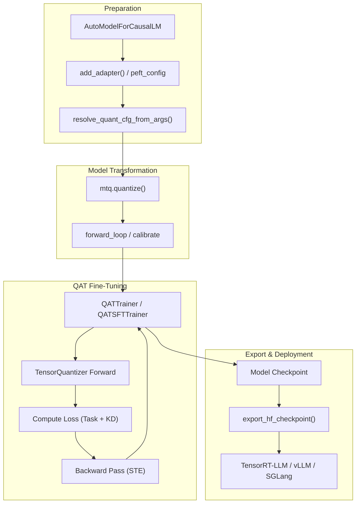
**Diagram: End-to-End QAT Workflow with Code Entities**

Sources: [examples/llm_qat/README.md:43-86](), [modelopt/torch/quantization/plugins/transformers_trainer.py:153-172]()

---

## Core Components

### QAT Trainer Classes
Model Optimizer provides specialized trainers that inherit from standard framework trainers (like Hugging Face `Trainer` and TRL `SFTTrainer`) to automate the QAT setup and calibration phases [modelopt/torch/quantization/plugins/transformers_trainer.py:153-169](), [examples/gpt-oss/sft.py:60-61]().

| Class | Base Class | Description |
| :--- | :--- | :--- |
| `QATTrainer` | `ModelOptHFTrainer` | Standard QAT for Hugging Face models. Handles `mtq.quantize` and calibration automatically [modelopt/torch/quantization/plugins/transformers_trainer.py:153-169](). |
| `KDTrainer` | `ModelOptHFTrainer` | Distillation trainer for Hugging Face models. Supports logit-level knowledge distillation [modelopt/torch/distill/plugins/huggingface.py:97-104](). |
| `QuantizationArguments` | `ModelOptHFArguments` | Standardizes CLI and YAML arguments for `recipe`, `calib_size`, and `compress` [modelopt/torch/quantization/plugins/transformers_trainer.py:46-77](). |

### Distributed Training Support
QAT supports large-scale training using FSDP2 and DeepSpeed. A critical component is the management of `modelopt_state` and gradient data types across ranks [modelopt/torch/quantization/plugins/transformers_trainer.py:93-136]().

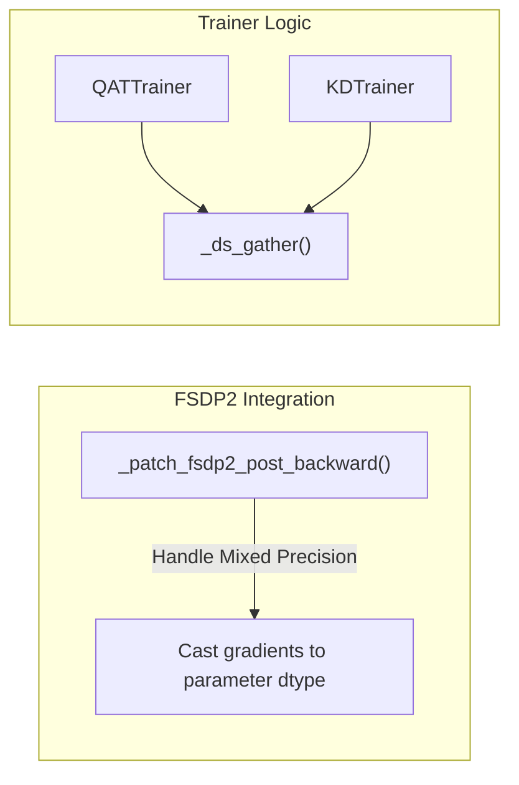
**Diagram: Distributed QAT Components and Code Hooks**

For FSDP2, a patch is applied to `FSDPParamGroup.post_backward` to handle mixed-precision gradient dtypes where `bf16` gradients are assigned to `fp32` parameters, preventing runtime errors in PyTorch 2.6+ [modelopt/torch/quantization/plugins/transformers_trainer.py:93-136](). For DeepSpeed ZeRO-3, the `_ds_gather` context manager is used to gather partitioned teacher parameters during distillation forward passes [modelopt/torch/distill/plugins/huggingface.py:174-189]().

Sources: [modelopt/torch/quantization/plugins/transformers_trainer.py:93-136](), [modelopt/torch/distill/plugins/huggingface.py:174-189]()

---

## Implementation Details

### Quantization-Aware Distillation (QAD)
Quantization-Aware Distillation (QAD) combines QAT with knowledge distillation, using a full-precision teacher model to guide the quantized student model. In the `KDTrainer` implementation:
- The teacher model is prepared via `self._prepare_model()` to handle FSDP2, DeepSpeed, or DDP topologies [modelopt/torch/distill/plugins/huggingface.py:163-169]().
- Distillation loss (`LogitsDistillationLoss`) computes KL-divergence over softened logits [modelopt/torch/distill/plugins/huggingface.py:142-144]().
- Liger kernel integration allows for accelerated fused Cross-Entropy and Jensen-Shannon Divergence calculations when enabled [modelopt/torch/distill/plugins/huggingface.py:152-160]().

Sources: [modelopt/torch/distill/plugins/huggingface.py:142-169](), [examples/llm_qat/README.md:125-129]()

---

## Export Pipeline

Once QAT is complete, the model is exported for high-performance inference engines like TensorRT-LLM, vLLM, or SGLang [examples/llm_qat/README.md:88]().

1. **Enable Checkpointing**: Call `mto.enable_huggingface_checkpointing()` in the training script to ensure ModelOpt metadata and quantization scales are saved alongside Hugging Face model weights [examples/gpt-oss/sft.py:64]().
2. **Load Trained Checkpoint**: Use `AutoModelForCausalLM.from_pretrained()` to load the fine-tuned checkpoint [examples/llm_qat/README.md:56-62]().
3. **Export Checkpoint**: Run `export.py` to extract scaling factors and format weights into deployment-ready structures [examples/llm_qat/README.md:62]().

Sources: [examples/llm_qat/README.md:56-62](), [examples/gpt-oss/sft.py:64]()

---

## Summary of Key QAT APIs

| API Function / Class | Module Path | Description |
| :--- | :--- | :--- |
| `mtq.quantize` | `modelopt.torch.quantization` | Transforms a model for QAT by inserting quantizers [examples/llm_qat/README.md:115-116](). |
| `mto.enable_huggingface_checkpointing` | `modelopt.torch.opt` | Enables automatic save/load of ModelOpt state with HF checkpoints [examples/gpt-oss/sft.py:64](). |
| `QATTrainer` | `modelopt.torch.quantization.plugins` | Drop-in HF Trainer replacement for QAT workflows [modelopt/torch/quantization/plugins/transformers_trainer.py:161-172](). |
| `KDTrainer` | `modelopt.torch.distill.plugins.huggingface` | HF Trainer for distillation-based accuracy recovery (QAD) [modelopt/torch/distill/plugins/huggingface.py:105-116](). |

Sources: [modelopt/torch/quantization/plugins/transformers_trainer.py:161-172](), [modelopt/torch/distill/plugins/huggingface.py:105-116](), [examples/gpt-oss/sft.py:64]()

---

# Page: Model Pruning

# Model Pruning

<details>
<summary>Relevant source files</summary>

The following files were used as context for generating this wiki page:

- [docs/source/guides/3_pruning.rst](docs/source/guides/3_pruning.rst)
- [docs/source/guides/7_nas.rst](docs/source/guides/7_nas.rst)
- [examples/megatron_bridge/README.md](examples/megatron_bridge/README.md)
- [examples/megatron_bridge/distill.py](examples/megatron_bridge/distill.py)
- [examples/megatron_bridge/export_distilled_megatron_to_hf.py](examples/megatron_bridge/export_distilled_megatron_to_hf.py)
- [examples/megatron_bridge/export_quantized_megatron_to_hf.py](examples/megatron_bridge/export_quantized_megatron_to_hf.py)
- [examples/megatron_bridge/prune_minitron.py](examples/megatron_bridge/prune_minitron.py)
- [examples/megatron_bridge/quantize.py](examples/megatron_bridge/quantize.py)
- [examples/pruning/README.md](examples/pruning/README.md)
- [examples/pruning/cifar_resnet.ipynb](examples/pruning/cifar_resnet.ipynb)
- [modelopt/torch/nas/plugins/megatron.py](modelopt/torch/nas/plugins/megatron.py)
- [modelopt/torch/nas/utils.py](modelopt/torch/nas/utils.py)
- [modelopt/torch/prune/plugins/mcore_minitron.py](modelopt/torch/prune/plugins/mcore_minitron.py)
- [modelopt/torch/utils/plugins/mbridge.py](modelopt/torch/utils/plugins/mbridge.py)
- [tests/_test_utils/torch/megatron/models.py](tests/_test_utils/torch/megatron/models.py)
- [tests/_test_utils/torch/megatron/utils.py](tests/_test_utils/torch/megatron/utils.py)
- [tests/examples/megatron_bridge/test_distill.py](tests/examples/megatron_bridge/test_distill.py)
- [tests/examples/megatron_bridge/test_prune_minitron.py](tests/examples/megatron_bridge/test_prune_minitron.py)
- [tests/examples/megatron_bridge/test_qad.py](tests/examples/megatron_bridge/test_qad.py)
- [tests/unit/torch/nas/test_evaluate_constraints.py](tests/unit/torch/nas/test_evaluate_constraints.py)
- [tests/unit/torch/nas/test_full_algorithms_vision.py](tests/unit/torch/nas/test_full_algorithms_vision.py)
- [tests/unit/torch/nas/test_latency_interpolator.py](tests/unit/torch/nas/test_latency_interpolator.py)
- [tests/unit/torch/nas/test_nas_utils.py](tests/unit/torch/nas/test_nas_utils.py)
- [tests/unit/torch/prune/test_algorithms.py](tests/unit/torch/prune/test_algorithms.py)

</details>


## Purpose and Scope

Model pruning reduces neural network size by removing redundant or less important parameters while maintaining accuracy. This technique can involve the removal of linear and convolutional layers, as well as Transformer-specific components like attention heads, MLP intermediate dimensions, Mixture-of-Experts (MoE) experts, and even entire model layers (depth pruning) [examples/pruning/README.md:3-6]().

This document provides a high-level overview of the pruning algorithms and the underlying Neural Architecture Search (NAS) infrastructure. For detailed instructions on pruning Large Language Models (LLMs) in distributed environments, see [Minitron Pruning for Megatron-Core](#3.3.1).

## Overview

Model Optimizer provides several pruning modes through the unified `mtp.prune` API [examples/pruning/README.md:78-85](). These modes are specialized for different model architectures and frameworks:

| Mode | Target Models | Pruning Strategy | Primary Use Case |
|------|--------------|------------------|------------------|
| `mcore_minitron` | Megatron-Core GPT, Mamba, MoE, Hybrid | Activation magnitude-based importance [modelopt/torch/prune/plugins/mcore_minitron.py:18-22]() | LLMs and Hybrid models in distributed frameworks |
| `fastnas` | Computer Vision models | Score function maximization under constraints [examples/pruning/README.md:11-11]() | CV models (ResNet, MobileNet, etc.) |
| `gradnas` | HuggingFace BERT, GPT-J | Gradient-based importance estimation [examples/pruning/README.md:12-12]() | Light-weight pruning for transformer LMs |
| `puzzletron` | General NVIDIA Models | Mixed Integer Programming (MIP) based search [examples/pruning/README.md:10-10]() | Advanced NAS search |

Sources: [examples/pruning/README.md:9-12](), [modelopt/torch/prune/plugins/mcore_minitron.py:16-25]()

## Pruning Architecture

The pruning system leverages the Neural Architecture Search (NAS) infrastructure. It treats pruning as a search for the optimal subnet within the original model supernet [examples/pruning/README.md:7-8]().

### High-Level Workflow

The `mtp.prune` process maps high-level pruning objectives to specific code entities within `modelopt.torch.nas` and `modelopt.torch.prune`.

Title: Pruning Workflow and Code Entity Mapping
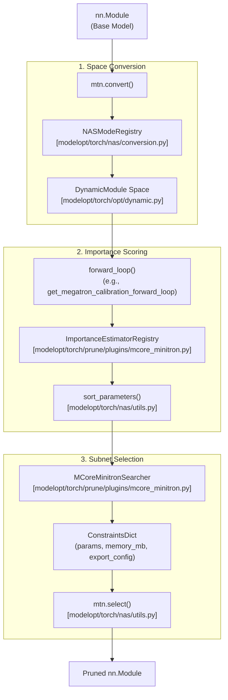

Sources: [modelopt/torch/nas/conversion.py:58-59](), [modelopt/torch/nas/utils.py:81-81](), [modelopt/torch/prune/plugins/mcore_minitron.py:124-125](), [examples/pruning/README.md:103-109]()

### Constraints and Metrics

Pruning is guided by a `constraints` dictionary that defines the target budget [examples/pruning/README.md:35-36]():

*   **Params**: Target total parameter count (e.g., `6e9` for a 6B model) [examples/megatron_bridge/prune_minitron.py:18-18]().
*   **Active Params**: Useful for Mixture-of-Experts (MoE) models where only a subset of experts are active per token [examples/megatron_bridge/prune_minitron.py:19-19]().
*   **Memory MB**: Target memory footprint (Weights + KV-Cache) for a specific sequence length and batch size [examples/megatron_bridge/prune_minitron.py:20-20]().
*   **Export Config**: Manual specification of target dimensions (e.g., `{"num_layers": 32, "hidden_size": 3584}`) [examples/pruning/README.md:97-97]().

Sources: [examples/megatron_bridge/prune_minitron.py:17-21](), [modelopt/torch/prune/plugins/mcore_minitron.py:98-114]()

## Dynamic Module System

To enable runtime shape changes during search, standard layers are replaced with `DynamicModule` variants. These modules use `TracedHp` (Traced Hyperparameters) to track active choices and importance [modelopt/torch/nas/plugins/megatron.py:59-69]().

### Megatron-Core Dynamic Plugins

For distributed training frameworks like Megatron-Core, specialized plugins handle parallelized linear layers and complex block structures [modelopt/torch/nas/plugins/megatron.py:16-25]().

Title: Dynamic Module Registry and Entity Mapping
```mermaid
graph TD
    subgraph MCore["Megatron-Core Layers"]
        ColumnParallelLinear["ColumnParallelLinear<br/>[megatron.core.tensor_parallel.layers]"]
        RowParallelLinear["RowParallelLinear<br/>[megatron.core.tensor_parallel.layers]"]
        GPTModel["GPTModel<br/>[megatron.core.models.gpt]"]
    end

    subgraph DynPlugins["Dynamic Plugins"]
        DynCol["_DynamicColumnParallelLinear<br/>[modelopt/torch/nas/plugins/megatron.py]"]
        DynRow["_DynamicRowParallelLinear<br/>[modelopt/torch/nas/plugins/megatron.py]"]
        DynLang["_DynamicMCoreLanguageModel<br/>[modelopt/torch/nas/plugins/megatron.py]"]
    end

    subgraph Registry["Registry & State"]
        DMRegistry["DMRegistry<br/>[modelopt/torch/nas/registry.py]"]
        DynamicSpace["DynamicSpace<br/>[modelopt/torch/opt/dynamic.py]"]
    end

    ColumnParallelLinear --> DMRegistry
    RowParallelLinear --> DMRegistry
    GPTModel --> DMRegistry
    
    DMRegistry --> DynCol
    DMRegistry --> DynRow
    DMRegistry --> DynLang

    DynCol --> DynamicSpace
    DynRow --> DynamicSpace
    DynLang --> DynamicSpace
```

Sources: [modelopt/torch/nas/plugins/megatron.py:36-49](), [modelopt/torch/nas/plugins/megatron.py:138-160](), [modelopt/torch/nas/registry.py:23]()

## Minitron: Width and Depth Pruning

Minitron is the primary algorithm for LLMs, supporting GPT (attention-based), Mamba (state-space), and Hybrid Transformer-Mamba models [modelopt/torch/prune/plugins/mcore_minitron.py:18-25]().

### Pruning Axes
Minitron can prune across multiple dimensions [modelopt/torch/prune/plugins/mcore_minitron.py:98-114]():
*   **Width**: `hidden_size`, `ffn_hidden_size`, `num_attention_heads`, `mamba_num_heads`, `mamba_head_dim`, `num_moe_experts`.
*   **Depth**: `num_layers`.

### Distributed Layer Dropping
For depth pruning in distributed settings, the system uses `drop_mcore_language_model_layers` to remove layers across pipeline-parallel (PP) ranks and re-index the remaining layers [modelopt/torch/prune/plugins/mcore_minitron.py:155-174]().

For details, see [Minitron Pruning for Megatron-Core](#3.3.1).

Sources: [modelopt/torch/prune/plugins/mcore_minitron.py:18-25](), [modelopt/torch/prune/plugins/mcore_minitron.py:98-114](), [modelopt/torch/prune/plugins/mcore_minitron.py:152-174]()

## Post-Pruning Recovery

Pruning is generally a lossy process. Recovery of accuracy is typically achieved through:
1.  **Fine-tuning**: Short-term training on the pruned architecture [examples/pruning/README.md:87-88]().
2.  **Knowledge Distillation**: Using the original unpruned model as a teacher to guide the pruned student model [examples/megatron_bridge/README.md:116-118]().

Sources: [examples/pruning/README.md:92-93](), [examples/megatron_bridge/distill.py:15-21]()

---

# Page: Minitron Pruning for Megatron-Core

# Minitron Pruning for Megatron-Core

<details>
<summary>Relevant source files</summary>

The following files were used as context for generating this wiki page:

- [examples/megatron_bridge/README.md](examples/megatron_bridge/README.md)
- [examples/megatron_bridge/distill.py](examples/megatron_bridge/distill.py)
- [examples/megatron_bridge/export_distilled_megatron_to_hf.py](examples/megatron_bridge/export_distilled_megatron_to_hf.py)
- [examples/megatron_bridge/export_quantized_megatron_to_hf.py](examples/megatron_bridge/export_quantized_megatron_to_hf.py)
- [examples/megatron_bridge/prune_minitron.py](examples/megatron_bridge/prune_minitron.py)
- [examples/megatron_bridge/quantize.py](examples/megatron_bridge/quantize.py)
- [examples/pruning/README.md](examples/pruning/README.md)
- [modelopt/torch/nas/plugins/megatron.py](modelopt/torch/nas/plugins/megatron.py)
- [modelopt/torch/nas/plugins/megatron_model_stats.py](modelopt/torch/nas/plugins/megatron_model_stats.py)
- [modelopt/torch/prune/plugins/mcore_minitron.py](modelopt/torch/prune/plugins/mcore_minitron.py)
- [modelopt/torch/utils/plugins/mbridge.py](modelopt/torch/utils/plugins/mbridge.py)
- [tests/_test_utils/torch/megatron/models.py](tests/_test_utils/torch/megatron/models.py)
- [tests/_test_utils/torch/megatron/utils.py](tests/_test_utils/torch/megatron/utils.py)
- [tests/examples/megatron_bridge/test_distill.py](tests/examples/megatron_bridge/test_distill.py)
- [tests/examples/megatron_bridge/test_prune_minitron.py](tests/examples/megatron_bridge/test_prune_minitron.py)
- [tests/examples/megatron_bridge/test_qad.py](tests/examples/megatron_bridge/test_qad.py)
- [tests/gpu_megatron/torch/nas/plugins/test_megatron_gpt_dynamic_modules.py](tests/gpu_megatron/torch/nas/plugins/test_megatron_gpt_dynamic_modules.py)
- [tests/gpu_megatron/torch/nas/plugins/test_megatron_model_stats.py](tests/gpu_megatron/torch/nas/plugins/test_megatron_model_stats.py)
- [tests/gpu_megatron/torch/prune/plugins/test_mcore_gpt_minitron_pruning.py](tests/gpu_megatron/torch/prune/plugins/test_mcore_gpt_minitron_pruning.py)

</details>


## Purpose and Scope

This page documents the Minitron pruning algorithm for NVIDIA Megatron-Core and NeMo 2.0 models. Minitron is a magnitude-based pruning technique that uses activation statistics to identify and remove redundant parameters from large language models (LLMs) while preserving model quality.

**Scope**: This page covers the technical implementation of Minitron pruning specifically for Megatron-Core models including GPT, Mamba, MoE, and hybrid architectures.

**Key Capabilities**:
- **Width pruning**: `hidden_size`, `ffn_hidden_size`, `num_attention_heads`, `mamba_num_heads`, `mamba_head_dim`, `num_moe_experts`, `moe_ffn_hidden_size`, `moe_shared_expert_intermediate_size` [modelopt/torch/prune/plugins/mcore_minitron.py:96-112]().
- **Depth pruning**: `num_layers` [modelopt/torch/prune/plugins/mcore_minitron.py:110-111]().
- **NAS-based Auto Pruning**: Automated search for the best architecture given a target parameter count, active parameter count (for MoE), or memory footprint [examples/megatron_bridge/prune_minitron.py:17-21](), [examples/pruning/README.md:40-46]().
- **Full Distributed Support**: Compatible with Pipeline Parallel (PP), Expert Parallel (EP), and Data Parallel (DP) training [modelopt/torch/prune/plugins/mcore_minitron.py:41-49]().

Sources: [modelopt/torch/prune/plugins/mcore_minitron.py:16-127](), [examples/pruning/README.md:1-47](), [examples/megatron_bridge/prune_minitron.py:15-38]()

---

## System Architecture

### High-Level Pruning Pipeline (Natural Language to Code Entity Mapping)

The Minitron pruning pipeline transforms natural language definitions of model compression into specific Megatron-Core dynamic modules and search operators. The diagram below bridges the system concepts to their concrete code entities.

Title: Minitron Pruning Pipeline Entity Mapping

```mermaid
graph TB
    subgraph NaturalLanguageSpace ["Natural Language Space"]
        NL_MODELS["GPT / Mamba / MoE / Hybrid Models"]
        NL_CONV["Dynamic Conversion & Slicing"]
        NL_EST["Importance Estimation (Activations)"]
        NL_SEARCH["NAS Search & Parameter Ranking"]
        NL_EXPORT["Homogeneous Pruned Checkpoint"]
    end

    subgraph CodeEntitySpace ["Code Entity Space"]
        CE_MODELS["GPTModel, HybridModel, MambaLayer <br/> (modelopt/torch/nas/plugins/megatron.py:77-80,84)"]
        CE_CONV["mtp.prune(mode='mcore_minitron') <br/> (modelopt/torch/prune/plugins/mcore_minitron.py:58-94)"]
        CE_EST["forward_loop & Activation Hooks <br/> (modelopt/torch/utils/plugins/megatron_calibration.py:71-72)"]
        CE_SEARCH["MCoreMinitronSearcher & sort_parameters <br/> (modelopt/torch/prune/plugins/mcore_minitron.py:79-89)"]
        CE_DROP["drop_mcore_language_model_layers <br/> (modelopt/torch/prune/plugins/mcore_minitron.py:152-171)"]
    end

    NL_MODELS --> CE_MODELS
    NL_CONV --> CE_CONV
    NL_EST --> CE_EST
    NL_SEARCH --> CE_SEARCH
    NL_EXPORT --> CE_DROP

    CE_MODELS --> CE_CONV
    CE_CONV --> CE_EST
    CE_EST --> CE_SEARCH
    CE_SEARCH --> CE_DROP

    style NaturalLanguageSpace fill:none
    style CodeEntitySpace fill:none
```

Sources: [modelopt/torch/prune/plugins/mcore_minitron.py:58-94](), [modelopt/torch/nas/plugins/megatron.py:77-90](), [examples/pruning/README.md:50-85]()

---

## Supported Models and Hyperparameters

### Model Types

Minitron pruning supports the following Megatron-Core model types:

| Model Type | Code Entity | Support Status |
|------------|-------------|----------------|
| GPT | `megatron.core.models.gpt.GPTModel` | Supported [modelopt/torch/nas/plugins/megatron.py:77-78]() |
| Mamba | `megatron.core.ssm.mamba_layer.MambaLayer` | Supported [modelopt/torch/nas/plugins/megatron.py:84]() |
| Hybrid | `megatron.core.models.hybrid.HybridModel` | Supported [modelopt/torch/nas/plugins/megatron.py:79-80]() |
| MoE | `_DynamicMoELayer` | Supported [modelopt/torch/nas/plugins/megatron.py:66]() |

Sources: [modelopt/torch/prune/plugins/mcore_minitron.py:22-25](), [modelopt/torch/nas/plugins/megatron.py:77-90]()

### Prunable Hyperparameters

The algorithm supports two main categories of pruning:

1. **Width Pruning**:
   - `hidden_size`: Global embedding dimension [modelopt/torch/prune/plugins/mcore_minitron.py:98]().
   - `ffn_hidden_size`: MLP intermediate dimension [modelopt/torch/prune/plugins/mcore_minitron.py:99-100]().
   - `num_attention_heads`: Attention head count [modelopt/torch/prune/plugins/mcore_minitron.py:101-102]().
   - `mamba_num_heads` & `mamba_head_dim`: Mamba-specific dimensions [modelopt/torch/prune/plugins/mcore_minitron.py:103-105]().
   - `num_moe_experts`: Number of experts in MoE layers [modelopt/torch/prune/plugins/mcore_minitron.py:109]().
   - `moe_ffn_hidden_size` & `moe_shared_expert_intermediate_size`: Expert dimensions in MoE and DeepSeek-style models [modelopt/torch/prune/plugins/mcore_minitron.py:107-108]().
2. **Depth Pruning**:
   - `num_layers`: Total number of transformer or Mamba layers [modelopt/torch/prune/plugins/mcore_minitron.py:110-111]().

Sources: [modelopt/torch/prune/plugins/mcore_minitron.py:96-112]()

---

## Dynamic Module System

### Module Mapping

During the `convert` phase, standard Megatron-Core layers are replaced with their dynamic counterparts defined in `modelopt.torch.nas.plugins.megatron`.

| Megatron-Core Module | ModelOpt Dynamic Module |
|----------------------|-------------------------|
| `GPTModel` / `HybridModel` | `_DynamicMCoreLanguageModel` [modelopt/torch/nas/plugins/megatron.py:64]() |
| `TransformerLayer` | `_DynamicTransformerLayer` [modelopt/torch/nas/plugins/megatron.py:70]() |
| `SelfAttention` / `MLASelfAttention` | `_DynamicSelfAttention` [modelopt/torch/nas/plugins/megatron.py:67]() |
| `MLP` | `_DynamicMLP` [modelopt/torch/nas/plugins/megatron.py:65]() |
| `MambaMixer` | `_DynamicMambaMixer` [modelopt/torch/nas/plugins/megatron.py:63]() |
| `MoELayer` | `_DynamicMoELayer` [modelopt/torch/nas/plugins/megatron.py:66]() |

Sources: [modelopt/torch/nas/plugins/megatron.py:58-71]()

### Dynamic Slicing Architecture (Code Entity Mapping)

Title: Dynamic Module and Weight Slicing Architecture

```mermaid
classDiagram
    class _DynamicParallelLinear {
        +_setup(input_size, output_size)
        +_get_weight(mod, weight)
        +_get_bias(mod, bias)
    }
    class _DynamicColumnParallelLinear {
        +_setup(input_size, output_size)
    }
    class _DynamicRowParallelLinear {
        +_setup(input_size, output_size)
    }
    class TracedHp {
        +List choices
        +int active
        +Tensor importance
        +active_slice
    }
    
    _DynamicParallelLinear <|-- _DynamicColumnParallelLinear : inherits
    _DynamicParallelLinear <|-- _DynamicRowParallelLinear : inherits
    _DynamicParallelLinear --> TracedHp : "registers input_size"
    _DynamicParallelLinear --> TracedHp : "registers output_size"
```

Sources: [modelopt/torch/nas/plugins/megatron.py:112-160]()

---

## Importance Estimation

Minitron uses activation magnitudes to estimate the importance of neurons, heads, and layers.

### Width Importance (Magnitude-based)
For linear layers and attention heads, importance is calculated by running a calibration forward loop on data and collecting the L2 norm of activations:
1. **Hooks**: Forward hooks collect activation magnitudes during calibration passes [modelopt/torch/prune/plugins/mcore_minitron.py:18-19]().
2. **Aggregation**: Magnitudes are averaged over sequence lengths and summed over batches.
3. **Distributed Reduction**: Activation scores are reduced across Data Parallel (DP) and gathered across Pipeline Parallel (PP) ranks [modelopt/torch/prune/plugins/mcore_minitron.py:41-49]().

### Depth Importance (Cosine Similarity)
For layer pruning, importance is determined by the cosine similarity between input and output hidden states of each layer:
- Layers with **high cosine similarity** (input ≈ output) are classified as redundant and selected as top candidates for removal [modelopt/torch/prune/plugins/mcore_minitron.py:18-20]().

Sources: [modelopt/torch/prune/plugins/mcore_minitron.py:16-49]()

---

## Pruning Execution

### Layer Dropping (Depth Pruning)
The function `drop_mcore_language_model_layers` handles physical layer removal from the model decoder `nn.ModuleList`. It supports uneven Pipeline Parallelism by re-indexing kept layers across PP ranks using pipeline parallelism groups [modelopt/torch/prune/plugins/mcore_minitron.py:152-180]().

### Manual vs. Auto Pruning
1. **Manual Pruning**: The user specifies an `export_config` with explicit target dimensions (e.g., `hidden_size: 3072`, `num_layers: 32`) [examples/pruning/README.md:43-44,96]().
2. **NAS-based Auto Pruning**: The user specifies constraints like `prune_target_params`, `prune_target_active_params`, or `prune_target_memory_mb` [examples/megatron_bridge/prune_minitron.py:17-21](). The `MCoreMinitronSearcher` utilizes a score function (such as MMLU) to explore architecture candidates [examples/megatron_bridge/prune_minitron.py:22-32]().

Sources: [modelopt/torch/prune/plugins/mcore_minitron.py:152-200](), [examples/pruning/README.md:90-118](), [examples/megatron_bridge/prune_minitron.py:15-38]()

---

## Usage Example (Megatron-Bridge)

The following example demonstrates pruning a model using the `mtp.prune` API within the Megatron-Bridge framework [examples/pruning/README.md:50-85]().

```python
import modelopt.torch.prune as mtp
from modelopt.torch.utils.plugins.mbridge import load_mbridge_model_from_hf

# Load model from Hugging Face
bridge, provider, model, unwrapped_model, tokenizer = load_mbridge_model_from_hf(
    hf_model_name_or_path="Qwen/Qwen3-8B"
)

# Define pruning constraints
constraints = {
    "export_config": {
        "num_layers": 32, 
        "hidden_size": 3584, 
        "ffn_hidden_size": 10240
    }
}

# Execute in-place pruning
mtp.prune(
    unwrapped_model,
    mode="mcore_minitron",
    constraints=constraints,
    config={"forward_loop": forward_loop},
)
```

Sources: [examples/pruning/README.md:50-85](), [examples/megatron_bridge/prune_minitron.py:66-78]()

---

## Distributed Support Details

Minitron pruning integrates cleanly with Megatron-Core distributed paradigms:
- **Pipeline Parallelism (PP)**: `drop_mcore_language_model_layers` synchronizes remaining layer distributions across ranks via `get_pipeline_model_parallel_world_size()` [modelopt/torch/prune/plugins/mcore_minitron.py:41-45,173-180]().
- **Tensor Parallelism (TP)**: Slicing logic adapts to partitioned weights in `_DynamicColumnParallelLinear` and `_DynamicRowParallelLinear` [modelopt/torch/nas/plugins/megatron.py:141-160]().
- **Expert Parallelism (EP)**: Supports expert count and expert-intermediate dimension pruning through `_DynamicMoELayer` [modelopt/torch/nas/plugins/megatron.py:66]().

Sources: [modelopt/torch/prune/plugins/mcore_minitron.py:41-49](), [modelopt/torch/nas/plugins/megatron.py:112-160]()

---

# Page: Knowledge Distillation

# Knowledge Distillation

<details>
<summary>Relevant source files</summary>

The following files were used as context for generating this wiki page:

- [docs/source/guides/4_distillation.rst](docs/source/guides/4_distillation.rst)
- [examples/llm_distill/README.md](examples/llm_distill/README.md)
- [examples/llm_distill/accelerate_config/fsdp2.yaml](examples/llm_distill/accelerate_config/fsdp2.yaml)
- [examples/llm_distill/main.py](examples/llm_distill/main.py)
- [examples/llm_distill/requirements.txt](examples/llm_distill/requirements.txt)
- [examples/llm_qat/ARGUMENTS.md](examples/llm_qat/ARGUMENTS.md)
- [examples/llm_qat/README.md](examples/llm_qat/README.md)
- [examples/llm_qat/llama_factory/launch_llamafactory.sh](examples/llm_qat/llama_factory/launch_llamafactory.sh)
- [examples/llm_qat/llama_factory/llama_factory.py](examples/llm_qat/llama_factory/llama_factory.py)
- [examples/llm_qat/quantize.py](examples/llm_qat/quantize.py)
- [modelopt/torch/distill/__init__.py](modelopt/torch/distill/__init__.py)
- [modelopt/torch/distill/config.py](modelopt/torch/distill/config.py)
- [modelopt/torch/distill/distillation_model.py](modelopt/torch/distill/distillation_model.py)
- [modelopt/torch/distill/layerwise_distillation_model.py](modelopt/torch/distill/layerwise_distillation_model.py)
- [modelopt/torch/distill/losses.py](modelopt/torch/distill/losses.py)
- [modelopt/torch/distill/mode.py](modelopt/torch/distill/mode.py)
- [modelopt/torch/distill/plugins/huggingface.py](modelopt/torch/distill/plugins/huggingface.py)
- [modelopt/torch/distill/plugins/megatron.py](modelopt/torch/distill/plugins/megatron.py)
- [modelopt/torch/distill/registry.py](modelopt/torch/distill/registry.py)
- [modelopt/torch/quantization/plugins/transformers_trainer.py](modelopt/torch/quantization/plugins/transformers_trainer.py)
- [tests/examples/llm_distill/test_llm_distill.py](tests/examples/llm_distill/test_llm_distill.py)
- [tests/gpu_megatron/torch/distill/plugins/test_distill_megatron.py](tests/gpu_megatron/torch/distill/plugins/test_distill_megatron.py)
- [tests/gpu_megatron/torch/export/test_vllm_fakequant_megatron_export.py](tests/gpu_megatron/torch/export/test_vllm_fakequant_megatron_export.py)
- [tests/gpu_megatron/torch/peft/plugins/test_megatron_peft.py](tests/gpu_megatron/torch/peft/plugins/test_megatron_peft.py)
- [tests/gpu_megatron/torch/speculative/plugins/test_speculative_megatron_modules.py](tests/gpu_megatron/torch/speculative/plugins/test_speculative_megatron_modules.py)
- [tests/unit/torch/distill/plugins/test_huggingface_kd.py](tests/unit/torch/distill/plugins/test_huggingface_kd.py)
- [tests/unit/torch/distill/test_distill.py](tests/unit/torch/distill/test_distill.py)
- [tests/unit/torch/distill/test_layerwise.py](tests/unit/torch/distill/test_layerwise.py)

</details>


## Purpose and Scope

This document describes the knowledge distillation (KD) capabilities in NVIDIA Model Optimizer (`modelopt`). Knowledge distillation is a technique where a compact "student" model learns to replicate the behavior of a larger, more complex "teacher" model. This is used for accuracy recovery after pruning, improving training efficiency, or enabling high-performance quantized models (Quantization-Aware Distillation, or QAD).

This page covers:
- Standard and layer-wise knowledge distillation implementation.
- Trainer classes for Hugging Face (`KDTrainer`) and Megatron-Core.
- Specialized loss functions and loss balancing techniques.
- Integration with quantization pipelines.

Sources: [modelopt/torch/distill/distillation_model.py:1-20](), [examples/llm_distill/README.md:3-7](), [examples/llm_qat/README.md:1-5]()

## Overview

Model Optimizer treats distillation as a model transformation process. A student model is wrapped into a meta-model that manages the teacher model and the distillation loss computation.

### Distillation Methods

Model Optimizer supports several distillation approaches:

| **Method** | **Description** | **Key Class/Function** |
|:---:|:---|:---|
| **Logits Distillation** | Standard KL-Divergence on output logits. | `mtd.LogitsDistillationLoss` [modelopt/torch/distill/losses.py:29-32]() |
| **Layer-wise KD** | Matches intermediate hidden states or attention maps. | `LayerwiseDistillationModel` [modelopt/torch/distill/layerwise_distillation_model.py:39-40]() |
| **Minifinetuning (MFT)** | Self-corrective distillation for small datasets. | `mtd.MFTLoss` [examples/llm_distill/README.md:120-120]() |
| **Masked Generative (MGD)** | Distillation for 2D convolutional outputs. | `mtd.MGDLoss` [examples/llm_distill/README.md:119-119]() |

Sources: [examples/llm_distill/README.md:117-123](), [modelopt/torch/distill/mode.py:84-104]()

### System Architecture

The following diagram illustrates how the `modelopt.torch.distill` (aliased as `mtd`) API transforms a standard PyTorch model into a distillation-aware entity, bridging natural language concepts to code entities.

**Distillation Entity Mapping**

```mermaid
graph TD
    subgraph "Natural Language Space"
        Student["Student Model"]
        Teacher["Teacher Model"]
        KD_Loss["Distillation Loss"]
    end

    subgraph "Code Entity Space (modelopt.torch.distill)"
        M_Convert["mtd.convert()"]
        D_Model["DistillationModel"]
        K_Trainer["KDTrainer"]
        L_Logits["LogitsDistillationLoss"]
    end

    Student --> M_Convert
    Teacher --> M_Convert
    M_Convert --> D_Model
    D_Model --> K_Trainer
    L_Logits --> D_Model
```

Sources: [modelopt/torch/distill/mode.py:144-163](), [modelopt/torch/distill/plugins/huggingface.py:97-103]()

## Implementation Details

### Model Conversion

The entry point for distillation is `mtd.convert` [modelopt/torch/distill/mode.py:144-149](). It wraps the student model in a `DistillationModel` which encapsulates the teacher and the loss criterion [modelopt/torch/distill/config.py:34-79]().

**Key logic in `_convert_for_kd`:**
1. Instantiates the teacher model from a provided `ModelLike` object [modelopt/torch/distill/mode.py:169]().
2. Transfers the student to a `DistillationModel` via `model_registry.convert(student)` [modelopt/torch/distill/mode.py:183-188]().
3. Disables Model Optimizer operations on the teacher by transferring its state to a storage module to prevent accidental modification [modelopt/torch/distill/mode.py:173-179]().

Sources: [modelopt/torch/distill/mode.py:144-188](), [modelopt/torch/distill/config.py:34-79]()

### Data Flow during Training

```mermaid
sequenceDiagram
    participant D as "DataProvider"
    participant S as "Student(DistillationModel)"
    participant T as "Teacher(Internal)"
    participant L as "Criterion(Loss)"

    D->>S: "Input Batch"
    S->>T: "Forward Pass (Teacher)"
    T-->>S: "Teacher Logits"
    S->>S: "Forward Pass (Student)"
    S-->>S: "Student Logits"
    S->>L: "compute_kd_loss(student_loss)"
    L-->>S: "Combined Total Loss"
    S->>S: "loss.backward()"
```

Sources: [examples/llm_distill/README.md:90-99](), [modelopt/torch/distill/distillation_model.py:1-50]()

## Framework Integrations

### Hugging Face Integration

For Hugging Face models, `modelopt` provides the `KDTrainer` class which extends `ModelOptHFTrainer` to automate loss calculation.

- **`KDTrainer`**: Handles logit-level knowledge distillation [modelopt/torch/distill/plugins/huggingface.py:97-103](). It stores the teacher model separately and forwards it explicitly during loss computation [modelopt/torch/distill/plugins/huggingface.py:140-144]().
- **`DistillArguments`**: CLI and YAML configuration for KD, including `temperature` and `liger_jsd_beta` for fused kernels [modelopt/torch/distill/plugins/huggingface.py:51-85]().
- **Liger Kernel Support**: Supports fused KD loss via `_setup_liger_fused_loss` to reduce memory overhead [modelopt/torch/distill/plugins/huggingface.py:152-161]().

Sources: [modelopt/torch/distill/plugins/huggingface.py:51-161]()

### Megatron-Core Integration

Distillation in Megatron-Core (MCore) involves handling distributed states and pipeline parallelism.

- **`DistillationConfig`**: Defines intermediate layer pairs, logit layers, and `logit_kl_topk` for memory-efficient KL loss [modelopt/torch/distill/plugins/megatron.py:52-71]().
- **`LogitsKLLoss` / `TopKLogitsKLLoss`**: Specialized losses for MCore that handle distributed logit tensors [modelopt/torch/distill/plugins/megatron.py:131-137]().
- **`ProjectionLayer`**: Used when student and teacher hidden sizes differ, projecting student hidden states to the teacher's dimension for intermediate layer matching [modelopt/torch/distill/plugins/megatron.py:139-153]().
- **`setup_distillation_config`**: Utility to initialize KD settings, adjusting layer indices for pipeline parallelism (PP) using `_adjust_layer_index_for_pp` [modelopt/torch/distill/plugins/megatron.py:98-161]().

**Megatron Distillation Architecture**

```mermaid
graph TD
    subgraph "Natural Language Space"
        M_Config["Megatron Distillation Config"]
        M_Balancer["Loss Balancer"]
        M_Proj["Hidden State Projection"]
    end

    subgraph "Code Entity Space (modelopt.torch.distill.plugins.megatron)"
        DC["DistillationConfig"]
        LB["LogitsAndIntermediatesLossBalancer"]
        PL["ProjectionLayer"]
        LKLL["LogitsKLLoss"]
    end

    M_Config --> DC
    M_Balancer --> LB
    M_Proj --> PL
    DC --> LKLL
```

Sources: [modelopt/torch/distill/plugins/megatron.py:52-161](), [tests/gpu_megatron/torch/distill/plugins/test_distill_megatron.py:24-28]()

## Quantization-Aware Distillation (QAD)

QAD is the recommended strategy for accuracy recovery after quantization. It uses the original full-precision model as a teacher to guide a quantized student.

- **`QATTrainer`**: While primarily for Quantization-Aware Training, it is used in QAD workflows by passing a `teacher_model` in the arguments [modelopt/torch/quantization/plugins/transformers_trainer.py:153-171]().
- **Workflow**:
    1. Load a quantization recipe (e.g., `nvfp4_default-kv_fp8`) [examples/llm_qat/README.md:113-116]().
    2. Quantize the model in-place via `mtq.quantize` [examples/llm_qat/README.md:116-117]().
    3. Initialize `QATTrainer` with `distill=True` and a `teacher_model` [examples/llm_qat/README.md:81-82]().

Sources: [examples/llm_qat/README.md:3-5](), [modelopt/torch/quantization/plugins/transformers_trainer.py:153-171]()

## Usage Example (Hugging Face)

```python
import modelopt.torch.distill as mtd
from modelopt.torch.distill.plugins.huggingface import KDTrainer

# Define student and teacher
student_model = AutoModelForCausalLM.from_pretrained("student-path")
teacher_model = AutoModelForCausalLM.from_pretrained("teacher-path")

# Use specialized trainer
class KDSFTTrainer(KDTrainer, SFTTrainer):
    pass

trainer = KDSFTTrainer(
    model=student_model,
    args=training_args,
    distill_args={"teacher_model": teacher_model},
    train_dataset=dset_train,
)

trainer.train()

# Export student model (removes teacher)
final_model = mtd.export(student_model)
```

Sources: [examples/llm_distill/main.py:66-68](), [examples/llm_distill/main.py:123-131](), [modelopt/torch/distill/mode.py:130-132]()

---

# Page: Speculative Decoding

# Speculative Decoding

<details>
<summary>Relevant source files</summary>

The following files were used as context for generating this wiki page:

- [examples/dataset/README.md](examples/dataset/README.md)
- [examples/dataset/add_nemotron_chat.py](examples/dataset/add_nemotron_chat.py)
- [examples/dataset/augmentations.yaml](examples/dataset/augmentations.yaml)
- [examples/dataset/conversation_utils.py](examples/dataset/conversation_utils.py)
- [examples/dataset/example_data_config.yaml](examples/dataset/example_data_config.yaml)
- [examples/dataset/make_dataset.py](examples/dataset/make_dataset.py)
- [examples/dataset/make_nemotron_ptv2_dataset.py](examples/dataset/make_nemotron_ptv2_dataset.py)
- [examples/dataset/make_nemotron_ptv3_dataset.py](examples/dataset/make_nemotron_ptv3_dataset.py)
- [examples/dataset/nemotron_ptv3_datasets.yaml](examples/dataset/nemotron_ptv3_datasets.yaml)
- [examples/dataset/utils.py](examples/dataset/utils.py)
- [examples/speculative_decoding/README.md](examples/speculative_decoding/README.md)
- [examples/speculative_decoding/train_eagle3_and_export.sh](examples/speculative_decoding/train_eagle3_and_export.sh)
- [modelopt/torch/export/plugins/hf_spec_export.py](modelopt/torch/export/plugins/hf_spec_export.py)
- [modelopt/torch/speculative/config.py](modelopt/torch/speculative/config.py)
- [modelopt/torch/speculative/dflash/conversion.py](modelopt/torch/speculative/dflash/conversion.py)
- [modelopt/torch/speculative/dflash/dflash_model.py](modelopt/torch/speculative/dflash/dflash_model.py)
- [modelopt/torch/speculative/plugins/hf_dflash.py](modelopt/torch/speculative/plugins/hf_dflash.py)
- [modelopt/torch/speculative/plugins/hf_training_args.py](modelopt/torch/speculative/plugins/hf_training_args.py)
- [modelopt/torch/speculative/plugins/modeling_draft_checkpoint_compat.py](modelopt/torch/speculative/plugins/modeling_draft_checkpoint_compat.py)
- [modelopt/torch/speculative/plugins/modeling_dspark.py](modelopt/torch/speculative/plugins/modeling_dspark.py)
- [tests/unit/torch/export/test_hf_spec_rope_export.py](tests/unit/torch/export/test_hf_spec_rope_export.py)
- [tests/unit/torch/speculative/plugins/test_hf_dflash.py](tests/unit/torch/speculative/plugins/test_hf_dflash.py)
- [tests/unit/torch/speculative/plugins/test_hf_dspark.py](tests/unit/torch/speculative/plugins/test_hf_dspark.py)

</details>


Speculative decoding is an inference acceleration technique that enables Large Language Models (LLMs) to generate multiple tokens per forward pass [examples/speculative_decoding/README.md:5-6](). This is achieved by using a lightweight **draft module** to predict the next $\gamma$ tokens, which the main **base model** then verifies in a single parallel step [examples/speculative_decoding/README.md:5-6](). If the draft model correctly predicts $\alpha$ tokens, the system accepts $\alpha+1$ tokens, significantly reducing the number of expensive base model forward passes [examples/speculative_decoding/README.md:5-6]().

For related optimization techniques, see:
- Post-Training Quantization: [Post-Training Quantization (PTQ)](#3.1)
- Model Pruning: [Model Pruning](#3.3)
- Knowledge Distillation: [Knowledge Distillation](#3.4)

## Overview

Model Optimizer supports multiple speculative decoding strategies integrated with Hugging Face and Megatron-Core [examples/speculative_decoding/README.md:9](). These techniques typically attach a trainable draft module to a frozen base model [tests/unit/torch/speculative/plugins/test_hf_dflash.py:72-80]().

| **Technique** | **Approach** | **Key Code Components** |
|:---:|:---:|:---:|
| **EAGLE-1/3** | Sequential drafting using auxiliary hidden states | `EagleModel`, `EagleModule`, `EagleDMRegistry`, `EagleConfig` [modelopt/torch/speculative/config.py:28-37]() |
| **Medusa** | Parallel independent draft heads | `MedusaConfig`, `MedusaDMRegistry` [modelopt/torch/speculative/config.py:33]() |
| **DFlash** | Block-wise parallel speculative decoding via block diffusion | `DFlashConfig`, `DFlashModule`, `DFlashDMRegistry` [modelopt/torch/speculative/config.py:31](), [modelopt/torch/speculative/dflash/conversion.py:26]() |
| **DSpark / Domino** | DFlash backbone augmented with causal correction heads | `DSparkModule`, `HFDSparkModel`, `DSparkDMRegistry`, `DominoDMRegistry` [modelopt/torch/speculative/plugins/modeling_dspark.py:82](), [modelopt/torch/speculative/dflash/conversion.py:31-37]() |

Sources: [examples/speculative_decoding/README.md:1-10](), [modelopt/torch/speculative/config.py:16-173](), [modelopt/torch/speculative/dflash/conversion.py:26-37]()

## System Architecture

The following diagram illustrates how the codebase bridges high-level model definitions to specific speculative implementations and export utilities.

Title: Speculative Decoding Code Architecture
```mermaid
graph TB
    subgraph "Natural Language Space"
        BASE["Base LLM (Llama, Kimi, etc.)"]
        DRAFT["Draft Module (EAGLE/DFlash/DSpark)"]
        TRAIN["Training Workflow"]
    end

    subgraph "Code Entity Space: modelopt.torch.speculative"
        MTSP_CONVERT["modelopt.torch.speculative.convert()"]
        
        subgraph "Registries & Plugins"
            E_REG["EagleDMRegistry"]
            D_REG["DFlashDMRegistry"]
            DS_REG["DSparkDMRegistry"]
            DOM_REG["DominoDMRegistry"]
        end

        subgraph "Architectures & Configs"
            E_MOD["EagleModel (modelopt.torch.speculative.eagle.eagle_model)"]
            D_MOD["DFlashModel (modelopt.torch.speculative.dflash.dflash_model)"]
            DS_MOD["DSparkModule (modelopt.torch.speculative.plugins.modeling_dspark)"]
            E_CFG["EagleConfig (modelopt.torch.speculative.config)"]
            D_CFG["DFlashConfig (modelopt.torch.speculative.config)"]
        end
    end

    subgraph "Export & Deployment"
        EXP_HF["hf_spec_export.py:EagleExporter"]
        Unified_EXP["export_hf_checkpoint"]
        TRT_LLM["TRT-LLM / vLLM / SGLang Engine"]
    end

    BASE --> MTSP_CONVERT
    MTSP_CONVERT --> E_REG
    MTSP_CONVERT --> D_REG
    MTSP_CONVERT --> DS_REG
    MTSP_CONVERT --> DOM_REG
    
    E_REG --> E_MOD
    D_REG --> D_MOD
    DS_REG --> DS_MOD
    E_MOD --> E_CFG
    D_MOD --> D_CFG
    
    E_MOD --> EXP_HF
    DS_MOD --> EXP_HF
    EXP_HF --> Unified_EXP
    Unified_EXP --> TRT_LLM
```

Sources: [modelopt/torch/speculative/config.py:173-201](), [modelopt/torch/speculative/dflash/conversion.py:26-75](), [modelopt/torch/export/plugins/hf_spec_export.py:104-121]()

## EAGLE Architecture and Training

EAGLE (Extrapolation Algorithm for Greater Language-model Efficiency) uses a sequential drafting approach [examples/speculative_decoding/README.md:6](). EAGLE-3 leverages **auxiliary hidden states** from intermediate layers of the base model to improve prediction accuracy [modelopt/torch/speculative/config.py:44]().

### Key Features:
*   **Auxiliary Hidden States**: Extracts hidden states from specific base model layers to provide the draft module with richer context [modelopt/torch/speculative/config.py:44]().
*   **Flexible Decoders**: Supports different decoder architectures such as `llama` and `kimik2` [modelopt/torch/export/plugins/hf_spec_export.py:132-135]().
*   **Training Options**: Supports online, offline, and streaming hidden state extraction workflows [examples/speculative_decoding/README.md:18-21]().

For details, see [EAGLE Architecture and Training](#3.5.1).

Sources: [modelopt/torch/speculative/config.py:23-46](), [modelopt/torch/export/plugins/hf_spec_export.py:121-135]()

## Medusa Architecture and Training

Medusa utilizes multiple parallel "heads" branching off the base model's final hidden state, where each head predicts a token at a specific future offset.

For details, see [Medusa Architecture and Training](#3.5.2).

Sources: [modelopt/torch/speculative/config.py:33]()

## DFlash, DSpark, and Domino Drafters

Model Optimizer supports advanced parallel speculative decoding families beyond sequential drafting:
*   **DFlash**: Block-wise parallel speculative decoding via block diffusion [modelopt/torch/speculative/config.py:79](), featuring D-PACE dynamic position weighting [modelopt/torch/speculative/config.py:111-116]() and KV feature injection [modelopt/torch/speculative/plugins/hf_dflash.py:39-41]().
*   **DSpark & Domino**: Augment the parallel DFlash backbone with sequential correction heads (Markov transition matrices or GRU recurrence) to restore intra-block causal dependencies [modelopt/torch/speculative/plugins/modeling_dspark.py:37-60]().

For details, see [DFlash and DSpark Drafters](#3.5.3).

Sources: [modelopt/torch/speculative/config.py:78-165](), [modelopt/torch/speculative/plugins/hf_dflash.py:37-53](), [modelopt/torch/speculative/plugins/modeling_dspark.py:37-67]()

## Training Modes

Model Optimizer supports three primary training workflows for speculative modules:

### 1. Online Training
The base model and draft module are collocated in GPU memory [examples/speculative_decoding/README.md:74-76](). The base model is frozen, and its hidden states are computed dynamically during the training forward pass [examples/speculative_decoding/README.md:76-79]().

### 2. Offline Training
Base model hidden states are pre-computed and stored on disk as `.pt` files [examples/speculative_decoding/README.md:91-95](). The draft module is trained independently using these artifacts, significantly reducing VRAM requirements [examples/speculative_decoding/README.md:91-95]().

### 3. Streaming Training
Hidden states are streamed from a live `vllm serve` instance via NIXL RDMA, enabling training on large base models without local disk storage overhead [examples/speculative_decoding/README.md:21]().

Title: Speculative Training Data Flow Pipeline
```mermaid
graph LR
    subgraph "Natural Language Space"
        JSONL["JSONL Conversations (Daring-Anteater)"]
        PT_FILES["Pre-computed .pt (Offline Storage)"]
        VLLM_SERVE["vLLM Serve Stream (NIXL RDMA)"]
    end

    subgraph "Code Entity Space: Data Collators & Trainers"
        LC["LanguageDataCollator (modelopt.torch.utils.plugins.transformers_dataset)"]
        VLC["VisionLanguageDataCollator"]
        OC["EagleOfflineDataCollator"]
        
        subgraph "Trainer Classes"
            ET["EagleTrainerWithAccLog"]
            DF_TRAIN["HFDFlashModel / HFDSparkModel (modelopt.torch.speculative.plugins)"]
            LOSS["compute_loss()"]
        end
    end

    JSONL --> LC
    JSONL --> VLC
    PT_FILES --> OC
    VLLM_SERVE --> OC
    
    LC --> ET
    VLC --> ET
    OC --> ET
    ET --> LOSS
    OC --> DF_TRAIN
```

Sources: [examples/speculative_decoding/README.md:18-21](), [modelopt/torch/speculative/plugins/hf_dflash.py:81-88](), [modelopt/torch/speculative/plugins/hf_training_args.py:49-67]()

## Export and Validation

Trained speculative models must be exported into deployment-compatible formats before serving:
*   **Export**: `EagleExporter` and related subclasses extract speculative module weights and update configuration files [modelopt/torch/export/plugins/hf_spec_export.py:104-121]().
*   **Validation**: Acceptance Rate (AR) metrics are validated via utilities such as `AcceptanceRateValidation` [modelopt/torch/speculative/utils.py:43-60]() and evaluation scripts [examples/speculative_decoding/README.md:71]().

Sources: [modelopt/torch/export/plugins/hf_spec_export.py:104-186](), [modelopt/torch/speculative/utils.py:43-60]()

---

# Page: EAGLE Architecture and Training

# EAGLE Architecture and Training

<details>
<summary>Relevant source files</summary>

The following files were used as context for generating this wiki page:

- [examples/speculative_decoding/collect_hidden_states/compute_hidden_states_hf.py](examples/speculative_decoding/collect_hidden_states/compute_hidden_states_hf.py)
- [examples/speculative_decoding/eagle_utils.py](examples/speculative_decoding/eagle_utils.py)
- [examples/speculative_decoding/launch_train.sh](examples/speculative_decoding/launch_train.sh)
- [examples/speculative_decoding/main.py](examples/speculative_decoding/main.py)
- [modelopt/torch/speculative/eagle/conversion.py](modelopt/torch/speculative/eagle/conversion.py)
- [modelopt/torch/speculative/eagle/default_config.py](modelopt/torch/speculative/eagle/default_config.py)
- [modelopt/torch/speculative/eagle/eagle_model.py](modelopt/torch/speculative/eagle/eagle_model.py)
- [modelopt/torch/speculative/eagle/utils.py](modelopt/torch/speculative/eagle/utils.py)
- [modelopt/torch/speculative/plugins/hf_eagle.py](modelopt/torch/speculative/plugins/hf_eagle.py)
- [modelopt/torch/speculative/plugins/megatron_eagle.py](modelopt/torch/speculative/plugins/megatron_eagle.py)
- [modelopt/torch/speculative/plugins/modeling_eagle.py](modelopt/torch/speculative/plugins/modeling_eagle.py)
- [modelopt/torch/speculative/plugins/transformers.py](modelopt/torch/speculative/plugins/transformers.py)
- [modelopt/torch/speculative/utils.py](modelopt/torch/speculative/utils.py)
- [modelopt_recipes/general/speculative_decoding/dflash.yaml](modelopt_recipes/general/speculative_decoding/dflash.yaml)
- [modelopt_recipes/general/speculative_decoding/eagle3.yaml](modelopt_recipes/general/speculative_decoding/eagle3.yaml)
- [tests/examples/speculative_decoding/conftest.py](tests/examples/speculative_decoding/conftest.py)
- [tests/examples/speculative_decoding/test_eagle.py](tests/examples/speculative_decoding/test_eagle.py)
- [tests/examples/speculative_decoding/test_eagle_offline_ptq.py](tests/examples/speculative_decoding/test_eagle_offline_ptq.py)
- [tests/gpu/torch/speculative/plugins/test_hf_dflash.py](tests/gpu/torch/speculative/plugins/test_hf_dflash.py)
- [tests/unit/torch/speculative/plugins/test_hf_dflash_offline.py](tests/unit/torch/speculative/plugins/test_hf_dflash_offline.py)
- [tests/unit/torch/speculative/plugins/test_hf_speculative.py](tests/unit/torch/speculative/plugins/test_hf_speculative.py)
- [tests/unit/torch/speculative/test_eagle_config.py](tests/unit/torch/speculative/test_eagle_config.py)
- [tools/launcher/common/eagle3/hf_ptq.sh](tools/launcher/common/eagle3/hf_ptq.sh)

</details>


## Purpose and Scope

This document details the EAGLE (Enhanced Autoregressive Generative Engine) architecture and its associated training workflows within the NVIDIA Model Optimizer codebase. EAGLE is a speculative decoding framework that uses a lightweight draft model operating on base model hidden states to predict multiple future tokens in parallel, accelerating large language model (LLM) and vision-language model (VLM) inference. 

This guide covers architectural variants (EAGLE-1 and EAGLE-3), online/offline/streaming training workflows including Training-Time-Testing (TTT), configuration options, and framework integrations for HuggingFace Transformers and Megatron-Core.

For broader context on speculative decoding, see [Speculative Decoding](#3.5). For Medusa-specific details, see [Medusa Architecture and Training](#3.5.2).

Sources: [modelopt/torch/speculative/plugins/hf_eagle.py:16-68](), [examples/speculative_decoding/main.py:32-52]()

---

## EAGLE Architecture Variants

The EAGLE architecture family builds on a base model backbone by attaching a lightweight draft decoder. The draft model consumes base model hidden representations and input tokens to generate speculative token paths.

### EAGLE-1

EAGLE-1 concatenates input embeddings with the base model's final hidden states, passing the combined representation through an FC projection layer into the draft decoder layers.

*   **Input Representation**: `[input_embeddings, hidden_states]` [modelopt/torch/speculative/plugins/hf_eagle.py:67-179]()
*   **Projection & Normalization**: An initial linear projection maps the concatenated dimension to the draft hidden size, using RMSNorm / LayerNorm.
*   **Implementation**: Managed via `HFEagleModel` [modelopt/torch/speculative/plugins/hf_eagle.py:67]() (superseding the legacy shim in `modelopt.torch.speculative.plugins.transformers` [modelopt/torch/speculative/plugins/transformers.py:16-29]()).

### EAGLE-3

EAGLE-3 enhances prediction accuracy by extracting auxiliary hidden states from multiple intermediate layers of the base model, rather than relying solely on the final layer.

*   **Auxiliary Layers**: Default auxiliary layer IDs are chosen near the start, middle, and end of the base model stack (e.g., layers selected via `default_eagle_aux_layer_ids`) [modelopt/torch/speculative/plugins/hf_eagle.py:58-63]().
*   **Concatenation**: Hidden states from the selected auxiliary layers and the final layer are concatenated along the feature dimension before projection.
*   **Default Configuration**: Defined in `default_eagle_config` [modelopt/torch/speculative/eagle/default_config.py:18-45]().

### Parallel Draft Extensions

Both variants support parallel draft steps and multi-layer draft heads to predict tree structures of tokens simultaneously (controlled via configuration flags such as `parallel_draft_step`) [modelopt/torch/speculative/plugins/megatron_eagle.py:124-127]().

```mermaid
graph TB
    subgraph "CodeEntitySpace"
        HFEagleModel["modelopt.torch.speculative.plugins.hf_eagle.HFEagleModel"]
        EagleModel["modelopt.torch.speculative.eagle.eagle_model.EagleModel"]
        EagleModule["modelopt.torch.speculative.plugins.modeling_eagle.EagleModule"]
        DefaultConfig["modelopt.torch.speculative.eagle.default_config.default_eagle_config"]
    end

    subgraph "NaturalLanguageSpace"
        EAGLE1["EAGLE-1 Final Hidden State Integration"] --> EagleModule
        EAGLE3["EAGLE-3 Multi-Layer Aux States"] --> EagleModule
        EagleModule --> HFEagleModel
        HFEagleModel --> EagleModel
        DefaultConfig --> EAGLE3
    end
```

**Sources:** [modelopt/torch/speculative/plugins/hf_eagle.py:58-68](), [modelopt/torch/speculative/plugins/transformers.py:16-29](), [modelopt/torch/speculative/eagle/default_config.py:18-45](), [modelopt/torch/speculative/plugins/megatron_eagle.py:115-130]()

---

## Core Components and Configuration System

### Dynamic Module Architecture

The foundational class for all EAGLE draft models is `EagleModel`, which inherits from `DynamicModule` [modelopt/torch/speculative/eagle/eagle_model.py:18-21](). It registers temporary attributes and handles dynamic layer modifications during training conversion.

*   **`EagleModel`**: Base class implementing configuration parsing in `modify()` [modelopt/torch/speculative/eagle/eagle_model.py:27-54]().
*   **`HFEagleModel`**: HuggingFace-specific realization registered in `EagleDMRegistry` [modelopt/torch/speculative/plugins/hf_eagle.py:66-67](). It automatically resolves submodules for embeddings (`_base_model_embeddings`), transformer blocks (`_base_model`), and LM heads (`_base_model_lm_head`) [modelopt/torch/speculative/plugins/hf_eagle.py:74-84]().

### Configuration Parameters

Recipe schemas (such as `ModelOptEagleRecipe`) configure the training behavior and architectural layout via `EagleModel.modify()` [modelopt/torch/speculative/eagle/eagle_model.py:27-54]():

| Field | Code Attribute | Description |
| :--- | :--- | :--- |
| `eagle_offline` | `self.eagle_offline` | Enables offline training using pre-computed hidden state dumps [modelopt/torch/speculative/eagle/eagle_model.py:32]() |
| `eagle_freeze_base_model` | `self.eagle_freeze_base_model` | Freezes base model weights during training [modelopt/torch/speculative/eagle/eagle_model.py:35]() |
| `eagle_ttt_steps` | `self.eagle_ttt_steps` | Number of Training-Time-Testing (TTT) steps [modelopt/torch/speculative/eagle/eagle_model.py:40]() |
| `eagle_mix_hidden_states` | `self.eagle_mix_hidden_states` | Mixes auxiliary hidden states for EAGLE-3 [modelopt/torch/speculative/eagle/eagle_model.py:41]() |
| `eagle_loss_decay_factor` | `self.eagle_loss_decay_factor` | Decay factor applied across multi-step TTT losses [modelopt/torch/speculative/eagle/eagle_model.py:38]() |

```mermaid
graph TB
    subgraph "CodeEntitySpace"
        Modify["EagleModel.modify"]
        Config["ModelOptEagleRecipe"]
        Reg["EagleDMRegistry"]
    end

    subgraph "NaturalLanguageSpace"
        Config -->|"passes parameters"| Modify
        Modify -->|"configures attributes"| HFEagleModel["modelopt.torch.speculative.plugins.hf_eagle.HFEagleModel"]
        Reg -->|"registers"| HFEagleModel
    end
```

**Sources:** [modelopt/torch/speculative/eagle/eagle_model.py:18-54](), [modelopt/torch/speculative/plugins/hf_eagle.py:66-84](), [modelopt/recipe/config.py:53-58]()

---

## Training Workflows

Model Optimizer supports three distinct data and execution workflows for EAGLE training: Online (with TTT), Offline, and Streaming.

### 1. Online Training & Training-Time-Testing (TTT)
In online mode, the full base model and draft head are loaded into memory. 
*   The base model executes forward passes to compute live hidden states and logits.
*   **TTT (Training-Time-Testing)** executes multi-step rollouts where the draft model predicts several steps ahead within a single training iteration.
*   Ring attention and sequence-parallel communication are patched when context parallelism (`cp_size > 1`) is active via `patch_ring_attention_for_ttt` [examples/speculative_decoding/main.py:45]().

### 2. Offline Training
Offline training decouples hidden-state extraction from model training, drastically reducing GPU memory requirements during backpropagation.
*   **Extraction**: Base model hidden states are pre-computed and stored using extraction scripts like `compute_hidden_states_hf.py` [examples/speculative_decoding/collect_hidden_states/compute_hidden_states_hf.py:182-198]().
*   **Dataset Loading**: `OfflineSupervisedDataset` loads `.pt` files containing `input_ids`, `hidden_states`, and `aux_hidden_states` [tests/examples/speculative_decoding/test_eagle.py:52-56]().
*   **Collator**: `EagleOfflineDataCollator` pads and organizes pre-computed features into batches [modelopt/torch/speculative/eagle/utils.py:33]().

### 3. Streaming Training
Streaming mode connects an inference engine (such as vLLM) to stream hidden states directly to the training process using `EagleVllmStreamingDataset` and `EagleVllmStreamingConfig` [examples/speculative_decoding/eagle_utils.py:93-128]().

```mermaid
graph LR
    subgraph "CodeEntitySpace"
        ComputeScript["compute_hidden_states_hf.py"]
        OfflineDS["modelopt.torch.speculative.eagle.utils.OfflineSupervisedDataset"]
        Collator["modelopt.torch.speculative.eagle.utils.EagleOfflineDataCollator"]
        StreamDS["modelopt.torch.speculative.plugins.hf_streaming_dataset.EagleVllmStreamingDataset"]
    end

    subgraph "NaturalLanguageSpace"
        ComputeScript -->|".pt dumps"| OfflineDS
        OfflineDS --> Collator
        StreamDS --> Collator
        Collator -->|"feeds"| EagleTrainer["modelopt.torch.speculative.plugins.hf_eagle.HFEagleModel"]
    end
```

**Sources:** [examples/speculative_decoding/main.py:45](), [examples/speculative_decoding/eagle_utils.py:93-130](), [examples/speculative_decoding/collect_hidden_states/compute_hidden_states_hf.py:182-198](), [tests/examples/speculative_decoding/test_eagle.py:52-56]()

---

## Key Functions and Classes

*   **`EagleTrainerWithAccLog`**: A custom `Trainer` subclass that logs token acceptance rates alongside training loss components [examples/speculative_decoding/eagle_utils.py:41]().
*   **`make_speculative_data_module`**: Factory function handling dataset instantiation for `online`, `offline`, and `streaming` modes, supporting both language and vision-language data collators [examples/speculative_decoding/eagle_utils.py:56-153]().
*   **`LoRAWarmupCallback`**: Manages parameter freezing and staged warmup for LoRA-adapted base models during EAGLE training [examples/speculative_decoding/eagle_utils.py:43]().
*   **`calibrate_frequent_vocab`**: Identifies frequent token distributions to construct draft vocabulary mappings (`d2t.pt`) for reduced-vocab draft heads [modelopt/torch/speculative/utils.py:62-75](), [tests/examples/speculative_decoding/test_eagle.py:93-115]().

Sources: [examples/speculative_decoding/eagle_utils.py:41-153](), [modelopt/torch/speculative/utils.py:62-75](), [tests/examples/speculative_decoding/test_eagle.py:93-115]()

---

## Implementation Details

### Multi-Step Loss Calculation
The training loss aggregates penalties across all `eagle_ttt_steps`. Each subsequent prediction step is weighted by the `eagle_loss_decay_factor` to prioritize nearer-term token accuracy [modelopt/torch/speculative/eagle/eagle_model.py:38]().

### Reduced Draft Vocabulary Support
To minimize memory overhead in the draft head classification layer, EAGLE supports training with a subset of the full vocabulary. The calibration utility generates a draft-to-target token mapping (`d2t`), verified during tests like `test_calibrate_draft_vocab` [tests/examples/speculative_decoding/test_eagle.py:92-115]().

### Distributed and Context Parallelism
When scaling across multiple nodes or GPUs via `launch_train.sh` and `accelerate`, tensor and context parallelism are configured through `init_distributed_env()` [examples/speculative_decoding/main.py:114-153]() and `ParallelismConfig` [examples/speculative_decoding/main.py:141-151]().

Sources: [modelopt/torch/speculative/eagle/eagle_model.py:38](), [tests/examples/speculative_decoding/test_eagle.py:92-115](), [examples/speculative_decoding/main.py:114-153](), [examples/speculative_decoding/launch_train.sh:25-83]()

---

# Page: Medusa Architecture and Training

# Medusa Architecture and Training

<details>
<summary>Relevant source files</summary>

The following files were used as context for generating this wiki page:

- [examples/speculative_decoding/eagle_utils.py](examples/speculative_decoding/eagle_utils.py)
- [examples/speculative_decoding/launch_train.sh](examples/speculative_decoding/launch_train.sh)
- [examples/speculative_decoding/main.py](examples/speculative_decoding/main.py)
- [examples/speculative_decoding/scripts/ar_validate.py](examples/speculative_decoding/scripts/ar_validate.py)
- [examples/speculative_decoding/scripts/export_hf_checkpoint.py](examples/speculative_decoding/scripts/export_hf_checkpoint.py)
- [modelopt/torch/speculative/eagle/conversion.py](modelopt/torch/speculative/eagle/conversion.py)
- [modelopt/torch/speculative/eagle/default_config.py](modelopt/torch/speculative/eagle/default_config.py)
- [modelopt/torch/speculative/eagle/eagle_model.py](modelopt/torch/speculative/eagle/eagle_model.py)
- [modelopt/torch/speculative/plugins/__init__.py](modelopt/torch/speculative/plugins/__init__.py)
- [modelopt/torch/speculative/plugins/hf_eagle.py](modelopt/torch/speculative/plugins/hf_eagle.py)
- [modelopt/torch/speculative/plugins/megatron_eagle.py](modelopt/torch/speculative/plugins/megatron_eagle.py)
- [modelopt/torch/speculative/plugins/modeling_eagle.py](modelopt/torch/speculative/plugins/modeling_eagle.py)
- [modelopt/torch/speculative/plugins/transformers.py](modelopt/torch/speculative/plugins/transformers.py)
- [modelopt/torch/speculative/utils.py](modelopt/torch/speculative/utils.py)
- [tests/examples/speculative_decoding/test_eagle.py](tests/examples/speculative_decoding/test_eagle.py)
- [tests/unit/torch/speculative/plugins/test_hf_speculative.py](tests/unit/torch/speculative/plugins/test_hf_speculative.py)

</details>


## Purpose and Scope

This document describes the Medusa speculative decoding architecture and training workflow in `modelopt.torch.speculative` [examples/speculative_decoding/main.py:51](). Medusa uses multiple parallel prediction heads attached to a base model to generate multiple candidate tokens in a single forward pass, enabling faster inference through speculative decoding.

For information about EAGLE, an alternative speculative decoding approach that uses an additional draft model, see [3.5.1](). For general speculative decoding concepts, see [3.5]().

---

## Architecture Overview

Medusa extends a base language model by adding multiple parallel prediction heads (`medusa_heads`), each consisting of a stack of residual blocks followed by a language modeling head. During inference, these heads predict multiple future tokens simultaneously based on the base model's hidden states.

### Core Components

The Medusa architecture consists of:

1.  **Base Model**: The original pretrained language model (`PreTrainedModel`) managed via `HFMedusaModel` [modelopt/torch/speculative/plugins/hf_medusa.py:67]() (or `MedusaLayer` in Megatron-Core integration [modelopt/torch/speculative/plugins/megatron_eagle.py:62]()).
2.  **Medusa Heads**: Multiple parallel prediction heads (`medusa_heads`), each predicting tokens at different future positions [modelopt/torch/speculative/plugins/hf_medusa.py:86-94]().
3.  **ResBlock Modules**: Residual blocks (`ResBlock`) within each head that transform hidden states before prediction [modelopt/torch/speculative/utils.py:177-202]().

### Medusa Multi-Head Architecture

```mermaid
graph TB
    subgraph "Base Model Space"
        INPUT["input_ids"] --> BASE["PreTrainedModel / GPTModel"]
        BASE --> HIDDEN["hidden_states<br/>[batch, seq, hidden_size]"]
        BASE --> LOGITS0["base_logits<br/>[batch, seq, vocab_size]"]
    end
    
    subgraph "Medusa Head Space (modelopt.torch.speculative.plugins.hf_medusa)"
        HIDDEN --> HEAD0["medusa_heads[0]<br/>nn.Sequential"]
        HIDDEN --> HEAD1["medusa_heads[1]<br/>nn.Sequential"]
        HIDDEN --> HEADN["medusa_heads[N-1]<br/>nn.Sequential"]
        
        HEAD0 --> RES0_0["ResBlock"]
        RES0_0 --> RES0_1["..."]
        RES0_1 --> RES0_L["ResBlock<br/>(medusa_num_layers)"]
        RES0_L --> LM0["Linear<br/>(hidden_size, vocab_size)"]
        LM0 --> OUT0["medusa_logits[0]<br/>predicts token i+1"]
        
        HEAD1 --> RES1["ResBlocks<br/>x medusa_num_layers"]
        RES1 --> LM1["Linear"]
        LM1 --> OUT1["medusa_logits[1]<br/>predicts token i+2"]
        
        HEADN --> RESN["ResBlocks<br/>x medusa_num_layers"]
        RESN --> LMN["Linear"]
        LMN --> OUTN["medusa_logits[N-1]<br/>predicts token i+N"]
    end
    
    subgraph "Output Space"
        LOGITS0 -.base prediction.-> FINAL["ModelOutput<br/>logits + medusa_logits"]
        OUT0 -.head 0 prediction.-> FINAL
        OUT1 -.head 1 prediction.-> FINAL
        OUTN -.head N-1 prediction.-> FINAL
    end
```

Sources: [modelopt/torch/speculative/plugins/hf_medusa.py:67-165](), [modelopt/torch/speculative/utils.py:177-202]()

---

## HFMedusaModel Implementation

The `HFMedusaModel` class implements Medusa for Hugging Face Transformers models through the dynamic module pattern (`DynamicModule`). It is registered in the `MedusaDMRegistry` for `PreTrainedModel` types.

### Class Structure

```mermaid
classDiagram
    class DynamicModule {
        <<abstract>>
        +_setup()
        +modify()
    }
    
    class MedusaModel {
        <<abstract>>
        +modify()
    }
    
    class HFMedusaModel {
        +config
        +medusa_heads: ModuleList
        +medusa_num_heads: int
        +medusa_num_layers: int
        +modify(medusa_num_heads, medusa_num_layers)
        +forward(input_ids, attention_mask, labels, ...) Any
    }
    
    class ResBlock {
        +linear: Linear
        +act: SiLU
        +forward(x) Tensor
    }
    
    DynamicModule <|-- MedusaModel
    MedusaModel <|-- HFMedusaModel
    HFMedusaModel *-- ResBlock : contains
    
    class Sequential {
        <<torch.nn>>
    }
    
    HFMedusaModel *-- Sequential : medusa_heads
    Sequential *-- ResBlock : layers
```

Sources: [modelopt/torch/speculative/plugins/hf_medusa.py:67-98](), [modelopt/torch/speculative/utils.py:177-202]()

### Initialization Process

The `modify()` method creates and initializes the Medusa heads:

```python
# From modelopt/torch/speculative/plugins/hf_medusa.py:70-101
def modify(self, medusa_num_heads=0, medusa_num_layers=0):
    super().modify(medusa_num_heads=medusa_num_heads, medusa_num_layers=medusa_num_layers)
    self.config.medusa = {
        "num_medusa_heads": medusa_num_heads,
        "num_medusa_layers": medusa_num_layers,
    }

    hidden_size = self.lm_head.weight.shape[-1]
    vocab_size = self.lm_head.weight.shape[0]

    # Create a list of Medusa heads
    self.medusa_heads = nn.ModuleList(
        [
            nn.Sequential(
                *([ResBlock(hidden_size) for _ in range(self.medusa_num_layers)]),
                nn.Linear(hidden_size, vocab_size, bias=False),
            )
            for _ in range(self.medusa_num_heads)
        ]
    )

    # Ensure medusa_head's dtype and device align with the base_model
    self.medusa_heads.to(self.lm_head.weight.dtype).to(self.lm_head.weight.device)
```

**Key Implementation Details:**

*   Each head is an `nn.Sequential` containing `medusa_num_layers` `ResBlock` instances followed by a Linear layer.
*   The final Linear layer projects from `hidden_size` to `vocab_size` without bias.
*   Device placement follows the base model's `lm_head` device and dtype.

Sources: [modelopt/torch/speculative/plugins/hf_medusa.py:70-101]()

---

## Training Process

### Forward Pass and Loss Computation

During training, `HFMedusaModel` computes a combined loss from the base model and all Medusa heads. The base model can be optionally frozen using `freeze_base_model=True`.

```mermaid
flowchart TD
    INPUT["input_ids<br/>[batch, seq_len]"] --> BASE["Base Model Forward<br/>PreTrainedModel"]
    INPUT --> LABELS["labels<br/>[batch, seq_len]"]
    
    BASE --> HIDDEN["hidden_states<br/>[batch, seq_len, hidden_size]"]
    BASE --> LOGITS["base_logits<br/>[batch, seq_len, vocab_size]"]
    
    HIDDEN --> HEAD0["medusa_heads[0]"]
    HIDDEN --> HEAD1["medusa_heads[1]"]
    HIDDEN --> HEADN["medusa_heads[i]"]
    
    HEAD0 --> ML0["medusa_logits[0]"]
    HEAD1 --> ML1["medusa_logits[1]"]
    HEADN --> MLI["medusa_logits[i]"]
    
    subgraph "Loss Calculation Space"
        LOGITS --> LOSS_BASE["base_loss<br/>(if not frozen)"]
        
        ML0 --> SHIFT0["Predict positions t+1<br/>labels shifted by 1"]
        ML1 --> SHIFT1["Predict positions t+2<br/>labels shifted by 2"]
        MLI --> SHIFTI["Predict positions t+i+1<br/>labels shifted by i+1"]
        
        SHIFT0 --> LOSS0["loss_0 * coeff^0"]
        SHIFT1 --> LOSS1["loss_1 * coeff^1"]
        SHIFTI --> LOSSI["loss_i * coeff^i"]
        
        LOSS_BASE --> TOTAL["total_loss"]
        LOSS0 --> TOTAL
        LOSS1 --> TOTAL
        LOSSI --> TOTAL
    end
    
    LABELS -.->SHIFT0
    LABELS -.->SHIFT1
    LABELS -.->SHIFTI
```

Sources: [modelopt/torch/speculative/plugins/hf_medusa.py:103-165]()

### Loss Formula

The total loss combines base model loss (if training base) and weighted Medusa head losses:

$$\text{total\_loss} = \text{base\_model\_loss} + \sum_{i=0}^{N-1} \text{medusa\_loss}_i \cdot \text{decay}^i \cdot \text{coefficient}$$

Implementation excerpt:

```python
# From modelopt/torch/speculative/plugins/hf_medusa.py:156-165
# Base model loss
if not freeze_base_model:
    loss_logits = logits.view(-1, logits.shape[-1])
    loss_labels = labels.view(-1)
    base_model_loss = loss_fct(loss_logits, loss_labels)
    loss += base_model_loss
# Medusa loss
for i in range(self.medusa_num_heads):
    labels = labels[..., 1:].contiguous()
    loss_logits = medusa_logits[i][:, : -(1 + i)].contiguous()
    # ... computation continues ...
```

Sources: [modelopt/torch/speculative/plugins/hf_medusa.py:152-165]()

---

## Configuration and Training Setup

### MedusaConfig and Arguments

The configuration for Medusa is managed through `MedusaConfig` and related arguments in the training recipe and CLI scripts:

| Parameter            | Type | Default | Description                                                                             |
| -------------------- | ---- | ------- | --------------------------------------------------------------------------------------- |
| `medusa_num_heads`   | int  | 2       | Number of parallel prediction heads [modelopt/torch/speculative/config.py:162](), [examples/speculative_decoding/main.py:143]() |
| `medusa_num_layers`  | int  | 1       | Number of `ResBlock` modules per head [modelopt/torch/speculative/config.py:167](), [examples/speculative_decoding/main.py:144]() |

Sources: [modelopt/torch/speculative/config.py:159-171](), [examples/speculative_decoding/main.py:142-144]()

### Training Script Integration

The main training script `examples/speculative_decoding/main.py` supports Medusa training through recipe configuration loading (`ModelOptMedusaRecipe`) [examples/speculative_decoding/main.py:56]().

```bash
# Example launch using launch_train.sh
./launch_train.sh \
    --config ../../modelopt_recipes/general/speculative_decoding/medusa.yaml \
    model.model_name_or_path=meta-llama/Llama-3.2-1B \
    training.output_dir=ckpts/medusa_test
```

**Conversion to Medusa Model:**

```python
# Conversion invocation via mtsp.convert
mtsp.convert(model, mode=[("medusa", config)])
```

The `mtsp.convert()` function applies the Medusa transformation through the `MedusaDMRegistry`.

Sources: [examples/speculative_decoding/main.py:56](), [examples/speculative_decoding/launch_train.sh:18-23]()

---

## ResBlock Component

The `ResBlock` is the fundamental building block of Medusa heads [modelopt/torch/speculative/utils.py:177-202](). It performs a linear transformation followed by a `nn.SiLU()` activation and adds the result to the original input.

```python
# From modelopt/torch/speculative/utils.py:177-202
class ResBlock(nn.Module):
    def __init__(self, hidden_size: int, bias: bool = True):
        super().__init__()
        self.linear = nn.Linear(hidden_size, hidden_size, bias=bias)
        nn.init.zeros_(self.linear.weight) # Initialize as identity
        self.act = nn.SiLU()

    def forward(self, x: torch.Tensor) -> torch.Tensor:
        return x + self.act(self.linear(x))
```

**Design Choices:**

*   **Zero initialization**: Weights initialized to zero via `nn.init.zeros_` so the block starts as an identity mapping.
*   **SiLU activation**: Used for consistency with modern LLM architectures like Llama.

Sources: [modelopt/torch/speculative/utils.py:177-202]()

---

## Training Workflow

### End-to-End Training Process

```mermaid
flowchart TD
    START["Start: Pretrained Base Model"] --> LOAD["Load Model<br/>load_vlm_or_llm"]
    LOAD --> CONVERT["Convert to Medusa<br/>mtsp.convert(model, [('medusa', config)])"]
    
    CONVERT --> MODIFY["HFMedusaModel.modify()<br/>- Create medusa_heads ModuleList<br/>- Initialize ResBlocks<br/>- Align device/dtype"]
    
    MODIFY --> PREP_DATA["Prepare Dataset<br/>make_speculative_data_module"]
    PREP_DATA --> TRAINER["Initialize Trainer<br/>EagleTrainerWithAccLog"]
    
    TRAINER --> TRAIN_LOOP["Training Loop<br/>trainer.train()"]
    
    subgraph TRAIN_LOOP["Training Iterations"]
        FORWARD["Forward Pass<br/>- Base model (frozen/trainable)<br/>- All Medusa heads"]
        FORWARD --> COMPUTE_LOSS["Compute Combined Loss<br/>- Base loss (optional)<br/>- Weighted head losses"]
        COMPUTE_LOSS --> BACKWARD["Backward Pass"]
        BACKWARD --> UPDATE["Update Weights"]
    end
    
    TRAIN_LOOP --> SAVE["Save Checkpoint"]
    SAVE --> EXPORT["Export Checkpoint<br/>export_hf_checkpoint.py"]
```

Sources: [examples/speculative_decoding/main.py:50-68](), [examples/speculative_decoding/scripts/export_hf_checkpoint.py:49]()

---

## Validation and Export

### Acceptance Rate (AR) Validation

Performance is measured by calculating the average number of accepted tokens per step using the `validate_ar` utility [examples/speculative_decoding/scripts/ar_validate.py:28]().

```python
# From examples/speculative_decoding/scripts/ar_validate.py:28-40
def validate_ar(model, tokenizer, ds, steps=3, osl=20, num_samples=80, device=None):
    # Performs speculative decoding and calculates acceptance rate metrics
```

### Export for Deployment

Trained Medusa models are exported to Hugging Face format using the `export_hf_checkpoint.py` script.

```bash
python ./scripts/export_hf_checkpoint.py \
    --model_path <trained_medusa_checkpoint> \
    --export_path <deployment_format_dir>
```

Sources: [examples/speculative_decoding/scripts/ar_validate.py:28-40](), [examples/speculative_decoding/scripts/export_hf_checkpoint.py:49]()

---

# Page: DFlash and DSpark Drafters

# DFlash and DSpark Drafters

<details>
<summary>Relevant source files</summary>

The following files were used as context for generating this wiki page:

- [examples/dataset/synthetic_conversations_1k.jsonl](examples/dataset/synthetic_conversations_1k.jsonl)
- [examples/specdec_bench/run.py](examples/specdec_bench/run.py)
- [examples/specdec_bench/specdec_bench/models/auto_deploy.py](examples/specdec_bench/specdec_bench/models/auto_deploy.py)
- [examples/specdec_bench/specdec_bench/models/sglang.py](examples/specdec_bench/specdec_bench/models/sglang.py)
- [examples/specdec_bench/specdec_bench/models/trtllm_torch_api.py](examples/specdec_bench/specdec_bench/models/trtllm_torch_api.py)
- [examples/specdec_bench/specdec_bench/models/vllm.py](examples/specdec_bench/specdec_bench/models/vllm.py)
- [examples/speculative_decoding/distributed_generate/launch.sh](examples/speculative_decoding/distributed_generate/launch.sh)
- [examples/speculative_decoding/distributed_generate/launch_multimodal.sh](examples/speculative_decoding/distributed_generate/launch_multimodal.sh)
- [examples/speculative_decoding/distributed_generate/server_generate_vlm_sglang.py](examples/speculative_decoding/distributed_generate/server_generate_vlm_sglang.py)
- [examples/speculative_decoding/distributed_generate/worker.sh](examples/speculative_decoding/distributed_generate/worker.sh)
- [examples/speculative_decoding/distributed_generate/worker_multimodal.sh](examples/speculative_decoding/distributed_generate/worker_multimodal.sh)
- [examples/speculative_decoding/recipes/merge_dflash_datasets.py](examples/speculative_decoding/recipes/merge_dflash_datasets.py)
- [examples/speculative_decoding/recipes/prepare_multimodal_synthetic_shards.py](examples/speculative_decoding/recipes/prepare_multimodal_synthetic_shards.py)
- [examples/speculative_decoding/recipes/run_multimodal_synthetic_generation.sh](examples/speculative_decoding/recipes/run_multimodal_synthetic_generation.sh)
- [examples/speculative_decoding/recipes/train_dflash_cosmos3_nano.ipynb](examples/speculative_decoding/recipes/train_dflash_cosmos3_nano.ipynb)
- [examples/speculative_decoding/requirements.txt](examples/speculative_decoding/requirements.txt)
- [examples/speculative_decoding/scripts/quantize_drafter.py](examples/speculative_decoding/scripts/quantize_drafter.py)
- [examples/speculative_decoding/scripts/server_generate.py](examples/speculative_decoding/scripts/server_generate.py)
- [modelopt/torch/export/plugins/hf_spec_export.py](modelopt/torch/export/plugins/hf_spec_export.py)
- [modelopt/torch/speculative/config.py](modelopt/torch/speculative/config.py)
- [modelopt/torch/speculative/dflash/conversion.py](modelopt/torch/speculative/dflash/conversion.py)
- [modelopt/torch/speculative/dflash/dflash_model.py](modelopt/torch/speculative/dflash/dflash_model.py)
- [modelopt/torch/speculative/plugins/hf_dflash.py](modelopt/torch/speculative/plugins/hf_dflash.py)
- [modelopt/torch/speculative/plugins/hf_streaming_dataset.py](modelopt/torch/speculative/plugins/hf_streaming_dataset.py)
- [modelopt/torch/speculative/plugins/hf_training_args.py](modelopt/torch/speculative/plugins/hf_training_args.py)
- [modelopt/torch/speculative/plugins/modeling_dflash.py](modelopt/torch/speculative/plugins/modeling_dflash.py)
- [modelopt/torch/speculative/plugins/modeling_draft_checkpoint_compat.py](modelopt/torch/speculative/plugins/modeling_draft_checkpoint_compat.py)
- [modelopt/torch/speculative/plugins/modeling_dspark.py](modelopt/torch/speculative/plugins/modeling_dspark.py)
- [modelopt/torch/speculative/plugins/modeling_fakebase.py](modelopt/torch/speculative/plugins/modeling_fakebase.py)
- [modelopt/torch/speculative/plugins/modeling_final_norm.py](modelopt/torch/speculative/plugins/modeling_final_norm.py)
- [modelopt/torch/utils/plugins/transformers_dataset.py](modelopt/torch/utils/plugins/transformers_dataset.py)
- [tests/regression/torch/speculative/test_dflash_offline.py](tests/regression/torch/speculative/test_dflash_offline.py)
- [tests/unit/torch/export/test_hf_spec_rope_export.py](tests/unit/torch/export/test_hf_spec_rope_export.py)
- [tests/unit/torch/speculative/plugins/test_fakebase.py](tests/unit/torch/speculative/plugins/test_fakebase.py)
- [tests/unit/torch/speculative/plugins/test_hf_dflash.py](tests/unit/torch/speculative/plugins/test_hf_dflash.py)
- [tests/unit/torch/speculative/plugins/test_hf_dspark.py](tests/unit/torch/speculative/plugins/test_hf_dspark.py)
- [tests/unit/torch/speculative/plugins/test_hf_speculative_offline.py](tests/unit/torch/speculative/plugins/test_hf_speculative_offline.py)
- [tests/unit/torch/speculative/plugins/test_hf_streaming_dataset.py](tests/unit/torch/speculative/plugins/test_hf_streaming_dataset.py)
- [tools/launcher/common/eagle3/dump_offline_data_hf.sh](tools/launcher/common/eagle3/dump_offline_data_hf.sh)
- [tools/launcher/common/eagle3/dump_offline_data_vllm.sh](tools/launcher/common/eagle3/dump_offline_data_vllm.sh)
- [tools/launcher/common/eagle3/train_eagle_streaming.sh](tools/launcher/common/eagle3/train_eagle_streaming.sh)
- [tools/launcher/common/specdec/quantize_drafter.sh](tools/launcher/common/specdec/quantize_drafter.sh)
- [tools/launcher/examples/MiniMaxAI/MiniMax-M3/hf_streaming_dspark_multi_node.yaml](tools/launcher/examples/MiniMaxAI/MiniMax-M3/hf_streaming_dspark_multi_node.yaml)
- [tools/launcher/examples/MiniMaxAI/MiniMax-M3/m3_chat_template_generation.jinja](tools/launcher/examples/MiniMaxAI/MiniMax-M3/m3_chat_template_generation.jinja)
- [tools/launcher/examples/Qwen/Qwen3-0.6B/hf_offline_dflash.yaml](tools/launcher/examples/Qwen/Qwen3-0.6B/hf_offline_dflash.yaml)
- [tools/launcher/examples/Qwen/Qwen3-8B/hf_dspark_ptq_nvfp4.yaml](tools/launcher/examples/Qwen/Qwen3-8B/hf_dspark_ptq_nvfp4.yaml)
- [tools/launcher/examples/moonshotai/Kimi-K2.5/specdec_bench.yaml](tools/launcher/examples/moonshotai/Kimi-K2.5/specdec_bench.yaml)
- [tools/launcher/examples/nvidia/NVIDIA-Nemotron-3.5-Lightning-30B-A3B-BF16/engine_args.json](tools/launcher/examples/nvidia/NVIDIA-Nemotron-3.5-Lightning-30B-A3B-BF16/engine_args.json)
- [tools/launcher/examples/nvidia/NVIDIA-Nemotron-3.5-Lightning-30B-A3B-BF16/hf_dspark_ptq_fp8.yaml](tools/launcher/examples/nvidia/NVIDIA-Nemotron-3.5-Lightning-30B-A3B-BF16/hf_dspark_ptq_fp8.yaml)

</details>


This page provides a technical guide to the DFlash, DSpark, and Domino speculative decoding draft-model families in NVIDIA Model Optimizer (`modelopt`). It covers their architectural implementation, training workflows supporting both streaming (via NIXL RDMA) and offline datasets, hidden-state collection, loss-objective formulations (such as D-PACE and exponential decay), and performance evaluation using `specdec_bench`.

---

## 1. Overview of DFlash, DSpark, and Domino Draft Families

DFlash introduces block-wise parallel speculative decoding where a lightweight draft network predicts multiple tokens (`dflash_block_size`) simultaneously conditioned on target hidden states [modelopt/torch/speculative/config.py:78-94](). 

- **DFlash**: Employs parallel block diffusion with random anchor sampling and exponential loss decay or confidence-derived weighting [modelopt/torch/speculative/config.py:100-117, modelopt/torch/speculative/plugins/hf_dflash.py:37-46]().
- **DSpark**: Extends the DFlash backbone by appending a lightweight sequential (Markov) head. This injects intra-block causal dependencies into the parallel backbone, mitigating suffix acceptance decay [modelopt/torch/speculative/plugins/modeling_dspark.py:37-51]().
- **Domino**: Shares the philosophy of maintaining a parallel backbone while introducing recurrent structures (such as GRUs over base model embeddings) to manage intra-block dependencies.

Sources:
- `modelopt/torch/speculative/config.py:78-117`
- `modelopt/torch/speculative/plugins/hf_dflash.py:37-46`
- `modelopt/torch/speculative/plugins/modeling_dspark.py:37-51`

---

## 2. Architecture and Implementation

The DFlash and DSpark draft architectures separate the draft network from the base target model. The target model provides hidden states, which are fused via linear projections and RMSNorm before injection into every draft layer [modelopt/torch/speculative/plugins/hf_dflash.py:37-41]().

### Diagram: Natural Language to Code Space Mapping (Architectural Components)

```mermaid
graph TD
  subgraph "NaturalLanguageSpace"
    A["Block-Wise Parallel DFlash Backbone"]
    B["Sequential Markov Head Variant"]
    C["Compiled Attention Sink Kernel"]
  end
  subgraph "CodeEntitySpace"
    D["modelopt/torch/speculative/plugins/modeling_dflash.py:DFlashModule"]
    E["modelopt/torch/speculative/plugins/modeling_dspark.py:DSparkModule"]
    F["modelopt/torch/speculative/plugins/modeling_dflash.py:_sink_attention_impl"]
  end
  A --> D
  B --> E
  C --> F
```
*Sources:* `modelopt/torch/speculative/plugins/modeling_dflash.py:37-113`, `modelopt/torch/speculative/plugins/modeling_dspark.py:82-123`

### Key Architectural Classes and Functions
- **`DFlashModule`**: Core class managing base hidden states, QK-norm attention blocks, mask tokens for unknown positions, and torch compilation [modelopt/torch/speculative/plugins/modeling_dflash.py:60-136]() and [modelopt/torch/speculative/dflash/dflash_model.py:25-55]().
- **`DSparkModule`**: Subclasses `DFlashModule` to add first-order transition embeddings (`markov_w1`, `markov_w2`), gating projections (`gate_proj`), recurrent steps (`joint_proj`), and confidence scoring (`confidence_proj`) [modelopt/torch/speculative/plugins/modeling_dspark.py:82-123]().
- **`_sink_attention_impl`**: Free function implementing eager attention with a learnable per-head sink logit, optimized via `torch.compile` [modelopt/torch/speculative/plugins/modeling_dflash.py:63-113]().
- **`DFlashConfig`**: Configuration schema defining block sizes (`dflash_block_size`), loss objectives (`dflash_loss_objective`), sliding window attention (`dflash_swa_window_size`), and attention patterns (`dflash_draft_attention`) [modelopt/torch/speculative/config.py:78-176]().

Sources:
- `modelopt/torch/speculative/config.py:78-176`
- `modelopt/torch/speculative/dflash/dflash_model.py:25-56`
- `modelopt/torch/speculative/plugins/modeling_dflash.py:37-113`
- `modelopt/torch/speculative/plugins/modeling_dspark.py:82-123`

---

## 3. Training Data Pipelines: Streaming, Offline Datasets, and Hidden-State Collection

Training drafters for DFlash and DSpark requires capturing target model hidden states. Model Optimizer supports both offline datasets (pre-computed `.pt` files) and streaming datasets (fetching hidden states dynamically from a running inference server over NIXL RDMA) [modelopt/torch/speculative/plugins/hf_streaming_dataset.py:16-38]().

### Diagram: Natural Language to Code Space Mapping (Data Pipelines)

```mermaid
graph TD
  subgraph "NaturalLanguageSpace"
    G["Live Inference Server RDMA Stream"]
    H["Offline Supervised PT Dumps"]
    I["Simultaneous Token & Loss Mask Generation"]
  end
  subgraph "CodeEntitySpace"
    J["modelopt/torch/speculative/plugins/hf_streaming_dataset.py:StreamingDataset"]
    K["examples/speculative_decoding/eagle_utils.py:OfflineSupervisedDataset"]
    L["modelopt/torch/speculative/plugins/hf_streaming_dataset.py:_tokenize_with_loss_mask"]
  end
  G --> J
  H --> K
  I --> L
```
*Sources:* `modelopt/torch/speculative/plugins/hf_streaming_dataset.py:37-142`, `tests/unit/torch/speculative/plugins/test_hf_speculative_offline.py:37-40`

### Streaming and Offline Mechanics
- **`StreamingDataset`**: Map-style PyTorch dataset that fetches per-sample hidden states from a live inference server using NIXL RDMA. Sharding is handled natively by `DistributedSampler` across trainer ranks [modelopt/torch/speculative/plugins/hf_streaming_dataset.py:16-38]() and [modelopt/torch/speculative/plugins/hf_streaming_dataset.py:68-77]().
- **`OfflineSupervisedDataset`**: Loads pre-dumped tensor files from disk for offline training loops [tests/unit/torch/speculative/plugins/test_hf_speculative_offline.py:37-40]().
- **`_tokenize_with_loss_mask`**: Executes a single `apply_chat_template` call to ensure `input_ids` and assistant loss masks remain aligned without drift [modelopt/torch/speculative/plugins/hf_streaming_dataset.py:88-105]().

Sources:
- `modelopt/torch/speculative/plugins/hf_streaming_dataset.py:16-142`
- `tests/unit/torch/speculative/plugins/test_hf_speculative_offline.py:37-40`

---

## 4. Loss Objectives, Confidence Scheduling, and Token Distillation

DFlash and DSpark optimize sequence generation using specialized loss objective configurations.

- **Loss Objectives**: Configured via `dflash_loss_objective` (`"decay"` or `"dpace"`) [modelopt/torch/speculative/config.py:100-117]().
  - **Exponential Decay (`"decay"`)**: Applies static exponential loss decay weighted by `dflash_loss_decay_factor` [modelopt/torch/speculative/config.py:104-109]().
  - **D-PACE (`"dpace"`)**: Dynamically derives per-position weights from draft confidences using an asymmetric smoothing factor `dflash_dpace_alpha` [modelopt/torch/speculative/config.py:110-124]() and [modelopt/torch/speculative/plugins/hf_dflash.py:154-162]().
- **Self-Logit Distillation**: Enabled via `dflash_self_logit_distillation` to align draft output probabilities with the target model logits [modelopt/torch/speculative/config.py:100-102]() and [modelopt/torch/speculative/dflash/dflash_model.py:47]().

Sources:
- `modelopt/torch/speculative/config.py:100-124`
- `modelopt/torch/speculative/plugins/hf_dflash.py:154-162`
- `modelopt/torch/speculative/dflash/dflash_model.py:47`

---

## 5. Inference Benchmarking with `specdec_bench`

The `examples/specdec_bench` suite benchmarks speculative decoding performance across backends such as vLLM, SGLang, and TensorRT-LLM [examples/specdec_bench/run.py:31-37]().

### Engine Configurations
- **`VLLMModel`**: Configures vLLM runtime arguments, routing algorithmic flags for `DFLASH`, `DSPARK`, `EAGLE`, and `MTP` [examples/specdec_bench/specdec_bench/models/vllm.py:41-136]().
- **`SGLANGModel`**: Initializes SGLang engine instances, mapping `DFLASH` execution paths and setting flags like `disable_cuda_graph_padding` [examples/specdec_bench/specdec_bench/models/sglang.py:28-102]().
- **Sequence Length Translation**: `_MAX_SEQ_LEN_KEY` normalizes sequence length constraints (`max_model_len` for vLLM, `max_seq_len` for TRTLLM, `context_length` for SGLang) across engines [examples/specdec_bench/run.py:39-52]() and [examples/specdec_bench/run.py:171-180]().

Sources:
- `examples/specdec_bench/run.py:31-52`
- `examples/specdec_bench/run.py:171-180`
- `examples/specdec_bench/specdec_bench/models/vllm.py:41-136`
- `examples/specdec_bench/specdec_bench/models/sglang.py:28-102`

---

# Page: Sparsity and Structured Pruning

# Sparsity and Structured Pruning

<details>
<summary>Relevant source files</summary>

The following files were used as context for generating this wiki page:

- [examples/llm_sparsity/attention_sparsity/README.md](examples/llm_sparsity/attention_sparsity/README.md)
- [examples/llm_sparsity/attention_sparsity/hf_sa.py](examples/llm_sparsity/attention_sparsity/hf_sa.py)
- [modelopt/torch/kernels/__init__.py](modelopt/torch/kernels/__init__.py)
- [modelopt/torch/kernels/common/attention/hf_triton_attention.py](modelopt/torch/kernels/common/attention/hf_triton_attention.py)
- [modelopt/torch/kernels/common/attention/triton_fa.py](modelopt/torch/kernels/common/attention/triton_fa.py)
- [modelopt/torch/kernels/sparsity/attention/calibrate.py](modelopt/torch/kernels/sparsity/attention/calibrate.py)
- [modelopt/torch/kernels/sparsity/attention/skip_softmax_helpers.py](modelopt/torch/kernels/sparsity/attention/skip_softmax_helpers.py)
- [modelopt/torch/sparsity/__init__.py](modelopt/torch/sparsity/__init__.py)
- [modelopt/torch/sparsity/attention_sparsity/calibration/calibrate.py](modelopt/torch/sparsity/attention_sparsity/calibration/calibrate.py)
- [modelopt/torch/sparsity/attention_sparsity/calibration/calibrator.py](modelopt/torch/sparsity/attention_sparsity/calibration/calibrator.py)
- [modelopt/torch/sparsity/attention_sparsity/config.py](modelopt/torch/sparsity/attention_sparsity/config.py)
- [modelopt/torch/sparsity/attention_sparsity/conversion.py](modelopt/torch/sparsity/attention_sparsity/conversion.py)
- [modelopt/torch/sparsity/attention_sparsity/methods/__init__.py](modelopt/torch/sparsity/attention_sparsity/methods/__init__.py)
- [modelopt/torch/sparsity/attention_sparsity/methods/flash_skip_softmax.py](modelopt/torch/sparsity/attention_sparsity/methods/flash_skip_softmax.py)
- [modelopt/torch/sparsity/attention_sparsity/methods/registry.py](modelopt/torch/sparsity/attention_sparsity/methods/registry.py)
- [modelopt/torch/sparsity/attention_sparsity/methods/triton_skip_softmax.py](modelopt/torch/sparsity/attention_sparsity/methods/triton_skip_softmax.py)
- [modelopt/torch/sparsity/attention_sparsity/methods/triton_sparse_softmax.py](modelopt/torch/sparsity/attention_sparsity/methods/triton_sparse_softmax.py)
- [modelopt/torch/sparsity/attention_sparsity/model_sparsify.py](modelopt/torch/sparsity/attention_sparsity/model_sparsify.py)
- [modelopt/torch/sparsity/attention_sparsity/plugins/__init__.py](modelopt/torch/sparsity/attention_sparsity/plugins/__init__.py)
- [modelopt/torch/sparsity/attention_sparsity/plugins/huggingface.py](modelopt/torch/sparsity/attention_sparsity/plugins/huggingface.py)
- [modelopt/torch/sparsity/attention_sparsity/sparse_attention.py](modelopt/torch/sparsity/attention_sparsity/sparse_attention.py)
- [modelopt/torch/sparsity/attention_sparsity/stats_manager.py](modelopt/torch/sparsity/attention_sparsity/stats_manager.py)
- [modelopt/torch/sparsity/weight_sparsity/__init__.py](modelopt/torch/sparsity/weight_sparsity/__init__.py)
- [modelopt/torch/sparsity/weight_sparsity/config.py](modelopt/torch/sparsity/weight_sparsity/config.py)
- [modelopt/torch/sparsity/weight_sparsity/magnitude.py](modelopt/torch/sparsity/weight_sparsity/magnitude.py)
- [modelopt/torch/sparsity/weight_sparsity/mode.py](modelopt/torch/sparsity/weight_sparsity/mode.py)
- [modelopt/torch/sparsity/weight_sparsity/module.py](modelopt/torch/sparsity/weight_sparsity/module.py)
- [modelopt/torch/sparsity/weight_sparsity/plugins/__init__.py](modelopt/torch/sparsity/weight_sparsity/plugins/__init__.py)
- [modelopt/torch/sparsity/weight_sparsity/plugins/megatron.py](modelopt/torch/sparsity/weight_sparsity/plugins/megatron.py)
- [modelopt/torch/sparsity/weight_sparsity/searcher.py](modelopt/torch/sparsity/weight_sparsity/searcher.py)
- [modelopt/torch/sparsity/weight_sparsity/sparsegpt.py](modelopt/torch/sparsity/weight_sparsity/sparsegpt.py)
- [modelopt/torch/sparsity/weight_sparsity/sparsification.py](modelopt/torch/sparsity/weight_sparsity/sparsification.py)
- [tests/_test_utils/torch/sparsity/sparse_attention_common.py](tests/_test_utils/torch/sparsity/sparse_attention_common.py)
- [tests/examples/llm_sparsity/attention_sparsity/test_attention_sparsity.py](tests/examples/llm_sparsity/attention_sparsity/test_attention_sparsity.py)
- [tests/gpu/torch/kernels/sparsity/attention/test_triton_fa_calibrate.py](tests/gpu/torch/kernels/sparsity/attention/test_triton_fa_calibrate.py)
- [tests/gpu/torch/sparsity/attention_sparsity/test_calibration_gpu.py](tests/gpu/torch/sparsity/attention_sparsity/test_calibration_gpu.py)
- [tests/gpu/torch/sparsity/attention_sparsity/test_integration_gpu.py](tests/gpu/torch/sparsity/attention_sparsity/test_integration_gpu.py)
- [tests/gpu/torch/sparsity/attention_sparsity/test_triton_calibration_gpu.py](tests/gpu/torch/sparsity/attention_sparsity/test_triton_calibration_gpu.py)
- [tests/unit/torch/sparsity/attention_sparsity/test_flash_skip_softmax.py](tests/unit/torch/sparsity/attention_sparsity/test_flash_skip_softmax.py)
- [tests/unit/torch/sparsity/attention_sparsity/test_sparse_attention_calibration.py](tests/unit/torch/sparsity/attention_sparsity/test_sparse_attention_calibration.py)
- [tests/unit/torch/sparsity/attention_sparsity/test_sparse_attention_conversion.py](tests/unit/torch/sparsity/attention_sparsity/test_sparse_attention_conversion.py)

</details>


## Purpose and Scope

This page covers **structured sparsity** techniques in Model Optimizer, focusing on 2:4 structured weight sparsity and **Sparse Attention** (Attention Sparsity). Structured sparsity enforces specific zero-weight patterns within weight matrices or attention scores to achieve acceleration on hardware with native sparsity support.

**Important distinction**: This page covers sparsity techniques that create sparse patterns within matrices. For techniques that remove entire architectural dimensions (width/depth pruning like Minitron), see [Model Pruning (3.3)](./3.3.-Model-Pruning).

---

## 1. Weight Sparsity (2:4 Structured)

2:4 structured sparsity is a hardware-supported format where for every contiguous group of 4 values, exactly 2 are zero. This provides a theoretical 2x speedup on NVIDIA Ampere and later architectures.

### Implementation and Data Flow

Weight sparsity is implemented through `SparseModule` wrappers that manage weight masks. The system supports both **Sparsity-Aware Training (SAT)** and **Post-Training Sparsification (PTS)**. For distributed training, Model Optimizer provides plugins for Megatron-Core, ensuring that weight masks are correctly sharded across tensor-parallel ranks.

### Diagram: Weight Sparsification Architecture
```mermaid
graph TD
    subgraph "Sparsification Flow"
        A["Dense nn.Linear"] -- "mts.sparsify()" --> B["SparseModule Wrapper"]
        B -- "Calibration/Training" --> C["Magnitude Searcher"]
        C --> D["_weight_mask [Boolean]"]
        D -- "Forward Pass" --> E["Apply Mask: W * Mask"]
    end

    subgraph "Code Entities"
        B1["modelopt.torch.sparsity.weight_sparsity.module.SparseModule"]
        C1["modelopt.torch.sparsity.weight_sparsity.magnitude.SparseMagnitudeSearcher"]
        D1["modelopt.torch.sparsity.weight_sparsity.module.SpDMRegistry"]
        M1["modelopt.torch.sparsity.weight_sparsity.plugins.megatron._MegatronParallelLinear"]
    end

    B -- "isinstance" --> B1
    C -- "uses" --> C1
    D -- "registered in" --> D1
    B1 -- "extended by" --> M1
```
Sources: [modelopt/torch/sparsity/weight_sparsity/module.py:27-52](), [modelopt/torch/sparsity/weight_sparsity/magnitude.py:22-35](), [modelopt/torch/sparsity/weight_sparsity/sparsification.py:24-45](), [modelopt/torch/sparsity/weight_sparsity/plugins/megatron.py:28-53]()

### Distributed Support (Megatron-Core)
The `_MegatronParallelLinear` class handles the sharding logic for weight masks in tensor-parallel environments. It overrides `sharded_state_dict` to ensure that `_weight_mask` is partitioned along the correct axis (axis 0 for `ColumnParallelLinear` and axis 1 for `RowParallelLinear`) [modelopt/torch/sparsity/weight_sparsity/plugins/megatron.py:28-71]().

Sources: [modelopt/torch/sparsity/weight_sparsity/plugins/megatron.py:28-71]()

---

## 2. Sparse Attention (Attention Sparsity)

Sparse Attention reduces the computational complexity of the attention mechanism by skipping negligible attention scores or enforcing structured patterns. Model Optimizer supports several methods including **Skip-softmax**, **N:M Sparse Softmax**, and **VSA** (Video Sparse Attention).

### Sparse Attention Methods

| Method | Identifier | Description | Backend |
| :--- | :--- | :--- | :--- |
| **Skip-softmax** | `flash_skip_softmax` | Row-level block-wise sparsity aligned with Flash Attention's processing. | PyTorch / Triton |
| **N:M Sparse Softmax**| `triton_sparse_softmax`| Keeps top-N scores for every M key positions (e.g., 2:4). | Triton |
| **Triton Skip-softmax**| `triton_skip_softmax` | Kernel-fused implementation of tile skipping. | Triton |
| **VSA** | `vsa` | Video Sparse Attention for long-context video models. | PyTorch |

Sources: [modelopt/torch/sparsity/attention_sparsity/methods/flash_skip_softmax.py:35-41](), [modelopt/torch/sparsity/attention_sparsity/config.py:37-41](), [modelopt/torch/sparsity/attention_sparsity/methods/__init__.py:28-28]()

### System Architecture and Integration

The sparse attention system uses a plugin-based architecture to replace standard attention layers with `SparseAttentionModule`. This module acts as a dynamic module that delegates actual attention logic to a specific `SparseAttentionMethod` implementation [modelopt/torch/sparsity/attention_sparsity/sparse_attention.py:27-52]().

### Diagram: Sparse Attention System Integration
```mermaid
graph TB
    subgraph "Natural Language Space"
        UserConfig["User Config (SKIP_SOFTMAX_CALIB)"]
        Model["HuggingFace Model"]
    end

    subgraph "Code Entity Space"
        Sparsify["modelopt.torch.sparsity.attention_sparsity.conversion.convert_to_sparse_attention_model"]
        SAM["modelopt.torch.sparsity.attention_sparsity.sparse_attention.SparseAttentionModule"]
        Method["modelopt.torch.sparsity.attention_sparsity.methods.flash_skip_softmax.FlashSkipSoftmax"]
        Context["get_sparse_context()"]
        Patch["modelopt.torch.quantization.utils.replace_function"]
        TritonReg["modelopt.torch.kernels.sparsity.attention.register_triton_attention"]
    end

    UserConfig --> Sparsify
    Model --> Sparsify
    Sparsify -- "wraps layer in" --> SAM
    Sparsify -- "if backend=triton" --> TritonReg
    SAM -- "instantiates" --> Method
    SAM -- "calls" --> Context
    Context -- "performs" --> Patch
```
Sources: [modelopt/torch/sparsity/attention_sparsity/sparse_attention.py:27-52](), [modelopt/torch/sparsity/attention_sparsity/methods/flash_skip_softmax.py:35-50](), [modelopt/torch/sparsity/attention_sparsity/conversion.py:158-170](), [modelopt/torch/sparsity/attention_sparsity/methods/registry.py:110-120](), [modelopt/torch/sparsity/attention_sparsity/conversion.py:88-105]()

### Configuration (`SparseAttentionAttributeConfig`)
The behavior is controlled via `SparseAttentionAttributeConfig` [modelopt/torch/sparsity/attention_sparsity/config.py:34-41](). Key parameters include:
* `sparsity_n` / `sparsity_m`: Defines the N:M pattern (e.g., 2:4 or 4:8) for the Triton backend [modelopt/torch/sparsity/attention_sparsity/config.py:99-116]().
* `dense_sink_tokens`: Number of initial tokens to keep dense (attention sinks) [modelopt/torch/sparsity/attention_sparsity/config.py:118-126]().
* `dense_recent_tokens`: Local attention window (trailing tokens) kept dense [modelopt/torch/sparsity/attention_sparsity/config.py:128-136]().
* `thresholds`: Dict containing `prefill` and `decode` threshold lists [modelopt/torch/sparsity/attention_sparsity/config.py:49-58]().
* `backend`: Either `pytorch` (uses `F.softmax` patching, requires `eager` implementation) or `triton` (uses fused kernels, requires `modelopt_triton`) [modelopt/torch/sparsity/attention_sparsity/config.py:72-80]().
* `skip_softmax_threshold`: Fraction for skipping tiles entirely in `triton_skip_softmax` [modelopt/torch/sparsity/attention_sparsity/config.py:148-156]().

Sources: [modelopt/torch/sparsity/attention_sparsity/config.py:34-156]()

---

## 3. Calibration and Sparsification Workflow

Sparse attention typically requires calibration to determine optimal thresholds that satisfy a `target_sparse_ratio` while maintaining model accuracy.

### Calibration Process
1. **Model Conversion**: `mtsa.sparsify(model, config)` replaces attention modules. It automatically sets `attn_implementation` to `eager` for PyTorch patching or `modelopt_triton` for Triton kernels via `_set_attn_implementation` [modelopt/torch/sparsity/attention_sparsity/conversion.py:42-56]().
2. **Calibration Loop**: The `DynamicThresholdCalibrator` runs the model on calibration data (e.g., RULER dataset) to collect attention score statistics across multiple threshold trials [modelopt/torch/sparsity/attention_sparsity/calibration/calibrator.py:94-140]().
3. **Threshold Optimization**: The system fits an exponential model (`scale_factor = a * exp(b * sparsity)`) to the collected data points [modelopt/torch/sparsity/attention_sparsity/calibration/calibrator.py:165-179]().
4. **Correction Factors**: During inference, `calc_correction_factor_and_p` uses these calibrated parameters to compute masks and re-normalize attention scores to prevent bias [modelopt/torch/sparsity/attention_sparsity/methods/flash_skip_softmax.py:117-157]().

### Implementation Detail: Phase Inference
The `FlashSkipSoftmax` method distinguishes between `prefill` and `decode` phases by inspecting the sequence length of the query tensor. If `query.shape[2] == 1`, it is treated as the `decode` phase [modelopt/torch/sparsity/attention_sparsity/methods/flash_skip_softmax.py:77-79]().

### Usage Example
```python
import modelopt.torch.sparsity.attention_sparsity as mtsa
from modelopt.torch.sparsity.attention_sparsity.config import SKIP_SOFTMAX_CALIB

# Load HF model
model = AutoModelForCausalLM.from_pretrained("Qwen/Qwen2-7B")

# Apply sparsification with calibration
# This triggers calibration forward passes using the RULER dataset if configured
model = mtsa.sparsify(model, config=SKIP_SOFTMAX_CALIB)

# Export for deployment (e.g., vLLM)
from modelopt.torch.export import export_hf_checkpoint
export_hf_checkpoint(model, "./sparse_model")
```
Sources: [examples/llm_sparsity/attention_sparsity/hf_sa.py:141-176](), [modelopt/torch/sparsity/attention_sparsity/conversion.py:42-56](), [modelopt/torch/sparsity/attention_sparsity/calibration/calibrate.py:93-146](), [examples/llm_sparsity/attention_sparsity/hf_sa.py:191-202]()

---

## 4. Comparison: Sparsity vs Pruning

| Feature | Structured Sparsity (2:4) | Sparse Attention | Pruning (Minitron) |
| :--- | :--- | :--- | :--- |
| **Target** | Weight Matrices | Attention Scores (KV cache) | Network Dimensions |
| **Hardware** | Tensor Core 2:4 Support | Optimized Triton Kernels | General Purpose |
| **API** | `modelopt.torch.sparsity` | `modelopt.torch.sparsity.attention_sparsity` | `modelopt.torch.prune` |
| **Result** | Sparse weights, same shape | Dynamic score/tile skipping | Smaller weight matrices |

Sources: [modelopt/torch/sparsity/attention_sparsity/config.py:16-23](), [modelopt/torch/sparsity/weight_sparsity/config.py:24-25](), [modelopt/torch/sparsity/attention_sparsity/methods/flash_skip_softmax.py:18-20]()

---

# Page: ONNX Optimization

# ONNX Optimization

<details>
<summary>Relevant source files</summary>

The following files were used as context for generating this wiki page:

- [docs/source/guides/9_autotune.rst](docs/source/guides/9_autotune.rst)
- [modelopt/onnx/quantization/__main__.py](modelopt/onnx/quantization/__main__.py)
- [modelopt/onnx/quantization/autotune/autotuner_base.py](modelopt/onnx/quantization/autotune/autotuner_base.py)
- [modelopt/onnx/quantization/autotune/export_utils.py](modelopt/onnx/quantization/autotune/export_utils.py)
- [modelopt/onnx/quantization/autotune/workflows.py](modelopt/onnx/quantization/autotune/workflows.py)
- [modelopt/onnx/quantization/fp8.py](modelopt/onnx/quantization/fp8.py)
- [modelopt/onnx/quantization/int8.py](modelopt/onnx/quantization/int8.py)
- [modelopt/onnx/quantization/precision_utils.py](modelopt/onnx/quantization/precision_utils.py)
- [modelopt/onnx/quantization/quantize.py](modelopt/onnx/quantization/quantize.py)
- [tests/unit/onnx/quantization/test_precision_utils.py](tests/unit/onnx/quantization/test_precision_utils.py)
- [tests/unit/onnx/quantization/test_quantize_api.py](tests/unit/onnx/quantization/test_quantize_api.py)

</details>


## Purpose and Scope

This document provides a high-level overview of ONNX-based optimization techniques available in `modelopt.onnx`. The ONNX optimization path enables post-training quantization, mixed-precision conversion, automated QDQ autotuning, and export workflows for deployment with TensorRT and other inference runtimes [modelopt/onnx/quantization/quantize.py:16-32](), [modelopt/onnx/quantization/autotune/workflows.py:16-20]().

ONNX optimization in Model Optimizer spans four core sub-topics:
1. **ONNX Model Quantization** — Converting unquantized ONNX models via calibration and inserting compiler-friendly QDQ patterns [modelopt/onnx/quantization/quantize.py:16-32]().
2. **Mixed Precision Conversion** — Converting precision using `PrecisionConverter` and preprocessing via `GraphSanitizer` [modelopt/onnx/quantization/precision_utils.py:51-62]().
3. **ONNX Export Pipeline** — End-to-end translation from quantized PyTorch models to optimized ONNX graphs [docs/source/guides/9_autotune.rst:7-10]().
4. **ONNX AutoQDQ and Autotuning** — Automated region pattern matching and TensorRT latency-based autotuning [docs/source/guides/9_autotune.rst:15-18]().

For PyTorch-specific optimization techniques (PTQ, QAT, pruning), see [PyTorch Optimization](#3).

## Architecture Overview

The ONNX optimization subsystem is organized into modular packages under `modelopt.onnx`, separating quantization logic, precision casting, and autotuning workflows.

### Code Entity Association: ONNX Optimization Subsystem
The following diagram bridges high-level ONNX optimization workflows to their underlying Python code entities and modules.

```mermaid
graph TB
    subgraph "NaturalLanguageSpace"
        Q_WORKFLOW["DirectONNXQuantization"]
        MIXED_PREC["MixedPrecisionConversion"]
        AUTOTUNE["AutoQDQAndAutotuning"]
    end

    subgraph "CodeEntitySpace"
        QUANT["modelopt.onnx.quantization.quantize()"]
        INT8_MOD["modelopt.onnx.quantization.int8.quantize()"]
        FP8_MOD["modelopt.onnx.quantization.fp8.quantize()"]
        AUTOCAST["modelopt.onnx.autocast.convert.convert_to_f16()"]
        AUTOTUNER["modelopt.onnx.quantization.autotune.workflows.region_pattern_autotuning_workflow()"]
    end

    Q_WORKFLOW --> QUANT
    QUANT --> INT8_MOD
    QUANT --> FP8_MOD
    MIXED_PREC --> AUTOCAST
    AUTOTUNE --> AUTOTUNER
```

**Sources:** [modelopt/onnx/quantization/quantize.py:119-145](), [modelopt/onnx/quantization/int8.py:119-125](), [modelopt/onnx/quantization/fp8.py:135-140](), [modelopt/onnx/quantization/autotune/workflows.py:163-170]()

## Core Optimization Workflows

### Direct ONNX Quantization

The direct ONNX quantization workflow converts pre-existing ONNX models (without QDQ nodes) into fully explicit QDQ graphs using calibration data [modelopt/onnx/quantization/quantize.py:16-32](). It targets operators such as `Conv`, `Gemm`, and `MatMul` [modelopt/onnx/quantization/quantize.py:23-28]().

### Code Entity Association: Quantization Pipeline
```mermaid
graph LR
    INPUT["ONNXModelWithoutQDQ"] --> PRE["modelopt.onnx.quantization.quantize._preprocess_onnx"]
    PRE --> CALIB["CalibrationDataReader"]
    CALIB --> MODE{"QuantizeMode"}
    MODE -->|int8| INT8["modelopt.onnx.quantization.int8.quantize"]
    MODE -->|fp8| FP8["modelopt.onnx.quantization.fp8.quantize"]
    MODE -->|int4| INT4["modelopt.onnx.quantization.int4.quantize"]
    INT8 --> OUT["ONNXModelWithQDQ"]
    FP8 --> OUT
    INT4 --> OUT
```

**Sources:** [modelopt/onnx/quantization/quantize.py:149-178](), [modelopt/onnx/quantization/int8.py:119-125](), [modelopt/onnx/quantization/fp8.py:135-140]()

For details, see [ONNX Model Quantization](#4.1).

### Mixed Precision Conversion

Mixed precision conversion handles translation between FP32, FP16, and BF16 execution precisions while protecting sensitivity-critical nodes [modelopt/onnx/quantization/precision_utils.py:51-65](). It leverages graph sanitization to remove redundant casts and fuse operations [modelopt/onnx/autocast/convert.py:17-24]().

For details, see [Mixed Precision Conversion](#4.2).

### ONNX Export Pipeline

The export pipeline manages the transition from trained PyTorch artifacts (including quantized checkpoints) into valid ONNX models, applying graph surgery utilities and shape inferences [docs/source/guides/9_autotune.rst:7-10]().

For details, see [ONNX Export Pipeline](#4.3).

### ONNX AutoQDQ and Autotuning

The autotuning module uses pattern-based region discovery and actual TensorRT latency measurements to evaluate multiple Q/DQ placement configurations and select the optimal graph layout [docs/source/guides/9_autotune.rst:15-28]().

For details, see [ONNX AutoQDQ and Autotuning](#4.4).

## Precision and Format Support

Model Optimizer supports multiple precisions mapped to specific minimum ONNX opset versions and backend implementations.

| Quantization Mode | Base Precision | Min Opset | Implementation Module |
| :--- | :--- | :--- | :--- |
| `int8` | `INT8` | 19 | `modelopt.onnx.quantization.int8` [modelopt/onnx/quantization/int8.py:16-17]() |
| `fp8` | `FLOAT8E4M3FN` | 19 | `modelopt.onnx.quantization.fp8` [modelopt/onnx/quantization/fp8.py:16-17]() |
| `int4` | `INT4` | 21 | `modelopt.onnx.quantization.int4` [modelopt/onnx/quantization/quantize.py:27-28]() |
| `nvfp4` | `FLOAT4_E2M1FN` | 23 | `modelopt.onnx.quantization.quantize` [modelopt/onnx/quantization/quantize.py:124-125]() |

**Sources:** [modelopt/onnx/quantization/quantize.py:25-29](), [modelopt/onnx/quantization/int8.py:16-17](), [modelopt/onnx/quantization/fp8.py:16-17]()

## Sub-Topic Overview

- [ONNX Model Quantization](#4.1) — Covers ONNX quantization workflows, QDQ pattern generation, and format-specific exporters (INT4, FP8, NVFP8, NVFP4, MXFP8) [modelopt/onnx/quantization/quantize.py:16-32]().
- [Mixed Precision Conversion](#4.2) — Detailed guide to `PrecisionConverter` for FP16/BF16 conversion, `GraphSanitizer` preprocessing, and Cast node management [modelopt/onnx/quantization/precision_utils.py:51-65]().
- [ONNX Export Pipeline](#4.3) — End-to-end ONNX export pipeline from PyTorch quantized models, including graph surgery utilities [docs/source/guides/9_autotune.rst:7-10]().
- [ONNX AutoQDQ and Autotuning](#4.4) — Automated QDQ insertion and autotuning workflows for ONNX models, including region pattern matching and benchmarking [docs/source/guides/9_autotune.rst:15-28]().

---

# Page: ONNX Model Quantization

# ONNX Model Quantization

<details>
<summary>Relevant source files</summary>

The following files were used as context for generating this wiki page:

- [docs/source/guides/9_autotune.rst](docs/source/guides/9_autotune.rst)
- [modelopt/onnx/export/nvfp4_exporter.py](modelopt/onnx/export/nvfp4_exporter.py)
- [modelopt/onnx/quantization/__main__.py](modelopt/onnx/quantization/__main__.py)
- [modelopt/onnx/quantization/autotune/autotuner_base.py](modelopt/onnx/quantization/autotune/autotuner_base.py)
- [modelopt/onnx/quantization/autotune/export_utils.py](modelopt/onnx/quantization/autotune/export_utils.py)
- [modelopt/onnx/quantization/autotune/workflows.py](modelopt/onnx/quantization/autotune/workflows.py)
- [modelopt/onnx/quantization/fp8.py](modelopt/onnx/quantization/fp8.py)
- [modelopt/onnx/quantization/graph_utils.py](modelopt/onnx/quantization/graph_utils.py)
- [modelopt/onnx/quantization/gs_patching.py](modelopt/onnx/quantization/gs_patching.py)
- [modelopt/onnx/quantization/int4.py](modelopt/onnx/quantization/int4.py)
- [modelopt/onnx/quantization/int8.py](modelopt/onnx/quantization/int8.py)
- [modelopt/onnx/quantization/ort_patching.py](modelopt/onnx/quantization/ort_patching.py)
- [modelopt/onnx/quantization/precision_utils.py](modelopt/onnx/quantization/precision_utils.py)
- [modelopt/onnx/quantization/qdq_utils.py](modelopt/onnx/quantization/qdq_utils.py)
- [modelopt/onnx/quantization/quant_utils.py](modelopt/onnx/quantization/quant_utils.py)
- [modelopt/onnx/quantization/quantize.py](modelopt/onnx/quantization/quantize.py)
- [modelopt/torch/quantization/qtensor/nvfp4_tensor.py](modelopt/torch/quantization/qtensor/nvfp4_tensor.py)
- [tests/gpu/onnx/test_ort_patching.py](tests/gpu/onnx/test_ort_patching.py)
- [tests/unit/onnx/quantization/test_graph_utils.py](tests/unit/onnx/quantization/test_graph_utils.py)
- [tests/unit/onnx/quantization/test_precision_utils.py](tests/unit/onnx/quantization/test_precision_utils.py)
- [tests/unit/onnx/quantization/test_qdq_utils.py](tests/unit/onnx/quantization/test_qdq_utils.py)
- [tests/unit/onnx/quantization/test_quant_utils.py](tests/unit/onnx/quantization/test_quant_utils.py)
- [tests/unit/onnx/quantization/test_quantize_api.py](tests/unit/onnx/quantization/test_quantize_api.py)
- [tests/unit/torch/quantization/test_nvfp4_tensor.py](tests/unit/torch/quantization/test_nvfp4_tensor.py)
- [tests/unit/torch/quantization/test_onnx_export_cpu.py](tests/unit/torch/quantization/test_onnx_export_cpu.py)

</details>


## Purpose and Scope

This page covers quantization of ONNX models using the `modelopt.onnx.quantization` module. ONNX model quantization compresses models by reducing precision from FP32/FP16 to lower-precision formats like FP8, INT8, INT4, NVFP4, or MXFP8, achieving significant model size reduction and inference speedup while preserving accuracy. Quantized ONNX models are optimized for deployment with TensorRT.

This page focuses on quantizing existing ONNX models or models exported from PyTorch to ONNX. For PyTorch model quantization without ONNX export, see [Post-Training Quantization (PTQ)](#3.1). For the complete PyTorch-to-ONNX export pipeline including graph surgery and optimization, see [ONNX Export Pipeline](#4.3). For mixed-precision FP16/BF16 conversion, see [Mixed Precision Conversion](#4.2).

Sources: [modelopt/onnx/quantization/quantize.py:16-32](), [modelopt/onnx/quantization/__main__.py:87-124]()

## Quantization Workflow Overview

The ONNX quantization process follows a multi-stage pipeline that transforms models from high-precision (FP32/FP16) to quantized formats suitable for TensorRT deployment using `onnx_graphsurgeon` and custom execution provider calibration.

Title: ONNX Quantization Pipeline
```mermaid
graph LR
    subgraph "InputModels"
        ONNX_IN["Pre-existing ONNX<br/>FP32/FP16"]
        PT_MODEL["PyTorch Model<br/>(timm, HF, custom)"]
    end
    
    subgraph "QuantizationStage"
        PTQ_TORCH["mtq.quantize()<br/>Insert TensorQuantizers<br/>PyTorch-side"]
        CALIB["Calibration<br/>Collect Statistics<br/>Forward Loop"]
        QUANT_CLI["python -m modelopt.onnx.quantization<br/>--quantize_mode<br/>--calibration_method"]
    end
    
    subgraph "ExportStage"
        EXPORT["torch.onnx.export<br/>QDQ Graph<br/>Opset 13/21+"]
    end
    
    subgraph "FormatSpecificProcessing"
        FP8_EXP["FP8QuantExporter<br/>compress_weights()<br/>Fold QDQ to DQ"]
        INT4_EXP["INT4QuantExporter<br/>process_model()<br/>Pack weights"]
        NVFP4_EXP["NVFP4QuantExporter<br/>2nd-stage DQ<br/>FP4 + FP8 scales"]
    end
    
    subgraph "Output"
        ONNX_OUT["Quantized ONNX<br/>Compressed Weights<br/>QDQ/DQ Nodes"]
        TRT["TensorRT Engine<br/>trtexec"]
    end
    
    ONNX_IN --> QUANT_CLI
    PT_MODEL --> PTQ_TORCH
    PTQ_TORCH --> CALIB
    CALIB --> EXPORT
    EXPORT --> FP8_EXP
    EXPORT --> INT4_EXP
    EXPORT --> NVFP4_EXP
    QUANT_CLI --> ONNX_OUT
    FP8_EXP --> ONNX_OUT
    INT4_EXP --> ONNX_OUT
    NVFP4_EXP --> ONNX_OUT
    ONNX_OUT --> TRT
```

Sources: [modelopt/onnx/quantization/quantize.py:16-32](), [modelopt/onnx/quantization/__main__.py:87-124]()

## Supported Formats and Calibration Methods

Model Optimizer supports multiple quantization formats and calibration algorithms for ONNX models.

### Quantization Formats

| Format | Description | Implementation | Target Hardware |
|--------|-------------|----------------|-----------------|
| **FP8** | 8-bit floating point (E4M3) | `quantize_fp8` [modelopt/onnx/quantization/fp8.py:163]() | Hopper/Ada (compute ≥8.9) |
| **INT8** | 8-bit integer quantization | `quantize_int8` [modelopt/onnx/quantization/int8.py:119]() | Most NVIDIA GPUs |
| **INT4** | 4-bit integer (AWQ, RTN-DQ) | `quantize_int4` [modelopt/onnx/quantization/int4.py:162]() | Most NVIDIA GPUs |
| **NVFP4** | 4-bit floating point | `NVFP4QuantExporter` [modelopt/onnx/export/nvfp4_exporter.py:34]() | Blackwell GPUs |
| **MXFP8** | Microscaling FP8 | `MXFP8QuantExporter` [tests/unit/onnx/quantization/test_qdq_utils.py:24]() | Hopper/Ada GPUs |

### Calibration Methods

The calibration process is managed by `CalibrationDataReader` [modelopt/onnx/quantization/quantize.py:49]() and `CalibrationDataProvider` [modelopt/onnx/quantization/calib_utils.py:54]().

| Method | Format Compatibility | CLI Option | Description |
|--------|---------------------|------------|-------------|
| `max` | FP8, INT8 | `max` | Uses maximum absolute value for scaling |
| `entropy` | FP8, INT8 | `entropy` | Minimizes KL divergence |
| `awq_clip` | INT4 | `awq_clip` | Activation-Aware Weight Quantization with clipping |
| `rtn_dq` | INT4 | `rtn_dq` | Round-To-Nearest with Double Quantization |

**Minimum ONNX Opset Requirements:**
The `_preprocess_onnx` function enforces minimum opset versions [modelopt/onnx/quantization/quantize.py:159-173]():
- **Base (INT8):** Opset 19 (for FP16 scales)
- **INT4:** Opset 21
- **NVFP4:** Opset 23

Sources: [modelopt/onnx/quantization/quantize.py:25-29](), [modelopt/onnx/quantization/quantize.py:149-173](), [modelopt/onnx/quantization/__main__.py:119-133]()

## Direct ONNX Model Quantization

For existing ONNX models, quantization can be performed using the command-line interface or Python API.

### Command-Line Interface

The `modelopt.onnx.quantization` module provides a CLI entrypoint [modelopt/onnx/quantization/__main__.py:87-124]().

```bash
python -m modelopt.onnx.quantization \
    --onnx_path=<input_model.onnx> \
    --quantize_mode=<fp8|int8|int4> \
    --calibration_data_path=<calibration.npy> \
    --calibration_method=<max|entropy|awq_clip|rtn_dq> \
    --output_path=<output_model.quant.onnx>
```

**Key Arguments:**
- `--onnx_path`: Input ONNX model path [modelopt/onnx/quantization/__main__.py:90]().
- `--quantize_mode`: Target format (`fp8`, `int8`, `int4`) [modelopt/onnx/quantization/__main__.py:119]().
- `--calibration_method`: Algorithm selection [modelopt/onnx/quantization/__main__.py:126]().
- `--calibration_data_path`: Path to calibration data [modelopt/onnx/quantization/__main__.py:134]().
- `--calibrate_per_node`: Sequential calibration to save memory [modelopt/onnx/quantization/int8.py:138]().

Sources: [modelopt/onnx/quantization/__main__.py:85-202]()

### Python API

The `quantize()` function in `modelopt.onnx.quantization.quantize` is the primary entry point [modelopt/onnx/quantization/quantize.py:87]().

```python
from modelopt.onnx.quantization import quantize

quantize(
    onnx_path="model.onnx",
    quantize_mode="int8",           
    calibration_data_reader=my_reader,
    calibration_method="entropy",
    output_path="model.quant.onnx",
)
```

Sources: [modelopt/onnx/quantization/quantize.py:86-218]()

## Format-Specific Implementation Details

### INT8 Quantization
The `quantize_int8` function [modelopt/onnx/quantization/int8.py:119]() uses heuristics to find quantizable nodes. It builds a non-residual input map [modelopt/onnx/quantization/int8.py:65]() and classifies partitions for fusion [modelopt/onnx/quantization/int8.py:81](). It can also import scales from a calibration cache [modelopt/onnx/quantization/int8.py:31]().

### FP8 Quantization
FP8 quantization can be performed directly or by converting an INT8 model using `int8_to_fp8` [modelopt/onnx/quantization/fp8.py:51](). It scales INT8 max-calibrated values to FP8 ranges (448.0 for E4M3) [modelopt/onnx/quantization/fp8.py:73](). It also handles opset 21 upgrades for FP16 scaling factors [modelopt/onnx/quantization/fp8.py:130]().

### INT4 Quantization
The `quantize_int4` implementation [modelopt/onnx/quantization/int4.py:162]() focuses on Weight-only Quantization (WoQ). It supports:
- **AWQ:** Activation-Aware Weight Quantization.
- **RTN:** Round-To-Nearest [modelopt/onnx/quantization/int4.py:56]().
- **Zero-Point:** Optional zero-point based quantization [modelopt/onnx/quantization/int4.py:128]().
- **Gather Nodes:** Specialized quantization for Gather layers [modelopt/onnx/quantization/int4.py:125]().

Sources: [modelopt/onnx/quantization/int8.py:57-116](), [modelopt/onnx/quantization/fp8.py:51-127](), [modelopt/onnx/quantization/int4.py:16-32]()

## QDQ Pattern Generation

Model Optimizer generates compiler-friendly QDQ patterns using `onnx-graphsurgeon`.

### QDQ Utilities
The `qdq_utils.py` file provides factory functions for creating QDQ components:
- `make_gs_quantize_node`: Creates a `QuantizeLinear` node [modelopt/onnx/quantization/qdq_utils.py:166]().
- `make_gs_dequantize_node`: Creates a `DequantizeLinear` node [modelopt/onnx/quantization/qdq_utils.py:220]().
- `make_gs_zp`: Generates zero-point constants [modelopt/onnx/quantization/qdq_utils.py:128]().
- `make_gs_scale`: Generates scale constants [modelopt/onnx/quantization/qdq_utils.py:140]().

### Graph Transformation Logic
The transformation flow for weight quantization is as follows:
1. **Identify weights:** `_find_quantizable_weights` [modelopt/onnx/quantization/int4.py:39]().
2. **Calculate Scales:** `find_scales` [modelopt/onnx/quantization/int4.py:52]().
3. **Insert Nodes:** Updates graph consumers to point to new `DequantizeLinear` output [modelopt/onnx/quantization/qdq_utils.py:239]().

Sources: [modelopt/onnx/quantization/qdq_utils.py:16-248](), [modelopt/onnx/quantization/int4.py:125-185]()

## System Entity Map & Data Flow

The following diagrams map the high-level quantization concepts to specific code entities and data flows across modules.

Title: "QuantizationLogicToCodeEntityMapping"
```mermaid
graph TD
    subgraph "EntryPoints"
        CLI["modelopt.onnx.quantization.__main__"]
        API["modelopt.onnx.quantization.quantize.quantize"]
    end

    subgraph "CoreAlgorithms"
        I8["modelopt.onnx.quantization.int8.quantize"]
        I4["modelopt.onnx.quantization.int4.quantize"]
        F8["modelopt.onnx.quantization.fp8.quantize"]
    end

    subgraph "GraphSurgeryAndExport"
        GS_UTILS["modelopt.onnx.quantization.qdq_utils"]
        GRAPH_UTILS["modelopt.onnx.quantization.graph_utils"]
        NVFP4_EXP["modelopt.onnx.export.nvfp4_exporter.NVFP4QuantExporter"]
    end

    CLI --> API
    API --> I8
    API --> I4
    API --> F8
    I8 & I4 & F8 --> GS_UTILS
    I8 & I4 & F8 --> GRAPH_UTILS
    NVFP4_EXP --> GS_UTILS
```

Sources: [modelopt/onnx/quantization/quantize.py:86-115](), [modelopt/onnx/quantization/__main__.py:87-124](), [modelopt/onnx/export/nvfp4_exporter.py:34]()

Title: "WeightQuantizationDataFlow"
```mermaid
sequenceDiagram
    participant GS as "onnx_graphsurgeon"
    participant Q as "modelopt.onnx.quantization.int4.quantize"
    participant QU as "modelopt.onnx.quantization.quant_utils"
    participant QDQ as "modelopt.onnx.quantization.qdq_utils"

    GS->>Q: Provide gs.Constant (FP32/FP16)
    Q->>QU: find_scales(weight_array)
    QU-->>Q: scale, zero_point
    Q->>QU: rtn(weight_array, scale)
    QU-->>Q: quantized_array (int8/uint8)
    Q->>QDQ: make_gs_quantized_weight(quantized_array)
    QDQ-->>GS: New gs.Constant (INT4 packed)
    Q->>QDQ: make_gs_dequantize_node(...)
    QDQ-->>GS: New DequantizeLinear Node
```

Sources: [modelopt/onnx/quantization/quantize.py:86-115](), [modelopt/onnx/quantization/__main__.py:87-124](), [modelopt/onnx/quantization/int4.py:132-185]()

## Implementation Utilities

### Graph Utilities
`graph_utils.py` contains critical logic for pattern matching and node filtering:
- `has_path_type`: Checks for specific node sequences (e.g., BiasAdd, ConstMul) [modelopt/onnx/quantization/graph_utils.py:88]().
- `get_fusible_backbone`: Identifies linear backbones (Conv/MatMul) for fusion [modelopt/onnx/quantization/graph_utils.py:174]().
- `is_const_input`: Determines if a tensor is an initializer or foldable [modelopt/onnx/quantization/graph_utils.py:48]().

### Exporters for Specialized Formats
The `modelopt.onnx.export` module contains exporters that handle final graph formatting for TensorRT:
- `NVFP4QuantExporter`: Implements the 2-stage dequantization required for Blackwell, using `_replace_fp4qdq_with_2dq` to insert a `DequantizeLinear` for FP8 scales followed by one for FP4 weights [modelopt/onnx/export/nvfp4_exporter.py:75-85]().
- `INT4QuantExporter`: Manages the packing of weights into 4-bit integers [tests/unit/onnx/quantization/test_qdq_utils.py:24]().
- `MXFP8QuantExporter`: Handles microscaling FP8 export [tests/unit/onnx/quantization/test_qdq_utils.py:24]().

Sources: [modelopt/onnx/quantization/graph_utils.py:48-180](), [modelopt/onnx/export/nvfp4_exporter.py:16-183]()

---

# Page: Mixed Precision Conversion

# Mixed Precision Conversion

<details>
<summary>Relevant source files</summary>

The following files were used as context for generating this wiki page:

- [docs/source/guides/8_autocast.rst](docs/source/guides/8_autocast.rst)
- [modelopt/onnx/autocast/__main__.py](modelopt/onnx/autocast/__main__.py)
- [modelopt/onnx/autocast/convert.py](modelopt/onnx/autocast/convert.py)
- [modelopt/onnx/autocast/graphsanitizer.py](modelopt/onnx/autocast/graphsanitizer.py)
- [modelopt/onnx/autocast/logging_config.py](modelopt/onnx/autocast/logging_config.py)
- [modelopt/onnx/autocast/nodeclassifier.py](modelopt/onnx/autocast/nodeclassifier.py)
- [modelopt/onnx/autocast/precisionconverter.py](modelopt/onnx/autocast/precisionconverter.py)
- [modelopt/onnx/autocast/referencerunner.py](modelopt/onnx/autocast/referencerunner.py)
- [modelopt/onnx/autocast/utils.py](modelopt/onnx/autocast/utils.py)
- [modelopt/onnx/logging_config.py](modelopt/onnx/logging_config.py)
- [modelopt/onnx/utils.py](modelopt/onnx/utils.py)
- [tests/_test_utils/onnx/lib_test_models.py](tests/_test_utils/onnx/lib_test_models.py)
- [tests/unit/onnx/autocast/test_autocast.py](tests/unit/onnx/autocast/test_autocast.py)
- [tests/unit/onnx/autocast/test_graphsanitizer.py](tests/unit/onnx/autocast/test_graphsanitizer.py)
- [tests/unit/onnx/autocast/test_nodeclassifier.py](tests/unit/onnx/autocast/test_nodeclassifier.py)
- [tests/unit/onnx/autocast/test_precisionconverter.py](tests/unit/onnx/autocast/test_precisionconverter.py)
- [tests/unit/onnx/autocast/test_referencerunner.py](tests/unit/onnx/autocast/test_referencerunner.py)
- [tests/unit/onnx/test_autocast_quantize.py](tests/unit/onnx/test_autocast_quantize.py)
- [tests/unit/onnx/test_onnx_utils.py](tests/unit/onnx/test_onnx_utils.py)
- [tests/unit/torch/deploy/utils/test_torch_onnx_utils.py](tests/unit/torch/deploy/utils/test_torch_onnx_utils.py)

</details>


## Purpose and Scope

This page documents the mixed precision conversion functionality in the ONNX optimization path (`modelopt.onnx.autocast`), which converts ONNX models from FP32 to lower precisions (FP16 or BF16) to reduce memory consumption and increase inference throughput on compatible hardware. The conversion process intelligently analyzes tensor magnitudes and operation characteristics, manages initializers, and handles Cast node insertion through `PrecisionConverter` and `GraphSanitizer` to ensure model validity.

For quantization to INT4/FP8/INT8 formats, see [ONNX Model Quantization](#4.1). For PyTorch-based quantization workflows, see [Post-Training Quantization (PTQ)](#3.1).

Sources: [modelopt/onnx/autocast/convert.py:17-24](), [modelopt/onnx/autocast/precisionconverter.py:16-22]()

## Overview

Mixed precision conversion allows running specific operations in lower precision (`fp16` or `bf16`) while maintaining sensitive operations in high precision (`fp32`). This approach provides:
- **Memory reduction**: Up to 50% reduction in model weight and activation footprint.
- **Performance improvement**: Enhanced execution speed on NVIDIA Tensor Cores.
- **Accuracy preservation**: Per-node precision decisions governed by tensor magnitude thresholds and calibration data.

The conversion pipeline consists of two primary phases: graph sanitization via `GraphSanitizer` and precision conversion via `PrecisionConverter`.

Sources: [modelopt/onnx/autocast/convert.py:17-43](), [modelopt/onnx/autocast/graphsanitizer.py:31-41]()

## Key Architectural Components

This section maps high-level AutoCast concepts to their concrete code entities and implementation classes.

| Component Role | Class / Function Name | File Path |
| :--- | :--- | :--- |
| **Main Orchestrator** | `convert_to_mixed_precision` | [modelopt/onnx/autocast/convert.py:64-83]() |
| **Graph Sanitization** | `GraphSanitizer` | [modelopt/onnx/autocast/graphsanitizer.py:31-41]() |
| **Precision Conversion** | `PrecisionConverter` | [modelopt/onnx/autocast/precisionconverter.py:75-85]() |
| **Reference Execution** | `ReferenceRunner` | [modelopt/onnx/autocast/referencerunner.py:71-76]() |
| **Node Classification** | `NodeClassifier` | [modelopt/onnx/autocast/nodeclassifier.py:35-40]() |

### Diagram: System Architecture to Code Entity Mapping
```mermaid
graph LR
    Input["Input ONNX Model<br/>(FP32)"]
    GS["GraphSanitizer<br/>modelopt.onnx.autocast.graphsanitizer.GraphSanitizer"]
    PC["PrecisionConverter<br/>modelopt.onnx.autocast.precisionconverter.PrecisionConverter"]
    Output["Output ONNX Model<br/>(Mixed Precision)"]
    
    Input -->|"onnx_path"| GS
    GS -->|"self.model"| PC
    PC -->|"converted model"| Output
    
    GS -.->|"sanitize()"| GS
    PC -.->|"convert()"| PC
```
Sources: [modelopt/onnx/autocast/convert.py:64-152](), [modelopt/onnx/autocast/graphsanitizer.py:31-78](), [modelopt/onnx/autocast/precisionconverter.py:75-102]()

## Conversion Pipeline and Execution Flow

The conversion pipeline coordinates multiple modules to validate, sanitize, and convert the graph.

### Diagram: Conversion Pipeline Execution Flow
```mermaid
graph TB
    Start["convert_to_mixed_precision()"] --> Load["onnx.load()"]
    Load --> GSInit["GraphSanitizer.__init__()"]
    GSInit --> Sanitize["GraphSanitizer.sanitize()"]
    Sanitize --> SetupMap["utils.setup_mappings()"]
    SetupMap --> PCInit["PrecisionConverter.__init__()"]
    PCInit --> PCConvert["PrecisionConverter.convert()"]
    PCConvert --> Check["onnx.checker.check_model()"]
    Check --> End["Return Converted Model"]

    subgraph "GraphSanitizer [modelopt.onnx.autocast.graphsanitizer]"
        Sanitize --> S1["find_custom_nodes()"]
        S1 --> S2["convert_opset()"]
        S2 --> S3["replace_layernorm_pattern()"]
        S3 --> S4["convert_fp64_to_fp32()"]
    end

    subgraph "PrecisionConverter [modelopt.onnx.autocast.precisionconverter]"
        PCConvert --> P1["_filter_unsupported_op_types()"]
        P1 --> P2["_remove_preexisting_casts()"]
        P2 --> P3["_get_tensors_to_cast()"]
        P3 --> P4["_add_cast()"]
        P4 --> P5["_convert_initializers()"]
    end
```
Sources: [modelopt/onnx/autocast/convert.py:64-160](), [modelopt/onnx/autocast/graphsanitizer.py:59-78](), [modelopt/onnx/autocast/precisionconverter.py:163-280]()

## Cast Node Management and Precision Boundaries

`PrecisionConverter` evaluates precision boundaries between high-precision (`fp32`) and low-precision (`fp16`/`bf16`) operations, automatically inserting `Cast` nodes (`_add_cast`) where necessary.

### Cast Insertion Strategy
- **Cast Down** (`cast_to_low_precision`): Tensors feeding into low-precision nodes are cast from `FP32` to the target low precision (`FP16`/`BF16`).
- **Cast Up** (`cast_to_high_precision`): Tensors flowing from low-precision nodes into high-precision consumers are cast back to `FP32`.

```mermaid
graph LR
    subgraph "High Precision Region [FP32]"
        HP1["MatMul<br/>(FP32)"]
    end
    
    subgraph "Precision Boundary"
        CastDown["Cast Node<br/>FP32 -> FP16/BF16"]
        CastUp["Cast Node<br/>FP16/BF16 -> FP32"]
    end
    
    subgraph "Low Precision Region [FP16/BF16]"
        LP1["Relu<br/>(FP16/BF16)"]
    end
    
    HP1 --> CastDown --> LP1 --> CastUp
```
Sources: [modelopt/onnx/autocast/precisionconverter.py:215-241](), [modelopt/onnx/autocast/precisionconverter.py:478-525]()

## Initializer Conversion and Consumer Tracking

Initializers (weights) are analyzed using `InitializerConsumerTracker` and `InputIndexTracker` to determine if they can be converted in-place or if they require duplication when consumed by nodes of mixed precisions.

```mermaid
graph TB
    Tracker["InitializerConsumerTracker"] --> CheckConsumer["Analyze Consuming Nodes"]
    CheckConsumer --> Decision{Consumer Types}
    
    Decision -->|"Low Precision Only"| Low["Convert Initializer In-Place<br/>to FP16/BF16"]
    Decision -->|"High Precision Only"| High["Keep / Convert to FP32"]
    Decision -->|"Mixed Consumers"| Mixed["Duplicate Initializer<br/>Create FP32 and FP16/BF16 copies"]
    
    Low --> Update["Update Node Input References"]
    High --> Update
    Mixed --> Update
```
Sources: [modelopt/onnx/autocast/precisionconverter.py:45-59](), [modelopt/onnx/autocast/precisionconverter.py:527-640]()

## Configuration Options and Usage

The conversion process can be invoked via python API or command-line interface.

### Python API Usage
```python
import onnx
from modelopt.onnx.autocast import convert_to_mixed_precision

converted_model = convert_to_mixed_precision(
    onnx_path="model.onnx",
    low_precision_type="fp16",
    data_max=512,
    init_max=65504,
    keep_io_types=False,
    calibration_data="calib.npz",
    providers=["cpu"],
)
onnx.save(converted_model, "converted_model_fp16.onnx")
```
Sources: [modelopt/onnx/autocast/convert.py:64-113](), [docs/source/guides/8_autocast.rst:21-50]()

### Command Line Interface
```bash
python -m modelopt.onnx.autocast \
    --onnx_path model.onnx \
    --output_path model_fp16.onnx \
    --low_precision_type fp16 \
    --calibration_data calib.npz \
    --data_max 512
```
Sources: [modelopt/onnx/autocast/__main__.py:47-183]()

---

# Page: ONNX Export Pipeline

# ONNX Export Pipeline

<details>
<summary>Relevant source files</summary>

The following files were used as context for generating this wiki page:

- [examples/onnx_ptq/README.md](examples/onnx_ptq/README.md)
- [examples/onnx_ptq/download_example_onnx.py](examples/onnx_ptq/download_example_onnx.py)
- [examples/torch_onnx/README.md](examples/torch_onnx/README.md)
- [examples/torch_onnx/hf_embedding_quant_to_onnx.py](examples/torch_onnx/hf_embedding_quant_to_onnx.py)
- [examples/torch_onnx/requirements.txt](examples/torch_onnx/requirements.txt)
- [examples/torch_onnx/torch_quant_to_onnx.py](examples/torch_onnx/torch_quant_to_onnx.py)
- [modelopt/onnx/export/fp8_exporter.py](modelopt/onnx/export/fp8_exporter.py)
- [modelopt/onnx/export/int8_exporter.py](modelopt/onnx/export/int8_exporter.py)
- [modelopt/onnx/graph_surgery/__init__.py](modelopt/onnx/graph_surgery/__init__.py)
- [modelopt/onnx/graph_surgery/__main__.py](modelopt/onnx/graph_surgery/__main__.py)
- [modelopt/onnx/graph_surgery/dq_transpose.py](modelopt/onnx/graph_surgery/dq_transpose.py)
- [modelopt/onnx/graph_surgery/encoder_cross_kv.py](modelopt/onnx/graph_surgery/encoder_cross_kv.py)
- [modelopt/onnx/graph_surgery/gqa_replacement.py](modelopt/onnx/graph_surgery/gqa_replacement.py)
- [modelopt/onnx/graph_surgery/utils/__init__.py](modelopt/onnx/graph_surgery/utils/__init__.py)
- [modelopt/onnx/graph_surgery/utils/dtype_conversion.py](modelopt/onnx/graph_surgery/utils/dtype_conversion.py)
- [modelopt/onnx/graph_surgery/utils/graph_utils.py](modelopt/onnx/graph_surgery/utils/graph_utils.py)
- [modelopt/onnx/graph_surgery/utils/rope_cache.py](modelopt/onnx/graph_surgery/utils/rope_cache.py)
- [modelopt/onnx/graph_surgery/utils/whisper_utils.py](modelopt/onnx/graph_surgery/utils/whisper_utils.py)
- [modelopt/onnx/llm_export_utils/__init__.py](modelopt/onnx/llm_export_utils/__init__.py)
- [modelopt/onnx/llm_export_utils/export_utils.py](modelopt/onnx/llm_export_utils/export_utils.py)
- [modelopt/onnx/llm_export_utils/quantization_utils.py](modelopt/onnx/llm_export_utils/quantization_utils.py)
- [modelopt/onnx/llm_export_utils/surgeon_utils.py](modelopt/onnx/llm_export_utils/surgeon_utils.py)
- [modelopt/torch/_deploy/utils/torch_onnx.py](modelopt/torch/_deploy/utils/torch_onnx.py)
- [modelopt/torch/opt/config.py](modelopt/torch/opt/config.py)
- [modelopt/torch/opt/config_loader.py](modelopt/torch/opt/config_loader.py)
- [modelopt/torch/quantization/export_onnx.py](modelopt/torch/quantization/export_onnx.py)
- [modelopt_recipes/huggingface/nemotron_llama/ptq/fp8_output_quant_proj.yaml](modelopt_recipes/huggingface/nemotron_llama/ptq/fp8_output_quant_proj.yaml)
- [modelopt_recipes/huggingface/nemotron_llama/ptq/nvfp4_output_quant_proj.yaml](modelopt_recipes/huggingface/nemotron_llama/ptq/nvfp4_output_quant_proj.yaml)
- [tests/_test_utils/torch/vision_models.py](tests/_test_utils/torch/vision_models.py)
- [tests/examples/torch_onnx/test_hf_embedding_quant_to_onnx.py](tests/examples/torch_onnx/test_hf_embedding_quant_to_onnx.py)
- [tests/examples/torch_onnx/test_torch_quant_to_onnx.py](tests/examples/torch_onnx/test_torch_quant_to_onnx.py)
- [tests/unit/torch/opt/test_config.py](tests/unit/torch/opt/test_config.py)

</details>


## Purpose and Scope

This document describes the ONNX export pipeline in Model Optimizer, which transforms quantized PyTorch models into optimized ONNX graphs suitable for TensorRT deployment. The pipeline handles the conversion from PyTorch's quantization representation (using `TensorQuantizer` modules) to ONNX's graph-based representation with QDQ (QuantizeLinear/DequantizeLinear) nodes or compressed weights.

**Related Pages:**
- For quantizing pre-existing ONNX models, see **4.1 ONNX Model Quantization**
- For mixed precision conversion of ONNX graphs, see **4.2 Mixed Precision Conversion**
- For deploying exported ONNX models to TensorRT, see **8.4 ONNX to TensorRT Pipeline**
- For PyTorch-side quantization techniques, see **3.1 Post-Training Quantization (PTQ)**

---

## Pipeline Overview

The ONNX export pipeline consists of four main stages that transform a quantized PyTorch model into a deployment-ready ONNX graph:

```mermaid
graph TB
    subgraph Stage1["Stage 1: PyTorch Export"]
        PyTorchModel["Quantized PyTorch Model<br/>(with TensorQuantizer modules)"]
        TorchOnnxExport["torch.onnx.export()"]
        RawONNX["Raw ONNX Graph<br/>(FP32/FP16 weights + QDQ nodes)"]
    end
    
    subgraph Stage2["Stage 2: Graph Optimization"]
        ShapeInference["Shape Inference<br/>(infer_shapes)"]
        GraphCleanup["Graph Cleanup<br/>(cleanup, toposort, fold_constants)"]
        OptimizedGraph["Optimized ONNX Graph"]
    end
    
    subgraph Stage3["Stage 3: Format-Specific Export"]
        FormatDetection["Detect Quantization Format<br/>(is_fp8_quantized, is_int4_quantized, etc.)"]
        ExporterSelection["Select Exporter"]
        
        FP8Exporter["FP8QuantExporter"]
        INT4Exporter["INT4QuantExporter"]
        NVFP4Exporter["NVFP4QuantExporter"]
        MXFP8Exporter["MXFP8QuantExporter"]
        INT8Exporter["INT8QuantExporter"]
    end
    
    subgraph Stage4["Stage 4: Post-Processing"]
        WeightCompression["Weight Compression<br/>(QDQ -> DQ, real quantization)"]
        PrecisionCast["Precision Casting<br/>(FP16/BF16 if requested)"]
        ScaleValidation["Scale Validation<br/>(replace_zero_scale_with_smallest_nonzero)"]
        FinalONNX["Final ONNX Graph<br/>(Compressed weights, optimized for TensorRT)"]
    end
    
    PyTorchModel --> TorchOnnxExport
    TorchOnnxExport --> RawONNX
    RawONNX --> ShapeInference
    ShapeInference --> GraphCleanup
    GraphCleanup --> OptimizedGraph
    
    OptimizedGraph --> FormatDetection
    FormatDetection --> ExporterSelection
    ExporterSelection --> FP8Exporter
    ExporterSelection --> INT4Exporter
    ExporterSelection --> NVFP4Exporter
    ExporterSelection --> MXFP8Exporter
    ExporterSelection --> INT8Exporter
    
    FP8Exporter --> WeightCompression
    INT4Exporter --> WeightCompression
    NVFP4Exporter --> WeightCompression
    MXFP8Exporter --> WeightCompression
    INT8Exporter --> WeightCompression
    
    WeightCompression --> PrecisionCast
    PrecisionCast --> ScaleValidation
    ScaleValidation --> FinalONNX
```

Sources: [modelopt/torch/_deploy/utils/torch_onnx.py:39-45](), [modelopt/torch/quantization/export_onnx.py:103-131](), [examples/torch_onnx/torch_quant_to_onnx.py:42-55]()

---

## Stage 1: PyTorch to ONNX Export

The export process begins by converting a quantized PyTorch model to ONNX format using `torch.onnx.export`. This stage preserves the quantization information by inserting QDQ nodes into the ONNX graph. For vision models, this is often handled by `torch_quant_to_onnx.py` [examples/torch_onnx/torch_quant_to_onnx.py:48-55]().

### Export Entry Point

The pipeline utilizes custom symbolic functions to map PyTorch quantized operations to ONNX ops. For example, `export_int8` handles the mapping of INT8 quantization parameters to ONNX `QuantizeLinear`/`DequantizeLinear` nodes [modelopt/torch/quantization/export_onnx.py:132-177]().

```mermaid
graph TB
    EntryPoint["torch.onnx.export()"]
    
    subgraph QuantizerConfig["Quantizer Configuration"]
        DetectFormat["Detect quantization format"]
        ConfigureQuantizers["export_int8() / export_fp8()"]
    end
    
    subgraph Export["ONNX Graph Generation"]
        TorchExport["torch.onnx.export()"]
        Opset20["Opset 20 (default)"]
    end
    
    subgraph Optimization["Graph Processing"]
        LoadGraph["onnx.load()"]
        FoldFP8["fold_fp8_qdq_to_dq()"]
    end
    
    EntryPoint --> DetectFormat
    DetectFormat --> ConfigureQuantizers
    ConfigureQuantizers --> TorchExport
    TorchExport --> Opset20
    Opset20 --> LoadGraph
    LoadGraph --> FoldFP8
```

Sources: [modelopt/torch/quantization/export_onnx.py:132-177](), [examples/torch_onnx/torch_quant_to_onnx.py:61]()

---

## Stage 2: Graph Surgery and Optimization

After the initial export, the graph undergoes surgery to improve compatibility with TensorRT and ONNX Runtime.

### LLM Graph Surgery

For LLMs, specialized utilities in `modelopt.onnx.graph_surgery` are used to transform standard attention patterns into optimized operators like `GroupQueryAttention` (GQA) [modelopt/onnx/graph_surgery/gqa_replacement.py:16-31]().

| Operation | Implementation | Purpose |
|-----------|----------------|---------|
| GQA Replacement | `replace-gqa` | Replaces standard attention with Microsoft's GQA operator [modelopt/onnx/graph_surgery/__main__.py:22-32]() |
| Cross-KV Addition | `add-cross-kv` | Adds cross-attention KV cache outputs for encoder models (e.g., Whisper) [modelopt/onnx/graph_surgery/encoder_cross_kv.py:16-27]() |
| BF16 Conversion | `convert-bf16` | Converts FP16 models to BFloat16 precision [modelopt/onnx/graph_surgery/utils/dtype_conversion.py:135-164]() |
| DQ Transpose | `transpose-dq` | Transposes `DequantizeLinear` weights for column-major optimization [modelopt/onnx/graph_surgery/dq_transpose.py:16-27]() |

Sources: [modelopt/onnx/graph_surgery/__main__.py:16-58](), [modelopt/onnx/graph_surgery/gqa_replacement.py:16-31]()

---

## Stage 3: Weight Compression and Post-Processing

A critical step in the pipeline is converting the high-precision weights (FP32/FP16) stored in the raw ONNX graph into actual low-precision storage (e.g., FP8).

### FP8 Weight Folding

Even though ModelOpt supports FP8 export, PyTorch's native export often represents weights in FP32 + QDQ. The `fold_fp8_qdq_to_dq` utility performs the following:
1. Identifies `TRT_FP8QuantizeLinear` nodes with constant inputs [modelopt/onnx/llm_export_utils/surgeon_utils.py:84-89]().
2. Converted the FP32 weights to `torch.float8_e4m3fn` [modelopt/onnx/llm_export_utils/surgeon_utils.py:100-102]().
3. Replaces the QDQ pair with a single `DequantizeLinear` node using actual FP8 weights [modelopt/onnx/llm_export_utils/surgeon_utils.py:108-115]().

Sources: [modelopt/onnx/llm_export_utils/surgeon_utils.py:64-120]()

### Precision Casting

The pipeline provides utilities to convert models between different floating-point precisions, specifically for BF16 support which is common in modern LLMs.

| Function | Implementation |
|----------|----------------|
| `convert_fp16_to_bf16` | Converts initializers, Constant nodes, Cast nodes, and value_info to BF16 [modelopt/onnx/graph_surgery/utils/dtype_conversion.py:135-212]() |
| `fp16_to_bf16_array` | Performs the bit-level manipulation to convert FP16 to BF16 via FP32 to avoid precision loss [modelopt/onnx/graph_surgery/utils/dtype_conversion.py:31-59]() |

Sources: [modelopt/onnx/graph_surgery/utils/dtype_conversion.py:16-212]()

---

## LLM-Specific Export Utilities

For Large Language Models, the pipeline includes specialized wrappers to ensure consistent I/O across different architectures.

### WrapperModelForCausalLM

The `WrapperModelForCausalLM` ensures that all exported LLMs share a unified interface:
- **Inputs**: `input_ids`, `past_key_values` [modelopt/onnx/llm_export_utils/export_utils.py:79]()
- **Outputs**: `logits`, `present_key_values` [modelopt/onnx/llm_export_utils/export_utils.py:90-91]()

It also handles the conversion between `DynamicCache` and legacy tuple-based caches [modelopt/onnx/llm_export_utils/export_utils.py:81-89]().

Sources: [modelopt/onnx/llm_export_utils/export_utils.py:66-91]()

### End-to-End LLM Export Flow

The `llm_to_onnx` function automates the generation of dummy inputs and dynamic axes for LLMs [modelopt/onnx/llm_export_utils/export_utils.py:94-146]().

```mermaid
graph LR
    Model["PyTorch LLM"] --> Wrap["WrapperModelForCausalLM"]
    Wrap --> Dummy["Generate KV Cache Dummies"]
    Dummy --> Export["torch.onnx.export (Opset 19)"]
    Export --> Final["model.onnx"]
```

Sources: [modelopt/onnx/llm_export_utils/export_utils.py:94-162]()

---

## Usage Example: Vision Model Export

The following demonstrates exporting a quantized vision model using the provided example script.

```bash
# Quantize and export a Swin Transformer to FP8 ONNX
python torch_quant_to_onnx.py \
    --timm_model_name=swin_tiny_patch4_window7_224 \
    --quantize_mode=fp8 \
    --onnx_save_path=swin_fp8.onnx
```

The script automatically handles `Conv2d` overrides for TensorRT compatibility (e.g., forcing FP8/INT8 for convolutions even in MXFP8/NVFP4 modes) [examples/torch_onnx/torch_quant_to_onnx.py:125-151]().

Sources: [examples/onnx_ptq/README.md:48-70](), [examples/torch_onnx/torch_quant_to_onnx.py:125-151]()

---

# Page: ONNX AutoQDQ and Autotuning

# ONNX AutoQDQ and Autotuning

<details>
<summary>Relevant source files</summary>

The following files were used as context for generating this wiki page:

- [docs/source/guides/_onnx_quantization.rst](docs/source/guides/_onnx_quantization.rst)
- [examples/onnx_ptq/autotune/README.md](examples/onnx_ptq/autotune/README.md)
- [examples/puzzletron/evaluation/hf_deployable_anymodel.py](examples/puzzletron/evaluation/hf_deployable_anymodel.py)
- [examples/speculative_decoding/collect_hidden_states/compute_hidden_states_trtllm.py](examples/speculative_decoding/collect_hidden_states/compute_hidden_states_trtllm.py)
- [examples/speculative_decoding/collect_hidden_states/send_conversations_for_hiddens.py](examples/speculative_decoding/collect_hidden_states/send_conversations_for_hiddens.py)
- [examples/speculative_decoding/scripts/send_conversation_vllm.py](examples/speculative_decoding/scripts/send_conversation_vllm.py)
- [modelopt/onnx/op_types.py](modelopt/onnx/op_types.py)
- [modelopt/onnx/quantization/autotune/__init__.py](modelopt/onnx/quantization/autotune/__init__.py)
- [modelopt/onnx/quantization/autotune/__main__.py](modelopt/onnx/quantization/autotune/__main__.py)
- [modelopt/onnx/quantization/autotune/autotuner.py](modelopt/onnx/quantization/autotune/autotuner.py)
- [modelopt/onnx/quantization/autotune/benchmark.py](modelopt/onnx/quantization/autotune/benchmark.py)
- [modelopt/onnx/quantization/autotune/common.py](modelopt/onnx/quantization/autotune/common.py)
- [modelopt/onnx/quantization/autotune/insertion_points.py](modelopt/onnx/quantization/autotune/insertion_points.py)
- [modelopt/onnx/quantization/autotune/region_pattern.py](modelopt/onnx/quantization/autotune/region_pattern.py)
- [modelopt/onnx/quantization/autotune/utils.py](modelopt/onnx/quantization/autotune/utils.py)
- [modelopt/onnx/quantization/calib_utils.py](modelopt/onnx/quantization/calib_utils.py)
- [modelopt/onnx/quantization/ort_utils.py](modelopt/onnx/quantization/ort_utils.py)
- [modelopt/torch/utils/graph.py](modelopt/torch/utils/graph.py)
- [tests/_test_utils/import_helper.py](tests/_test_utils/import_helper.py)
- [tests/_test_utils/onnx/quantization/autotune/models.py](tests/_test_utils/onnx/quantization/autotune/models.py)
- [tests/gpu/onnx/quantization/autotune/test_benchmark.py](tests/gpu/onnx/quantization/autotune/test_benchmark.py)
- [tests/gpu/onnx/quantization/autotune/test_workflow.py](tests/gpu/onnx/quantization/autotune/test_workflow.py)
- [tests/unit/onnx/quantization/autotune/test_autotune_config.py](tests/unit/onnx/quantization/autotune/test_autotune_config.py)
- [tests/unit/onnx/quantization/autotune/test_autotuner.py](tests/unit/onnx/quantization/autotune/test_autotuner.py)
- [tests/unit/onnx/quantization/autotune/test_insertion_points.py](tests/unit/onnx/quantization/autotune/test_insertion_points.py)
- [tests/unit/onnx/quantization/autotune/test_pattern_cache.py](tests/unit/onnx/quantization/autotune/test_pattern_cache.py)
- [tests/unit/onnx/quantization/autotune/test_region.py](tests/unit/onnx/quantization/autotune/test_region.py)
- [tests/unit/onnx/quantization/autotune/test_region_pattern.py](tests/unit/onnx/quantization/autotune/test_region_pattern.py)
- [tests/unit/onnx/quantization/test_autotune_quantization_integration.py](tests/unit/onnx/quantization/test_autotune_quantization_integration.py)
- [tests/unit/onnx/quantization/test_ort_utils.py](tests/unit/onnx/quantization/test_ort_utils.py)
- [tests/unit/torch/speculative/test_speculative_utils.py](tests/unit/torch/speculative/test_speculative_utils.py)

</details>


The ONNX AutoQDQ and Autotuning system provides an automated framework for optimizing Quantize/Dequantize (Q/DQ) node placement in ONNX models. Unlike static quantization which applies fixed rules, autotuning explores the space of possible Q/DQ configurations, measuring the actual performance on target hardware using TensorRT to find the optimal balance between precision and latency.

## Overview and Implementation

The autotuning workflow is built around the concept of **Region-based Pattern Matching**. The system partitions an ONNX graph into hierarchical regions, identifies recurring structural patterns, and applies search algorithms to find the best Q/DQ insertion schemes for those patterns.

### Key Components

*   **`Region`**: Represents a subgraph. Regions are hierarchical: `ROOT` (entire graph), `COMPOSITE` (contains child regions), and `LEAF` (contains atomic operations) `[modelopt/onnx/quantization/autotune/common.py:50-60]()`.
*   **`InsertionPoint`**: An abstract representation of where a Q/DQ pair can be placed. These are pattern-relative rather than absolute to allow re-use across identical subgraphs `[modelopt/onnx/quantization/autotune/insertion_points.py:1-50]()`.
*   **`PatternCache`**: Stores successful Q/DQ schemes for specific graph signatures, allowing "warm-start" optimizations on similar models `[modelopt/onnx/quantization/autotune/common.py:1-50]()`.
*   **`Benchmark`**: The abstract base class defining the interface for measuring inference latency `[modelopt/onnx/quantization/autotune/benchmark.py:66-82]()`. It supports both `TrtExecBenchmark` (CLI-based) `[modelopt/onnx/quantization/autotune/benchmark.py:147-153]()` and `TensorRTPyBenchmark` (Python API-based) `[modelopt/onnx/quantization/autotune/benchmark.py:270-300]()`.
*   **`QDQAutotuner`**: The core engine that manages the optimization state, iterates through patterns, and coordinates with the benchmark instance `[modelopt/onnx/quantization/autotune/autotuner.py:25-50]()`.

### Data Flow: From Graph to Optimized Model

The following diagram illustrates how an unquantized ONNX model is transformed into an optimized QDQ model through the autotuning pipeline.

**Autotuning Pipeline Data Flow**
```mermaid
graph TD
    A["ONNX Model"] --> B["CombinedRegionSearch"]
    B --> C["Region Hierarchy (ROOT/COMPOSITE/LEAF)"]
    C --> D["RegionPattern Signature Generation"]
    D --> E["QDQAutotuner (Scheme Selection)"]
    E --> F["Benchmark (TrtExecBenchmark/TensorRTPyBenchmark)"]
    F --> G["Latency Feedback (ms)"]
    G --> E
    E --> H["Best Pattern Schemes"]
    H --> I["PatternCache (YAML)"]
    I --> J["Final Model Exporter"]
    J --> K["Optimized QDQ ONNX Model"]
```
Sources: [modelopt/onnx/quantization/autotune/workflows.py:30-40](), [modelopt/onnx/quantization/autotune/common.py:50-90](), [modelopt/onnx/quantization/autotune/benchmark.py:66-160](), [modelopt/onnx/quantization/autotune/autotuner.py:25-60]()

## Region Pattern Matching

To scale optimization to large models, the autotuner identifies identical subgraphs (e.g., repeated blocks in a ResNet or Transformer). It generates a unique signature for each region based on its internal node types and connectivity.

### Implementation Details
1.  **Partitioning**: The graph is traversed by `CombinedRegionSearch` to group nodes into regions `[modelopt/onnx/quantization/autotune/__init__.py:45-50]()`.
2.  **Insertion Points**: The system identifies valid locations for Q/DQ nodes, such as `NodeInputInsertionPoint` or `ChildRegionInputInsertionPoint` `[modelopt/onnx/quantization/autotune/insertion_points.py:1-60]()`.
3.  **Resolution**: During benchmarking, these relative points are resolved to absolute tensor names in the actual graph using `ResolvedInsertionPoint` `[modelopt/onnx/quantization/autotune/insertion_points.py:1-60]()`.
4.  **Pattern Reuse**: The `PatternCache` allows the system to reuse optimization results across models with similar architectures `[modelopt/onnx/quantization/autotune/common.py:1-50]()`.

**Entity Association: Logic to Code**
```mermaid
graph LR
    subgraph "Natural Language Space"
        P["Structural Pattern"]
        L["Latency Measurement"]
        S["Quantization Scheme"]
        R["Subgraph Partition"]
    end

    subgraph "Code Entity Space"
        P_CE["RegionPattern (region_pattern.py)"]
        L_CE["Benchmark.run() (benchmark.py)"]
        S_CE["InsertionScheme (common.py)"]
        R_CE["Region (common.py)"]
    end

    P --- P_CE
    L --- L_CE
    S --- S_CE
    R --- R_CE
```
Sources: [modelopt/onnx/quantization/autotune/region_pattern.py:1-50](), [modelopt/onnx/quantization/autotune/benchmark.py:109-121](), [modelopt/onnx/quantization/autotune/common.py:63-90]()

## Benchmarking Workflows

The system relies on accurate hardware feedback to make decisions. It provides two primary benchmarking implementations:

| Class | Method | Use Case |
| :--- | :--- | :--- |
| `TrtExecBenchmark` | Uses `trtexec` binary via `subprocess` | Standard, reliable benchmarking matching NVIDIA production tools `[modelopt/onnx/quantization/autotune/benchmark.py:147-153]()`. |
| `TensorRTPyBenchmark` | Uses TensorRT Python API | Direct engine profiling with finer control over memory and streams `[modelopt/onnx/quantization/autotune/benchmark.py:270-300]()`. |

### Performance Configuration
The autotuner supports different intensity modes via the CLI through `MODE_PRESETS` defined in `utils.py` `[modelopt/onnx/quantization/autotune/utils.py:20-40]()`:
*   **`quick`**: 15 schemes per region, 5 warmup runs, 10 timing runs.
*   **`default`**: 30 schemes per region, 5 warmup runs, 10 timing runs.
*   **`extensive`**: 50 schemes per region, 10 warmup runs, 20 timing runs.

These presets are applied in the CLI entry point unless explicitly overridden by the user `[modelopt/onnx/quantization/autotune/__main__.py:44-59]()`.

Sources: [modelopt/onnx/quantization/autotune/utils.py:20-40](), [modelopt/onnx/quantization/autotune/benchmark.py:84-108](), [modelopt/onnx/quantization/autotune/__main__.py:44-59]()

## Command Line Interface (CLI)

The autotuner can be executed directly as a module via `python -m modelopt.onnx.quantization.autotune`. It handles state preservation, allowing users to resume interrupted sessions `[modelopt/onnx/quantization/autotune/__main__.py:139-143]()`.

### Key Arguments
*   `--onnx_path`: Path to the input model `[modelopt/onnx/quantization/autotune/__main__.py:165-170]()`.
*   `--quant_type`: Target format, e.g., `int8` (default) or `fp8` `[modelopt/onnx/quantization/autotune/__main__.py:38-41]()`.
*   `--qdq_baseline`: Optional existing quantized model to use as a starting point `[modelopt/onnx/quantization/autotune/__main__.py:98-98]()`.
*   `--pattern_cache_file`: Path to a YAML file for reusing learned patterns `[modelopt/onnx/quantization/autotune/__main__.py:124-124]()`.
*   `--mode`: Selection of `quick`, `default`, or `extensive` presets `[modelopt/onnx/quantization/autotune/__main__.py:44-59]()`.

### Execution Flow
1.  `run_autotune()` validates input paths and initializes the benchmark instance `[modelopt/onnx/quantization/autotune/__main__.py:80-112]()`.
2.  `region_pattern_autotuning_workflow()` executes the search across discovered regions `[modelopt/onnx/quantization/autotune/__main__.py:120-131]()`.
3.  The workflow manages the `QDQAutotuner` to evaluate schemes and select the best configuration `[modelopt/onnx/quantization/autotune/autotuner.py:25-60]()`.
4.  On completion, it exports the final model to `optimized_final.onnx` `[examples/onnx_ptq/autotune/README.md:111-115]()`.

**CLI to Internal Workflow Mapping**
```mermaid
graph TD
    CLI["python -m modelopt.onnx.quantization.autotune"] -- "get_parser()" --> ARGS["argparse.Namespace"]
    ARGS -- "init_benchmark_instance()" --> BENCH["TrtExecBenchmark / TensorRTPyBenchmark"]
    ARGS -- "region_pattern_autotuning_workflow()" --> WF["Workflow Execution"]
    WF -- "state_file" --> YAML["autotuner_state.yaml"]
    WF -- "export_final_model()" --> OUT["optimized_final.onnx"]
```
Sources: [modelopt/onnx/quantization/autotune/__main__.py:150-160](), [modelopt/onnx/quantization/autotune/workflows.py:30-40](), [examples/onnx_ptq/autotune/README.md:109-123]()

---

# Page: Framework Integration

# Framework Integration

<details>
<summary>Relevant source files</summary>

The following files were used as context for generating this wiki page:

- [modelopt/torch/opt/plugins/mcore_dist_checkpointing.py](modelopt/torch/opt/plugins/mcore_dist_checkpointing.py)
- [modelopt/torch/quantization/_auto_quantize_cost.py](modelopt/torch/quantization/_auto_quantize_cost.py)
- [modelopt/torch/quantization/algorithms.py](modelopt/torch/quantization/algorithms.py)
- [modelopt/torch/quantization/conversion.py](modelopt/torch/quantization/conversion.py)
- [modelopt/torch/quantization/model_quant.py](modelopt/torch/quantization/model_quant.py)
- [modelopt/torch/quantization/nn/__init__.py](modelopt/torch/quantization/nn/__init__.py)
- [modelopt/torch/quantization/nn/modules/quant_linear.py](modelopt/torch/quantization/nn/modules/quant_linear.py)
- [modelopt/torch/quantization/nn/modules/quant_module.py](modelopt/torch/quantization/nn/modules/quant_module.py)
- [modelopt/torch/quantization/plugins/custom.py](modelopt/torch/quantization/plugins/custom.py)
- [modelopt/torch/quantization/plugins/transformer_engine.py](modelopt/torch/quantization/plugins/transformer_engine.py)
- [modelopt/torch/utils/plugins/megatron_calibration.py](modelopt/torch/utils/plugins/megatron_calibration.py)
- [tests/gpu_megatron/torch/quantization/plugins/test_transformer_engine.py](tests/gpu_megatron/torch/quantization/plugins/test_transformer_engine.py)
- [tests/unit/torch/quantization/plugins/test_huggingface.py](tests/unit/torch/quantization/plugins/test_huggingface.py)
- [tests/unit/torch/quantization/test_autoquant.py](tests/unit/torch/quantization/test_autoquant.py)
- [tests/unit/torch/quantization/test_calib.py](tests/unit/torch/quantization/test_calib.py)
- [tests/unit/torch/quantization/test_tensor_quant_cpu.py](tests/unit/torch/quantization/test_tensor_quant_cpu.py)

</details>


This page provides a high-level overview of NVIDIA Model Optimizer's framework-specific integrations and plugin system. ModelOpt bridges multiple deep learning frameworks, training paradigms, and inference engines through dedicated adapter modules and registration registries. For detailed technical guides and deep dives into specific frameworks, see the child pages: [Hugging Face Models](#5.1), [Megatron-Core and NeMo](#5.2), [PyTorch FSDP and Distributed Support](#5.3), and [vLLM and SGLang Integration](#5.4).

Sources: [modelopt/torch/quantization/nn/modules/quant_module.py:36-48](), [modelopt/torch/opt/plugins/mcore_dist_checkpointing.py:16-17]()

## Overview

ModelOpt provides a unified optimization interface across multiple deep learning frameworks and training paradigms. The framework integration layer handles:

- **Model architecture adaptation**: Replacing framework-specific model layers (such as `nn.Linear` or `te.pytorch.Linear`) with ModelOpt optimization modules via `QuantModuleRegistry` [modelopt/torch/quantization/nn/modules/quant_module.py:36-37]().
- **Distributed training compatibility**: Supporting tensor parallelism (TP), pipeline parallelism (PP), data parallelism (DP/FSDP), and expert parallelism (EP) via `ParallelState` [modelopt/torch/quantization/nn/modules/quant_module.py:48]().
- **Checkpoint format management**: Saving and loading optimized models in distributed checkpointing formats using specialized sharded state dict hooks [modelopt/torch/opt/plugins/mcore_dist_checkpointing.py:67-85]().
- **Export path coordination**: Generating deployment-ready checkpoints for TensorRT-LLM, vLLM, and SGLang.

Sources: [modelopt/torch/quantization/nn/modules/quant_module.py:36-48](), [modelopt/torch/opt/plugins/mcore_dist_checkpointing.py:67-85]()

## Supported Frameworks and Features

ModelOpt supports a wide range of frameworks through dedicated plugins and registries.

| Framework / Ecosystem | Key Features | Plugin / Code Entity |
|-----------------------|--------------|----------------------|
| **Hugging Face** | Transformers (LLMs), Diffusers (VLMs), PEFT/LoRA integration | `modelopt.torch.quantization.plugins.huggingface` |
| **Megatron-Core** | Distributed Quantization, Minitron Pruning, MoE support | `modelopt.torch.quantization.plugins.megatron` |
| **Transformer Engine** | FP8 training conflict resolution, Grouped Linear support | `modelopt.torch.quantization.plugins.transformer_engine` [modelopt/torch/quantization/plugins/transformer_engine.py:16-17]() |
| **PyTorch FSDP** | FSDP2 weight access, distributed checkpointing | `modelopt.torch.opt.plugins.mcore_dist_checkpointing` [modelopt/torch/opt/plugins/mcore_dist_checkpointing.py:16-17]() |
| **Inference Engines** | Native vLLM and SGLang quantization support | `modelopt.torch.quantization.plugins.vllm` |

Sources: [modelopt/torch/quantization/plugins/transformer_engine.py:16-17](), [modelopt/torch/opt/plugins/mcore_dist_checkpointing.py:16-17]()

## Integration Architecture

The following diagram bridges natural language framework concepts to concrete code entities in ModelOpt, illustrating how framework-specific models are ingested, optimized, and exported.

### System Flow: From Framework to Deployment Architecture
```mermaid
graph TB
    subgraph ["Input Frameworks (Natural Language Space)"]
        HF["Hugging Face Transformers/Diffusers"]
        MCORE["NVIDIA Megatron-Core Layers"]
        TE["Transformer Engine te.pytorch.Linear"]
        FSDP["PyTorch FSDP2 / Distributed"]
    end
    
    subgraph ["Code Entity Space (modelopt/torch)"]
        REG["QuantModuleRegistry<br/>modelopt.torch.quantization.nn"]
        QUAL["_QuantTELinear / _QuantLinear<br/>modelopt.torch.quantization.plugins"]
        MGR["ModeloptStateManager<br/>modelopt.torch.opt.conversion"]
        DIS_CP["save_sharded_modelopt_state<br/>modelopt.torch.opt.plugins.mcore_dist_checkpointing"]
    end
    
    subgraph ["Export & Deployment"]
        EXP["convert_to_quantized_model<br/>modelopt.torch.quantization.conversion"]
        VLLM_ENG["vLLM / SGLang Quantization Engine"]
        TRT["TensorRT-LLM Checkpoint Exporter"]
    end
    
    HF --> REG
    MCORE --> REG
    TE --> QUAL
    FSDP --> DIS_CP
    
    REG --> EXP
    QUAL --> EXP
    EXP --> MGR
    MGR --> DIS_CP
    
    DIS_CP --> VLLM_ENG
    DIS_CP --> TRT
```

Sources: [modelopt/torch/quantization/nn/modules/quant_module.py:36-37](), [modelopt/torch/quantization/plugins/transformer_engine.py:61-63](), [modelopt/torch/opt/plugins/mcore_dist_checkpointing.py:112-117]()

## Hugging Face Models

ModelOpt provides deep integration with the Hugging Face ecosystem, supporting `transformers`, `diffusers`, and `peft`. Transformers and diffusers models are automatically instrumented using `QuantModuleRegistry` entries designed for HF architectures, enabling seamless Post-Training Quantization (PTQ) and Quantization-Aware Training (QAT).

For details, see [Hugging Face Models](#5.1).

Sources: [tests/unit/torch/quantization/plugins/test_huggingface.py:37-42]()

## Megatron-Core and NeMo

Integration with Megatron-Core (MCore) and NeMo 2.0 enables distributed optimization of large language models across multi-GPU clusters. This includes specialized support for Transformer Engine layers (`_QuantTELinear`) [modelopt/torch/quantization/plugins/transformer_engine.py:61-63]() and grouped linear modules for Mixture of Experts (MoE) (`_QuantTEGroupedLinear`) [modelopt/torch/quantization/plugins/transformer_engine.py:116-118]().

For details, see [Megatron-Core and NeMo](#5.2).

Sources: [modelopt/torch/quantization/plugins/transformer_engine.py:61-63](), [modelopt/torch/quantization/plugins/transformer_engine.py:116-118]()

## PyTorch FSDP and Distributed Support

ModelOpt handles the complexities of optimizing models wrapped in Fully Sharded Data Parallel (FSDP) and distributed parallelism. Distributed checkpointing plugins like `save_sharded_modelopt_state` and `restore_modelopt_state` ensure that optimization metadata and quantizer states (`modelopt_state`) are correctly sharded and aligned with pipeline and expert parallelism [modelopt/torch/opt/plugins/mcore_dist_checkpointing.py:67-110]().

### Distributed Checkpointing Flow
```mermaid
graph LR
    subgraph ["Distributed Context (Code Entities)"]
        MOD["torch.nn.Module (Optimized)"]
        MTO_STATE["ModeloptStateManager<br/>modelopt.torch.opt.conversion"]
        DIST_CP["dist_checkpointing<br/>megatron.core.dist_checkpointing"]
    end

    subgraph ["Checkpoint Operations"]
        SAVE_STATE["save_sharded_modelopt_state<br/>mcore_dist_checkpointing.py"]
        RESTORE_STATE["restore_modelopt_state<br/>mcore_dist_checkpointing.py"]
        LOAD_EXTRA["_load_extra_state_from_sharded_checkpoint<br/>mcore_dist_checkpointing.py"]
    end

    MOD --> MTO_STATE
    MTO_STATE --> SAVE_STATE
    SAVE_STATE --> DIST_CP
    DIST_CP --> RESTORE_STATE
    RESTORE_STATE --> LOAD_EXTRA
    LOAD_EXTRA --> MOD
```

For details, see [PyTorch FSDP and Distributed Support](#5.3).

Sources: [modelopt/torch/opt/plugins/mcore_dist_checkpointing.py:67-174]()

## vLLM and SGLang Integration

ModelOpt acts as a native quantization provider for high-throughput inference engines like vLLM and SGLang. Models optimized and converted via `convert_to_quantized_model` [modelopt/torch/quantization/conversion.py:63-74]() can export fake-quantized weights, scaling factors, and block-wise quantization descriptors that are recognized directly by inference engine runtimes.

For details, see [vLLM and SGLang Integration](#5.4).

Sources: [modelopt/torch/quantization/conversion.py:63-74]()

---

# Page: Hugging Face Models

# Hugging Face Models

<details>
<summary>Relevant source files</summary>

The following files were used as context for generating this wiki page:

- [CHANGELOG.rst](CHANGELOG.rst)
- [examples/llm_qat/export.py](examples/llm_qat/export.py)
- [modelopt/torch/export/layer_utils.py](modelopt/torch/export/layer_utils.py)
- [modelopt/torch/export/model_config_export.py](modelopt/torch/export/model_config_export.py)
- [modelopt/torch/export/model_utils.py](modelopt/torch/export/model_utils.py)
- [modelopt/torch/export/moe_utils.py](modelopt/torch/export/moe_utils.py)
- [modelopt/torch/export/quant_utils.py](modelopt/torch/export/quant_utils.py)
- [modelopt/torch/export/tensorrt_llm_utils.py](modelopt/torch/export/tensorrt_llm_utils.py)
- [modelopt/torch/export/unified_export_hf.py](modelopt/torch/export/unified_export_hf.py)
- [modelopt/torch/opt/plugins/transformers.py](modelopt/torch/opt/plugins/transformers.py)
- [modelopt/torch/quantization/plugins/huggingface.py](modelopt/torch/quantization/plugins/huggingface.py)
- [modelopt_recipes/huggingface/qwen3_5/ptq/fp8_vision-kv_none.yaml](modelopt_recipes/huggingface/qwen3_5/ptq/fp8_vision-kv_none.yaml)
- [modelopt_recipes/huggingface/qwen3_5/ptq/fp8_vision_lm-kv_fp8_cast.yaml](modelopt_recipes/huggingface/qwen3_5/ptq/fp8_vision_lm-kv_fp8_cast.yaml)
- [modelopt_recipes/huggingface/qwen3_vl/ptq/fp8_vision-kv_none.yaml](modelopt_recipes/huggingface/qwen3_vl/ptq/fp8_vision-kv_none.yaml)
- [modelopt_recipes/huggingface/qwen3_vl/ptq/fp8_vision_lm-kv_fp8_cast.yaml](modelopt_recipes/huggingface/qwen3_vl/ptq/fp8_vision_lm-kv_fp8_cast.yaml)
- [modelopt_recipes/huggingface/qwen3_vl/ptq/vision_fp8.quant_cfg.yaml](modelopt_recipes/huggingface/qwen3_vl/ptq/vision_fp8.quant_cfg.yaml)
- [tests/_test_utils/torch/quantization/tied_modules.py](tests/_test_utils/torch/quantization/tied_modules.py)
- [tests/examples/hf_ptq/test_hf_ptq_vision_quantization.py](tests/examples/hf_ptq/test_hf_ptq_vision_quantization.py)
- [tests/examples/llm_qat/test_llm_qat.py](tests/examples/llm_qat/test_llm_qat.py)
- [tests/gpu/torch/export/test_export.py](tests/gpu/torch/export/test_export.py)
- [tests/gpu/torch/export/test_fsdp2_export.py](tests/gpu/torch/export/test_fsdp2_export.py)
- [tests/gpu/torch/export/test_unified_hf_export_and_check_safetensors.py](tests/gpu/torch/export/test_unified_hf_export_and_check_safetensors.py)
- [tests/unit/torch/export/test_get_quantization.py](tests/unit/torch/export/test_get_quantization.py)
- [tests/unit/torch/export/test_unified_export_hf.py](tests/unit/torch/export/test_unified_export_hf.py)
- [tests/unit/torch/opt/plugins/test_hf_patching.py](tests/unit/torch/opt/plugins/test_hf_patching.py)
- [tests/unit/torch/opt/plugins/test_transformers_save_load.py](tests/unit/torch/opt/plugins/test_transformers_save_load.py)
- [tests/unit/torch/quantization/plugins/test_fused_experts.py](tests/unit/torch/quantization/plugins/test_fused_experts.py)

</details>


This page describes Model Optimizer's integration with Hugging Face models, covering quantization and export workflows for Transformers, Diffusers, and PEFT models. For distributed training support with Megatron-Core and NeMo, see [5.2](). For FSDP-specific integration, see [5.3]().

Model Optimizer provides seamless integration with Hugging Face's ecosystem, enabling post-training quantization (PTQ) and quantization-aware training (QAT) for a wide range of model architectures. The integration supports standard causal language models, encoder-decoder models, multimodal vision-language models (VLMs), and diffusion models.

---

## Supported Model Architectures

Model Optimizer detects and handles Hugging Face models through internal mapping logic that translates Hugging Face architecture names to internal model type identifiers.

### Model Type Detection

The `get_model_type()` function in [modelopt/torch/export/model_utils.py:81-86]() performs model type detection by matching the model's class name against known patterns in `MODEL_NAME_TO_TYPE` [modelopt/torch/export/model_utils.py:21-64](). This detection is critical for applying the correct quantization recipes and handling export logic.

```mermaid
graph TB
    subgraph "Model Type Registry [modelopt/torch/export/model_utils.py]"
        registry["MODEL_NAME_TO_TYPE"]
    end
    
    subgraph "Detection Process"
        input["INPUT: HF Model Instance"]
        get_type["GET_TYPE: get_model_type()"]
        match["MATCH: Match type(model).__name__"]
        output["OUTPUT: Model Type String"]
    end
    
    subgraph "Usage"
        export["EXPORT: export_hf_checkpoint()"]
        quant["QUANT: mtq.quantize()"]
        calib["CALIB: model_calib.py utilities"]
    end
    
    input --> get_type
    registry --> get_type
    get_type --> match
    match --> output
    output --> export
    output --> quant
    output --> calib
```

**Sources:** [modelopt/torch/export/model_utils.py:21-86]()

### Multimodal and VLM Detection

For Vision-Language Models (VLMs), Model Optimizer uses `is_multimodal_model()` to identify models requiring specialized handling, such as extracting the language model component before export [modelopt/torch/export/model_utils.py:89-118]().

| Detection Criterion | Attribute/Property | Example Models |
|---------------------|-------------------|----------------|
| Standard Vision Config | `config.vision_config` | Qwen2-VL, LLaVA |
| Language Model Attribute | `model.language_model` | LLaVA, VILA |
| Nemotron-Parse Architecture | `config.architectures` containing `nemotronparse` | Nemotron-Parse |

**Sources:** [modelopt/torch/export/model_utils.py:89-118]()

---

## Framework Integration: Hugging Face Plugins

Model Optimizer utilizes a plugin system to extend quantization support to specific Hugging Face components, particularly for attention mechanisms and Mixture-of-Experts (MoE) layers.

### Attention and KV Cache Quantization

The `_QuantAttention` class in [modelopt/torch/quantization/plugins/huggingface.py:78-124]() provides a wrapper for Hugging Face attention modules to support KV cache quantization. It is compatible with the attention interface in `transformers >= 4.48.0`.

- **Quantizers**: Manages `q_bmm_quantizer`, `k_bmm_quantizer`, `v_bmm_quantizer`, and `p_bmm_quantizer` [modelopt/torch/quantization/plugins/huggingface.py:82-85]().
- **Triton/Kitchen Support**: Integrates with `KitchenFlashAttentionModule` for optimized execution when `p_bmm_quantizer` is enabled (e.g., for MXFP8) [modelopt/torch/quantization/plugins/huggingface.py:90-123]().
- **Triton Kernel**: Supports a built-in Triton kernel for FP8 and NVFP4 `p_qdq` modes [modelopt/torch/quantization/plugins/huggingface.py:125-157]().

**Sources:** [modelopt/torch/quantization/plugins/huggingface.py:78-157]()

### Fused Mixture-of-Experts (MoE)

Support for Hugging Face MoE models (like Mixtral or Qwen3-Moe) is handled via expert detection and scale synchronization.

- **Expert Detection**: `get_experts_list()` identifies MoE expert layers by looking for architecture-specific linear names [modelopt/torch/export/layer_utils.py:84-124]().
- **Per-Expert Quantization**: Functions like `_export_fused_experts()` split fused 3-D expert weights and export per-expert quantization scales [modelopt/torch/export/moe_utils.py:48-76]().

**Sources:** [modelopt/torch/export/layer_utils.py:84-124](), [modelopt/torch/export/moe_utils.py:48-76]()

---

## State Saving and Checkpoint Restoration

When working with Hugging Face models, Model Optimizer integrates with `from_pretrained` and `save_pretrained` workflows.

### State Restoration (`_restore_qtensor_wrappers`)

Transformers versions >= 5.0 load weights via direct `setattr` calls, which can replace `QTensorWrapper` objects with plain `Parameter` tensors. The `_restore_qtensor_wrappers()` function in [modelopt/torch/opt/plugins/transformers.py:96-146]() reads the saved `q_tensor_state` from `modelopt_state.pth` and re-wraps compressed weights to ensure correct decompression during inference or evaluation.

```mermaid
graph TB
    subgraph "State Restoration Pipeline [modelopt/torch/opt/plugins/transformers.py]"
        load["_new_from_pretrained()"]
        check["_restore_qtensor_wrappers()"]
        state["load_modelopt_state()"]
        wrap["QTensorWrapper() re-wrapping"]
    end
    
    load --> check
    check --> state
    state --> wrap
```

**Sources:** [modelopt/torch/opt/plugins/transformers.py:96-158]()

---

## Export and Deployment

### Unified HF Checkpoint Export

The `export_hf_checkpoint` function converts a quantized PyTorch model into a standard Hugging Face format with quantization metadata [modelopt/torch/export/unified_export_hf.py:123]().

```mermaid
graph TD
    subgraph "Export Pipeline [modelopt/torch/export/unified_export_hf.py]"
        input["Quantized nn.Module"]
        fuse["FUSE: preprocess_linear_fusion()"]
        to_q["CONVERT: to_quantized_weight()"]
        tied["SYNC: sync_tied_input_amax()"]
        save["SAVE: save_file (safetensors)"]
    end
    
    input --> fuse
    fuse --> to_q
    to_q --> tied
    tied --> save
    
    subgraph "Metadata Injection"
        meta["Quantization Config & Metadata"]
        save -.-> meta
    end
```

**Key Export Features:**
- **Fusion**: Fuses pre-quantization LayerNorm/RMSNorm into Linear layers [modelopt/torch/export/quant_utils.py:106-107]().
- **Weight Swizzling**: For NVFP4, block scales are swizzled for cuBLAS layout compatibility [modelopt/torch/export/unified_export_hf.py:35]().
- **Tied Weights**: `TiedWeightMap` tracks and handles tied parameters across modules [modelopt/torch/export/model_utils.py:157-182]().
- **VLM Extraction**: `get_language_model_from_vl()` extracts the language component from vision-language models for export [modelopt/torch/export/model_utils.py:121-154]().

**Sources:** [modelopt/torch/export/unified_export_hf.py:35-123](), [modelopt/torch/export/quant_utils.py:106-107](), [modelopt/torch/export/model_utils.py:121-182]()

---

# Page: Megatron-Core and NeMo

# Megatron-Core and NeMo

<details>
<summary>Relevant source files</summary>

The following files were used as context for generating this wiki page:

- [examples/dataset/MEGATRON_DATA_PREP.md](examples/dataset/MEGATRON_DATA_PREP.md)
- [examples/megatron_bridge/README.md](examples/megatron_bridge/README.md)
- [examples/megatron_bridge/distill.py](examples/megatron_bridge/distill.py)
- [examples/megatron_bridge/export_distilled_megatron_to_hf.py](examples/megatron_bridge/export_distilled_megatron_to_hf.py)
- [examples/megatron_bridge/export_quantized_megatron_to_hf.py](examples/megatron_bridge/export_quantized_megatron_to_hf.py)
- [examples/megatron_bridge/prune_minitron.py](examples/megatron_bridge/prune_minitron.py)
- [examples/megatron_bridge/quantize.py](examples/megatron_bridge/quantize.py)
- [examples/pruning/README.md](examples/pruning/README.md)
- [examples/pruning/minitron/NVIDIA-Nemotron-3-Nano-30B-A3B-BF16/README.md](examples/pruning/minitron/NVIDIA-Nemotron-3-Nano-30B-A3B-BF16/README.md)
- [examples/pruning/minitron/NVIDIA-Nemotron-Nano-9B-v2/ABLATIONS.md](examples/pruning/minitron/NVIDIA-Nemotron-Nano-9B-v2/ABLATIONS.md)
- [examples/pruning/minitron/NVIDIA-Nemotron-Nano-9B-v2/README.md](examples/pruning/minitron/NVIDIA-Nemotron-Nano-9B-v2/README.md)
- [examples/pruning/minitron/NVIDIA-Nemotron-Nano-9B-v2/figures/learning_curves.png](examples/pruning/minitron/NVIDIA-Nemotron-Nano-9B-v2/figures/learning_curves.png)
- [examples/pruning/minitron/NVIDIA-Nemotron-Nano-9B-v2/nemo_evaluator.yaml](examples/pruning/minitron/NVIDIA-Nemotron-Nano-9B-v2/nemo_evaluator.yaml)
- [examples/pruning/minitron_vs_puzzletron/README.md](examples/pruning/minitron_vs_puzzletron/README.md)
- [modelopt/torch/export/plugins/__init__.py](modelopt/torch/export/plugins/__init__.py)
- [modelopt/torch/export/plugins/hf_checkpoint_utils.py](modelopt/torch/export/plugins/hf_checkpoint_utils.py)
- [modelopt/torch/export/plugins/mcore_common.py](modelopt/torch/export/plugins/mcore_common.py)
- [modelopt/torch/export/plugins/mcore_custom.py](modelopt/torch/export/plugins/mcore_custom.py)
- [modelopt/torch/export/plugins/mcore_nemotron.py](modelopt/torch/export/plugins/mcore_nemotron.py)
- [modelopt/torch/export/plugins/mcore_qwen3vl.py](modelopt/torch/export/plugins/mcore_qwen3vl.py)
- [modelopt/torch/export/plugins/megatron_importer.py](modelopt/torch/export/plugins/megatron_importer.py)
- [modelopt/torch/export/unified_export_megatron.py](modelopt/torch/export/unified_export_megatron.py)
- [modelopt/torch/nas/plugins/megatron.py](modelopt/torch/nas/plugins/megatron.py)
- [modelopt/torch/prune/plugins/mcore_minitron.py](modelopt/torch/prune/plugins/mcore_minitron.py)
- [modelopt/torch/quantization/plugins/megatron.py](modelopt/torch/quantization/plugins/megatron.py)
- [modelopt/torch/utils/logging.py](modelopt/torch/utils/logging.py)
- [modelopt/torch/utils/plugins/mbridge.py](modelopt/torch/utils/plugins/mbridge.py)
- [modelopt/torch/utils/plugins/megatron_generate.py](modelopt/torch/utils/plugins/megatron_generate.py)
- [modelopt/torch/utils/plugins/megatron_mmlu.py](modelopt/torch/utils/plugins/megatron_mmlu.py)
- [modelopt/torch/utils/plugins/megatron_preprocess_data.py](modelopt/torch/utils/plugins/megatron_preprocess_data.py)
- [tests/_test_utils/torch/megatron/models.py](tests/_test_utils/torch/megatron/models.py)
- [tests/_test_utils/torch/megatron/utils.py](tests/_test_utils/torch/megatron/utils.py)
- [tests/_test_utils/torch/transformers_models.py](tests/_test_utils/torch/transformers_models.py)
- [tests/examples/megatron_bridge/test_distill.py](tests/examples/megatron_bridge/test_distill.py)
- [tests/examples/megatron_bridge/test_prune_minitron.py](tests/examples/megatron_bridge/test_prune_minitron.py)
- [tests/examples/megatron_bridge/test_qad.py](tests/examples/megatron_bridge/test_qad.py)
- [tests/examples/megatron_bridge/test_quantize_export.py](tests/examples/megatron_bridge/test_quantize_export.py)
- [tests/gpu_megatron/torch/export/test_megatron_importer.py](tests/gpu_megatron/torch/export/test_megatron_importer.py)
- [tests/gpu_megatron/torch/export/test_unified_export_megatron.py](tests/gpu_megatron/torch/export/test_unified_export_megatron.py)
- [tests/gpu_megatron/torch/quantization/plugins/test_megatron.py](tests/gpu_megatron/torch/quantization/plugins/test_megatron.py)
- [tests/gpu_megatron/torch/utils/plugins/test_megatron_preprocess_data.py](tests/gpu_megatron/torch/utils/plugins/test_megatron_preprocess_data.py)
- [tests/gpu_megatron/torch/utils/plugins/test_utils_megatron.py](tests/gpu_megatron/torch/utils/plugins/test_utils_megatron.py)
- [tests/unit/torch/export/test_export_weight.py](tests/unit/torch/export/test_export_weight.py)
- [tests/unit/torch/export/test_hf_checkpoint_utils.py](tests/unit/torch/export/test_hf_checkpoint_utils.py)
- [tests/unit/torch/export/test_mcore_save_safetensors.py](tests/unit/torch/export/test_mcore_save_safetensors.py)

</details>


This document covers ModelOpt's integration with NVIDIA Megatron-Core and NeMo frameworks for distributed model optimization. It details support for quantization, pruning, and sparsity techniques on large-scale language models trained with Tensor Parallelism (TP), Pipeline Parallelism (PP), Expert Parallelism (EP), and Context Parallelism (CP).

For general quantization concepts, see [Post-Training Quantization (PTQ)](#3.1). For pruning theory, see [Model Pruning](#3.3). For deployment of optimized Megatron models, see [TensorRT-LLM Deployment](#8.2).

## Purpose and Scope

ModelOpt provides specialized plugin modules that enable optimization techniques on Megatron-Core models while preserving their distributed training capabilities. The integration supports:

- **Quantization** with sharded state dict for TP/PP/EP/CP configurations [modelopt/torch/quantization/plugins/megatron.py:16-58]().
- **Minitron pruning** for width and depth reduction of GPT, Mamba, and MoE models with distributed support [modelopt/torch/nas/plugins/megatron.py:149-180]().
- **Heterogeneous checkpointing** to change parallelism configurations between save and restore using `extra_state` [modelopt/torch/quantization/plugins/megatron.py:133-168]().
- **Distributed calibration** with automated amax synchronization across parallel groups [modelopt/torch/quantization/plugins/megatron.py:45-57]().
- **Unified Export** of quantized Megatron models to Hugging Face or TensorRT-LLM formats [modelopt/torch/export/unified_export_megatron.py:19-172]().

Sources: [modelopt/torch/quantization/plugins/megatron.py:16-58](), [modelopt/torch/nas/plugins/megatron.py:149-180](), [modelopt/torch/export/unified_export_megatron.py:19-172]()

## Architecture Overview

Title: Megatron-Core Plugin Architecture
```mermaid
graph TB
    subgraph NaturalLanguageSpace["Natural Language Space"]
        GPTConcept["GPT and Hybrid Models"]
        ParallelLayerConcept["Parallel Linear Layers"]
    end

    subgraph CodeEntitySpace["Code Entity Space"]
        GPTModelClass["GPTModel<br/>megatron.core.models.gpt.GPTModel"]
        HybridModelClass["HybridModel<br/>megatron.core.models.hybrid.HybridModel"]
        ColParallel["ColumnParallelLinear<br/>megatron.core.tensor_parallel.layers"]
        RowParallel["RowParallelLinear<br/>megatron.core.tensor_parallel.layers"]
        TEGrouped["TEGroupedMLP<br/>megatron.core.transformer.moe.experts"]
        QuantCol["_QuantColumnParallelLinear<br/>modelopt.torch.quantization.plugins.megatron"]
        QuantRow["_QuantRowParallelLinear<br/>modelopt.torch.quantization.plugins.megatron"]
    end

    GPTConcept --> GPTModelClass
    ParallelLayerConcept --> ColParallel
    ParallelLayerConcept --> RowParallel

    ColParallel -.-> QuantCol
    RowParallel -.-> QuantRow
    GPTModelClass --> ColParallel
    HybridModelClass --> TEGrouped
```
Sources: [modelopt/torch/quantization/plugins/megatron.py:16-75](), [modelopt/torch/nas/plugins/megatron.py:37-80]()

ModelOpt registers custom module classes that wrap or replace Megatron-Core modules. For quantization, `QuantModuleRegistry` maps Megatron classes to specialized `QuantModule` implementations with distributed-aware features [modelopt/torch/quantization/plugins/megatron.py:16-58]().

## Distributed Parallelism Support

Title: Distributed Training Integration
```mermaid
graph LR
    subgraph ParallelismDomains["Distributed Parallelism Domains"]
        TP["Tensor Parallel Group<br/>get_tensor_model_parallel_group"]
        DP["Data Parallel Group<br/>get_data_parallel_group"]
        EP["Expert Parallel Group<br/>get_expert_model_parallel_group"]
    end

    subgraph ModelOptHandlers["ModelOpt Distributed Handlers"]
        ShardedSD["Sharded State Dict<br/>make_sharded_tensors_for_checkpoint"]
        AmaxSync["Amax Synchronization<br/>sync_moe_expert_amax"]
        ExtraState["Extra State Serialization<br/>quant_module_get_extra_state"]
    end

    TP --> ShardedSD
    DP --> AmaxSync
    EP --> AmaxSync
    TP --> ExtraState
```
Sources: [modelopt/torch/quantization/plugins/megatron.py:23-57](), [modelopt/torch/opt/plugins/megatron.py:25-54]()

### Tensor Parallelism Handling
Megatron-Core distributes model layers across multiple GPUs using TP. ModelOpt's quantization plugins handle this through specialized `QuantModule` implementations:

*   **ColumnParallelLinear**: Output dimension is sharded. `sharded_state_dict` ensures quantizer metadata (like amax) is correctly mapped to the sharded weight [modelopt/torch/quantization/plugins/megatron.py:23-34]().
*   **RowParallelLinear**: Input dimension is sharded. ModelOpt handles the synchronization of activation quantizers across the TP group [tests/gpu_megatron/torch/quantization/plugins/test_megatron.py:100-136]().
*   **NVFP4 Support**: Static-block NVFP4 weight quantization is currently not supported with TP > 1 due to shard-local amax limitations [modelopt/torch/quantization/plugins/megatron.py:81-110]().

Sources: [modelopt/torch/quantization/plugins/megatron.py:23-110](), [tests/gpu_megatron/torch/quantization/plugins/test_megatron.py:100-136]()

### Expert and Context Parallelism
*   **Expert Parallelism (EP)**: Distributes MoE experts across ranks. `sync_moe_expert_amax()` is used to synchronize calibration statistics across experts to ensure consistent quantization scaling [modelopt/torch/quantization/plugins/megatron.py:56-56]().
*   **Context Parallelism (CP)**: Splits sequence dimension. ModelOpt utilities enable calibration and inference on CP-enabled models by correctly partitioning data across the CP group [modelopt/torch/utils/plugins/megatron_generate.py:43-89]().

Sources: [modelopt/torch/quantization/plugins/megatron.py:56-56](), [modelopt/torch/utils/plugins/megatron_generate.py:43-89]()

## Quantization for Megatron-Core

### Extra State Mechanism
Megatron-Core uses `get_extra_state()` and `set_extra_state()` for module-specific checkpointing. ModelOpt registers callbacks to store quantizer states without relying on full module names, which enables heterogeneous checkpoint loading when PP/EP configurations change.

Title: Extra State Checkpoint Flow
```mermaid
sequenceDiagram
    participant Model as "Torch Model"
    participant Mod as "MegatronModule"
    participant CB as "quant_module_get_extra_state"
    participant State as "Extra State Dict"

    Model->>Mod: state_dict()
    Mod->>CB: quant_module_get_extra_state(self)
    CB->>State: Populate modelopt_quantizer_state
    State->>Mod: Return extra_state dict
    Note over Model, State: Checkpoint saved with sharded layout
    Model->>Mod: load_state_dict()
    Mod->>CB: quant_module_set_extra_state(self, state)
    CB->>State: Restore TensorQuantizer states
    State->>Mod: Quantizers fully initialized
```
Sources: [modelopt/torch/quantization/plugins/megatron.py:113-168]()

**Key functions**:
- `quant_module_get_extra_state()`: Populates the `modelopt_quantizer_state`, `modelopt_real_quantizer_state`, and `modelopt_q_tensor_state` [modelopt/torch/quantization/plugins/megatron.py:113-130]().
- `quant_module_set_extra_state()`: Restores quantizer states and handles meta-device initialization for `QTensorWrapper` [modelopt/torch/quantization/plugins/megatron.py:171-202]().
- `ensure_metadata_has_dp_cp_group()`: Ensures that distributed metadata correctly tracks data-parallel and context-parallel groups during optimization [modelopt/torch/opt/plugins/megatron.py:32-54]().

Sources: [modelopt/torch/quantization/plugins/megatron.py:113-202](), [modelopt/torch/opt/plugins/megatron.py:32-54]()

## Transformer Engine Integration

ModelOpt integrates with Transformer Engine (TE) to support distributed quantization on TE layers:

- **Conflict Prevention**: `_assert_te_fp8_enabled()` checks if TE's native FP8 autocast is active and raises an error to prevent interference with ModelOpt quantization [modelopt/torch/quantization/plugins/transformer_engine.py:35-48]().
- **TE Linear**: `_QuantTELinear` and `_QuantTELayerNormLinear` replace TE linear forward methods to inject ModelOpt `TensorQuantizer` logic [modelopt/torch/quantization/plugins/transformer_engine.py:50-105]().
- **Grouped Linear**: `_QuantTEGroupedLinear` provides specialized handling for `TEGroupedLinear` (used in MoE), iterating through expert weights for calibration and quantization [modelopt/torch/quantization/plugins/transformer_engine.py:108-160]().

Sources: [modelopt/torch/quantization/plugins/transformer_engine.py:35-160]()

## Export and Import Pipeline

### Unified Megatron Export
The `export_mcore_gpt_to_hf` function converts a quantized Megatron-Core model to a Hugging Face compatible checkpoint [modelopt/torch/export/unified_export_megatron.py:106-108]().

- **GPTModelExporter**: Host attributes and methods for exporting models like `GPTModel`, `HybridModel`, and `LLaVAModel` [modelopt/torch/export/unified_export_megatron.py:111-139]().
- **Weight Conversion**: Uses `to_quantized_weight` to pack weights into formats like INT4 or FP8 while extracting scaling factors [modelopt/torch/export/unified_export_megatron.py:63-73]().
- **Metadata Generation**: Automatically generates `hf_quant_config.json` to ensure the exported model is deployable in engines like vLLM or TensorRT-LLM [tests/gpu_megatron/torch/export/test_unified_export_megatron.py:45-79]().

### Megatron Importer
The `GPTModelImporter` class allows loading Hugging Face checkpoints back into Megatron-Core models [modelopt/torch/export/plugins/megatron_importer.py:81-110]().

- **Rule Book**: Maps HF state dict keys to Megatron components using `CustomModuleMapping` [modelopt/torch/export/plugins/megatron_importer.py:141-168]().
- **Parallel Loading**: Handles sharding during import using `ParallelConfig` to ensure weights are correctly distributed across ranks [modelopt/torch/export/plugins/mcore_custom.py:48-67]().

Sources: [modelopt/torch/export/unified_export_megatron.py:63-139](), [modelopt/torch/export/plugins/megatron_importer.py:81-168]()

## Key Classes and Functions Reference

| Entity | Role | Location |
| :--- | :--- | :--- |
| `GPTModelExporter` | Logic for Megatron to HF checkpoint conversion | [modelopt/torch/export/unified_export_megatron.py:111-139]() |
| `GPTModelImporter` | Logic for HF to Megatron checkpoint conversion | [modelopt/torch/export/plugins/megatron_importer.py:81-110]() |
| `sync_moe_expert_amax` | Synchronizes amax values across EP ranks | [modelopt/torch/quantization/plugins/megatron.py:56-56]() |
| `quant_module_get_extra_state` | Populates quantizer state for MCore checkpoints | [modelopt/torch/quantization/plugins/megatron.py:133-168]() |
| `_QuantMegatronTEGroupedLinear` | Quantized wrapper for TE MoE experts | [tests/gpu_megatron/torch/quantization/plugins/test_megatron.py:67-74]() |
| `save_sharded_modelopt_state` | Saves ModelOpt state in sharded format | [modelopt/torch/opt/plugins/mcore_dist_checkpointing.py:112-126]() |

Sources: [modelopt/torch/export/unified_export_megatron.py:111-139](), [modelopt/torch/export/plugins/megatron_importer.py:81-110](), [modelopt/torch/quantization/plugins/megatron.py:56-168](), [tests/gpu_megatron/torch/quantization/plugins/test_megatron.py:67-74]()

---

# Page: PyTorch FSDP and Distributed Support

# PyTorch FSDP and Distributed Support

<details>
<summary>Relevant source files</summary>

The following files were used as context for generating this wiki page:

- [docs/source/guides/2_save_load.rst](docs/source/guides/2_save_load.rst)
- [examples/llm_qat/export.py](examples/llm_qat/export.py)
- [examples/llm_sparsity/weight_sparsity/README.md](examples/llm_sparsity/weight_sparsity/README.md)
- [examples/llm_sparsity/weight_sparsity/finetune.py](examples/llm_sparsity/weight_sparsity/finetune.py)
- [modelopt/torch/export/distribute.py](modelopt/torch/export/distribute.py)
- [modelopt/torch/export/quant_utils.py](modelopt/torch/export/quant_utils.py)
- [modelopt/torch/opt/conversion.py](modelopt/torch/opt/conversion.py)
- [modelopt/torch/opt/plugins/huggingface.py](modelopt/torch/opt/plugins/huggingface.py)
- [modelopt/torch/opt/plugins/megatron.py](modelopt/torch/opt/plugins/megatron.py)
- [modelopt/torch/opt/plugins/peft.py](modelopt/torch/opt/plugins/peft.py)
- [modelopt/torch/opt/plugins/transformers.py](modelopt/torch/opt/plugins/transformers.py)
- [modelopt/torch/opt/searcher.py](modelopt/torch/opt/searcher.py)
- [modelopt/torch/utils/distributed.py](modelopt/torch/utils/distributed.py)
- [tests/examples/llm_qat/test_llm_qat.py](tests/examples/llm_qat/test_llm_qat.py)
- [tests/gpu/torch/export/test_export.py](tests/gpu/torch/export/test_export.py)
- [tests/gpu/torch/export/test_fsdp2_export.py](tests/gpu/torch/export/test_fsdp2_export.py)
- [tests/gpu/torch/export/test_unified_hf_export_and_check_safetensors.py](tests/gpu/torch/export/test_unified_hf_export_and_check_safetensors.py)
- [tests/unit/torch/export/test_get_quantization.py](tests/unit/torch/export/test_get_quantization.py)
- [tests/unit/torch/opt/plugins/test_hf_patching.py](tests/unit/torch/opt/plugins/test_hf_patching.py)
- [tests/unit/torch/opt/plugins/test_transformers_save_load.py](tests/unit/torch/opt/plugins/test_transformers_save_load.py)
- [tests/unit/torch/opt/test_load_modelopt_state.py](tests/unit/torch/opt/test_load_modelopt_state.py)

</details>


## Purpose and Scope

This page describes Model Optimizer's support for PyTorch FSDP2 (Fully Sharded Data Parallel version 2) and distributed training/inference workflows. It covers weight access contexts, multi-node quantization, and export considerations when working with sharded models. It also details the integration with Megatron-Core distributed checkpointing for sharded `modelopt_state`.

For general framework integration patterns, see [Framework Integration](#5). For Megatron-Core specific distributed support (TP/PP/EP), see [Megatron-Core and NeMo](#5.2).

Sources: [modelopt/torch/utils/distributed.py:32-47]()

## Overview of FSDP2 Integration

FSDP2 shards model parameters across multiple GPUs to reduce memory footprint, enabling training and quantization of large models that don't fit on a single device. Model Optimizer provides specialized contexts and utilities to safely access and modify weights in FSDP-sharded models during quantization, calibration, and export.

### FSDP2 Integration Architecture

```mermaid
graph TB
    subgraph UserCode["User Code"]
        MODEL["Model with fully_shard()"]
        QUANT["mtq.quantize()"]
        EXPORT["export_hf_checkpoint()"]
    end
    
    subgraph FSDPLayer["FSDP2 Layer"]
        FSDPMOD["FSDPModule"]
        FSDPPARAM["FSDPParam"]
        SHARD["Sharded Weights"]
        UNSHARD["unshard()"]
        RESHARD["reshard()"]
    end
    
    subgraph ModelOptUtils["ModelOpt FSDP Utilities"]
        WEIGHTCTX["fsdp2_aware_weight_update"]
        PATCHMP["patch_fsdp_mp_dtypes"]
        DETECT["is_fsdp2_model"]
        LOADER["parallel_load_and_prepare_fsdp2"]
    end
    
    subgraph Operations["Operations on Weights"]
        CALIBRATE["Calibration"]
        FUSION["Weight Fusion"]
        COMPRESS["Compression/Export"]
    end
    
    MODEL --> QUANT
    QUANT --> CALIBRATE
    QUANT --> FUSION
    
    CALIBRATE --> WEIGHTCTX
    FUSION --> WEIGHTCTX
    EXPORT --> COMPRESS
    COMPRESS --> WEIGHTCTX
    
    WEIGHTCTX --> UNSHARD
    WEIGHTCTX --> Operations
    Operations --> RESHARD
    
    FSDPMOD --> FSDPPARAM
    FSDPPARAM --> SHARD
    SHARD --> UNSHARD
    UNSHARD --> RESHARD
    
    PATCHMP --> FSDPMOD
    DETECT --> FSDPMOD
    LOADER --> FSDPMOD
```

Sources: [modelopt/torch/utils/distributed.py:28-47](), [tests/gpu/torch/export/test_fsdp2_export.py:38-73]()

## Weight Access Contexts

### fsdp2_aware_weight_update

The `fsdp2_aware_weight_update` context manager enables safe weight modification in FSDP2-sharded models. It handles the unshard/reshard cycle and ensures proper synchronization across ranks.

**Key functionality:**
- Detects FSDP2 models using `is_fsdp2_model()` [modelopt/torch/utils/distributed.py:42-42]().
- Unshards weights before modification.
- Supports both single modules and lists of modules.
- Optional automatic resharding via the `reshard` parameter.

### fsdp2_aware_weight_update Workflow

```mermaid
graph LR
    ENTER["Enter Context"]
    DETECT["is_fsdp2_model()"]
    UNSHARD["module.unshard()"]
    MODIFY["User modifies module.weight"]
    RESHARD["module.reshard()"]
    EXIT["Exit Context"]
    
    ENTER --> DETECT
    DETECT -->|"is FSDP2"| UNSHARD
    DETECT -->|"not FSDP2"| MODIFY
    UNSHARD --> MODIFY
    MODIFY --> RESHARD
    RESHARD --> EXIT
```

**Parameters:**
- `model`: The full model (needed to traverse FSDP hierarchy).
- `modules`: Module or list of modules to modify.
- `reshard`: Whether to automatically reshard after modification (default: `True`).

Sources: [modelopt/torch/utils/distributed.py:32-47](), [tests/gpu/torch/export/test_fsdp2_export.py:38-73]()

### patch_fsdp_mp_dtypes

The `patch_fsdp_mp_dtypes` context manager patches FSDP2's mixed precision configuration to allow flexible dtype usage during quantization.

**Purpose:**
- Enables quantization with FP8/INT8/INT4 dtypes that FSDP2 doesn't natively support [tests/gpu/torch/export/test_fsdp2_export.py:40-70]().
- Patches forward pass input casting to bypass restrictive default dtype policies.

Sources: [tests/gpu/torch/export/test_fsdp2_export.py:36-71]()

## Distributed Support Utilities

Model Optimizer provides several `torch.distributed` wrappers in `modelopt.torch.utils.distributed`:

| Function | Description | Source |
|----------|-------------|--------|
| `is_master` | Returns whether the current process is rank 0. | [modelopt/torch/utils/distributed.py:89-91]() |
| `broadcast` | Broadcasts an object from source to all other processes. | [modelopt/torch/utils/distributed.py:121-144]() |
| `allgather` | Gathers objects from all processes into a list. | [modelopt/torch/utils/distributed.py:152-179]() |
| `allreduce` | Reduces objects from all processes (supports "sum"). | [modelopt/torch/utils/distributed.py:182-189]() |

Sources: [modelopt/torch/utils/distributed.py:50-218]()

## Distributed Loading and Checkpointing

### parallel_load_and_prepare_fsdp2

This utility enables loading large models directly into a sharded FSDP2 state without requiring a full model to fit on a single GPU.

**Key Logic:**
1. Loads the model configuration.
2. Initializes the model on the `meta` device to save memory.
3. Wraps the model using FSDP shards.
4. Loads the state dict in a distributed-aware fashion.

Sources: [modelopt/torch/utils/distributed.py:32-47]()

### Megatron Distributed Checkpointing

Model Optimizer provides plugins for Megatron-Core (MCore) to handle sharded `modelopt_state`. This is critical when models are trained or optimized with Pipeline Parallelism (PP) or Expert Parallelism (EP).

| Function | Role | Source |
|----------|------|--------|
| `save_sharded_modelopt_state` | Saves sharded state to a `modelopt_state` subfolder. | [modelopt/torch/opt/plugins/megatron.py:57-92]() |
| `restore_sharded_modelopt_state` | Restores sharded state, handling prefix mapping for NeMo. | [modelopt/torch/opt/plugins/megatron.py:95-121]() |

Sources: [modelopt/torch/opt/plugins/megatron.py:32-148]()

## Export with FSDP2

### Export Pipeline with FSDP2

Export operations require multiple weight access operations. Model Optimizer uses `fsdp2_aware_weight_update` strategically to minimize unshard/reshard cycles.

```mermaid
graph TB
    START["Export Execution"]
    FUSE["Layer Fusion / Resmoothing"]
    PROCESS["Process Quantized Modules"]
    
    subgraph FuseOps["Fusion Operations"]
        COLLECT["Collect modules with shared inputs"]
        FUSECTX1["fsdp2_aware_weight_update"]
        FUSEWEIGHTS["Preprocess linear fusion"]
    end
    
    subgraph ProcessOps["Processing Operations"]
        ITERATE["Iterate modules"]
        DETECTFSDP["Detect FSDPModule"]
        PROCESSCTX["fsdp2_aware_weight_update"]
        EXPORTWEIGHT["Export Quantized Weight"]
        RESHARD["Reshard per layer"]
    end
    
    START --> FUSE
    FUSE --> COLLECT
    COLLECT --> FUSECTX1
    FUSECTX1 --> FUSEWEIGHTS
    
    FUSE --> PROCESS
    PROCESS --> ITERATE
    ITERATE --> DETECTFSDP
    DETECTFSDP --> PROCESSCTX
    PROCESSCTX --> EXPORTWEIGHT
    EXPORTWEIGHT --> RESHARD
```

Sources: [tests/gpu/torch/export/test_fsdp2_export.py:120-187]()

### Weight Parameter Indexing

To handle sharded parameters efficiently, Model Optimizer builds a parameter index to map FSDP-sharded parameters back to their original names in the model hierarchy, preventing quadratic complexity during export for models with many parameters.

Sources: [modelopt/torch/utils/distributed.py:32-47](), [tests/gpu/torch/export/test_fsdp2_export.py:38-73]()

---

# Page: vLLM and SGLang Integration

# vLLM and SGLang Integration

<details>
<summary>Relevant source files</summary>

The following files were used as context for generating this wiki page:

- [examples/vllm_serve/Dockerfile](examples/vllm_serve/Dockerfile)
- [examples/vllm_serve/README.md](examples/vllm_serve/README.md)
- [examples/vllm_serve/fakequant_worker.py](examples/vllm_serve/fakequant_worker.py)
- [examples/vllm_serve/sparse_attn_worker.py](examples/vllm_serve/sparse_attn_worker.py)
- [examples/vllm_serve/vllm_mlflow_utils.py](examples/vllm_serve/vllm_mlflow_utils.py)
- [examples/vllm_serve/vllm_ptq_utils.py](examples/vllm_serve/vllm_ptq_utils.py)
- [examples/vllm_serve/vllm_reload_utils.py](examples/vllm_serve/vllm_reload_utils.py)
- [examples/vllm_serve/vllm_serve_fakequant.py](examples/vllm_serve/vllm_serve_fakequant.py)
- [examples/vllm_serve/vllm_serve_sparse_attn.py](examples/vllm_serve/vllm_serve_sparse_attn.py)
- [modelopt/torch/export/plugins/vllm_fakequant_hf.py](modelopt/torch/export/plugins/vllm_fakequant_hf.py)
- [modelopt/torch/export/plugins/vllm_fakequant_megatron.py](modelopt/torch/export/plugins/vllm_fakequant_megatron.py)
- [modelopt/torch/kernels/common/attention/decode_attention.py](modelopt/torch/kernels/common/attention/decode_attention.py)
- [modelopt/torch/kernels/quantization/attention/bmm2_qdq.py](modelopt/torch/kernels/quantization/attention/bmm2_qdq.py)
- [modelopt/torch/opt/dynamic.py](modelopt/torch/opt/dynamic.py)
- [modelopt/torch/opt/hparam.py](modelopt/torch/opt/hparam.py)
- [modelopt/torch/quantization/plugins/vllm.py](modelopt/torch/quantization/plugins/vllm.py)
- [modelopt/torch/sparsity/attention_sparsity/plugins/vllm.py](modelopt/torch/sparsity/attention_sparsity/plugins/vllm.py)
- [modelopt/torch/utils/mlflow.py](modelopt/torch/utils/mlflow.py)
- [tests/examples/vllm_serve/test_vllm_mlflow_utils.py](tests/examples/vllm_serve/test_vllm_mlflow_utils.py)
- [tests/gpu/torch/export/test_vllm_fakequant_hf_export.py](tests/gpu/torch/export/test_vllm_fakequant_hf_export.py)
- [tests/gpu/torch/kernels/common/attention/test_triton_fa_paged.py](tests/gpu/torch/kernels/common/attention/test_triton_fa_paged.py)
- [tests/gpu_vllm/torch/quantization/test_vllm_dynamic_modules.py](tests/gpu_vllm/torch/quantization/test_vllm_dynamic_modules.py)
- [tests/gpu_vllm/torch/sparsity/attention_sparsity/test_sparse_attn_worker.py](tests/gpu_vllm/torch/sparsity/attention_sparsity/test_sparse_attn_worker.py)
- [tests/gpu_vllm/torch/sparsity/attention_sparsity/test_vllm_plugin.py](tests/gpu_vllm/torch/sparsity/attention_sparsity/test_vllm_plugin.py)
- [tests/unit/torch/export/test_vllm_quantizer_reload.py](tests/unit/torch/export/test_vllm_quantizer_reload.py)
- [tests/unit/torch/opt/test_dynamic.py](tests/unit/torch/opt/test_dynamic.py)
- [tests/unit/torch/utils/test_mlflow.py](tests/unit/torch/utils/test_mlflow.py)

</details>


This page describes the native quantization support and deployment workflows for vLLM and SGLang inference engines. Model Optimizer provides specialized plugins and export utilities to ensure that quantized models (including FP8 and NVFP4 formats) can be served with high performance.

## Overview

Model Optimizer integrates with vLLM and SGLang through two primary mechanisms:
1. **Native Quantization Support**: Specialized `QuantModule` implementations for vLLM's parallel layers (e.g., `RowParallelLinear`, `ColumnParallelLinear`) that allow for "fake-quantization" during calibration or evaluation within the vLLM runtime [modelopt/torch/quantization/plugins/vllm.py:16-35]().
2. **Unified Export**: Utilities to export optimized PyTorch models into HuggingFace-compatible checkpoints containing the necessary scaling factors (`amax` values) and quantization metadata required by these engines [modelopt/torch/export/plugins/vllm_fakequant_hf.py:15-53]().

**Integration Architecture**

```mermaid
graph TB
    subgraph "ModelOptimizerCore"
        Q["mtq.quantize"] --> R["QuantModuleRegistry"]
        R --> P["modelopt.torch.quantization.plugins.vllm"]
    end
    
    subgraph "vLLMPlugins"
        P --> VPL["_QuantVLLMParallelLinear"]
        P --> FFM["invoke_fused_moe_quantized"]
        P --> FQM["FakeQuantMethod"]
    end
    
    subgraph "ExportLayer"
        EHF["export_hf_vllm_fq_checkpoint"]
        EMC["export_mcore_gpt_to_hf_vllm_fq"]
    end

    subgraph "DeploymentExamples"
        FW["FakeQuantWorker"]
        VSF["vllm_serve_fakequant.py"]
    end

    VPL --> EHF
    FFM --> EMC
    EHF --> FW
    EMC --> FW
    FW --> VSF
```
Sources: [modelopt/torch/quantization/plugins/vllm.py:16-40](), [modelopt/torch/export/plugins/vllm_fakequant_hf.py:49-53](), [examples/vllm_serve/fakequant_worker.py:158-165]()

## vLLM Quantization Plugins

To support quantization within vLLM's distributed architecture, Model Optimizer provides the `modelopt.torch.quantization.plugins.vllm` module [modelopt/torch/quantization/plugins/vllm.py:16-35](). This plugin registers quantized versions of vLLM's internal linear, attention, and MoE layers.

### Parallel Linear Layers
The plugin maps vLLM's parallel linear layers to `QuantModule` equivalents that utilize `FakeQuantMethod`. This allows the model to simulate quantization effects while maintaining the original weights in high precision for calibration [modelopt/torch/quantization/plugins/vllm.py:220-255]().

| vLLM Original Class | ModelOpt Quant Class |
| :--- | :--- |
| `vllm_linear.RowParallelLinear` | `_QuantVLLMRowParallelLinear` |
| `vllm_linear.ColumnParallelLinear` | `_QuantVLLMColumnParallelLinear` |
| `vllm_linear.MergedColumnParallelLinear` | `_QuantVLLMMergedColumnParallelLinear` |
| `vllm_linear.QKVParallelLinear` | `_QuantVLLMQKVParallelLinear` |

Sources: [modelopt/torch/quantization/plugins/vllm.py:220-255]()

### Attention and MLA Support
Model Optimizer supports specialized quantization for vLLM attention layers, including Multi-Head Latent Attention (MLA). The `build_vllm_attention_quant_cfg` function allows for per-operand (Q, K, P, V) quantization formats such as `nvfp4` or `fp8` [modelopt/torch/quantization/plugins/vllm.py:56-84](). For MLA models, `update_kv_cfg_for_mla` ensures that the `kv_c_bmm_quantizer` (compressed KV) is correctly configured [examples/vllm_serve/vllm_ptq_utils.py:137-160]().

### FakeQuantMethod Implementation
The `FakeQuantMethod` class wraps vLLM's standard linear methods. During the forward pass, it applies `input_quantizer` to activations and `weight_quantizer` to weights before calling the original vLLM execution logic [modelopt/torch/quantization/plugins/vllm.py:257-300]().

**FakeQuant Forward Data Flow**

```mermaid
sequenceDiagram
    participant VLE as vllm.model_executor.layers.linear
    participant FQM as FakeQuantMethod
    participant TQ as TensorQuantizer
    
    VLE->>FQM: "apply(layer, x, bias)"
    FQM->>TQ: "layer.input_quantizer(x)"
    FQM->>TQ: "layer.weight_quantizer(layer.weight)"
    FQM->>VLE: "original_quant_method.apply(layer, q_x, q_weight)"
    VLE-->>FQM: "output"
    FQM->>TQ: "layer.output_quantizer(output)"
    FQM-->>VLE: "final_output"
```
Sources: [modelopt/torch/quantization/plugins/vllm.py:87-103](), [modelopt/torch/quantization/plugins/vllm.py:257-300]()

## Export Workflows

Model Optimizer supports exporting both HuggingFace (HF) and Megatron-Core (MCore) models specifically for vLLM fake-quantization deployment.

### HuggingFace to vLLM Export
The `export_hf_vllm_fq_checkpoint` function extracts quantizer states and saves them into a `vllm_fq_modelopt_state.pth` file [modelopt/torch/export/plugins/vllm_fakequant_hf.py:49-53](). It then folds the weight quantizers into the model weights via `fold_weight` and saves the model in its original data type (e.g., BF16) to ensure the inference engine receives fake-quantized weights [examples/vllm_serve/fakequant_worker.py:149-156]().

**Export Data Flow**
```mermaid
graph LR
    QHF["Quantized_HF_Model"] --> GQS["get_quantizer_state_dict"]
    GQS --> VFS["vllm_fq_modelopt_state.pth"]
    QHF --> FW["fold_weight"]
    FW --> SP["model.save_pretrained"]
    SP --> FQW["FakeQuantized_Weights"]
```
Sources: [modelopt/torch/export/plugins/vllm_fakequant_hf.py:143-200](), [examples/vllm_serve/fakequant_worker.py:149-156]()

### Megatron-Core to vLLM Export
For distributed MCore models, `export_mcore_gpt_to_hf_vllm_fq` handles the gathering of quantizer tensors across multiple ranks [modelopt/torch/export/plugins/vllm_fakequant_megatron.py:30-35]().

1. **Gathering**: `gather_mcore_vllm_fq_quantized_state_dict` collects quantizer sidecars from all shards across ranks [modelopt/torch/export/plugins/vllm_fakequant_megatron.py:33-54]().
2. **Merging**: `DistributedProcessGroup.get_dist_syncd_obj` is used to sync and merge these dictionaries on Rank 0, saving them as `quantizer_state.pth` [modelopt/torch/export/plugins/vllm_fakequant_megatron.py:62-68]().
3. **Conversion**: The `VllmFqGPTModelExporter` (subclass of `GPTModelExporter`) handles the conversion of MCore structures to HF-compatible formats while folding weight quantizers via `_get_quantized_state` [modelopt/torch/export/plugins/vllm_fakequant_megatron.py:71-130]().

Sources: [modelopt/torch/export/plugins/vllm_fakequant_megatron.py:33-130]()

## Serving with FakeQuant

Model Optimizer includes a specialized `FakeQuantWorker` for vLLM serving. This allows for the evaluation of quantized models even when native kernel support for a specific format is not yet available [examples/vllm_serve/fakequant_worker.py:23-42]().

### State Reload and Conversion
When serving a fake-quantized model, `restore_from_modelopt_state_vllm` and `convert_modelopt_state_to_vllm` are used to map HuggingFace-style quantizer keys to the naming conventions expected by vLLM [examples/vllm_serve/vllm_reload_utils.py:25-40]().

| HF Pattern | vLLM Target | Logic |
| :--- | :--- | :--- |
| `gate_proj`, `up_proj` | `gate_up_proj` | `_group_keys_for_vllm` |
| `q_proj`, `k_proj`, `v_proj` | `qkv_proj` | `_group_keys_for_vllm` |
| `experts.*.gate_proj` | `experts.routed_experts.w13` | MoE layer fusion (vLLM >= 0.24) |

Sources: [examples/vllm_serve/vllm_reload_utils.py:85-155](), [examples/vllm_serve/fakequant_worker.py:67-82]()

### Serving Configuration
The `vllm_serve_fakequant.py` entrypoint allows users to specify quantization configurations via environment variables [examples/vllm_serve/vllm_serve_fakequant.py:74-85]():

* `QUANT_CFG`: Primary quantization format (e.g., `NVFP4_DEFAULT_CFG`).
* `KV_QUANT_CFG`: Format for KV Cache quantization.
* `MODELOPT_STATE_PATH`: Path to the exported `vllm_fq_modelopt_state.pth`.
* `QUANT_FILE_PATH`: Path to the exported `quantizer_state.pth`.

Sources: [examples/vllm_serve/fakequant_worker.py:43-52](), [examples/vllm_serve/README.md:20-32](), [examples/vllm_serve/vllm_serve_fakequant.py:74-85]()

## Summary of Integration Features

| Feature | vLLM Support | SGLang Support | Code Pointer |
| :--- | :--- | :--- | :--- |
| Parallel Linear Quantization | Yes | Yes (via HF export) | [modelopt/torch/quantization/plugins/vllm.py:220]() |
| Fused MoE Quantization | Yes | Yes (via HF export) | [modelopt/torch/quantization/plugins/vllm.py:328]() |
| MLA Attention Quantization | Yes | Experimental | [examples/vllm_serve/vllm_ptq_utils.py:137]() |
| Cross/Encoder Attention | Yes | No | [modelopt/torch/quantization/plugins/vllm.py:182-195]() |
| MLflow Tracking | Yes | No | [examples/vllm_serve/vllm_mlflow_utils.py:1]() |

Sources: [modelopt/torch/quantization/plugins/vllm.py:16-105](), [examples/vllm_serve/vllm_ptq_utils.py:137-160](), [modelopt/torch/export/plugins/vllm_fakequant_megatron.py:33-68]()

---

# Page: Advanced Use Cases

# Advanced Use Cases

<details>
<summary>Relevant source files</summary>

The following files were used as context for generating this wiki page:

- [examples/hf_ptq/README.md](examples/hf_ptq/README.md)
- [examples/hf_ptq/example_utils.py](examples/hf_ptq/example_utils.py)
- [examples/hf_ptq/hf_ptq.py](examples/hf_ptq/hf_ptq.py)
- [examples/hf_ptq/requirements.txt](examples/hf_ptq/requirements.txt)
- [modelopt/torch/export/hf_export_handlers.py](modelopt/torch/export/hf_export_handlers.py)
- [modelopt/torch/export/registry.py](modelopt/torch/export/registry.py)
- [modelopt/torch/export/unified_export_hf_streaming.py](modelopt/torch/export/unified_export_hf_streaming.py)
- [modelopt_recipes/huggingface/qwen3_6_moe/auto_quantize/w4a16_nvfp4_fp8_module_spaces_at_6p0bits-active_moe.yaml](modelopt_recipes/huggingface/qwen3_6_moe/auto_quantize/w4a16_nvfp4_fp8_module_spaces_at_6p0bits-active_moe.yaml)
- [modelopt_recipes/ptq.md](modelopt_recipes/ptq.md)
- [tests/examples/hf_ptq/test_example_utils.py](tests/examples/hf_ptq/test_example_utils.py)
- [tests/examples/hf_ptq/test_hf_ptq_args.py](tests/examples/hf_ptq/test_hf_ptq_args.py)
- [tests/unit/torch/export/test_export_registry.py](tests/unit/torch/export/test_export_registry.py)
- [tests/unit/torch/export/test_offload_export.py](tests/unit/torch/export/test_offload_export.py)

</details>


This page covers specialized optimization scenarios and advanced techniques beyond standard post-training quantization workflows. These use cases address specific model architectures—including Diffusion models, Vision-Language Models (VLMs), Large Language Models (LLMs) with complex search or training, and cross-platform or local neural architecture search deployment requirements.

For basic quantization workflows, see [Post-Training Quantization (PTQ)](#3.1), [Quantization-Aware Training (QAT)](#3.2), and [ONNX Model Quantization](#4.1). For core quantization concepts, see [TensorQuantizer Module](#7.2) and [Calibration Algorithms](#7.3).

Sources: [examples/hf_ptq/README.md:1-25](), [modelopt_recipes/ptq.md:1-25]()

## 6.1. AutoQuantize Mixed Precision Search

Automated mixed precision search uses `auto_quantize` to discover optimal per-layer quantization formats under given bit-width or memory constraints [examples/hf_ptq/hf_ptq.py:65-75](). This approach evaluates multiple candidate quantization configurations (such as mixing NVFP4 and FP8 formats) to maximize accuracy while adhering to strict average bit-width budgets [tests/examples/hf_ptq/test_hf_ptq_args.py:58-85]().

For details, see [AutoQuantize Mixed Precision Search](#6.1).

Sources: [examples/hf_ptq/hf_ptq.py:65-75](), [tests/examples/hf_ptq/test_hf_ptq_args.py:58-85]()

## 6.2. Diffusion Model Optimization

Quantizing and deploying transformer-based diffusion models (such as Stable Diffusion, Flux, and other diffusers models) requires specialized handling of time embeddings, patch projections, and attention blocks. Model Optimizer supports these architectures via tailored filtering and block-range configurations, alongside advanced distillation techniques like DMD2 via `modelopt.torch.fastgen` [examples/hf_ptq/README.md:96-111]().

For details, see [Diffusion Model Optimization](#6.2).

Sources: [examples/hf_ptq/README.md:96-111]()

## 6.3. Vision-Language Models (VLMs)

Vision-Language Models (e.g., Qwen2-VL, LLaVA, and Nemotron-VL) combine vision encoders with large language decoders. Model Optimizer handles these multimodal pipelines by extracting the underlying language model or applying selective quantization that excludes non-text components (such as vision towers or MTP modules) from quantization and export [examples/hf_ptq/example_utils.py:150-156](), [examples/hf_ptq/hf_ptq.py:125-155]().

For details, see [Vision-Language Models (VLMs)](#6.3).

Sources: [examples/hf_ptq/example_utils.py:150-156](), [examples/hf_ptq/hf_ptq.py:125-155]()

## 6.4. Large Language Model Optimization

Advanced LLM optimization workflows encompass post-training quantization (PTQ), quantization-aware training (QAT), pruning, and chained optimization recipes. These workflows support complex architectures like Mixture-of-Experts (MoE) and DeepSeek models, applying expert-aware calibration and weight casting (such as `cast_mxfp4_to_nvfp4`) [examples/hf_ptq/hf_ptq.py:28-30](), [modelopt_recipes/ptq.md:33-60]().

For details, see [Large Language Model Optimization](#6.4).

Sources: [examples/hf_ptq/hf_ptq.py:28-30](), [modelopt_recipes/ptq.md:33-60]()

## 6.5. Windows and ONNX Runtime Deployment

Windows-specific deployment workflows leverage ONNX Runtime, Olive, and GenAI extensions to deploy quantized Large Language Models and audio models like Whisper on Windows hardware. These pipelines handle graph conversion, QDQ pattern insertion, and execution provider routing [examples/hf_ptq/README.md:20-25]().

For details, see [Windows and ONNX Runtime Deployment](#6.5).

Sources: [examples/hf_ptq/README.md:20-25]()

## 6.6. Puzzletron Local NAS

Puzzletron provides MIP-based local neural architecture search for heterogeneous layer optimization, enabling fine-grained pruning of FFN widths and expert removal in large models. This allows custom trade-offs between model footprint and inference throughput [CHANGELOG.rst:33-43]().

For details, see [Puzzletron Local NAS](#6.6).

Sources: [CHANGELOG.rst:33-43]()

## System to Code Mapping

The following diagrams bridge natural language concepts to specific code entities in the codebase.

### VLM Language Model Extraction Flow
```mermaid
graph TD
    FullModel["FullVLMModel"] --> Extractor["get_language_model_from_vl()"]
    Extractor --> LangModel["ExtractedLanguageModel"]
    Extractor --> Ancestors["VisionAndAncestorComponents"]
    Ancestors --> DisableQuant["mtq.quantize(..., enable=False)"]
    LangModel --> ModelType["get_model_type()"]

    subgraph "modelopt/torch/export/model_utils.py"
        Extractor
        ModelType
    end

    subgraph "examples/hf_ptq/hf_ptq.py"
        DisableQuant
    end
```
Sources: [examples/hf_ptq/hf_ptq.py:125-155](), [modelopt/torch/export/model_utils.py:80-123]()

### AutoQuantize Configuration Pipeline
```mermaid
graph LR
    Recipe["LoadYAMLRecipe"] --> AutoConfig["AutoQuantizeConfig"]
    AutoConfig --> Parser["_mtq_inputs_from_auto_quantize_config()"]
    Parser --> Constraints["constraints.cost & excluded_patterns"]
    Parser --> Formats["quantization_formats"]
    Parser --> SearchSpace["module_search_spaces"]

    subgraph "examples/hf_ptq/hf_ptq.py"
        Parser
    end

    subgraph "modelopt/recipe/config.py"
        AutoConfig
    end
```
Sources: [tests/examples/hf_ptq/test_hf_ptq_args.py:58-135](), [examples/hf_ptq/hf_ptq.py:65-75]()

---

# Page: AutoQuantize Mixed Precision Search

# AutoQuantize Mixed Precision Search

<details>
<summary>Relevant source files</summary>

The following files were used as context for generating this wiki page:

- [examples/hf_ptq/README.md](examples/hf_ptq/README.md)
- [examples/hf_ptq/example_utils.py](examples/hf_ptq/example_utils.py)
- [examples/hf_ptq/hf_ptq.py](examples/hf_ptq/hf_ptq.py)
- [examples/hf_ptq/requirements.txt](examples/hf_ptq/requirements.txt)
- [modelopt/torch/export/hf_export_handlers.py](modelopt/torch/export/hf_export_handlers.py)
- [modelopt/torch/export/registry.py](modelopt/torch/export/registry.py)
- [modelopt/torch/export/unified_export_hf_streaming.py](modelopt/torch/export/unified_export_hf_streaming.py)
- [modelopt/torch/opt/plugins/mcore_dist_checkpointing.py](modelopt/torch/opt/plugins/mcore_dist_checkpointing.py)
- [modelopt/torch/quantization/_auto_quantize_cost.py](modelopt/torch/quantization/_auto_quantize_cost.py)
- [modelopt/torch/quantization/algorithms.py](modelopt/torch/quantization/algorithms.py)
- [modelopt/torch/quantization/conversion.py](modelopt/torch/quantization/conversion.py)
- [modelopt/torch/quantization/model_quant.py](modelopt/torch/quantization/model_quant.py)
- [modelopt/torch/quantization/nn/__init__.py](modelopt/torch/quantization/nn/__init__.py)
- [modelopt/torch/quantization/nn/modules/quant_linear.py](modelopt/torch/quantization/nn/modules/quant_linear.py)
- [modelopt/torch/quantization/nn/modules/quant_module.py](modelopt/torch/quantization/nn/modules/quant_module.py)
- [modelopt/torch/quantization/plugins/custom.py](modelopt/torch/quantization/plugins/custom.py)
- [modelopt/torch/quantization/plugins/transformer_engine.py](modelopt/torch/quantization/plugins/transformer_engine.py)
- [modelopt/torch/utils/plugins/megatron_calibration.py](modelopt/torch/utils/plugins/megatron_calibration.py)
- [modelopt_recipes/huggingface/qwen3_6_moe/auto_quantize/w4a16_nvfp4_fp8_module_spaces_at_6p0bits-active_moe.yaml](modelopt_recipes/huggingface/qwen3_6_moe/auto_quantize/w4a16_nvfp4_fp8_module_spaces_at_6p0bits-active_moe.yaml)
- [modelopt_recipes/ptq.md](modelopt_recipes/ptq.md)
- [tests/examples/hf_ptq/test_example_utils.py](tests/examples/hf_ptq/test_example_utils.py)
- [tests/examples/hf_ptq/test_hf_ptq_args.py](tests/examples/hf_ptq/test_hf_ptq_args.py)
- [tests/gpu_megatron/torch/quantization/plugins/test_transformer_engine.py](tests/gpu_megatron/torch/quantization/plugins/test_transformer_engine.py)
- [tests/unit/torch/export/test_export_registry.py](tests/unit/torch/export/test_export_registry.py)
- [tests/unit/torch/export/test_offload_export.py](tests/unit/torch/export/test_offload_export.py)
- [tests/unit/torch/quantization/plugins/test_huggingface.py](tests/unit/torch/quantization/plugins/test_huggingface.py)
- [tests/unit/torch/quantization/test_autoquant.py](tests/unit/torch/quantization/test_autoquant.py)
- [tests/unit/torch/quantization/test_calib.py](tests/unit/torch/quantization/test_calib.py)
- [tests/unit/torch/quantization/test_tensor_quant_cpu.py](tests/unit/torch/quantization/test_tensor_quant_cpu.py)

</details>


AutoQuantize (`auto_quantize`) is an advanced post-training quantization algorithm in NVIDIA Model Optimizer that automatically determines the optimal quantization format for each layer in a neural network while satisfying user-specified performance and memory constraints [modelopt/torch/quantization/model_quant.py:49](). Unlike single-format quantization where all layers use a uniform precision (e.g., all FP8 or all NVFP4), AutoQuantize performs a per-layer mixed-precision search to optimize the tradeoff between model accuracy and compression [modelopt/torch/quantization/algorithms.py:41]().

## Overview

AutoQuantize addresses the challenge of layer-wise precision sensitivity: different layers react differently to precision reduction. By allocating higher-precision formats (such as FP8 or unquantized BF16) to sensitive layers and aggressive lower-precision formats (such as NVFP4 or INT4) to robust layers, AutoQuantize achieves superior accuracy-compression tradeoffs [modelopt/torch/quantization/algorithms.py:67-82]().

The algorithm executes in three primary phases:
1. **Sensitivity Analysis**: Computes a sensitivity score for each candidate layer using gradient-based backpropagation or KL divergence [modelopt/torch/quantization/model_quant.py:41-42]().
2. **Format Evaluation**: Evaluates candidate quantization formats defined via `QuantRecipe` objects across layers [modelopt/torch/quantization/algorithms.py:41]().
3. **Constraint Optimization**: Solves a knapsack-style optimization problem to select per-layer formats minimizing accuracy loss under the given `effective_bits` or memory constraints [modelopt/torch/quantization/_auto_quantize_cost.py:51-52]().

### System Architecture: Logic to Code Mapping

The following diagram maps the high-level mixed-precision search concepts to their corresponding code entities within the `modelopt.torch.quantization` and `modelopt.torch.opt` modules.

**Diagram: AutoQuantize Code Entity Map**
```mermaid
graph TB
    subgraph "Search Entry Point [modelopt/torch/quantization/model_quant.py]"
        AQ["auto_quantize()"]
    end

    subgraph "Search Algorithms [modelopt/torch/quantization/algorithms.py]"
        GS["AutoQuantizeGradientSearcher"]
        KS["AutoQuantizeKLDivSearcher"]
    end

    subgraph "Configuration Management [modelopt/torch/quantization/config.py]"
        QR["QuantRecipe"]
        QC["QuantizeConfig"]
    end

    subgraph "Hyperparameter & Search [modelopt/torch/opt/hparam.py]"
        HP["Hparam"]
        NH["named_hparams()"]
    end

    AQ --> GS
    AQ --> KS
    GS --> QR
    KS --> QR
    QR -- "inherits" --> HP
    QR --> QC

    subgraph "Cost & Analysis [modelopt/torch/quantization/_auto_quantize_cost.py]"
        GAC["get_auto_quantize_cost_model()"]
        CQM["compute_quantization_mse() [model_quant.py]"]
    end

    GS -.-> GAC
    KS -.-> CQM
```

Sources: [modelopt/torch/quantization/model_quant.py:41-55](), [modelopt/torch/quantization/algorithms.py:41-42](), [modelopt/torch/opt/hparam.py:37-38]()

---

## Core Components

### QuantRecipe and Compression Estimation

A `QuantRecipe` wraps a `QuantizeConfig` to support mixed-precision candidate spaces, calculating an effective bit-width cost metric used during optimization [modelopt/torch/quantization/algorithms.py:41](). Compression ratios are derived by inspecting the `num_bits` fields across quantizer attribute configurations, supporting standard weights and active Mixture-of-Experts (MoE) expert ratios [modelopt/torch/quantization/_auto_quantize_cost.py:44-50]().

| Format | Approximate Bits | Compression Ratio (Relative to 16-bit) |
| :--- | :--- | :--- |
| FP8 (W8A8) | 8 | 0.5 [modelopt/torch/quantization/algorithms.py:186-187]() |
| INT4 / NVFP4 (W4A4) | 4 | 0.25 [modelopt/torch/quantization/algorithms.py:187]() |
| BF16 / FP16 | 16 | 1.0 [modelopt/torch/quantization/algorithms.py:174]() |

Sources: [modelopt/torch/quantization/algorithms.py:174-190](), [modelopt/torch/quantization/_auto_quantize_cost.py:44-50]()

### Search Space Definition

The search space utilizes the hyperparameter framework provided by `Hparam`. `QuantRecipe` integrates directly with `Hparam`, treating individual layer configurations as tunable choices managed via `named_hparams` [modelopt/torch/quantization/algorithms.py:37-38]().

Sources: [modelopt/torch/quantization/algorithms.py:37-38](), [modelopt/torch/opt/utils.py:38]()

---

## Sensitivity Computation Methods

AutoQuantize implements searchers within `modelopt.torch.quantization.algorithms` to quantify layer sensitivity.

### Gradient-Based Searcher (`AutoQuantizeGradientSearcher`)
Measures global loss sensitivity to quantization perturbations via backpropagation gradients [modelopt/torch/quantization/model_quant.py:41]().
1. **Forward Pass**: Evaluates the model and computes the loss using a designated `loss_func` [modelopt/torch/quantization/model_quant.py:200-204]().
2. **Backward Pass**: Computes parameter gradients.
3. **Ranking**: Aggregates gradient magnitudes on quantized weights to score importance.

Sources: [modelopt/torch/quantization/model_quant.py:41](), [modelopt/torch/quantization/model_quant.py:200-204]()

### KL Divergence Searcher (`AutoQuantizeKLDivSearcher`)
Measures the Kullback-Leibler divergence between baseline (FP16/BF16) and quantized activation probability distributions [modelopt/torch/quantization/model_quant.py:41](). This approach is suited for unsupervised or generation-only tasks where explicit target labels are absent.

Sources: [modelopt/torch/quantization/model_quant.py:41]()

---

## Implementation Details

### The auto_quantize API Execution Flow

The `auto_quantize` function orchestrates the search loop, instantiating the searcher, performing calibration per recipe, evaluating sensitivity, and applying the optimal per-layer configuration [modelopt/torch/quantization/model_quant.py:49]().

**Diagram: auto_quantize Execution Flow**
```mermaid
sequenceDiagram
    participant User
    participant AQ as auto_quantize() [model_quant.py]
    participant Searcher as AutoQuantizeSearcher [algorithms.py]
    participant Model as nn.Module

    User->>AQ: model, constraints, formats, data_loader
    AQ->>AQ: Initialize Hparams for layers [algorithms.py]
    AQ->>Searcher: Instantiate (Gradient or KLDiv)
    Searcher->>Model: Calibrate for each QuantRecipe [model_calib.py]
    Searcher->>Model: Forward/Backward for sensitivity scoring
    Searcher->>Searcher: Solve knapsack optimization [searcher.py]
    Searcher->>Model: Apply optimal QuantRecipe per layer
    AQ-->>User: best_model, search_history
```

Sources: [modelopt/torch/quantization/model_quant.py:49](), [modelopt/torch/quantization/model_quant.py:161-220](), [modelopt/torch/quantization/algorithms.py:31-42]()

### Effective Bits and MoE Constraints

Constraints such as `effective_bits` are validated and normalized by `normalize_auto_quantize_constraints` [modelopt/torch/quantization/_auto_quantize_cost.py:51-52](). For MoE architectures, the `active_moe_expert_ratio` parameter scales the bit-width cost calculation to reflect sparse expert activation during inference [modelopt/torch/quantization/_auto_quantize_cost.py:45-47]().

Sources: [modelopt/torch/quantization/model_quant.py:167](), [modelopt/torch/quantization/_auto_quantize_cost.py:44-52]()

---

## Advanced Usage

### Quantizer State and MSE Analysis
- **`compute_quantization_mse`**: Computes reconstruction mean squared error for individual quantizers to audit noise introduction [modelopt/torch/quantization/model_quant.py:51]().
- **State Management**: `enable_quantizer` and `disable_quantizer` toggle fake-quantization or scaling buffers dynamically during search iterations [modelopt/torch/quantization/model_quant.py:52-53](), [modelopt/torch/quantization/nn/modules/tensor_quantizer.py:31]().

Sources: [modelopt/torch/quantization/model_quant.py:51-53](), [modelopt/torch/quantization/nn/modules/tensor_quantizer.py:31]()

### Usage Example

```python
import modelopt.torch.quantization as mtq

# Define search space using recipes
search_formats = [
    load_recipe("general/ptq/int4_blockwise_weight_only"),
    load_recipe("general/ptq/fp8_default-kv_fp8"),
    load_recipe("general/ptq/nvfp4_default-kv_fp8")
]

# Run mixed-precision search
best_model, history = mtq.auto_quantize(
    model,
    constraints={"effective_bits": 6.0},
    quantization_formats=search_formats,
    data_loader=calib_loader,
    forward_step=lambda m, b: m(b),
    loss_func=lambda out, data: out.loss,
    method="gradient"
)
```

Sources: [modelopt/torch/quantization/model_quant.py:49](), [modelopt/torch/quantization/algorithms.py:41]()

---

# Page: Diffusion Model Optimization

# Diffusion Model Optimization

<details>
<summary>Relevant source files</summary>

The following files were used as context for generating this wiki page:

- [docs/source/deployment/3_unified_hf.rst](docs/source/deployment/3_unified_hf.rst)
- [examples/diffusers/README.md](examples/diffusers/README.md)
- [examples/diffusers/distillation/README.md](examples/diffusers/distillation/README.md)
- [examples/diffusers/distillation/distillation_trainer.py](examples/diffusers/distillation/distillation_trainer.py)
- [examples/diffusers/distillation/requirements.txt](examples/diffusers/distillation/requirements.txt)
- [examples/diffusers/fastgen/README.md](examples/diffusers/fastgen/README.md)
- [examples/diffusers/fastgen/configs/dmd2_qwen_image.yaml](examples/diffusers/fastgen/configs/dmd2_qwen_image.yaml)
- [examples/diffusers/fastgen/dmd2_finetune.py](examples/diffusers/fastgen/dmd2_finetune.py)
- [examples/diffusers/fastgen/dmd2_recipe.py](examples/diffusers/fastgen/dmd2_recipe.py)
- [examples/diffusers/fastgen/export_diffusers_qwen_image.py](examples/diffusers/fastgen/export_diffusers_qwen_image.py)
- [examples/diffusers/fastgen/fastgen_checkpoint.py](examples/diffusers/fastgen/fastgen_checkpoint.py)
- [examples/diffusers/fastgen/fastgen_data/__init__.py](examples/diffusers/fastgen/fastgen_data/__init__.py)
- [examples/diffusers/fastgen/fastgen_data/collate_fns.py](examples/diffusers/fastgen/fastgen_data/collate_fns.py)
- [examples/diffusers/fastgen/fastgen_data/text_to_image_dataset.py](examples/diffusers/fastgen/fastgen_data/text_to_image_dataset.py)
- [examples/diffusers/fastgen/inference_dmd2_qwen_image.py](examples/diffusers/fastgen/inference_dmd2_qwen_image.py)
- [examples/diffusers/fastgen/make_negative_prompt_embedding.py](examples/diffusers/fastgen/make_negative_prompt_embedding.py)
- [examples/diffusers/fastgen/preprocess/__init__.py](examples/diffusers/fastgen/preprocess/__init__.py)
- [examples/diffusers/fastgen/requirements.txt](examples/diffusers/fastgen/requirements.txt)
- [examples/diffusers/quantization/.gitignore](examples/diffusers/quantization/.gitignore)
- [examples/diffusers/quantization/calibration.py](examples/diffusers/quantization/calibration.py)
- [examples/diffusers/quantization/config.py](examples/diffusers/quantization/config.py)
- [examples/diffusers/quantization/diffusion_trt.py](examples/diffusers/quantization/diffusion_trt.py)
- [examples/diffusers/quantization/models_utils.py](examples/diffusers/quantization/models_utils.py)
- [examples/diffusers/quantization/onnx_utils/export.py](examples/diffusers/quantization/onnx_utils/export.py)
- [examples/diffusers/quantization/pipeline_manager.py](examples/diffusers/quantization/pipeline_manager.py)
- [examples/diffusers/quantization/quantize.py](examples/diffusers/quantization/quantize.py)
- [examples/diffusers/quantization/quantize_config.py](examples/diffusers/quantization/quantize_config.py)
- [examples/diffusers/quantization/utils.py](examples/diffusers/quantization/utils.py)
- [examples/windows/diffusers/qad_example/README.md](examples/windows/diffusers/qad_example/README.md)
- [examples/windows/diffusers/qad_example/requirements.txt](examples/windows/diffusers/qad_example/requirements.txt)
- [examples/windows/diffusers/qad_example/sample_example_qad_diffusers.py](examples/windows/diffusers/qad_example/sample_example_qad_diffusers.py)
- [modelopt/torch/export/diffusers_utils.py](modelopt/torch/export/diffusers_utils.py)
- [modelopt/torch/fastgen/__init__.py](modelopt/torch/fastgen/__init__.py)
- [modelopt/torch/fastgen/config.py](modelopt/torch/fastgen/config.py)
- [modelopt/torch/quantization/plugins/__init__.py](modelopt/torch/quantization/plugins/__init__.py)
- [modelopt/torch/quantization/plugins/diffusion/diffusers.py](modelopt/torch/quantization/plugins/diffusion/diffusers.py)
- [modelopt/torch/quantization/plugins/diffusion/fastvideo.py](modelopt/torch/quantization/plugins/diffusion/fastvideo.py)
- [modelopt/torch/quantization/plugins/diffusion/ltx2.py](modelopt/torch/quantization/plugins/diffusion/ltx2.py)
- [modelopt/torch/trace/modules/concat.py](modelopt/torch/trace/modules/concat.py)
- [plugins/modelopt/skills/deployment/references/support-matrix.md](plugins/modelopt/skills/deployment/references/support-matrix.md)
- [tests/_test_utils/torch/diffusers_models.py](tests/_test_utils/torch/diffusers_models.py)
- [tests/examples/diffusers/conftest.py](tests/examples/diffusers/conftest.py)
- [tests/examples/diffusers/test_diffusers.py](tests/examples/diffusers/test_diffusers.py)
- [tests/examples/diffusers/test_export_diffusers_hf_ckpt.py](tests/examples/diffusers/test_export_diffusers_hf_ckpt.py)
- [tests/gpu/torch/export/test_export_diffusers.py](tests/gpu/torch/export/test_export_diffusers.py)
- [tests/unit/torch/export/test_export_diffusers.py](tests/unit/torch/export/test_export_diffusers.py)

</details>


## Purpose and Scope

This document covers optimization techniques for diffusion models used in image and video generation tasks. Model Optimizer provides post-training quantization (PTQ), quantization-aware training (QAT), and distribution-matching distillation (DMD2) workflows via `modelopt.torch.fastgen` specifically designed for diffusion model architectures such as UNet and Transformer-based backbones [examples/diffusers/README.md:1-26]().

For general quantization concepts and PyTorch-based optimization, see [Post-Training Quantization (PTQ)](./3.1). For knowledge distillation techniques applicable to other model types, see [Knowledge Distillation](./3.4). For ONNX-specific quantization workflows, see [ONNX Quantization](./4.1).

Sources: [examples/diffusers/README.md:1-26](), [examples/diffusers/quantization/quantize.py:1-50]()

## Overview

Diffusion models like Stable Diffusion XL, FLUX, SD3, and Qwen-Image generate high-quality images through iterative denoising steps. The backbone component (UNet or Transformer) typically consumes over 95% of end-to-end inference latency [examples/diffusers/README.md:87-90](). Model Optimizer enables compression of these backbones to INT8, FP8, or NVFP4 precision with minimal quality degradation, achieving 2x-4x memory reduction and significant speedup on NVIDIA GPUs [examples/diffusers/README.md:4-6](). Additionally, `modelopt.torch.fastgen` provides fast generation distillation workflows such as DMD2 (Distribution Matching Distillation) to reduce generation steps drastically.

The optimization workflow consists of three main stages:
1. **Quantization** - Convert model precision and calibrate scaling factors using sample prompts.
2. **Distillation (FastGen / DMD2)** - Distill multi-step diffusion pipelines into few-step or single-step fast generators using `modelopt.torch.fastgen`.
3. **Export & Deployment** - Generate ONNX models with QDQ (Quantize-Dequantize) nodes, unified HF checkpoints, and compiled TensorRT engines.

Sources: [examples/diffusers/README.md:1-26](), [examples/diffusers/quantization/quantize.py:1-50]()

## Supported Models and Formats

### Model Support Matrix

```mermaid
graph TB
    subgraph "Supported Models"
        SDXL["Stable Diffusion XL<br/>(SDXL_BASE)"]
        SDXLTurbo["SDXL-Turbo<br/>(SDXL_TURBO)"]
        SD3["SD3 Medium<br/>(SD3_MEDIUM)"]
        SD35["SD3.5 Medium<br/>(SD35_MEDIUM)"]
        FLUX_DEV["FLUX.1-dev<br/>(FLUX_DEV)"]
        FLUX_SCHNELL["FLUX.1-schnell<br/>(FLUX_SCHNELL)"]
        LTX["LTX-Video<br/>(LTX_VIDEO_DEV)"]
        WAN["WAN 2.2 T2V<br/>(WAN22_T2V_14b)"]
        LTX2["LTX-2<br/>(LTX2)"]
        QWEN_IMG["Qwen-Image<br/>(QWEN_IMAGE)"]
    end
    
    subgraph "Optimization Techniques"
        INT8["INT8<br/>SmoothQuant"]
        FP8["FP8<br/>Per-tensor/channel"]
        NVFP4["NVFP4<br/>4-bit floating point"]
        W4A8["W4A8 AWQ<br/>Experimental"]
        SVDQuant["NVFP4 + SVDQuant<br/>Low-rank decomposition"]
        DMD2["DMD2 Distillation<br/>modelopt.torch.fastgen"]
    end
    
    subgraph "Deployment Targets"
        TRT["TensorRT Engine<br/>Ada/Hopper/Blackwell"]
        ONNX_RT["ONNX Runtime<br/>TensorRT EP"]
    end
    
    SDXL --> INT8
    SDXL --> FP8
    SDXL --> NVFP4
    SDXL --> W4A8
    SDXL --> SVDQuant
    SDXL --> DMD2
    
    SD3 --> INT8
    SD3 --> FP8
    SD3 --> NVFP4
    SD3 --> SVDQuant
    
    FLUX_DEV --> INT8
    FLUX_DEV --> FP8
    FLUX_DEV --> NVFP4
    FLUX_DEV --> W4A8
    FLUX_DEV --> SVDQuant
    FLUX_DEV --> DMD2
    
    LTX --> FP8
    LTX --> NVFP4
    
    WAN --> FP8
    WAN --> NVFP4
    
    LTX2 --> FP8
    QWEN_IMG --> FP8
    QWEN_IMG --> NVFP4
    QWEN_IMG --> DMD2
    
    INT8 --> TRT
    FP8 --> TRT
    NVFP4 --> TRT
    W4A8 --> TRT
    SVDQuant --> ONNX_RT
    
    TRT --> ONNX_RT
```

**Model Type Enumeration:**
The `ModelType` enum [examples/diffusers/quantization/models_utils.py:52-66]() defines supported models and maps them to their respective HuggingFace IDs in `MODEL_REGISTRY` [examples/diffusers/quantization/models_utils.py:97-110]().

| ModelType Enum | HuggingFace Model ID | Backbone Type |
|---|---|---|
| `SDXL_BASE` | stabilityai/stable-diffusion-xl-base-1.0 | `UNet2DConditionModel` |
| `SDXL_TURBO` | stabilityai/sdxl-turbo | `UNet2DConditionModel` |
| `SD3_MEDIUM` | stabilityai/stable-diffusion-3-medium-diffusers | `SD3Transformer2DModel` |
| `SD35_MEDIUM` | stabilityai/stable-diffusion-3.5-medium | `SD3Transformer2DModel` |
| `FLUX_DEV` | black-forest-labs/FLUX.1-dev | `FluxTransformer2DModel` |
| `FLUX_SCHNELL` | black-forest-labs/FLUX.1-schnell | `FluxTransformer2DModel` |
| `LTX_VIDEO_DEV` | Lightricks/LTX-Video-0.9.7-dev | `LTXVideoTransformer3DModel` |
| `LTX2` | Lightricks/LTX-2 | `LTX2-specific-pipeline` |
| `WAN22_T2V_14b` | Wan-AI/Wan2.2-T2V-A14B-Diffusers | `WanTransformer3DModel` |
| `QWEN_IMAGE` | Qwen/Qwen-Image | `QwenImageTransformer2DModel` |

Sources: [examples/diffusers/quantization/models_utils.py:52-125](), [examples/diffusers/README.md:71-78]()

## Architecture and Core Components

### Component Class Diagram

```mermaid
graph TB
    subgraph "Entry Points"
        QuantizeScript["quantize.py<br/>CLI entry point"]
        DiffusionTRTScript["diffusion_trt.py<br/>Inference/benchmark entry"]
        DMD2Script["dmd2_finetune.py<br/>modelopt.torch.fastgen"]
    end
    
    subgraph "Core Classes"
        PipelineManager["PipelineManager<br/>Creates and manages<br/>DiffusionPipeline"]
        Calibrator["Calibrator<br/>Runs calibration loops<br/>on prompts"]
        Quantizer["Quantizer<br/>Applies quantization<br/>configs"]
        ExportManager["ExportManager<br/>Saves checkpoints<br/>and ONNX"]
    end
    
    subgraph "Configuration & FastGen"
        ModelConfig["ModelConfig<br/>model_type, dtype,<br/>backbone, cpu_offloading"]
        QuantConfig["QuantizationConfig<br/>format, algo, percentile,<br/>alpha, lowrank"]
        FastGenConfig["modelopt.torch.fastgen<br/>DMD2 distillation configs"]
    end
    
    subgraph "Quantization Configs"
        INT8Config["INT8_DEFAULT_CONFIG<br/>INT8_SMOOTHQUANT_CFG"]
        FP8Config["FP8_DEFAULT_CONFIG"]
        NVFP4Config["NVFP4_DEFAULT_CONFIG<br/>NVFP4_FP8_MHA_CONFIG"]
    end
    
    subgraph "ONNX Export"
        ExportUtils["onnx_utils/export.py<br/>modelopt_export_sd()<br/>generate_fp8_scales()"]
        DummyInputGen["generate_dummy_kwargs_and_<br/>dynamic_axes_and_shapes()"]
    end
    
    subgraph "Deployment"
        DeviceModel["DeviceModel<br/>TensorRT engine wrapper"]
        RuntimeRegistry["RuntimeRegistry<br/>TRT runtime client"]
    end
    
    QuantizeScript --> PipelineManager
    QuantizeScript --> Calibrator
    QuantizeScript --> Quantizer
    QuantizeScript --> ExportManager
    
    PipelineManager --> ModelConfig
    Calibrator --> CalibConfig
    Quantizer --> QuantConfig
    ExportManager --> ExportConfig
    
    Quantizer --> INT8Config
    Quantizer --> FP8Config
    Quantizer --> NVFP4Config
    
    ExportManager --> ExportUtils
    ExportUtils --> DummyInputGen
    
    DiffusionTRTScript --> DeviceModel
    DiffusionTRTScript --> RuntimeRegistry
    DeviceModel --> RuntimeRegistry
    
    DMD2Script --> FastGenConfig
```

Sources: [examples/diffusers/quantization/quantize.py:93-275](), [examples/diffusers/quantization/pipeline_manager.py:29-180](), [examples/diffusers/quantization/calibration.py:28-107](), [examples/diffusers/quantization/diffusion_trt.py:43-49](), [examples/diffusers/fastgen/dmd2_finetune.py:1-50]()

### Key Class Responsibilities

**PipelineManager** [examples/diffusers/quantization/pipeline_manager.py:29-180]()
- Creates `DiffusionPipeline` instances using `MODEL_PIPELINE` registry [examples/diffusers/quantization/pipeline_manager.py:48-75]().
- Handles specialized initialization for LTX-2 via `ltx2_plugin.register_ltx2_quant_linear()` [examples/diffusers/quantization/pipeline_manager.py:95-101]().
- Handles device placement including CUDA or CPU offloading [examples/diffusers/quantization/pipeline_manager.py:137-156]().
- Manages optional components like LTX-Video upsampler [examples/diffusers/quantization/pipeline_manager.py:116-127]().
- Provides `iter_backbones()` method to yield model components like UNet or Transformer [examples/diffusers/quantization/pipeline_manager.py:163-180]().

**Calibrator** [examples/diffusers/quantization/calibration.py:28-107]()
- Loads calibration prompts from HuggingFace datasets or text files via `load_calib_prompts` [examples/diffusers/quantization/utils.py:138-151]().
- Runs forward passes through the pipeline with batched prompts using `run_calibration` [examples/diffusers/quantization/calibration.py:75-106]().
- Handles specialized calibration logic for video models like LTX-2 and WAN which require frame-specific parameters [examples/diffusers/quantization/calibration.py:90-97]().

**Quantizer** [examples/diffusers/quantization/quantize.py:93-204]()
- Builds quantization configs based on format (INT8/FP8/FP4) in `get_quant_config` [examples/diffusers/quantization/quantize.py:111-170]().
- Applies quantization using `mtq.quantize()` API in `quantize_model` [examples/diffusers/quantization/quantize.py:171-203]().
- Disables specific quantizers using model-specific filter functions via `mtq.disable_quantizer` [examples/diffusers/quantization/quantize.py:199]().
- Validates LoRA layer fusion before quantization via `check_lora()` [examples/diffusers/quantization/utils.py:171-183]().

Sources: [examples/diffusers/quantization/quantize.py:93-275](), [examples/diffusers/quantization/pipeline_manager.py:29-180]()

## Quantization Workflow (PTQ)

### End-to-End PTQ Pipeline

```mermaid
graph TB
    subgraph "1. Model Loading"
        LoadModel["PipelineManager.create_pipeline()<br/>Load from HF/Local"]
        ExtractBackbone["PipelineManager.iter_backbones()<br/>Extract Transformer/UNet"]
        MoveDevice["PipelineManager.setup_device()<br/>CUDA or CPU offload"]
    end
    
    subgraph "2. Quantization Setup"
        BuildQuantConfig["Quantizer.get_quant_config()<br/>Select INT8/FP8/FP4"]
        SetAttributes["set_quant_config_attr()<br/>Set precision and algo"]
    end
    
    subgraph "3. Calibration"
        LoadPrompts["load_calib_prompts()<br/>Load prompts list"]
        ForwardLoop["Calibrator.run_calibration()<br/>Run denoising steps"]
        CollectStats["mtq.calibrate()<br/>Collect statistics"]
    end
    
    subgraph "4. Apply Quantization"
        MTQQuantize["mtq.quantize()<br/>Insert TensorQuantizers"]
        DisableQuantizers["mtq.disable_quantizer()<br/>Disable sensitive layers"]
        CheckConvMHA["check_conv_and_mha()<br/>Filter NVFP4 Conv/MHA"]
    end
    
    subgraph "5. Export"
        SaveTorchCkpt["export_hf_checkpoint()<br/>Unified HF format"]
        ExportONNX["modelopt_export_sd()<br/>Export to ONNX"]
        GenerateFP8Scales["generate_fp8_scales()<br/>Fix Conv scaling"]
    end
    
    LoadModel --> ExtractBackbone
    ExtractBackbone --> MoveDevice
    
    MoveDevice --> BuildQuantConfig
    BuildQuantConfig --> SetAttributes
    
    SetAttributes --> LoadPrompts
    LoadPrompts --> ForwardLoop
    ForwardLoop --> CollectStats
    
    CollectStats --> MTQQuantize
    MTQQuantize --> DisableQuantizers
    DisableQuantizers --> CheckConvMHA
    
    CheckConvMHA --> SaveTorchCkpt
    SaveTorchCkpt --> ExportONNX
    ExportONNX --> GenerateFP8Scales
```

Sources: [examples/diffusers/quantization/quantize.py:111-203](), [examples/diffusers/quantization/pipeline_manager.py:80-161]()

### Quantization Algorithm Selection

The `Quantizer.get_quant_config()` method [examples/diffusers/quantization/quantize.py:111-170]() selects the appropriate configuration:

**INT8 with SmoothQuant:**
- Uses `mtq.INT8_SMOOTHQUANT_CFG` [examples/diffusers/quantization/quantize.py:126]().
- Applies `reset_set_int8_config()` to set percentile and collect method [examples/diffusers/quantization/config.py:56-91]().
- Supports multiple collect methods via `CollectMethod` enum [examples/diffusers/quantization/quantize_config.py:60-68]().

**FP8:**
- Uses `FP8_DEFAULT_CONFIG` [examples/diffusers/quantization/config.py:22-24]().
- Enables MHA quantization if `quantize_mha` is set [examples/diffusers/quantization/quantize.py:163-170]().

**NVFP4:**
- Uses `NVFP4_DEFAULT_CONFIG` or `NVFP4_FP8_MHA_CONFIG` for FLUX models [examples/diffusers/quantization/config.py:28-33]().
- Configures block sizes for NVFP4 [examples/diffusers/quantization/quantize.py:154-161]().

Sources: [examples/diffusers/quantization/quantize.py:111-170](), [examples/diffusers/quantization/quantize_config.py:44-58]()

## Fast Generation & DMD2 Distillation (`modelopt.torch.fastgen`)

Model Optimizer provides `modelopt.torch.fastgen` to distill multi-step diffusion pipelines into few-step or single-step fast generators using Distribution Matching Distillation (DMD2). This significantly cuts inference latency while maintaining generation quality on models like FLUX and Qwen-Image.

### DMD2 Distillation Workflow

```mermaid
graph TB
    subgraph "DMD2 Distillation Pipeline"
        Teacher["Teacher Diffusion Model<br/>(Multi-step baseline)"]
        Student["Student Diffusion Model<br/>(FastGenerator backbone)"]
        FastGen["modelopt.torch.fastgen<br/>DMD2 Loss & Optimization"]
        Recipe["dmd2_recipe.py<br/>YAML Configs / Recipes"]
        FinetuneScript["dmd2_finetune.py<br/>Fine-tuning loop"]
    end
    
    Teacher --> FastGen
    Student --> FastGen
    Recipe --> FastGen
    FastGen --> FinetuneScript
```

Sources: [examples/diffusers/fastgen/dmd2_finetune.py:1-50](), [examples/diffusers/fastgen/dmd2_recipe.py:1-30]()

### Key FastGen Components
- **`modelopt.torch.fastgen`**: Implements distribution matching distillation algorithms (DMD2) optimized for TensorRT and PyTorch execution.
- **`examples/diffusers/fastgen/dmd2_finetune.py`**: Entry point script for running DMD2 distillation fine-tuning on supported models (e.g., FLUX, Qwen-Image).
- **`examples/diffusers/fastgen/dmd2_recipe.py`**: Defines hyperparameter configurations, loss weighting, and scheduler configurations for fast generation training.

Sources: [examples/diffusers/fastgen/dmd2_finetune.py:1-50](), [examples/diffusers/fastgen/dmd2_recipe.py:1-30]()

## Export and Deployment

### ONNX Export Process

The `modelopt_export_sd` function [examples/diffusers/quantization/onnx_utils/export.py:466-552]() handles the conversion of quantized PyTorch backbones to ONNX.

1. **Dummy Input Generation**: Uses `generate_dummy_kwargs_and_dynamic_axes_and_shapes` [examples/diffusers/quantization/onnx_utils/export.py:382-463]() to create inputs based on model type (SDXL, SD3, FLUX, LTX, WAN).
2. **Quantization Configuration**: Calls `configure_linear_module_onnx_quantizers` for NVFP4 models [examples/diffusers/quantization/onnx_utils/export.py:507]().
3. **Graph Surgery**:
    - `flux_convert_rope_weight_type` [examples/diffusers/quantization/onnx_utils/export.py:119-124]() fixes Einsum weight types for FLUX.
    - `convert_zp_fp8` [examples/diffusers/quantization/onnx_utils/export.py:544]() handles FP8 zero-point conversion.
4. **Export**: Uses `torch.onnx.export` with opset 17 or 20 [examples/diffusers/quantization/onnx_utils/export.py:516-527]().

Sources: [examples/diffusers/quantization/onnx_utils/export.py:466-552](), [examples/diffusers/quantization/onnx_utils/export.py:56-116]()

### Unified HF Checkpoint Export

The `export_hf_checkpoint` function [modelopt/torch/export/unified_export_hf.py]() (referenced in [examples/diffusers/quantization/quantize.py:57]()) provides a standardized format for quantized models.

- **Dummy Input Generation**: `generate_diffusion_dummy_inputs` [modelopt/torch/export/diffusers_utils.py:83-214]() automatically creates appropriate inputs for `FluxTransformer2DModel`, `SD3Transformer2DModel`, `UNet2DConditionModel`, and `WanTransformer3DModel`.
- **RoPE Handling**: Supports 3D (Flux1) and 4D (Flux2) RoPE IDs [modelopt/torch/export/diffusers_utils.py:160-181]().
- **SVDQuant Support**: Promotes low-rank factors (`svdquant_lora_a/b`) and smoothing scales (`pre_quant_scale`) to module-level keys while hiding quantizers [tests/unit/torch/export/test_export_diffusers.py:157-187]().

Sources: [modelopt/torch/export/diffusers_utils.py:83-214](), [examples/diffusers/quantization/quantize.py:253-261](), [tests/unit/torch/export/test_export_diffusers.py:157-187]()

### TensorRT Deployment

The `diffusion_trt.py` script [examples/diffusers/quantization/diffusion_trt.py:27-336]() demonstrates end-to-end deployment.

1. **Runtime Selection**: Uses `RuntimeRegistry` to get the TensorRT runtime [examples/diffusers/quantization/diffusion_trt.py:44]().
2. **Device Model**: Wraps the compiled engine in a `DeviceModel` [examples/diffusers/quantization/diffusion_trt.py:47]().
3. **Benchmarking**: Direct backbone benchmarking via `benchmark_backbone_standalone` [examples/diffusers/quantization/diffusion_trt.py:82-136]().

Sources: [examples/diffusers/quantization/diffusion_trt.py:43-136](), [examples/diffusers/README.md:21-25]()

## LoRA Integration and Layer Filtering

Before quantization, LoRA layers must be fused into the base model. The `check_lora()` utility [examples/diffusers/quantization/utils.py:171-183]() ensures that no active LoRA layers exist on `LoRACompatibleConv`, `LoRACompatibleLinear`, or PEFT layers.

```python
def check_lora(unet):
    for name, module in unet.named_modules():
        if isinstance(module, (LoRACompatibleConv, LoRACompatibleLinear)):
            assert module.lora_layer is None, (
                f"To quantize {name}, LoRA layer should be fused/merged."
            )
```

Model Optimizer provides model-specific filter functions to exclude sensitive layers (e.g., embeddings, output norms) from quantization:
- **Default Filter** [examples/diffusers/quantization/utils.py:39-44]()
- **LTX-Video Filter** [examples/diffusers/quantization/utils.py:74-79]()
- **Flux-dev Filter** [examples/diffusers/quantization/utils.py:82-87]()
- **Wan-Video Filter** [examples/diffusers/quantization/utils.py:106-111]()

Sources: [examples/diffusers/quantization/utils.py:39-183](), [examples/diffusers/quantization/quantize.py:188]()

## Summary of Optimization Scripts

| Script | Purpose | Key Classes/Functions |
|---|---|---|
| `quantize.py` | PTQ calibration and export | `Quantizer`, `Calibrator`, `ExportManager` |
| `diffusion_trt.py` | Deployment and Benchmarking | `DeviceModel`, `RuntimeRegistry` |
| `dmd2_finetune.py` | DMD2 FastGen Distillation | `modelopt.torch.fastgen`, `dmd2_recipe.py` |
| `onnx_utils/export.py` | Low-level ONNX export | `modelopt_export_sd`, `generate_fp8_scales` |
| `pipeline_manager.py` | Framework integration | `PipelineManager` |

Sources: [examples/diffusers/quantization/quantize.py](), [examples/diffusers/quantization/diffusion_trt.py](), [examples/diffusers/fastgen/dmd2_finetune.py](), [examples/diffusers/quantization/pipeline_manager.py]()

---

# Page: Vision-Language Models (VLMs)

# Vision-Language Models (VLMs)

<details>
<summary>Relevant source files</summary>

The following files were used as context for generating this wiki page:

- [examples/alpamayo/0417_16rows_train_set_for_calibration_25.10.parquet](examples/alpamayo/0417_16rows_train_set_for_calibration_25.10.parquet)
- [examples/alpamayo/README.md](examples/alpamayo/README.md)
- [examples/alpamayo/qad.py](examples/alpamayo/qad.py)
- [examples/alpamayo/quantize.py](examples/alpamayo/quantize.py)
- [modelopt/torch/quantization/plugins/accelerate.py](modelopt/torch/quantization/plugins/accelerate.py)
- [modelopt/torch/quantization/utils/calib_utils.py](modelopt/torch/quantization/utils/calib_utils.py)
- [modelopt/torch/utils/dataset_utils.py](modelopt/torch/utils/dataset_utils.py)
- [modelopt/torch/utils/speech_dataset_utils.py](modelopt/torch/utils/speech_dataset_utils.py)
- [modelopt/torch/utils/vlm_dataset_utils.py](modelopt/torch/utils/vlm_dataset_utils.py)
- [modelopt_recipes/huggingface/qwen3_5/ptq/fp8_vision-kv_none.yaml](modelopt_recipes/huggingface/qwen3_5/ptq/fp8_vision-kv_none.yaml)
- [modelopt_recipes/huggingface/qwen3_5/ptq/fp8_vision_lm-kv_fp8_cast.yaml](modelopt_recipes/huggingface/qwen3_5/ptq/fp8_vision_lm-kv_fp8_cast.yaml)
- [modelopt_recipes/huggingface/qwen3_vl/ptq/fp8_vision-kv_none.yaml](modelopt_recipes/huggingface/qwen3_vl/ptq/fp8_vision-kv_none.yaml)
- [modelopt_recipes/huggingface/qwen3_vl/ptq/fp8_vision_lm-kv_fp8_cast.yaml](modelopt_recipes/huggingface/qwen3_vl/ptq/fp8_vision_lm-kv_fp8_cast.yaml)
- [modelopt_recipes/huggingface/qwen3_vl/ptq/vision_fp8.quant_cfg.yaml](modelopt_recipes/huggingface/qwen3_vl/ptq/vision_fp8.quant_cfg.yaml)
- [tests/examples/alpamayo/test_qad.py](tests/examples/alpamayo/test_qad.py)
- [tests/examples/alpamayo/test_quantize.py](tests/examples/alpamayo/test_quantize.py)
- [tests/examples/hf_ptq/test_hf_ptq_vision_quantization.py](tests/examples/hf_ptq/test_hf_ptq_vision_quantization.py)
- [tests/gpu/torch/quantization/conftest.py](tests/gpu/torch/quantization/conftest.py)
- [tests/gpu/torch/quantization/plugins/test_accelerate_gpu.py](tests/gpu/torch/quantization/plugins/test_accelerate_gpu.py)
- [tests/gpu/torch/quantization/test_fsdp2.py](tests/gpu/torch/quantization/test_fsdp2.py)
- [tests/gpu/torch/quantization/test_gptq.py](tests/gpu/torch/quantization/test_gptq.py)
- [tests/gpu/torch/quantization/test_layerwise_calibrate.py](tests/gpu/torch/quantization/test_layerwise_calibrate.py)
- [tests/gpu/torch/utils/test_model_load_utils.py](tests/gpu/torch/utils/test_model_load_utils.py)
- [tests/unit/torch/quantization/test_layerwise_calibrate.py](tests/unit/torch/quantization/test_layerwise_calibrate.py)
- [tests/unit/torch/utils/test_dataset_utils.py](tests/unit/torch/utils/test_dataset_utils.py)

</details>


This page documents Model Optimizer's support for quantizing Vision-Language Models (VLMs), also known as multimodal models, which combine vision encoders and language models to process images and text.

## Overview and Quantization Strategy

Vision-Language Models consist of multiple heterogeneous components: vision encoders, multimodal projection/merger layers, and language models. Model Optimizer implements a **language-only quantization strategy** where primarily the language model component (and optionally vision encoder linear layers via dedicated recipes) is quantized while critical vision representations and projection embeddings are carefully managed.

This approach:
- Preserves vision encoder representation quality, which is critical for fine-grained image and document understanding `[modelopt/torch/export/unified_export_hf.py:90-117]()`.
- Reduces memory footprint and accelerates token generation through language model quantization `[modelopt/torch/export/model_utils.py:89-118]()`.
- Maintains full compatibility with downstream deployment runtimes like TensorRT-LLM, vLLM, and SGLang.

Sources: `[modelopt/torch/export/unified_export_hf.py:90-117]`, `[modelopt/torch/export/model_utils.py:89-118]()`

## Multimodal Model Detection and Code Architecture

Model Optimizer inspects model configurations and module hierarchies to detect multimodal architectures automatically. The bridge from natural language VLM concepts to concrete codebase symbols is centralized around detection functions.

```mermaid
graph TB
    subgraph "Natural Language Space"
        NL1["Standard Multimodal VLM (e.g., Qwen2-VL, LLaVA)"]
        NL2["Encoder-Decoder Parsing VLM (e.g., Nemotron-Parse)"]
    end

    subgraph "Code Entity Space"
        CE1["is_multimodal_model(config)"]
        CE2["get_language_model_from_vl(model)"]
    end

    NL1 --> CE1
    NL2 --> CE1
    CE1 --> CE2

    Sources: modelopt/torch/export/model_utils.py:89-118
```

The function `is_multimodal_model()` inspects attributes such as `vision_config`, explicit language model wrappers (`language_model`), or architectural strings (`nemotronparse`) to categorize the network topology `[modelopt/torch/export/model_utils.py:89-118]()`.

Sources: `[modelopt/torch/export/model_utils.py:89-118]()`

## Language Model Extraction and Lineage

Once a model is identified as a VLM, Model Optimizer isolates the language model component for weight quantization and calibration using lineage extraction utilities.

```mermaid
graph TB
    subgraph "Code Entity Space"
        LM1["model.model.language_model"] -->|Found| Path1["Lineage: [model, model.model, model.model.language_model]"]
        LM2["model.language_model"] -->|Found| Path2["Lineage: [model, model.language_model]"]
        LM3["model.decoder"] -->|is_multimodal_model| Path3["Lineage: [model, model.decoder]"]
    end

    Path1 --> Target["Target for Quantization & Calibration"]
    Path2 --> Target
    Path3 --> Target

    Sources: modelopt/torch/export/model_utils.py:121-154
```

The `get_language_model_from_vl()` function returns the exact module reference and its containment lineage, enabling safe weight wrapping and unpatching during quantization workflows `[modelopt/torch/export/model_utils.py:121-154]()`.

Sources: `[modelopt/torch/export/model_utils.py:121-154]()`

## VLM Calibration Datasets and Utilities

Quantization calibration for VLMs requires specialized multimodal data loaders that handle interleaved text and image tokens correctly. Model Optimizer provides dedicated dataset utilities under `modelopt.torch.utils.vlm_dataset_utils` `[modelopt/torch/utils/vlm_dataset_utils.py:16-21]()`.

Supported built-in datasets include:
- `scienceqa`: A small multimodal dataset suitable for unit tests and lightweight calibration `[modelopt/torch/utils/vlm_dataset_utils.py:38-39]()`.
- `nemotron_vlm_dataset_v2`: A large streaming dataset with subsets like `sparsetables`, `plotqa_cot`, and `wiki_en` designed for document and figure-heavy VLM benchmarks `[modelopt/torch/utils/vlm_dataset_utils.py:40-49]()`.

Image extraction helpers (`_extract_first_image_from_messages` and `_maybe_load_image`) automatically parse interleaved chat histories and lazily load image assets from remote Hugging Face hubs or local roots `[modelopt/torch/utils/vlm_dataset_utils.py:127-167]()`.

Sources: `[modelopt/torch/utils/vlm_dataset_utils.py:16-167]()`

## Architecture-Specific Quantization and Recipes

Model Optimizer ships with declarative YAML recipes for major VLM families such as Qwen2-VL, Qwen3-VL, LLaVA, and Nemotron-VL. For instance, Qwen3-VL recipes specify granular control over the vision encoder, primary linears, deepstack merger layers, and KV-cache casting options `[modelopt_recipes/huggingface/qwen3_vl/ptq/fp8_vision-kv_none.yaml:18-34]`, `[modelopt_recipes/huggingface/qwen3_vl/ptq/fp8_vision_lm-kv_fp8_cast.yaml:18-41]()`.

| VLM Family | Quantization Focus | Recipe / Implementation Pointer |
| :--- | :--- | :--- |
| **Qwen2-VL / Qwen3-VL** | Vision encoder FP8 + Language model W8A8 / KV-cache cast | `modelopt_recipes/huggingface/qwen3_vl/ptq/` `[modelopt_recipes/huggingface/qwen3_vl/ptq/fp8_vision-kv_none.yaml:18-33]()` |
| **LLaVA** | Language model quantization with frozen vision tower | `modelopt/torch/export/model_utils.py` `[modelopt/torch/export/model_utils.py:89-118]()` |
| **Alpamayo-R1** | Mixed-precision AutoQuantize + Quantization-Aware Distillation (QAD) | `examples/alpamayo/README.md` `[examples/alpamayo/README.md:55-86]()` |

Sources: `[modelopt_recipes/huggingface/qwen3_vl/ptq/fp8_vision-kv_none.yaml:18-34]`, `[modelopt_recipes/huggingface/qwen3_vl/ptq/fp8_vision_lm-kv_fp8_cast.yaml:18-42]`, `[examples/alpamayo/README.md:55-86]()`

## Quantization-Aware Distillation (QAD) for VLMs

For complex vision-language-action models (such as Alpamayo-R1), aggressive quantization can degrade reasoning performance. Model Optimizer supports **Quantization-Aware Distillation (QAD)** via `qad.py` recipes `[examples/alpamayo/README.md:76-86]()`.

In this workflow:
1. The student model is the quantized VLM checkpoint, while the teacher is the original FP16 VLM `[examples/alpamayo/README.md:76-81]()`.
2. Only the language model and VLM components are distilled; specialized downstream heads (such as diffusion action experts) remain frozen `[examples/alpamayo/README.md:78-80]()`.
3. The distillation loss computes KL divergence on prompt tokens (covering system instructions, images, and trajectory history) across distributed FSDP2 workers `[examples/alpamayo/README.md:80-99]()`.

Sources: `[examples/alpamayo/README.md:76-114]()`

## Export and Deployment Pipeline

The final export step packages quantized weights while preserving essential multimodal configuration metadata so downstream engines can instantiate the complete pipeline.

```mermaid
graph LR
    subgraph "Code Entity Space"
        EX["export_hf_checkpoint()"] --> DET["is_multimodal_model()"]
        DET -->|True| EXT["get_language_model_from_vl()"]
        EXT --> POST["Postprocess State Dict & Quantized Scales"]
        POST --> SAVE["Save Safetensors with VLM Config"]
    end

    Sources: modelopt/torch/export/unified_export_hf.py:90-117
```

The function `export_hf_checkpoint()` identifies multimodal structures and delegates weight packing through `_export_quantized_weight()` without stripping out vision projection layers or vision configs `[modelopt/torch/export/unified_export_hf.py:90-117]()`, `[modelopt/torch/export/quant_utils.py:116-117]()`.

Sources: `[modelopt/torch/export/unified_export_hf.py:90-117]`, `[modelopt/torch/export/quant_utils.py:116-117]()`

---

# Page: Large Language Model Optimization

# Large Language Model Optimization

<details>
<summary>Relevant source files</summary>

The following files were used as context for generating this wiki page:

- [.gitignore](.gitignore)
- [examples/deepseek/README.md](examples/deepseek/README.md)
- [examples/deepseek/deepseek_v4/ptq.py](examples/deepseek/deepseek_v4/ptq.py)
- [examples/deepseek/deepseek_v4/quantize_to_nvfp4.py](examples/deepseek/deepseek_v4/quantize_to_nvfp4.py)
- [examples/hf_ptq/run_tensorrt_llm.py](examples/hf_ptq/run_tensorrt_llm.py)
- [examples/hf_ptq/scripts/huggingface_example.sh](examples/hf_ptq/scripts/huggingface_example.sh)
- [examples/hf_ptq/scripts/parser.sh](examples/hf_ptq/scripts/parser.sh)
- [examples/kimi/README.md](examples/kimi/README.md)
- [examples/kimi/kimi_k3/quantize_to_nvfp4.py](examples/kimi/kimi_k3/quantize_to_nvfp4.py)
- [examples/llm_eval/README.md](examples/llm_eval/README.md)
- [examples/llm_eval/lm_eval_hf.py](examples/llm_eval/lm_eval_hf.py)
- [examples/llm_eval/lm_eval_trtllm.py](examples/llm_eval/lm_eval_trtllm.py)
- [examples/llm_eval/mmlu.py](examples/llm_eval/mmlu.py)
- [examples/llm_eval/requirements.txt](examples/llm_eval/requirements.txt)
- [examples/llm_eval/run_simple_eval.sh](examples/llm_eval/run_simple_eval.sh)
- [examples/windows/accuracy_benchmark/README.md](examples/windows/accuracy_benchmark/README.md)
- [modelopt/deploy/llm/generate.py](modelopt/deploy/llm/generate.py)
- [modelopt/torch/export/__init__.py](modelopt/torch/export/__init__.py)
- [modelopt/torch/export/shard_cast_utils.py](modelopt/torch/export/shard_cast_utils.py)
- [modelopt_recipes/huggingface/README.md](modelopt_recipes/huggingface/README.md)
- [plugins/modelopt/skills/common/remote-execution.md](plugins/modelopt/skills/common/remote-execution.md)
- [plugins/modelopt/skills/common/workspace-management.md](plugins/modelopt/skills/common/workspace-management.md)
- [plugins/modelopt/skills/day0-release/scripts/gate_ptq.py](plugins/modelopt/skills/day0-release/scripts/gate_ptq.py)
- [plugins/modelopt/skills/day0-release/scripts/gate_verbosity.py](plugins/modelopt/skills/day0-release/scripts/gate_verbosity.py)
- [plugins/modelopt/skills/day0-release/tests/evals.json](plugins/modelopt/skills/day0-release/tests/evals.json)
- [plugins/modelopt/skills/day0-release/tests/test_gates.py](plugins/modelopt/skills/day0-release/tests/test_gates.py)
- [plugins/modelopt/skills/deployment/SKILL.md](plugins/modelopt/skills/deployment/SKILL.md)
- [tests/_test_utils/examples/megatron_example_runner.py](tests/_test_utils/examples/megatron_example_runner.py)
- [tests/_test_utils/examples/run_command.py](tests/_test_utils/examples/run_command.py)
- [tests/examples/hf_ptq/test_run_tensorrt_llm.py](tests/examples/hf_ptq/test_run_tensorrt_llm.py)
- [tests/examples/llm_eval/test_llm_eval.py](tests/examples/llm_eval/test_llm_eval.py)
- [tests/examples/llm_eval/test_lm_eval_trtllm.py](tests/examples/llm_eval/test_lm_eval_trtllm.py)
- [tests/examples/megatron_bridge/conftest.py](tests/examples/megatron_bridge/conftest.py)
- [tests/gpu/_extensions/test_torch_extensions.py](tests/gpu/_extensions/test_torch_extensions.py)
- [tests/unit/examples/test_deepseek_v4_recipe.py](tests/unit/examples/test_deepseek_v4_recipe.py)
- [tests/unit/examples/test_kimi_k3_quantize_to_nvfp4.py](tests/unit/examples/test_kimi_k3_quantize_to_nvfp4.py)
- [tests/unit/recipe/test_kimi_k3_recipe.py](tests/unit/recipe/test_kimi_k3_recipe.py)
- [tests/unit/test_example_run_command.py](tests/unit/test_example_run_command.py)

</details>


## Purpose and Scope

This page covers LLM-specific optimization workflows available in NVIDIA Model Optimizer, including Post-Training Quantization (PTQ), Quantization-Aware Training (QAT), model pruning, and chained optimization techniques. These workflows address the unique challenges of optimizing large language models such as memory constraints, activation outliers, and maintaining accuracy under aggressive compression.

For general quantization concepts, see [Post-Training Quantization (PTQ)](3.1) and [Quantization-Aware Training (QAT)](3.2). For vision-language models, see [Vision-Language Models (VLMs)](6.3). For automatic mixed-precision search, see [AutoQuantize Mixed Precision Search](6.1).

This page covers four main LLM optimization workflows:

1.  **Post-Training Quantization (PTQ)**: Advanced algorithms (AWQ, SmoothQuant, SVDQuant), KV cache quantization, and built-in recipes for formats like NVFP4 and FP8.
2.  **Quantization-Aware Training (QAT)**: Training-based quantization with trainer classes and distributed support.
3.  **Model Pruning**: Minitron pruning for width/depth reduction and importance-based parameter selection.
4.  **Chained Optimizations**: Combining pruning and quantization (e.g., using `mtq.quantize` on pruned checkpoints).

Sources: [examples/hf_ptq/scripts/huggingface_example.sh:1-15](), [examples/hf_ptq/hf_ptq.py:64-80]()

---

## LLM Quantization Algorithms

ModelOpt provides several advanced quantization algorithms specifically designed to address LLM characteristics such as outlier activations and weight distributions.

### Algorithm Selection and Format Mapping

```mermaid
graph TB
    subgraph "Input Model"
        LLM["LLM Model<br/>(Hugging Face / Megatron)"]
    end
    
    subgraph "modelopt.torch.quantization Algorithms"
        AWQ["AWQ<br/>Activation-Aware<br/>Weight Quantization"]
        SQ["SmoothQuant<br/>Smooth Activation<br/>Outliers"]
        SVD["SVDQuant<br/>Low-Rank Decomposition<br/>+ Quantization"]
        NAIVE["Naive Quantization<br/>Max/MSE Calibration"]
    end
    
    subgraph "Quantization Configs (mtq)"
        INT4_AWQ["mtq.INT4_AWQ_CFG"]
        W4A8_AWQ["mtq.W4A8_AWQ_BETA_CFG"]
        INT8_SQ["mtq.INT8_SMOOTHQUANT_CFG"]
        FP8["mtq.FP8_DEFAULT_CFG"]
        NVFP4["mtq.NVFP4_DEFAULT_CFG"]
        MXFP8["mtq.MXFP8_DEFAULT_CFG"]
    end
    
    subgraph "Output"
        QUANT_MODEL["Quantized Model<br/>(RealQuant / FakeQuant)"]
    end
    
    LLM --> AWQ
    LLM --> SQ
    LLM --> SVD
    LLM --> NAIVE
    
    AWQ --> INT4_AWQ
    AWQ --> W4A8_AWQ
    SQ --> INT8_SQ
    NAIVE --> FP8
    NAIVE --> NVFP4
    NAIVE --> MXFP8
    SVD --> QUANT_MODEL
    
    INT4_AWQ --> QUANT_MODEL
    W4A8_AWQ --> QUANT_MODEL
    INT8_SQ --> QUANT_MODEL
    FP8 --> QUANT_MODEL
    NVFP4 --> QUANT_MODEL
```

**Diagram: LLM Quantization Algorithm Selection and Format Mapping**

Sources: [examples/hf_ptq/hf_ptq.py:64-80](), [examples/llm_eval/README.md:63-71]()

### Available Quantization Formats

ModelOpt supports a wide array of LLM-optimized configurations via `modelopt.torch.quantization` (aliased as `mtq`).

| Format Key | Weights | Activations | Algorithm | Hardware |
| :--- | :--- | :--- | :--- | :--- |
| `int8_sq` | INT8 | INT8 | SmoothQuant | All CUDA |
| `int4_awq` | INT4 | FP16/BF16 | AWQ | All CUDA |
| `fp8` | FP8 (E4M3) | FP8 (E4M3) | Max | Hopper+ |
| `nvfp4` | NVFP4 | NVFP4 | Max | Blackwell |
| `mxfp8` | MXFP8 | MXFP8 | Microscaling | Blackwell |

Sources: [examples/hf_ptq/hf_ptq.py:64-80](), [examples/llm_eval/README.md:63-71]()

### Specialized NVFP4 Configurations

For higher accuracy with 4-bit floating point (NVFP4) on Blackwell GPUs, specialized partial quantization configs are recommended to protect sensitive layers:

*   **`NVFP4_MLP_ONLY_CFG`**: Quantizes only MLP (and MoE) layers, leaving attention layers in higher precision.
*   **`NVFP4_EXPERTS_ONLY_CFG`**: Targets only MoE routed expert layers, excluding shared experts and attention.
*   **`NVFP4_OMLP_ONLY_CFG`**: Quantizes MLP layers and the attention output projection (`o_proj`).

Sources: [modelopt_recipes/huggingface/README.md:1-10]()

---

## KV Cache Quantization

KV cache quantization is critical for reducing the memory footprint of long-context LLM inference. ModelOpt allows independent configuration of KV cache precision.

### KV Cache Quantization Modes

| Mode | Behavior | Source |
| :--- | :--- | :--- |
| `fp8` / `nvfp4` | Data-driven calibration of scaling factors (amax). | [examples/hf_ptq/scripts/huggingface_example.sh:113]() |
| `fp8_cast` / `nvfp4_cast` | Uses a constant amax (e.g., 448.0 for FP8) to skip calibration. Detectable via `use_constant_amax`. | [examples/hf_ptq/scripts/huggingface_example.sh:113]() |
| `nvfp4_act_headroom` | Uses a specialized calibration variant for NVFP4 activations. | [examples/hf_ptq/scripts/huggingface_example.sh:113]() |

Sources: [examples/hf_ptq/scripts/huggingface_example.sh:113]()

---

## Memory-Efficient Quantization Workflows

Quantizing massive LLMs requires strategies to manage peak GPU memory during the optimization process.

### Low Memory Mode and FSDP2 Support

The `low_memory_mode` utilizes `init_quantized_weights` to load models with pre-compressed weights. For models sharded across multiple nodes, ModelOpt integrates with PyTorch FSDP2.

```python
from modelopt.torch.quantization.plugins.accelerate import init_quantized_weights

# Initialize model with compressed weights to save memory
with init_quantized_weights(quant_cfg):
    model = AutoModelForCausalLM.from_pretrained(model_path)
```

Sources: [examples/hf_ptq/scripts/huggingface_example.sh:93-95]()

### Multi-GPU Calibration (FSDP2)

ModelOpt supports distributed calibration via FSDP2, enabling the optimization of models that exceed the memory of a single GPU. The `setup_distributed_args` function initializes the environment for sharded processing.

Sources: [examples/deepseek/deepseek_v3/ptq.py:60-65]()

---

## Vision-Language Model (VLM) Extraction

When optimizing multimodal models, ModelOpt provides utilities to extract the language model component for targeted quantization while maintaining the integrity of vision/audio encoders.

### VLM Optimization Workflow

```mermaid
graph TB
    subgraph "Multimodal Model Space"
        FULL_VLM["Full VLM Model<br/>(e.g., LLaVA, Nemotron-VL)"]
        DETECT["is_multimodal_model()"]
    end
    
    subgraph "modelopt.torch.export.model_utils"
        EXTRACT["get_language_model_from_vl()"]
        LM_COMP["Language Model Component"]
    end
    
    subgraph "Selective Quantization"
        QUANT_LM["mtq.quantize(LM_COMP)"]
        DISABLE_V["Disable Quantization for<br/>Vision/Audio Encoders"]
    end
    
    FULL_VLM --> DETECT
    DETECT --> EXTRACT
    EXTRACT --> LM_COMP
    LM_COMP --> QUANT_LM
    QUANT_LM --> DISABLE_V
```

**Diagram: VLM Extraction and Selective Quantization**

**Key Functions:**
*   `extract_and_prepare_language_model_from_vl(full_model)`: Extracts the language model and explicitly disables quantization for non-language components to exclude them during export.
*   `get_language_model_from_vl(full_model)`: Identifies the language model sub-module within a VLM architecture.

Sources: [modelopt/torch/export/model_utils.py:78-79]()

---

## DeepSeek V4 Routed-Expert NVFP4 Quantization

DeepSeek V4 models utilize a mixed native checkpoint layout. ModelOpt provides a specialized workflow to quantize only the routed experts to NVFP4 W4A4, while leaving other components (attention projections, router gate, shared experts, embeddings, and the LM head) in their original formats.

### DeepSeek V4 Quantization Workflow

```mermaid
graph TD
    A[DeepSeek V4 HF Checkpoint] --> B{Prepare MP Checkpoint};
    B --> C[MP Checkpoint (MXFP4 Experts)];
    C --> D{Calibrate Routed Experts};
    D --> E[AMAX Dump (NVFP4 Experts)];
    E --> F{Export back to HF Shard Layout};
    F --> G[HF Checkpoint (NVFP4 Routed Experts)];

    subgraph "Prepare MP Checkpoint"
        B -- "python inference/convert.py" --> C;
        B_note[Keep experts in MXFP4 during resharding];
    end

    subgraph "Calibrate Routed Experts"
        D -- "torchrun deepseek_v4/ptq.py" --> E;
        D_note[Uses built-in routed-expert NVFP4 config];
        D_note2[Supports multi-node calibration];
    end

    subgraph "Export back to HF Shard Layout"
        F -- "python deepseek_v4/quantize_to_nvfp4.py" --> G;
        F_note[Replaces routed expert weights with NVFP4 tensors];
        F_note2[Adds weight_scale, weight_scale_2, input_scale];
        F_note3[Updates model.safetensors.index.json and config.json];
    end
```

**Diagram: DeepSeek V4 Routed-Expert NVFP4 Quantization Workflow**

### Key Steps and Components

1.  **Prepare MP Checkpoint**: The initial Hugging Face checkpoint is converted to a sharded format suitable for distributed processing using DeepSeek's `inference/convert.py` script. It's crucial to keep experts in MXFP4 during this step.
    *   Example command: `python ${DS_V4}/inference/convert.py --hf-ckpt-path ${DS_V4} --save-path ${MP_CKPT} --n-experts 384 --model-parallel ${MP}` [examples/deepseek/README.md:121-127]()

2.  **Calibrate Routed Experts**: The `deepseek_v4/ptq.py` script performs post-training quantization (PTQ) calibration specifically on the routed experts. This script registers a wrapper only against the routed-expert module (`deekseep_v4_model.Expert`) to install per-weight and per-input `TensorQuantizer` pairs for `w1`, `w2`, `w3`. Shared experts' quantizers are disabled by config pattern (`*shared_experts*`).
    *   The script supports single-node and multi-node distributed calibration using `torchrun`. [examples/deepseek/README.md:137-163]()
    *   Calibration settings: `calib_seq` sets the tokenizer truncation cap. `mse_calibrate` has no effect on this path as weight quantizers are overwritten later. [examples/deepseek/deepseek_v4/ptq.py:58-72]()
    *   Uncalibrated experts: For experts receiving zero tokens during calibration, `weight_amax` is synthesized from the dequantized BF16 weight, and `input_amax` falls back to the max observed on calibrated routed experts for the same projection. [examples/deepseek/deepseek_v4/quantize_to_nvfp4.py:60-64]()

3.  **Export back to HF Shard Layout**: The `deepseek_v4/quantize_to_nvfp4.py` script takes the calibrated amax values and the original HF-style checkpoint to produce a new HF-style checkpoint. In this output, every routed-expert weight is quantized to NVFP4.
    *   The script adds new sibling keys (`.weight_scale`, `.weight_scale_2`, and `.input_scale`) for each expert weight. [examples/deepseek/deepseek_v4/quantize_to_nvfp4.py:39-44]()
    *   It updates `model.safetensors.index.json` and `config.json` to reflect the changes, including `moe_quant_algo = "NVFP4"`. [examples/deepseek/README.md:178-180]()
    *   **Lossless MXFP4 → NVFP4 weight cast**: The `--cast_mxfp4_to_nvfp4` flag enables a lossless bit-cast for source MXFP4 routed experts, preserving the original MXFP4 nibbles. Without this flag, a lossy dequantization to BF16 and re-quantization to NVFP4 occurs. [examples/deepseek/README.md:183-189](), [examples/deepseek/deepseek_v4/quantize_to_nvfp4.py:66-79]()

Sources: [examples/deepseek/README.md:104-189](), [examples/deepseek/deepseek_v4/ptq.py:16-72](), [examples/deepseek/deepseek_v4/quantize_to_nvfp4.py:16-79]()

---

## LLM Evaluation Harnesses

Evaluating the accuracy of optimized LLMs is crucial. ModelOpt integrates with popular third-party LLM benchmarks.

### Evaluation Workflow

```mermaid
graph TD
    A[Optimized LLM Checkpoint] --> B{Deployment Target};
    B --> C[Evaluation Harness];
    C --> D[Accuracy Metrics];

    subgraph "Deployment Targets"
        B_TRTLLM[TensorRT-LLM];
        B_VLLM[vLLM];
        B_SGLang[SGLang];
        B_HF[HuggingFace (Simulated Quant)];
    end

    subgraph "Evaluation Harnesses"
        C_NEMO[NeMo Evaluator];
        C_LMEVAL[LM-Eval-Harness];
    end

    B_TRTLLM --> C_NEMO;
    B_VLLM --> C_NEMO;
    B_SGLang --> C_NEMO;
    B_HF --> C_LMEVAL;
    B_TRTLLM --> C_LMEVAL;
```

**Diagram: LLM Evaluation Workflow**

### NeMo Evaluator

[NeMo Evaluator](https://docs.nvidia.com/nemo/evaluator/latest/get-started/quickstart/index.html#self-hosted-options) is the recommended tool for evaluating a wide range of benchmarks on quantized checkpoints. It supports checkpoints served with TensorRT-LLM, vLLM, or SGLang.

Sources: [examples/llm_eval/README.md:8-10]()

### LM-Eval-Harness

[LM-Eval-Harness](https://github.com/EleutherAI/lm-evaluation-harness) provides a unified framework for testing generative language models across many evaluation tasks.
The `lm_eval_hf.py` script in ModelOpt's examples directory is adapted from LM-Eval-Harness and includes ModelOpt-specific extensions for quantization and sparsity. [examples/llm_eval/lm_eval_hf.py:1-38]()

#### Baseline Evaluation

For standard HuggingFace models and Puzzletron-pruned checkpoints:
*   **Single GPU**: `python lm_eval_hf.py --model hf --model_args pretrained=<HF model> --tasks <tasks> --batch_size 4` [examples/llm_eval/README.md:26-28]()
*   **Multi-GPU (model sharding)**: Add `,parallelize=True` to `model_args`. [examples/llm_eval/README.md:32-34]()
*   **Data-parallel evaluation with model sharding**: Use `accelerate launch --multi_gpu --num_processes <num_copies>` to run multiple model copies concurrently. [examples/llm_eval/README.md:49-54]()

#### Quantized (Simulated) Evaluation

For simulated quantization with ModelOpt's default formats:
*   **Multi-GPU (without data-parallelism)**: Add `--quant_cfg <MODELOPT_QUANT_CFG>` to the `lm_eval_hf.py` command. Supported configs include `INT8_SMOOTHQUANT_CFG`, `FP8_DEFAULT_CFG`, `NVFP4_DEFAULT_CFG`, `INT4_AWQ_CFG`, `W4A8_AWQ_BETA_CFG`, `MXFP8_DEFAULT_CFG`. [examples/llm_eval/README.md:63-69]()
*   **Optimal per-layer quantization with `auto_quantize`**: Use `--quant_cfg <AUTOQUANTIZE_SEARCH_FORMATS>` and `--auto_quantize_bits <EFFECTIVE_BITS>`. [examples/llm_eval/README.md:89-94]()
*   **T5 models**: Use `--model hf-seq2seq`. [examples/llm_eval/README.md:99-106]()

The `lm_eval_hf.py` script overrides `HFLM.create_from_arg_obj` and `HFLM.create_from_arg_string` to inject quantization, sparsity, and Puzzletron support. [examples/llm_eval/lm_eval_hf.py:87-145](), [examples/llm_eval/lm_eval_hf.py:148-161]()

#### TensorRT-LLM Evaluation

LM-Eval-Harness (>= 0.4.12) includes a `trtllm` backend that loads quantized checkpoints directly with the TensorRT-LLM LLM API.
*   Example command: `python lm_eval_trtllm.py --model trtllm --model_args model=<Quantized checkpoint dir>,tokenizer=<HF model folder>,... --tasks <tasks>` [examples/llm_eval/README.md:116-120]()
*   **Note**: Loglikelihood tasks require TensorRT-LLM >= 1.3.0rc11. [examples/llm_eval/README.md:122-125]()

Sources: [examples/llm_eval/README.md:12-125](), [examples/llm_eval/lm_eval_hf.py:1-169](), [examples/llm_eval/requirements.txt:2]()

---

## Export and Deployment

Once optimized, LLMs are exported to a **Unified Hugging Face Checkpoint**. This format is compatible with major inference engines.

### Unified Export Pipeline

The `export_hf_checkpoint` function handles the conversion of quantized weights, scaling factors, and metadata into a deployable format.

```python
from modelopt.torch.export import export_hf_checkpoint

# Export quantized model to disk
export_hf_checkpoint(
    model,
    export_dir="path/to/export"
)
```

Sources: [modelopt/torch/export/__init__.py:27]()

### Supported Deployment Engines

| Engine | Quantization Support | Export Command |
| :--- | :--- | :--- |
| **TensorRT-LLM** | FP8, NVFP4, INT4 AWQ, SQ | `export_tensorrt_llm_checkpoint` |
| **vLLM** | FP8, NVFP4, INT4 AWQ | `export_hf_checkpoint` |
| **SGLang** | FP8, NVFP4, INT4 AWQ | `export_hf_checkpoint` |

Sources: [examples/hf_ptq/scripts/huggingface_example.sh:183-193]()

### Specialized Export Utilities

*   **`export_hf_vllm_fq_checkpoint`**: Exports checkpoints specifically formatted for vLLM fake-quantization.
*   **`save_expert_token_count_table`**: Saves MoE expert usage statistics for deployment optimization.
*   **`apply_cast_mxfp4_to_nvfp4`**: Closed-form conversion utility for specific weight formats.

Sources: [modelopt/torch/export/shard_cast_utils.py:1-15]()

---

# Page: Windows and ONNX Runtime Deployment

# Windows and ONNX Runtime Deployment

<details>
<summary>Relevant source files</summary>

The following files were used as context for generating this wiki page:

- [LICENSE_HEADER](LICENSE_HEADER)
- [docs/source/deployment/2_onnxruntime.rst](docs/source/deployment/2_onnxruntime.rst)
- [docs/source/getting_started/1_overview.rst](docs/source/getting_started/1_overview.rst)
- [docs/source/getting_started/_installation_for_Linux.rst](docs/source/getting_started/_installation_for_Linux.rst)
- [docs/source/getting_started/windows/_installation_for_Windows.rst](docs/source/getting_started/windows/_installation_for_Windows.rst)
- [docs/source/getting_started/windows/_installation_standalone.rst](docs/source/getting_started/windows/_installation_standalone.rst)
- [docs/source/getting_started/windows/_installation_with_olive.rst](docs/source/getting_started/windows/_installation_with_olive.rst)
- [docs/source/guides/0_support_matrix.rst](docs/source/guides/0_support_matrix.rst)
- [docs/source/guides/windows_guides/_ONNX_PTQ_guide.rst](docs/source/guides/windows_guides/_ONNX_PTQ_guide.rst)
- [docs/source/support/2_faqs.rst](docs/source/support/2_faqs.rst)
- [examples/windows/Benchmark.md](examples/windows/Benchmark.md)
- [examples/windows/README.md](examples/windows/README.md)
- [examples/windows/accuracy_benchmark/fvd_metrics/README.md](examples/windows/accuracy_benchmark/fvd_metrics/README.md)
- [examples/windows/accuracy_benchmark/fvd_metrics/compute_fvd.py](examples/windows/accuracy_benchmark/fvd_metrics/compute_fvd.py)
- [examples/windows/accuracy_benchmark/fvd_metrics/i3d_model.py](examples/windows/accuracy_benchmark/fvd_metrics/i3d_model.py)
- [examples/windows/accuracy_benchmark/fvd_metrics/requirements.txt](examples/windows/accuracy_benchmark/fvd_metrics/requirements.txt)
- [examples/windows/accuracy_benchmark/mmlu_benchmark.py](examples/windows/accuracy_benchmark/mmlu_benchmark.py)
- [examples/windows/accuracy_benchmark/perplexity_metrics/README.md](examples/windows/accuracy_benchmark/perplexity_metrics/README.md)
- [examples/windows/accuracy_benchmark/perplexity_metrics/perplexity_metrics.py](examples/windows/accuracy_benchmark/perplexity_metrics/perplexity_metrics.py)
- [examples/windows/accuracy_benchmark/requirements.txt](examples/windows/accuracy_benchmark/requirements.txt)
- [examples/windows/diffusers/qad_example/fsdp_custom.yaml](examples/windows/diffusers/qad_example/fsdp_custom.yaml)
- [examples/windows/diffusers/qad_example/ltx2_qad.yaml](examples/windows/diffusers/qad_example/ltx2_qad.yaml)
- [examples/windows/onnx_ptq/genai_llm/README.md](examples/windows/onnx_ptq/genai_llm/README.md)
- [examples/windows/onnx_ptq/genai_llm/quantize.py](examples/windows/onnx_ptq/genai_llm/quantize.py)
- [examples/windows/onnx_ptq/genai_llm/requirements.txt](examples/windows/onnx_ptq/genai_llm/requirements.txt)
- [examples/windows/onnx_ptq/sam2/README.md](examples/windows/onnx_ptq/sam2/README.md)
- [examples/windows/onnx_ptq/whisper/README.md](examples/windows/onnx_ptq/whisper/README.md)
- [examples/windows/onnx_ptq/whisper/requirements.txt](examples/windows/onnx_ptq/whisper/requirements.txt)
- [examples/windows/onnx_ptq/whisper/whisper_onnx_quantization.py](examples/windows/onnx_ptq/whisper/whisper_onnx_quantization.py)
- [examples/windows/onnx_ptq/whisper/whisper_optimum_ort_inference.py](examples/windows/onnx_ptq/whisper/whisper_optimum_ort_inference.py)
- [examples/windows/torch_onnx/diffusers/README.md](examples/windows/torch_onnx/diffusers/README.md)
- [examples/windows/torch_onnx/diffusers/type_update_trt_custom_ops.py](examples/windows/torch_onnx/diffusers/type_update_trt_custom_ops.py)
- [modelopt/onnx/__init__.py](modelopt/onnx/__init__.py)

</details>


The **Model Optimizer - Windows** (**ModelOpt-Windows**) is a specialized toolkit within the NVIDIA Model Optimizer library designed to deliver advanced model compression and quantization specifically for Windows RTX PC systems [examples/windows/README.md:33-35](). It is engineered for rapid quantization featuring local GPU calibration, reduced memory consumption, and seamless integration with the Windows AI ecosystem, including **ONNX Runtime (ORT)**, **DirectML (DML)**, and **Microsoft Olive** [examples/windows/README.md:35-37]().

## System Overview and Integration

ModelOpt-Windows generates standards-compliant ONNX models, making them compatible with any inference framework supporting the ONNX standard [examples/windows/README.md:36-37](). The primary deployment targets are the `DirectML` and `TensorRT-RTX` (via the `NvTensorRtRtx` Execution Provider) paths [examples/windows/README.md:36-37]().

### Data Flow: From PyTorch/ONNX to Windows Deployment

The following diagram illustrates the workflow from a base model to a quantized ONNX model deployed on Windows.

**ModelOpt-Windows Deployment Pipeline**
```mermaid
graph TD
    subgraph "InputSpace" ["Input Space"]
        A["PyTorch / HF Model"] --> B["ONNX Base Model"]
        B1["onnxruntime_genai.models.builder"] --> B
    end

    subgraph "OptimizationSpace" ["Optimization Space"]
        B --> C["modelopt.onnx.quantization"]
        C --> D{"Quantization Algo"}
        D -- "awq_lite / rtn" --> E["INT4 Quantization"]
        D -- "max / entropy" --> F["INT8/FP8 Quantization"]
        
        subgraph "CoreEntities" ["Core Entities"]
            E1["quantize_int4()"]
            F1["quantize()"]
        end
    end

    subgraph "DeploymentSpace" ["Deployment Space (Windows RTX)"]
        E --> G["ONNX Runtime (ORT)"]
        F --> G
        G --> H["DirectML (DML) EP"]
        G --> I["NvTensorRtRtx EP"]
        G --> J["CUDA EP"]
    end

    C --- E1
    C --- F1
```
Sources: [examples/windows/README.md:33-37](), [examples/windows/onnx_ptq/genai_llm/README.md:12-18](), [examples/windows/onnx_ptq/genai_llm/README.md:30-35]()

## Installation and Setup

ModelOpt-Windows can be installed as a standalone toolkit or integrated into the Microsoft Olive workflow.

### System Requirements
*   **OS**: Windows [docs/source/getting_started/windows/_installation_for_Windows.rst:12]()
*   **Architecture**: amd64 (x86_64) [docs/source/getting_started/windows/_installation_for_Windows.rst:14]()
*   **Python**: >=3.10, <3.13 [docs/source/getting_started/windows/_installation_for_Windows.rst:16]()
*   **CUDA**: >=12.0 [docs/source/getting_started/windows/_installation_for_Windows.rst:18]()
*   **Driver**: 565.90 or newer [docs/source/getting_started/windows/_installation_for_Windows.rst:22]()
*   **Hardware**: RTX 40 and 50 series GPUs [docs/source/getting_started/windows/_installation_for_Windows.rst:24]()

### Standalone Installation
The standalone toolkit requires CUDA 12.x and can be installed via PyPI:
```bash
pip install "nvidia-modelopt[onnx]"
```
[docs/source/getting_started/windows/_installation_standalone.rst:38](). By default, this installs `onnxruntime-gpu` for CUDA EP-based calibration [docs/source/getting_started/windows/_installation_standalone.rst:51](). For CUDA 13.x systems, users must switch to `cupy-cuda13x` and `onnxruntime-gpu>=1.27` [docs/source/getting_started/windows/_installation_standalone.rst:75-78]().

### Olive Integration
ModelOpt is integrated into Microsoft's Olive framework. The integration introduces a new pass, `NVModelOptQuantization` (or `nvmo`), specifically for ModelOpt-Windows quantization [docs/source/getting_started/windows/_installation_with_olive.rst:33-35]().
```bash
pip install olive-ai[nvmo]
pip install onnxruntime-genai-cuda
```
[examples/windows/README.md:57-58]()

Sources: [docs/source/getting_started/windows/_installation_for_Windows.rst:7-26](), [docs/source/getting_started/windows/_installation_standalone.rst:3-80](), [docs/source/getting_started/windows/_installation_with_olive.rst:3-37](), [examples/windows/README.md:57-58]()

## Quantization Techniques for Windows

ModelOpt-Windows supports several high-performance quantization formats tailored for RTX GPUs, including **INT4**, **FP8**, and **INT8** [examples/windows/README.md:65-67]().

### INT4 Weight-Only Quantization (WoQ)
The INT4 pipeline is frequently used for Large Language Models (LLMs) to achieve significant compression. It supports algorithms like **AWQ (Activation-aware Weight Quantization)** and **RTN (Round-to-Nearest)** [examples/windows/README.md:67-68]().

Key features of the INT4 implementation:
*   **AWQ Lite**: Performs core AWQ scale search and INT4 quantization [examples/windows/onnx_ptq/genai_llm/README.md:87]().
*   **AWQ Clip**: Performs weight clipping and INT4 quantization [examples/windows/onnx_ptq/genai_llm/README.md:88]().
*   **Mixed Precision**: Allows quantizing sensitive layers to INT8 while keeping the rest at INT4 to balance accuracy and performance [examples/windows/onnx_ptq/genai_llm/README.md:101-110]().
*   **Block-wise Quantization**: Supports configurable block sizes (e.g., 32, 64, 128) [examples/windows/onnx_ptq/genai_llm/README.md:63]().

### Code Entity Association: INT4 Quantization Logic
The following diagram maps the high-level quantization process to specific internal functions and utilities.

**INT4 Quantization Implementation Map**
```mermaid
graph LR
    subgraph "UserAPI" ["User API"]
        API["modelopt.onnx.quantization.int4.quantize"]
    end

    subgraph "InternalLogic" ["Internal Logic"]
        API --> FQ["_find_quantizable_weights()"]
        FQ --> ALGO{"Algorithm Selection"}
        ALGO -- "awq_lite" --> AWQ["AWQ Scale Search"]
        ALGO -- "rtn" --> RTN["rtn()"]
        
        subgraph "Utilities" ["modelopt.onnx.quantization.quant_utils"]
            RTN --> PS["pack_float32_to_4bit_cpp_based()"]
            AWQ --> FS["find_scales()"]
            PS --> PW["pack_weights_to_int4()"]
        end
    end

    subgraph "GraphSurgery" ["Graph Surgery"]
        PW --> GS["patch_gs_modules()"]
        GS --> EX["_export_tensor_proto()"]
    end
```
Sources: [examples/windows/onnx_ptq/genai_llm/quantize.py:29](), [examples/windows/onnx_ptq/genai_llm/README.md:86-90]()

## Specialized Workflows

### 1. Generative AI LLMs (ORT-GenAI)
For LLMs, the workflow typically involves using the `onnxruntime-genai` model builder to create a base ONNX model, followed by ModelOpt quantization [examples/windows/onnx_ptq/genai_llm/README.md:32-34](). Calibration is performed using datasets like `cnn_dailymail` or `pile-val` [examples/windows/onnx_ptq/genai_llm/README.md:58]().

**Key API Usage:**
The `quantize` function from `modelopt.onnx.quantization.int4` is the primary entry point [examples/windows/onnx_ptq/genai_llm/quantize.py:29]().
```python
from modelopt.onnx.quantization.int4 import quantize as quantize_int4
# import other packages as needed
calib_inputs = get_calib_inputs(dataset, model_name, cache_dir, calib_size, batch_size,...)
quantized_onnx_model = quantize_int4(
    onnx_path,
    calibration_method="awq_lite",
    calibration_data_reader=None if use_random_calib else calib_inputs,
    calibration_eps=["dml", "cpu"]
)
```
[examples/windows/README.md:73-84]()

The `get_calib_inputs` function [examples/windows/onnx_ptq/genai_llm/quantize.py:148-162]() is responsible for loading and preparing calibration data. It uses `AutoConfig` and `AutoTokenizer` from the `transformers` library to configure the model and tokenize the dataset [examples/windows/onnx_ptq/genai_llm/quantize.py:167-172](). The `make_model_input` function [examples/windows/onnx_ptq/genai_llm/quantize.py:37-46]() then constructs the model inputs, including `input_ids`, `attention_mask`, and optionally `position_ids` and `past_key_values` [examples/windows/onnx_ptq/genai_llm/quantize.py:54-63]().

### 2. Whisper (ASR Models)
ModelOpt-Windows supports PTQ for Whisper models (Automatic Speech Recognition). This workflow includes quantization of the encoder and decoder components and provides scripts for `Optimum-ORT` based inference using the CUDA EP [examples/windows/onnx_ptq/whisper/README.md](). The `whisper_onnx_quantization.py` script handles the quantization process, while `whisper_optimum_ort_inference.py` demonstrates inference with the quantized model [examples/windows/onnx_ptq/whisper/whisper_onnx_quantization.py](), [examples/windows/onnx_ptq/whisper/whisper_optimum_ort_inference.py]().

### 3. Diffusion Models
Quantizing diffusion backbones (like SD3.5 or Flux) often requires higher Opset versions (Opset 23 for FP4 support in Q/DQ nodes) [examples/windows/torch_onnx/diffusers/README.md:54-55](). ModelOpt provides `NVFP4QuantExporter` to process models for FP4 deployment.

Sources: [examples/windows/onnx_ptq/genai_llm/README.md:32-34](), [examples/windows/onnx_ptq/genai_llm/README.md:58](), [examples/windows/onnx_ptq/genai_llm/quantize.py:29](), [examples/windows/README.md:73-84](), [examples/windows/onnx_ptq/genai_llm/quantize.py:148-172](), [examples/windows/onnx_ptq/genai_llm/quantize.py:37-63](), [examples/windows/onnx_ptq/whisper/README.md](), [examples/windows/onnx_ptq/whisper/whisper_onnx_quantization.py](), [examples/windows/onnx_ptq/whisper/whisper_optimum_ort_inference.py](), [examples/windows/torch_onnx/diffusers/README.md:54-55]()

## Deployment Considerations

### Opset Requirements
Proper deployment requires specific ONNX Opset versions to support the necessary Q/DQ (Quantize/Dequantize) linear nodes:
*   **FP8 Quantization**: Opset 19+ [examples/windows/README.md:102]().
*   **INT4 Quantization**: Opset 21+ [examples/windows/README.md:102]().
*   **FP4 (NVFP4) Quantization**: Opset 23+ [examples/windows/torch_onnx/diffusers/README.md:54-55]().

### External Data Handling
Due to the large size of quantized weights in LLMs, models should be saved using `save_as_external_data=True` to avoid exceeding the 2GB protobuf limit [examples/windows/README.md:88-91]().

### Accuracy and Performance Evaluation
ModelOpt-Windows provides tools for evaluating the impact of quantization:
*   **MMLU**: Massive Multitask Language Understanding [examples/windows/Benchmark.md:29]().
*   **Perplexity (PPL)**: Measures how well the model predicts samples; lower is better [examples/windows/Benchmark.md:47]().
*   **KL-Divergence**: Quantifies the distributional difference between quantized and baseline models [examples/windows/Benchmark.md:70-72]().

| Model | Metric | INT4 RTN | Mixed RTN (INT4+INT8) | Improvement |
| :--- | :--- | :--- | :--- | :--- |
| DeepSeek R1 1.5B | MMLU | 32.40% | 33.90% | +1.5% |
| Qwen 2.5 1.5B | Perplexity | 10.933 | 10.338 | -0.595 (lower is better) |

Sources: [examples/windows/onnx_ptq/genai_llm/README.md:113-116](), [examples/windows/Benchmark.md:37-43](), [examples/windows/Benchmark.md:60-66]()

---

# Page: Puzzletron Local NAS

# Puzzletron Local NAS

<details>
<summary>Relevant source files</summary>

The following files were used as context for generating this wiki page:

- [examples/megatron_bridge/tutorials/NVIDIA-Nemotron-3-Nano-30B-A3B-BF16/ABLATIONS.md](examples/megatron_bridge/tutorials/NVIDIA-Nemotron-3-Nano-30B-A3B-BF16/ABLATIONS.md)
- [examples/megatron_bridge/tutorials/NVIDIA-Nemotron-3-Nano-30B-A3B-BF16/README.md](examples/megatron_bridge/tutorials/NVIDIA-Nemotron-3-Nano-30B-A3B-BF16/README.md)
- [examples/megatron_bridge/tutorials/NVIDIA-Nemotron-3-Nano-30B-A3B-BF16/figures/learning_curves.png](examples/megatron_bridge/tutorials/NVIDIA-Nemotron-3-Nano-30B-A3B-BF16/figures/learning_curves.png)
- [examples/megatron_bridge/tutorials/NVIDIA-Nemotron-3-Nano-30B-A3B-BF16/nemo_evaluator.yaml](examples/megatron_bridge/tutorials/NVIDIA-Nemotron-3-Nano-30B-A3B-BF16/nemo_evaluator.yaml)
- [examples/puzzletron/README.md](examples/puzzletron/README.md)
- [examples/puzzletron/configs/llama-3_1-8B_pruneffn_memory/Llama-3_1-8B.yaml](examples/puzzletron/configs/llama-3_1-8B_pruneffn_memory/Llama-3_1-8B.yaml)
- [examples/puzzletron/configs/llama-3_1-8B_pruneffn_memory/validate_model_defaults.yaml](examples/puzzletron/configs/llama-3_1-8B_pruneffn_memory/validate_model_defaults.yaml)
- [examples/puzzletron/configs/llama-3_1-8B_pruneffn_runtime/Llama-3_1-8B.yaml](examples/puzzletron/configs/llama-3_1-8B_pruneffn_runtime/Llama-3_1-8B.yaml)
- [examples/puzzletron/configs/llama-3_1-8B_pruneffn_runtime/pruning/attn_pruning.yaml](examples/puzzletron/configs/llama-3_1-8B_pruneffn_runtime/pruning/attn_pruning.yaml)
- [examples/puzzletron/configs/llama-3_1-8B_pruneffn_runtime/pruning/ffn_pruning.yaml](examples/puzzletron/configs/llama-3_1-8B_pruneffn_runtime/pruning/ffn_pruning.yaml)
- [examples/puzzletron/configs/llama-3_1-8B_pruneffn_runtime/pruning/hidden_dim_pruning.yaml](examples/puzzletron/configs/llama-3_1-8B_pruneffn_runtime/pruning/hidden_dim_pruning.yaml)
- [examples/puzzletron/configs/llama-3_1-8B_pruneffn_runtime/pruning/pruning_defaults.yaml](examples/puzzletron/configs/llama-3_1-8B_pruneffn_runtime/pruning/pruning_defaults.yaml)
- [examples/puzzletron/configs/llama-3_1-8B_pruneffn_runtime/validate_model_defaults.yaml](examples/puzzletron/configs/llama-3_1-8B_pruneffn_runtime/validate_model_defaults.yaml)
- [examples/puzzletron/configs/llama-3_1-8B_pruneffn_runtime/validate_solutions_defaults.yaml](examples/puzzletron/configs/llama-3_1-8B_pruneffn_runtime/validate_solutions_defaults.yaml)
- [examples/puzzletron/main.py](examples/puzzletron/main.py)
- [modelopt/torch/puzzletron/__init__.py](modelopt/torch/puzzletron/__init__.py)
- [modelopt/torch/puzzletron/anymodel/model_descriptor/model_descriptor_factory.py](modelopt/torch/puzzletron/anymodel/model_descriptor/model_descriptor_factory.py)
- [modelopt/torch/puzzletron/anymodel/models/__init__.py](modelopt/torch/puzzletron/anymodel/models/__init__.py)
- [modelopt/torch/puzzletron/mip/run_puzzle.py](modelopt/torch/puzzletron/mip/run_puzzle.py)
- [modelopt/torch/puzzletron/plugins/mbridge/base.py](modelopt/torch/puzzletron/plugins/mbridge/base.py)
- [modelopt/torch/puzzletron/replacement_library/build_replacement_library.py](modelopt/torch/puzzletron/replacement_library/build_replacement_library.py)
- [modelopt/torch/puzzletron/subblock_stats/__init__.py](modelopt/torch/puzzletron/subblock_stats/__init__.py)
- [modelopt/torch/puzzletron/subblock_stats/calc_runtime_stats.py](modelopt/torch/puzzletron/subblock_stats/calc_runtime_stats.py)
- [modelopt/torch/puzzletron/subblock_stats/runtime_utils.py](modelopt/torch/puzzletron/subblock_stats/runtime_utils.py)
- [modelopt/torch/puzzletron/subblock_stats/runtime_vllm.py](modelopt/torch/puzzletron/subblock_stats/runtime_vllm.py)
- [modelopt/torch/puzzletron/tools/checkpoint_utils_hf.py](modelopt/torch/puzzletron/tools/checkpoint_utils_hf.py)
- [modelopt/torch/puzzletron/tools/validate_puzzle_with_multi_replacements.py](modelopt/torch/puzzletron/tools/validate_puzzle_with_multi_replacements.py)
- [tests/_test_utils/torch/misc.py](tests/_test_utils/torch/misc.py)
- [tests/gpu/torch/puzzletron/resources/configs/validate_model_defaults.yaml](tests/gpu/torch/puzzletron/resources/configs/validate_model_defaults.yaml)
- [tests/gpu/torch/puzzletron/test_puzzletron.py](tests/gpu/torch/puzzletron/test_puzzletron.py)
- [tests/gpu/torch/puzzletron/tools/test_save_ckpt_from_shards.py](tests/gpu/torch/puzzletron/tools/test_save_ckpt_from_shards.py)
- [tools/launcher/examples/nvidia/NVIDIA-Nemotron-3-Nano-30B-A3B-BF16/nemo_evaluator.yaml](tools/launcher/examples/nvidia/NVIDIA-Nemotron-3-Nano-30B-A3B-BF16/nemo_evaluator.yaml)

</details>


Puzzletron is a localized Neural Architecture Search (NAS) and pruning framework within NVIDIA Model Optimizer designed to compress Large Language Models (LLMs) by finding optimal heterogeneous layer configurations [pyproject.toml:15-18](). Based on the [Puzzle paper](https://arxiv.org/abs/2411.19146), it utilizes Mixed-Integer Programming (MIP) to select the best combination of layer modifications—such as FFN intermediate size pruning and attention layer removal—to satisfy specific hardware constraints like GPU memory or parameter counts [examples/puzzletron/README.md:9-16]().

## Overview and Implementation

Puzzletron operates by decomposing the global architecture search problem into local decisions for each transformer block. It evaluates a library of potential layer replacements and uses a solver to assemble these "puzzle pieces" into a final model that maximizes accuracy while staying under resource budgets [examples/puzzletron/README.md:16-18]().

### Key Features
*   **Heterogeneous Optimization**: Unlike standard pruning which applies uniform widths, Puzzletron allows each layer to have different widths or even be removed entirely [examples/puzzletron/README.md:10-15]().
*   **MIP-Based Search**: Uses the `pulp` library to solve the optimization problem [pyproject.toml:46]().
*   **AnyModel Support**: A generic abstraction layer that allows Puzzletron to work with various model architectures including Llama, Mistral, Qwen, and Nemotron [tests/gpu/torch/puzzletron/test_puzzletron.py:37-49]().
*   **Megatron-Core Integration**: Supports converting heterogeneous Hugging Face models into Megatron-Core format for distributed inference and training [modelopt/torch/puzzletron/plugins/mbridge/base.py:18-22]().

## Data Flow and System Architecture

The Puzzletron pipeline consists of several stages, transitioning from scoring activations to realizing a final heterogeneous model.

### Pipeline Stages
1.  **Model Conversion**: The input Hugging Face model is converted to a standardized internal format using `mtpz.anymodel.convert_model` [tests/gpu/torch/puzzletron/test_puzzletron.py:102-106]().
2.  **Scoring Pruning Activations**: Multi-GPU execution to score the importance of different dimensions (FFN neurons or attention heads) [examples/puzzletron/README.md:98]().
3.  **Building Replacement Library**: Generation of a `replacement_library.json` containing candidate layer configurations [tests/gpu/torch/puzzletron/test_puzzletron.py:182-185]().
4.  **Subblock Statistics**: Calculation of runtime or memory statistics for each candidate in the library [examples/puzzletron/README.md:100](). This involves creating small benchmark models with repeated subblocks and measuring their runtime using vLLM latency benchmarks [modelopt/torch/puzzletron/subblock_stats/calc_runtime_stats.py:50-51](). The `run_vllm_latency_benchmark` function executes vLLM in a subprocess to ensure isolation and accurate measurements [modelopt/torch/puzzletron/subblock_stats/runtime_vllm.py:39-45]().
5.  **MIP Solving**: The `run_puzzle` module invokes the solver to find the optimal architecture [modelopt/torch/puzzletron/mip/run_puzzle.py]().
6.  **Model Realization**: The chosen solution is saved as a new model checkpoint [examples/puzzletron/README.md:102]().

### Code Entity Space: Pipeline Execution

The following diagram maps the high-level pipeline stages to the specific code entities and functions that execute them.

```mermaid
graph TD
    subgraph "Entrypoint"
        Main["examples/puzzletron/main.py"] --> EPoint["mtpz.entrypoint.puzzletron"]
    end

    subgraph "Core Logic"
        EPoint --> Conv["mtpz.anymodel.convert_model"]
        EPoint --> Score["score_pruning_activations"]
        EPoint --> BuildLib["build_replacement_library"]
        EPoint --> CalcStats["calc_subblock_stats"]
        EPoint --> MIP["mtpz.mip.run_puzzle"]
        EPoint --> Realize["realize_model"]
    end

    subgraph "Outputs"
        BuildLib --> LibJSON["replacement_library.json"]
        CalcStats --> StatsJSON["subblock_stats.json"]
        MIP --> SolJSON["mip/puzzle_solutions/solutions.json"]
        Realize --> Ckpt["Realized Checkpoints"]
    end

    style EPoint stroke-width:2px
    style MIP stroke-width:2px
```
**Sources:** [examples/puzzletron/main.py:90-103](), [tests/gpu/torch/puzzletron/test_puzzletron.py:102-112](), [modelopt/torch/puzzletron/replacement_library/build_replacement_library.py](), [modelopt/torch/puzzletron/subblock_stats/calc_runtime_stats.py](), [modelopt/torch/puzzletron/mip/run_puzzle.py]()

## Key Classes and Functions

### `ReplacementLibrary`
Defined in `modelopt/torch/puzzletron/replacement_library/library.py`, this class manages the collection of possible layer modifications. It handles loading and applying layer replacements to a base model [modelopt/torch/puzzletron/tools/validate_puzzle_with_multi_replacements.py:140-144]().

### `GenericHeterogeneousProvider`
A bridge class that enables Megatron-Core to handle models where layers have different configurations. It inherits from `GPTModelProvider` and `HeterogeneousTransformerConfig` [modelopt/torch/puzzletron/plugins/mbridge/base.py:60-68]().

### `validate_puzzle_solutions`
Located in `modelopt/torch/puzzletron/tools/validate_puzzle_with_multi_replacements.py`, this function iterates through the solutions produced by the MIP solver, applies the corresponding layer replacements, and evaluates performance (e.g., LM loss, token accuracy) [modelopt/torch/puzzletron/tools/validate_puzzle_with_multi_replacements.py:66-118]().

### `HeterogeneousBridgeMixin`
Provides the logic to convert Hugging Face `block_configs` into Megatron-Core compatible formats by building a JSON representation of the heterogeneous architecture [modelopt/torch/puzzletron/plugins/mbridge/base.py:85-90]().

### `calc_subblock_runtime`
This function, found in `modelopt/torch/puzzletron/subblock_stats/calc_runtime_stats.py`, measures the runtime of a repeated subblock using vLLM latency benchmarks. It constructs a small Llama model with a specified `BlockConfig` and then calls `calc_model_runtime` to get the empirical latency [modelopt/torch/puzzletron/subblock_stats/calc_runtime_stats.py:94-127]().

### `run_vllm_latency_benchmark`
Defined in `modelopt/torch/puzzletron/subblock_stats/runtime_vllm.py`, this function executes the `vllm bench latency` command in a separate subprocess. This ensures that GPU memory and CUDA state are fully reclaimed after each benchmark run, preventing resource leaks during extensive subblock evaluations [modelopt/torch/puzzletron/subblock_stats/runtime_vllm.py:39-45]().

## Configuration and Search Space

Puzzletron uses Hydra for configuration management. Key parameters include:
*   `intermediate_size_list`: The candidate FFN sizes to search over [examples/puzzletron/README.md:80-81]().
*   `target_memory`: The maximum GPU memory (in MiB) allowed for the resulting model [examples/puzzletron/README.md:83-84]().
*   `num_params`: The upper bound for the number of parameters [examples/puzzletron/README.md:85-86]().
*   `calc_subblock_stats`: Configuration for calculating runtime statistics, including `batch_sizes`, `prefill_seq_len`, and `generation_seq_len` [examples/puzzletron/configs/llama-3_1-8B_pruneffn_runtime/Llama-3_1-8B.yaml:20-28]().

### Model-to-Code Mapping: Heterogeneous Config

The diagram below illustrates how a heterogeneous model configuration is represented and processed within the bridge system.

```mermaid
graph LR
    subgraph "HuggingFace Space"
        HF_Config["HF Config w/ block_configs"]
    end

    subgraph "Bridge Translation"
        Mixin["HeterogeneousBridgeMixin"]
        Mixin --> Conv["_convert_block_config"]
        Conv --> Attn["_convert_attention_config"]
        Conv --> FFN["_convert_ffn_config"]
    end

    subgraph "Megatron-Core Space"
        GH_Provider["GenericHeterogeneousProvider"]
        H_Spec["heterogeneous_layer_spec"]
        GH_Provider --> H_Spec
    end

    HF_Config --> Mixin
    Mixin --> GH_Provider
```
**Sources:** [modelopt/torch/puzzletron/plugins/mbridge/base.py:85-155]()

## Usage Example

To run the full Puzzletron pipeline, the `main.py` script is used with a YAML configuration that defines the search space and constraints.

```bash
# Multi-GPU execution for scoring and realization
torchrun --nproc_per_node 2 examples/puzzletron/main.py \
    --config examples/puzzletron/configs/llama-3_1-8B_pruneffn_memory/llama-3_1-8B_pruneffn_memory.yaml
```
**Sources:** [examples/puzzletron/README.md:89-91]()

The pipeline progress is tracked through specific log markers, indicating the transition from single-GPU conversion to multi-GPU scoring and MIP realization [examples/puzzletron/README.md:96-103]().

---

# Page: Core Components

# Core Components

<details>
<summary>Relevant source files</summary>

The following files were used as context for generating this wiki page:

- [examples/vllm_serve/sparse_attn_worker.py](examples/vllm_serve/sparse_attn_worker.py)
- [examples/vllm_serve/vllm_serve_sparse_attn.py](examples/vllm_serve/vllm_serve_sparse_attn.py)
- [modelopt/torch/kernels/common/attention/decode_attention.py](modelopt/torch/kernels/common/attention/decode_attention.py)
- [modelopt/torch/kernels/quantization/attention/bmm2_qdq.py](modelopt/torch/kernels/quantization/attention/bmm2_qdq.py)
- [modelopt/torch/opt/dynamic.py](modelopt/torch/opt/dynamic.py)
- [modelopt/torch/opt/hparam.py](modelopt/torch/opt/hparam.py)
- [modelopt/torch/sparsity/attention_sparsity/plugins/vllm.py](modelopt/torch/sparsity/attention_sparsity/plugins/vllm.py)
- [tests/gpu/torch/kernels/common/attention/test_triton_fa_paged.py](tests/gpu/torch/kernels/common/attention/test_triton_fa_paged.py)
- [tests/gpu_vllm/torch/quantization/test_vllm_dynamic_modules.py](tests/gpu_vllm/torch/quantization/test_vllm_dynamic_modules.py)
- [tests/gpu_vllm/torch/sparsity/attention_sparsity/test_sparse_attn_worker.py](tests/gpu_vllm/torch/sparsity/attention_sparsity/test_sparse_attn_worker.py)
- [tests/gpu_vllm/torch/sparsity/attention_sparsity/test_vllm_plugin.py](tests/gpu_vllm/torch/sparsity/attention_sparsity/test_vllm_plugin.py)
- [tests/unit/torch/opt/test_dynamic.py](tests/unit/torch/opt/test_dynamic.py)

</details>


This document provides technical deep dives into the core architectural components and abstractions that power NVIDIA Model Optimizer. It covers the fundamental building blocks used across all quantization and pruning workflows, including the `TensorQuantizer` module, the calibration system, the configuration framework, and the plugin architecture.

For specific quantization techniques (PTQ, QAT), see [PyTorch Optimization](#3). For model export details, see [Export and Deployment](#8). For calibration algorithm specifics, see [Calibration Algorithms](#7.3).

## Architecture Overview

Model Optimizer's system is built on a modular architecture with clear separation of concerns. At its core, the system consists of quantization modules, calibrators, configuration objects, and export utilities.

### Component Hierarchy

```mermaid
graph TB
    subgraph "Configuration Layer"
        QAC["QuantizerAttributeConfig"]
        QC["QuantizeConfig"]
        QCE["QuantizerCfgEntry"]
    end
    
    subgraph "Quantization Modules"
        TQ["TensorQuantizer"]
        SQ["SequentialQuantizer"]
        QM["QuantModuleRegistry"]
        QL["_QuantLinear"]
    end
    
    subgraph "Calibration System"
        CalFactory["CalibratorFactory"]
        MseCal["MseCalibrator"]
        HeadroomCal["NVFP4ActHeadroomCalibrator"]
        GPTQ["GPTQHelper"]
    end
    
    subgraph "Dynamic & NAS System"
        DM["DynamicModule"]
        THP["TracedHp"]
        Hparam["Hparam"]
    end
    
    QAC --> TQ
    QCE --> QC
    
    TQ --> MseCal
    TQ --> HeadroomCal
    
    SQ --> TQ
    QM --> TQ
    QL --> TQ
    
    DM --> THP
    THP --> Hparam
```

**Sources:**
- [modelopt/torch/quantization/nn/modules/tensor_quantizer.py:136-159]()
- [modelopt/torch/quantization/config.py:53-80]()
- [modelopt/torch/quantization/model_calib.py:44-79]()
- [modelopt/torch/quantization/nn/modules/quant_module.py:45-55]()

## TensorQuantizer Module

The `TensorQuantizer` is the fundamental quantization module in Model Optimizer. It manages both fake quantization (for training/simulation) and real quantization (via backend registration), performing calibration and applying quantization transformations to tensors. It supports per-tensor, per-channel, and block-wise quantization formats. Recent updates include support for `temporarily_fold_weights` [modelopt/torch/quantization/model_quant.py:59]() for repeated frozen-weight inference.

### Class Structure and Backend Integration

```mermaid
graph TB
    TQ["TensorQuantizer<br/>nn.Module"]
    
    subgraph "Core Attributes"
        NumBits["num_bits<br/>int or tuple"]
        Axis["axis<br/>quantization axis"]
        BlockSizes["block_sizes<br/>dict for block quant"]
        Amax["amax<br/>buffer for scaling"]
    end
    
    subgraph "Backend Registration"
        Reg["register_quant_backend"]
        Funcs["_QUANT_FUNCTIONAL_BACKENDS"]
    end
    
    subgraph "Calibrator"
        Cal["_calibrator<br/>e.g. MseCalibrator"]
        BiasCal["_bias_calibrator<br/>BiasCalibrator"]
    end
    
    TQ --> NumBits
    TQ --> Axis
    TQ --> BlockSizes
    TQ --> Amax
    TQ --> Cal
    TQ --> BiasCal
    TQ -.-> Reg
    Reg --> Funcs
```

**Sources:**
- [modelopt/torch/quantization/nn/modules/tensor_quantizer.py:136-187]()
- [modelopt/torch/quantization/nn/modules/tensor_quantizer.py:92-109]()
- [modelopt/torch/quantization/nn/modules/tensor_quantizer.py:189-194]()

For details, see [TensorQuantizer Module](#7.2).

## Calibration System

The calibration system collects statistics from input tensors and computes optimal quantization parameters (amax values). Model Optimizer provides multiple calibrator implementations. A new addition is the `NVFP4ActHeadroomCalibrator` [modelopt/torch/quantization/model_calib.py:44](), which anchors scales to a percentile of the amax distribution to prevent saturation in NVFP4 activations.

### Calibration Workflow

```mermaid
graph TB
    Start["Model with TensorQuantizers"] --> EnableStats["mtq.calibrate(model, algorithm, forward_loop)"]
    EnableStats --> ApplyMode["apply_mode(model, get_modelike_from_algo_cfg(algorithm))"]
    ApplyMode --> CollectData["forward_loop(model)"]
    CollectData --> Collect["TensorQuantizer.forward<br/>calls _calibrator.collect(x)"]
    Finish["compute_amax()"]
    Collect --> Finish
    Finish --> LoadAmax["_amax.copy_(calibrated_amax)"]
    LoadAmax --> Done["Calibration complete"]
```

**Sources:**
- [modelopt/torch/quantization/model_quant.py:64-129]()
- [modelopt/torch/quantization/model_calib.py:16-79]()
- [modelopt/torch/quantization/nn/modules/tensor_quantizer.py:145-159]()

For details, see [Calibration Algorithms](#7.3).

## Dynamic Modules and Hyperparameter System

The Dynamic Module system enables structural optimization like pruning and Neural Architecture Search (NAS). It uses a `Hparam` class [modelopt/torch/opt/hparam.py:57]() to represent configurable hyperparameters with choices and an `active_slice` mechanism [modelopt/torch/opt/hparam.py:125]() to perform on-the-fly pruning of tensors based on importance. The `DynamicModule` [modelopt/torch/opt/dynamic.py:39]() serves as the base class for NAS-capable modules, managing original classes, hyperparameters, and dynamic attributes through `_DMAttributeManager` [modelopt/torch/opt/dynamic.py:88](). This system integrates with the `QuantModule` system for combined pruning and quantization.

### Dynamic Module and Hparam Interaction

```mermaid
graph TD
    DM[DynamicModule] --> DMA[(_DMAttributeManager)]
    DMA --> Hparam[Hparam]
    Hparam --> ActiveSlice[active_slice]
    Hparam --> Importance[importance]
    DM --> DynamicAttribute[Dynamic Attribute]
    DynamicAttribute --> FoldedCallback[_FoldedCallback]
```

**Sources:**
- [modelopt/torch/opt/dynamic.py:39-40]()
- [modelopt/torch/opt/dynamic.py:88-126]()
- [modelopt/torch/opt/hparam.py:57-65]()
- [modelopt/torch/opt/hparam.py:125-130]()
- [modelopt/torch/opt/hparam.py:173-179]()
- [modelopt/torch/opt/dynamic.py:50-55]()
- [modelopt/torch/opt/dynamic.py:60-86]()

For details, see [Dynamic Modules and Hyperparameter System](#7.1).

## Configuration System

The configuration system provides a declarative way to specify quantization parameters using `QuantizeConfig`. It uses `QuantizerCfgEntry` to map module patterns (via `quantizer_name`) to specific `QuantizerAttributeConfig` settings.

### Pattern Matching Logic

The configuration system uses wildcard patterns to match quantizer names during the conversion process.

| Pattern Example | Target |
|---------|---------|
| `*weight_quantizer` | Matches all weight quantizers [modelopt/torch/quantization/config.py:117]() |
| `*input_quantizer` | Matches all activation/input quantizers [modelopt/torch/quantization/config.py:118]() |
| `parent_class: "nn.Linear"` | Filters by module type [modelopt/torch/quantization/config.py:71-73]() |

**Sources:**
- [modelopt/torch/quantization/config.py:53-100]()
- [modelopt/torch/quantization/config.py:165-170]()

## QuantModule Plugin System

To support various model architectures and high-performance backends (like Transformer Engine or Hugging Face), Model Optimizer uses a `QuantModuleRegistry`. This system allows the library to swap standard layers with framework-specific quantized versions, such as `_QuantAttention` [modelopt/torch/quantization/plugins/huggingface.py:78]() for KV cache quantization or `TEGroupedMLP` support for MoE experts [CHANGELOG.rst:17-18](). The plugin system also extends to inference engines like vLLM, where `ModelOptSparseAttentionImpl` [modelopt/torch/sparsity/attention_sparsity/plugins/vllm.py:43]() and `_QuantVLLMAttention` [tests/gpu_vllm/torch/quantization/test_vllm_dynamic_modules.py:54]() provide specialized implementations for sparse and quantized attention.

### QuantModule Plugin Architecture

```mermaid
graph TD
    QMR[QuantModuleRegistry] --> Register[register_quant_module]
    Register --> FrameworkSpecific[Framework-Specific QuantModules]
    FrameworkSpecific --> HFQuantAttention[_QuantAttention]
    FrameworkSpecific --> VLLMSparseAttn[ModelOptSparseAttentionImpl]
    FrameworkSpecific --> VLLMQuantAttn[_QuantVLLMAttention]
    HFQuantAttention --> KVQuantization[KV Cache Quantization]
    VLLMSparseAttn --> TritonKernel[Triton Sparse Attention Kernel]
    VLLMQuantAttn --> NVFP4Quantization[NVFP4 Attention Quantization]
```

**Sources:**
- [modelopt/torch/quantization/nn/modules/quant_module.py:159]()
- [modelopt/torch/quantization/plugins/huggingface.py:78-107]()
- [modelopt/torch/quantization/plugins/custom.py:49-50]()
- [modelopt/torch/sparsity/attention_sparsity/plugins/vllm.py:43]()
- [tests/gpu_vllm/torch/quantization/test_vllm_dynamic_modules.py:54]()
- [modelopt/torch/kernels/common/attention/triton_fa.py]()
- [modelopt/torch/kernels/quantization/attention/bmm2_qdq.py]()
- [modelopt/torch/kernels/common/attention/decode_attention.py]()

For details, see [QuantModule Plugin System](#7.4).

## ModelOpt Recipes

Model Optimizer provides pre-built YAML recipes for common optimization targets. These recipes encapsulate best practices for specific hardware (e.g., Blackwell NVFP4) or formats (e.g., FP8, INT8). Recent additions include recipes for `nvfp4_act_headroom` [CHANGELOG.rst:12]() and `auto_quantize` [CHANGELOG.rst:29](). The `modelopt.recipe` module handles loading and validation of these YAML configurations, supporting unit and preset composition.

**Sources:**
- [modelopt/torch/quantization/algorithms.py:41-53]()
- [CHANGELOG.rst:12-33]()

For details, see [ModelOpt Recipes](#7.5) and [Recipe and Config Loader Internals](#7.6).

---

# Page: Dynamic Modules and Hyperparameter System

# Dynamic Modules and Hyperparameter System

<details>
<summary>Relevant source files</summary>

The following files were used as context for generating this wiki page:

- [docs/source/guides/2_save_load.rst](docs/source/guides/2_save_load.rst)
- [docs/source/guides/3_pruning.rst](docs/source/guides/3_pruning.rst)
- [docs/source/guides/7_nas.rst](docs/source/guides/7_nas.rst)
- [examples/llm_sparsity/weight_sparsity/README.md](examples/llm_sparsity/weight_sparsity/README.md)
- [examples/llm_sparsity/weight_sparsity/finetune.py](examples/llm_sparsity/weight_sparsity/finetune.py)
- [examples/pruning/cifar_resnet.ipynb](examples/pruning/cifar_resnet.ipynb)
- [examples/vllm_serve/sparse_attn_worker.py](examples/vllm_serve/sparse_attn_worker.py)
- [examples/vllm_serve/vllm_serve_sparse_attn.py](examples/vllm_serve/vllm_serve_sparse_attn.py)
- [modelopt/torch/export/distribute.py](modelopt/torch/export/distribute.py)
- [modelopt/torch/kernels/common/attention/decode_attention.py](modelopt/torch/kernels/common/attention/decode_attention.py)
- [modelopt/torch/kernels/quantization/attention/bmm2_qdq.py](modelopt/torch/kernels/quantization/attention/bmm2_qdq.py)
- [modelopt/torch/nas/utils.py](modelopt/torch/nas/utils.py)
- [modelopt/torch/opt/conversion.py](modelopt/torch/opt/conversion.py)
- [modelopt/torch/opt/dynamic.py](modelopt/torch/opt/dynamic.py)
- [modelopt/torch/opt/hparam.py](modelopt/torch/opt/hparam.py)
- [modelopt/torch/opt/plugins/huggingface.py](modelopt/torch/opt/plugins/huggingface.py)
- [modelopt/torch/opt/plugins/megatron.py](modelopt/torch/opt/plugins/megatron.py)
- [modelopt/torch/opt/plugins/peft.py](modelopt/torch/opt/plugins/peft.py)
- [modelopt/torch/opt/searcher.py](modelopt/torch/opt/searcher.py)
- [modelopt/torch/sparsity/attention_sparsity/plugins/vllm.py](modelopt/torch/sparsity/attention_sparsity/plugins/vllm.py)
- [modelopt/torch/utils/distributed.py](modelopt/torch/utils/distributed.py)
- [tests/gpu/torch/kernels/common/attention/test_triton_fa_paged.py](tests/gpu/torch/kernels/common/attention/test_triton_fa_paged.py)
- [tests/gpu_vllm/torch/quantization/test_vllm_dynamic_modules.py](tests/gpu_vllm/torch/quantization/test_vllm_dynamic_modules.py)
- [tests/gpu_vllm/torch/sparsity/attention_sparsity/test_sparse_attn_worker.py](tests/gpu_vllm/torch/sparsity/attention_sparsity/test_sparse_attn_worker.py)
- [tests/gpu_vllm/torch/sparsity/attention_sparsity/test_vllm_plugin.py](tests/gpu_vllm/torch/sparsity/attention_sparsity/test_vllm_plugin.py)
- [tests/unit/torch/nas/test_evaluate_constraints.py](tests/unit/torch/nas/test_evaluate_constraints.py)
- [tests/unit/torch/nas/test_full_algorithms_vision.py](tests/unit/torch/nas/test_full_algorithms_vision.py)
- [tests/unit/torch/nas/test_latency_interpolator.py](tests/unit/torch/nas/test_latency_interpolator.py)
- [tests/unit/torch/nas/test_nas_utils.py](tests/unit/torch/nas/test_nas_utils.py)
- [tests/unit/torch/opt/test_dynamic.py](tests/unit/torch/opt/test_dynamic.py)
- [tests/unit/torch/opt/test_load_modelopt_state.py](tests/unit/torch/opt/test_load_modelopt_state.py)
- [tests/unit/torch/prune/test_algorithms.py](tests/unit/torch/prune/test_algorithms.py)

</details>


## Purpose and Scope

This document describes the dynamic module and hyperparameter system, which forms the architectural foundation for runtime-configurable neural network architectures in Model Optimizer. This system enables:

- Converting static PyTorch modules into dynamic modules with configurable architectural dimensions (e.g., hidden size, number of heads, FFN dimension).
- Managing hyperparameters that control these dimensions through the `Hparam` and `TracedHp` classes.
- Implementing tensor slicing via the `active_slice` mechanism for pruning and neural architecture search (NAS).
- Supporting both width pruning (channels, features, heads) and depth pruning (layers).
- Chaining multiple optimization modes (e.g., NAS + Quantization) on the same module using a hierarchical attribute manager.

This system is primarily used by the Minitron pruning algorithm ([#3.3.1]()) for Megatron-Core models but also supports general NAS, quantization, and mixed-precision workflows.

Sources: [modelopt/torch/opt/dynamic.py:16-39](), [modelopt/torch/opt/hparam.py:56-65](), [modelopt/torch/opt/conversion.py:16-24]()

---

## Core Components Overview

The dynamic module system consists of three primary layers that work together to enable runtime-configurable architectures:

Title: Three-Layer Architecture of Dynamic Module System
```mermaid
graph TB
    subgraph "Layer 1: Hyperparameter Management"
        Hparam["Hparam<br/>modelopt.torch.opt.hparam<br/>Base hyperparameter class<br/>active_slice, choices, importance"]
        TracedHp["TracedHp<br/>modelopt.torch.nas.traced_hp<br/>Manages NAS-specific choices<br/>and importance"]
    end
    
    subgraph "Layer 2: Dynamic Module Infrastructure"
        DynamicModule["DynamicModule<br/>modelopt.torch.opt.dynamic<br/>Base class for all dynamic modules<br/>_register_hparam()<br/>_register_dynamic_attribute()"]
        DMAttributeManager["_DMAttributeManager<br/>modelopt.torch.opt.dynamic<br/>Internal manager for<br/>stacked conversions"]
        QuantModule["QuantModule<br/>modelopt.torch.quantization.nn.modules.quant_module<br/>Dynamic module for quantization"]
    end
    
    subgraph "Layer 3: Framework-Specific Modules"
        DynLinear["_DynamicLinear<br/>modelopt.torch.nas.modules.linear<br/>Dynamic in/out features"]
        DynConv["_DynamicConvNd<br/>modelopt.torch.nas.modules.conv<br/>Dynamic channels & kernel size"]
        MegatronMLP["_MegatronMLP<br/>modelopt.torch.opt.plugins.megatron<br/>MCore MLP with sharded state support"]
        QuantTELinear["_QuantTELinear<br/>modelopt.torch.quantization.plugins.transformer_engine<br/>Quantized TE Linear"]
    end
    
    Hparam -.-> TracedHp
    
    DynamicModule --> Hparam
    DynamicModule --> DMAttributeManager
    
    DynamicModule -.-> QuantModule
    DynamicModule -.-> DynLinear
    DynamicModule -.-> DynConv
    DynamicModule -.-> MegatronMLP
    QuantModule -.-> QuantTELinear
```

Sources: [modelopt/torch/opt/dynamic.py:88-127](), [modelopt/torch/opt/hparam.py:56-84](), [modelopt/torch/opt/plugins/megatron.py:149-158](), [modelopt/torch/quantization/nn/modules/quant_module.py:40-60]()

---

## Hparam: The Hyperparameter Abstraction

`Hparam` (defined in [modelopt/torch/opt/hparam.py:56]()) is the fundamental class for representing configurable architectural dimensions. It keeps track of hyperparameter values and their importance, which search algorithms use to optimize sub-networks.

### Key Properties and State

| Property | Type | Purpose |
|----------|------|---------|
| `choices` | `Sequence[HPType]` | Available values for this dimension (e.g., `[32, 64, 128]` for hidden size). |
| `active` | `HPType` | Currently selected value from `choices`. |
| `original` | `HPType` | Initial value before any modification. |
| `importance` | `Tensor \| None` | Normalized importance scores for the features the hparam represents. |
| `active_slice` | `slice \| LongTensor` | The indices representing the active sub-network components. |

### The active_slice Mechanism

The `active_slice` property is critical for pruning. It returns a `slice` or a `LongTensor` of indices representing the "best" components to keep based on the `active` value and an optional `_slice_order` (derived from importance).

Title: Hparam active_slice Mechanism
```mermaid
graph LR
    subgraph "Hparam State"
        active["active = 4"]
        slice_order["_slice_order = [3, 1, 0, 2]<br/>(Sorted by importance)"]
    end
    
    subgraph "Logic in active_slice"
        check_order["If _slice_order is None:<br/>Return slice(active)"]
        use_order["Else:<br/>Return _slice_order[:active]"]
    end
    
    subgraph "Tensor Slicing"
        weight["Original weight: [4, hidden]"]
        sliced["Sliced weight: weight[indices, :]"]
    end
    
    active --> check_order
    slice_order --> use_order
    use_order --> sliced
```

Sources: [modelopt/torch/opt/hparam.py:110-131](), [modelopt/torch/opt/hparam.py:173-186]()

---

## DynamicModule: Architecture for Stacked Conversions

`DynamicModule` (defined in [modelopt/torch/opt/dynamic.py:39]()) allows a standard `nn.Module` to behave dynamically. It uses an internal `_DMAttributeManager` to handle multiple levels of conversion (e.g., first applying NAS/Pruning, then applying Quantization).

### Hierarchical Attribute Management

The `_DMAttributeManager` (defined in [modelopt/torch/opt/dynamic.py:88]()) maintains a stack of "levels" corresponding to optimization steps. This enables:
1.  **Original Classes**: Storing the stack of original module classes as modules are converted [modelopt/torch/opt/dynamic.py:106-107]().
2.  **Hparams**: Storing hyperparameters unique across all levels [modelopt/torch/opt/dynamic.py:108-112]().
3.  **Dynamic Attributes**: Associating callbacks (e.g., slicing functions) with attributes like `weight`. Multiple callbacks for the same attribute are "folded" across hierarchy levels [modelopt/torch/opt/dynamic.py:113-122]().

Title: Dynamic Attribute Access Flow
```mermaid
sequenceDiagram
    participant User
    participant DM as DynamicModule
    participant AM as _DMAttributeManager
    participant FCB as _FoldedCallback

    User->>DM: getattr("weight")
    DM->>AM: Look up "weight" dynamic attribute
    AM-->>DM: Return _FoldedCallback object
    DM->>FCB: __call__(self_module, original_val)
    loop For each cb in _callbacks
        FCB->>FCB: val = cb(self_module, val)
    end
    FCB-->>DM: Return transformed weight (e.g. sliced + quantized)
    DM-->>User: Return result
```

Sources: [modelopt/torch/opt/dynamic.py:50-81](), [modelopt/torch/opt/dynamic.py:88-127](), [modelopt/torch/opt/dynamic.py:151-172](), [tests/unit/torch/opt/test_dynamic.py:58-154]()

---

## Framework Integration and Checkpointing

### Megatron-Core Integration
For Megatron-Core, Model Optimizer provides `_MegatronMLP` (defined in [modelopt/torch/opt/plugins/megatron.py:149]()) to handle special sharding requirements, such as SwiGLU gated linear units, during `sharded_state_dict` calls [modelopt/torch/opt/plugins/megatron.py:160-173](). It also provides a registry for `extra_state` callbacks to store quantizer and pruning metadata within standard Megatron checkpoints [modelopt/torch/opt/plugins/megatron.py:122-147]().

Sources: [modelopt/torch/opt/plugins/megatron.py:122-147](), [modelopt/torch/opt/plugins/megatron.py:149-181]()

### Modelopt State Management
The `ModeloptStateManager` (defined in [modelopt/torch/opt/conversion.py:64]()) manages the `_modelopt_state` attribute on the root module. This state records the history of `ModeDescriptor` applications, allowing a model to be reconstructed or restored from a checkpoint [modelopt/torch/opt/conversion.py:70-96](), [modelopt/torch/opt/conversion.py:140-161]().

Sources: [modelopt/torch/opt/conversion.py:70-96](), [modelopt/torch/opt/conversion.py:140-161]()

### vLLM Reload and Export
For deployment, `modelopt.torch.sparsity.attention_sparsity.plugins.vllm` provides utilities to integrate sparse attention into vLLM. This involves replacing vLLM's native attention implementations with ModelOpt's `ModelOptSparseAttentionImpl` [modelopt/torch/sparsity/attention_sparsity/plugins/vllm.py:21-26](). The `_build_sparse_kw` function converts checkpoint layer configurations into kernel arguments for sparse attention [modelopt/torch/sparsity/attention_sparsity/plugins/vllm.py:115-134](). Similarly, `_bmm_qdq_from_layer` resolves quantization parameters for the kernel's QDQ mode and scalar amax [modelopt/torch/sparsity/attention_sparsity/plugins/vllm.py:137-161]().

Sources: [modelopt/torch/sparsity/attention_sparsity/plugins/vllm.py:21-26](), [modelopt/torch/sparsity/attention_sparsity/plugins/vllm.py:115-134](), [modelopt/torch/sparsity/attention_sparsity/plugins/vllm.py:137-161](), [tests/gpu_vllm/torch/sparsity/attention_sparsity/test_sparse_attn_worker.py:144-156]()

---

## Summary of Key Entities

| Class/Function | Location | Role |
|----------------|----------|------|
| `DynamicModule` | `modelopt/torch/opt/dynamic.py` | Base class for runtime-configurable modules. |
| `Hparam` | `modelopt/torch/opt/hparam.py` | Representation of a configurable dimension (e.g. hidden size). |
| `_DMAttributeManager` | `modelopt/torch/opt/dynamic.py` | Manages hierarchical attributes and callbacks for stacked conversions. |
| `ModeloptStateManager` | `modelopt/torch/opt/conversion.py` | Handles serialization and restoration of optimization history. |
| `BaseSearcher` | `modelopt/torch/opt/searcher.py` | Abstract interface for NAS algorithms to optimize `Hparam` values. |
| `_FoldedCallback` | `modelopt/torch/opt/dynamic.py` | Functor for chaining multiple dynamic attribute transformations. |

Sources: [modelopt/torch/opt/dynamic.py:39](), [modelopt/torch/opt/hparam.py:56](), [modelopt/torch/opt/conversion.py:64](), [modelopt/torch/opt/searcher.py:60]()

---

# Page: TensorQuantizer Module

# TensorQuantizer Module

<details>
<summary>Relevant source files</summary>

The following files were used as context for generating this wiki page:

- [docs/source/_templates/autosummary/module.rst](docs/source/_templates/autosummary/module.rst)
- [modelopt/torch/export/layerwise_export.py](modelopt/torch/export/layerwise_export.py)
- [modelopt/torch/export/model_config.py](modelopt/torch/export/model_config.py)
- [modelopt/torch/kernels/quantization/attention/__init__.py](modelopt/torch/kernels/quantization/attention/__init__.py)
- [modelopt/torch/kernels/quantization/common/fp8_quant.py](modelopt/torch/kernels/quantization/common/fp8_quant.py)
- [modelopt/torch/kernels/quantization/common/nvfp4_quant.py](modelopt/torch/kernels/quantization/common/nvfp4_quant.py)
- [modelopt/torch/kernels/quantization/gemm/fp4_kernel.py](modelopt/torch/kernels/quantization/gemm/fp4_kernel.py)
- [modelopt/torch/kernels/quantization/gemm/fp4_kernel_hopper.py](modelopt/torch/kernels/quantization/gemm/fp4_kernel_hopper.py)
- [modelopt/torch/kernels/quantization/gemm/gptq_fused_kernel.py](modelopt/torch/kernels/quantization/gemm/gptq_fused_kernel.py)
- [modelopt/torch/kernels/quantization/gemm/nvfp4_fp8_sweep.py](modelopt/torch/kernels/quantization/gemm/nvfp4_fp8_sweep.py)
- [modelopt/torch/quantization/backends/__init__.py](modelopt/torch/quantization/backends/__init__.py)
- [modelopt/torch/quantization/backends/fp8_per_tensor_gemm.py](modelopt/torch/quantization/backends/fp8_per_tensor_gemm.py)
- [modelopt/torch/quantization/backends/nvfp4_gemm.py](modelopt/torch/quantization/backends/nvfp4_gemm.py)
- [modelopt/torch/quantization/compress.py](modelopt/torch/quantization/compress.py)
- [modelopt/torch/quantization/config.py](modelopt/torch/quantization/config.py)
- [modelopt/torch/quantization/mode.py](modelopt/torch/quantization/mode.py)
- [modelopt/torch/quantization/model_calib.py](modelopt/torch/quantization/model_calib.py)
- [modelopt/torch/quantization/nn/modules/tensor_quantizer.py](modelopt/torch/quantization/nn/modules/tensor_quantizer.py)
- [modelopt/torch/quantization/qtensor/__init__.py](modelopt/torch/quantization/qtensor/__init__.py)
- [modelopt/torch/quantization/qtensor/int4_tensor.py](modelopt/torch/quantization/qtensor/int4_tensor.py)
- [modelopt/torch/quantization/qtensor/int8_tensor.py](modelopt/torch/quantization/qtensor/int8_tensor.py)
- [modelopt/torch/quantization/qtensor/mxfp8_tensor.py](modelopt/torch/quantization/qtensor/mxfp8_tensor.py)
- [modelopt/torch/quantization/qtensor/nf4_tensor.py](modelopt/torch/quantization/qtensor/nf4_tensor.py)
- [modelopt/torch/quantization/utils/core_utils.py](modelopt/torch/quantization/utils/core_utils.py)
- [modelopt/torch/quantization/utils/layerwise_calib.py](modelopt/torch/quantization/utils/layerwise_calib.py)
- [tests/gpu/torch/kernels/common/attention/test_triton_fa_p_qdq.py](tests/gpu/torch/kernels/common/attention/test_triton_fa_p_qdq.py)
- [tests/gpu/torch/quantization/test_qtensor_cuda.py](tests/gpu/torch/quantization/test_qtensor_cuda.py)
- [tests/gpu/torch/quantization/test_real_quantize_cuda.py](tests/gpu/torch/quantization/test_real_quantize_cuda.py)
- [tests/unit/torch/quantization/test_config_validation.py](tests/unit/torch/quantization/test_config_validation.py)

</details>


## Overview

The `TensorQuantizer` module is the core quantization primitive in Model Optimizer's PyTorch quantization system. It manages both calibration (statistics collection) and quantization (precision reduction) of tensors during model optimization. Each `TensorQuantizer` instance is responsible for quantizing a single tensor stream (e.g., weights or activations) according to a configurable quantization format.

This page documents the `TensorQuantizer` class architecture, its configuration system, forward pass behavior, and integration with calibration algorithms. For information about how `TensorQuantizer` instances are inserted into models, see the Plugin System documentation [7.4](). For calibration algorithm details, see [7.3]().

**Sources**: [modelopt/torch/quantization/nn/modules/tensor_quantizer.py:16-150]()

---

## Core Architecture

### Class Hierarchy

The quantization system provides two main module types:

```mermaid
classDiagram
    class nn_Module {
        <<PyTorch>>
    }
    
    class TensorQuantizer {
        +QuantizerAttributeConfig _quant_cfg
        +_Calibrator _calibrator
        +torch.Tensor _amax
        +torch.Tensor _pre_quant_scale
        +bool _if_quant
        +bool _if_calib
        +bool _disabled
        +forward(inputs) Tensor
        +load_calib_amax()
        +enable_quant()
        +disable_quant()
        +enable_calib()
        +disable_calib()
    }
    
    class SequentialQuantizer {
        +List~TensorQuantizer~ quantizers
        +forward(inputs) Tensor
        +convert_to_single_quantizer()
    }
    
    class TensorQuantizerCache {
        <<Protocol>>
        +Custom backend cache
    }

    class NVFP4StaticQuantizer {
        +bool is_nvfp4_static
        +global_amax
    }

    class GroupedQuantizer {
        +ModuleList quantizers
        +forward(inputs)
    }
    
    class StaticBlockScaleQuantizer {
        +bool is_nvfp4_static
        +global_amax
    }

    nn_Module <|-- TensorQuantizer
    nn_Module <|-- SequentialQuantizer
    nn_Module <|-- GroupedQuantizer
    TensorQuantizer <|-- NVFP4StaticQuantizer
    TensorQuantizer <|-- StaticBlockScaleQuantizer
    SequentialQuantizer o-- TensorQuantizer
    TensorQuantizer o-- TensorQuantizerCache
    GroupedQuantizer o-- TensorQuantizer
```

**Sources**: [modelopt/torch/quantization/nn/modules/tensor_quantizer.py:122-125](), [modelopt/torch/quantization/nn/modules/tensor_quantizer.py:126-205](), [modelopt/torch/quantization/nn/modules/tensor_quantizer.py:1240-1258](), [modelopt/torch/quantization/nn/modules/tensor_quantizer.py:1300-1310](), [modelopt/torch/quantization/nn/modules/tensor_quantizer.py:77-79]()

### Key Responsibilities

The `TensorQuantizer` module has three primary responsibilities:

| Responsibility | Description | State Variables |
|---------------|-------------|-----------------|
| **Configuration Management** | Stores quantization format parameters (num_bits, axis, block_sizes, etc.) | `_num_bits`, `_axis`, `_block_sizes`, `_unsigned`, `_narrow_range`, `_fake_quant` |
| **Calibration** | Collects tensor statistics using calibrator algorithms | `_calibrator`, `_bias_calibrator`, `_if_calib` |
| **Quantization** | Applies fake or real quantization to input tensors | `_amax`, `_scale`, `_if_quant`, `_dequantize` |

**Sources**: [modelopt/torch/quantization/nn/modules/tensor_quantizer.py:126-205](), [modelopt/torch/quantization/nn/modules/tensor_quantizer.py:237-330]()

---

## Configuration System

### QuantizerAttributeConfig

Each `TensorQuantizer` is configured via a `QuantizerAttributeConfig` object that defines the quantization format:

```mermaid
graph TB
    subgraph "Configuration Fields"
        enable["enable: bool<br/>Enable/disable quantizer"]
        num_bits["num_bits: int | tuple<br/>8 or (4,3) for FP8"]
        axis["axis: int | tuple | None<br/>Quantization axis"]
        block_sizes["block_sizes: dict | None<br/>{-1: 128} for blockwise"]
        fake_quant["fake_quant: bool<br/>Fake vs real quantization"]
        type_field["type: 'static' | 'dynamic'<br/>Static vs dynamic"]
        calibrator["calibrator: str | tuple<br/>'max' or custom class"]
        backend["backend: str | None<br/>Custom backend name"]
    end
    
    subgraph "TensorQuantizer State"
        _disabled["_disabled: bool"]
        _num_bits["_num_bits: int | tuple"]
        _axis["_axis: int | tuple | None"]
        _block_sizes["_block_sizes: dict | None"]
        _fake_quant["_fake_quant: bool"]
        _dynamic["_dynamic: bool"]
        _calibrator_obj["_calibrator: Calibrator"]
        backend_name["backend: str | None"]
    end
    
    enable -->|"val is False"| _disabled
    num_bits --> _num_bits
    axis --> _axis
    block_sizes --> _block_sizes
    fake_quant --> _fake_quant
    type_field -->|"'dynamic'"| _dynamic
    calibrator --> _calibrator_obj
    backend --> backend_name
```

**Configuration Application**:

The `set_from_attribute_config()` method applies configuration settings to the quantizer instance. It uses custom setters to map config attributes to internal state [modelopt/torch/quantization/nn/modules/tensor_quantizer.py:237-330]().

**Sources**: [modelopt/torch/quantization/nn/modules/tensor_quantizer.py:237-330](), [modelopt/torch/quantization/config.py:65-85]()

---

## Quantization Modes

### Fake vs Real Quantization

The `TensorQuantizer` supports two quantization modes controlled by the `fake_quant` attribute:

```mermaid
graph LR
    subgraph "Fake Quantization"
        direction TB
        fake_input["Input Tensor<br/>(float32)"]
        fake_quant_op["Quantize + Dequantize<br/>Simulate precision loss"]
        fake_output["Output Tensor<br/>(float32, quantized values)"]
        
        fake_input --> fake_quant_op
        fake_quant_op --> fake_output
    end
    
    subgraph "Real Quantization"
        direction TB
        real_input["Input Tensor<br/>(float32)"]
        real_quant_op["Pack to Low Precision<br/>INT4QTensor/FP8QTensor"]
        real_output["Output Tensor<br/>(uint8/float8, packed)"]
        
        real_input --> real_quant_op
        real_quant_op --> real_output
    end
```

| Mode | Output Type | Use Case | Supported Formats |
|------|------------|----------|-------------------|
| **Fake** (`_fake_quant=True`) | Same as input dtype | Training, QAT, calibration | All formats |
| **Real** (`_fake_quant=False`) | QTensor wrapper | Export, deployment | INT8, FP8, INT4, NVFP4, NF4, MXFP4, MXFP8 |

**Real Quantization Support Check**:

The quantizer determines if real quantization is supported based on the precision and block settings in `_real_quantize` [modelopt/torch/quantization/nn/modules/tensor_quantizer.py:640-721]().

**Sources**: [modelopt/torch/quantization/nn/modules/tensor_quantizer.py:640-721](), [modelopt/torch/quantization/qtensor/__init__.py:1-25]()

---

## Forward Pass Pipeline

### State Machine

The `TensorQuantizer.forward()` method implements a state machine that routes inputs through different code paths:

```mermaid
stateDiagram-v2
    [*] --> CheckDisabled
    CheckDisabled --> ReturnInput: _disabled == True
    CheckDisabled --> CheckDTensor: _disabled == False
    
    CheckDTensor --> HandleDTensor: isinstance(inputs, DTensor)
    CheckDTensor --> CheckQTensor: Regular tensor
    
    HandleDTensor --> RecurseLocal: Extract local tensor
    RecurseLocal --> WrapDTensor: forward(local)
    WrapDTensor --> [*]
    
    CheckQTensor --> Dequantize: isinstance(BaseQuantizedTensor)
    Dequantize --> [*]
    
    CheckQTensor --> CheckCalib: Regular float tensor
    
    CheckCalib --> CollectStats: _if_calib == True
    CheckCalib --> CheckQuant: _if_calib == False
    
    CollectStats --> CalibCollect: _calibrator.collect(inputs)
    CalibCollect --> ReturnInput
    
    CheckQuant --> ApplyQuantization: _if_quant == True
    CheckQuant --> ReturnInput: _if_quant == False
    
    ApplyQuantization --> CheckFakeQuant
    
    CheckFakeQuant --> FakeQuantize: _fake_quant == True
    CheckFakeQuant --> RealQuantize: _fake_quant == False
    
    FakeQuantize --> ApplyPreQuantScale: pre_quant_scale exists
    FakeQuantize --> CallFakeQuantize: No pre_quant_scale
    
    ApplyPreQuantScale --> ScaleInput: inputs * pre_quant_scale
    ScaleInput --> CallFakeQuantize
    
    CallFakeQuantize --> FakeQuantBackend: backend is not None
    CallFakeQuantize --> StandardFakeQuant: backend is None
    
    FakeQuantBackend --> [*]
    StandardFakeQuant --> [*]
    
    RealQuantize --> CheckDequantize: _real_quantize(inputs)
    CheckDequantize --> [*]
    
    ReturnInput --> [*]
```

**Sources**: [modelopt/torch/quantization/nn/modules/tensor_quantizer.py:962-1070]()

### Detailed Forward Logic

The forward pass logic handles several special cases:

1.  **Distributed Tensor Handling**: `DTensor` support for FSDP2 and model parallelism [modelopt/torch/quantization/nn/modules/tensor_quantizer.py:968-971]().
2.  **Dequantization Path**: For compressed models or handling already quantized inputs [modelopt/torch/quantization/nn/modules/tensor_quantizer.py:973-976]().
3.  **Block Quantization Setup**: Lazy initialization for block-wise quantization formats like INT4 or NVFP4 [modelopt/torch/quantization/nn/modules/tensor_quantizer.py:981-984]().
4.  **Pre-Quantization Scaling**: For SmoothQuant or Hadamard transforms [modelopt/torch/quantization/nn/modules/tensor_quantizer.py:993-994]().

**Sources**: [modelopt/torch/quantization/nn/modules/tensor_quantizer.py:962-1070]()

---

## Calibration Integration

### Calibrator Lifecycle

The `TensorQuantizer` integrates with calibration algorithms through a setup, collection, and finalization sequence:

```mermaid
sequenceDiagram
    participant User
    participant TensorQuantizer
    participant Calibrator
    participant Model
    
    Note over TensorQuantizer: Phase 1: Setup
    User->>TensorQuantizer: enable_calib()
    activate TensorQuantizer
    TensorQuantizer->>TensorQuantizer: _if_calib = True
    TensorQuantizer->>TensorQuantizer: _if_quant = False
    deactivate TensorQuantizer
    
    Note over TensorQuantizer: Phase 2: Collection
    loop Forward Pass
        Model->>TensorQuantizer: forward(inputs)
        activate TensorQuantizer
        TensorQuantizer->>Calibrator: collect(inputs)
        activate Calibrator
        Calibrator->>Calibrator: Update statistics
        deactivate Calibrator
        TensorQuantizer-->>Model: inputs (unchanged)
        deactivate TensorQuantizer
    end
    
    Note over TensorQuantizer: Phase 3: Finalization
    User->>TensorQuantizer: load_calib_amax()
    activate TensorQuantizer
    TensorQuantizer->>Calibrator: compute_amax()
    activate Calibrator
    Calibrator-->>TensorQuantizer: amax_value
    deactivate Calibrator
    TensorQuantizer->>TensorQuantizer: register_buffer("_amax", amax_value)
    deactivate TensorQuantizer
    
    User->>TensorQuantizer: disable_calib()
    activate TensorQuantizer
    TensorQuantizer->>TensorQuantizer: _if_calib = False
    deactivate TensorQuantizer
    
    User->>TensorQuantizer: enable_quant()
    activate TensorQuantizer
    TensorQuantizer->>TensorQuantizer: _if_quant = True
    deactivate TensorQuantizer
```

**Common Calibrators**:

| Calibrator | Description | Configuration |
|-----------|-------------|---------------|
| `MaxCalibrator` | Uses max(abs(x)) | `calibrator="max"` |
| `HistogramCalibrator` | Histogram-based percentile | `calibrator="histogram"` |
| `MseCalibrator` | MSE-based amax search | `calibrator=(MseCalibrator, ...)` |
| `NVFP4MSECalibrator` | FP8 scale sweep for NVFP4 | `calibrator=(NVFP4MSECalibrator, ...)` |
| `NVFP4ActHeadroomCalibrator` | Headroom for dynamic NVFP4 | `calibrator=(NVFP4ActHeadroomCalibrator, ...)` |

**Sources**: [modelopt/torch/quantization/nn/modules/tensor_quantizer.py:526-593](), [modelopt/torch/quantization/model_calib.py:40-42](), [modelopt/torch/quantization/model_calib.py:44-45]()

---

## Backend System

### Custom Quantization Backends

The `TensorQuantizer` supports pluggable quantization backends for specialized hardware or kernels:

```mermaid
graph TB
    subgraph "Backend Registration"
        register["register_quant_backend(name, entrypoint)"]
        backend_dict["_QUANT_FUNCTIONAL_BACKENDS<br/>dict[str, QuantBackendEntrypoint]"]
        register --> backend_dict
    end
    
    subgraph "Runtime Dispatch"
        tq_forward["TensorQuantizer.forward()"]
        check_backend{"backend<br/>is not None?"}
        get_entrypoint["entrypoint = _QUANT_FUNCTIONAL_BACKENDS[backend]"]
        call_entrypoint["return entrypoint(inputs, self)"]
        default_path["Standard _fake_quantize()"]
        
        tq_forward --> check_backend
        check_backend -->|Yes| get_entrypoint
        get_entrypoint --> call_entrypoint
        check_backend -->|No| default_path
    end
    
    subgraph "Backend Entrypoint"
        custom_func["def custom_backend(inputs, quantizer)"]
        access_attrs["Access quantizer._num_bits,<br/>quantizer._amax, etc."]
        custom_logic["Apply custom quantization"]
        return_output["return quantized_tensor"]
        
        custom_func --> access_attrs
        access_attrs --> custom_logic
        custom_logic --> return_output
    end
    
    call_entrypoint -.-> custom_func
```

**Backend Registration API**:

Custom backends can be registered via `register_quant_backend` and then referenced in the quantization configuration [modelopt/torch/quantization/nn/modules/tensor_quantizer.py:82-100]().

Examples of registered backends include:
*   `nvfp4_gemm` for NVFP4 quantization [modelopt/torch/quantization/backends/nvfp4_gemm.py:28-125]()
*   `fp8_per_tensor_gemm` for FP8 per-tensor quantization [modelopt/torch/quantization/backends/fp8_per_tensor_gemm.py:54-93]()

**Sources**: [modelopt/torch/quantization/nn/modules/tensor_quantizer.py:82-119](), [modelopt/torch/quantization/nn/modules/tensor_quantizer.py:724-728](), [modelopt/torch/quantization/backends/nvfp4_gemm.py:28-125](), [modelopt/torch/quantization/backends/fp8_per_tensor_gemm.py:54-93]()

---

## Block Quantization Support

### Block Quantization Workflow

For block-wise quantization formats (e.g., INT4-AWQ, NVFP4), the `TensorQuantizer` handles input padding and reshaping to align with block boundaries [modelopt/torch/quantization/nn/modules/tensor_quantizer.py:816-905]().

```mermaid
graph TB
    subgraph "Initial Forward Pass"
        check_setup{"Has<br/>_block_reshape_size?"}
        setup_blockquant["_setup_for_blockquant(inputs)"]
        compute_params["Compute:<br/>- _axis<br/>- _block_reshape_size<br/>- _padding<br/>- _slices"]
        store_attrs["Store as attributes"]
        
        check_setup -->|No| setup_blockquant
        setup_blockquant --> compute_params
        compute_params --> store_attrs
        check_setup -->|Yes| process
    end
    
    subgraph "Every Forward Pass"
        process["_process_for_blockquant(inputs)"]
        pad_input["F.pad(inputs, _padding)"]
        reshape["inputs.reshape(_block_reshape_size)"]
        quantize["Apply quantization"]
        reshape_back["_reset_to_original_shape(outputs)"]
        slice_output["outputs[_slices]"]
        
        store_attrs --> process
        process --> pad_input
        pad_input --> reshape
        reshape --> quantize
        quantize --> reshape_back
        reshape_back --> slice_output
    end
```

**Sources**: [modelopt/torch/quantization/nn/modules/tensor_quantizer.py:816-905]()

---

## State Persistence

### Save and Restore

The `TensorQuantizer` manages state persistence via PyTorch's `state_dict`. It excludes transient objects like calibrators and caches from being saved to disk to maintain portability [modelopt/torch/quantization/nn/modules/tensor_quantizer.py:151-174]().

```mermaid
graph LR
    subgraph "Saved State"
        buffers["Buffers<br/>_amax<br/>_pre_quant_scale<br/>_bias_value<br/>_scale"]
        attributes["Attributes<br/>_num_bits<br/>_axis<br/>_block_sizes<br/>_fake_quant<br/>backend"]
    end
    
    subgraph "Excluded from Save"
        calibrator_state["_calibrator<br/>(transient)"]
        bias_calibrator_state["_bias_calibrator<br/>(transient)"]
        cache_state["_quantizer_cache<br/>(backend-specific)"]
        reshape_state["_original_shape<br/>_block_reshape_size<br/>_padding<br/>_slices"]
    end
    
    subgraph "Restore Process"
        load_state_dict["model.load_state_dict()"]
        buffers_loaded["Buffers restored"]
        attrs_loaded["Attributes restored"]
        calibrator_recreated["_calibrator recreated<br/>from config"]
        
        load_state_dict --> buffers_loaded
        load_state_dict --> attrs_loaded
        attrs_loaded --> calibrator_recreated
    end
    
    buffers --> load_state_dict
    attributes --> load_state_dict
```

**Sources**: [modelopt/torch/quantization/nn/modules/tensor_quantizer.py:151-174]()

---

## SequentialQuantizer

### Multi-Stage Quantization

The `SequentialQuantizer` enables sequential application of multiple quantization formats, such as INT4 weight quantization followed by FP8 activation quantization in certain hybrid formats [modelopt/torch/quantization/nn/modules/tensor_quantizer.py:1095-1197]().

```mermaid
graph LR
    subgraph "SequentialQuantizer"
        direction LR
        input["Input Tensor"]
        
        stage1["TensorQuantizer 1<br/>INT4 blockwise"]
        stage2["TensorQuantizer 2<br/>FP8 per-tensor"]
        
        output["Output Tensor"]
        
        input --> stage1
        stage1 --> stage2
        stage2 --> output
    end
    
    subgraph "Configuration"
        config["'*weight_quantizer': [<br/>  {'num_bits': 4, 'block_sizes': {-1: 128}},<br/>  {'num_bits': (4,3), 'axis': None}<br/>]"]
    end
    
    config -.creates.-> stage1
    config -.creates.-> stage2
```

**Sources**: [modelopt/torch/quantization/nn/modules/tensor_quantizer.py:1095-1197]()

---

## Shared State and Fusion

### NVFP4 Shared State

For NVFP4 quantization, multiple sibling layers (e.g., Q/K/V projections or MoE experts) often need to share a unified `global_amax` to ensure consistent scaling during hardware fusion. The `SharedWeightGlobalAmaxState` utility manages this synchronization [modelopt/torch/quantization/model_calib.py:117-141]().

```mermaid
graph TD
    subgraph "Fusible Group (e.g. Q/K/V)"
        q_quant["Q weight_quantizer<br/>(StaticBlockScaleQuantizer)"]
        k_quant["K weight_quantizer<br/>(StaticBlockScaleQuantizer)"]
        v_quant["V weight_quantizer<br/>(StaticBlockScaleQuantizer)"]
    end
    
    shared_state["SharedWeightGlobalAmaxState<br/>(Unified global_amax)"]
    
    q_quant -->|populate| shared_state
    k_quant -->|populate| shared_state
    v_quant -->|populate| shared_state
    
    shared_state -->|promote| q_quant
    shared_state -->|promote| k_quant
    shared_state -->|promote| v_quant
```

**Sources**: [modelopt/torch/quantization/model_calib.py:117-157](), [modelopt/torch/quantization/utils/core_utils.py:55-56]()

---

## Usage Examples

### Real Quantization and Compression

Real quantization involves packing high-precision weights into low-precision containers (e.g., `INT4QTensor`) followed by model compression to reduce the memory footprint.

```python
import modelopt.torch.quantization as mtq

# Quantize model to real formats (e.g., INT4 weight-only)
# Using mtq.quantize with real_quantize=True in config
model = mtq.quantize(model, mtq.INT4_AWQ_CFG, forward_loop)

# Compress to low-precision storage (uint8/float8 packed)
# This replaces fake quantizers with real ones and packs weights
# See compress_convert in modelopt/torch/quantization/mode.py
```

**Sources**: [tests/unit/torch/quantization/test_config_validation.py:29](), [modelopt/torch/quantization/mode.py:161-199]()

---

# Page: Calibration Algorithms

# Calibration Algorithms

<details>
<summary>Relevant source files</summary>

The following files were used as context for generating this wiki page:

- [modelopt/torch/quantization/calib/__init__.py](modelopt/torch/quantization/calib/__init__.py)
- [modelopt/torch/quantization/calib/mse.py](modelopt/torch/quantization/calib/mse.py)
- [modelopt/torch/quantization/calib/nvfp4_act_headroom.py](modelopt/torch/quantization/calib/nvfp4_act_headroom.py)
- [modelopt/torch/quantization/plugins/accelerate.py](modelopt/torch/quantization/plugins/accelerate.py)
- [modelopt/torch/quantization/tensor_quant.py](modelopt/torch/quantization/tensor_quant.py)
- [modelopt/torch/quantization/utils/calib_utils.py](modelopt/torch/quantization/utils/calib_utils.py)
- [modelopt/torch/utils/dataset_utils.py](modelopt/torch/utils/dataset_utils.py)
- [modelopt/torch/utils/speech_dataset_utils.py](modelopt/torch/utils/speech_dataset_utils.py)
- [modelopt/torch/utils/vlm_dataset_utils.py](modelopt/torch/utils/vlm_dataset_utils.py)
- [modelopt_recipes/general/ptq/nvfp4_act_headroom-kv_fp8_cast.yaml](modelopt_recipes/general/ptq/nvfp4_act_headroom-kv_fp8_cast.yaml)
- [tests/_test_utils/torch/quantization/quantize_common.py](tests/_test_utils/torch/quantization/quantize_common.py)
- [tests/gpu/torch/quantization/conftest.py](tests/gpu/torch/quantization/conftest.py)
- [tests/gpu/torch/quantization/plugins/test_accelerate_gpu.py](tests/gpu/torch/quantization/plugins/test_accelerate_gpu.py)
- [tests/gpu/torch/quantization/test_fsdp2.py](tests/gpu/torch/quantization/test_fsdp2.py)
- [tests/gpu/torch/quantization/test_gptq.py](tests/gpu/torch/quantization/test_gptq.py)
- [tests/gpu/torch/quantization/test_layerwise_calibrate.py](tests/gpu/torch/quantization/test_layerwise_calibrate.py)
- [tests/gpu/torch/quantization/test_nvfp4_fp8_sweep_kernel.py](tests/gpu/torch/quantization/test_nvfp4_fp8_sweep_kernel.py)
- [tests/gpu/torch/quantization/test_nvfp4_static_quantizer_cuda.py](tests/gpu/torch/quantization/test_nvfp4_static_quantizer_cuda.py)
- [tests/gpu/torch/quantization/test_quantize_cuda.py](tests/gpu/torch/quantization/test_quantize_cuda.py)
- [tests/gpu/torch/quantization/test_tensor_quant_cuda.py](tests/gpu/torch/quantization/test_tensor_quant_cuda.py)
- [tests/gpu/torch/utils/test_model_load_utils.py](tests/gpu/torch/utils/test_model_load_utils.py)
- [tests/unit/torch/quantization/test_layerwise_calibrate.py](tests/unit/torch/quantization/test_layerwise_calibrate.py)
- [tests/unit/torch/quantization/test_lsq.py](tests/unit/torch/quantization/test_lsq.py)
- [tests/unit/torch/quantization/test_mse_calibrator.py](tests/unit/torch/quantization/test_mse_calibrator.py)
- [tests/unit/torch/quantization/test_nvfp4_act_headroom.py](tests/unit/torch/quantization/test_nvfp4_act_headroom.py)
- [tests/unit/torch/quantization/test_quantize_cpu.py](tests/unit/torch/quantization/test_quantize_cpu.py)
- [tests/unit/torch/utils/test_dataset_utils.py](tests/unit/torch/utils/test_dataset_utils.py)

</details>


## Purpose and Scope

This page documents the calibration algorithms available in Model Optimizer for post-training quantization (PTQ). Calibration determines optimal quantization parameters (amax values, scaling factors) by analyzing tensor statistics during forward passes with calibration data. The calibration process is separate from quantization itself: calibration happens first to compute parameters, then those parameters are used during inference.

**Key Components:**
- **Calibrator classes** (`MaxCalibrator`, `MseCalibrator`, etc.) collect statistics and compute optimal amax.
- **Calibration functions** (`max_calibrate()`, `smoothquant()`, `awq()`, `svdquant()`, `gptq()`) orchestrate the calibration process.
- **TensorQuantizer** uses calibrators via its `_calibrator` attribute to determine quantization parameters.

**Sources**: [modelopt/torch/quantization/model_calib.py:16-51]()

## Overview

Model Optimizer supports several calibration algorithms, each optimized for different quantization formats and accuracy requirements:

| Algorithm | Function Name | Primary Use Case | Quantization Formats |
|-----------|---------------|------------------|---------------------|
| `max` | `max_calibrate()` | Simple per-tensor/channel quantization | INT8, FP8, NVFP4 |
| `mse` | `mse_calibrate()` | MSE-minimizing amax search | INT8, FP8, NVFP4 |
| `nvfp4_act_headroom` | `nvfp4_act_headroom_calibrate()` | NVFP4 activation headroom calibration | NVFP4 |
| `smoothquant` | `smoothquant()` | INT8 with activation smoothing | INT8 |
| `awq` | `awq()` (lite/clip/full) | Weight-only and W4A8 quantization | INT4, NVFP4, W4A8 |
| `svdquant` | `svdquant()` | Low-rank compressed quantization | INT4, NVFP4 |
| `gptq` | `gptq()` | Hessian-based weight optimization | INT4, NVFP4 |

**Algorithm Selection**: Specified via the `"algorithm"` field in quantization configs. For example: `"algorithm": "max"` or `"algorithm": {"method": "mse", "step_size": 0.25}`.

**Sources**: [modelopt/torch/quantization/config.py:50-137](), [modelopt/torch/quantization/model_calib.py:53-67]()

## Calibration Architecture

### High-Level Flow

```mermaid
graph TB
    Model["nn.Module with<br/>TensorQuantizers"]
    Config["QuantizeConfig<br/>{quant_cfg, algorithm}"]
    CalibData["ForwardLoop<br/>(Calibration Data)"]
    
    Quantize["mtq.quantize()"]
    SelectAlgo["get_modelike_from_algo_cfg()"]
    
    MaxCalib["max_calibrate()"]
    MseCalib["mse_calibrate()"]
    NVFP4ActHeadroomCalib["nvfp4_act_headroom_calibrate()"]
    SmoothCalib["smoothquant()"]
    AWQCalib["awq()"]
    SVDCalib["svdquant()"]
    GPTQCalib["gptq()"]
    
    StatsCollection["enable_stats_collection()"]
    ForwardLoop["forward_loop(model)"]
    FinishStats["finish_stats_collection()"]
    
    CalibratedModel["Calibrated nn.Module"]
    
    Model --> Quantize
    Config --> Quantize
    CalibData --> Quantize
    
    Quantize --> SelectAlgo
    
    SelectAlgo -->|"algorithm: 'max'"| MaxCalib
    SelectAlgo -->|"algorithm: 'mse'"| MseCalib
    SelectAlgo -->|"algorithm: 'nvfp4_act_headroom'"| NVFP4ActHeadroomCalib
    SelectAlgo -->|"algorithm: 'smoothquant'"| SmoothCalib
    SelectAlgo -->|"algorithm: 'awq_*'"| AWQCalib
    SelectAlgo -->|"algorithm: 'svdquant'"| SVDCalib
    SelectAlgo -->|"algorithm: 'gptq'"| GPTQCalib
    
    MaxCalib --> StatsCollection
    MseCalib --> StatsCollection
    NVFP4ActHeadroomCalib --> StatsCollection
    SmoothCalib --> StatsCollection
    AWQCalib --> StatsCollection
    SVDCalib --> StatsCollection
    GPTQCalib --> StatsCollection
    
    StatsCollection --> ForwardLoop
    ForwardLoop --> FinishStats
    FinishStats --> CalibratedModel
```

**Sources**: [modelopt/torch/quantization/model_calib.py:136-159](), [modelopt/torch/quantization/mode.py:78-123](), [modelopt/torch/quantization/mode.py:211-230](), [modelopt/torch/quantization/model_quant.py:144-177]()

### Calibrator Class Hierarchy

```mermaid
graph TB
    BaseCalibrator["_Calibrator (Abstract Base)<br/>modelopt.torch.quantization.calib._Calibrator<br/>- collect(x)<br/>- compute_amax()"]
    
    MaxCalib["MaxCalibrator<br/>modelopt.torch.quantization.calib.MaxCalibrator<br/>- tracks max(abs(x))"]
    MseCalib["MseCalibrator<br/>modelopt.torch.quantization.calib.MseCalibrator<br/>- MSE search space"]
    NVFP4MseCalib["NVFP4MSECalibrator<br/>modelopt.torch.quantization.calib.NVFP4MSECalibrator<br/>- FP8 scale sweep"]
    NVFP4ActHeadroomCalib["NVFP4ActHeadroomCalibrator<br/>modelopt.torch.quantization.calib.nvfp4_act_headroom.NVFP4ActHeadroomCalibrator<br/>- NVFP4 activation headroom"]
    BiasCalib["BiasCalibrator<br/>modelopt.torch.quantization.calib.BiasCalibrator<br/>- KV cache specific"]
    
    TensorQuantizer["TensorQuantizer<br/>modelopt.torch.quantization.nn.TensorQuantizer<br/>_calibrator: _Calibrator<br/>_bias_calibrator: BiasCalibrator"]
    
    SetConfig["set_from_attribute_config()<br/>Sets _calibrator from config"]
    
    LoadAmax["load_calib_amax()<br/>self._amax = calibrator.compute_amax()"]
    
    BaseCalibrator --> MaxCalib
    BaseCalibrator --> MseCalib
    BaseCalibrator --> BiasCalib
    BaseCalibrator --> NVFP4ActHeadroomCalib
    MseCalib --> NVFP4MseCalib
    
    SetConfig --> TensorQuantizer
    TensorQuantizer --> MaxCalib
    TensorQuantizer --> MseCalib
    TensorQuantizer --> BiasCalib
    TensorQuantizer --> NVFP4ActHeadroomCalib
    
    MaxCalib --> LoadAmax
    MseCalib --> LoadAmax
    NVFP4ActHeadroomCalib --> LoadAmax
```

**Key Methods:**
- `collect(x)`: Accumulate statistics from input tensor. [modelopt/torch/quantization/calib/mse.py:83-119]()
- `compute_amax()`: Return optimal amax from collected statistics. [modelopt/torch/quantization/calib/mse.py:130-171]()

**Sources**: [modelopt/torch/quantization/nn/modules/tensor_quantizer.py:126-149](), [modelopt/torch/quantization/model_calib.py:40-42](), [modelopt/torch/quantization/calib/mse.py:30-180]()

## Max Calibration

### Description

Max calibration (`max_calibrate()`) computes the absolute maximum value (amax) of all tensors passed through each quantizer. For per-channel quantization, it computes one amax per channel.

**Sources**: [modelopt/torch/quantization/model_calib.py:136-153]()

### Distributed Synchronization

Max calibration includes automatic synchronization of amax values across distributed processes (Data Parallel, Expert Parallel, and Tensor Parallel groups) to ensure consistency.

```mermaid
graph TB
    Start["max_calibrate(distributed_sync=True)"]
    
    EnableStats["enable_stats_collection(model)"]
    ForwardLoop["forward_loop(model)"]
    FinishStats["finish_stats_collection(model)"]
    
    SyncDP["Step 1: Sync across Data/Expert Parallel<br/>sync_quantizer_amax_across_dp_ep()"]
    
    SyncTP["Step 2: Sync across Tensor Parallel<br/>sync_quantizer_amax_across_tp()"]
    
    subgraph "Parallel Group Logic"
        DPLogic["Sync _amax across<br/>data_parallel_group and<br/>expert_model_parallel_group"]
        TPLogic["Sync _amax across<br/>tensor_parallel_group if axis<br/>matches split (Col/Row)"]
    end
    
    Start --> EnableStats
    EnableStats --> ForwardLoop
    ForwardLoop --> FinishStats
    FinishStats --> SyncDP
    SyncDP --> DPLogic
    DPLogic --> SyncTP
    SyncTP --> TPLogic
```

**Sources**: [modelopt/torch/quantization/model_calib.py:136-183]()

## MSE Calibration

### Description

MSE calibration (`mse_calibrate()`) searches for the optimal amax value that minimizes the mean squared error (MSE) between the original and quantized tensors.

### Algorithm

1. **Initialize with max calibration**: Compute initial amax values.
2. **Search space**: Generate candidates based on `step_size`, `start_multiplier`, and `stop_multiplier`. [modelopt/torch/quantization/calib/mse.py:70-74]()
3. **Collect statistics**: For each sample and candidate, compute `MSE(x, quant(x, candidate_amax))`. [modelopt/torch/quantization/calib/mse.py:104-118]()
4. **Optimal amax**: Find the candidate that minimizes the total MSE. [modelopt/torch/quantization/calib/mse.py:154-157]()

**Advanced Feature: FP8 Scale Sweep**: When `fp8_scale_sweep=True` is used, Model Optimizer uses `NVFP4MSECalibrator` to perform a per-block sweep over FP8 scales for NVFP4 static quantization. [modelopt/torch/quantization/model_calib.py:79-89](), [modelopt/torch/quantization/calib/mse.py:174-180]()

**Sources**: [modelopt/torch/quantization/model_calib.py:200-325](), [modelopt/torch/quantization/calib/mse.py:30-180]()

## NVFP4 Activation Headroom Calibration

### Description

NVFP4 activation headroom calibration (`nvfp4_act_headroom_calibrate()`) is a specialized calibration method for NVFP4 activations. It aims to find an amax that balances the representation of the bulk of the activation values with a "headroom" to accommodate potential outliers, which is crucial for maintaining accuracy in NVFP4. This method is particularly relevant for mixed-precision quantization schemes involving NVFP4.

### Algorithm

The `NVFP4ActHeadroomCalibrator` collects statistics on the input tensor's absolute maximum values. It then computes an amax that is a multiple of the observed maximum, providing a buffer for values that might exceed the typical range. This multiplier can be configured to adjust the amount of headroom.

**Sources**: [modelopt/torch/quantization/calib/nvfp4_act_headroom.py:29-100](), [modelopt/torch/quantization/model_calib.py:327-360]()

## Advanced Calibration Techniques

### SmoothQuant

SmoothQuant (`smoothquant()`) redistributes quantization difficulty from activations to weights by applying per-channel scaling factors. It requires per-channel activation statistics collected during a preliminary max calibration pass.

**Sources**: [modelopt/torch/quantization/model_calib.py:467-552]()

### AWQ (Activation-Aware Weight Quantization)

AWQ protects salient weights by scaling channels based on activation magnitudes.
- **awq_lite**: Uses a coarse grid search over scaling alpha values.
- **awq_clip**: Uses gradient-based optimization to find optimal clipping thresholds.
- **awq_full**: Combines lite search with clip refinement.

**Sources**: [modelopt/torch/quantization/model_calib.py:554-847]()

### SVDQuant

SVDQuant separates a weight matrix into a low-rank FP16/BF16 branch and a quantized residual branch. It uses Singular Value Decomposition (SVD) to isolate high-magnitude singular values that are difficult to quantize.

**Sources**: [modelopt/torch/quantization/model_calib.py:1164-1202]()

### GPTQ (Hessian-based Quantization)

GPTQ optimizes weights to compensate for quantization error using second-order information (Hessian matrix).
- **Hessian Collection**: Patches module forward passes to accumulate $X X^T$ statistics via `update_hessian`. [modelopt/torch/quantization/utils/calib_utils.py:148-162]()
- **Weight Update**: Computes the damped inverse Hessian via `compute_hessian_inverse` and applies blockwise updates to weights. [modelopt/torch/quantization/utils/calib_utils.py:77-111]()

**Sources**: [modelopt/torch/quantization/model_calib.py:849-1162](), [modelopt/torch/quantization/utils/calib_utils.py:113-172]()

## Calibration Datasets

Calibration datasets are crucial for collecting accurate statistics for quantization. Model Optimizer provides utilities to load and prepare various datasets for calibration.

### General Datasets

The `modelopt.torch.utils.dataset_utils` module provides functions to handle common text-based datasets.
- `SUPPORTED_DATASET_CONFIG`: A dictionary mapping dataset names to their configurations, including Hugging Face paths, splits, and preprocessing functions. [modelopt/torch/utils/dataset_utils.py:139-174]()
- `get_dataset_dataloader`: Creates a `DataLoader` for a specified dataset, handling tokenization and batching. [tests/unit/torch/utils/test_dataset_utils.py:31]()
- `create_forward_loop`: Generates a simple forward loop function for calibration given a dataloader. [tests/gpu/torch/quantization/test_gptq.py:34]()

### Vision-Language Model (VLM) Datasets

For VLMs, `modelopt.torch.utils.vlm_dataset_utils` offers specialized utilities.
- `SUPPORTED_VLM_DATASET_CONFIG`: Defines configurations for VLM datasets like "scienceqa" and "nemotron_vlm_dataset_v2", supporting streaming for large datasets. [modelopt/torch/utils/vlm_dataset_utils.py:37-50]()
- `_HFDatasetsIterableWrapper`: Wraps Hugging Face streaming `IterableDataset` for compatibility with PyTorch `DataLoader`. [modelopt/torch/utils/vlm_dataset_utils.py:55-69]()
- `_ShardedIterable`: Shards iterable datasets across distributed ranks. [modelopt/torch/utils/vlm_dataset_utils.py:70-85]()
- `_extract_text_from_messages`, `_extract_first_image_from_messages`: Helper functions to parse text and image references from VLM chat-style messages. [modelopt/torch/utils/vlm_dataset_utils.py:88-150]()

### Speech Datasets

The `modelopt.torch.utils.speech_dataset_utils` module provides similar utilities for speech-related datasets.

**Sources**: [modelopt/torch/utils/dataset_utils.py:139-174](), [tests/unit/torch/utils/test_dataset_utils.py:31](), [tests/gpu/torch/quantization/test_gptq.py:34](), [modelopt/torch/utils/vlm_dataset_utils.py:37-50](), [modelopt/torch/utils/vlm_dataset_utils.py:55-69](), [modelopt/torch/utils/vlm_dataset_utils.py:70-85](), [modelopt/torch/utils/vlm_dataset_utils.py:88-150]()

## Code Entity Mapping

| Code Entity | Role | File Path |
|-------------|------|-----------|
| `max_calibrate` | Primary entry point for max calibration | [modelopt/torch/quantization/model_calib.py:136]() |
| `mse_calibrate` | Entry point for MSE-based amax optimization | [modelopt/torch/quantization/model_calib.py:200]() |
| `nvfp4_act_headroom_calibrate` | Entry point for NVFP4 activation headroom calibration | [modelopt/torch/quantization/model_calib.py:327]() |
| `MseCalibrator` | Class managing MSE candidate search | [modelopt/torch/quantization/calib/mse.py:30]() |
| `NVFP4MSECalibrator` | Specialized MSE search for NVFP4 FP8 scales | [modelopt/torch/quantization/calib/mse.py:174]() |
| `NVFP4ActHeadroomCalibrator` | Class for NVFP4 activation headroom calibration | [modelopt/torch/quantization/calib/nvfp4_act_headroom.py:29]() |
| `TensorQuantizer` | Module that triggers calibration via `collect` | [modelopt/torch/quantization/nn/modules/tensor_quantizer.py:126]() |
| `awq` | Orchestrator for AWQ variants | [modelopt/torch/quantization/model_calib.py:554]() |
| `gptq` | Orchestrator for GPTQ weight optimization | [modelopt/torch/quantization/model_calib.py:849]() |
| `GPTQHelper` | Manages Hessian state and forward patching for GPTQ | [modelopt/torch/quantization/utils/calib_utils.py:113]() |
| `NVFP4QTensor` | Implements NVFP4 quantization and scaling factor retrieval | [modelopt/torch/quantization/qtensor/nvfp4_tensor.py:49]() |
| `SUPPORTED_DATASET_CONFIG` | Configuration for general calibration datasets | [modelopt/torch/utils/dataset_utils.py:139]() |
| `SUPPORTED_VLM_DATASET_CONFIG` | Configuration for VLM calibration datasets | [modelopt/torch/utils/vlm_dataset_utils.py:37]() |

**Sources**: [modelopt/torch/quantization/model_calib.py:136-1162](), [modelopt/torch/quantization/calib/mse.py:30-174](), [modelopt/torch/quantization/calib/nvfp4_act_headroom.py:29](), [modelopt/torch/quantization/nn/modules/tensor_quantizer.py:126](), [modelopt/torch/quantization/utils/calib_utils.py:113](), [modelopt/torch/quantization/qtensor/nvfp4_tensor.py:49](), [modelopt/torch/utils/dataset_utils.py:139](), [modelopt/torch/utils/vlm_dataset_utils.py:37]()

---

# Page: QuantModule Plugin System

# QuantModule Plugin System

<details>
<summary>Relevant source files</summary>

The following files were used as context for generating this wiki page:

- [modelopt/torch/opt/plugins/mcore_dist_checkpointing.py](modelopt/torch/opt/plugins/mcore_dist_checkpointing.py)
- [modelopt/torch/quantization/_auto_quantize_cost.py](modelopt/torch/quantization/_auto_quantize_cost.py)
- [modelopt/torch/quantization/algorithms.py](modelopt/torch/quantization/algorithms.py)
- [modelopt/torch/quantization/conversion.py](modelopt/torch/quantization/conversion.py)
- [modelopt/torch/quantization/model_quant.py](modelopt/torch/quantization/model_quant.py)
- [modelopt/torch/quantization/nn/__init__.py](modelopt/torch/quantization/nn/__init__.py)
- [modelopt/torch/quantization/nn/functional.py](modelopt/torch/quantization/nn/functional.py)
- [modelopt/torch/quantization/nn/modules/quant_embedding.py](modelopt/torch/quantization/nn/modules/quant_embedding.py)
- [modelopt/torch/quantization/nn/modules/quant_linear.py](modelopt/torch/quantization/nn/modules/quant_linear.py)
- [modelopt/torch/quantization/nn/modules/quant_module.py](modelopt/torch/quantization/nn/modules/quant_module.py)
- [modelopt/torch/quantization/plugins/attention.py](modelopt/torch/quantization/plugins/attention.py)
- [modelopt/torch/quantization/plugins/custom.py](modelopt/torch/quantization/plugins/custom.py)
- [modelopt/torch/quantization/plugins/transformer_engine.py](modelopt/torch/quantization/plugins/transformer_engine.py)
- [modelopt/torch/utils/plugins/megatron_calibration.py](modelopt/torch/utils/plugins/megatron_calibration.py)
- [tests/gpu/torch/quantization/test_hadamard.py](tests/gpu/torch/quantization/test_hadamard.py)
- [tests/gpu_megatron/torch/quantization/plugins/test_transformer_engine.py](tests/gpu_megatron/torch/quantization/plugins/test_transformer_engine.py)
- [tests/unit/torch/quantization/plugins/test_attention_quant.py](tests/unit/torch/quantization/plugins/test_attention_quant.py)
- [tests/unit/torch/quantization/plugins/test_huggingface.py](tests/unit/torch/quantization/plugins/test_huggingface.py)
- [tests/unit/torch/quantization/test_autoquant.py](tests/unit/torch/quantization/test_autoquant.py)
- [tests/unit/torch/quantization/test_calib.py](tests/unit/torch/quantization/test_calib.py)
- [tests/unit/torch/quantization/test_quant_embedding.py](tests/unit/torch/quantization/test_quant_embedding.py)
- [tests/unit/torch/quantization/test_tensor_quant_cpu.py](tests/unit/torch/quantization/test_tensor_quant_cpu.py)

</details>


The QuantModule Plugin System is the architectural component that enables NVIDIA Model Optimizer to support quantization across multiple deep learning frameworks through a unified registry and plugin-based architecture. This system maps framework-specific module types (e.g., `ColumnParallelLinear`, `TEColumnParallelLinear`, `LlamaAttention`) to their quantized counterparts and manages the module replacement process during quantization.

For information about the actual quantization process and algorithms, see [Post-Training Quantization (PTQ)](#3.1). For details on the `TensorQuantizer` module that performs the actual quantization operations, see [TensorQuantizer Module](#7.2).

## System Architecture

The plugin system consists of three main layers: the registry layer that maps module types to quantized implementations, the plugin layer that provides framework-specific quantization logic, and the replacement layer that performs the actual module conversion during quantization.

**Diagram: QuantModule Plugin System Architecture**

```mermaid
graph TB
    subgraph RegistryLayer["Registry Layer"]
        QMR["QuantModuleRegistry<br/>(modelopt.torch.quantization.nn.QuantModuleRegistry)"]
    end
    
    subgraph Plugins["Framework Plugin Layer"]
        MCP["Megatron-Core Plugins<br/>_MegatronMLP<br/>_MegatronParallelLinear"]
        TEP["Transformer Engine Plugins<br/>_QuantTELinear<br/>_QuantTEGroupedLinear"]
        HFP["HuggingFace Plugins<br/>_QuantHFParallelLinear"]
        CUSTP["Custom Plugin Base<br/>_ParallelLinear"]
    end
    
    subgraph Replacement["Module Replacement"]
        RQM["replace_quant_module()"]
        CONVERT["convert_to_quantized_model()"]
    end
    
    subgraph Frameworks["Original Framework Modules"]
        MC["megatron.core<br/>ColumnParallelLinear<br/>RowParallelLinear<br/>MLP"]
        TE["transformer_engine<br/>TELinear<br/>TEGroupedLinear"]
        HF["transformers<br/>Conv1D<br/>DbrxExperts"]
    end
    
    MC --> MCP
    TE --> TEP
    HF --> HFP
    
    MCP --> QMR
    TEP --> QMR
    HFP --> QMR
    CUSTP --> QMR
    
    QMR --> RQM
    RQM --> CONVERT
```
Sources: [modelopt/torch/quantization/conversion.py:39-46](), [modelopt/torch/quantization/plugins/transformer_engine.py:31-33](), [modelopt/torch/quantization/nn/modules/quant_module.py:33-38](), [modelopt/torch/quantization/plugins/custom.py:30-32](), [modelopt/torch/quantization/plugins/huggingface.py:36-42]()

## Core Components

### QuantModuleRegistry

The `QuantModuleRegistry` is a singleton registry based on `_DMRegistryCls` that maintains the mapping from original module types to their quantized implementations. It is the central dispatch mechanism for module replacement.

**Key Operations:**

| Operation | Description | File Reference |
|-----------|-------------|----------------|
| `@QuantModuleRegistry.register` | Decorator to register a QuantModule for specific module types | [modelopt/torch/quantization/nn/modules/quant_module.py:37-37]() |
| `replace_quant_module()` | Recursively replace modules in a model with their quantized counterparts | [modelopt/torch/quantization/conversion.py:68-68]() |
| `unregister()` | Remove a module registration from the registry | [modelopt/torch/quantization/conversion.py:59-59]() |

The registration decorator typically accepts a dictionary mapping original module types to string identifiers. For example, Transformer Engine layers are registered via `@QuantModuleRegistry.register({te.pytorch.Linear: "te_Linear"})` [modelopt/torch/quantization/plugins/transformer_engine.py:61-61]().

Sources: [modelopt/torch/quantization/nn/modules/quant_module.py:37-37](), [modelopt/torch/quantization/conversion.py:52-60](), [modelopt/torch/opt/dynamic.py:26-26]()

### QuantModule Base Class

`QuantModule` inherits from `DynamicModule` and provides the foundation for all quantized modules. It manages parallel state for distributed environments and provides hooks for state restoration.

**Key QuantModule Methods:**

| Method | Purpose | Implementation Detail |
|--------|---------|----------------------|
| `convert()` | Class method to convert a standard module to a `QuantModule` | Initializes `ParallelState` if missing [modelopt/torch/quantization/nn/modules/quant_module.py:50-60]() |
| `modelopt_post_restore()` | Post-restore state adjustment | Moves `TensorQuantizer` states to the correct device [modelopt/torch/quantization/nn/modules/quant_module.py:92-121]() |
| `fold_weight()` | Fakes quantized weights into parameters for faster evaluation | Disables fake quantization and copies data [modelopt/torch/quantization/nn/modules/quant_module.py:160-188]() |
| `iter_weights_for_calibration()` | Yields weight/quantizer pairs for calibration | Used by weight-only calibration algorithms [modelopt/torch/quantization/nn/modules/quant_module.py:123-129]() |

Sources: [modelopt/torch/quantization/nn/modules/quant_module.py:41-188]()

## Framework-Specific Implementations

### Hugging Face (HF) Plugin

The Hugging Face plugin extends `QuantModule` to support various HF module types, including `Conv1D`, `Linear`, and specialized MoE layers like `DbrxExperts`.

**Implementation Details:**
- **`_QuantHFParallelLinear`**: This class handles `transformers.pytorch_utils.Conv1D` and `nn.Linear` modules, providing a unified interface for quantization. It also includes logic for handling `DTensor` for distributed weight access [tests/unit/torch/quantization/plugins/test_huggingface.py:81-105]().
- **MoE Support**: For DBRX models, `DbrxExperts` and `DbrxExpertGLU` are registered, ensuring that their internal linear layers are correctly quantized. This involves handling transposed weights and managing per-expert quantization [tests/unit/torch/quantization/plugins/test_huggingface.py:159-196]().
- **FP8Linear Handling**: The plugin includes specific logic for `transformers.integrations.finegrained_fp8.FP8Linear` to correctly dequantize weights [tests/unit/torch/quantization/plugins/test_huggingface.py:140-153]().

Sources: [tests/unit/torch/quantization/plugins/test_huggingface.py:81-105](), [tests/unit/torch/quantization/plugins/test_huggingface.py:159-196](), [tests/unit/torch/quantization/plugins/test_huggingface.py:140-153]()

### Megatron-Core (MCore) Plugin

The Megatron plugin provides support for distributed linear layers and MoE experts.

**Implementation Details:**
- **Extra State Management**: MCore models often change module names during pipeline-parallel (PP) or expert-parallel (EP) changes. To handle this, `QuantModule` implements `quant_module_get_extra_state` to store quantizer states in the module's `extra_state` rather than relying on full module names in a global dictionary [modelopt/torch/opt/plugins/mcore_dist_checkpointing.py:138-142]().
- **Sharded Checkpointing**: The system integrates with MCore's distributed checkpointing to ensure `modelopt_state` is correctly sharded and remapped during loading [modelopt/torch/opt/plugins/mcore_dist_checkpointing.py:112-135]().
- **NVFP4 TP Restriction**: A check `_check_nvfp4_static_tp_supported` is implemented to raise an error if static-block NVFP4 weight quantization is attempted with Tensor Parallelism > 1, as shard-local amax values are currently treated as replicated [modelopt/torch/utils/plugins/megatron_calibration.py:30-59]().

Sources: [modelopt/torch/opt/plugins/mcore_dist_checkpointing.py:112-173](), [modelopt/torch/utils/plugins/megatron_calibration.py:30-59]()

### Transformer Engine (TE) Integration

The TE plugin enables ModelOpt quantization to work with `transformer_engine` layers, ensuring compatibility with TE's own FP8 internal logic.

**Implementation Details:**
- **Function Replacement**: TE layers use specialized C++ extensions. ModelOpt patches the `forward` or `apply` methods of TE functional classes (e.g., `te_linear._Linear`) to inject quantization [modelopt/torch/quantization/plugins/transformer_engine.py:64-69]().
- **TE FP8 Conflict Check**: The `_assert_te_fp8_enabled` function ensures that TE's native FP8 training (`fp8_autocast`) is disabled, as it conflicts with ModelOpt's quantization framework [modelopt/torch/quantization/plugins/transformer_engine.py:39-52]().
- **Grouped Linear Support**: `_QuantTEGroupedLinear` handles the complex weight storage in `TEGroupedLinear` (weight0, weight1, etc.). It initializes a `GroupedQuantizer` (an `nn.ModuleList`) to provide independent amax values for each fused expert [modelopt/torch/quantization/plugins/transformer_engine.py:150-156]().

Sources: [modelopt/torch/quantization/plugins/transformer_engine.py:39-111](), [modelopt/torch/quantization/plugins/transformer_engine.py:117-156]()

## Module Replacement Process

The conversion from a standard model to a quantized model is coordinated by `convert_to_quantized_model`.

**Module Replacement Flow:**

```mermaid
graph TD
    A[convert_to_quantized_model(model, config)] --> B{model.init_modellike() if ModelLikeModule};
    B --> C[replace_quant_module(model, version)];
    C --> D{Traverse module tree};
    D --> E{Is module type in QuantModuleRegistry?};
    E -- Yes --> F[Swap original module with QuantModule];
    E -- No --> D;
    F --> D;
    D --> G[set_quantizer_by_cfg(model, config.get("quant_cfg", []))];
    G --> H[update_quantize_metadata(model, config, metadata)];
    H --> I[Return model, metadata];
```
Sources: [modelopt/torch/quantization/conversion.py:63-74](), [modelopt/torch/quantization/conversion.py:182-195]()

### SVDQuant Special Case
SVDQuant uses a separate registry `SVDQuantModuleRegistry`. When SVDQuant is requested, the system performs an "on-the-fly" replacement where existing quantized linear modules are further converted into `SVDQuantLinear` modules [modelopt/torch/quantization/conversion.py:172-181](). This is handled by `create_and_replace_svdquant_linear_on_the_fly` [modelopt/torch/quantization/conversion.py:175-175](). The `SVDQuantLinear` module itself overrides the `_setup` method to ensure its `weight_quantizer` is an `SVDQuantTensorQuantizer`, which includes properties for LoRA weights (`svdquant_lora_a`, `svdquant_lora_b`) [modelopt/torch/quantization/nn/modules/quant_linear.py:65-115]().

Sources: [modelopt/torch/quantization/conversion.py:77-90](), [modelopt/torch/quantization/conversion.py:172-181](), [modelopt/torch/quantization/nn/modules/quant_linear.py:65-115]()

## State Restoration and Conversion

The plugin system supports restoring quantized models from metadata, ensuring that the architecture matches the saved state.

**Restoration Flow:**
1. **Module Reification**: `restore_quantized_model` first calls `convert_to_quantized_model` to ensure the model has the correct `QuantModule` structure [modelopt/torch/quantization/conversion.py:93-98]().
2. **State Application**: `restore_quantizer_state` maps the metadata back to `TensorQuantizer` buffers [modelopt/torch/quantization/conversion.py:125-169]().
3. **Type Promotion**: If a saved state indicates a specialized quantizer (e.g., `StaticBlockScaleQuantizer` for NVFP4), the system promotes the existing `TensorQuantizer` instance using `maybe_promote_nvfp4_static_quantizer` [modelopt/torch/quantization/conversion.py:103-109]().

Sources: [modelopt/torch/quantization/conversion.py:93-100](), [modelopt/torch/quantization/conversion.py:125-169](), [modelopt/torch/quantization/conversion.py:103-109]()

---

# Page: ModelOpt Recipes

# ModelOpt Recipes

<details>
<summary>Relevant source files</summary>

The following files were used as context for generating this wiki page:

- [docs/source/guides/10_recipes.rst](docs/source/guides/10_recipes.rst)
- [docs/source/guides/11_config_system.rst](docs/source/guides/11_config_system.rst)
- [docs/source/guides/_basic_quantization.rst](docs/source/guides/_basic_quantization.rst)
- [docs/source/guides/_pytorch_quantization.rst](docs/source/guides/_pytorch_quantization.rst)
- [docs/source/guides/_quant_cfg.rst](docs/source/guides/_quant_cfg.rst)
- [examples/minimax_m3/README.md](examples/minimax_m3/README.md)
- [examples/minimax_m3/hf_ptq_mixed_mxfp8_nvfp4.py](examples/minimax_m3/hf_ptq_mixed_mxfp8_nvfp4.py)
- [modelopt_recipes/configs/ptq/presets/model/nvfp4_mlp_only.yaml](modelopt_recipes/configs/ptq/presets/model/nvfp4_mlp_only.yaml)
- [modelopt_recipes/configs/ptq/presets/model/nvfp4_omlp_only.yaml](modelopt_recipes/configs/ptq/presets/model/nvfp4_omlp_only.yaml)
- [modelopt_recipes/configs/ptq/units/README.md](modelopt_recipes/configs/ptq/units/README.md)
- [modelopt_recipes/configs/ptq/units/default_disabled_quantizers.yaml](modelopt_recipes/configs/ptq/units/default_disabled_quantizers.yaml)
- [modelopt_recipes/configs/ptq/units/mixer_mlp_nvfp4.yaml](modelopt_recipes/configs/ptq/units/mixer_mlp_nvfp4.yaml)
- [modelopt_recipes/general/ptq/nvfp4_default-kv_none-gptq.yaml](modelopt_recipes/general/ptq/nvfp4_default-kv_none-gptq.yaml)
- [modelopt_recipes/general/ptq/nvfp4_experts_only-kv_fp8.yaml](modelopt_recipes/general/ptq/nvfp4_experts_only-kv_fp8.yaml)
- [modelopt_recipes/general/ptq/nvfp4_experts_only-kv_fp8_cast.yaml](modelopt_recipes/general/ptq/nvfp4_experts_only-kv_fp8_cast.yaml)
- [modelopt_recipes/general/ptq/nvfp4_experts_only-kv_fp8_layerwise.yaml](modelopt_recipes/general/ptq/nvfp4_experts_only-kv_fp8_layerwise.yaml)
- [modelopt_recipes/general/ptq/nvfp4_experts_only_mse-kv_fp8_cast.yaml](modelopt_recipes/general/ptq/nvfp4_experts_only_mse-kv_fp8_cast.yaml)
- [modelopt_recipes/general/ptq/nvfp4_mlp_only-kv_fp8.yaml](modelopt_recipes/general/ptq/nvfp4_mlp_only-kv_fp8.yaml)
- [modelopt_recipes/general/ptq/nvfp4_mlp_only-kv_fp8_cast.yaml](modelopt_recipes/general/ptq/nvfp4_mlp_only-kv_fp8_cast.yaml)
- [modelopt_recipes/general/ptq/nvfp4_mlp_only-novit-kv_fp8.yaml](modelopt_recipes/general/ptq/nvfp4_mlp_only-novit-kv_fp8.yaml)
- [modelopt_recipes/general/ptq/nvfp4_mlp_only_mse-kv_fp8_cast.yaml](modelopt_recipes/general/ptq/nvfp4_mlp_only_mse-kv_fp8_cast.yaml)
- [modelopt_recipes/general/ptq/nvfp4_omlp_only-kv_fp8.yaml](modelopt_recipes/general/ptq/nvfp4_omlp_only-kv_fp8.yaml)
- [modelopt_recipes/general/ptq/nvfp4_omlp_only-kv_fp8_cast.yaml](modelopt_recipes/general/ptq/nvfp4_omlp_only-kv_fp8_cast.yaml)
- [modelopt_recipes/huggingface/minimax_m3_vl/ptq/mxfp8_nvfp4_experts.yaml](modelopt_recipes/huggingface/minimax_m3_vl/ptq/mxfp8_nvfp4_experts.yaml)
- [modelopt_recipes/huggingface/minimax_m3_vl/ptq/nvfp4_experts_only.yaml](modelopt_recipes/huggingface/minimax_m3_vl/ptq/nvfp4_experts_only.yaml)
- [tests/unit/recipe/test_minimax_m3_recipe.py](tests/unit/recipe/test_minimax_m3_recipe.py)
- [tools/launcher/common/megatron_lm/quantize/quantize.sh](tools/launcher/common/megatron_lm/quantize/quantize.sh)
- [tools/launcher/examples/nvidia/NVIDIA-Nemotron-3-Super-120B-A12B-BF16/megatron_lm_ptq.yaml](tools/launcher/examples/nvidia/NVIDIA-Nemotron-3-Super-120B-A12B-BF16/megatron_lm_ptq.yaml)
- [tools/launcher/examples/nvidia/NVIDIA-Nemotron-3-Ultra-550B-A55B-BF16/megatron_lm_ptq.yaml](tools/launcher/examples/nvidia/NVIDIA-Nemotron-3-Ultra-550B-A55B-BF16/megatron_lm_ptq.yaml)
- [tools/launcher/examples/nvidia/NVIDIA-Nemotron-3.5-Lightning-30B-A3B-BF16/megatron_lm_qad.yaml](tools/launcher/examples/nvidia/NVIDIA-Nemotron-3.5-Lightning-30B-A3B-BF16/megatron_lm_qad.yaml)

</details>


ModelOpt Recipes are declarative specifications that fully describe how to optimize a model. They decouple optimization settings from Python code, enabling reuse, sharing, version control, and reproducibility [docs/source/guides/10_recipes.rst:6-11](). While the recipe system is designed to support any optimization technique, it currently focuses on Post-Training Quantization (PTQ) and Speculative Decoding [modelopt/recipe/config.py:53-62]().

## Recipe Architecture and Design

The recipe system is part of the `modelopt.recipe` package and consists of three layers:
1.  **Recipe sources**: YAML files or directories stored in `modelopt_recipes/` or on the user's filesystem [docs/source/guides/10_recipes.rst:42-43]().
2.  **Config loader**: `modelopt.recipe.loader.load_config` reads YAML, resolves paths, and performs automatic `ExMy` notation conversion [docs/source/guides/10_recipes.rst:44-45]().
3.  **Recipe loader**: `modelopt.recipe.loader.load_recipe` validates the configuration against Pydantic models and returns a typed recipe object [docs/source/guides/10_recipes.rst:46-48]().

### Key Recipe Components

Recipes are defined by specialized Pydantic classes inheriting from `ModelOptRecipeBase` [modelopt/recipe/config.py:91-113]().

| Component | Description | Code Entity |
| :--- | :--- | :--- |
| `metadata` | Contains `recipe_type` and a `description`. | `RecipeMetadataConfig` [modelopt/recipe/config.py:67-79]() |
| `quantize` | Configuration for PTQ, including algorithm and quantization config. | `QuantizeConfig` [modelopt/recipe/config.py:118-123]() |
| `constraints` | LP search constraints for AutoQuantize. | `AutoQuantizeConstraints` [modelopt/recipe/config.py:149-166]() |
| `imports` | A mapping of short names to config file paths for reusable snippets. | `_ListSnippet.imports` [modelopt/torch/opt/config_loader.py:44-57]() |

### Data Flow: Recipe to Model Optimization
The following diagram illustrates how a YAML recipe is loaded and transformed into a validated configuration object.

**Recipe Application Pipeline**
```mermaid
graph TD
    YAML["YAML Recipe File (.yaml)"] -->|load_recipe| Loader["modelopt.recipe.loader.load_recipe"]
    Loader -->|Resolves Path| PathRes["_resolve_recipe_path"]
    PathRes -->|Checks| Builtin["modelopt_recipes/"]
    PathRes -->|Checks| FS["Filesystem"]
    Loader -->|Calls| C_Loader["modelopt.torch.opt.config_loader.load_config"]
    C_Loader -->|Resolves| Imports["$import Directives"]
    C_Loader -->|Parses| ExMy["ExMy Floating Point Strings"]
    C_Loader -->|Instantiates| RecipeObj["ModelOptPTQRecipe (Pydantic)"]
    RecipeObj -->|Passes to| MTQ["mtq.quantize(model, config=...)"]
```
**Sources:** [modelopt/recipe/loader.py:37-37](), [modelopt/recipe/config.py:115-123](), [docs/source/guides/10_recipes.rst:42-48]()

---

## Composable Imports and Authoring Styles

Recipes support two authoring styles: **inline** (all values written directly) and **import-based** (reusable snippets referenced via `$import`) [docs/source/guides/10_recipes.rst:57-59]().

### The `$import` Mechanism
*   **`imports` (Top-level)**: Declares dependencies mapping names to paths [docs/source/guides/10_recipes.rst:180-181]().
*   **`$import` (Inline directive)**: Resolved at load time to inject snippet content [docs/source/guides/10_recipes.rst:182-183]().

When used as a dict value, `$import` supports composition with a specific override precedence:
1.  **Imports in list order**: Later snippets in a list override earlier ones [docs/source/guides/10_recipes.rst:196-197]().
2.  **Inline keys**: Keys alongside `$import` have the highest precedence and override imported values [docs/source/guides/10_recipes.rst:198-199]().

### Standard Snippets
Common exclusion patterns are maintained in reusable units, such as `default_disabled_quantizers.yaml`, which disables quantization for `lm_head`, `router`, and multimodal vision components like `vision_tower` and `visual` by default [modelopt_recipes/configs/ptq/units/default_disabled_quantizers.yaml:19-64]().

---

## Post-Training Quantization (PTQ) Schemes

ModelOpt provides pre-built model-agnostic recipes under `general/ptq/` and model-specific recipes under `huggingface/` [modelopt_recipes/ptq.md:4-7]().

### Recipe Naming Convention
General recipes follow the pattern: `<formats-scope>-<kv-mode>[-<algorithm>].yaml` [modelopt_recipes/ptq.md:20-22]().

### Supported Model-Body Schemes
| Scheme | Format | Target | Description |
| :--- | :--- | :--- | :--- |
| `fp8_default` | FP8 W8A8 | All linears | Safer aggressive option; Hopper+ [modelopt_recipes/ptq.md:73-77]() |
| `nvfp4_default` | NVFP4 W4A4 | All linears | Maximum throughput; Blackwell+ [modelopt_recipes/ptq.md:78-82]() |
| `nvfp4_experts_only`| NVFP4 W4A4 | MoE Experts | Recommended for MoE models [modelopt_recipes/general/ptq/nvfp4_experts_only-kv_fp8.yaml:27-28](), [modelopt_recipes/general/ptq/nvfp4_experts_only_mse-kv_fp8_cast.yaml:27-29]() |
| `nvfp4_mlp_only` | NVFP4 W4A4 | MLP/FFN | Recommended for dense models [modelopt_recipes/general/ptq/nvfp4_mlp_only-kv_fp8.yaml:27-29](), [modelopt_recipes/general/ptq/nvfp4_mlp_only_mse-kv_fp8_cast.yaml:27-29]() |
| `nvfp4_weight_only`| NVFP4 W4A16 | Weights only | Low-concurrency edge use cases [modelopt_recipes/ptq.md:128-130]() |

### KV-Cache Modes
*   **`kv_fp8`**: Calibrated FP8 KV cache [modelopt_recipes/general/ptq/nvfp4_experts_only-kv_fp8.yaml:22]().
*   **`kv_fp8_cast`**: Uses a constant amax (e.g., `use_constant_amax: true`) to skip data-driven calibration for the KV cache [modelopt_recipes/general/ptq/nvfp4_mlp_only_mse-kv_fp8_cast.yaml:23]().

**Sources:** [modelopt_recipes/ptq.md:13-130](), [examples/hf_ptq/hf_ptq.py:101-110](), [modelopt_recipes/general/ptq/nvfp4_experts_only-kv_fp8.yaml:22](), [modelopt_recipes/general/ptq/nvfp4_mlp_only_mse-kv_fp8_cast.yaml:23](), [modelopt_recipes/general/ptq/nvfp4_experts_only-kv_fp8.yaml:27-28](), [modelopt_recipes/general/ptq/nvfp4_experts_only_mse-kv_fp8_cast.yaml:27-29](), [modelopt_recipes/general/ptq/nvfp4_mlp_only-kv_fp8.yaml:27-29](), [modelopt_recipes/general/ptq/nvfp4_mlp_only_mse-kv_fp8_cast.yaml:27-29]()

---

## Implementation Details

### Entity Mapping: Natural Language to Code
The mapping between high-level recipe concepts and their internal Pydantic implementation.

```mermaid
graph LR
    subgraph "Recipe Types (RecipeType)"
        PTQ_TYPE["ptq"]
        AUTO_TYPE["auto_quantize"]
        EAGLE_TYPE["speculative_eagle"]
    end

    subgraph "Recipe Classes (modelopt.recipe.config)"
        PTQ_CLS["ModelOptPTQRecipe"]
        AUTO_CLS["ModelOptAutoQuantizeRecipe"]
        EAGLE_CLS["ModelOptEagleRecipe"]
    end

    subgraph "Sub-Configs (modelopt.torch.quantization.config)"
        Q_CFG["QuantizeConfig"]
        A_CFG["AutoQuantizeConfig"]
    end

    PTQ_TYPE -.-> PTQ_CLS
    AUTO_TYPE -.-> AUTO_CLS
    EAGLE_TYPE -.-> EAGLE_CLS
    
    PTQ_CLS --> Q_CFG
    AUTO_CLS --> A_CFG
```
**Sources:** [modelopt/recipe/config.py:53-62](), [modelopt/recipe/config.py:115-123](), [modelopt/recipe/config.py:192-200]()

### Recipe Loading Logic
The `load_recipe` function in `modelopt.recipe.loader` resolves the recipe path (probing for `.yaml` or `.yml` suffixes) and checks for built-in recipes before checking the local filesystem [tests/unit/recipe/test_loader.py:122-152]().

### Integration in Examples
The `hf_ptq.py` example utilizes `load_recipe` to fetch the desired configuration based on user input, supporting both preset strings and local paths [examples/hf_ptq/hf_ptq.py:67-67](). It also includes logic to detect if a recipe requires calibration by inspecting the `QuantizeConfig` [examples/hf_ptq/hf_ptq.py:79-79]().

**Sources:** [modelopt/recipe/loader.py:37-37](), [examples/hf_ptq/hf_ptq.py:67-79](), [tests/unit/recipe/test_loader.py:122-152]()

---

# Page: Recipe and Config Loader Internals

# Recipe and Config Loader Internals

<details>
<summary>Relevant source files</summary>

The following files were used as context for generating this wiki page:

- [MANIFEST.in](MANIFEST.in)
- [docs/source/guides/10_recipes.rst](docs/source/guides/10_recipes.rst)
- [docs/source/guides/11_config_system.rst](docs/source/guides/11_config_system.rst)
- [docs/source/guides/_basic_quantization.rst](docs/source/guides/_basic_quantization.rst)
- [docs/source/guides/_pytorch_quantization.rst](docs/source/guides/_pytorch_quantization.rst)
- [docs/source/guides/_quant_cfg.rst](docs/source/guides/_quant_cfg.rst)
- [examples/minimax_m3/README.md](examples/minimax_m3/README.md)
- [examples/minimax_m3/hf_ptq_mixed_mxfp8_nvfp4.py](examples/minimax_m3/hf_ptq_mixed_mxfp8_nvfp4.py)
- [modelopt/onnx/llm_export_utils/__init__.py](modelopt/onnx/llm_export_utils/__init__.py)
- [modelopt/onnx/llm_export_utils/export_utils.py](modelopt/onnx/llm_export_utils/export_utils.py)
- [modelopt/onnx/llm_export_utils/quantization_utils.py](modelopt/onnx/llm_export_utils/quantization_utils.py)
- [modelopt/onnx/llm_export_utils/surgeon_utils.py](modelopt/onnx/llm_export_utils/surgeon_utils.py)
- [modelopt/recipe/config.py](modelopt/recipe/config.py)
- [modelopt/recipe/loader.py](modelopt/recipe/loader.py)
- [modelopt/torch/opt/config.py](modelopt/torch/opt/config.py)
- [modelopt/torch/opt/config_loader.py](modelopt/torch/opt/config_loader.py)
- [modelopt_recipes/README.md](modelopt_recipes/README.md)
- [modelopt_recipes/huggingface/minimax_m3_vl/ptq/mxfp8_nvfp4_experts.yaml](modelopt_recipes/huggingface/minimax_m3_vl/ptq/mxfp8_nvfp4_experts.yaml)
- [modelopt_recipes/huggingface/minimax_m3_vl/ptq/nvfp4_experts_only.yaml](modelopt_recipes/huggingface/minimax_m3_vl/ptq/nvfp4_experts_only.yaml)
- [tests/unit/recipe/test_loader.py](tests/unit/recipe/test_loader.py)
- [tests/unit/recipe/test_minimax_m3_recipe.py](tests/unit/recipe/test_minimax_m3_recipe.py)
- [tests/unit/torch/opt/test_config.py](tests/unit/torch/opt/test_config.py)

</details>


This page details the internal mechanisms of `modelopt.recipe` for loading and validating YAML recipe configurations. It covers how unit and preset configurations are composed, and how the `modelopt.torch.opt` config system underpins these operations. The goal is to provide a comprehensive understanding of the data flow, key functions, and classes involved in processing Model Optimizer recipes.

## Motivation and Design Principles

The Model Optimizer recipe system aims to provide a declarative, version-controlled, and reproducible way to define model optimization workflows. Instead of scattering optimization settings across code, recipes centralize them in YAML files. This approach addresses challenges such as reproducibility, sharing configurations, version control, and onboarding new models [docs/source/guides/10_recipes.rst:21-30]().

The core design principles of the config system are:
*   **Typed / schematized**: Each configuration surface has an explicit Python type contract, typically inheriting from `modelopt.torch.opt.config.ModeloptBaseConfig` [docs/source/guides/11_config_system.rst:27-29]().
*   **Validated**: Invalid values are caught at load time or schema construction time, surfacing as Pydantic validation errors [docs/source/guides/11_config_system.rst:31-34]().
*   **Persistent**: Resolved configurations can be serialized to YAML/JSON and restored against their schema [docs/source/guides/11_config_system.rst:35-37]().
*   **Composable YAML**: Shared fragments (units and presets) can be defined once and referenced across multiple YAML files using an `$import` mechanism [docs/source/guides/10_recipes.rst:170-173]().

Sources: [docs/source/guides/10_recipes.rst:21-30](), [docs/source/guides/11_config_system.rst:27-37]()

## Recipe Structure and Authoring Styles

A recipe typically consists of two top-level sections: `metadata` and a type-specific configuration section (e.g., `quantize` for PTQ recipes) [docs/source/guides/10_recipes.rst:53-54](). These sections can reside in a single YAML file or be split across multiple files within a directory.

### Single-File Format

Recipes can be authored in a single `.yaml` file using two styles:

*   **Inline style**: All configuration values are written directly within the file [docs/source/guides/10_recipes.rst:66-91]().
*   **Import style**: Reusable configuration snippets are referenced via an `imports` section and `$import` directives [docs/source/guides/10_recipes.rst:93-119](). This reduces duplication for common numeric formats or exclusion lists.

Sources: [docs/source/guides/10_recipes.rst:66-119]()

### Directory Format

For larger recipes or to separate metadata, a directory structure can be used. For example, a PTQ recipe might have `my_recipe/metadata.yaml` and `my_recipe/quantize.yaml` [docs/source/guides/10_recipes.rst:126-160](). Both inline and import styles are supported within this format.

Sources: [docs/source/guides/10_recipes.rst:126-160]()

### Composable Imports

The `$import` mechanism allows recipes to compose reusable configuration snippets. The `imports` section maps short names to config file paths. The `$import` directive, marked with a dollar sign, is used inline to reference these snippets [docs/source/guides/10_recipes.rst:170-184]().

*   **As a dict value**: The `$import` marker is replaced with the snippet content, or merged with inline overrides [docs/source/guides/10_recipes.rst:186-188]().
*   **As a list element**: The snippet is either appended as one element or spliced as multiple elements, depending on the surrounding list's schema and the imported snippet's `modelopt-schema` [docs/source/guides/10_recipes.rst:189-192]().

Sources: [docs/source/guides/10_recipes.rst:170-192]()

## Recipe Loading Process

The recipe loading process involves several steps, from resolving paths to validating against Pydantic models. The primary entry point is `modelopt.recipe.loader.load_recipe` [modelopt/recipe/loader.py:83-86]().

### 1. Path Resolution (`_resolve_recipe_path`)

The `_resolve_recipe_path` function resolves the input `recipe_path`. It first checks the built-in recipe library (`modelopt_recipes/`) and then the filesystem. It also handles backward compatibility for old recipe paths like `huggingface/models/...` by rewriting them to `models/...` [modelopt/recipe/loader.py:52-70]().

**Diagram: Recipe Path Resolution**
```mermaid
graph TD
    A["`recipe_path` (str | Path | Traversable)"] --> B{Is `recipe_path` a string/relative Path?};
    B -- Yes --> C{Is `recipe_path` an old "huggingface/models/" path?};
    C -- Yes --> D["Rewrite prefix to 'models/'"];
    C -- No --> E["Use `recipe_path` as is"];
    D --> F["Check built-in library (`BUILTIN_RECIPES_LIB`)"];
    E --> F;
    F -- Found --> G["Return built-in path"];
    F -- Not Found --> H["Check filesystem (absolute/relative)"];
    H -- Found --> I["Return filesystem path"];
    H -- Not Found --> J["Return original `recipe_path` as Path"];
    B -- No --> K["Return `recipe_path` as is"];
    G --> L["Resolved Path"];
    I --> L;
    J --> L;
    K --> L;
```
Sources: [modelopt/recipe/loader.py:52-70]()

### 2. Configuration Loading (`load_config`)

The `modelopt.torch.opt.config_loader.load_config` function is responsible for reading YAML files, resolving paths, and performing automatic `ExMy` floating-point notation conversion [docs/source/guides/10_recipes.rst:45-46](). It can load a plain YAML file [tests/unit/recipe/test_loader.py:116-119]() and automatically resolve `.yml` or `.yaml` suffixes if omitted [tests/unit/recipe/test_loader.py:122-125]().

Sources: [docs/source/guides/10_recipes.rst:45-46](), [tests/unit/recipe/test_loader.py:116-125]()

### 3. Recipe Type Peeking (`_peek_recipe_type`)

Before full validation, `_peek_recipe_type` attempts to extract the `metadata.recipe_type` from the raw YAML. This is crucial for `load_config` to apply the correct schema for typed-list `$import` resolution [modelopt/recipe/loader.py:143-147]().

Sources: [modelopt/recipe/loader.py:143-147]()

### 4. Applying Overrides (`_apply_dotlist`)

If `overrides` (CLI-style `key.path=value` dotlist entries) are provided, `_apply_dotlist` merges them on top of the loaded YAML data using `OmegaConf.merge` [modelopt/recipe/loader.py:131-140](). This is only supported for single YAML file recipes, not directory-format recipes [modelopt/recipe/loader.py:121-125]().

Sources: [modelopt/recipe/loader.py:121-125](), [modelopt/recipe/loader.py:131-140]()

### 5. Pydantic Validation

After loading and applying overrides, the raw configuration is validated against a Pydantic model. The specific Pydantic class used for validation depends on the `recipe_type` found in the metadata.

The `modelopt.recipe.config.RECIPE_TYPE_TO_CLASS` dictionary maps `RecipeType` enums (e.g., `RecipeType.PTQ`) to their corresponding Pydantic recipe classes (e.g., `ModelOptPTQRecipe`) [modelopt/recipe/config.py:36]().

**Diagram: Recipe Loading and Validation Flow**
```mermaid
graph TD
    A["`load_recipe(recipe_path, overrides)`"] --> B["`_resolve_recipe_path(recipe_path)`"];
    B --> C{Is resolved path a file or directory?};
    C -- File --> D["`_load_recipe_from_file(resolved_path, overrides)`"];
    C -- Directory --> E["`_load_recipe_from_dir(resolved_path)`"];

    D --> F["`_peek_recipe_type(resolved_path)`"];
    F --> G["`load_config(resolved_path, schema_type=RecipeMetadataConfig)`"];
    G --> H["Extract `recipe_type` from metadata"];
    H --> I["Load full config with `load_config(resolved_path, schema_type=RECIPE_TYPE_TO_CLASS[recipe_type])`"];
    I --> J{Are `overrides` present?};
    J -- Yes --> K["`_apply_dotlist(raw_config, overrides)`"];
    J -- No --> L["Use raw config"];
    K --> M["Pydantic validation against `RECIPE_TYPE_TO_CLASS[recipe_type]`"];
    L --> M;
    M --> N["Return validated `ModelOptRecipeBase` instance"];

    E --> O["Load `metadata.yaml` and type-specific YAMLs (e.g., `quantize.yaml`)"];
    O --> P["Combine into a single dict"];
    P --> Q["Pydantic validation against `RECIPE_TYPE_TO_CLASS[recipe_type]`"];
    Q --> N;

    N --> R["Recipe Object"];
```
Sources: [modelopt/recipe/loader.py:83-86](), [modelopt/recipe/loader.py:107-128](), [modelopt/recipe/loader.py:143-147](), [modelopt/recipe/loader.py:131-140](), [modelopt/recipe/config.py:36]()

### Recipe Classes

The base class for all Model Optimizer recipes is `modelopt.recipe.config.ModelOptRecipeBase` [modelopt/recipe/config.py:91](). Specific recipe types inherit from this base class:

*   `modelopt.recipe.config.ModelOptPTQRecipe`: For Post-Training Quantization recipes. It requires a `quantize` section [modelopt/recipe/config.py:115-123]().
*   `modelopt.recipe.config.ModelOptAutoQuantizeRecipe`: For auto-quantization recipes.
*   `modelopt.recipe.config.ModelOptEagleRecipe`: For EAGLE speculative decoding recipes.
*   `modelopt.recipe.config.ModelOptDFlashRecipe`: For DFlash speculative decoding recipes.
*   `modelopt.recipe.config.ModelOptMedusaRecipe`: For Medusa speculative decoding recipes.

Each recipe class defines its expected structure and fields using Pydantic. For example, `ModelOptPTQRecipe` expects a `quantize` field of type `QuantizeConfig` [modelopt/recipe/config.py:118]().

Sources: [modelopt/recipe/config.py:91](), [modelopt/recipe/config.py:115-123]()

## `modelopt.torch.opt` Config System

The `modelopt.torch.opt` config system provides the underlying infrastructure for schema definition, validation, and YAML composition.

### Schema Layer

The `modelopt.torch.opt.config.ModeloptBaseConfig` is the common base class for structured ModelOpt config objects [docs/source/guides/11_config_system.rst:53](). It extends Pydantic's `BaseModel` with ModelOpt-specific behaviors:

*   `extra="forbid"`: Rejects unknown keys by default [docs/source/guides/11_config_system.rst:58]().
*   `validate_assignment=True`: Revalidates field updates after construction [docs/source/guides/11_config_system.rst:59]().
*   `ModeloptField(...)`: A wrapper over Pydantic `Field` ensuring default values are supplied [docs/source/guides/11_config_system.rst:60-62]().
*   `model_dump()` and `model_dump_json()`: Default to `by_alias=True` and suppress Pydantic warnings [docs/source/guides/11_config_system.rst:63-65]().
*   `MutableMapping` inheritance: Allows dict-style access to config objects [docs/source/guides/11_config_system.rst:66-77]().
*   `__init_subclass__`: Registers config subclasses for `torch.load` deserialization [docs/source/guides/11_config_system.rst:78-81]().

An example is `modelopt.torch.quantization.config.QuantizeConfig`, which defines fields like `quant_cfg` and `algorithm` and includes field validators for normalization [docs/source/guides/11_config_system.rst:88-105]().

Sources: [docs/source/guides/11_config_system.rst:53-105]()

### Validation Model

Validation occurs at two main boundaries:

1.  **Imported snippets**: Any file referenced by a YAML `imports` block must include a `# modelopt-schema: ...` comment in its preamble [docs/source/guides/11_config_system.rst:135-143](). The loader validates the snippet payload against this schema using Pydantic's `TypeAdapter` before exposing it. Schema paths are restricted to the `modelopt.` package and must point to Pydantic-compatible types [docs/source/guides/11_config_system.rst:144-153]().
2.  **Top-level configs**: Top-level user configs can either declare a `modelopt-schema` comment or have their schema context supplied directly by the API through `schema_type=` [docs/source/guides/11_config_system.rst:157-167]().

Sources: [docs/source/guides/11_config_system.rst:135-167]()

## Quantization Configuration (`quant_cfg`)

The `quant_cfg` field within a `QuantizeConfig` is a crucial part of PTQ recipes. It is an ordered list of `modelopt.torch.quantization.config.QuantizerCfgEntry` entries [docs/source/guides/_quant_cfg.rst:27-28](). Each entry targets quantizer modules in the model and specifies their configuration.

### `QuantizerCfgEntry` Fields

Each entry in `quant_cfg` is a `QuantizerCfgEntry` with the following fields:

*   `quantizer_name`: A wildcard string (using `fnmatch` rules) matched against quantizer module names (e.g., `"*weight_quantizer"`) [docs/source/guides/_quant_cfg.rst:55-57]().
*   `parent_class`: (Optional) Restricts matching to quantizers whose immediate parent module is of this PyTorch class (e.g., `"nn.Linear"`) [docs/source/guides/_quant_cfg.rst:58-60]().
*   `cfg`: (Optional) Quantizer attributes typed as `modelopt.torch.quantization.config.QuantizerAttributeConfig`, or a list for sequential quantization [docs/source/guides/_quant_cfg.rst:61-65]().
*   `enable`: (Optional) `True` or `False` to toggle matched quantizers. If `cfg` is present and `enable` is omitted, the quantizer is implicitly enabled [docs/source/guides/_quant_cfg.rst:66-71]().

Sources: [docs/source/guides/_quant_cfg.rst:27-28](), [docs/source/guides/_quant_cfg.rst:55-71]()

### Ordering and Precedence

Entries in `quant_cfg` are applied in list order, with later entries overriding earlier ones for any matched quantizer. This allows for composable precedence:
1.  Broad rules (e.g., deny-all) are placed first.
2.  Format-specific enable rules come after.
3.  Fine-grained exclusions are placed last [docs/source/guides/_quant_cfg.rst:125-130]().

A common pattern is to start with a deny-all entry (`{"quantizer_name": "*", "enable": False}`) to ensure quantizers not explicitly targeted remain disabled [docs/source/guides/_quant_cfg.rst:136-152]().

Sources: [docs/source/guides/_quant_cfg.rst:125-152]()

### Default Quantizer Configuration

When a quantizer is enabled but not explicitly configured by a `cfg` entry, it operates with the default attributes of `modelopt.torch.quantization.config.QuantizerAttributeConfig`. This typically means INT8 per-tensor static fake-quantization with a max-calibrated scale [docs/source/guides/_quant_cfg.rst:90-115]().

Sources: [docs/source/guides/_quant_cfg.rst:90-115]()

---

# Page: Export and Deployment

# Export and Deployment

<details>
<summary>Relevant source files</summary>

The following files were used as context for generating this wiki page:

- [examples/deepseek/deepseek_v4/quantize_to_nvfp4.py](examples/deepseek/deepseek_v4/quantize_to_nvfp4.py)
- [examples/kimi/README.md](examples/kimi/README.md)
- [examples/kimi/kimi_k3/quantize_to_nvfp4.py](examples/kimi/kimi_k3/quantize_to_nvfp4.py)
- [modelopt/torch/export/__init__.py](modelopt/torch/export/__init__.py)
- [modelopt/torch/export/shard_cast_utils.py](modelopt/torch/export/shard_cast_utils.py)
- [modelopt_recipes/huggingface/README.md](modelopt_recipes/huggingface/README.md)
- [tests/unit/recipe/test_kimi_k3_recipe.py](tests/unit/recipe/test_kimi_k3_recipe.py)

</details>


This page describes the process of exporting optimized models from ModelOpt to deployment-ready formats and the supported deployment targets. After applying optimization techniques like quantization, pruning, or speculative decoding, models must be exported to formats compatible with inference engines such as TensorRT-LLM, vLLM, SGLang, or TensorRT.

For details on specific export APIs and deployment workflows, see:
- **Unified HF Checkpoint Export**: [Unified HF Checkpoint Export](#8.1) — Detailed guide to `export_hf_checkpoint` including packed weights, scaling factors, and VLM handling.
- **TensorRT-LLM Deployment**: [TensorRT-LLM Deployment](#8.2) — Deployment to TensorRT-LLM including `export_tensorrt_llm_checkpoint` and AutoDeploy integration.
- **vLLM and SGLang Deployment**: [vLLM and SGLang Deployment](#8.3) — Deployment to vLLM and SGLang inference engines with native quantization support.
- **ONNX to TensorRT Pipeline**: [ONNX to TensorRT Pipeline](#8.4) — End-to-end ONNX to TensorRT deployment including engine compilation and `DeviceModel` integration.
- **Megatron Export Pipeline**: [Megatron Export Pipeline](#8.5) — Export of Megatron-Core quantized models to HF and TensorRT-LLM formats including NeMo Run integration.

For information about the optimization techniques that precede export, see:
- **PyTorch Optimization**: [PyTorch Optimization](#3) — Quantization, pruning, and distillation techniques.
- **ONNX Optimization**: [ONNX Optimization](#4) — ONNX-specific quantization and conversion.

---

## Export Formats and Deployment Targets

ModelOpt supports three primary export pathways depending on the model type and target deployment platform:

| Export Format | Model Types | Deployment Targets | Primary API |
|--------------|-------------|-------------------|-------------|
| **Unified HF Checkpoint** | LLMs, VLMs, Diffusion | vLLM, SGLang, TensorRT-LLM, ComfyUI | `export_hf_checkpoint` |
| **TensorRT-LLM Checkpoint** | LLMs | TensorRT-LLM | `export_tensorrt_llm_checkpoint` |
| **ONNX Graph** | Vision, Diffusion | TensorRT, ONNX Runtime | ONNX export pipeline |

The **Unified HF Checkpoint** format is the modern standard, maintaining compatibility with Hugging Face's model structure while incorporating quantization metadata and packed weights [modelopt/torch/export/unified_export_hf.py:16-32](). It supports a wide range of formats including FP8, NVFP4, and MXFP8 [modelopt/torch/export/unified_export_hf.py:83-94]().

Sources: [modelopt/torch/export/unified_export_hf.py:16-32](), [modelopt/torch/export/unified_export_hf.py:83-94]()

---

## Export Architecture Overview

```mermaid
graph TB
    subgraph "Optimized Models [PyTorch Entities]"
        PTQ["mtq.quantize"]
        QAT["mtq.quantize(qat=True)"]
        PRUNED["mtp.prune"]
    end
    
    subgraph "Export APIs [modelopt.torch.export]"
        EXP_HF["export_hf_checkpoint"]
        EXP_TRTLLM["export_tensorrt_llm_checkpoint"]
        EXP_ONNX["ONNXQuantExporter"]
    end
    
    subgraph "Export Formats"
        HF_CKPT["Unified HF Checkpoint<br/>model.safetensors<br/>config.json"]
        TRTLLM_CKPT["TRT-LLM Checkpoint<br/>rank*.safetensors<br/>config.json"]
        ONNX_GRAPH["ONNX Model<br/>QDQ Nodes"]
    end
    
    subgraph "Deployment Targets"
        VLLM["vLLM<br/>quantization='modelopt'"]
        SGLANG["SGLang<br/>quantization='modelopt'"]
        TRTLLM_ENG["TensorRT-LLM<br/>trtllm-build"]
        TRT_ENG["TensorRT<br/>trtexec"]
    end
    
    PTQ --> EXP_HF
    QAT --> EXP_HF
    PRUNED --> EXP_HF
    
    PTQ --> EXP_ONNX
    PTQ --> EXP_TRTLLM
    
    EXP_HF --> HF_CKPT
    EXP_TRTLLM --> TRTLLM_CKPT
    EXP_ONNX --> ONNX_GRAPH
    
    HF_CKPT --> VLLM
    HF_CKPT --> SGLANG
    HF_CKPT --> TRTLLM_ENG
    TRTLLM_CKPT --> TRTLLM_ENG
    ONNX_GRAPH --> TRT_ENG
```

**Diagram: Export Format Selection and Deployment Path**

The export process transforms an optimized PyTorch model into a deployment-ready format. For LLMs and VLMs, the unified HF checkpoint format is the preferred path for cross-framework compatibility [modelopt/torch/export/unified_export_hf.py:16-32](). The system handles complex multi-modal architectures by extracting language model components from VLMs [modelopt/torch/export/model_utils.py:121-154]().

Sources: [modelopt/torch/export/unified_export_hf.py:120-120](), [modelopt/torch/export/model_utils.py:121-154](), [modelopt/torch/export/unified_export_hf.py:83-94]()

---

## Export Pipeline Components

The export process consists of several key stages:

```mermaid
graph LR
    subgraph "Input Model State"
        OPT_MODEL["Optimized Model<br/>TensorQuantizer"]
    end
    
    subgraph "Stage 1: Fusion & Handling"
        FUSE_LN["fuse_prequant_layernorm"]
        MOE_SPLIT["_export_fused_experts"]
        
        FUSE_LN --> MOE_SPLIT
    end
    
    subgraph "Stage 2: Weight Processing"
        EXP_WEIGHT["_export_quantized_weight"]
        GET_SF["get_scaling_factor_from_weight"]
        PACK["pad_nvfp4_weights"]
        
        EXP_WEIGHT --> GET_SF
        EXP_WEIGHT --> PACK
    end
    
    subgraph "Stage 3: State Dict Transformation"
        POST_PROC["postprocess_state_dict"]
        KV_SCALE["get_kv_cache_dtype"]
        AMAX["adjust_attn_amax_values"]
        
        POST_PROC --> KV_SCALE
        POST_PROC --> AMAX
    end
    
    subgraph "Output"
        SAVE["safetensors.torch.save_file"]
    end
    
    OPT_MODEL --> FUSE_LN
    FUSE_LN --> EXP_WEIGHT
    EXP_WEIGHT --> POST_PROC
    POST_PROC --> SAVE
```

**Diagram: Export Pipeline Stages**

1.  **Layer Fusion & Handling**: Optimizes models by fusing pre-quantization scales [modelopt/torch/export/unified_export_hf.py:103-104]() and splitting fused MoE expert weights into per-expert projections [modelopt/torch/export/moe_utils.py:48-76]().
2.  **Weight Processing**: Calculates scaling factors for different group sizes and handles weight transposition for expert layers [modelopt/torch/export/shard_cast_utils.py:125-125](). For NVFP4, weights are padded and scales are swizzled for optimized inference [modelopt/torch/export/shard_cast_utils.py:138-139]().
3.  **State Dict Transformation**: `postprocess_state_dict` renames keys, handles tied weights via `TiedWeightMap`, and prepares KV cache scaling factors [modelopt/torch/export/model_utils.py:157-186]().

Sources: [modelopt/torch/export/unified_export_hf.py:102-117](), [modelopt/torch/export/moe_utils.py:48-76](), [modelopt/torch/export/model_utils.py:157-186](), [modelopt/torch/export/shard_cast_utils.py:125-125](), [modelopt/torch/export/shard_cast_utils.py:138-139]()

---

## Unified HF Checkpoint Export API

The primary export API for LLMs and VLMs is `export_hf_checkpoint` [modelopt/torch/export/unified_export_hf.py:120-120]().

### Distributed Support (FSDP2)
For models optimized using PyTorch FSDP2, the exporter is aware of the distributed state. It uses `is_fsdp2_model` to detect sharded modules and `fsdp2_aware_weight_update` to handle weight transformations across ranks [modelopt/torch/export/unified_export_hf.py:62-65]().

### KV Cache Scaling
The export process handles multiple KV cache formats, including FP8, INT8, and NVFP4 [modelopt/torch/export/model_config.py:83-94](). Scaling factors for KV caches are extracted using `get_kv_cache_scaling_factor` and stored in the final checkpoint [modelopt/torch/export/model_config.py:83-94]().

Sources: [modelopt/torch/export/unified_export_hf.py:120-120](), [modelopt/torch/export/unified_export_hf.py:62-65](), [modelopt/torch/export/model_config.py:83-94]()

---

## Weight Export and Quantization Formats

The weight export process converts model parameters from fake-quantized states to actual quantized formats using `to_quantized_weight` [modelopt/torch/export/unified_export_hf.py:116-116]().

### Supported Quantization Formats

| Format | Bits | Weight Type | Use Case |
|--------|------|-------------|----------|
| `QUANTIZATION_FP8` | 8 | FP8 E4M3 | Standard LLM/VLM [modelopt/torch/export/model_config.py:83]() |
| `QUANTIZATION_NVFP4` | 4 | NVFP4 | Blackwell GPUs [modelopt/torch/export/model_config.py:88]() |
| `QUANTIZATION_W4A8_AWQ` | 4/8 | INT4/FP8 | Memory-constrained [modelopt/torch/export/model_config.py:91]() |
| `QUANTIZATION_MXFP8` | 8 | MXFP8 | Microscaling formats [modelopt/torch/export/model_config.py:86]() |

For specialized formats like `QUANTIZATION_NVFP4_AWQ`, the exporter performs resmoothing and scale adjustments [modelopt/torch/export/shard_cast_utils.py:138-139](). It also supports per-expert weight quantization for MoE layers, where each expert has an independent `amax` [examples/deepseek/deepseek_v4/quantize_to_nvfp4.py:131-134](). The `quantize_mxfp4_to_nvfp4_lossless` function in `shard_cast_utils.py` provides a closed-form MXFP4-to-NVFP4 cast, which is used in models like Kimi-K3 and DeepSeek-V4 [modelopt/torch/export/shard_cast_utils.py:143-174](), [examples/kimi/kimi_k3/quantize_to_nvfp4.py:28-38](), [examples/deepseek/deepseek_v4/quantize_to_nvfp4.py:66-79]().

Sources: [modelopt/torch/export/model_config.py:83-94](), [modelopt/torch/export/shard_cast_utils.py:138-139](), [examples/deepseek/deepseek_v4/quantize_to_nvfp4.py:131-134](), [modelopt/torch/export/shard_cast_utils.py:143-174](), [examples/kimi/kimi_k3/quantize_to_nvfp4.py:28-38](), [examples/deepseek/deepseek_v4/quantize_to_nvfp4.py:66-79]()

---

# Page: Unified HF Checkpoint Export

# Unified HF Checkpoint Export

<details>
<summary>Relevant source files</summary>

The following files were used as context for generating this wiki page:

- [CHANGELOG.rst](CHANGELOG.rst)
- [examples/llm_qat/export.py](examples/llm_qat/export.py)
- [modelopt/torch/export/layer_utils.py](modelopt/torch/export/layer_utils.py)
- [modelopt/torch/export/model_config_export.py](modelopt/torch/export/model_config_export.py)
- [modelopt/torch/export/model_utils.py](modelopt/torch/export/model_utils.py)
- [modelopt/torch/export/moe_utils.py](modelopt/torch/export/moe_utils.py)
- [modelopt/torch/export/quant_aware_conversion.py](modelopt/torch/export/quant_aware_conversion.py)
- [modelopt/torch/export/quant_utils.py](modelopt/torch/export/quant_utils.py)
- [modelopt/torch/export/tensorrt_llm_utils.py](modelopt/torch/export/tensorrt_llm_utils.py)
- [modelopt/torch/export/unified_export_hf.py](modelopt/torch/export/unified_export_hf.py)
- [modelopt/torch/opt/plugins/transformers.py](modelopt/torch/opt/plugins/transformers.py)
- [modelopt/torch/quantization/plugins/huggingface.py](modelopt/torch/quantization/plugins/huggingface.py)
- [tests/_test_utils/torch/export/utils.py](tests/_test_utils/torch/export/utils.py)
- [tests/_test_utils/torch/quantization/tied_modules.py](tests/_test_utils/torch/quantization/tied_modules.py)
- [tests/examples/llm_qat/test_llm_qat.py](tests/examples/llm_qat/test_llm_qat.py)
- [tests/gpu/torch/export/test_export.py](tests/gpu/torch/export/test_export.py)
- [tests/gpu/torch/export/test_export_weight_gpu.py](tests/gpu/torch/export/test_export_weight_gpu.py)
- [tests/gpu/torch/export/test_fsdp2_export.py](tests/gpu/torch/export/test_fsdp2_export.py)
- [tests/gpu/torch/export/test_quant_aware_conversion_gpu.py](tests/gpu/torch/export/test_quant_aware_conversion_gpu.py)
- [tests/gpu/torch/export/test_unified_hf_export_and_check_safetensors.py](tests/gpu/torch/export/test_unified_hf_export_and_check_safetensors.py)
- [tests/gpu_trtllm/torch/export/test_export_compressed_nvfp4.py](tests/gpu_trtllm/torch/export/test_export_compressed_nvfp4.py)
- [tests/unit/torch/export/test_get_quantization.py](tests/unit/torch/export/test_get_quantization.py)
- [tests/unit/torch/export/test_quant_aware_conversion.py](tests/unit/torch/export/test_quant_aware_conversion.py)
- [tests/unit/torch/export/test_unified_export_hf.py](tests/unit/torch/export/test_unified_export_hf.py)
- [tests/unit/torch/opt/plugins/test_hf_patching.py](tests/unit/torch/opt/plugins/test_hf_patching.py)
- [tests/unit/torch/opt/plugins/test_transformers_save_load.py](tests/unit/torch/opt/plugins/test_transformers_save_load.py)
- [tests/unit/torch/quantization/plugins/test_fused_experts.py](tests/unit/torch/quantization/plugins/test_fused_experts.py)

</details>


## Purpose and Scope

This page documents the unified Hugging Face checkpoint export system in ModelOpt, which converts quantized PyTorch models into deployment-ready Hugging Face checkpoints with packed weights and quantization metadata. The export process transforms in-memory quantized models (containing `TensorQuantizer` or `SequentialQuantizer` modules) into serialized checkpoints that can be loaded by inference engines like vLLM, SGLang, or TensorRT-LLM.

The system handles diverse quantization formats (FP8, INT4, NVFP4, MXFP4, MXFP8), complex model architectures (Mixture-of-Experts, Vision-Language Models), and distributed training frameworks (PyTorch FSDP2).

---

## Export Pipeline Overview

The unified export system performs three primary transformations on quantized models:

1.  **Weight Quantization**: Converts floating-point weights to quantized formats using calibrated scaling factors.
2.  **Layer Fusion**: Applies resmoothing and requantization to layers that share inputs (e.g., Q/K/V projections) to improve accuracy.
3.  **Checkpoint Serialization**: Generates a Hugging Face-compatible checkpoint with `config.json`, `hf_quant_config.json`, and packed weights in `model.safetensors`.

### Pipeline Data Flow

Title: Unified Export Pipeline Data Flow
```mermaid
graph TB
    subgraph "Input Space"
        QM["Quantized nn.Module<br/>(with TensorQuantizers)"]
        DT["Target torch.dtype<br/>(e.g., bfloat16)"]
        ED["export_dir (Path)"]
    end
    
    subgraph "modelopt.torch.export.unified_export_hf"
        subgraph "Stage 1: Layer Fusion"
            FWD["requantize_resmooth_fused_llm_layers<br/>(Forward pass with hooks)"]
            GRP["Group modules by shared input<br/>via _input_hook"]
            FUSE["preprocess_linear_fusion<br/>(Average pre_quant_scale)"]
            LN["fuse_prequant_layernorm<br/>(Fuse scale to weights)"]
        end
        
        subgraph "Stage 2: Weight Export"
            ITER["Iterate named_modules"]
            CHK["is_quantlinear check"]
            FSDP["fsdp2_aware_weight_update<br/>(Unshard FlatParameter)"]
            EXP["_export_quantized_weight<br/>(Convert & pack)"]
        end
        
        subgraph "Stage 3: Checkpoint Generation"
            SD["model.state_dict()"]
            POST["postprocess_state_dict<br/>(Rename keys, add KV scales)"]
            CFG["get_quant_config<br/>(Generate hf_quant_config.json)"]
            SAVE["save_file (safetensors)"]
        end
    end
    
    subgraph "Output Space"
        OUT1["model.safetensors"]
        OUT2["config.json (quantization_config)"]
        OUT3["hf_quant_config.json"]
    end
    
    QM --> FWD
    DT --> EXP
    ED --> SAVE
    
    FWD --> GRP
    GRP --> FUSE
    FUSE --> LN
    LN --> ITER
    
    ITER --> CHK
    CHK --> FSDP
    FSDP --> EXP
    EXP --> SD
    
    SD --> POST
    POST --> CFG
    CFG --> SAVE
    
    SAVE --> OUT1
    SAVE --> OUT2
    SAVE --> OUT3
```

Sources: [modelopt/torch/export/unified_export_hf.py:482-553](), [modelopt/torch/export/unified_export_hf.py:90-231](), [modelopt/torch/export/unified_export_hf.py:233-392]()

---

## Main Export API

### `export_hf_checkpoint`

The primary export function that orchestrates the entire export pipeline. It supports both standard LLMs and Vision-Language Models (VLMs) by automatically extracting the language model component.

**Function Signature:**
[modelopt/torch/export/unified_export_hf.py:556-561]()
```python
def export_hf_checkpoint(
    model: nn.Module,
    dtype: torch.dtype | None = None,
    export_dir: Path | str = tempfile.gettempdir(),
    save_modelopt_state: bool = False,
    **kwargs,
)
```

**Key Behaviors:**
*   **VLM Handling**: Uses `get_language_model_from_vl` to identify the language model submodule in multimodal architectures [modelopt/torch/export/model_utils.py:121-154](). It can extract components from LLaVA-style or encoder-decoder VLMs like Nemotron-Parse [modelopt/torch/export/model_utils.py:147-152]().
*   **MoE Calibration Fallback**: If Mixture-of-Experts (MoE) experts were not fully calibrated, `_export_fused_experts` derives a fallback amax from the fused tensor to ensure consistency between gate and up projections [modelopt/torch/export/moe_utils.py:111-129]().
*   **Layer Fusion**: Automatically runs `requantize_resmooth_fused_llm_layers` to handle AWQ-style smoothing for fused QKV or MLP layers [modelopt/torch/export/unified_export_hf.py:590]().
*   **Per-Expert Quantization**: Support for `TEGroupedMLP` (Transformer Engine MoE) ensures each expert has an independent `weight_quantizer` and `amax` during export [CHANGELOG.rst:37]().
*   **Layerwise Export**: When `layerwise.export_dir` is enabled, each decoder layer is written to its own quantized checkpoint shard as it finishes, eliminating the need for a separate `export_hf_checkpoint()` pass. This also allows interrupted runs to resume without redoing finished layers [CHANGELOG.rst:31]().

Sources: [modelopt/torch/export/unified_export_hf.py:556-614](), [modelopt/torch/export/model_utils.py:121-154](), [modelopt/torch/export/moe_utils.py:48-176](), [CHANGELOG.rst:37](), [CHANGELOG.rst:31]()

---

## Weight Quantization and Packing

The `_export_quantized_weight` function converts floating-point weights to quantized formats and registers scaling factors as buffers on the module.

### Quantization Logic by Format

| Format | Code Entity / Logic | Scaling Factor(s) |
| :--- | :--- | :--- |
| **FP8** | `to(torch.float8_e4m3fn)` | `weight_scale` = amax / 448.0 [modelopt/torch/export/quant_utils.py:90-96]() |
| **INT4 (AWQ)** | `pack_int4_in_uint8` | `weight_scale` (per-block) [modelopt/torch/export/quant_utils.py:79-102]() |
| **NVFP4** | `NVFP4QTensor.quantize` | `weight_scale` (FP8 block) + `weight_scale_2` (FP8 tensor) [modelopt/torch/export/quant_utils.py:66-68]() |
| **MXFP4** | `MXFP4QTensor.quantize` | `weight_scale` (E8M0) [modelopt/torch/export/quant_utils.py:63]() |
| **MXFP8** | `MXFP8QTensor` | Microscaling format support [modelopt/torch/export/quant_utils.py:64]()

### Expert Weight Transposition
For models like Llama 4 or GPT-OSS that use BMM-style experts with shape `(num_experts, input_dim, output_dim)`, weights must be transposed to `(num_experts, output_dim, input_dim)` before quantization to ensure the block-quantization axis (the input dimension) is the last dimension.

[modelopt/torch/export/quant_utils.py:105-134]()
```python
# Logic in _export_quantized_weight
weight, _ = maybe_transpose_expert_weight_dimensions(weight, is_bmm_expert_weight=True)
# ... quantization and packing ...
quantized_weight, weight_scale = maybe_transpose_expert_weight_dimensions(
    quantized_weight, weight_scale, is_bmm_expert_weight=True
)
```

Sources: [modelopt/torch/export/unified_export_hf.py:233-392](), [modelopt/torch/export/quant_utils.py:79-102](), [modelopt/torch/export/quant_utils.py:105-134]()

---

## Layer Fusion and Resmoothing

The `requantize_resmooth_fused_llm_layers` function implements AWQ-style fusion to improve quantization accuracy by sharing pre-quantization scales across layers that share inputs.

### Fusion Implementation Details
1.  **Input Collection**: Uses forward hooks (`_input_hook`) during a dummy forward pass to group modules by shared input tensors [modelopt/torch/export/unified_export_hf.py:482-553]().
2.  **Scale Averaging**: `resmooth_and_get_scale` computes an average `new_pre_quant_scale` from a list of rank-specific scales [modelopt/torch/export/quant_utils.py:160-162]().
3.  **Weight Adjustment**: Weights are resmoothed using `resmooth_and_get_scale`, effectively moving the smoothing factor from the activation to the weight [modelopt/torch/export/quant_utils.py:171-177]().
4.  **LayerNorm Fusion**: `fuse_prequant_layernorm` multiplies the preceding LayerNorm's weights by the `pre_quant_scale`, eliminating the need for a separate scaling op at inference [modelopt/torch/export/unified_export_hf.py:103]().

Sources: [modelopt/torch/export/unified_export_hf.py:482-553](), [modelopt/torch/export/quant_utils.py:137-193](), [modelopt/torch/export/unified_export_hf.py:103-117]()

---

## FSDP2 and Distributed Export

For models trained or loaded with PyTorch FSDP2, the export system utilizes `fsdp2_aware_weight_update` to manage unsharing and resharding of `FlatParameter` buffers.

### FSDP2 Interaction Diagram

Title: FSDP2 Distributed Weight Access
```mermaid
graph LR
    subgraph "Natural Language Space"
        DS["Distributed System"]
        UP["Unsharded Parameters"]
        RP["Resharded Parameters"]
    end

    subgraph "Code Entity Space"
        FM["FSDPModule"]
        FP["FlatParameter"]
        CTX["fsdp2_aware_weight_update"]
        EXP["_export_quantized_weight"]
    end

    DS -- manages --> FM
    FM -- contains --> FP
    CTX -- calls --> FM
    CTX -- provides --> UP
    EXP -- modifies --> UP
    CTX -- triggers --> RP
```

**Key Logic:**
*   **Unsharding**: The context manager calls `fsdp_module.unshard()` to provide access to the full weight tensor [modelopt/torch/quantization/utils/__init__.py:45]().
*   **Metadata Validation**: It tracks shape and dtype changes to update the `FlatParameter` metadata correctly after quantization.
*   **Resharding Optimization**: In the export loop, `reshard=False` is used for individual layers, and resharding is manually triggered at the end of each transformer block to optimize memory [modelopt/torch/export/unified_export_hf.py:465-470]().

Sources: [modelopt/torch/quantization/utils/__init__.py:45](), [modelopt/torch/export/unified_export_hf.py:440-480]()

---

## State Dict Postprocessing

The `postprocess_state_dict` function prepares the final state dict for serialization by renaming keys and extracting KV cache scaling factors.

### KV Cache Scale Extraction
KV cache scaling factors are extracted from the `k_bmm_quantizer` and `v_bmm_quantizer` modules and converted to `k_scale` and `v_scale` buffers.

*   **FP8 KV Cache**: Scaling factors are computed based on the calibrated `amax` values [modelopt/torch/export/quant_utils.py:56-59]().
*   **NVFP4 KV Cache**: Supports both static and affine quantization formats [modelopt/torch/export/quant_utils.py:54-55]().
*   **Attention Adjustment**: `adjust_attn_amax_values` ensures consistency across QKV projections for specific attention implementations [modelopt/torch/export/quant_utils.py:196-220]().

### Checkpoint Metadata
The system adds a `quantization_config` to the `config.json` via `convert_hf_quant_config_format`, specifying the `quant_method` as `"modelopt"` [modelopt/torch/export/convert_hf_config.py:74-75]().

Sources: [modelopt/torch/export/quant_utils.py:113](), [modelopt/torch/export/quant_utils.py:51-73](), [modelopt/torch/export/quant_utils.py:196-220](), [modelopt/torch/export/convert_hf_config.py:74-75]()

---

# Page: TensorRT-LLM Deployment

# TensorRT-LLM Deployment

<details>
<summary>Relevant source files</summary>

The following files were used as context for generating this wiki page:

- [CHANGELOG.rst](CHANGELOG.rst)
- [examples/hf_ptq/run_tensorrt_llm.py](examples/hf_ptq/run_tensorrt_llm.py)
- [examples/llm_eval/mmlu.py](examples/llm_eval/mmlu.py)
- [examples/llm_eval/run_simple_eval.sh](examples/llm_eval/run_simple_eval.sh)
- [modelopt/deploy/llm/generate.py](modelopt/deploy/llm/generate.py)
- [modelopt/torch/export/layer_utils.py](modelopt/torch/export/layer_utils.py)
- [modelopt/torch/export/model_config_export.py](modelopt/torch/export/model_config_export.py)
- [modelopt/torch/export/model_utils.py](modelopt/torch/export/model_utils.py)
- [modelopt/torch/export/moe_utils.py](modelopt/torch/export/moe_utils.py)
- [modelopt/torch/export/tensorrt_llm_utils.py](modelopt/torch/export/tensorrt_llm_utils.py)
- [modelopt/torch/export/unified_export_hf.py](modelopt/torch/export/unified_export_hf.py)
- [modelopt/torch/quantization/plugins/huggingface.py](modelopt/torch/quantization/plugins/huggingface.py)
- [modelopt/torch/utils/plugins/__init__.py](modelopt/torch/utils/plugins/__init__.py)
- [modelopt/torch/utils/plugins/prepare_megatron_data_blend.py](modelopt/torch/utils/plugins/prepare_megatron_data_blend.py)
- [tests/_test_utils/deploy_utils.py](tests/_test_utils/deploy_utils.py)
- [tests/_test_utils/torch/quantization/tied_modules.py](tests/_test_utils/torch/quantization/tied_modules.py)
- [tests/conftest.py](tests/conftest.py)
- [tests/examples/cnn_qat/test_resnet50.py](tests/examples/cnn_qat/test_resnet50.py)
- [tests/examples/hf_ptq/test_deploy.py](tests/examples/hf_ptq/test_deploy.py)
- [tests/examples/hf_ptq/test_run_tensorrt_llm.py](tests/examples/hf_ptq/test_run_tensorrt_llm.py)
- [tests/gpu_megatron/conftest.py](tests/gpu_megatron/conftest.py)
- [tests/gpu_megatron/torch/utils/plugins/test_prepare_megatron_data_blend.py](tests/gpu_megatron/torch/utils/plugins/test_prepare_megatron_data_blend.py)
- [tests/unit/torch/export/test_unified_export_hf.py](tests/unit/torch/export/test_unified_export_hf.py)
- [tests/unit/torch/quantization/plugins/test_fused_experts.py](tests/unit/torch/quantization/plugins/test_fused_experts.py)

</details>


## Purpose and Scope

This page documents the deployment of Model Optimizer optimized checkpoints to **TensorRT-LLM**, NVIDIA's high-performance inference framework for Large Language Models. TensorRT-LLM provides optimized kernels (including Flash-Attention and fused kernels) and execution strategies for accelerated inference on NVIDIA GPUs.

Model Optimizer supports two primary export paths for TensorRT-LLM:

1.  **Unified HuggingFace Checkpoint Format** (Recommended): Export via `export_hf_checkpoint` [modelopt/torch/export/unified_export_hf.py:123](), producing a standard HuggingFace checkpoint with optimized weights and scaling factors deployable on TensorRT-LLM.
2.  **Native TensorRT-LLM Checkpoint Format**: Direct export via `export_tensorrt_llm_checkpoint` [modelopt/torch/export/model_config_export.py:85]() for specific TensorRT-LLM engine building workflows.

Additionally, this page covers the **AutoDeploy** integration for automated deployment and the internal `model_config` intermediate representation used to bridge PyTorch and TensorRT-LLM.

## Deployment Architecture

The deployment pipeline transforms a quantized PyTorch model (containing `TensorQuantizer` nodes) into a format that TensorRT-LLM can consume to build an execution engine.

### Code Entity Space Mapping
The following diagram maps high-level deployment concepts to specific code entities within the `modelopt` repository.

**Model-to-Engine Flow**
```mermaid
graph TD
    subgraph "PyTorch Space"
        PYT_MODEL["torch.nn.Module<br/>(with TensorQuantizer)"]
        TQ["TensorQuantizer<br/>modelopt.torch.quantization.nn.modules.tensor_quantizer.TensorQuantizer"]
    end

    subgraph "Intermediate Representation"
        M_CONFIG["ModelConfig<br/>modelopt.torch.export.model_config.ModelConfig"]
        L_CONFIG["LinearConfig / QKVConfig<br/>(Stores weights + scales)"]
    end

    subgraph "Export Logic"
        HF_EXP["export_hf_checkpoint()<br/>modelopt.torch.export.unified_export_hf.export_hf_checkpoint"]
        TRT_EXP["export_tensorrt_llm_checkpoint()<br/>modelopt.torch.export.model_config_export.export_tensorrt_llm_checkpoint"]
        T2T["torch_to_tensorrt_llm_checkpoint()<br/>modelopt.torch.export.model_config_export.torch_to_tensorrt_llm_checkpoint"]
    end

    subgraph "TensorRT-LLM Space"
        TRT_JSON["config.json<br/>(TRT-LLM structure)"]
        SAFE["model.safetensors<br/>(Quantized weights)"]
    end

    PYT_MODEL --> HF_EXP
    PYT_MODEL --> TRT_EXP
    TRT_EXP --> T2T
    
    T2T --> M_CONFIG
    HF_EXP --> M_CONFIG
    
    M_CONFIG --> L_CONFIG
    L_CONFIG --> TRT_JSON
    L_CONFIG --> SAFE
```
**Sources:** [modelopt/torch/export/model_config.py:29-61](), [modelopt/torch/export/model_config_export.py:85-122](), [modelopt/torch/export/unified_export_hf.py:123](), [modelopt/torch/quantization/nn/modules/tensor_quantizer.py:29]()

## Internal Representation: ModelConfig

Before weights are written to disk, Model Optimizer converts the PyTorch model into a `ModelConfig` object. This structure decouples the PyTorch module hierarchy from the flat or block-based structure required by TensorRT-LLM.

### Key Configuration Classes
*   **`LinearConfig`**: Stores weights, biases, and crucial quantization metadata such as `weights_scaling_factor`, `activation_scaling_factor`, and `weights_scaling_factor_2` [modelopt/torch/export/model_config.py:88-120]().
*   **`QKVConfig`**: A specialized container that merges Query, Key, and Value linear layers into a single entity, calculating combined scaling factors. It handles concatenation for TensorRT-LLM's fused QKV format [modelopt/torch/export/model_config.py:140-215]().
*   **`LayernormConfig`**: Manages normalization parameters including weight, bias, type (`LayerNorm` or `RmsNorm`), and epsilon [modelopt/torch/export/model_config.py:78-86]().
*   **`ExpertConfig`**: Represents a single expert in a Mixture-of-Experts (MoE) layer, containing its `gate_proj`, `up_proj`, and `down_proj` linear configurations [modelopt/torch/export/model_config.py:240-250]().
*   **`MOEConfig`**: Encapsulates the entire MoE layer, including the router and a list of `ExpertConfig` instances [modelopt/torch/export/model_config.py:252-260]().

### Quantization Metadata Mapping
The `LinearConfig` class maps Model Optimizer's internal quantization states to TensorRT-LLM's expected scaling factors:
*   **FP8**: Uses `weights_scaling_factor` and `activation_scaling_factor` [modelopt/torch/export/model_config.py:95-96]().
*   **NVFP4**: Utilizes `weights_scaling_factor_2` for the second-stage quantization required by Blackwell hardware [modelopt/torch/export/model_config.py:101]().
*   **AWQ**: Includes `awq_block_size` for group-wise quantization [modelopt/torch/export/model_config.py:108]().

**Sources:** [modelopt/torch/export/model_config.py:29-61](), [modelopt/torch/export/model_config.py:78-86](), [modelopt/torch/export/model_config.py:88-120](), [modelopt/torch/export/model_config.py:140-215](), [modelopt/torch/export/model_config.py:240-250](), [modelopt/torch/export/model_config.py:252-260]()

## Export Implementation

### export_hf_checkpoint
This is the primary entry point for modern deployments. It produces a HuggingFace-compatible directory containing `.safetensors` files.

*   **Logic**: It builds a serialized representation of the model architecture and state dict, utilizing `safetensors` for efficient weight storage [modelopt/torch/export/unified_export_hf.py:146-156]().
*   **Weight Packing**: For 4-bit formats like `INT4_AWQ` or `NVFP4`, weights are processed and scaling factors adjusted. For NVFP4, weights are often stored as packed nibbles [modelopt/torch/export/unified_export_hf.py:61-64]().
*   **Verification**: The export process includes checks for scale consistency across fused projections (e.g., gate/up, q/k/v) [modelopt/torch/export/unified_export_hf.py:105-129]().
*   **MoE Export**: For Mixture-of-Experts models, `_export_fused_experts` [modelopt/torch/export/moe_utils.py:48-153]() is called to split fused 3-D weights into per-expert 2-D projections and export their quantization scales. This ensures compatibility with inference runtimes like vLLM that expect a single per-tensor scale across fused gate and up projections [modelopt/torch/export/moe_utils.py:105-109]().
*   **Tied Weights**: The `TiedWeightMap` class [modelopt/torch/export/model_utils.py:157-182]() is used to handle tied weights (e.g., `lm_head` and `embed_tokens`) by ensuring only the canonical weight is exported and aliases are dropped, preventing redundant storage [tests/unit/torch/export/test_unified_export_hf.py:96-100]().

### export_tensorrt_llm_checkpoint
This function targets the native TensorRT-LLM format. It calls `torch_to_tensorrt_llm_checkpoint` to perform the conversion [modelopt/torch/export/model_config_export.py:85-88]().

*   **Tensor Parallelism**: It handles the splitting and merging of weights across ranks using `inference_tensor_parallel` and `inference_pipeline_parallel` arguments [modelopt/torch/export/model_config_export.py:92-93]().
*   **Config Mapping**: It converts internal `ModelConfig` to TensorRT-LLM's `PretrainedConfig` structure via `convert_to_tensorrt_llm_config` [modelopt/torch/export/tensorrt_llm_utils.py:80-92]().
*   **Layer Normalization**: It maps PyTorch norms to `LAYERNORM_DEFAULT` or `LAYERNORM_RMS` [modelopt/torch/export/model_config.py:56-57]().

**Sources:** [modelopt/torch/export/model_config.py:56-57](), [modelopt/torch/export/model_config_export.py:88-122](), [modelopt/torch/export/model_utils.py:157-182](), [modelopt/torch/export/moe_utils.py:48-153](), [modelopt/torch/export/tensorrt_llm_utils.py:80-178](), [modelopt/torch/export/unified_export_hf.py:61-64](), [modelopt/torch/export/unified_export_hf.py:105-129](), [modelopt/torch/export/unified_export_hf.py:146-156](), [tests/unit/torch/export/test_unified_export_hf.py:96-100]()

## AutoDeploy and Runtime Integration

AutoDeploy provides a high-level API to skip manual engine building. It utilizes the TensorRT-LLM high-level API to manage the lifecycle of a model.

### Deployment Workflow Diagram
```mermaid
graph LR
    subgraph "AutoDeploy Logic"
        LLM_WRAP["LLM (Wrapper Class)<br/>modelopt.deploy.llm.generate.LLM"]
        TRTLLM_API["tensorrt_llm.llmapi.llm.LLM<br/>(High-level API)"]
    end

    subgraph "Runtime & Inference"
        GEN["_generate()<br/>modelopt.deploy.llm.generate.LLM._generate"]
        TEXT["generate_text()<br/>modelopt.deploy.llm.generate.LLM.generate_text"]
        LOGITS["generate_context_logits()<br/>modelopt.deploy.llm.generate.LLM.generate_context_logits"]
    end

    LLM_WRAP --> TRTLLM_API
    TRTLLM_API --> GEN
    GEN --> TEXT
    GEN --> LOGITS
```
**Sources:** [modelopt/deploy/llm/generate.py:53-160](), [examples/hf_ptq/run_tensorrt_llm.py:71-92]()

### Implementation Details
*   **`LLM` Wrapper**: A wrapper over `tensorrt_llm.llmapi.llm.LLM` that adds profiling, validation, and configuration handling. It manages `TRT_KvCacheConfig` and `CudaGraphConfig` [modelopt/deploy/llm/generate.py:53-160]().
*   **KV Cache Management**: The wrapper allows configuring `free_gpu_memory_fraction` (default 0.7) and `enable_block_reuse` [modelopt/deploy/llm/generate.py:128-133]().
*   **Parallelism Support**: It supports Tensor Parallelism (`tp`) and Expert Parallelism (`ep`), defaulting `ep=1` to avoid kernel failures on unsupported hardware [modelopt/deploy/llm/generate.py:114-120]().
*   **Inference Capabilities**: Provides methods for generating text, tokens, and context logits (useful for evaluation tasks like MMLU) [examples/hf_ptq/run_tensorrt_llm.py:79-92](), [examples/llm_eval/mmlu.py:183-195]().

## Support Matrix and Formats

TensorRT-LLM deployment via Model Optimizer supports a wide range of precisions and hardware targets.

| Format | Code Identifier | Target Hardware | Notes |
| :--- | :--- | :--- | :--- |
| **FP8** | `QUANTIZATION_FP8` | Hopper+ | Standard 8-bit floating point [modelopt/torch/export/model_config.py:30]() |
| **NVFP4** | `QUANTIZATION_NVFP4` | Blackwell | 4-bit FP with two-scale stages [modelopt/torch/export/model_config.py:35]() |
| **INT8 SQ** | `QUANTIZATION_INT8_SQ` | Ampere+ | SmoothQuant implementation [modelopt/torch/export/model_config.py:31]() |
| **INT4 AWQ** | `QUANTIZATION_INT4_AWQ` | All | Weight-only with activation scales [modelopt/torch/export/model_config.py:33]() |
| **MXFP8** | `QUANTIZATION_MXFP8` | All | Microscaling 8-bit format [modelopt/torch/export/model_config.py:39]()
| **SVDQuant**| `QUANTIZATION_NVFP4_SVDQUANT` | Blackwell | NVFP4 with SVDQuant [modelopt/torch/export/model_config.py:36]()
| **W4A16 NVFP4** | `QUANTIZATION_W4A16_NVFP4` | Blackwell | Weight-only NVFP4 with FP16 activations [modelopt/torch/export/model_config.py:43]()
| **W4A8 NVFP4 FP8** | `QUANTIZATION_W4A8_NVFP4_FP8` | Blackwell | Weight-only NVFP4 with FP8 activations [modelopt/torch/export/model_config.py:42]()
| **W4A8 AWQ** | `QUANTIZATION_W4A8_AWQ` | All | Weight-only AWQ with FP8 activations [modelopt/torch/export/model_config.py:41]()

### KV Cache Support
TensorRT-LLM supports quantized KV caches to reduce memory footprint:
*   **FP8 KV Cache**: `KV_CACHE_FP8` [modelopt/torch/export/model_config.py:47]()
*   **INT8 KV Cache**: `KV_CACHE_INT8` [modelopt/torch/export/model_config.py:48]()
*   **NVFP4 KV Cache**: `KV_CACHE_NVFP4` [modelopt/torch/export/model_config.py:49]()

**Sources:** [modelopt/torch/export/model_config.py:29-52](), [modelopt/torch/export/model_config_export.py:70]()

---

# Page: vLLM and SGLang Deployment

# vLLM and SGLang Deployment

<details>
<summary>Relevant source files</summary>

The following files were used as context for generating this wiki page:

- [examples/specdec_bench/run.py](examples/specdec_bench/run.py)
- [examples/specdec_bench/specdec_bench/models/auto_deploy.py](examples/specdec_bench/specdec_bench/models/auto_deploy.py)
- [examples/specdec_bench/specdec_bench/models/sglang.py](examples/specdec_bench/specdec_bench/models/sglang.py)
- [examples/specdec_bench/specdec_bench/models/trtllm_torch_api.py](examples/specdec_bench/specdec_bench/models/trtllm_torch_api.py)
- [examples/specdec_bench/specdec_bench/models/vllm.py](examples/specdec_bench/specdec_bench/models/vllm.py)
- [examples/speculative_decoding/scripts/quantize_drafter.py](examples/speculative_decoding/scripts/quantize_drafter.py)
- [examples/vllm_serve/Dockerfile](examples/vllm_serve/Dockerfile)
- [examples/vllm_serve/README.md](examples/vllm_serve/README.md)
- [examples/vllm_serve/fakequant_worker.py](examples/vllm_serve/fakequant_worker.py)
- [examples/vllm_serve/vllm_mlflow_utils.py](examples/vllm_serve/vllm_mlflow_utils.py)
- [examples/vllm_serve/vllm_ptq_utils.py](examples/vllm_serve/vllm_ptq_utils.py)
- [examples/vllm_serve/vllm_reload_utils.py](examples/vllm_serve/vllm_reload_utils.py)
- [examples/vllm_serve/vllm_serve_fakequant.py](examples/vllm_serve/vllm_serve_fakequant.py)
- [modelopt/torch/export/plugins/vllm_fakequant_hf.py](modelopt/torch/export/plugins/vllm_fakequant_hf.py)
- [modelopt/torch/export/plugins/vllm_fakequant_megatron.py](modelopt/torch/export/plugins/vllm_fakequant_megatron.py)
- [modelopt/torch/quantization/plugins/vllm.py](modelopt/torch/quantization/plugins/vllm.py)
- [modelopt/torch/utils/mlflow.py](modelopt/torch/utils/mlflow.py)
- [tests/examples/vllm_serve/test_vllm_mlflow_utils.py](tests/examples/vllm_serve/test_vllm_mlflow_utils.py)
- [tests/gpu/torch/export/test_vllm_fakequant_hf_export.py](tests/gpu/torch/export/test_vllm_fakequant_hf_export.py)
- [tests/unit/torch/export/test_vllm_quantizer_reload.py](tests/unit/torch/export/test_vllm_quantizer_reload.py)
- [tests/unit/torch/utils/test_mlflow.py](tests/unit/torch/utils/test_mlflow.py)
- [tools/launcher/common/specdec/quantize_drafter.sh](tools/launcher/common/specdec/quantize_drafter.sh)
- [tools/launcher/examples/Qwen/Qwen3-8B/hf_dspark_ptq_nvfp4.yaml](tools/launcher/examples/Qwen/Qwen3-8B/hf_dspark_ptq_nvfp4.yaml)
- [tools/launcher/examples/moonshotai/Kimi-K2.5/specdec_bench.yaml](tools/launcher/examples/moonshotai/Kimi-K2.5/specdec_bench.yaml)
- [tools/launcher/examples/nvidia/NVIDIA-Nemotron-3.5-Lightning-30B-A3B-BF16/engine_args.json](tools/launcher/examples/nvidia/NVIDIA-Nemotron-3.5-Lightning-30B-A3B-BF16/engine_args.json)
- [tools/launcher/examples/nvidia/NVIDIA-Nemotron-3.5-Lightning-30B-A3B-BF16/hf_dspark_ptq_fp8.yaml](tools/launcher/examples/nvidia/NVIDIA-Nemotron-3.5-Lightning-30B-A3B-BF16/hf_dspark_ptq_fp8.yaml)

</details>


This page describes how to deploy quantized models optimized with Model Optimizer to vLLM and SGLang inference engines. Model Optimizer supports native quantization for these engines through a unified HuggingFace checkpoint format and specialized "fakequant" workers for research and validation.

For exporting to TensorRT-LLM, see [TensorRT-LLM Deployment](#8.2). For details on the unified HF checkpoint format, see [Unified HF Checkpoint Export](#8.1).

## Overview

Model Optimizer supports deployment to two major open-source LLM inference engines:

- **vLLM**: A high-throughput and memory-efficient inference engine for LLMs.
- **SGLang**: A fast serving framework for LLMs and vision-language models.

Both engines natively support loading Model Optimizer's quantized checkpoints in FP8 and NVFP4 formats. Additionally, Model Optimizer provides a `FakeQuantWorker` implementation for vLLM to enable serving models in their original data type while simulating quantization effects (fake quantization).

**Deployment Architecture**

```mermaid
graph TB
    subgraph "Model Optimizer"
        [mtq.quantize] --> [mtq.calibrate]
        [mtq.calibrate] --> [export_hf_checkpoint]
        [mtq.calibrate] --> [export_mcore_gpt_to_hf_vllm_fq]
    end
    
    subgraph "Export Artifacts"
        [model.safetensors]
        [config.json]
        [quantizer_state.pth]
        [vllm_fq_modelopt_state.pth]
    end
    
    subgraph "Inference Engines"
        [vLLM Native]
        [SGLang Native]
        [vLLM FakeQuantWorker]
    end
    
    [export_hf_checkpoint] --> [model.safetensors]
    [export_hf_checkpoint] --> [config.json]
    [export_mcore_gpt_to_hf_vllm_fq] --> [quantizer_state.pth]
    
    [model.safetensors] --> [vLLM Native]
    [config.json] --> [SGLang Native]
    [quantizer_state.pth] --> [vLLM FakeQuantWorker]
    [vllm_fq_modelopt_state.pth] --> [vLLM FakeQuantWorker]
```

Sources: [modelopt/torch/quantization/plugins/vllm.py:37-51](), [examples/vllm_serve/fakequant_worker.py:24-32](), [modelopt/torch/export/plugins/vllm_fakequant_megatron.py:33-68](), [examples/vllm_serve/README.md:1-9]()

## vLLM Plugin Implementation

Model Optimizer integrates with vLLM via a plugin system that replaces standard vLLM layers with quantized counterparts. This is primarily used for "fake quantization" serving, which allows for 2-5x slower inference but facilitates research without dedicated kernel support [examples/vllm_serve/README.md:5-9]().

### FakeQuantMethod and Layer Registration

The plugin handles the conversion of vLLM's internal linear and MoE structures. vLLM >= 0.24 moved fused expert weights to a `RoutedExperts` submodule, which the plugin detects to ensure correct quantization mapping [modelopt/torch/quantization/plugins/vllm.py:141-162]().

| Class/Function | Purpose |
| :--- | :--- |
| `FakeQuantMethod` | Wraps vLLM's linear method to apply input/weight/output quantizers. |
| `_VLLMParallelLinear` | Base class for quantized vLLM parallel linear layers. |
| `_QuantFusedMoEBase` | Base class for quantized vLLM Fused MoE layers. |
| `disable_compilation` | Context manager to disable vLLM model compilation during quantization. |

**vLLM Layer Transformation**

```mermaid
graph TD
    subgraph "vLLM Code Space"
        RP["vllm_linear.RowParallelLinear"]
        CP["vllm_linear.ColumnParallelLinear"]
        FMOE["vllm_fused_moe_layer.FusedMoE"]
        RE["vllm.model_executor.layers.fused_moe.routed_experts.RoutedExperts"]
    end

    subgraph "Model Optimizer Plugin"
        QR["QuantModuleRegistry"]
        FQ["FakeQuantMethod"]
        TQ["modelopt.torch.quantization.nn.TensorQuantizer"]
        VRP["_VLLMRowParallelLinear"]
        VCP["_VLLMColumnParallelLinear"]
    end

    RP -- "Registered as" --> QR
    CP -- "Registered as" --> QR
    FMOE -- "Registered as" --> QR
    RE -- "Handled by" --> QR

    QR -- "Wraps with" --> FQ
    FQ -- "Uses" --> TQ
    QR -- "Instantiates" --> VRP
    QR -- "Instantiates" --> VCP
```

Sources: [modelopt/torch/quantization/plugins/vllm.py:141-162](), [modelopt/torch/quantization/plugins/vllm.py:181-200](), [examples/vllm_serve/fakequant_worker.py:35-39]()

## Export Workflows for vLLM/SGLang

Model Optimizer provides specialized export functions to prepare models for these engines.

### HuggingFace FakeQuant Export
The `export_hf_vllm_fq_checkpoint` function prepares a model for vLLM fake-quant reload [modelopt/torch/export/plugins/vllm_fakequant_hf.py:49-53](). It performs weight folding (quantize + dequantize) to bake quantization effects into the weights while maintaining original precision for serving [modelopt/torch/export/plugins/vllm_fakequant_hf.py:143-157]().

```python
# From examples/hf_ptq/hf_ptq.py logic
# Generates vllm_fq_modelopt_state.pth for vLLM reload
python ../hf_ptq/hf_ptq.py --vllm_fakequant_export ...
```

Sources: [modelopt/torch/export/plugins/vllm_fakequant_hf.py:49-68](), [examples/vllm_serve/README.md:126-145]()

### Megatron-Core to vLLM Export
For models optimized in Megatron-Core (MCore), `VllmFqGPTModelExporter` gathers quantized state across ranks and saves it as `quantizer_state.pth` [modelopt/torch/export/plugins/vllm_fakequant_megatron.py:33-68]().

| Step | Function | File |
| :--- | :--- | :--- |
| Gather Quantizers | `gather_mcore_vllm_fq_quantized_state_dict` | [modelopt/torch/export/plugins/vllm_fakequant_megatron.py:33-68]() |
| Weight Folding | `VllmFqGPTModelExporter._get_quantized_state` | [modelopt/torch/export/plugins/vllm_fakequant_megatron.py:112-130]() |
| Export Artifacts | `VllmFqGPTModelExporter.save_pretrained` | [modelopt/torch/export/plugins/vllm_fakequant_megatron.py:80-107]() |

Sources: [modelopt/torch/export/plugins/vllm_fakequant_megatron.py:30-130]()

## Serving with FakeQuant

Model Optimizer includes a custom vLLM worker (`FakeQuantWorker`) that enables serving models with on-the-fly fake quantization [examples/vllm_serve/fakequant_worker.py:158-161]().

### Worker Implementation
The `FakeQuantWorker` (located in `examples/vllm_serve/fakequant_worker.py`) extends the base vLLM `Worker` to:
1. Load a model and unwrap it if necessary [examples/vllm_serve/fakequant_worker.py:64-66]().
2. Load `modelopt_state` or `quantizer_state` from specified paths [examples/vllm_serve/fakequant_worker.py:67-78]().
3. Apply `mtq.quantize` using `calibrate_fun` if no state is provided [examples/vllm_serve/fakequant_worker.py:112-133]().
4. Call `mtq.fold_weight` to ensure weights are fake-quantized before inference [examples/vllm_serve/fakequant_worker.py:149-155]().

### State Dictionary Conversion
Because vLLM often fuses projections (e.g., Q, K, V into QKV), Model Optimizer provides utilities to map HuggingFace/ModelOpt keys to vLLM's internal names [examples/vllm_serve/vllm_reload_utils.py:85-94]().

| Function | Purpose |
| :--- | :--- |
| `_convert_key_for_vllm` | Transforms individual keys (e.g., `q_proj` to `qkv_proj`) [examples/vllm_serve/vllm_reload_utils.py:85-155](). |
| `convert_modelopt_state_to_vllm` | Processes the full state dict for vLLM compatibility [examples/vllm_serve/vllm_reload_utils.py:218-223](). |
| `shard_pre_quant_scale_for_tp` | Shards `_pre_quant_scale` tensors to match TP groups [examples/vllm_serve/vllm_reload_utils.py:330-345](). |
| `merge_amax_tensors_for_group` | Merges component `_amax` values for fused layers [modelopt/torch/export/plugins/vllm_fakequant_hf.py:202-215](). |

Sources: [examples/vllm_serve/fakequant_worker.py:55-156](), [examples/vllm_serve/vllm_reload_utils.py:85-155](), [examples/vllm_serve/vllm_reload_utils.py:218-223]()

## Deployment Steps

### 1. Environment Setup
A specialized Docker environment or pip installation of vLLM is required. The provided `Dockerfile` installs `nvidia-modelopt` with `mlflow` support [examples/vllm_serve/Dockerfile:21-24]().
```bash
docker build -f examples/vllm_serve/Dockerfile -t vllm-modelopt .
```
Sources: [examples/vllm_serve/README.md:10-15](), [examples/vllm_serve/Dockerfile:1-43]()

### 2. Launching the Server
The server is launched using `vllm_serve_fakequant.py`, which sets the `worker_cls` to `FakeQuantWorker` [examples/vllm_serve/vllm_serve_fakequant.py:116-117]().

```bash
# Set configuration via environment variables
export MODELOPT_STATE_PATH="vllm_fq_modelopt_state.pth"
python vllm_serve_fakequant.py <model_path> -tp 8 --host 0.0.0.0 --port 8000
```

The script automatically propagates relevant environment variables (like `QUANT_DATASET`, `QUANT_CFG`, `MODELOPT_STATE_PATH`) to distributed Ray workers [examples/vllm_serve/vllm_serve_fakequant.py:74-85]().

Sources: [examples/vllm_serve/vllm_serve_fakequant.py:74-128](), [examples/vllm_serve/README.md:18-39]()

## MLflow Tracking
Model Optimizer supports tracking quantization runs in vLLM via MLflow. The `FakeQuantMlflowTracker` records resolved recipes, quantization configurations, and final summaries [examples/vllm_serve/README.md:88-100]().

| Artifact | Contents |
| :--- | :--- |
| `recipe/resolved_recipe.yaml` | The expanded PTQ recipe used for calibration. |
| `summary/quant_summary.txt` | Per-quantizer statistics (bits, format, scale). |
| `logs/worker.log` | Python stdout/stderr from the rank-0 worker. |

Sources: [examples/vllm_serve/README.md:65-107](), [examples/vllm_serve/fakequant_worker.py:24-25]()

## Known Limitations and Requirements
- **MLA Attention**: MLA models use `kv_c_bmm_quantizer` for compressed KV cache, requiring special handling in `update_kv_cfg_for_mla` [examples/vllm_serve/vllm_ptq_utils.py:137-160]().
- **Weight Folding**: Weight quantizers must be disabled after folding to prevent double-quantization corruption during inference [examples/vllm_serve/fakequant_worker.py:149-155]().
- **VLLM Versions**: The plugin system supports multiple vLLM versions (e.g., 0.11.0, 0.10.2) by checking for different import paths for attention and MoE layers [modelopt/torch/quantization/plugins/vllm.py:106-115]().

Sources: [examples/vllm_serve/vllm_ptq_utils.py:137-160](), [examples/vllm_serve/fakequant_worker.py:146-156](), [modelopt/torch/quantization/plugins/vllm.py:106-115]()

---

# Page: ONNX to TensorRT Pipeline

# ONNX to TensorRT Pipeline

<details>
<summary>Relevant source files</summary>

The following files were used as context for generating this wiki page:

- [examples/cnn_qat/README.md](examples/cnn_qat/README.md)
- [examples/onnx_ptq/README.md](examples/onnx_ptq/README.md)
- [examples/onnx_ptq/download_example_onnx.py](examples/onnx_ptq/download_example_onnx.py)
- [examples/onnx_ptq/evaluate.py](examples/onnx_ptq/evaluate.py)
- [examples/onnx_ptq/evaluation.py](examples/onnx_ptq/evaluation.py)
- [examples/onnx_ptq/image_prep.py](examples/onnx_ptq/image_prep.py)
- [examples/torch_onnx/README.md](examples/torch_onnx/README.md)
- [examples/torch_onnx/hf_embedding_quant_to_onnx.py](examples/torch_onnx/hf_embedding_quant_to_onnx.py)
- [examples/torch_onnx/requirements.txt](examples/torch_onnx/requirements.txt)
- [examples/torch_onnx/torch_quant_to_onnx.py](examples/torch_onnx/torch_quant_to_onnx.py)
- [modelopt/onnx/export/fp8_exporter.py](modelopt/onnx/export/fp8_exporter.py)
- [modelopt/onnx/export/int8_exporter.py](modelopt/onnx/export/int8_exporter.py)
- [modelopt/onnx/trt_utils.py](modelopt/onnx/trt_utils.py)
- [modelopt/torch/_deploy/_runtime/tensorrt/constants.py](modelopt/torch/_deploy/_runtime/tensorrt/constants.py)
- [modelopt/torch/_deploy/_runtime/tensorrt/engine_builder.py](modelopt/torch/_deploy/_runtime/tensorrt/engine_builder.py)
- [modelopt/torch/_deploy/_runtime/trt_client.py](modelopt/torch/_deploy/_runtime/trt_client.py)
- [modelopt/torch/_deploy/utils/torch_onnx.py](modelopt/torch/_deploy/utils/torch_onnx.py)
- [modelopt/torch/quantization/export_onnx.py](modelopt/torch/quantization/export_onnx.py)
- [modelopt_recipes/huggingface/nemotron_llama/ptq/fp8_output_quant_proj.yaml](modelopt_recipes/huggingface/nemotron_llama/ptq/fp8_output_quant_proj.yaml)
- [modelopt_recipes/huggingface/nemotron_llama/ptq/nvfp4_output_quant_proj.yaml](modelopt_recipes/huggingface/nemotron_llama/ptq/nvfp4_output_quant_proj.yaml)
- [tests/_test_utils/torch/vision_models.py](tests/_test_utils/torch/vision_models.py)
- [tests/examples/test_onnx_ptq.sh](tests/examples/test_onnx_ptq.sh)
- [tests/examples/torch_onnx/test_hf_embedding_quant_to_onnx.py](tests/examples/torch_onnx/test_hf_embedding_quant_to_onnx.py)
- [tests/examples/torch_onnx/test_torch_quant_to_onnx.py](tests/examples/torch_onnx/test_torch_quant_to_onnx.py)
- [tests/gpu/onnx/quantization/test_concat_elim.py](tests/gpu/onnx/quantization/test_concat_elim.py)
- [tests/gpu/onnx/quantization/test_plugin.py](tests/gpu/onnx/quantization/test_plugin.py)
- [tests/gpu/onnx/quantization/test_qdq_utils_fp8.py](tests/gpu/onnx/quantization/test_qdq_utils_fp8.py)
- [tests/gpu/onnx/quantization/test_quantize_fp8.py](tests/gpu/onnx/quantization/test_quantize_fp8.py)
- [tests/gpu/onnx/quantization/test_quantize_onnx_torch_int4_awq.py](tests/gpu/onnx/quantization/test_quantize_onnx_torch_int4_awq.py)
- [tests/unit/onnx/quantization/test_convtranspose_qdq.py](tests/unit/onnx/quantization/test_convtranspose_qdq.py)
- [tests/unit/onnx/quantization/test_qdq_rules_int8.py](tests/unit/onnx/quantization/test_qdq_rules_int8.py)
- [tests/unit/onnx/quantization/test_quantize_int8.py](tests/unit/onnx/quantization/test_quantize_int8.py)
- [tests/unit/torch/deploy/_runtime/tensorrt/test_engine_builder.py](tests/unit/torch/deploy/_runtime/tensorrt/test_engine_builder.py)

</details>


## Purpose and Scope

This page documents the end-to-end pipeline for exporting quantized PyTorch models to ONNX format and building optimized TensorRT engines. This pipeline is primarily utilized for vision models (e.g., ImageNet classifiers, detection models) and diffusion models (e.g., SDXL, SD3, FLUX).

**Important:** For LLM deployment, see [8.2 TensorRT-LLM Deployment]() and [8.1 Unified HF Checkpoint Export](). LLMs use a specialized export path that produces TensorRT-LLM checkpoints rather than ONNX graphs.

The pipeline consists of five stages: (1) PyTorch-side quantization with calibration, (2) ONNX export with QDQ node insertion, (3) Graph optimization and sanitization, (4) Format-specific weight compression, and (5) TensorRT engine compilation and `DeviceModel` integration.

## Pipeline Overview

The ONNX to TensorRT pipeline transforms a quantized PyTorch model into an optimized inference engine. Each stage performs specific transformations on the model representation, progressing from a PyTorch computational graph to an executable TensorRT engine.

Title: ONNX to TensorRT Deployment Flow
```mermaid
graph TB
    subgraph Stage1["Stage 1: PyTorch Quantization"]
        PT_MODEL["PyTorch Model<br/>(e.g., timm.create_model)"]
        MTQ["mtq.quantize()"]
        CALIB["Calibration Loop<br/>model_calib()"]
        QUANT_MODEL["Quantized Model<br/>with TensorQuantizer"]
    end
    
    subgraph Stage2["Stage 2: ONNX Export"]
        TORCH_EXPORT["torch.onnx.export()"]
        QDQ_INSERT["QDQ Node Insertion<br/>export_onnx.py"]
        ONNX_GRAPH["ONNX Graph<br/>with QDQ nodes"]
    end
    
    subgraph Stage3["Stage 3: Graph Optimization"]
        SANITIZE["GraphSanitizer<br/>remove_redundant_casts"]
        OPTIMIZE["Graph cleanup<br/>infer_shapes()"]
        PRECISION["PrecisionConverter<br/>convert_to_f16"]
        OPT_GRAPH["Optimized ONNX Graph"]
    end
    
    subgraph Stage4["Stage 4: Format-Specific Export"]
        FP8_EXP["FP8QuantExporter"]
        INT4_EXP["INT4QuantExporter"]
        MXFP8_EXP["MXFP8QuantExporter"]
        COMPRESSED["Compressed ONNX<br/>Weight Compression"]
    end
    
    subgraph Stage5["Stage 5: TensorRT Compilation"]
        TRT_CLIENT["TRTLocalClient<br/>RuntimeRegistry"]
        TRT_BUILD["build_engine()<br/>trtexec"]
        ENGINE["TensorRT Engine<br/>.engine file"]
        DEVICE_MODEL["DeviceModel<br/>Runtime wrapper"]
    end
    
    PT_MODEL --> MTQ
    MTQ --> CALIB
    CALIB --> QUANT_MODEL
    
    QUANT_MODEL --> TORCH_EXPORT
    TORCH_EXPORT --> QDQ_INSERT
    QDQ_INSERT --> ONNX_GRAPH
    
    ONNX_GRAPH --> SANITIZE
    SANITIZE --> OPTIMIZE
    OPTIMIZE --> PRECISION
    PRECISION --> OPT_GRAPH
    
    OPT_GRAPH --> FP8_EXP
    OPT_GRAPH --> INT4_EXP
    OPT_GRAPH --> MXFP8_EXP
    FP8_EXP --> COMPRESSED
    INT4_EXP --> COMPRESSED
    MXFP8_EXP --> COMPRESSED
    
    COMPRESSED --> TRT_CLIENT
    TRT_CLIENT --> TRT_BUILD
    TRT_BUILD --> ENGINE
    ENGINE --> DEVICE_MODEL
```
Sources: `[modelopt/torch/_deploy/_runtime/trt_client.py:34-95]()`, `[modelopt/torch/_deploy/_runtime/tensorrt/engine_builder.py:120-127]()`, `[examples/onnx_ptq/evaluate.py:82-94]()`

## Stage 1: PyTorch-Side Quantization

The first stage applies quantization to the PyTorch model using `mtq.quantize`. This replaces standard layers with quantized variants from `modelopt.torch.quantization.nn` containing `TensorQuantizer` modules.

### Calibration
Calibration determines the quantization scales (`amax`) by running a forward pass on representative data. For ONNX-based PTQ, users can provide a `CalibrationDataReader` or pre-allocated `numpy` arrays `[tests/unit/onnx/quantization/test_quantize_int8.py:59-92]()`.

Sources: `[tests/unit/onnx/quantization/test_quantize_int8.py:29-51]()`

## Stage 2: ONNX Export with QDQ Nodes

The second stage exports the quantized PyTorch model to ONNX. `TensorQuantizer` modules are converted to ONNX QDQ (QuantizeLinear/DequantizeLinear) nodes.

### Quantization Modes
- **INT8**: Generates standard ONNX `QuantizeLinear` and `DequantizeLinear` nodes `[tests/unit/onnx/quantization/test_quantize_int8.py:29-51]()`.
- **FP8**: Supports FP8 quantization with specific TensorRT compatibility `[tests/gpu/onnx/quantization/test_quantize_fp8.py:27-46]()`. The `FP8QuantExporter` `[modelopt/onnx/export/fp8_exporter.py:36]()` handles compression of FP32/FP16 weights to FP8 by folding QDQ nodes to DQ only, representing weights as `FLOAT8E4M3FN` `[modelopt/onnx/export/fp8_exporter.py:50-141]()`.
- **INT4 AWQ**: Supports INT4 quantization using algorithms like AWQ clip, which may force higher ONNX opset versions `[tests/gpu/onnx/quantization/test_plugin.py:131-152]()`.

Sources: `[tests/gpu/onnx/quantization/test_plugin.py:105-130]()`, `[modelopt/onnx/export/fp8_exporter.py:36-149]()`

## Stage 3: Graph Optimization

After export, the ONNX graph is processed using graph surgery utilities.

| Utility Function | Description |
| :--- | :--- |
| `GraphSanitizer` | Preprocesses the graph to ensure compatibility and remove redundant operations `[tests/gpu/onnx/quantization/test_plugin.py:27]()`. |
| `convert_to_mixed_precision` | Converts the graph to FP16/BF16 precision `[tests/gpu/onnx/quantization/test_plugin.py:26]()`. |
| `concat_elimination` | A quantization pass that aligns scales across Concat nodes to enable fusion `[tests/gpu/onnx/quantization/test_concat_elim.py:27-59]()`. |
| `remove_redundant_casts` | Removes unnecessary `Cast` nodes from the graph `[modelopt/torch/_deploy/utils/torch_onnx.py:60]()`. |
| `fold_q_fp16_to_fp32_casts`, `fold_dq_fp32_to_fp16_casts`, `fold_qdq_scale_fp16_to_fp32_casts` | Functions to fold specific `Cast` patterns related to quantization and precision conversion `[modelopt/torch/_deploy/utils/torch_onnx.py:50-52]()`. |
| `change_casts_to_fp16` | Modifies `Cast` nodes to target `FP16` precision `[modelopt/torch/_deploy/utils/torch_onnx.py:48]()`. |

Sources: `[tests/gpu/onnx/quantization/test_concat_elim.py:27-77]()`, `[modelopt/torch/_deploy/utils/torch_onnx.py:48-61]()`

## Stage 4: TensorRT Compatibility and Plugins

TensorRT requires specific handling for custom layers and large models during the parsing phase.

### Custom Layer Handling
The pipeline identifies custom TensorRT ops (e.g., `CustomSkipLayerNormPluginDynamic`) and ensures they are correctly registered in the TensorRT `plugin_registry` `[modelopt/onnx/trt_utils.py:112-142]()`. Static plugins (linked against `libnvinfer`) are loaded via `ctypes.CDLL` to prevent segmentation faults from double-loading, while dynamic plugins use `registry.load_library` `[modelopt/onnx/trt_utils.py:64-89]()`. The `_is_static_plugin` function determines if a plugin is statically linked against `libnvinfer.so` `[modelopt/onnx/trt_utils.py:46-61]()`.

### Large Model Support
For models exceeding the 2 GiB Protobuf limit, the pipeline switches from in-memory parsing to file-backed parsing. The `_requires_file_backed_parse` function checks if the model's `ByteSize()` exceeds `onnx.checker.MAXIMUM_PROTOBUF` `[modelopt/onnx/trt_utils.py:90-109]()`. If so, the model is serialized to a temporary external-data file and loaded using `parser.parse_from_file()` to prevent empty network initialization `[modelopt/onnx/trt_utils.py:161-174]()`.

Sources: `[modelopt/onnx/trt_utils.py:46-109]()`, `[modelopt/onnx/trt_utils.py:161-174]()`, `[tests/gpu/onnx/quantization/test_plugin.py:154-182]()`

## Stage 5: TensorRT Engine Compilation

The final stage compiles the optimized ONNX model into a TensorRT engine using `TRTLocalClient`.

### Engine Building and trtexec
The `build_engine` function `[modelopt/torch/_deploy/_runtime/tensorrt/engine_builder.py:139]()` wraps the `trtexec` binary to generate the `.engine` file. It supports:
- **Precision Modes**: `stronglyTyped` (recommended), `best`, `fp16`, `int8`, `fp8`, `int4` `[modelopt/torch/_deploy/_runtime/tensorrt/engine_builder.py:157-165]()`. The `_is_low_bit_mode` function checks if a given `trt_mode` corresponds to a low-bit precision `[modelopt/torch/_deploy/_runtime/tensorrt/engine_builder.py:120-127]()`.
- **Dynamic Shapes**: Configuration of `minShapes`, `optShapes`, and `maxShapes` using `_update_dynamic_shapes` `[modelopt/torch/_deploy/_runtime/tensorrt/engine_builder.py:130-136]()`.
- **Timing Cache**: Reusing layer profiling data to speed up compilation `[modelopt/torch/_deploy/_runtime/tensorrt/engine_builder.py:143]()`.
- **Plugin Configuration**: Allows specifying static and dynamic plugins, and plugins to serialize `[modelopt/torch/_deploy/_runtime/tensorrt/engine_builder.py:175-181]()`.
- **Builder Optimization Level**: Configurable optimization level for the TensorRT builder `[modelopt/torch/_deploy/_runtime/tensorrt/engine_builder.py:147]()`.
The `_run_trtexec_with_logging` function executes the `trtexec` command, capturing and logging its output `[modelopt/torch/_deploy/_runtime/tensorrt/engine_builder.py:42-85]()`.

Title: Runtime Entity Association
```mermaid
graph LR
    subgraph "Natural Language Space"
        RUNTIME["TensorRT Runtime"]
        MODEL_WRAPPER["Model Deployment Wrapper"]
        BUILDER["Engine Builder"]
        ONNX_MODEL_BYTES["ONNX Model as Bytes"]
    end

    subgraph "Code Entity Space"
        TRT_CLIENT["TRTLocalClient<br/>(trt_client.py)"]
        DEVICE_MODEL["DeviceModel<br/>(device_model.py)"]
        BUILD_FUNC["build_engine()<br/>(engine_builder.py)"]
        ONNX_BYTES_CLASS["OnnxBytes<br/>(torch_onnx.py)"]
        RUNTIME_REGISTRY["RuntimeRegistry<br/>(runtime.py)"]
    end

    RUNTIME --- TRT_CLIENT
    MODEL_WRAPPER --- DEVICE_MODEL
    BUILDER --- BUILD_FUNC
    ONNX_MODEL_BYTES --- ONNX_BYTES_CLASS

    RUNTIME_REGISTRY -- "get(deployment)" --> TRT_CLIENT
    TRT_CLIENT -- "ir_to_compiled(onnx_bytes, compilation_args)" --> BUILD_FUNC
    BUILD_FUNC -- "returns compiled engine" --> TRT_CLIENT
    TRT_CLIENT -- "compiled_model" --> DEVICE_MODEL
    ONNX_BYTES_CLASS -- "to_bytes()" --> ONNX_MODEL_BYTES
```
Sources: `[modelopt/torch/_deploy/_runtime/trt_client.py:35-95]()`, `[modelopt/torch/_deploy/_runtime/tensorrt/engine_builder.py:139-150]()`, `[examples/onnx_ptq/evaluate.py:88-100]()`, `[modelopt/torch/_deploy/utils/torch_onnx.py:102-138]()`, `[modelopt/torch/_deploy/_runtime/tensorrt/engine_builder.py:42-85]()`, `[modelopt/torch/_deploy/_runtime/tensorrt/engine_builder.py:120-127]()`, `[modelopt/torch/_deploy/_runtime/tensorrt/engine_builder.py:130-136]()`, `[modelopt/torch/_deploy/_runtime/tensorrt/engine_builder.py:175-181]()`

### DeviceModel Integration
The `DeviceModel` `[examples/onnx_ptq/evaluate.py:100]()` provides the runtime interface for the compiled engine. It manages the runtime session, executes inference via `TRTLocalClient`, and provides latency measurements `[examples/onnx_ptq/evaluate.py:118-119]()`. The `OnnxBytes` class `[modelopt/torch/_deploy/utils/torch_onnx.py:102]()` is used to encapsulate the ONNX model data, handling both in-memory and external data formats `[modelopt/torch/_deploy/utils/torch_onnx.py:105-138]()`.

```python
# Compilation and Deployment Example
onnx_bytes = OnnxBytes(args.onnx_path).to_bytes()
client = RuntimeRegistry.get({"runtime": "TRT", "precision": "stronglyTyped"})
compilation_args = {"engine_path": args.engine_path, "timing_cache_path": args.timing_cache_path}
compiled_model = client.ir_to_compiled(onnx_bytes, compilation_args)
device_model = DeviceModel(client, compiled_model, metadata={})

# Inference and Metrics
latency = device_model.get_latency()
```
Sources: `[examples/onnx_ptq/evaluate.py:82-119]()`, `[modelopt/torch/_deploy/_runtime/trt_client.py:69-95]()`, `[modelopt/torch/_deploy/utils/torch_onnx.py:102-138]()`

---

# Page: Megatron Export Pipeline

# Megatron Export Pipeline

<details>
<summary>Relevant source files</summary>

The following files were used as context for generating this wiki page:

- [modelopt/torch/export/plugins/__init__.py](modelopt/torch/export/plugins/__init__.py)
- [modelopt/torch/export/plugins/hf_checkpoint_utils.py](modelopt/torch/export/plugins/hf_checkpoint_utils.py)
- [modelopt/torch/export/plugins/mcore_common.py](modelopt/torch/export/plugins/mcore_common.py)
- [modelopt/torch/export/plugins/mcore_custom.py](modelopt/torch/export/plugins/mcore_custom.py)
- [modelopt/torch/export/plugins/mcore_deepseek.py](modelopt/torch/export/plugins/mcore_deepseek.py)
- [modelopt/torch/export/plugins/mcore_gptoss.py](modelopt/torch/export/plugins/mcore_gptoss.py)
- [modelopt/torch/export/plugins/mcore_llama.py](modelopt/torch/export/plugins/mcore_llama.py)
- [modelopt/torch/export/plugins/mcore_nemotron.py](modelopt/torch/export/plugins/mcore_nemotron.py)
- [modelopt/torch/export/plugins/mcore_qwen.py](modelopt/torch/export/plugins/mcore_qwen.py)
- [modelopt/torch/export/plugins/mcore_qwen3vl.py](modelopt/torch/export/plugins/mcore_qwen3vl.py)
- [modelopt/torch/export/plugins/megatron_importer.py](modelopt/torch/export/plugins/megatron_importer.py)
- [modelopt/torch/export/unified_export_megatron.py](modelopt/torch/export/unified_export_megatron.py)
- [modelopt/torch/quantization/plugins/megatron.py](modelopt/torch/quantization/plugins/megatron.py)
- [tests/_test_utils/torch/transformers_models.py](tests/_test_utils/torch/transformers_models.py)
- [tests/gpu_megatron/torch/export/plugins/test_mcore_export_mappings.py](tests/gpu_megatron/torch/export/plugins/test_mcore_export_mappings.py)
- [tests/gpu_megatron/torch/export/test_megatron_importer.py](tests/gpu_megatron/torch/export/test_megatron_importer.py)
- [tests/gpu_megatron/torch/export/test_unified_export_megatron.py](tests/gpu_megatron/torch/export/test_unified_export_megatron.py)
- [tests/gpu_megatron/torch/quantization/plugins/test_megatron.py](tests/gpu_megatron/torch/quantization/plugins/test_megatron.py)
- [tests/unit/torch/export/test_export_weight.py](tests/unit/torch/export/test_export_weight.py)
- [tests/unit/torch/export/test_hf_checkpoint_utils.py](tests/unit/torch/export/test_hf_checkpoint_utils.py)
- [tests/unit/torch/export/test_mcore_save_safetensors.py](tests/unit/torch/export/test_mcore_save_safetensors.py)

</details>


The Megatron Export Pipeline provides a specialized workflow for converting quantized **Megatron-Core (MCore)** models into industry-standard formats, specifically **Hugging Face (HF)** and **TensorRT-LLM**. This pipeline bridges the gap between high-performance distributed training/quantization in Megatron and deployment-ready artifacts, supporting complex architectures like MoE (Mixture of Experts), multimodal models (LLaVA), and speculative decoding heads (Medusa/EAGLE).

## Pipeline Architecture

The export process is centered around the `GPTModelExporter` and `GPTModelImporter` classes. These components handle the mapping of distributed Megatron layers (potentially sharded across multiple GPUs using Tensor Parallelism or Expert Parallelism) to a unified state dictionary or vice versa.

### Data Flow: Megatron to Hugging Face

The following diagram illustrates the transformation of a distributed MCore model into a unified HF checkpoint.

**Diagram: Megatron to HF Export Flow**
```mermaid
graph TD
    subgraph "Megatron_Distributed_Space"
        MC["GPTModel (MCore)"]
        MC_WQ["TensorQuantizer_Weights"]
        MC_SQ["Scaling_Factors"]
    end

    subgraph "Export_Logic (GPTModelExporter)"
        RULE["Rule_Book (all_mcore_hf_export_mapping)"]
        PROC["process_layer()"]
        SHARD["save_safetensors_by_layer_index()"]
    end

    subgraph "Hugging_Face_Space"
        HF_CFG["config.json (quantization_config)"]
        HF_ST["model.safetensors (Unified/Sharded)"]
    end

    MC --> PROC
    MC_WQ --> PROC
    MC_SQ --> PROC
    RULE --> PROC
    PROC --> SHARD
    SHARD --> HF_ST
    PROC --> HF_CFG
```
Sources: [modelopt/torch/export/unified_export_megatron.py:111-139](), [modelopt/torch/export/unified_export_megatron.py:346-370](), [modelopt/torch/export/plugins/mcore_custom.py:60-65]()

## Key Components and Implementation

### 1. GPTModelExporter
The `GPTModelExporter` class is the primary interface for exporting MCore models. It iterates through the model's layers and applies transformation rules based on the model architecture (e.g., Llama, Nemotron).

*   **Initialization**: Loads the base HF configuration using `transformers.AutoConfig` to ensure the exported model remains compatible with the HF ecosystem [modelopt/torch/export/unified_export_megatron.py:156-158]().
*   **Rule-Based Mapping**: Uses a "rule book" (`all_mcore_hf_export_mapping`) to map MCore module names (like `linear_qkv`) to HF names (like `self_attn.q_proj`) [modelopt/torch/export/plugins/mcore_common.py:1-50]().
*   **Quantization Handling**: Extracts scaling factors and converts weights to the target quantized format (e.g., FP8, NVFP4) using `to_quantized_weight` [modelopt/torch/export/unified_export_megatron.py:72](). It also supports KV cache quantization export by retrieving scaling factors via `get_kv_cache_scaling_factor` [modelopt/torch/export/unified_export_megatron.py:67]().
*   **vLLM FakeQuant Support**: A specialized subclass `VllmFqGPTModelExporter` allows exporting models where weight quantizers are folded into weights via fake-quantization (quantize + dequantize), specifically for vLLM consumption [modelopt/torch/export/plugins/vllm_fakequant_megatron.py:71-107]().

Sources: [modelopt/torch/export/unified_export_megatron.py:111-139](), [modelopt/torch/export/unified_export_megatron.py:156-158](), [modelopt/torch/export/unified_export_megatron.py:67-72](), [modelopt/torch/export/plugins/mcore_common.py:1-50]()

### 2. Custom Module Mappings
Because MCore and HF often represent layers differently (e.g., fused QKV in MCore vs. separate projections in HF), the pipeline uses `CustomModuleMapping` subclasses to handle slicing and merging.

| Mapping Class | Purpose |
| :--- | :--- |
| `QKVSlicing` | Slices a fused MCore QKV weight into separate HF Q, K, and V tensors [modelopt/torch/export/plugins/mcore_custom.py:155-165]() |
| `GatedMLPSlicing` | Slices fused MCore MLP weights (gate + up) into separate HF tensors [modelopt/torch/export/plugins/mcore_custom.py:180-190]() |
| `GroupedMLPMerging` | Merges expert weights for MoE models during import into MCore [modelopt/torch/export/plugins/mcore_custom.py:106-116]() |
| `SelfAttentionScaling` | Handles KV cache scaling factors for FP8/NVFP4 export [modelopt/torch/export/plugins/mcore_custom.py:167-177]() |
| `PackNameRemapping` | Handles packed local experts for specific MCore architectures [modelopt/torch/export/plugins/mcore_custom.py:30-31]() |

Sources: [modelopt/torch/export/plugins/mcore_custom.py:70-191]()

### 3. Parallelism Awareness
The exporter is designed to run in a distributed environment. It collects state dicts across pipeline parallel ranks and ensures that tensors sharded via Tensor Parallelism (TP) or Expert Parallelism (EP) are correctly handled.

*   **Rank Management**: Uses `get_pipeline_model_parallel_rank()` to coordinate which rank exports which layers in the pipeline [modelopt/torch/export/unified_export_megatron.py:94]().
*   **SafeTensors Integration**: The function `save_safetensors_by_layer_index` manages the writing of tensors to disk, ensuring that large models are sharded appropriately to avoid memory overflows [modelopt/torch/export/plugins/mcore_custom.py:659-673]().
*   **Import Parallelism**: `GPTModelImporter` handles downloading and sharding HF checkpoints into MCore's TP/EP structure using `ParallelConfig` [modelopt/torch/export/plugins/megatron_importer.py:167-170]().

Sources: [modelopt/torch/export/unified_export_megatron.py:94](), [modelopt/torch/export/plugins/mcore_custom.py:659-673](), [modelopt/torch/export/plugins/megatron_importer.py:167-170]()

## Code Entity Association

The following diagram maps the high-level export concepts to the specific classes and rule dictionaries used in the implementation.

**Diagram: Code Entity Mapping**
```mermaid
classDiagram
    class GPTModelExporter {
        +_state_dict: OrderedDict
        +rules: dict
        +export_extra_modules: bool
        +process_layer(layer_index, layer)
    }

    class CustomModuleMapping {
        +func_name: str
        +target_name_or_prefix: str
    }

    class GPTModelImporter {
        +model: torch.nn.Module
        +rules: dict
        +_get_safetensor(key, parallel_config)
    }

    class VllmFqGPTModelExporter {
        +save_pretrained(save_directory, ...)
        +_get_quantized_state(module, ...)
    }

    GPTModelExporter "1" *-- "many" CustomModuleMapping : uses
    GPTModelImporter "1" *-- "many" CustomModuleMapping : uses
    VllmFqGPTModelExporter --|> GPTModelExporter : extends
    GPTModelExporter ..> CustomModuleMapping : selects via all_mcore_hf_export_mapping
```
Sources: [modelopt/torch/export/unified_export_megatron.py:111-139](), [modelopt/torch/export/plugins/megatron_importer.py:78-106](), [modelopt/torch/export/plugins/vllm_fakequant_megatron.py:71-80]()

## Integration and Validation

The pipeline includes utilities for model validation and inference testing within the Megatron environment.

1.  **Checkpoint Loading**: The pipeline supports loading from MCore distributed checkpoints or standard HF checkpoints via `import_mcore_gpt_from_hf` [modelopt/torch/export/unified_export_megatron.py:557-582]().
2.  **Multimodal Support**: `LLaVAModel` export is supported, including handling vision towers and projectors [modelopt/torch/export/unified_export_megatron.py:88]().
3.  **Speculative Decoding**: Export supports extra modules like `medusa_heads` or `eagle_module` when `export_extra_modules` is enabled [modelopt/torch/export/unified_export_megatron.py:124-125]().
4.  **vLLM Integration**: The pipeline provides specialized export for vLLM fake-quantized checkpoints, including a `gather_mcore_vllm_fq_quantized_state_dict` function to sync quantizer sidecars across ranks [modelopt/torch/export/plugins/vllm_fakequant_megatron.py:33-68]().

**Key Export Functions:**
*   `export_mcore_gpt_to_hf`: The main entry point for MCore to HF conversion [modelopt/torch/export/unified_export_megatron.py:506-554]().
*   `export_mcore_gpt_to_hf_vllm_fq`: Entry point for vLLM-specific fakequant export [modelopt/torch/export/plugins/vllm_fakequant_megatron.py:126-150]().

Sources: [modelopt/torch/export/unified_export_megatron.py:557-582](), [modelopt/torch/export/unified_export_megatron.py:88](), [modelopt/torch/export/unified_export_megatron.py:124-125](), [modelopt/torch/export/plugins/vllm_fakequant_megatron.py:33-68](), [modelopt/torch/export/unified_export_megatron.py:506-554](), [modelopt/torch/export/plugins/vllm_fakequant_megatron.py:126-150]()

## Supported Architectures and Formats

The pipeline supports several major architectures through specific plugin files:
*   **Llama & Nemotron**: Handled via mappings in `all_mcore_hf_export_mapping` [modelopt/torch/export/plugins/mcore_common.py:1-50]().
*   **Mamba & Hybrid Models**: Integrated via `MambaLayer` and `HybridModel` support [modelopt/torch/export/unified_export_megatron.py:86-87]().

**Supported Quantization Formats for Export:**
*   **FP8**: Standard 8-bit floating point [modelopt/torch/export/model_config.py:44]().
*   **NVFP4**: NVIDIA 4-bit floating point [modelopt/torch/export/model_config.py:48]().
*   **KV Cache Quantization**: Support for FP8 and NVFP4 KV cache schemes [modelopt/torch/export/model_config.py:42-43]().

Sources: [modelopt/torch/export/unified_export_megatron.py:41-50](), [modelopt/torch/export/unified_export_megatron.py:86-87](), [modelopt/torch/export/plugins/mcore_common.py:1-50]()

---

# Page: Development Guide

# Development Guide

<details>
<summary>Relevant source files</summary>

The following files were used as context for generating this wiki page:

- [.agents/TOOLING.md](.agents/TOOLING.md)
- [.coderabbit.yaml](.coderabbit.yaml)
- [.github/PULL_REQUEST_TEMPLATE.md](.github/PULL_REQUEST_TEMPLATE.md)
- [.github/actions/cache-extensions/action.yml](.github/actions/cache-extensions/action.yml)
- [.github/actions/pr-merge-base/action.yml](.github/actions/pr-merge-base/action.yml)
- [.github/codecov.yml](.github/codecov.yml)
- [.github/workflows/_example_tests_runner.yml](.github/workflows/_example_tests_runner.yml)
- [.github/workflows/_pr_gate.yml](.github/workflows/_pr_gate.yml)
- [.github/workflows/claude.yml](.github/workflows/claude.yml)
- [.github/workflows/claude_review.yml](.github/workflows/claude_review.yml)
- [.github/workflows/code_quality.yml](.github/workflows/code_quality.yml)
- [.github/workflows/example_tests.yml](.github/workflows/example_tests.yml)
- [.github/workflows/gpu_tests.yml](.github/workflows/gpu_tests.yml)
- [.github/workflows/pages.yml](.github/workflows/pages.yml)
- [.github/workflows/regression_tests.yml](.github/workflows/regression_tests.yml)
- [.github/workflows/release.yml](.github/workflows/release.yml)
- [.github/workflows/unit_tests.yml](.github/workflows/unit_tests.yml)
- [AGENTS.md](AGENTS.md)
- [CLAUDE.md](CLAUDE.md)
- [CONTRIBUTING.md](CONTRIBUTING.md)
- [README.md](README.md)
- [examples/diffusers/requirements.txt](examples/diffusers/requirements.txt)
- [examples/gpt-oss/requirements.txt](examples/gpt-oss/requirements.txt)
- [modelopt/torch/__init__.py](modelopt/torch/__init__.py)
- [noxfile.py](noxfile.py)
- [pyproject.toml](pyproject.toml)
- [tests/examples/diffusers/test_cache_diffusion.py](tests/examples/diffusers/test_cache_diffusion.py)
- [tests/examples/gpt-oss/test_gpt_oss_qat.py](tests/examples/gpt-oss/test_gpt_oss_qat.py)

</details>


This guide provides information for contributors and developers working on the Model Optimizer codebase. It covers the package structure, development environment setup, testing infrastructure, and CI/CD pipelines. This page serves as an entry point for understanding the development workflow and architecture.

For specific information about contributing guidelines and code style requirements, see [Contributing Guidelines](#9.1). For detailed testing infrastructure documentation, see [Testing Framework](#9.2). For CI/CD pipeline details, see [CI/CD Pipeline](#9.3).

## Package Structure

Model Optimizer is organized as a Python package with the following structure:

Title: Codebase Architecture
```mermaid
graph TB
    Root["nvidia-modelopt<br/>(Root Package)"]
    
    Root --> ModelOpt["modelopt/<br/>(Main Package)"]
    Root --> Tests["tests/<br/>(Test Suite)"]
    Root --> Examples["examples/<br/>(Usage Examples)"]
    Root --> Docs["docs/<br/>(Documentation)"]
    Root --> Tools["tools/<br/>(Developer Tools)"]
    
    ModelOpt --> Torch["modelopt/torch/<br/>(PyTorch Optimization)"]
    ModelOpt --> ONNX["modelopt/onnx/<br/>(ONNX Optimization)"]
    
    Torch --> PTQ["quantization/<br/>(PTQ/QAT)"]
    Torch --> Prune["prune/<br/>(Minitron)"]
    Torch --> SpecDec["speculative/<br/>(EAGLE/Medusa)"]
    
    Tools --> Launcher["launcher/<br/>(Job Submission)"]
    Tools --> MCP["mcp/<br/>(AI Agent Server)"]
    
    Tests --> UnitTests["unit/<br/>(Unit Tests)"]
    Tests --> GPUTests["gpu/<br/>(GPU Tests)"]
    Tests --> ExampleTests["examples/<br/>(Example Tests)"]
```

**Sources:** [pyproject.toml:142-143](), [CONTRIBUTING.md:84-90](), [README.md:18-26]()

### Dependency Management

The package uses a hierarchical dependency structure defined in `pyproject.toml`.

| Dependency Type | Key | Description |
|----------------|-----|-------------|
| **Required** | `dependencies` | Core: `torch`, `numpy`, `pydantic>=2.0`, `safetensors`, `ninja` |
| **ONNX** | `[onnx]` | ONNX optimization: `onnx`, `onnxruntime-gpu`, `onnxslim` |
| **HuggingFace** | `[hf]` | HF support: `transformers`, `diffusers`, `peft`, `accelerate` |
| **Dev Test** | `[dev-test]` | Testing: `pytest`, `nox`, `pytest-cov`, `uv` |
| **All** | `[all]` | Compound extra: `[onnx,hf,puzzletron]` |
| **Dev** | `[dev]` | Complete environment including all tools |

**Sources:** [pyproject.toml:34-130]()

## Development Environment Setup

### Basic Setup

Title: Environment Onboarding
```mermaid
graph LR
    Clone["Clone Repository"] --> Install["Install Dependencies"]
    Install --> PreCommit["Setup Pre-commit Hooks"]
    PreCommit --> Verify["Verify Installation"]
    
    Install -->|"pip install -e .[dev]"| AllDeps["All Dependencies<br/>Installed"]
    PreCommit -->|"pre-commit install"| Hooks["Git Hooks Active"]
    Verify -->|"pytest tests/unit"| Tests["Tests Pass"]
```

The standard development installation installs the package in editable mode with all dependencies:

```bash
pip install -e ".[dev]"
```

This ensures that the `modelopt` package is linked to the source directory, allowing changes to take effect immediately.

**Sources:** [CONTRIBUTING.md:8-14](), [pyproject.toml:137-137]()

### Python Version Compatibility

Model Optimizer supports Python 3.10 through 3.14 as defined in `pyproject.toml` and verified in CI. The CI matrix tests against these versions to ensure compatibility across different environments.

**Sources:** [pyproject.toml:22-29](), [.github/workflows/unit_tests.yml:106-109]()

## Development Workflow

The typical development workflow follows this pattern:

Title: PR Lifecycle
```mermaid
graph TB
    Start["Start Development"] --> Branch["Create Feature Branch"]
    Branch --> Code["Write Code"]
    Code --> LocalTest["Run Local Tests"]
    
    LocalTest --> PreCommit["pre-commit run --all-files"]
    PreCommit --> UnitTest["nox -s unit-3.12"]
    
    UnitTest -->|"Pass"| Commit["Commit Changes"]
    UnitTest -->|"Fail"| Code
    
    Commit --> Push["Push to GitHub"]
    Push --> PR["Create Pull Request"]
    
    PR --> AutoChecks["Automated Checks"]
    
    AutoChecks --> CodeQuality["Code Quality<br/>Ruff + Secret Scan"]
    AutoChecks --> UnitTests["Unit Tests<br/>Linux/Windows/Multi-version"]
    AutoChecks --> ClaudeReview["/claude review<br/>(On-demand)"]
    
    Merge -->|"Yes"| Approved["Ready for Review"]
```

### Pre-commit Hooks

The codebase uses pre-commit hooks for automated code quality checks. These are configured via `.pre-commit-config.yaml` and run automatically on every commit.

Run manually using:
```bash
pre-commit run --all-files
```

**Sources:** [CONTRIBUTING.md:25-43](), [.github/workflows/code_quality.yml:31-32]()

### Local Testing Commands

| Command | Purpose |
|---------|---------|
| `nox -s "unit-3.12(torch_214, tf_latest)"` | Run unit tests with Python 3.12 and PyTorch 2.14 [noxfile.py:70-76]() |
| `nox -s pre_commit_all` | Run all code quality checks [noxfile.py:209-210]() |
| `nox -s gpu` | Run GPU unit tests [noxfile.py:133-133]() |
| `nox -s "partial_unit(subset='torch')"` | Test PyTorch-only installation [noxfile.py:86-96]() |

**Sources:** [noxfile.py:70-76](), [noxfile.py:209-210](), [noxfile.py:133-133](), [noxfile.py:86-96]()

## Testing Architecture

The test suite is organized into several categories based on hardware requirements and scope:

1. **Unit Tests**: Fast CPU-based tests for the core library logic [.github/workflows/unit_tests.yml:60-124]().
2. **GPU Tests**: Tests for quantization kernels, Megatron-Core, and TensorRT-LLM integration [.github/workflows/gpu_tests.yml:39-64]().
3. **Example Tests**: Integration tests for end-to-end examples like `hf_ptq`, `llm_qat`, and `diffusers` [.github/workflows/example_tests.yml:109-171]().

For detailed information, see [Testing Framework](#9.2).

## CI/CD Pipeline Overview

The CI/CD infrastructure uses GitHub Actions for automated testing and quality enforcement.

### GitHub Actions Workflows

| Workflow File | Trigger | Purpose |
|--------------|---------|---------|
| [.github/workflows/unit_tests.yml]() | PR, Push, Schedule | Multi-version unit tests (Linux/Windows) |
| [.github/workflows/gpu_tests.yml]() | PR (filtered), Schedule | GPU tests on RTX 6000 |
| [.github/workflows/example_tests.yml]() | PR (filtered), Schedule | Integration tests for examples |
| [.github/workflows/code_quality.yml]() | PR, Schedule | Secret scanning and pre-commit checks |
| [.github/workflows/claude_review.yml]() | `/claude review` | Deep architectural analysis by AI |
| [.github/workflows/pages.yml]() | PR, Push, Schedule | Builds and deploys documentation pages |
| [.github/workflows/release.yml]() | `release` | Builds and uploads Python wheels to GitHub Releases |

**Sources:** [.github/workflows/unit_tests.yml:1-23](), [.github/workflows/gpu_tests.yml:1-11](), [.github/workflows/example_tests.yml:1-11](), [.github/workflows/code_quality.yml:1-11](), [.github/workflows/claude_review.yml](), [.github/workflows/pages.yml:1-13](), [.github/workflows/release.yml:1-6]()

### File Change Detection

GPU and Example test workflows use a gating mechanism to avoid running expensive GPU tests when changes don't affect relevant code. For instance, the `example_tests` workflow defines lanes for `torch`, `trtllm`, `megatron`, and `onnx` based on path changes.

**Sources:** [.github/workflows/example_tests.yml:52-78](), [.github/workflows/gpu_tests.yml:24-37]()

## Developer Tooling

Model Optimizer includes specialized tools to assist development and optimization:

- **ModelOpt Launcher**: A utility for submitting optimization jobs to Slurm clusters or local Docker environments. For details, see [ModelOpt Launcher Tool](#9.4).
- **AI Agent Skills**: A system for AI-assisted optimization using Claude and MCP integration. For details, see [AI Agent Skills and MCP Integration](#9.6).

**Sources:** [.github/workflows/unit_tests.yml:139-178](), [AGENTS.md]()

---

# Page: Contributing Guidelines

# Contributing Guidelines

<details>
<summary>Relevant source files</summary>

The following files were used as context for generating this wiki page:

- [.agents/TOOLING.md](.agents/TOOLING.md)
- [.coderabbit.yaml](.coderabbit.yaml)
- [.github/ISSUE_TEMPLATE/1_bug_report.md](.github/ISSUE_TEMPLATE/1_bug_report.md)
- [.github/ISSUE_TEMPLATE/2_feature_request.md](.github/ISSUE_TEMPLATE/2_feature_request.md)
- [.github/ISSUE_TEMPLATE/3_question.md](.github/ISSUE_TEMPLATE/3_question.md)
- [.github/ISSUE_TEMPLATE/get_system_info.py](.github/ISSUE_TEMPLATE/get_system_info.py)
- [.github/PULL_REQUEST_TEMPLATE.md](.github/PULL_REQUEST_TEMPLATE.md)
- [.github/actions/pr-merge-base/action.yml](.github/actions/pr-merge-base/action.yml)
- [.github/workflows/claude.yml](.github/workflows/claude.yml)
- [.github/workflows/claude_review.yml](.github/workflows/claude_review.yml)
- [.pre-commit-config.yaml](.pre-commit-config.yaml)
- [AGENTS.md](AGENTS.md)
- [CLAUDE.md](CLAUDE.md)
- [CONTRIBUTING.md](CONTRIBUTING.md)
- [LICENSE](LICENSE)
- [README.md](README.md)
- [examples/diffusers/requirements.txt](examples/diffusers/requirements.txt)
- [examples/onnx_ptq/far3d/Dockerfile](examples/onnx_ptq/far3d/Dockerfile)
- [examples/onnx_ptq/far3d/README.md](examples/onnx_ptq/far3d/README.md)
- [examples/onnx_ptq/far3d/evaluate.py](examples/onnx_ptq/far3d/evaluate.py)
- [examples/onnx_ptq/far3d/far3d_optional_flash_attn.patch](examples/onnx_ptq/far3d/far3d_optional_flash_attn.patch)
- [examples/onnx_ptq/far3d/prepare_calibration.py](examples/onnx_ptq/far3d/prepare_calibration.py)
- [examples/onnx_ptq/far3d/prepare_metadata.py](examples/onnx_ptq/far3d/prepare_metadata.py)
- [examples/onnx_ptq/far3d/quantize.py](examples/onnx_ptq/far3d/quantize.py)
- [modelopt/torch/speculative/plugins/hf_domino.py](modelopt/torch/speculative/plugins/hf_domino.py)
- [modelopt/torch/speculative/plugins/hf_dspark.py](modelopt/torch/speculative/plugins/hf_dspark.py)
- [tests/examples/diffusers/test_cache_diffusion.py](tests/examples/diffusers/test_cache_diffusion.py)
- [tests/examples/gpt-oss/test_gpt_oss_qat.py](tests/examples/gpt-oss/test_gpt_oss_qat.py)
- [tests/unit/torch/speculative/plugins/test_hf_domino.py](tests/unit/torch/speculative/plugins/test_hf_domino.py)
- [tools/launcher/examples/nvidia/NVIDIA-Nemotron-3-Nano-30B-A3B-NVFP4/offline_kd_qad.yaml](tools/launcher/examples/nvidia/NVIDIA-Nemotron-3-Nano-30B-A3B-NVFP4/offline_kd_qad.yaml)
- [tools/precommit/check_launcher_yaml.py](tools/precommit/check_launcher_yaml.py)
- [tools/precommit/check_modelopt_recipes.py](tools/precommit/check_modelopt_recipes.py)

</details>


This page documents the code contribution workflow, coding standards, pre-commit hooks, and pull request process for Model Optimizer. It is intended for developers who want to submit bug fixes, new features, or improvements to the codebase.

---

## Purpose and Scope

NVIDIA Model Optimizer (ModelOpt) is a library comprising state-of-the-art model optimization techniques including quantization, pruning, NAS, distillation, and speculative decoding [README.md:18-18](). This guide covers the complete contribution workflow from environment setup through pull request merge. It specifies:

- Development environment configuration and dependency installation.
- Code quality enforcement via automated tools (Ruff, MyPy, Bandit).
- Coding principles for simplicity, modularity, and performance.
- Commit signing requirements (Developer Certificate of Origin).
- Pull request submission and review process, including AI-assisted reviews.
- Security coding practices and third-party code policies.

**Sources:** [README.md:18-18](), [CONTRIBUTING.md:1-4]()

---

## Development Environment Setup

### Installation in Editable Mode

Install Model Optimizer in editable mode with all development dependencies to ensure the environment matches the CI/CD pipeline:

```bash
# Clone repository
git clone git@github.com:NVIDIA/Model-Optimizer.git
cd Model-Optimizer

# Install in editable mode with dev dependencies
pip install -e ".[dev]"
```

The `dev` extra includes all testing, linting, and documentation dependencies. For features requiring dependencies like `TensorRT-LLM` or `Megatron-Core`, it is recommended to use a Docker container [CONTRIBUTING.md:8-17]().

### Dependency Management

The project uses two primary locations for dependency management:
1.  **Library Dependencies:** Defined in `pyproject.toml` for core ModelOpt functionality [CONTRIBUTING.md:107-109]().
2.  **Example Dependencies:** Defined in `examples/<example-name>/requirements.txt` for specific use cases [CONTRIBUTING.md:109-110]().

Any new dependency must have a permissive license (e.g., MIT, Apache 2). Non-permissive licenses require justification and approval from `@NVIDIA/modelopt-setup-codeowners` [CONTRIBUTING.md:111-112]().

**Sources:** [CONTRIBUTING.md:8-17](), [CONTRIBUTING.md:107-112]()

---

## Coding Standards

Guidelines for production code in ModelOpt emphasize simplicity, modularity, and conciseness [CONTRIBUTING.md:45-48]().

### Core Principles

*   **Surgical Changes:** Touch only what the task requires. Avoid speculative refactors or broad rewrites [CONTRIBUTING.md:52-53]().
*   **Modularity:** Avoid input-specific hard-coding. Use existing extension points or add focused helpers/plugins [CONTRIBUTING.md:57-59]().
*   **Single Source of Truth:** Consolidate repeated logic with shared APIs to avoid duplication that can drift out of sync [CONTRIBUTING.md:62-63]().
*   **Public API Definition:** Declare public surfaces with `__all__ = [...]` at the top of the file and re-export via `from .module import *` in `__init__.py` [CONTRIBUTING.md:83-88]().
*   **GPU Efficiency:** Keep tensor work on the GPU. Avoid CPU-GPU syncs like `tensor.item()` or `float(tensor)` [CONTRIBUTING.md:92-95]().
*   **Backward Compatibility:** Preserve config and checkpoint compatibility. Breaking changes to Pydantic-based configs (e.g., `ModeloptBaseConfig`, `QuantizeConfig`) must be explicit [CONTRIBUTING.md:102-105]().

### Security Coding Practices

All contributors must follow the practices in `SECURITY.md`. Key prohibitions include:
*   `torch.load(..., weights_only=False)` without justification [.coderabbit.yaml:15-16]().
*   Hardcoded `trust_remote_code=True` for transformers models [.coderabbit.yaml:19-20]().
*   `eval()` or `exec()` on external input [.coderabbit.yaml:21-21]().

**Sources:** [CONTRIBUTING.md:45-105](), [.coderabbit.yaml:11-27]()

---

## Code Quality and Pre-commit Hooks

Model Optimizer enforces standards through automated hooks configured in `.pre-commit-config.yaml`.

### Pre-commit Hook Architecture

The following diagram bridges the natural language requirements to the code entities that enforce them.

**Figure 1: Code Entity Validation Mapping**
```mermaid
graph TD
    subgraph "Natural Language Requirements"
        "Security"["Security & Licensing"]
        "Formatting"["Style & Formatting"]
        "Logic"["Logic & Type Safety"]
        "Domain"["Domain Specific (Recipes)"]
    end

    subgraph "Code Entities (Hooks & Scripts)"
        "Bandit"["bandit [.pre-commit-config.yaml:151]"]
        "LicensePy"["insert-license-py [.pre-commit-config.yaml:91]"]
        "Ruff"["ruff-format [.pre-commit-config.yaml:28]"]
        "Clang"["clang-format [.pre-commit-config.yaml:38]"]
        "MyPy"["mypy [.pre-commit-config.yaml:33]"]
        "RecipeCheck"["check-modelopt-recipes [.pre-commit-config.yaml:64]"]
        "RecipeScript"["tools/precommit/check_modelopt_recipes.py"]
    end

    "Security" --> "Bandit"
    "Security" --> "LicensePy"
    "Formatting" --> "Ruff"
    "Formatting" --> "Clang"
    "Logic" --> "MyPy"
    "Domain" --> "RecipeCheck"
    "RecipeCheck" --> "RecipeScript"
```

**Sources:** [.pre-commit-config.yaml:23-156](), [tools/precommit/check_modelopt_recipes.py:16-31]()

### Recipe Validation Details

When optimization recipes in `modelopt_recipes/` are modified, `tools/precommit/check_modelopt_recipes.py` performs the following checks:
1.  **Format:** `quant_cfg` must use the list-of-dicts format with explicit `quantizer_name` keys [tools/precommit/check_modelopt_recipes.py:24-25]().
2.  **Top-level Keys:** PTQ recipes must use `quantize` as the top-level key, not `ptq_cfg` [tools/precommit/check_modelopt_recipes.py:26-27]().
3.  **Loading:** The script attempts to call `load_recipe()` from `modelopt.recipe.loader` to catch Pydantic-validation errors [tools/precommit/check_modelopt_recipes.py:28-30]().

**Sources:** [tools/precommit/check_modelopt_recipes.py:16-31](), [tools/precommit/check_modelopt_recipes.py:50-85]()

---

## AI-Assisted Contribution Workflow

Model Optimizer integrates AI agents to assist in development and review.

### AI Agent Integration Architecture

This diagram shows how AI entities interact with the codebase during the PR process.

**Figure 2: AI Agent System Architecture**
```mermaid
graph LR
    subgraph "AI Entities"
        "ClaudeCode"["Claude Code Assistant"]
        "CodeRabbit"["CodeRabbit Reviewer"]
    end

    subgraph "Codebase Integration"
        "ClaudeSkill"["plugins/modelopt/skills/"]
        "ReviewWorkflow"["claude_review.yml [.github/workflows/claude_review.yml]"]
        "InteractiveWorkflow"["claude.yml [.github/workflows/claude.yml]"]
        "RabbitConfig"["coderabbit.yml [.coderabbit.yaml]"]
    end

    "ClaudeCode" -- "Uses" --> "ClaudeSkill"
    "ClaudeCode" -- "Triggered by" --> "InteractiveWorkflow"
    "CodeRabbit" -- "Configured by" --> "RabbitConfig"
    "ReviewWorkflow" -- "Triggers" --> "ClaudeCode"
```

**Sources:** [AGENTS.md:10-13](), [.github/workflows/claude_review.yml:1-16](), [.github/workflows/claude.yml:1-12](), [.coderabbit.yaml:1-8]()

### Triggering AI Reviews
*   **Routine Review:** CodeRabbit automatically reviews every PR for style, typos, and security anti-patterns [.github/workflows/claude_review.yml:13-14]().
*   **Deep Architectural Review:** Triggered by commenting `/claude review` on a PR. This invokes a deeper analysis of numerical correctness, mode composition, and export compatibility [CONTRIBUTING.md:27-27](), [.github/workflows/claude_review.yml:9-16]().

**Sources:** [.github/workflows/claude_review.yml:1-24](), [.github/workflows/claude.yml:1-49](), [CONTRIBUTING.md:27-27]()

---

## Pull Request Process

### Submission Checklist
Before marking a PR as "Ready for review", ensure the following:
1.  **Signed Commits:** All commits must be signed (`git commit -s -S`) to certify the DCO [.github/PULL_REQUEST_TEMPLATE.md:18-18]().
2.  **Compatibility:** Explicitly state if the change is backward compatible (especially for configs and checkpoints) [.github/PULL_REQUEST_TEMPLATE.md:22-22]().
3.  **Tests:** New features or examples must include necessary tests [.github/PULL_REQUEST_TEMPLATE.md:24-24]().
4.  **Changelog:** Add a one or two-sentence entry to `CHANGELOG.rst` for new features, breaking changes, or critical fixes [AGENTS.md:49-53]().

### Third-Party Code Policy
If copying code from other sources:
*   Include the original license and copyright [CONTRIBUTING.md:120-121]().
*   Add the NVIDIA Apache 2.0 license header [CONTRIBUTING.md:121-122]().
*   Exclude the file from the automated `insert-license` hook in `.pre-commit-config.yaml` to avoid conflicts [.pre-commit-config.yaml:103-138]().

**Sources:** [.github/PULL_REQUEST_TEMPLATE.md:1-29](), [AGENTS.md:40-73](), [CONTRIBUTING.md:120-130](), [.pre-commit-config.yaml:103-138]()

---

# Page: Testing Framework

# Testing Framework

<details>
<summary>Relevant source files</summary>

The following files were used as context for generating this wiki page:

- [.github/actions/cache-extensions/action.yml](.github/actions/cache-extensions/action.yml)
- [.github/codecov.yml](.github/codecov.yml)
- [.github/workflows/_example_tests_runner.yml](.github/workflows/_example_tests_runner.yml)
- [.github/workflows/_pr_gate.yml](.github/workflows/_pr_gate.yml)
- [.github/workflows/code_quality.yml](.github/workflows/code_quality.yml)
- [.github/workflows/example_tests.yml](.github/workflows/example_tests.yml)
- [.github/workflows/gpu_tests.yml](.github/workflows/gpu_tests.yml)
- [.github/workflows/pages.yml](.github/workflows/pages.yml)
- [.github/workflows/regression_tests.yml](.github/workflows/regression_tests.yml)
- [.github/workflows/release.yml](.github/workflows/release.yml)
- [.github/workflows/unit_tests.yml](.github/workflows/unit_tests.yml)
- [examples/gpt-oss/requirements.txt](examples/gpt-oss/requirements.txt)
- [examples/hf_ptq/scripts/huggingface_example.sh](examples/hf_ptq/scripts/huggingface_example.sh)
- [examples/hf_ptq/scripts/parser.sh](examples/hf_ptq/scripts/parser.sh)
- [examples/llm_eval/README.md](examples/llm_eval/README.md)
- [examples/llm_eval/lm_eval_hf.py](examples/llm_eval/lm_eval_hf.py)
- [examples/llm_eval/lm_eval_trtllm.py](examples/llm_eval/lm_eval_trtllm.py)
- [examples/llm_eval/requirements.txt](examples/llm_eval/requirements.txt)
- [examples/windows/accuracy_benchmark/README.md](examples/windows/accuracy_benchmark/README.md)
- [modelopt/torch/__init__.py](modelopt/torch/__init__.py)
- [modelopt/torch/utils/plugins/__init__.py](modelopt/torch/utils/plugins/__init__.py)
- [modelopt/torch/utils/plugins/prepare_megatron_data_blend.py](modelopt/torch/utils/plugins/prepare_megatron_data_blend.py)
- [noxfile.py](noxfile.py)
- [pyproject.toml](pyproject.toml)
- [tests/_test_utils/deploy_utils.py](tests/_test_utils/deploy_utils.py)
- [tests/_test_utils/examples/megatron_example_runner.py](tests/_test_utils/examples/megatron_example_runner.py)
- [tests/_test_utils/examples/run_command.py](tests/_test_utils/examples/run_command.py)
- [tests/conftest.py](tests/conftest.py)
- [tests/examples/cnn_qat/test_resnet50.py](tests/examples/cnn_qat/test_resnet50.py)
- [tests/examples/hf_ptq/test_deploy.py](tests/examples/hf_ptq/test_deploy.py)
- [tests/examples/llm_eval/test_llm_eval.py](tests/examples/llm_eval/test_llm_eval.py)
- [tests/examples/llm_eval/test_lm_eval_trtllm.py](tests/examples/llm_eval/test_lm_eval_trtllm.py)
- [tests/examples/megatron_bridge/conftest.py](tests/examples/megatron_bridge/conftest.py)
- [tests/gpu/_extensions/test_torch_extensions.py](tests/gpu/_extensions/test_torch_extensions.py)
- [tests/gpu_megatron/conftest.py](tests/gpu_megatron/conftest.py)
- [tests/gpu_megatron/torch/utils/plugins/test_prepare_megatron_data_blend.py](tests/gpu_megatron/torch/utils/plugins/test_prepare_megatron_data_blend.py)
- [tests/unit/test_example_run_command.py](tests/unit/test_example_run_command.py)

</details>


## Purpose and Scope

The NVIDIA Model Optimizer testing framework provides multi-layer validation to ensure code quality, hardware compatibility, and end-to-end workflow reliability. The framework is categorized into module-level unit tests, hardware-dependent GPU tests, and scenario-based example tests. It leverages `nox` for environment orchestration and GitHub Actions for continuous integration across multiple Python and PyTorch versions.

---

## Test Organization

The testing infrastructure is organized into distinct directories based on the scope of validation and hardware requirements.

### Test Categories

| Category | Location | Purpose | Hardware |
| :--- | :--- | :--- | :--- |
| **Unit Tests** | `tests/unit/` | Module-level logic and graph transformations | CPU |
| **GPU Tests** | `tests/gpu/` | Quantization kernels, calibration, and plugin integration | GPU (RTX6000/H100) |
| **GPU Megatron**| `tests/gpu_megatron/`| Distributed Megatron-Core integration | GPU (RTX6000/H100) |
| **GPU TRT-LLM** | `tests/gpu_trtllm/` | TensorRT-LLM deployment validation | GPU (RTX6000/H100) |
| **GPU vLLM** | `tests/gpu_vllm/` | vLLM integration and expert routing validation | GPU (RTX6000/H100) |
| **Example Tests**| `tests/examples/` | End-to-end validation of example scripts | GPU (RTX6000/H100) |

### Code Entity Association

The following diagram maps high-level test categories to the specific code entities and directories they validate.

**Test Category to Code Mapping**
```mermaid
graph TD
    subgraph "Natural Language Space"
        UT["Unit Testing"]
        GT["GPU Testing"]
        ET["Example Testing"]
        PI["Partial Installation Testing"]
        LT["Launcher Testing"]
        MT["MCP Testing"]
        ST["Skills Testing"]
    end

    subgraph "Code Entity Space"
        UT --> UT_ONNX["tests/unit/onnx/"]
        UT --> UT_TORCH["tests/unit/torch/"]
        UT --> UT_DEPLOY["tests/unit/torch/deploy/"]
        
        GT --> GT_QUANT["tests/gpu/"]
        GT --> GT_MEGATRON["tests/gpu_megatron/"]
        GT --> GT_TRTLLM["tests/gpu_trtllm/"]
        GT --> GT_VLLM["tests/gpu_vllm/"]
        
        ET --> ET_LLM["tests/examples/llm_distill/"]
        ET --> ET_SPEC["tests/examples/speculative_decoding/"]
        ET --> ET_ONNX["tests/examples/torch_onnx/"]
        ET --> ET_HFPTQ["tests/examples/hf_ptq/"]
        ET --> ET_LLMEVAL["tests/examples/llm_eval/"]
        ET --> ET_MEGATRON["tests/examples/megatron_bridge/"]
        ET --> ET_DIFFUSERS["tests/examples/diffusers/"]
        
        PI --> NOX_PARTIAL["noxfile.py: partial_unit(subset='onnx|torch')"]

        LT --> TOOLS_LAUNCHER["tools/launcher/"]
        MT --> TOOLS_MCP["tools/mcp/"]
        ST --> PLUGINS_SKILLS["plugins/modelopt/skills/"]
    end

    UT_TORCH -.-> M_TORCH["modelopt/torch/"]
    UT_ONNX -.-> M_ONNX["modelopt/onnx/"]
    GT_MEGATRON -.-> M_PLUGINS["modelopt/torch/quantization/plugins/"]
    ET_LLMEVAL -.-> EX_LLMEVAL["examples/llm_eval/"]
    ET_HFPTQ -.-> EX_HFPTQ["examples/hf_ptq/"]
    ET_MEGATRON -.-> EX_MEGATRON["examples/megatron_bridge/"]
    ET_DIFFUSERS -.-> EX_DIFFUSERS["examples/diffusers/"]
    LT -.-> TOOLS_LAUNCHER_CODE["tools/launcher/"]
    MT -.-> TOOLS_MCP_CODE["tools/mcp/"]
    ST -.-> PLUGINS_SKILLS_CODE["plugins/modelopt/skills/"]
```
Sources: [.github/workflows/unit_tests.yml:13-18](), [.github/workflows/gpu_tests.yml:34-37](), [.github/workflows/example_tests.yml:63-78](), [noxfile.py:79-98](), [.github/workflows/unit_tests.yml:140-156](), [.github/workflows/unit_tests.yml:157-179](), [.github/workflows/unit_tests.yml:180-196]()

---

## Test Environments (Nox)

The project uses `nox` to manage a matrix of test environments, ensuring compatibility across supported Python (3.10–3.14) and PyTorch (2.8–2.13) versions.

### Nox Configuration Matrix

The `noxfile.py` defines sessions for unit testing, GPU execution, and code quality.

| Session Group | Command | Purpose |
| :--- | :--- | :--- |
| `unit` | `nox -s unit` | CPU-based module testing across Python/Torch matrix [noxfile.py:66-76]() |
| `partial_unit` | `nox -s partial_unit` | Verifies imports with subset of dependencies (onnx vs torch) [noxfile.py:79-98]() |
| `gpu` | `nox -s gpu` | Standard GPU-accelerated tests (Inside Container) [noxfile.py:107-132]() |
| `gpu_megatron`| `nox -s gpu_megatron` | Distributed NeMo/Megatron-Core integration [noxfile.py:136-143]() |
| `gpu_trtllm` | `nox -s gpu_trtllm` | TensorRT-LLM deployment validation [noxfile.py:147-150]() |
| `gpu_vllm` | `nox -s gpu_vllm` | vLLM integration validation [noxfile.py:155-158]() |

**Nox Execution Flow**
```mermaid
graph LR
    subgraph "Environment Orchestration"
        NOX["nox runner"]
    end

    subgraph "Dependency Sets (pyproject.toml)"
        ALL["[all]"]
        ONNX["[onnx]"]
        HF["[hf]"]
        DEV["[dev-test]"]
        PUZZLETRON["[puzzletron]"]
    end

    subgraph "Execution Contexts"
        NOX -->|"nox -s unit"| UNIT["Venv Context (UV)"]
        NOX -->|"nox -s partial_unit"| PARTIAL_UNIT["Venv Context (UV)"]
        NOX -->|"nox -s gpu"| GPU["Container Context (none)"]
        NOX -->|"nox -s gpu_megatron"| GPU_MEGATRON["Container Context (none)"]
        NOX -->|"nox -s gpu_trtllm"| GPU_TRTLLM["Container Context (none)"]
        NOX -->|"nox -s gpu_vllm"| GPU_VLLM["Container Context (none)"]
    end

    UNIT --> PYTEST_U["python -m pytest tests/unit"]
    PARTIAL_UNIT --> PYTEST_PU["python -m pytest tests/unit/onnx OR tests/unit/torch"]
    GPU --> PYTEST_G["python -m pytest tests/gpu"]
    GPU_MEGATRON --> PYTEST_GM["python -m pytest tests/gpu_megatron"]
    GPU_TRTLLM --> PYTEST_GTRT["python -m pytest tests/gpu_trtllm"]
    GPU_VLLM --> PYTEST_GV["python -m pip install -e .[hf,puzzletron,dev-test] && python3 -m pytest tests/gpu_vllm"]

    UNIT -- "installs" --> ALL & DEV
    PARTIAL_UNIT -- "installs" --> ONNX & DEV
    PARTIAL_UNIT -- "installs" --> HF & DEV
    GPU -- "installs" --> ALL & DEV
    GPU_MEGATRON -- "installs" --> HF & DEV
    GPU_TRTLLM -- "installs" --> HF & DEV
    GPU_VLLM -- "installs" --> HF & PUZZLETRON & DEV
```
Sources: [noxfile.py:32-35](), [noxfile.py:69-75](), [noxfile.py:107-108](), [pyproject.toml:114-128](), [noxfile.py:84-99](), [noxfile.py:120-121](), [noxfile.py:143](), [noxfile.py:150](), [noxfile.py:158]()

---

## CI/CD Pipeline Integration

The testing framework is integrated into GitHub Actions through specialized workflows for unit, GPU, and example validation.

### Workflow Architecture

1.  **Unit Tests (`unit_tests.yml`)**: Triggered on every PR. Executes a matrix of Python (3.10-3.14) and PyTorch (2.8-2.13) versions on Ubuntu and Windows runners. Also includes specific jobs for `launcher`, `mcp`, and `skills` tests. [.github/workflows/unit_tests.yml:60-124](), [.github/workflows/unit_tests.yml:140-156](), [.github/workflows/unit_tests.yml:157-179](), [.github/workflows/unit_tests.yml:180-196]()
2.  **GPU Tests (`gpu_tests.yml`)**: Triggered on PR pushes. Uses `linux-amd64-gpu-rtxpro6000` runners and specific NGC/Docker containers (e.g., `pytorch:26.05-py3`, `nemo:26.08`, `vllm-openai:v0.26.0`, `vllm-openai:v0.20.0`). [.github/workflows/gpu_tests.yml:39-65]()
3.  **Example Tests (`example_tests.yml`)**: Validates end-to-end scripts using `_example_tests_runner.yml`. Covers LLM Distill, QAT, Sparsity, Speculative Decoding, GPT-OSS, HF PTQ, LLM Eval, Megatron Bridge, Diffusers, and ONNX. [.github/workflows/example_tests.yml:109-175]()
4.  **Regression Tests (`regression_tests.yml`)**: A separate workflow for long-running or specific regression tests, not detailed in the provided files but implied by the overall structure.
5.  **Code Quality (`code_quality.yml`)**: Runs linting, formatting, and secret scanning checks. [.github/workflows/code_quality.yml:18-38]()
6.  **Docs (`pages.yml`)**: Builds and deploys documentation. [.github/workflows/pages.yml:25-39]()
7.  **Release (`release.yml`)**: Builds and uploads wheel files upon release publication. [.github/workflows/release.yml:10-25]()

### Test Utilities and Fixtures

The framework provides shared utilities for creating synthetic models and managing deployments.

**Synthetic Model Generation and Deployment Utilities**
```mermaid
graph TD
    subgraph "tests/_test_utils/torch/transformers_models.py"
        T_LLM["create_tiny_llm_dir"]
        T_VLM["create_tiny_vlm_dir"]
        T_QWEN["get_tiny_qwen3"]
    end

    subgraph "tests/_test_utils/deploy_utils.py"
        DEPLOYER_CLASS["ModelDeployer"]
        VLLM_DEPLOY_IMPL["_deploy_vllm_impl"]
        TRTLLM_DEPLOY_IMPL["_deploy_trtllm_impl"]
        SGLANG_DEPLOY_IMPL["_deploy_sglang_impl"]
        RUN_DEPLOY_SUBPROCESS["_run_deploy_via_subprocess"]
        GET_AVAILABLE_BACKENDS["get_available_backends"]
    end

    T_LLM -->|Generates| FS["Local Model Path"]
    FS --> DEPLOYER_CLASS
    DEPLOYER_CLASS -- "calls" --> VLLM_DEPLOY_IMPL
    DEPLOYER_CLASS -- "calls" --> TRTLLM_DEPLOY_IMPL
    DEPLOYER_CLASS -- "calls" --> SGLANG_DEPLOY_IMPL
    RUN_DEPLOY_SUBPROCESS -- "invokes" --> VLLM_DEPLOY_IMPL
    RUN_DEPLOY_SUBPROCESS -- "invokes" --> TRTLLM_DEPLOY_IMPL
    RUN_DEPLOY_SUBPROCESS -- "invokes" --> SGLANG_DEPLOY_IMPL
    GET_AVAILABLE_BACKENDS -- "detects" --> DEPLOYER_CLASS
```
Sources: [tests/_test_utils/torch/transformers_models.py:74-91](), [tests/_test_utils/torch/transformers_models.py:136-152](), [tests/_test_utils/deploy_utils.py:68-87](), [tests/_test_utils/deploy_utils.py:93-112](), [tests/_test_utils/deploy_utils.py:118-140](), [tests/_test_utils/deploy_utils.py:143-207](), [tests/_test_utils/deploy_utils.py:30-65]()

---

## Test Execution and Requirements

### Execution Commands

To run tests locally, users should install `nox` and `uv`:

```bash
# Install orchestration tools
pip install nox uv

# Run specific unit test combination
nox -s "unit-3.12(torch_213, tf_latest)"

# Run code quality checks (pre-commit)
nox -s pre_commit_all
```
Sources: [noxfile.py:18-24](), [pyproject.toml:114-128](), [.github/workflows/code_quality.yml:31-32]()

### Coverage and Quality Requirements

-   **Coverage**: Coverage is tracked across subprocesses using `COVERAGE_PROCESS_START`. Reports are uploaded to Codecov with flags (`unit`, `gpu`, `examples`). [.github/workflows/unit_tests.yml:68-76](), [.github/workflows/gpu_tests.yml:90-103](), [.github/workflows/_example_tests_runner.yml:78-100]()
-   **Linting**: Enforced via `ruff` with rules including `C4` (comprehensions), `D` (pydocstyle), `E/F` (pycodestyle/flakes), and `I` (isort). [pyproject.toml:102]()
-   **Version Compatibility**: The framework explicitly checks `torch` and `transformers` versions at runtime to warn about untested configurations. [modelopt/torch/__init__.py:43-69]()

### Hardware Detection
The framework includes utilities to detect available inference backends (TRT-LLM, vLLM, SGLang) to skip or run deployment tests accordingly.
Sources: [tests/_test_utils/deploy_utils.py:30-65]()

---

# Page: CI/CD Pipeline

# CI/CD Pipeline

<details>
<summary>Relevant source files</summary>

The following files were used as context for generating this wiki page:

- [.agents/review-guidelines/technical-blog.md](.agents/review-guidelines/technical-blog.md)
- [.dockerignore](.dockerignore)
- [.github/CODEOWNERS](.github/CODEOWNERS)
- [.github/actions/cache-extensions/action.yml](.github/actions/cache-extensions/action.yml)
- [.github/codecov.yml](.github/codecov.yml)
- [.github/workflows/_example_tests_runner.yml](.github/workflows/_example_tests_runner.yml)
- [.github/workflows/_pr_gate.yml](.github/workflows/_pr_gate.yml)
- [.github/workflows/bump_uv_lock.yml](.github/workflows/bump_uv_lock.yml)
- [.github/workflows/code_quality.yml](.github/workflows/code_quality.yml)
- [.github/workflows/example_tests.yml](.github/workflows/example_tests.yml)
- [.github/workflows/gpu_tests.yml](.github/workflows/gpu_tests.yml)
- [.github/workflows/pages.yml](.github/workflows/pages.yml)
- [.github/workflows/regression_tests.yml](.github/workflows/regression_tests.yml)
- [.github/workflows/release.yml](.github/workflows/release.yml)
- [.github/workflows/unit_tests.yml](.github/workflows/unit_tests.yml)
- [.gitlab/.gitlab-ci.yml](.gitlab/.gitlab-ci.yml)
- [docs/source/_ext/modelopt_autodoc_pydantic.py](docs/source/_ext/modelopt_autodoc_pydantic.py)
- [docs/source/_static/announcements.css](docs/source/_static/announcements.css)
- [docs/source/_static/announcements.js](docs/source/_static/announcements.js)
- [docs/source/_static/custom.css](docs/source/_static/custom.css)
- [docs/source/announcements/assets/autoquantize-qwen35-mmlu-effective-bits.png](docs/source/announcements/assets/autoquantize-qwen35-mmlu-effective-bits.png)
- [docs/source/announcements/autoquantize.rst](docs/source/announcements/autoquantize.rst)
- [docs/source/announcements/dspark-vs-domino.rst](docs/source/announcements/dspark-vs-domino.rst)
- [docs/source/announcements/github-pages-announcements.rst](docs/source/announcements/github-pages-announcements.rst)
- [docs/source/conf.py](docs/source/conf.py)
- [docs/source/deployment/1_tensorrt_llm.rst](docs/source/deployment/1_tensorrt_llm.rst)
- [docs/source/getting_started/2_installation.rst](docs/source/getting_started/2_installation.rst)
- [docs/source/index.rst](docs/source/index.rst)
- [examples/gpt-oss/requirements.txt](examples/gpt-oss/requirements.txt)
- [modelopt/onnx/quantization/extensions.py](modelopt/onnx/quantization/extensions.py)
- [modelopt/torch/__init__.py](modelopt/torch/__init__.py)
- [noxfile.py](noxfile.py)
- [pyproject.toml](pyproject.toml)
- [uv.lock](uv.lock)

</details>


This document describes the continuous integration and continuous deployment infrastructure for the NVIDIA Model Optimizer repository. It covers all GitHub Actions workflows, their trigger conditions, job dependencies, hardware configurations, and maintenance strategies. For information about the actual test content and organization, see [Testing Framework](#9.2). For contribution guidelines including pre-commit hooks, see [Contributing Guidelines](#9.1).

## Overview

The CI/CD pipeline implements a multi-stage validation strategy with several primary workflows:

1.  **Unit Tests**: CPU-based unit tests across multiple Python, PyTorch, and Transformers versions [`.github/workflows/unit_tests.yml:1-188`]().
2.  **GPU Tests**: GPU-accelerated tests for quantization, pruning, and framework plugins (Megatron-Core, TensorRT-LLM, vLLM) [`.github/workflows/gpu_tests.yml:1-104`]().
3.  **Example Tests**: End-to-end integration tests for PyTorch, TensorRT-LLM, NeMo, and ONNX examples [`.github/workflows/example_tests.yml:1-171`]().
4.  **Code Quality**: Secret scanning and pre-commit hook validation [`.github/workflows/code_quality.yml:1-33`]().
5.  **Documentation**: Sphinx documentation build and GitHub Pages deployment with PR previews [`.github/workflows/pages.yml:1-101`]().
6.  **Release**: Wheel building and GitHub release artifact upload [`.github/workflows/release.yml:1-26`]().
7.  **Regression Tests**: Nightly and on-demand regression suites for specific model optimizations [`.github/workflows/regression_tests.yml:1-72`]().

The pipeline employs cost optimization strategies including file change detection via `step-security/changed-files` [`.github/workflows/unit_tests.yml:45-59`]() and `dorny/paths-filter` [`.github/workflows/pages.yml:47-55`]().

Sources: [`.github/workflows/unit_tests.yml:1-188`](), [`.github/workflows/gpu_tests.yml:1-104`](), [`.github/workflows/example_tests.yml:1-171`](), [`.github/workflows/code_quality.yml:1-33`](), [`.github/workflows/pages.yml:1-101`](), [`.github/workflows/release.yml:1-26`](), [`.github/workflows/regression_tests.yml:1-72`]()

## Workflow Trigger Architecture

```mermaid
graph TB
    subgraph Triggers["Event Triggers"]
        PR["pull_request<br/>branches: main, release/*, feature/*"]
        PUSH_MAIN["push<br/>branches: main, release/*, feature/*"]
        PUSH_PR["push<br/>branches: pull-request/[0-9]+"]
        SCHEDULE["schedule<br/>cron: 0 0 * * *"]
        MANUAL["workflow_dispatch"]
        RELEASE["release<br/>types: [published]"]
    end
    
    subgraph Workflows["Workflow Files"]
        UNIT[".github/workflows/unit_tests.yml"]
        GPU[".github/workflows/gpu_tests.yml"]
        EXAMPLES[".github/workflows/example_tests.yml"]
        QUALITY[".github/workflows/code_quality.yml"]
        DOCS[".github/workflows/pages.yml"]
        REL[".github/workflows/release.yml"]
        REG[".github/workflows/regression_tests.yml"]
    end
    
    PR --> UNIT
    PR --> QUALITY
    PR --> DOCS
    
    PUSH_MAIN --> UNIT
    PUSH_MAIN --> DOCS
    
    PUSH_PR --> GPU
    PUSH_PR --> EXAMPLES
    
    SCHEDULE --> UNIT
    SCHEDULE --> GPU
    SCHEDULE --> EXAMPLES
    SCHEDULE --> QUALITY
    SCHEDULE --> DOCS
    SCHEDULE --> REG
    
    MANUAL --> UNIT
    MANUAL --> GPU
    MANUAL --> EXAMPLES
    MANUAL --> QUALITY
    MANUAL --> REG
    
    RELEASE --> REL
    
    subgraph Concurrency["Concurrency Control"]
        UNITCONC["unit_tests.yml<br/>group: workflow-PR_number/sha<br/>cancel-in-progress: true"]
        GPUCONC["gpu_tests.yml<br/>group: workflow-ref/sha<br/>cancel-in-progress: true"]
        EXCONC["example_tests.yml<br/>group: workflow-ref/sha<br/>cancel-in-progress: true"]
    end
    
    UNIT --> UNITCONC
    GPU --> GPUCONC
    EXAMPLES --> EXCONC
```

**Workflow Trigger Architecture**: Pull requests trigger lightweight validation (unit tests, code quality, docs). Expensive GPU and example tests are triggered on `push` to `pull-request/[0-9]+` branches (mirrored branches used for GPU runner access) [`.github/workflows/gpu_tests.yml:4-6`](). Nightly schedules ensure regression testing. All workflows implement concurrency groups to terminate stale runs [`.github/workflows/unit_tests.yml:24-27`]().

Sources: [`.github/workflows/unit_tests.yml:3-27`](), [`.github/workflows/gpu_tests.yml:3-15`](), [`.github/workflows/example_tests.yml:3-16`](), [`.github/workflows/code_quality.yml:3-15`](), [`.github/workflows/pages.yml:3-18`](), [`.github/workflows/release.yml:3-5`]()

## Unit Tests Workflow

The `unit_tests.yml` workflow provides CPU-based validation across multiple environment configurations using `nox` and `uv` [`.github/workflows/unit_tests.yml:70`]().

```mermaid
graph TB
    subgraph Trigger["Trigger Events"]
        T1["pull_request: main, release/*, feature/*"]
        T2["push: main, release/*, feature/*"]
        T3["schedule: nightly"]
        T4["workflow_dispatch"]
    end
    
    subgraph Jobs["Jobs"]
        CHANGES["check-file-changes<br/>outputs: any_changed"]
        
        LINUX["linux<br/>ubuntu-latest<br/>nox: unit-3.12(torch_214, tf_latest)"]
        
        WINDOWS["windows<br/>windows-latest<br/>if: any_changed"]
        
        MULTI["multi-version<br/>matrix: [py10-14, torch28-214, tf_min]"]
        
        LAUNCHER["launcher<br/>tools/launcher tests<br/>uv run pytest"]
        
        MCP["mcp<br/>tools/mcp tests<br/>uv run pytest"]
        
        SKILLS["skills<br/>.agents/skills tests<br/>pytest"]
        
        PARTIAL["partial-install<br/>matrix: [onnx, torch]"]
        
        REQCHECK["unit-pr-required-check<br/>if: pull_request && always()"]
    end
    
    CHANGES --> LINUX
    CHANGES --> WINDOWS
    CHANGES --> MULTI
    CHANGES --> PARTIAL
    CHANGES --> LAUNCHER
    CHANGES --> MCP
    CHANGES --> SKILLS
    
    LINUX --> WINDOWS
    LINUX --> MULTI
    LINUX --> PARTIAL
    LINUX --> LAUNCHER
    LINUX --> MCP
    LINUX --> SKILLS
    
    WINDOWS --> REQCHECK
    MULTI --> REQCHECK
    PARTIAL --> REQCHECK
    LAUNCHER --> REQCHECK
    MCP --> REQCHECK
    SKILLS --> REQCHECK
```

**Unit Tests Job Dependency Graph**: The workflow enforces sequential dependency starting with the primary Linux job with coverage [`.github/workflows/unit_tests.yml:60-81`](). Parallel matrix jobs validate different environment versions [`.github/workflows/unit_tests.yml:96-124`](). Specialized jobs test the `tools/launcher` [`.github/workflows/unit_tests.yml:139-155`](), the Model Context Protocol (`mcp`) server [`.github/workflows/unit_tests.yml:156-178`](), and AI agent skills [`.github/workflows/unit_tests.yml:179-191`]().

### Job Configuration Details

| Job | Runner | Condition | Nox Session / Command |
|-----|--------|-----------|-----------------------|
| `linux` | ubuntu-latest | - | `unit-3.12(torch_214, tf_latest)` [`.github/workflows/unit_tests.yml:70`]() |
| `windows` | windows-latest | if: any_changed | `unit-3.12(torch_214, tf_latest)` [`.github/workflows/unit_tests.yml:95`]() |
| `multi-version` | ubuntu-latest | if: any_changed | Matrix of py [3.10-3.14] and torch [2.8-2.14] [`.github/workflows/unit_tests.yml:105-116`]() |
| `partial-install` | ubuntu-latest | if: any_changed | `partial_unit(subset='onnx'/'torch')` [`.github/workflows/unit_tests.yml:139`]() |
| `launcher` | ubuntu-latest | if: any_changed | `uv run python3 -m pytest` in `tools/launcher` [`.github/workflows/unit_tests.yml:156`]() |
| `mcp` | ubuntu-latest | if: any_changed | `uv run python3 -m pytest` in `tools/mcp` [`.github/workflows/unit_tests.yml:179`]() |

Sources: [`.github/workflows/unit_tests.yml:30-191`](), [`noxfile.py:67-76`](), [`noxfile.py:81-99`]()

## GPU Tests Workflow

The `gpu_tests.yml` workflow implements GPU-accelerated testing using specialized NVIDIA containers. It uses a matrix strategy to test across different framework environments [`.github/workflows/gpu_tests.yml:42-64`]().

```mermaid
graph TB
    subgraph Strategy["Matrix Strategy"]
        GPU["example: gpu<br/>img: pytorch:26.05-py3"]
        MEG["example: gpu_megatron<br/>img: nemo:26.08"]
        TRT["example: gpu_trtllm<br/>img: tensorrt-llm/release:1.3.0rc20"]
        VLLM_026["example: gpu_vllm<br/>img: vllm-openai:v0.26.0"]
        VLLM_020["example: gpu_vllm<br/>img: vllm-openai:v0.20.0"]
    end
    
    subgraph Steps["Execution Steps"]
        CHECKOUT["actions/checkout@v6"]
        CACHE["cache-extensions"]
        ENV["Setup LD_LIBRARY_PATH"]
        RUN["nox -s matrix.example"]
        CODECOV["codecov-action (flag: gpu)"]
    end
    
    Strategy --> CHECKOUT --> CACHE --> ENV --> RUN --> CODECOV
```

**GPU Test Matrix**:
- `gpu`: Validates core PyTorch quantization and pruning using the standard PyTorch container [`.github/workflows/gpu_tests.yml:46-50`]().
- `gpu_megatron`: Validates Megatron-Core integration using the NeMo container [`.github/workflows/gpu_tests.yml:51-53`]().
- `gpu_trtllm`: Validates TensorRT-LLM export and deployment [`.github/workflows/gpu_tests.yml:54-56`]().
- `gpu_vllm`: Validates vLLM integration, covering both legacy and new RoutedExperts layouts [`.github/workflows/gpu_tests.yml:58-64`]().

The workflow uses a composite action `cache-extensions` to reuse JIT-compiled CUDA extensions across runs [`.github/actions/cache-extensions/action.yml:1-25`]().

Sources: [`.github/workflows/gpu_tests.yml:39-104`](), [`.github/actions/cache-extensions/action.yml:1-25`]()

## Example Tests Workflow

The `example_tests.yml` workflow validates end-to-end examples. It utilizes a `pr-gate` job to perform granular file change detection, only running the "lanes" (torch, trtllm, megatron, onnx) that have relevant changes [`.github/workflows/example_tests.yml:23-99`]().

| Category | Runner | Container Image | Examples |
|----------|-------------|-----------------|----------|
| **PyTorch** | `rtxpro6000-latest` | `pytorch:26.07-py3` [`.github/workflows/example_tests.yml:121`]() | `llm_distill`, `llm_qat`, `llm_sparsity`, `specdec_bench`, `speculative_decoding` [`.github/workflows/example_tests.yml:115`]() |
| **TRT-LLM** | `rtxpro6000-latest` | `tensorrt-llm/release:1.3.0rc20` [`.github/workflows/example_tests.yml:141`]() | `gpt-oss`, `hf_ptq`, `llm_eval` [`.github/workflows/example_tests.yml:135`]() |
| **Megatron** | `rtxpro6000-latest` | `nemo:26.08` [`.github/workflows/example_tests.yml:156`]() | `megatron_bridge` [`.github/workflows/example_tests.yml:157`]() |
| **ONNX** | `rtxpro6000-latest` | `tensorrt:26.02-py3` [`.github/workflows/example_tests.yml:176`]() | `diffusers`, `torch_onnx`, `torch_trt` [`.github/workflows/example_tests.yml:170`]() |

**Reusable Runner Logic**: The `_example_tests_runner.yml` handles environment setup, uninstalls conflicting packages in NeMo containers [`.github/workflows/_example_tests_runner.yml:62-63`](), and installs project extras [`.github/workflows/_example_tests_runner.yml:74`](). It allows specific examples to fail without blocking the PR if they are listed in `vars.ALLOW_FAILURE_EXAMPLE_TESTS` [`.github/workflows/_example_tests_runner.yml:83-89`]().

Sources: [`.github/workflows/example_tests.yml:23-171`](), [`.github/workflows/_example_tests_runner.yml:1-101`]()

## Release and Documentation

### Wheel Release
The `release.yml` workflow automates package publication:
1.  **Validation**: Runs unit tests on Py 3.12 with Torch 2.14 [`.github/workflows/release.yml:16-17`]().
2.  **Build**: Executes `nox -s build_wheel` [`.github/workflows/release.yml:20`]().
3.  **Upload**: Attaches the wheel to the GitHub release using the `gh` CLI [`.github/workflows/release.yml:25`]().

### Documentation Pipeline
The `pages.yml` workflow manages Sphinx documentation:
- **Build**: Runs `nox -s docs` [`.github/workflows/pages.yml:33`]().
- **PR Preview**: Deploys a preview for PRs, excluding fork PRs due to token restrictions [`.github/workflows/pages.yml:56-80`]().
- **Production**: Deploys the `main` branch documentation to GitHub Pages while preserving preview subdirectories [`.github/workflows/pages.yml:83-101`]().

Sources: [`.github/workflows/release.yml:1-26`](), [`.github/workflows/pages.yml:1-101`]()

---

# Page: ModelOpt Launcher Tool

# ModelOpt Launcher Tool

<details>
<summary>Relevant source files</summary>

The following files were used as context for generating this wiki page:

- [examples/speculative_decoding/collect_hidden_states/compute_hidden_states_vllm.py](examples/speculative_decoding/collect_hidden_states/compute_hidden_states_vllm.py)
- [examples/speculative_decoding/doc/dflash.md](examples/speculative_decoding/doc/dflash.md)
- [examples/speculative_decoding/fsdp2_buffer_patch.py](examples/speculative_decoding/fsdp2_buffer_patch.py)
- [modelopt/torch/speculative/plugins/rdma_hidden_states_connector.py](modelopt/torch/speculative/plugins/rdma_hidden_states_connector.py)
- [tools/launcher/common/megatron_lm/export/export.sh](tools/launcher/common/megatron_lm/export/export.sh)
- [tools/launcher/common/megatron_lm/quantize/task.py](tools/launcher/common/megatron_lm/quantize/task.py)
- [tools/launcher/common/megatron_lm/train/sft.sh](tools/launcher/common/megatron_lm/train/sft.sh)
- [tools/launcher/common/query.py](tools/launcher/common/query.py)
- [tools/launcher/common/specdec/dflash_online_training.sh](tools/launcher/common/specdec/dflash_online_training.sh)
- [tools/launcher/common/specdec/vllm_smoke_test.sh](tools/launcher/common/specdec/vllm_smoke_test.sh)
- [tools/launcher/common/tensorrt_llm/eval.sh](tools/launcher/common/tensorrt_llm/eval.sh)
- [tools/launcher/common/tensorrt_llm/extra_llm_api_options.yaml](tools/launcher/common/tensorrt_llm/extra_llm_api_options.yaml)
- [tools/launcher/common/vllm/gpqa_sample.jsonl](tools/launcher/common/vllm/gpqa_sample.jsonl)
- [tools/launcher/common/vllm/query.sh](tools/launcher/common/vllm/query.sh)
- [tools/launcher/core.py](tools/launcher/core.py)
- [tools/launcher/docs/configuration.md](tools/launcher/docs/configuration.md)
- [tools/launcher/examples/Qwen/Qwen3-0.6B/hf_offline_eagle3.yaml](tools/launcher/examples/Qwen/Qwen3-0.6B/hf_offline_eagle3.yaml)
- [tools/launcher/examples/Qwen/Qwen3-0.6B/hf_online_eagle3.yaml](tools/launcher/examples/Qwen/Qwen3-0.6B/hf_online_eagle3.yaml)
- [tools/launcher/examples/Qwen/Qwen3-30B-A3B/hf_streaming_dflash_multi_node.yaml](tools/launcher/examples/Qwen/Qwen3-30B-A3B/hf_streaming_dflash_multi_node.yaml)
- [tools/launcher/examples/Qwen/Qwen3-30B-A3B/hf_streaming_eagle3_multi_node.yaml](tools/launcher/examples/Qwen/Qwen3-30B-A3B/hf_streaming_eagle3_multi_node.yaml)
- [tools/launcher/examples/Qwen/Qwen3-30B-A3B/megatron_lm_ptq.yaml](tools/launcher/examples/Qwen/Qwen3-30B-A3B/megatron_lm_ptq.yaml)
- [tools/launcher/examples/Qwen/Qwen3-8B/eagle3_quick_check.yaml](tools/launcher/examples/Qwen/Qwen3-8B/eagle3_quick_check.yaml)
- [tools/launcher/examples/Qwen/Qwen3-8B/hf_offline_eagle3.yaml](tools/launcher/examples/Qwen/Qwen3-8B/hf_offline_eagle3.yaml)
- [tools/launcher/examples/Qwen/Qwen3-8B/hf_offline_eagle3_ptq.yaml](tools/launcher/examples/Qwen/Qwen3-8B/hf_offline_eagle3_ptq.yaml)
- [tools/launcher/examples/Qwen/Qwen3-8B/hf_online_dflash.yaml](tools/launcher/examples/Qwen/Qwen3-8B/hf_online_dflash.yaml)
- [tools/launcher/examples/Qwen/Qwen3-8B/hf_online_eagle3.yaml](tools/launcher/examples/Qwen/Qwen3-8B/hf_online_eagle3.yaml)
- [tools/launcher/examples/Qwen/Qwen3-8B/hf_streaming_eagle3.yaml](tools/launcher/examples/Qwen/Qwen3-8B/hf_streaming_eagle3.yaml)
- [tools/launcher/examples/Qwen/Qwen3-8B/hf_streaming_eagle3_multi_node.yaml](tools/launcher/examples/Qwen/Qwen3-8B/hf_streaming_eagle3_multi_node.yaml)
- [tools/launcher/examples/Qwen/Qwen3-8B/hf_synth.yaml](tools/launcher/examples/Qwen/Qwen3-8B/hf_synth.yaml)
- [tools/launcher/examples/Qwen/Qwen3-8B/megatron_lm_ptq.yaml](tools/launcher/examples/Qwen/Qwen3-8B/megatron_lm_ptq.yaml)
- [tools/launcher/examples/meta-llama/Llama-3.2-1B-Instruct/megatron_lm_qad.yaml](tools/launcher/examples/meta-llama/Llama-3.2-1B-Instruct/megatron_lm_qad.yaml)
- [tools/launcher/examples/moonshotai/Kimi-K2.5/hf_eagle3_dryrun.yaml](tools/launcher/examples/moonshotai/Kimi-K2.5/hf_eagle3_dryrun.yaml)
- [tools/launcher/examples/moonshotai/Kimi-K2.5/hf_streaming_dflash.yaml](tools/launcher/examples/moonshotai/Kimi-K2.5/hf_streaming_dflash.yaml)
- [tools/launcher/examples/moonshotai/Kimi-K2.5/hf_streaming_dflash_multi_node.yaml](tools/launcher/examples/moonshotai/Kimi-K2.5/hf_streaming_dflash_multi_node.yaml)
- [tools/launcher/examples/moonshotai/Kimi-K2.5/hf_streaming_eagle3.yaml](tools/launcher/examples/moonshotai/Kimi-K2.5/hf_streaming_eagle3.yaml)
- [tools/launcher/examples/moonshotai/Kimi-K2.5/hf_streaming_eagle3_multi_node.yaml](tools/launcher/examples/moonshotai/Kimi-K2.5/hf_streaming_eagle3_multi_node.yaml)
- [tools/launcher/examples/nvidia/NVIDIA-Nemotron-3-Nano-30B-A3B-BF16/mbridge_prune.yaml](tools/launcher/examples/nvidia/NVIDIA-Nemotron-3-Nano-30B-A3B-BF16/mbridge_prune.yaml)
- [tools/launcher/examples/nvidia/NVIDIA-Nemotron-3-Nano-30B-A3B-BF16/mbridge_quantize.yaml](tools/launcher/examples/nvidia/NVIDIA-Nemotron-3-Nano-30B-A3B-BF16/mbridge_quantize.yaml)
- [tools/launcher/examples/nvidia/NVIDIA-Nemotron-3-Nano-30B-A3B-BF16/megatron_lm_ptq.yaml](tools/launcher/examples/nvidia/NVIDIA-Nemotron-3-Nano-30B-A3B-BF16/megatron_lm_ptq.yaml)
- [tools/launcher/examples/nvidia/NVIDIA-Nemotron-3-Nano-30B-A3B-BF16/megatron_lm_qad.yaml](tools/launcher/examples/nvidia/NVIDIA-Nemotron-3-Nano-30B-A3B-BF16/megatron_lm_qad.yaml)
- [tools/launcher/examples/nvidia/NVIDIA-Nemotron-3-Super-120B-A12B-BF16/megatron_bridge_import.yaml](tools/launcher/examples/nvidia/NVIDIA-Nemotron-3-Super-120B-A12B-BF16/megatron_bridge_import.yaml)
- [tools/launcher/examples/openai/gpt-oss-20b/hf_streaming_dflash_multi_node.yaml](tools/launcher/examples/openai/gpt-oss-20b/hf_streaming_dflash_multi_node.yaml)
- [tools/launcher/examples/smoke/hostname.yaml](tools/launcher/examples/smoke/hostname.yaml)
- [tools/launcher/launch.py](tools/launcher/launch.py)
- [tools/launcher/slurm_config.py](tools/launcher/slurm_config.py)
- [tools/launcher/tests/test_core.py](tools/launcher/tests/test_core.py)
- [tools/launcher/tests/test_core_extended.py](tools/launcher/tests/test_core_extended.py)
- [tools/launcher/tests/test_docker_execution.py](tools/launcher/tests/test_docker_execution.py)
- [tools/launcher/tests/test_examples_resolve.py](tools/launcher/tests/test_examples_resolve.py)
- [tools/launcher/tests/test_slurm_config.py](tools/launcher/tests/test_slurm_config.py)
- [tools/launcher/tests/test_slurm_executor.py](tools/launcher/tests/test_slurm_executor.py)
- [tools/launcher/tests/test_yaml_formats.py](tools/launcher/tests/test_yaml_formats.py)

</details>


The ModelOpt Launcher is a technical utility designed to streamline the submission of Post-Training Quantization (PTQ), training, and evaluation jobs to diverse environments, including Slurm clusters and local Docker containers. It leverages `nemo_run` to manage job orchestration, environment injection, and task dependencies.

## Overview and Purpose

The launcher provides a standardized way to define multi-stage pipelines using YAML configurations. It handles the complexities of:
*   **Environment Mapping**: Injecting consistent paths for Hugging Face caches, Triton caches, and model tokens [tools/launcher/core.py:42-72]().
*   **Cluster Agnosticism**: Using factories to define Slurm configurations that can be overridden via CLI or environment variables [tools/launcher/slurm_config.py:31-64]().
*   **Pipeline Orchestration**: Running sequences of tasks (e.g., PTQ followed by distillation) with shared global variables and execution slots [tools/launcher/core.py:110-156]().
*   **Cross-Framework Support**: Providing common shell wrappers for Megatron-LM, Hugging Face, and vLLM [tools/launcher/examples/nvidia/NVIDIA-Nemotron-3-Nano-30B-A3B-BF16/megatron_lm_qad.yaml:30-31](), [tools/launcher/common/megatron_lm/train/sft.sh:57-72](), [tools/launcher/examples/Qwen/Qwen3-8B/hf_synth.yaml:21-22]().

## Core Architecture

The tool is built around three primary entities: the `SandboxTask`, the `SandboxPipeline`, and the `SlurmConfig`.

### Launcher Entity Mapping
The following diagram illustrates how the logical concepts of the launcher map to specific classes and functions in the codebase.

**Launcher Logic to Code Entity Map**
```mermaid
graph TD
    subgraph "Natural Language Space"
        A["Job Definition"]
        B["Cluster Settings"]
        C["Task Sequence"]
        D["Variable Injection"]
    end

    subgraph "Code Entity Space"
        A1["SandboxTask"]
        B1["SlurmConfig"]
        C1["SandboxPipeline"]
        D1["GlobalVariables"]
        
        A2["create_task_from_yaml()"]
        B2["slurm_factory()"]
        E1["SandboxTask0...4"]
    end

    A --> A1
    A --> A2
    A --> E1
    B --> B1
    B --> B2
    C --> C1
    D --> D1
    
    A1 -- "contains" --> B1
    C1 -- "contains list of" --> A1
    C1 -- "uses" --> D1
    E1 -- "inherits" --> A1
```
Sources: [tools/launcher/core.py:110-156](), [tools/launcher/slurm_config.py:31-64](), [tools/launcher/core.py:159-175]()

### Data Flow and Job Submission
The launcher processes YAML files to build an execution graph. It uses `nemo_run` executors to dispatch these tasks.

**Job Execution Flow**
```mermaid
graph LR
    subgraph "Input Space"
        YAML["YAML Config"]
        CLI["CLI --yaml override"]
    end

    subgraph "Parsing Logic"
        Parser["create_task_from_yaml"]
        Lookup["_FACTORY_REGISTRY"]
    end
    
    subgraph "Execution Logic"
        Task["SandboxTask"]
        Pipeline["SandboxPipeline"]
        Resolve["_resolve() Global Vars"]
        Builder["build_slurm_executor()"]
        SLURM["nemo_run.SlurmExecutor"]
        SSH["ControlMasterSSHTunnel"]
    end
    
    YAML --> Parser
    CLI --> Parser
    Parser --> Task
    Task --> Pipeline
    Pipeline --> Resolve
    Resolve --> Builder
    Builder --> SLURM
    SLURM --> SSH
```
Sources: [tools/launcher/core.py:159-175](), [tools/launcher/slurm_config.py:69-109](), [tools/launcher/tests/test_slurm_executor.py:27-66]()

## Implementation Details

### Slurm Configuration
The `SlurmConfig` class is a cluster-agnostic dataclass that stores parameters for `srun` and container orchestration.

| Parameter | Default Value | Description |
| :--- | :--- | :--- |
| `container` | `nvcr.io/nvidia/tensorrt-llm/release:1.3.0rc20` | The Docker image used for the job [tools/launcher/slurm_config.py:78](). |
| `modelopt_install_path` | `/usr/local/lib/python3.12/dist-packages/modelopt` | Path where ModelOpt is installed inside the container [tools/launcher/slurm_config.py:79](). |
| `container_mounts` | `['{SLURM_HF_LOCAL}:/hf-local']` | Directories to mount into the container [tools/launcher/slurm_config.py:80-82](). |
| `nodes` | `1` | Number of Slurm nodes [tools/launcher/slurm_config.py:74](). |
| `gpus_per_node` | `1` | Number of GPUs per node (supports None for non-GRES clusters) [tools/launcher/slurm_config.py:56](). |

Sources: [tools/launcher/slurm_config.py:31-64](), [tools/launcher/slurm_config.py:69-109]()

### Pipeline Variable Interpolation
The launcher supports a special syntax `<<global_vars.X>>` within YAML files. This allows users to define a model path once and reuse it across multiple tasks.

*   **GlobalVariables**: Holds shared identifiers like `hf_model`, `hf_data`, and `hf_local` [tools/launcher/tests/test_core_extended.py:88-101]().
*   **Resolution**: The `SandboxPipeline` resolves these placeholders in `task.args` and `task.environment` during initialization [tools/launcher/tests/test_core_extended.py:88-101]().

### MFA and SSH Tunneling
For clusters requiring Multi-Factor Authentication (MFA), the launcher provides `ControlMasterSSHTunnel`. This shim reuses existing OpenSSH `ControlMaster` sockets instead of attempting fresh Paramiko-based authentication, which would otherwise fail on MFA-protected login nodes [tools/launcher/tests/test_slurm_executor.py:35-73]().

## Megatron-LM Workflows

The launcher is heavily used for Megatron-Core (MCore) optimization pipelines, spanning PTQ and Quantization-Aware Distillation (QAD).

### PTQ and Export Pipeline
A standard Megatron-LM PTQ pipeline (e.g., for Qwen3-8B) typically chains:
1.  **Quantization**: Runs `quantize.sh` to generate a quantized MCore checkpoint [tools/launcher/examples/Qwen/Qwen3-8B/megatron_lm_ptq.yaml:25-26]().
2.  **Export**: Converts the MCore checkpoint to Hugging Face format for inference engines [tools/launcher/examples/Qwen/Qwen3-8B/megatron_lm_ptq.yaml:67-68]().
3.  **Validation**: Queries the exported model using vLLM to ensure functional correctness [tools/launcher/examples/Qwen/Qwen3-8B/megatron_lm_ptq.yaml:67-77]().

### QAD (Quantization-Aware Distillation)
For high-precision low-bitwidth models (e.g., NVFP4), the launcher facilitates multi-node distillation:
*   **Teacher Import**: Converts HF BF16 weights to MCore [tools/launcher/examples/nvidia/NVIDIA-Nemotron-3-Nano-30B-A3B-BF16/megatron_lm_qad.yaml:29-34]().
*   **Student Distillation**: Trains the quantized student using the BF16 teacher as a reference, often utilizing `sft.sh` with `--modelopt-enabled` [tools/launcher/common/megatron_lm/train/sft.sh:27-28](), [tools/launcher/examples/nvidia/NVIDIA-Nemotron-3-Nano-30B-A3B-BF16/megatron_lm_qad.yaml:73-105]().

## Key Components and Functions

*   **`slurm_factory`**: A `nemo_run` factory that generates `SlurmConfig` objects from environment variables or CLI overrides [tools/launcher/slurm_config.py:69-109]().
*   **`create_task_from_yaml`**: Reads a YAML file, extracts the task definition, and uses a factory lookup to instantiate the `slurm_config` [tools/launcher/core.py:159-175]().
*   **`get_default_env`**: Returns standard environment variables like `TRITON_CACHE_DIR` and `HF_HOME` to ensure consistency across execution environments [tools/launcher/core.py:42-72]().
*   **`LLM.generate`**: An OpenAI-compatible client method used by query scripts to synthesize data or benchmark models [tools/launcher/common/query.py:62-85]().
*   **`_strip_thinking`**: A utility to remove `<think>` blocks from assistant turns during multi-turn data synthesis for models like EAGLE-3 [tools/launcher/common/query.py:34-41]().

Sources: [tools/launcher/core.py:42-175](), [tools/launcher/slurm_config.py:69-109](), [tools/launcher/common/query.py:34-85](), [tools/launcher/tests/test_slurm_executor.py:74-135]()

---

# Page: Experimental Features

# Experimental Features

<details>
<summary>Relevant source files</summary>

The following files were used as context for generating this wiki page:

- [examples/vllm_serve/sparse_attn_worker.py](examples/vllm_serve/sparse_attn_worker.py)
- [examples/vllm_serve/vllm_serve_sparse_attn.py](examples/vllm_serve/vllm_serve_sparse_attn.py)
- [modelopt/torch/kernels/common/attention/decode_attention.py](modelopt/torch/kernels/common/attention/decode_attention.py)
- [modelopt/torch/kernels/quantization/attention/bmm2_qdq.py](modelopt/torch/kernels/quantization/attention/bmm2_qdq.py)
- [modelopt/torch/opt/dynamic.py](modelopt/torch/opt/dynamic.py)
- [modelopt/torch/opt/hparam.py](modelopt/torch/opt/hparam.py)
- [modelopt/torch/sparsity/attention_sparsity/plugins/vllm.py](modelopt/torch/sparsity/attention_sparsity/plugins/vllm.py)
- [tests/gpu/torch/kernels/common/attention/test_triton_fa_paged.py](tests/gpu/torch/kernels/common/attention/test_triton_fa_paged.py)
- [tests/gpu_vllm/torch/quantization/test_vllm_dynamic_modules.py](tests/gpu_vllm/torch/quantization/test_vllm_dynamic_modules.py)
- [tests/gpu_vllm/torch/sparsity/attention_sparsity/test_sparse_attn_worker.py](tests/gpu_vllm/torch/sparsity/attention_sparsity/test_sparse_attn_worker.py)
- [tests/gpu_vllm/torch/sparsity/attention_sparsity/test_vllm_plugin.py](tests/gpu_vllm/torch/sparsity/attention_sparsity/test_vllm_plugin.py)
- [tests/unit/torch/opt/test_dynamic.py](tests/unit/torch/opt/test_dynamic.py)
- [tools/debugger/.gitignore](tools/debugger/.gitignore)
- [tools/debugger/CLAUDE.md](tools/debugger/CLAUDE.md)
- [tools/debugger/README.md](tools/debugger/README.md)
- [tools/debugger/client.sh](tools/debugger/client.sh)
- [tools/debugger/server.sh](tools/debugger/server.sh)

</details>


The `experimental` package contains research-stage optimization algorithms and novel techniques that are under active development. These features are provided for early access and evaluation but are not yet considered production-ready.

## Overview

Experimental features in the NVIDIA Model Optimizer serve as a sandbox for high-impact optimizations that may require custom kernels or unstable APIs. Current focus areas include:

*   **Dynamic Memory Sparsification (DMS):** A minimal, optimized implementation for KV-cache compression that learns a per-head eviction policy.
*   **Puzzletron:** A Local Neural Architecture Search (NAS) algorithm that finds optimal heterogeneous modifications to MLP and attention layers to satisfy memory or parameter constraints.
*   **Sparse Attention (Experimental Backends):** Novel sparse attention methods including `flash_skip_softmax` and `triton_sparse_softmax` that leverage fused kernels for block-wise sparsity.

Sources: [README.md:18-31](), [modelopt/torch/sparsity/attention_sparsity/config.py:34-156]()

---

## Sparse Attention Optimization

ModelOpt provides experimental sparse attention techniques designed to reduce the computational overhead of the attention mechanism in LLMs and VLMs. These methods use either PyTorch-based softmax patching or high-performance Triton kernels.

### Technical Implementation
Sparse attention is implemented by wrapping standard attention modules and applying a sparsity mask during the forward pass. The system supports multiple methods registered via the `SparseAttentionMethod` base class [modelopt/torch/sparsity/attention_sparsity/methods/registry.py:26-39]().

**Key Components:**
*   **Flash Skip-Softmax:** Implements row-level block-wise sparsity (typically 128x128 blocks) aligned with Flash Attention's online softmax [modelopt/torch/sparsity/attention_sparsity/methods/flash_skip_softmax.py:36-41](). It masks blocks where the attention score is significantly below the cumulative maximum [modelopt/torch/sparsity/attention_sparsity/methods/flash_skip_softmax.py:167-172]().
*   **Triton Sparse Softmax:** A fused kernel implementation supporting N:M sparsity (e.g., 2:4) and dense sink/recent tokens [modelopt/torch/sparsity/attention_sparsity/config.py:99-136]().
*   **Dynamic Threshold Calibrator:** Automatically determines optimal sparsity thresholds per layer to meet a `target_sparse_ratio` while maintaining accuracy [modelopt/torch/sparsity/attention_sparsity/calibration/calibrate.py:30-31]().

### Data Flow and Calibration
The calibration process uses a dataset (e.g., RULER) to measure attention distributions and fit an exponential model for dynamic thresholding [modelopt/torch/sparsity/attention_sparsity/methods/flash_skip_softmax.py:148-156]().

**System Entity Mapping**
| Component | Code Entity | Role |
| :--- | :--- | :--- |
| **Method Registry** | `register_sparse_method` | Decorator for adding new sparsity implementations [modelopt/torch/sparsity/attention_sparsity/methods/registry.py:165]() |
| **Config Class** | `SparseAttentionAttributeConfig` | Pydantic model for sparsity hyperparameters [modelopt/torch/sparsity/attention_sparsity/config.py:34]() |
| **Forward Loop** | `create_calibration_forward_loop` | Generates the forward pass for prefill/decode calibration [modelopt/torch/sparsity/attention_sparsity/calibration/calibrate.py:93]() |
| **Softmax Patch** | `FlashSkipSoftmax` | Logic for block-wise mask calculation [modelopt/torch/sparsity/attention_sparsity/methods/flash_skip_softmax.py:36]() |

**Sparse Attention Calibration and Execution Flow**
```mermaid
graph TD
    subgraph "Calibration_Phase"
        A["RulerDatasetBuilder"] --> B["create_calibration_forward_loop"]
        B --> C["DynamicThresholdCalibrator"]
        C --> D["Fit_Exponential_Model_(a,b)"]
    end

    subgraph "Inference_Phase"
        E["attn_weights"] --> F{"Backend?"}
        F -- "pytorch" --> G["F.softmax_patching"]
        F -- "triton" --> H["modelopt_triton_kernel"]
        G --> I["calc_correction_factor_and_p"]
        I --> J["Apply_Log_Threshold"]
    end

    subgraph "Sparsity_Application"
        J --> K["Sparse_Mask"]
        K --> L["Masked_Attention_Output"]
    end
```
Sources: [modelopt/torch/sparsity/attention_sparsity/methods/flash_skip_softmax.py:117-180](), [modelopt/torch/sparsity/attention_sparsity/calibration/calibrate.py:93-146](), [modelopt/torch/sparsity/attention_sparsity/config.py:34-80]()

### Usage Example
Applying experimental sparse attention to a Hugging Face model involves selecting a configuration recipe and running calibration [examples/llm_sparsity/attention_sparsity/hf_sa.py:45-50]().

```python
import modelopt.torch.sparsity.attention_sparsity as mtsa
from modelopt.torch.sparsity.attention_sparsity.config import SKIP_SOFTMAX_CALIB

# Apply sparsification logic
model = mtsa.sparsify(model, SKIP_SOFTMAX_CALIB)

# Calibrate to find optimal thresholds
mtsa.calibrate(model, SKIP_SOFTMAX_CALIB)
```
Sources: [examples/llm_sparsity/attention_sparsity/hf_sa.py:167-182](), [modelopt/torch/sparsity/attention_sparsity/calibration/calibrate.py:16-32]()

### vLLM Integration for Sparse Attention

ModelOpt provides a plugin for integrating sparse attention with vLLM, allowing for efficient inference of sparse models. This integration focuses on swapping the attention implementation (`impl`) within vLLM's `Attention` module without replacing the entire module.

**Key Aspects:**
*   **No Module Replacement:** The original vLLM `Attention` module and its state remain intact. Only the internal `impl` object is replaced with a sparse-aware adapter.
*   **Backend-Matched Adapters:** The plugin provides adapters for both `FlashAttentionBackend` and `FlashInferBackend` to ensure compatibility with vLLM's chosen attention backend.
*   **Triton Kernel Utilization:** The `forward()` method of the sparse `impl` adapter calls the ModelOpt Triton kernel (`triton_attention` [modelopt/torch/kernels/common/attention/triton_fa.py]()) when a validated sparse transform is active.
*   **KV Cache Handling:** KV cache updates follow the native version-specific contract of the selected vLLM backend.
*   **Quantization Support:** The plugin also supports quantization of attention operations within vLLM, specifically for NVFP4 and FP8 E4M3 formats [modelopt/torch/sparsity/attention_sparsity/plugins/vllm.py:144-155]().

**Core Classes and Functions:**
*   `ModelOptSparseAttentionImpl`: The base class for sparse attention implementations that wraps the original vLLM attention `impl` and overrides its `forward` method to use the Triton kernel [modelopt/torch/sparsity/attention_sparsity/plugins/vllm.py:200-202]().
*   `_clone_sparse_impl`: A helper function to create a new `ModelOptSparseAttentionImpl` instance, preserving the runtime state of the original vLLM `impl` [modelopt/torch/sparsity/attention_sparsity/plugins/vllm.py:300-301]().
*   `_build_sparse_kw`: Converts checkpoint layer configurations into kernel-specific keyword arguments for sparsity [modelopt/torch/sparsity/attention_sparsity/plugins/vllm.py:115-134]().
*   `_resolve_skip_softmax_calibration`: Translates exported calibration parameters into the scalar threshold API for the Triton kernel [modelopt/torch/sparsity/attention_sparsity/plugins/vllm.py:72-113]().
*   `_p_qdq_from_layer`, `_v_qdq_from_layer`: Map enabled BMM2 quantizers to the kernel's QDQ mode and scalar amax values [modelopt/torch/sparsity/attention_sparsity/plugins/vllm.py:164-173]().

**vLLM Sparse Attention Integration Flow**
```mermaid
graph TD
    A[vLLM_LLM_Initialization] --> B{vLLM_Worker_Load_Model};
    B --> C[BaseWorker.load_model];
    C --> D[install_vllm_sparse_attention_from_checkpoint];
    D --> E[Iterate_Attention_Modules];
    E --> F[Original_vLLM_Attention_Impl];
    F --> G[ModelOptSparseAttentionImpl_Adapter];
    G --> H[Override_forward_method];
    H --> I[Triton_Sparse_Attention_Kernel];
    I --> J[KV_Cache_Update];
    J --> K[Quantization_Logic_(_bmm_qdq_from_layer)];
    K --> L[Triton_BMM2_QDQ_Kernel];
    H --> M[Output_Attention_Scores];

    subgraph "ModelOpt_Sparse_Attention_Impl_Details"
        G -- "_clone_sparse_impl" --> G_clone[Cloned_Impl_State];
        G_clone -- "_build_sparse_kw" --> G_sparse_kw[Sparsity_Kwargs];
        G_sparse_kw -- "_resolve_skip_softmax_calibration" --> G_calib[Calibrated_Thresholds];
        G_calib --> I;
        K --> L;
    end
```
The `ModelOptSparseAttentionImpl` [modelopt/torch/sparsity/attention_sparsity/plugins/vllm.py:200-202]() acts as a wrapper around the original vLLM attention implementation. Its `forward` method translates vLLM's attention metadata (e.g., `query_start_loc`, `seq_lens`) into the format expected by the ModelOpt Triton kernel (`triton_attention` [modelopt/torch/kernels/common/attention/triton_fa.py]()). This includes handling paged KV caches and applying sparsity and quantization parameters.

For example, in `test_prefill_matches_contiguous` [tests/gpu_vllm/torch/sparsity/attention_sparsity/test_vllm_plugin.py:109-169](), the `ModelOptSparseAttentionImpl`'s `forward` method is tested to ensure its output matches a direct call to `triton_attention` with contiguous inputs, verifying the metadata translation.

Sources: [modelopt/torch/sparsity/attention_sparsity/plugins/vllm.py:16-28](), [modelopt/torch/sparsity/attention_sparsity/plugins/vllm.py:200-202](), [modelopt/torch/sparsity/attention_sparsity/plugins/vllm.py:300-301](), [modelopt/torch/sparsity/attention_sparsity/plugins/vllm.py:115-134](), [modelopt/torch/sparsity/attention_sparsity/plugins/vllm.py:72-113](), [modelopt/torch/sparsity/attention_sparsity/plugins/vllm.py:164-173](), [modelopt/torch/kernels/common/attention/triton_fa.py](), [tests/gpu_vllm/torch/sparsity/attention_sparsity/test_vllm_plugin.py:109-169]()

---

## Puzzletron: Model Compression via NAS

Puzzletron is an experimental framework for model compression based on Local Neural Architecture Search (NAS) using Mixed Integer Programming (MIP). It aims to find optimal modifications like reducing FFN intermediate sizes or removing attention layers entirely.

### Architecture and Workflow
Puzzletron decomposes a model into subblocks and searches for the optimal combination of teacher and student (compressed) layers to meet a specific memory or parameter budget.

**Key Components:**
*   **Model Descriptors:** Resolves model-specific structures (e.g., Llama, Mistral, Qwen) to identify layers and subblocks.
*   **Replacement Library:** Constructs a database of available layer replacements (FFN, Attention) from trained checkpoints.
*   **Validation Pipeline:** Applies layer replacements to realize a compressed model and evaluates performance against the teacher.

**Puzzletron Entity Relationship**
```mermaid
graph TD
    subgraph "Model_Analysis"
        MD["ModelDescriptorFactory"] --> DESC["resolve_descriptor_from_pretrained"]
    end

    subgraph "Search_&_Realization"
        RL["ReplacementLibrary"] --> BL["block_library.json"]
        MIP["MIP_Search"] --> SOL["puzzle_solutions.json"]
    end

    subgraph "Validation_&_Export"
        VAL["validate_puzzle_solutions"] --> CKPT["save_checkpoint_from_shards"]
    end

    DESC --> RL
    SOL --> VAL
    VAL --> CKPT
```

Sources: [README.md:31-33](), [CONTRIBUTING.md:45-59]()

---

# Page: AI Agent Skills and MCP Integration

# AI Agent Skills and MCP Integration

<details>
<summary>Relevant source files</summary>

The following files were used as context for generating this wiki page:

- [.agents/TOOLING.md](.agents/TOOLING.md)
- [.coderabbit.yaml](.coderabbit.yaml)
- [.github/PULL_REQUEST_TEMPLATE.md](.github/PULL_REQUEST_TEMPLATE.md)
- [.github/actions/pr-merge-base/action.yml](.github/actions/pr-merge-base/action.yml)
- [.github/workflows/claude.yml](.github/workflows/claude.yml)
- [.github/workflows/claude_review.yml](.github/workflows/claude_review.yml)
- [.gitmodules](.gitmodules)
- [AGENTS.md](AGENTS.md)
- [CLAUDE.md](CLAUDE.md)
- [CONTRIBUTING.md](CONTRIBUTING.md)
- [README.md](README.md)
- [examples/diffusers/requirements.txt](examples/diffusers/requirements.txt)
- [plugins/modelopt/skills/compare-results/SKILL.md](plugins/modelopt/skills/compare-results/SKILL.md)
- [plugins/modelopt/skills/day0-release/SKILL.md](plugins/modelopt/skills/day0-release/SKILL.md)
- [plugins/modelopt/skills/evaluation/SKILL.md](plugins/modelopt/skills/evaluation/SKILL.md)
- [plugins/modelopt/skills/evaluation/recipes/env.example](plugins/modelopt/skills/evaluation/recipes/env.example)
- [plugins/modelopt/skills/evaluation/recipes/examples/gym/example_gdpval.yaml](plugins/modelopt/skills/evaluation/recipes/examples/gym/example_gdpval.yaml)
- [plugins/modelopt/skills/evaluation/recipes/examples/gym/example_mrcr.yaml](plugins/modelopt/skills/evaluation/recipes/examples/gym/example_mrcr.yaml)
- [plugins/modelopt/skills/evaluation/recipes/tasks/aa/scicode.md](plugins/modelopt/skills/evaluation/recipes/tasks/aa/scicode.md)
- [plugins/modelopt/skills/evaluation/recipes/tasks/aa/tau2_bench_telecom.md](plugins/modelopt/skills/evaluation/recipes/tasks/aa/tau2_bench_telecom.md)
- [plugins/modelopt/skills/evaluation/recipes/tasks/gym/gdpval.md](plugins/modelopt/skills/evaluation/recipes/tasks/gym/gdpval.md)
- [plugins/modelopt/skills/evaluation/recipes/tasks/gym/mrcr.md](plugins/modelopt/skills/evaluation/recipes/tasks/gym/mrcr.md)
- [plugins/modelopt/skills/evaluation/references/gym-gdpval.md](plugins/modelopt/skills/evaluation/references/gym-gdpval.md)
- [plugins/modelopt/skills/evaluation/references/quantization-benchmarks.md](plugins/modelopt/skills/evaluation/references/quantization-benchmarks.md)
- [plugins/modelopt/skills/evaluation/scripts/gdpval-sif.sh](plugins/modelopt/skills/evaluation/scripts/gdpval-sif.sh)
- [plugins/modelopt/skills/evaluation/tests/evals.json](plugins/modelopt/skills/evaluation/tests/evals.json)
- [tests/examples/diffusers/test_cache_diffusion.py](tests/examples/diffusers/test_cache_diffusion.py)
- [tests/examples/gpt-oss/test_gpt_oss_qat.py](tests/examples/gpt-oss/test_gpt_oss_qat.py)
- [tools/launcher/.gitignore](tools/launcher/.gitignore)
- [tools/launcher/CLAUDE.md](tools/launcher/CLAUDE.md)
- [tools/launcher/README.md](tools/launcher/README.md)
- [tools/launcher/__init__.py](tools/launcher/__init__.py)
- [tools/launcher/common/eagle3/dump_offline_data.sh](tools/launcher/common/eagle3/dump_offline_data.sh)
- [tools/launcher/common/smoke/hostname.sh](tools/launcher/common/smoke/hostname.sh)
- [tools/launcher/common/smoke/nvidia_smi.sh](tools/launcher/common/smoke/nvidia_smi.sh)
- [tools/launcher/examples/smoke/nvidia_smi.yaml](tools/launcher/examples/smoke/nvidia_smi.yaml)
- [tools/launcher/pyproject.toml](tools/launcher/pyproject.toml)
- [tools/mcp/.gitignore](tools/mcp/.gitignore)
- [tools/mcp/README.md](tools/mcp/README.md)
- [tools/mcp/SCOPE.md](tools/mcp/SCOPE.md)
- [tools/mcp/modelopt_mcp/__init__.py](tools/mcp/modelopt_mcp/__init__.py)
- [tools/mcp/modelopt_mcp/bridge.py](tools/mcp/modelopt_mcp/bridge.py)
- [tools/mcp/modelopt_mcp/server.py](tools/mcp/modelopt_mcp/server.py)
- [tools/mcp/pyproject.toml](tools/mcp/pyproject.toml)
- [tools/mcp/tests/__init__.py](tools/mcp/tests/__init__.py)
- [tools/mcp/tests/test_bridge.py](tools/mcp/tests/test_bridge.py)

</details>


NVIDIA Model Optimizer (ModelOpt) provides a specialized integration layer for AI agents (such as Claude Code or Codex) to automate complex model optimization workflows. This system consists of an **MCP (Model Context Protocol) Server** that exposes ModelOpt's capabilities as typed tools and an **Agent Skills** system that provides structured domain knowledge for tasks like Post-Training Quantization (PTQ), deployment, and evaluation.

## 1. Overview and Architecture

The integration bridges the gap between natural language instructions and the ModelOpt execution engine. It allows agents to discover optimization examples, verify hardware/software environments, submit optimization jobs to local or remote clusters, and monitor their progress.

### Data Flow and System Interaction

The following diagram illustrates how a user request flows through the AI Agent into the ModelOpt ecosystem.

**Natural Language to Code Entity Mapping**
```mermaid
graph TD
    User["User Request (e.g., 'Quantize Llama-3 to FP8')"] -- "Natural Language" --> Agent["AI Agent (Claude/Codex)"]
    Agent -- "Tool Call" --> MCPServer["modelopt-mcp Server (tools/mcp/modelopt_mcp/server.py)"]
    
    subgraph "Code Entity Space: modelopt-mcp"
        MCPServer -- "bridge.submit_job()" --> Bridge["bridge.py (tools/mcp/modelopt_mcp/bridge.py)"]
        Bridge -- "Managed Checkout" --> Source["SourceCheckout Class (tools/mcp/modelopt_mcp/bridge.py)"]
        Bridge -- "Subprocess" --> Launcher["modelopt-launcher (tools/launcher/core.py)"]
    end
    
    subgraph "Execution Space"
        Launcher -- "sbatch" --> Slurm["Slurm Cluster"]
        Launcher -- "docker run" --> Docker["Local GPU Container"]
    end
    
    subgraph "Agent Skill Space"
        SkillPTQ["PTQ Skill (plugins/modelopt/skills/ptq/SKILL.md)"]
        SkillEval["Evaluation Skill (plugins/modelopt/skills/evaluation/SKILL.md)"]
        SkillDeploy["Deployment Skill (plugins/modelopt/skills/deployment/SKILL.md)"]
        SkillDay0Release["Day0-Release Skill (plugins/modelopt/skills/day0-release/SKILL.md)"]
        Agent -.-> SkillPTQ
        Agent -.-> SkillEval
        Agent -.-> SkillDeploy
        Agent -.-> SkillDay0Release
    end

    style Bridge stroke-dasharray: 5 5
    style Launcher stroke-dasharray: 5 5
```
Sources: [tools/mcp/README.md:1-30](), [tools/mcp/modelopt_mcp/bridge.py:16-32](), [AGENTS.md:10-13](), [plugins/modelopt/skills/evaluation/SKILL.md:1-4](), [plugins/modelopt/skills/day0-release/SKILL.md:1-4]()

## 2. The ModelOpt MCP Server

The MCP server (`modelopt-mcp`) acts as a thin Python bridge between agentic tool layers and the ModelOpt launcher orchestrator. It is designed to be installed via `uvx` and provides a standardized interface for job management.

### Key Implementation Entities

| Entity | Path | Role |
| :--- | :--- | :--- |
| `list_examples_impl` | [tools/mcp/modelopt_mcp/bridge.py:530-562]() | Enumerates bundled YAML recipes under `tools/launcher/examples/` with metadata extraction. |
| `verify_docker_setup_impl` | [tools/mcp/modelopt_mcp/bridge.py:389-436]() | Probes if a Docker daemon is reachable and if GPU passthrough is configured. |
| `verify_slurm_setup_impl` | [tools/mcp/modelopt_mcp/bridge.py:449-487]() | Probes SSH connectivity to a Slurm cluster login node. |
| `submit_job_impl` | [tools/mcp/modelopt_mcp/bridge.py:1000-1003]() | The primary tool entry point for launching optimization jobs. |
| `SourceCheckout` | [tools/mcp/modelopt_mcp/bridge.py:94-112]() | Manages a temporary git checkout of ModelOpt to ensure job reproducibility. |
| `job_status_impl` | [tools/mcp/modelopt_mcp/bridge.py:642-736]() | Reads `nemo_run` experiment directories for task completion or failure. |
| `job_logs_impl` | [tools/mcp/modelopt_mcp/bridge.py:749-790]() | Reads `log_<task>.out` from the experiment directory. |
| `wait_for_experiment_impl` | [tools/mcp/modelopt_mcp/bridge.py:803-839]() | Blocks until a job completes or fails, or a timeout is reached. |
| `provision_passwordless_ssh_dry_run_impl` | [tools/mcp/modelopt_mcp/bridge.py:852-900]() | Inspects `~/.ssh/` and suggests `ssh-keygen`/`ssh-copy-id` commands for passwordless SSH. |
| `read_cluster_artifact_impl` | [tools/mcp/modelopt_mcp/bridge.py:913-959]() | Pulls artifact content from the remote cluster via `nemo_run`'s tunnel. |
| `open_draft_pr_impl` | [tools/mcp/modelopt_mcp/bridge.py:972-990]() | Pushes the current branch and opens a draft PR using `gh pr create`. |

### Managed Source Checkouts
To ensure that an agent always uses the correct version of the library, the `submit_job_impl` function materializes a managed checkout. It resolves the `source_ref` (branch/tag/SHA) and initializes recursive submodules before execution [tools/mcp/modelopt_mcp/bridge.py:255-325](). This ensures that the exact version of ModelOpt used for the job is recorded and reproducible.

Sources: [tools/mcp/README.md:20-30](), [tools/mcp/README.md:62-79](), [tools/mcp/modelopt_mcp/bridge.py:94-112](), [tools/mcp/modelopt_mcp/bridge.py:389-436](), [tools/mcp/modelopt_mcp/bridge.py:449-487](), [tools/mcp/modelopt_mcp/bridge.py:530-562](), [tools/mcp/modelopt_mcp/bridge.py:642-736](), [tools/mcp/modelopt_mcp/bridge.py:749-790](), [tools/mcp/modelopt_mcp/bridge.py:803-839](), [tools/mcp/modelopt_mcp/bridge.py:852-900](), [tools/mcp/modelopt_mcp/bridge.py:913-959](), [tools/mcp/modelopt_mcp/bridge.py:972-990](), [tools/mcp/modelopt_mcp/bridge.py:1000-1003]()

## 3. Agent Skills System

Skills are structured directories containing `SKILL.md` files that provide "System Prompts" and domain-specific recipes to the AI agent. These are located in `plugins/modelopt/skills/` [AGENTS.md:10-13]().

### Evaluation Skill (NEL Integration)
The evaluation skill (`plugins/modelopt/skills/evaluation/SKILL.md`) guides agents through the **NeMo Evaluator Launcher (NEL)** workflow. It handles the transition from a quantized model to an accuracy benchmark (e.g., MMLU, GSM8K).

**Evaluation Workflow Logic**
```mermaid
graph TD
    Start["Start Eval Skill"] --> Workspace["Step 0: Check MODELOPT_WORKSPACE_ROOT"]
    Workspace --> Install["Step 1: Verify 'nel' Installation + .env setup"]
    Install --> Config["Step 2: Build Base Config (5-question flow OR shortcut)"]
    Config --> Deploy["Step 3: Configure Deployment (model path, params, cross-check)"]
    Deploy --> FillValues["Step 4: Fill remaining ??? values"]
    FillValues --> Tasks["Step 5: Confirm Evaluation Tasks (iterative)"]
    Tasks --> MultiNode["Step 6: Multi-node (if needed)"]
    MultiNode --> Interceptors["Step 7: Interceptors (if needed)"]
    Interceptors --> ContainerAuth["Step 7.5: Container auth (SLURM private images)"]
    ContainerAuth --> Execution["Step 8: Dry-run -> Canary -> Full Run"]
    Execution --> Verify["Step 9: Verify Completed Run"]

    subgraph "Specialized Paths"
        NELNext["nel-next path (Terminal-Bench 2.x, SWE-bench)"]
        GDPVal["GDPVal path (NeMo Gym 'Stirrup' agent)"]
        MRCR["MRCR path (NeMo Gym 'simple_agent')"]
    end
    
    Config -.-> NELNext
    Config -.-> GDPVal
    Config -.-> MRCR
```
Sources: [plugins/modelopt/skills/evaluation/SKILL.md:1-50](), [plugins/modelopt/skills/evaluation/SKILL.md:35-47](), [plugins/modelopt/skills/evaluation/SKILL.md:51-81]()

### GDPVal and Stirrup Agent Integration
For agentic benchmarks, the system integrates with **GDPVal** (NeMo Gym "Stirrup" agent). This involves:
*   **Sandboxing:** Using Apptainer SIF containers for safe code execution during evaluation [plugins/modelopt/skills/evaluation/references/gym-gdpval.md:65-75]().
*   **Process Reaping:** Using `setsid` and quoted heredocs in Slurm commands to prevent orphaned Ray workers from hanging jobs [plugins/modelopt/skills/evaluation/references/gym-gdpval.md:108-123]().
*   **Prerequisites:** Requires `HF_TOKEN`, `INFERENCE_API_KEY`, `TAVILY_API_KEY`, `INFERENCE_JUDGE_URL`, `GDPVAL_SIF_DIR`, and `NEMO_EVALUATOR_TRUST_PRE_CMD=1` in the `.env` file [plugins/modelopt/skills/evaluation/SKILL.md:66-72]().

### MRCR (NeMo Gym `simple_agent`) Path
The MRCR (Multi-Round Conversational Reasoning) path is another specialized NeMo Gym task. It is standalone, simpler than GDPVal, and does not involve SIF containers or judges.
*   **Configuration:** Starts from `recipes/examples/gym/example_mrcr.yaml` and requires selecting a variant (e.g., `config_n3_1m`) which sets context cap, dataset, and metric prefix [plugins/modelopt/skills/evaluation/SKILL.md:89-93]().
*   **Environment Variables:** Requires `HF_TOKEN`, `NEMO_EVALUATOR_TRUST_PRE_CMD=1`, and `NEMO_EVALUATOR_TRUST_UNLISTED_TASKS=1` in `.env` [plugins/modelopt/skills/evaluation/SKILL.md:94-98]().
*   **Gym Image:** Needs a git-backed Gym image, as the pin is newer than any image's baked Gym [plugins/modelopt/skills/evaluation/SKILL.md:99-102]().
*   **Long-context Deployment:** Involves specific vLLM settings like `--max-model-len 1100000` and `VLLM_ALLOW_LONG_MAX_MODEL_LEN=1` [plugins/modelopt/skills/evaluation/SKILL.md:103-106]().

### SciCode Evaluation
SciCode is a NeMo Skills code/reasoning benchmark with specific requirements:
*   **Context Length:** Requires at least `--max-model-len 65536`, with `--max-model-len 131072` preferred [plugins/modelopt/skills/evaluation/recipes/tasks/aa/scicode.md:14-19]().
*   **Parallelism:** Task-level `parallelism: 8` is required [plugins/modelopt/skills/evaluation/recipes/tasks/aa/scicode.md:20-21]().
*   **Repeats:** `num_repeats: 1` should be used, and the task submitted 8+ times, with the mean of valid runs reported [plugins/modelopt/skills/evaluation/recipes/tasks/aa/scicode.md:22-47]().

Sources: [plugins/modelopt/skills/evaluation/SKILL.md:51-81](), [plugins/modelopt/skills/evaluation/SKILL.md:82-107](), [plugins/modelopt/skills/evaluation/references/gym-gdpval.md:65-75](), [plugins/modelopt/skills/evaluation/references/gym-gdpval.md:108-123](), [plugins/modelopt/skills/evaluation/recipes/tasks/aa/scicode.md:14-47]()

## 4. Execution and Verification

Before submitting jobs, the MCP server provides verification tools to ensure the target environment is ready.

### Verification Logic
*   **Docker:** Runs `docker info` to check the daemon and probes for the `"nvidia"` runtime to ensure GPU passthrough is available [tools/mcp/modelopt_mcp/bridge.py:389-436]().
*   **Slurm:** Uses `ssh -o BatchMode=yes` to probe connectivity to the login node without requiring interactive password entry [tools/mcp/modelopt_mcp/bridge.py:449-487]().

### Job Submission Flow
When `submit_job_impl` is called, the bridge determines the executor based on the provided arguments:
1.  If `hf_local` is provided, it defaults to **Docker** mode [tools/mcp/README.md:13-14]().
2.  If `cluster_host` is provided, it uses **Slurm** mode via SSH tunneling [tools/mcp/README.md:14-15]().

Sources: [tools/mcp/README.md:13-15](), [tools/mcp/README.md:20-30](), [tools/mcp/modelopt_mcp/bridge.py:389-436](), [tools/mcp/modelopt_mcp/bridge.py:449-487](), [tools/mcp/modelopt_mcp/bridge.py:1000-1003]()

## 5. Development and Testing

The MCP server includes a comprehensive test suite in `tools/mcp/tests/` that mocks subprocess and filesystem interactions to validate the bridge logic.

*   **Bridge Tests:** `test_bridge.py` verifies metadata extraction from YAMLs and the parsing of experiment IDs from launcher output [tools/mcp/tests/test_bridge.py:44-90](). It also includes tests for Docker and Slurm setup verification, including scenarios where the daemon is unavailable or GPUs are not detected [tools/mcp/tests/test_bridge.py:91-176](), [tools/mcp/tests/test_bridge.py:177-181]().
*   **Status Tracking:** The system uses a filesystem-based status tracker (checking for `_DONE` files and `status_*.out` tokens like `failed` or `error`) to survive MCP server restarts [tools/mcp/modelopt_mcp/bridge.py:58-64](), [tools/mcp/modelopt_mcp/bridge.py:642-736]().

Sources: [tools/mcp/tests/test_bridge.py:1-100](), [tools/mcp/tests/test_bridge.py:91-176](), [tools/mcp/tests/test_bridge.py:177-181](), [tools/mcp/modelopt_mcp/bridge.py:16-32](), [tools/mcp/modelopt_mcp/bridge.py:58-64](), [tools/mcp/modelopt_mcp/bridge.py:642-736]()

---

# Page: API Reference

# API Reference

<details>
<summary>Relevant source files</summary>

The following files were used as context for generating this wiki page:

- [examples/deepseek/deepseek_v4/quantize_to_nvfp4.py](examples/deepseek/deepseek_v4/quantize_to_nvfp4.py)
- [examples/kimi/README.md](examples/kimi/README.md)
- [examples/kimi/kimi_k3/quantize_to_nvfp4.py](examples/kimi/kimi_k3/quantize_to_nvfp4.py)
- [modelopt/torch/export/__init__.py](modelopt/torch/export/__init__.py)
- [modelopt/torch/export/shard_cast_utils.py](modelopt/torch/export/shard_cast_utils.py)
- [modelopt_recipes/huggingface/README.md](modelopt_recipes/huggingface/README.md)
- [tests/unit/recipe/test_kimi_k3_recipe.py](tests/unit/recipe/test_kimi_k3_recipe.py)

</details>


## Purpose and Scope

This section provides a comprehensive API reference for NVIDIA Model Optimizer. It presents an overview of all public APIs organized by namespace, including core classes, entry point functions, and configuration systems.

This page serves as a high-level guide to the API surface. For detailed API documentation of specific modules, refer to the following child pages:

- **[modelopt.torch.quantization API](#10.1)** — `mtq.quantize()`, `mtq.calibrate()`, `mtq.auto_quantize()`, calibration algorithms, and configuration.
- **[modelopt.onnx.quantization API](#10.2)** — `moq.quantize()`, ONNX quantization workflows, and format-specific exporters.
- **[modelopt.torch.export API](#10.3)** — `export_hf_checkpoint()`, `export_tensorrt_llm_checkpoint()`, and deployment utilities.
- **[modelopt.torch.prune API](#10.4)** — `mtp.prune()`, pruning mode descriptors (Minitron, FastNAS, GradNAS).
- **[modelopt.torch.nas API](#10.5)** — Dynamic module system and search algorithms.
- **[modelopt.onnx.autocast API](#10.6)** — `PrecisionConverter`, `GraphSanitizer`, mixed precision conversion.
- **[modelopt.torch.speculative API](#10.7)** — `mtsp.convert()`, EAGLE/Medusa model classes.

Sources: [modelopt/torch/quantization/model_quant.py:48-60](), [modelopt/torch/export/unified_export_hf.py:120-120]()

## High-Level API Organization

Model Optimizer is organized into specialized namespaces, each providing a focused set of APIs for different optimization techniques.

### Core Namespaces

```mermaid
graph TB
    subgraph "Core API Namespaces"
        MTQ["modelopt.torch.quantization (mtq)<br/>PyTorch quantization APIs"]
        MOQ["modelopt.onnx.quantization (moq)<br/>ONNX quantization APIs"]
        Export["modelopt.torch.export<br/>Model export utilities"]
    end
    
    subgraph "Specialized Optimization"
        MTP["modelopt.torch.prune (mtp)<br/>Pruning algorithms"]
        MTNAS["modelopt.torch.nas<br/>Neural Architecture Search"]
        MTSP["modelopt.torch.speculative (mtsp)<br/>Speculative decoding"]
    end
    
    UserModel["User Model"] --> MTQ
    UserModel --> MOQ
    UserModel --> MTP
    UserModel --> MTNAS
    
    MTQ --> Export
    MOQ --> Export
    
    Export --> Deployment["Deployment Target<br/>TensorRT-LLM / vLLM / SGLang / ONNX Runtime"]
```

Sources: [modelopt/torch/quantization/model_quant.py:16-60](), [modelopt/onnx/quantization/quantize.py:83-83]()

## Main Entry Point Functions

Model Optimizer provides high-level entry point functions for each optimization technique. These are the primary APIs users interact with.

### PyTorch Quantization Entry Points (Section 10.1)

| Function | Module | Description |
|----------|--------|-------------|
| `mtq.quantize()` | `modelopt.torch.quantization.model_quant` | Main API for in-place quantization and calibration [modelopt/torch/quantization/model_quant.py:147-151]() |
| `mtq.calibrate()` | `modelopt.torch.quantization.model_quant` | Adjusts weights and scaling factors based on algorithms like `max`, `smoothquant`, or `awq` [modelopt/torch/quantization/model_quant.py:64-68]() |
| `mtq.auto_quantize()` | `modelopt.torch.quantization.model_quant` | Automated mixed-precision search for optimal quantization formats [modelopt/torch/quantization/model_quant.py:49-49]() |

### ONNX Quantization Entry Points (Section 10.2)

| Function | Module | Description |
|----------|--------|-------------|
| `quantize()` | `modelopt.onnx.quantization.quantize` | Converts ONNX models to QDQ format for INT8, INT4, or FP8 [modelopt/onnx/quantization/quantize.py:83-83]() |

### Export Entry Points (Section 10.3)

| Function | Module | Description |
|----------|--------|-------------|
| `export_hf_checkpoint()` | `modelopt.torch.export.unified_export_hf` | Exports quantized Hugging Face models for deployment (Safetensors) [modelopt/torch/export/unified_export_hf.py:120-120]() |
| `quantize_mxfp4_to_nvfp4()` | `modelopt.torch.export.shard_cast_utils` | Dequantizes MXFP4 weights and requantizes them to NVFP4 using an optional global amax [modelopt/torch/export/shard_cast_utils.py:125-131]() |
| `quantize_mxfp4_to_nvfp4_lossless()` | `modelopt.torch.export.shard_cast_utils` | Performs a closed-form MXFP4-to-NVFP4 cast with lossless-block accounting [modelopt/torch/export/shard_cast_utils.py:143-149]() |

Sources: [modelopt/torch/quantization/model_quant.py:48-60](), [modelopt/onnx/quantization/quantize.py:83-83](), [modelopt/torch/export/unified_export_hf.py:120-120](), [modelopt/torch/export/shard_cast_utils.py:125-131](), [modelopt/torch/export/shard_cast_utils.py:143-149]()

## Core Module Classes

### TensorQuantizer

The `TensorQuantizer` class is the fundamental building block for PyTorch quantization. It manages the quantization state and performs fake or real quantization.

```mermaid
graph TB
    subgraph "TensorQuantizer [modelopt.torch.quantization.nn.modules.tensor_quantizer]"
        TQ["TensorQuantizer<br/>nn.Module"]
        
        subgraph "Configuration Attributes"
            NumBits["num_bits: int | tuple<br/>e.g., 8, 4, or (4,3) for FP8"]
            Axis["axis: int | tuple | None<br/>Quantization dimension"]
            BlockSizes["block_sizes: dict<br/>For block-wise quantization"]
        end
        
        subgraph "Internal State"
            Amax["_amax: torch.Tensor<br/>Scaling factor storage"]
            PreQuant["_pre_quant_scale: torch.Tensor<br/>For SmoothQuant/AWQ"]
        end
        
        subgraph "Functional Operations"
            Forward["forward(input) -> QTensor"]
            Calib["_calibrator: _Calibrator<br/>Stats collection logic"]
        end
    end
    
    TQ --> NumBits
    TQ --> Axis
    TQ --> Amax
    TQ --> Forward
```

**Key Features:**
- **Flexible Formats**: Supports INT8, FP8 (E4M3/E5M2), INT4, and NVFP4 formats [modelopt/torch/quantization/nn/modules/tensor_quantizer.py:46-56]().
- **Calibration Integration**: Works with `MseCalibrator`, `NVFP4ActHeadroomCalibrator`, and others to determine optimal scales [modelopt/torch/quantization/model_calib.py:44-44]().
- **Dynamic Blocking**: Supports per-block scaling factors via `block_sizes` [modelopt/torch/quantization/utils/core_utils.py:43-50]().

Sources: [modelopt/torch/quantization/nn/modules/tensor_quantizer.py:136-159](), [modelopt/torch/quantization/model_calib.py:44-44](), [modelopt/torch/quantization/utils/core_utils.py:43-50]()

## Framework Extensions and Plugins

Model Optimizer includes a robust plugin system to extend quantization and export support to various frameworks and layer types.

### Plugin Integration Space

```mermaid
graph TB
    subgraph "Framework-Specific Plugins"
        HF_Plugin["HuggingFace Plugin<br/>modelopt.torch.quantization.plugins.huggingface"]
        TE_Plugin["Transformer Engine Plugin<br/>modelopt.torch.quantization.plugins.transformer_engine"]
        Mcore_Plugin["Megatron-Core Support<br/>modelopt.torch.export.mcore_config_map"]
    end

    subgraph "Core Registry"
        QReg["QuantModuleRegistry<br/>Maps nn.Module -> QuantModule"]
        ExpReg["ExportModuleRegistry<br/>Handles deployment conversion"]
    end

    HF_Plugin --> QReg
    TE_Plugin --> QReg
    Mcore_Plugin --> ExpReg
```

**Key Plugin Entities:**
- `QuantModuleRegistry`: The central registry for mapping standard PyTorch modules to their quantized versions [modelopt/torch/quantization/plugins/huggingface.py:44-45]().
- `TEGroupedMLP`: Specialized support for Transformer Engine's fused MoE experts with per-expert quantization [CHANGELOG.rst:17-18]().
- `HF_CONFIG_MAP`: Mapping for exporting Hugging Face architectures to inference-optimized configs [modelopt/torch/export/layer_utils.py:35-35]().

Sources: [modelopt/torch/quantization/plugins/huggingface.py:43-45](), [modelopt/torch/export/layer_utils.py:35-37](), [CHANGELOG.rst:17-18]()

## Configuration System

Quantization behavior is controlled via `QuantizeConfig`, which combines structural configuration (`quant_cfg`) and algorithmic settings (`algorithm`).

- **`quant_cfg`**: An ordered list of `QuantizerCfgEntry` dicts that use wildcards to target specific modules (e.g., `*weight_quantizer`) [modelopt/torch/quantization/config.py:53-58]().
- **`algorithm`**: Specifies the calibration method, such as `max`, `smoothquant`, or `awq` [modelopt/torch/quantization/model_quant.py:76-80]().

Sources: [modelopt/torch/quantization/config.py:53-60](), [modelopt/torch/quantization/model_quant.py:76-84]()

---

# Page: modelopt.torch.quantization API

# modelopt.torch.quantization API

<details>
<summary>Relevant source files</summary>

The following files were used as context for generating this wiki page:

- [modelopt/torch/export/layerwise_export.py](modelopt/torch/export/layerwise_export.py)
- [modelopt/torch/export/model_config.py](modelopt/torch/export/model_config.py)
- [modelopt/torch/opt/plugins/mcore_dist_checkpointing.py](modelopt/torch/opt/plugins/mcore_dist_checkpointing.py)
- [modelopt/torch/quantization/_auto_quantize_cost.py](modelopt/torch/quantization/_auto_quantize_cost.py)
- [modelopt/torch/quantization/algorithms.py](modelopt/torch/quantization/algorithms.py)
- [modelopt/torch/quantization/config.py](modelopt/torch/quantization/config.py)
- [modelopt/torch/quantization/conversion.py](modelopt/torch/quantization/conversion.py)
- [modelopt/torch/quantization/mode.py](modelopt/torch/quantization/mode.py)
- [modelopt/torch/quantization/model_calib.py](modelopt/torch/quantization/model_calib.py)
- [modelopt/torch/quantization/model_quant.py](modelopt/torch/quantization/model_quant.py)
- [modelopt/torch/quantization/nn/__init__.py](modelopt/torch/quantization/nn/__init__.py)
- [modelopt/torch/quantization/nn/modules/quant_linear.py](modelopt/torch/quantization/nn/modules/quant_linear.py)
- [modelopt/torch/quantization/nn/modules/quant_module.py](modelopt/torch/quantization/nn/modules/quant_module.py)
- [modelopt/torch/quantization/nn/modules/tensor_quantizer.py](modelopt/torch/quantization/nn/modules/tensor_quantizer.py)
- [modelopt/torch/quantization/plugins/custom.py](modelopt/torch/quantization/plugins/custom.py)
- [modelopt/torch/quantization/plugins/transformer_engine.py](modelopt/torch/quantization/plugins/transformer_engine.py)
- [modelopt/torch/quantization/utils/core_utils.py](modelopt/torch/quantization/utils/core_utils.py)
- [modelopt/torch/quantization/utils/layerwise_calib.py](modelopt/torch/quantization/utils/layerwise_calib.py)
- [modelopt/torch/utils/plugins/megatron_calibration.py](modelopt/torch/utils/plugins/megatron_calibration.py)
- [tests/gpu_megatron/torch/quantization/plugins/test_transformer_engine.py](tests/gpu_megatron/torch/quantization/plugins/test_transformer_engine.py)
- [tests/unit/torch/quantization/plugins/test_huggingface.py](tests/unit/torch/quantization/plugins/test_huggingface.py)
- [tests/unit/torch/quantization/test_autoquant.py](tests/unit/torch/quantization/test_autoquant.py)
- [tests/unit/torch/quantization/test_calib.py](tests/unit/torch/quantization/test_calib.py)
- [tests/unit/torch/quantization/test_config_validation.py](tests/unit/torch/quantization/test_config_validation.py)
- [tests/unit/torch/quantization/test_tensor_quant_cpu.py](tests/unit/torch/quantization/test_tensor_quant_cpu.py)

</details>


## Purpose and Scope

This document provides a comprehensive API reference for PyTorch-based quantization functions in the NVIDIA Model Optimizer. It covers the primary entry points for quantization (`mtq.quantize`, `mtq.calibrate`, `mtq.auto_quantize`), advanced calibration algorithms, and the configuration system used to define quantization formats and behaviors.

For model export functions, see the [Unified HF Checkpoint Export](8.1). For ONNX-specific quantization, see the [ONNX Optimization API](10.2).

---

## API Overview

The quantization API is structured to provide a high-level user interface that orchestrates low-level module replacement, calibration, and state management.

```mermaid
graph TB
    subgraph "Main Quantization APIs"
        quantize["mtq.quantize()"]
        calibrate["mtq.calibrate()"]
        auto_quantize["mtq.auto_quantize()"]
    end
    
    subgraph "Configuration System"
        QuantizeConfig["QuantizeConfig"]
        QuantizerAttributeConfig["QuantizerAttributeConfig"]
        Configs["INT8_DEFAULT_CFG<br/>FP8_DEFAULT_CFG<br/>INT4_AWQ_CFG<br/>etc."]
    end
    
    subgraph "Core Modules"
        TensorQuantizer["TensorQuantizer"]
        SequentialQuantizer["SequentialQuantizer"]
        QuantModule["QuantModule"]
    end
    
    subgraph "Calibration Backend"
        max_calib["max_calibrate()"]
        smoothquant["smoothquant()"]
        awq["awq()"]
        mse["mse_calibrate()"]
        svdquant["svdquant()"]
        gptq["gptq()"]
    end
    
    quantize --> QuantizeConfig
    quantize --> calibrate
    auto_quantize --> QuantizeConfig
    auto_quantize --> calibrate
    calibrate --> max_calib
    calibrate --> smoothquant
    calibrate --> awq
    calibrate --> mse
    calibrate --> svdquant
    calibrate --> gptq
    
    max_calib --> TensorQuantizer
    QuantizeConfig --> QuantizerAttributeConfig
    QuantizeConfig --> Configs
    
    TensorQuantizer --> SequentialQuantizer
    QuantModule --> TensorQuantizer
```

**Sources:** [modelopt/torch/quantization/model_quant.py:16-57](), [modelopt/torch/quantization/model_calib.py:69-79](), [modelopt/torch/quantization/config.py:16-151](), [modelopt/torch/quantization/nn/modules/tensor_quantizer.py:136-159]()

---

## Core Quantization Functions

### mtq.quantize()

**Function:** Quantizes and calibrates a PyTorch model in-place by replacing standard modules with quantized equivalents and executing the specified calibration algorithm.

**Location:** [modelopt/torch/quantization/model_quant.py:147-235]()

**Signature:**
```python
def quantize(
    model: nn.Module,
    config: dict[str, Any | QuantizeConfig],
    forward_loop: ForwardLoop | None = None,
) -> nn.Module
```

**Parameters:**

| Parameter | Type | Description |
|-----------|------|-------------|
| `model` | `nn.Module` | PyTorch model to quantize. |
| `config` | `dict` or `QuantizeConfig` | Configuration specifying `"quant_cfg"` (format) and `"algorithm"` (calibration). |
| `forward_loop` | `ForwardLoop` or `None` | Callable that forwards calibration data through the model. |

**Implementation Details:**
- It performs replacement of modules with their quantized counterparts using `QuantizeModeRegistry` [modelopt/torch/quantization/mode.py:82-82](). The actual conversion is handled by `convert_to_quantized_model` [modelopt/torch/quantization/conversion.py:63-74]().
- It applies `QuantizerAttributeConfig` attributes to matching modules using wildcard patterns [modelopt/torch/quantization/config.py:65-85](). This is done via `set_quantizer_by_cfg` [modelopt/torch/quantization/conversion.py:69-69]().
- It triggers `mtq.calibrate()` to determine scaling factors [modelopt/torch/quantization/model_quant.py:224-224]().

**Sources:** [modelopt/torch/quantization/model_quant.py:147-235](), [modelopt/torch/quantization/config.py:53-151](), [modelopt/torch/quantization/mode.py:82-82](), [modelopt/torch/quantization/conversion.py:63-74](), [modelopt/torch/quantization/conversion.py:69-69]()

---

### mtq.calibrate()

**Function:** Adjusts weights and scaling factors (`amax`) using specialized algorithms. This function assumes the model already contains `TensorQuantizer` modules.

**Location:** [modelopt/torch/quantization/model_quant.py:64-130]()

**Signature:**
```python
def calibrate(
    model: nn.Module,
    algorithm: QuantizeAlgoCfgType = "max",
    forward_loop: ForwardLoop | None = None,
) -> nn.Module
```

**Parameters:**

| Parameter | Type | Description |
|-----------|------|-------------|
| `model` | `nn.Module` | A PyTorch model with quantizer modules. |
| `algorithm` | `str` or `dict` | Specifies the calibration algorithm. Can be a string (e.g., `"max"`) or a dictionary with a `"method"` key and optional kwargs. |
| `forward_loop` | `ForwardLoop` or `None` | Callable to forward calibration data through the model. Required for activation-dependent algorithms. |

**Implementation Details:**
- Sets the model to evaluation mode (`model.eval()`) during calibration [modelopt/torch/quantization/model_quant.py:110-110]().
- Uses `apply_mode` to dispatch to the appropriate calibration algorithm based on the `algorithm` parameter [modelopt/torch/quantization/model_quant.py:113-117](). The `get_modelike_from_algo_cfg` function determines the specific mode descriptor [modelopt/torch/quantization/mode.py:76-76]().
- After calibration, it validates the `_amax` and `_pre_quant_scale` attributes of `TensorQuantizer` modules [modelopt/torch/quantization/model_quant.py:120-123]().

**Supported Algorithms:**

| Algorithm | Function | Description |
|-----------|----------|-------------|
| `max` | `max_calibrate` | Standard absolute maximum collection for scaling [modelopt/torch/quantization/model_calib.py:68-68](). |
| `smoothquant` | `smoothquant` | Migrates quantization difficulty from activations to weights [modelopt/torch/quantization/model_calib.py:68-68](). |
| `awq` | `awq` | Activation-aware Weight Quantization for low-bit formats [modelopt/torch/quantization/model_calib.py:68-68](). |
| `mse` | `mse_calibrate` | Searches for `amax` that minimizes Mean Squared Error [modelopt/torch/quantization/mode.py:69-69](). |
| `svdquant` | `svdquant` | Uses SVD to decompose and quantize outlier-heavy weights [modelopt/torch/quantization/model_calib.py:68-68](). |
| `nvfp4_act_headroom`| `nvfp4_act_headroom_calibrate` | Anchors scales to a percentile for NVFP4 activation headroom [modelopt/torch/quantization/model_calib.py:68-68](). |
| `gptq` | `gptq` | GPTQ algorithm for post-training quantization [modelopt/torch/quantization/model_calib.py:68-68](). |
| `lsq` | `lsq` | Learns quantization parameters during training [modelopt/torch/quantization/model_calib.py:68-68](). |
| `layerwise_calibrate` | `layerwise_calibrate` | Performs calibration layer by layer [modelopt/torch/quantization/model_calib.py:68-68](). |
| `local_hessian_calibrate` | `local_hessian_calibrate` | Uses local Hessian information for calibration [modelopt/torch/quantization/model_calib.py:68-68](). |

**Sources:** [modelopt/torch/quantization/model_quant.py:64-130](), [modelopt/torch/quantization/model_calib.py:68-68](), [modelopt/torch/quantization/mode.py:69-69](), [modelopt/torch/quantization/mode.py:76-76]()

---

### mtq.auto_quantize()

**Function:** Automatically searches for the optimal per-layer quantization format (e.g., mixing FP8 and INT4) based on a target compression constraint.

**Location:** [modelopt/torch/quantization/model_quant.py:243-431]()

**Signature:**
```python
def auto_quantize(
    model: nn.Module,
    forward_loop: ForwardLoop,
    quant_recipe: QuantRecipe,
    constraints: ConstraintsDict | None = None,
    search_config: SearchConfig | None = None,
    resume_from_checkpoint: str | None = None,
    output_dir: str | None = None,
    save_each_step: bool = False,
    save_best_model: bool = False,
    save_final_model: bool = True,
    save_final_model_name: str = "model_final.pth",
    save_final_model_config_name: str = "config_final.yaml",
    save_final_model_state_name: str = "modelopt_state_final.pth",
    save_final_model_metadata_name: str = "metadata_final.pth",
    save_final_model_search_state_name: str = "search_state_final.pth",
    save_final_model_search_config_name: str = "search_config_final.yaml",
    save_final_model_search_metadata_name: str = "search_metadata_final.pth",
    save_final_model_search_state_dict_name: str = "search_state_dict_final.pth",
    save_final_model_search_state_dict_config_name: str = "search_state_dict_config_final.yaml",
    save_final_model_search_state_dict_metadata_name: str = "search_state_dict_metadata_final.pth",
    save_final_model_search_state_dict_search_state_name: str = "search_state_dict_search_state_final.pth",
    save_final_model_search_state_dict_search_config_name: str = "search_state_dict_search_config_final.yaml",
    save_final_model_search_state_dict_search_metadata_name: str = "search_state_dict_search_metadata_final.pth",
) -> tuple[nn.Module, QuantizeConfig, SearchStateDict]
```

**Parameters:**

| Parameter | Type | Description |
|-----------|------|-------------|
| `model` | `nn.Module` | The PyTorch model to be quantized. |
| `forward_loop` | `ForwardLoop` | A callable that runs a forward pass on the model, typically for calibration or evaluation. |
| `quant_recipe` | `QuantRecipe` | Defines the quantization options (e.g., available bit-widths) for the search. |
| `constraints` | `ConstraintsDict` or `None` | Optional constraints for the search, such as target compression ratios. |
| `search_config` | `SearchConfig` or `None` | Configuration for the search algorithm itself. |
| `resume_from_checkpoint` | `str` or `None` | Path to a checkpoint to resume the search from. |
| `output_dir` | `str` or `None` | Directory to save search results and models. |
| `save_each_step` | `bool` | If `True`, saves the model at each step of the search. |
| `save_best_model` | `bool` | If `True`, saves the best model found during the search. |
| `save_final_model` | `bool` | If `True`, saves the final quantized model. |
| `save_final_model_name` | `str` | Filename for the final model. |
| `save_final_model_config_name` | `str` | Filename for the final quantization config. |
| `save_final_model_state_name` | `str` | Filename for the final ModelOpt state. |
| `save_final_model_metadata_name` | `str` | Filename for the final ModelOpt metadata. |
| `save_final_model_search_state_name` | `str` | Filename for the final search state. |
| `save_final_model_search_config_name` | `str` | Filename for the final search config. |
| `save_final_model_search_metadata_name` | `str` | Filename for the final search metadata. |
| `save_final_model_search_state_dict_name` | `str` | Filename for the final search state dictionary. |
| `save_final_model_search_state_dict_config_name` | `str` | Filename for the final search state dictionary config. |
| `save_final_model_search_state_dict_metadata_name` | `str` | Filename for the final search state dictionary metadata. |
| `save_final_model_search_state_dict_search_state_name` | `str` | Filename for the final search state dictionary search state. |
| `save_final_model_search_state_dict_search_config_name` | `str` | Filename for the final search state dictionary search config. |
| `save_final_model_search_state_dict_search_metadata_name` | `str` | Filename for the final search state dictionary search metadata. |

**Returns:**
- `nn.Module`: The quantized model.
- `QuantizeConfig`: The quantization configuration applied to the model.
- `SearchStateDict`: The state of the search process.

**Scoring Methods:**
- **Gradient-based:** Uses `AutoQuantizeGradientSearcher` to estimate layer sensitivity via gradients [modelopt/torch/quantization/algorithms.py:41-41]().
- **KL Divergence:** Uses `AutoQuantizeKLDivSearcher` to measure output distribution shift [modelopt/torch/quantization/algorithms.py:41-41]().

**Sources:** [modelopt/torch/quantization/model_quant.py:243-431](), [modelopt/torch/quantization/algorithms.py:41-56]()

---

## Configuration System

### QuantizeConfig and QuantizerCfgEntry

Quantization behavior is driven by a hierarchical configuration system.

```mermaid
graph LR
    QC["QuantizeConfig"] --> QCFG["quant_cfg (List[QuantizerCfgEntry])"]
    QC --> ALGO["algorithm (QuantizeAlgorithmConfig)"]
    
    QCFG -- "Each entry" --> QCE["QuantizerCfgEntry"]
    
    QCE --> QN["quantizer_name: str (wildcard)"]
    QCE --> PC["parent_class: str (optional)"]
    QCE --> CFG["cfg: QuantizerAttributeConfig | List[QuantizerAttributeConfig] (optional)"]
    QCE --> EN["enable: bool (optional)"]
    
    CFG --> ATTR["QuantizerAttributeConfig"]
    
    ATTR --> BITS["num_bits: int | tuple"]
    ATTR --> AXIS["axis: int | None"]
    ATTR --> BLK["block_sizes: dict"]
    ATTR --> TYPE["type: Literal['static', 'dynamic']"]
    ATTR --> FQ["fake_quant: bool"]
    ATTR --> BK["backend: str"]
    ATTR --> BKA["backend_extra_args: dict"]
```

**Key Configuration Entities:**
- **`QuantizeConfig`**: The top-level configuration object, containing `quant_cfg` and `algorithm` [modelopt/torch/quantization/config.py:53-59]().
- **`quant_cfg`**: An ordered list of `QuantizerCfgEntry` dictionaries [modelopt/torch/quantization/config.py:55-56]().
- **`QuantizerCfgEntry`**: Defines how to configure specific quantizers:
    - **`quantizer_name`**: A wildcard string matched against quantizer module names (e.g., `*weight_quantizer`) [modelopt/torch/quantization/config.py:65-70]().
    - **`parent_class`**: Optional. Restricts matching to quantizers whose immediate parent module is of this PyTorch class (e.g., `"nn.Linear"`) [modelopt/torch/quantization/config.py:71-73]().
    - **`cfg`**: A `QuantizerAttributeConfig` or a list of them. If a list, a `SequentialQuantizer` is used [modelopt/torch/quantization/config.py:74-81]().
    - **`enable`**: Toggles matched quantizers on or off [modelopt/torch/quantization/config.py:82-85]().
- **`QuantizerAttributeConfig`**: Specifies attributes for a `TensorQuantizer`:
    - **`num_bits`**: Supports integers (e.g., `8` for INT8) or tuples for mixed-precision formats [modelopt/torch/quantization/config.py:72-79]().
    - **`axis`**: Specifies the quantization axis (e.g., `0` for per-channel, `None` for per-tensor) [modelopt/torch/quantization/config.py:72-79]().
    - **`block_sizes`**: Enables block-wise quantization (e.g., `{-1: 128}`) for hardware-aligned formats like NVFP4 or INT4 [modelopt/torch/quantization/config.py:72-81]().
    - **`type`**: Specifies if the quantization is `"static"` or `"dynamic"` [modelopt/torch/quantization/config.py:72-79]().
    - **`fake_quant`**: If `True`, performs fake quantization [modelopt/torch/quantization/config.py:72-79]().
    - **`backend`**: Specifies a custom quantization backend [modelopt/torch/quantization/config.py:72-79]().
    - **`backend_extra_args`**: Additional arguments for the custom backend [modelopt/torch/quantization/config.py:72-79]().

**Ordering and Precedence:**
- Entries in `quant_cfg` are applied in list order; later entries override earlier ones for any quantizer they match [modelopt/torch/quantization/config.py:89-89]().
- Recommended pattern: deny-all, then selectively enable/configure, then append default exclusions [modelopt/torch/quantization/config.py:91-96]().

**Sources:** [modelopt/torch/quantization/config.py:50-168](), [modelopt/torch/quantization/algorithms.py:53-55]()

---

## Core Quantizer Modules

### TensorQuantizer

The `TensorQuantizer` is the primary module responsible for scaling and rounding tensors during the forward pass.

**Location:** [modelopt/torch/quantization/nn/modules/tensor_quantizer.py:136-1892]()

**Key States:**
- **`if_quant`**: When `True`, the module applies quantization in the forward path [modelopt/torch/quantization/nn/modules/tensor_quantizer.py:155-155]().
- **`if_calib`**: When `True`, the module collects statistics (via a `_calibrator`) instead of quantizing [modelopt/torch/quantization/nn/modules/tensor_quantizer.py:156-156]().
- **`amax`**: The scaling factor used to map floating-point values to the quantized range [modelopt/torch/quantization/nn/modules/tensor_quantizer.py:157-158]().
- **`_calibrator`**: An instance of `_Calibrator` (e.g., `MseCalibrator`, `NVFP4ActHeadroomCalibrator`) used to collect statistics [modelopt/torch/quantization/model_calib.py:45-45]().

### SequentialQuantizer

Used for multi-step quantization (e.g., W4A8 where weights are quantized to INT4 then FP8) [modelopt/torch/quantization/nn/modules/tensor_quantizer.py:77-77](). It replaces a single `TensorQuantizer` with a list of quantizers applied in sequence [modelopt/torch/quantization/config.py:75-81]().

**Sources:** [modelopt/torch/quantization/nn/modules/tensor_quantizer.py:136-204](), [modelopt/torch/quantization/config.py:75-81](), [modelopt/torch/quantization/model_calib.py:45-45]()

---

## Data Flow: Calibration to Quantization

This diagram maps the natural language process of "Calibrating a Model" to the specific code entities involved.

```mermaid
graph TD
    subgraph "Natural Language: Calibration Process"
        NL1["1. Collect Statistics (e.g., amax)"]
        NL2["2. Compute Optimal Scales/Parameters"]
        NL3["3. Synchronize Distributed States (if applicable)"]
        NL4["4. Apply Quantization (using computed scales)"]
    end

    subgraph "Code Entity Space"
        direction LR
        A[/"model.eval()"\]
        B["TensorQuantizer._calibrator.collect()"]
        C["model_calib.max_calibrate()<br/>model_calib.smoothquant()<br/>etc."]
        D["modelopt.torch.utils.distributed.all_reduce()"]
        E["SharedWeightGlobalAmaxState.populate()"]
        F["promote_static_block_weight_quantizers()"]
        G["TensorQuantizer.forward()"]
        H[/"model.train(is_training)"\]
    end

    NL1 --> A
    A --> B
    B --> C
    C --> NL2
    NL2 --> D
    D --> E
    E --> F
    F --> NL3
    NL3 --> G
    G --> NL4
    NL4 --> H

    style A fill:#f9f,stroke:#333,stroke-width:2px
    style H fill:#f9f,stroke:#333,stroke-width:2px
```

**Explanation of Flow:**
1.  **Collect Statistics**: The model is set to evaluation mode (`model.eval()` [modelopt/torch/quantization/model_quant.py:110-110]()). During a forward pass (`forward_loop`), `TensorQuantizer` modules, when `if_calib` is `True` [modelopt/torch/quantization/nn/modules/tensor_quantizer.py:156-156](), use their internal `_calibrator` to collect statistics (e.g., absolute maximums) [modelopt/torch/quantization/model_calib.py:136-208]().
2.  **Compute Optimal Scales/Parameters**: The chosen calibration algorithm (e.g., `max_calibrate`, `smoothquant`) processes the collected statistics to determine the optimal quantization scales (`amax`) or other parameters [modelopt/torch/quantization/model_calib.py:68-68]().
3.  **Synchronize Distributed States**: In distributed training/inference, `all_reduce` operations [modelopt/torch/utils/distributed.py:42-42]() are used to synchronize `amax` values across ranks. `SharedWeightGlobalAmaxState.populate()` [modelopt/torch/quantization/model_calib.py:143-158]() aggregates shared weight `global_amax` values, and `promote_static_block_weight_quantizers()` [modelopt/torch/quantization/model_calib.py:154-154]() applies these to the quantizers.
4.  **Apply Quantization**: Once calibration is complete, `if_calib` is set to `False` and `if_quant` is set to `True` for the `TensorQuantizer` modules. Subsequent forward passes then apply the actual quantization using the computed scales via `TensorQuantizer.forward()` [modelopt/torch/quantization/nn/modules/tensor_quantizer.py:300-300](). The model is then restored to its original training state (`model.train(is_training)` [modelopt/torch/quantization/model_quant.py:127-127]()).

**Sources:** [modelopt/torch/quantization/model_quant.py:110-110](), [modelopt/torch/quantization/nn/modules/tensor_quantizer.py:156-156](), [modelopt/torch/quantization/model_calib.py:136-208](), [modelopt/torch/quantization/model_calib.py:68-68](), [modelopt/torch/utils/distributed.py:42-42](), [modelopt/torch/quantization/model_calib.py:143-158](), [modelopt/torch/quantization/model_calib.py:154-154](), [modelopt/torch/quantization/nn/modules/tensor_quantizer.py:300-300](), [modelopt/torch/quantization/model_quant.py:127-127]()

---

## Advanced Features and Framework Support

### NVFP4 Activation Headroom

The `NVFP4ActHeadroomCalibrator` provides a mechanism to avoid saturation in NVFP4 activations by anchoring the global scale to a lower percentile of the per-block amax distribution, creating "headroom" for outliers [modelopt/torch/quantization/model_calib.py:45-45](). This is exposed via the `nvfp4_act_headroom_calibrate` function [modelopt/torch/quantization/model_calib.py:68-68]().

**Sources:** [modelopt/torch/quantization/model_calib.py:45-45](), [modelopt/torch/quantization/model_calib.py:68-68]()

### Transformer Engine (TE) and MoE Integration

ModelOpt supports per-expert weight quantization for `TEGroupedMLP` (fused MoE experts) [modelopt/torch/quantization/plugins/transformer_engine.py:117-153](). Each expert maintains an independent `amax` via a `GroupedQuantizer` holding one `TensorQuantizer` per expert [modelopt/torch/quantization/plugins/transformer_engine.py:150-153]().

-   **Shared State:** `SharedWeightGlobalAmaxState` aggregates fusible group weight `global_amax` across siblings (e.g., Q/K/V) [modelopt/torch/quantization/model_calib.py:143-158](). This ensures consistency for grouped linear layers.
-   **MoE Sync:** `sync_moe_expert_amax` (not directly shown in provided files but implied by MoE support) ensures expert scales are synchronized across Expert Parallel (EP) ranks. The `_TransposedExpertsCalibMixin` in Hugging Face plugins also handles calibration for transposed experts [tests/unit/torch/quantization/plugins/test_huggingface.py:39-39]().
-   **Megatron-Core Distributed Checkpointing**: The `modelopt.torch.opt.plugins.mcore_dist_checkpointing` module provides utilities like `save_modelopt_state` and `restore_modelopt_state` to handle ModelOpt's state within Megatron-Core's distributed checkpointing system, ensuring quantizer states are correctly saved and loaded across sharded models [modelopt/torch/opt/plugins/mcore_dist_checkpointing.py:67-84](), [modelopt/torch/opt/plugins/mcore_dist_checkpointing.py:94-110]().

**Sources:** [modelopt/torch/quantization/plugins/transformer_engine.py:117-153](), [modelopt/torch/quantization/plugins/transformer_engine.py:150-153](), [modelopt/torch/quantization/model_calib.py:143-158](), [tests/unit/torch/quantization/plugins/test_huggingface.py:39-39](), [modelopt/torch/opt/plugins/mcore_dist_checkpointing.py:67-84](), [modelopt/torch/opt/plugins/mcore_dist_checkpointing.py:94-110]()

---

## Summary of High-Level Utilities

| Utility | Location | Description |
|---------|----------|-------------|
| `disable_quantizer` | [modelopt/torch/quantization/model_quant.py:52-52]() | Disables quantizers matching a pattern. |
| `enable_quantizer` | [modelopt/torch/quantization/model_quant.py:53-53]() | Enables quantizers matching a pattern. |
| `print_quant_summary` | [modelopt/torch/quantization/model_quant.py:57-57]() | Prints a summary of all quantized modules and their bits. |
| `fold_weight` | [modelopt/torch/quantization/model_quant.py:54-54]() | Folds `pre_quant_scale` into weights for inference. |
| `temporarily_fold_weights` | [modelopt/torch/quantization/model_quant.py:59-59]() | Context manager for repeated frozen-weight inference. |
| `postprocess_amax` | [modelopt/torch/quantization/model_quant.py:132-144]() | Transforms `amax` values after calibration using a user function. |

**Sources:** [modelopt/torch/quantization/model_quant.py:48-60](), [modelopt/torch/quantization/model_quant.py:132-144]()

---

# Page: modelopt.onnx.quantization API

# modelopt.onnx.quantization API

<details>
<summary>Relevant source files</summary>

The following files were used as context for generating this wiki page:

- [docs/source/guides/9_autotune.rst](docs/source/guides/9_autotune.rst)
- [modelopt/onnx/export/nvfp4_exporter.py](modelopt/onnx/export/nvfp4_exporter.py)
- [modelopt/onnx/quantization/__main__.py](modelopt/onnx/quantization/__main__.py)
- [modelopt/onnx/quantization/autotune/autotuner_base.py](modelopt/onnx/quantization/autotune/autotuner_base.py)
- [modelopt/onnx/quantization/autotune/export_utils.py](modelopt/onnx/quantization/autotune/export_utils.py)
- [modelopt/onnx/quantization/autotune/workflows.py](modelopt/onnx/quantization/autotune/workflows.py)
- [modelopt/onnx/quantization/fp8.py](modelopt/onnx/quantization/fp8.py)
- [modelopt/onnx/quantization/int8.py](modelopt/onnx/quantization/int8.py)
- [modelopt/onnx/quantization/precision_utils.py](modelopt/onnx/quantization/precision_utils.py)
- [modelopt/onnx/quantization/qdq_utils.py](modelopt/onnx/quantization/qdq_utils.py)
- [modelopt/onnx/quantization/quant_utils.py](modelopt/onnx/quantization/quant_utils.py)
- [modelopt/onnx/quantization/quantize.py](modelopt/onnx/quantization/quantize.py)
- [modelopt/torch/quantization/qtensor/nvfp4_tensor.py](modelopt/torch/quantization/qtensor/nvfp4_tensor.py)
- [tests/unit/onnx/quantization/test_precision_utils.py](tests/unit/onnx/quantization/test_precision_utils.py)
- [tests/unit/onnx/quantization/test_qdq_utils.py](tests/unit/onnx/quantization/test_qdq_utils.py)
- [tests/unit/onnx/quantization/test_quant_utils.py](tests/unit/onnx/quantization/test_quant_utils.py)
- [tests/unit/onnx/quantization/test_quantize_api.py](tests/unit/onnx/quantization/test_quantize_api.py)
- [tests/unit/torch/quantization/test_nvfp4_tensor.py](tests/unit/torch/quantization/test_nvfp4_tensor.py)
- [tests/unit/torch/quantization/test_onnx_export_cpu.py](tests/unit/torch/quantization/test_onnx_export_cpu.py)

</details>


## Purpose and Scope

This page documents the API reference for ONNX quantization functionality in Model Optimizer. The `modelopt.onnx.quantization` module provides tools for quantizing ONNX models to various precision formats including INT4, INT8, and FP8. This includes utilities for inserting QDQ (Quantize-Dequantize) patterns into ONNX graphs, specialized calibration routines, and format-specific logic for TensorRT deployment.

The module also includes a high-level `quantize` function for Post-Training Quantization (PTQ) and support for automated pattern-based Q/DQ node placement.

---

## Core Architecture

### ONNX Quantization Pipeline

The ONNX quantization system transforms high-precision ONNX models into optimized versions suitable for TensorRT deployment. The pipeline handles preprocessing, node classification, calibration, and graph surgery.

```mermaid
graph TB
    subgraph Input["Input Layer"]
        ONNX_IN["ONNX Model<br/>(Float32/Float16)"]
        CALIB_DATA["Calibration Data<br/>(DataReader)"]
    end
    
    subgraph MainAPI["High-Level API"]
        QUANTIZE_FUNC["quantize()<br/>(quantize.py)"]
    end
    
    subgraph Preprocessing["Model Preparation"]
        LOAD["load_onnx_model()<br/>(trt_utils.py)"]
        OPSET["_normalize_quantize_mode_for_opset()<br/>(quantize.py)"]
        SHAPE["infer_shapes()<br/>(utils.py)"]
    end
    
    subgraph FormatLogic["Format-Specific Dispatch"]
        INT8_M["int8.quantize()<br/>(int8.py)"]
        FP8_M["fp8.quantize()<br/>(fp8.py)"]
        INT4_M["int4.quantize()<br/>(int4.py)"]
    end
    
    subgraph GraphSurgery["QDQ Utilities"]
        GS_PATCH["patch_gs_modules()<br/>(gs_patching.py)"]
        QDQ_UTILS["qdq_utils.py<br/>make_gs_quantize_node()"]
        GRAPH_UTILS["graph_utils.py<br/>find_fusible_backbone()"]
    end
    
    subgraph Output["Output Layer"]
        ONNX_OUT["Quantized ONNX Model<br/>(QDQ Pattern)"]
    end
    
    ONNX_IN --> QUANTIZE_FUNC
    CALIB_DATA --> QUANTIZE_FUNC
    
    QUANTIZE_FUNC --> LOAD
    LOAD --> OPSET
    OPSET --> SHAPE
    
    SHAPE --> INT8_M
    SHAPE --> FP8_M
    SHAPE --> INT4_M
    
    INT8_M -.uses.-> GraphSurgery
    FP8_M -.uses.-> GraphSurgery
    INT4_M -.uses.-> GraphSurgery
    
    GraphSurgery --> ONNX_OUT
```

**Sources:**
- [modelopt/onnx/quantization/quantize.py:16-32]()
- [modelopt/onnx/quantization/qdq_utils.py:16-33]()
- [modelopt/onnx/quantization/int8.py:144-148]()

---

## High-Level PTQ API

### `quantize()` Function

The `quantize` function is the primary entry point for ONNX post-training quantization. It handles model loading, opset validation, calibration, and routing to specific quantization backends.

#### `modelopt.onnx.quantization.quantize(onnx_path, ...)`

**Key Parameters:**
- `onnx_path`: Path to the input ONNX model. [modelopt/onnx/quantization/__main__.py:90]()
- `quantize_mode`: Target precision (`"int8"`, `"fp8"`, `"int4"`). [modelopt/onnx/quantization/__main__.py:120-124]()
- `calibration_method`: Algorithm for scale calculation (e.g., `"max"`, `"entropy"`, `"awq_clip"`, `"rtn_dq"`). [modelopt/onnx/quantization/__main__.py:126-132]()
- `calibration_data_reader`: An `onnxruntime.quantization.calibrate.CalibrationDataReader` instance. [modelopt/onnx/quantization/quantize.py:50]()
- `opset`: Target ONNX opset version. The function automatically upgrades the opset to minimum required versions based on `QDQ_PRECISION_MIN_OPSET` (e.g., opset 21 for INT4, opset 23 for NVFP4). [modelopt/onnx/quantization/quantize.py:159]()

**Internal Logic:**
1. **Preprocessing**: Loads the model using `load_onnx_model` and determines the target opset based on the `quantize_mode`. [modelopt/onnx/quantization/quantize.py:161-178]()
2. **Backend Selection**: Routes to the appropriate implementation:
   - `modelopt.onnx.quantization.int8.quantize` [modelopt/onnx/quantization/int8.py:119]()
   - `modelopt.onnx.quantization.fp8.quantize` [modelopt/onnx/quantization/fp8.py:163]()
   - `modelopt.onnx.quantization.int4.quantize` [modelopt/onnx/quantization/int4.py:61]()

**Sources:**
- [modelopt/onnx/quantization/quantize.py:86-178]()
- [modelopt/onnx/quantization/__main__.py:90-170]()
- [modelopt/onnx/quantization/int8.py:119-145]()
- [modelopt/onnx/quantization/fp8.py:163-180]()

---

## Format-Specific Implementations

### INT8 Quantization (`int8.py`)

Performs INT8 quantization using compiler-friendly heuristics. It identifies quantizable partitions (e.g., Conv-BN-Relu) that TensorRT can fuse.

**Key Functions:**
- `_find_nodes_to_quantize()`: Scans the graph for patterns like MHA, LayerNorm, and residual connections using `build_non_residual_input_map` to determine optimal QDQ placement. [modelopt/onnx/quantization/int8.py:57-116]()
- `quantize()`: Orchestrates the INT8 workflow, including `concat_elimination` and calling `ort_patching._quantize_static`. [modelopt/onnx/quantization/int8.py:119-166]()

**Sources:**
- [modelopt/onnx/quantization/int8.py:57-116]()
- [modelopt/onnx/quantization/int8.py:146-166]()

### INT4 Weight-Only Quantization (`int4.py`)

Focuses on quantizing weights to 4-bit while keeping activations in high precision.

**Key Features:**
- Supports RTN (Round-To-Nearest) and AWQ-style clipping via `find_scales` and `rtn`. [modelopt/onnx/quantization/int4.py:159-165]()
- Handles `Gather` nodes specifically for large embedding layers using `_quantize_gather_nodes`. [modelopt/onnx/quantization/int4.py:125-188]()
- Uses `pack_weights_to_int4` which internally leverages `pack_float32_to_4bit_cpp_based` for efficient packing. [modelopt/onnx/quantization/quant_utils.py:69-123]()

**Sources:**
- [modelopt/onnx/quantization/int4.py:63-78]()
- [modelopt/onnx/quantization/int4.py:125-188]()
- [modelopt/onnx/quantization/quant_utils.py:69-123]()

### FP8 Quantization (`fp8.py`)

Targeting NVIDIA Ada Lovelace and Blackwell architectures, this module handles `FLOAT8E4M3FN` quantization.

**Key Operations:**
- `int8_to_fp8()`: Converts an existing max-calibrated INT8 model to FP8 by rescaling `QuantizeLinear` and `DequantizeLinear` nodes. [modelopt/onnx/quantization/fp8.py:51-127]()
- `upgrade_opset_21()`: Modifies the graph to meet Opset 21 requirements, where `ReduceMean` loses the "axes" attribute and Q/DQ ops support FP16 scaling factors. [modelopt/onnx/quantization/precision_utils.py:93]()

**Sources:**
- [modelopt/onnx/quantization/fp8.py:51-127]()
- [modelopt/onnx/quantization/precision_utils.py:93]()

---

## Exporter Classes

The `modelopt.onnx.export` module contains specialized exporters that convert PyTorch-quantized models or existing ONNX QDQ models into optimized deployment formats.

### `ONNXQuantExporter` Base Class
The base class for all ONNX quantization exporters, defining the standard pipeline stages: `pre_process`, `compute_scales`, and `compress_weights`. [modelopt/onnx/export/base_exporter.py]()

### `FP8QuantExporter`
Handles the conversion of TRT-specific FP8 QDQ nodes into native ONNX `DequantizeLinear` nodes with FP8 weights.
- `compress_weights()`: Replaces `(fp32 weights + fp8 QDQ)` with `(fp8 weights + DQ)`. It also handles folding `Transpose` nodes that feed `MatMul` to ensure TensorRT sees the `DQ -> MatMul` pattern. [modelopt/onnx/export/fp8_exporter.py:50-153]()

### `NVFP4QuantExporter`
Supports NVIDIA's 4-bit floating point format (NVFP4).
- `_replace_fp4qdq_with_2dq()`: Replaces a single FP4 QDQ node with a two-stage dequantization subgraph: `(w_f4, sw_f8_per_block, sw_f32_per_tensor)`. This function is also exposed as `fp4qdq_to_2dq` for backward compatibility. [modelopt/onnx/export/nvfp4_exporter.py:75-172]()
- `_cast_fp4()`: Casts a numpy array to `FLOAT4E2M1` using PyTorch, packing two FP4 values into a single byte. [modelopt/onnx/export/nvfp4_exporter.py:37-57]()
- `_encode_nvfp4_block_scale()`: Returns FP8-rounded block scales as FP32 values and encoded bytes. [modelopt/onnx/export/nvfp4_exporter.py:60-72]()

**Sources:**
- [modelopt/onnx/export/fp8_exporter.py:36-63]()
- [modelopt/onnx/export/nvfp4_exporter.py:37-172]()
- [tests/unit/onnx/quantization/test_qdq_utils.py:29]()
- [tests/unit/torch/quantization/test_onnx_export_cpu.py:37]()

---

## QDQ Utilities

The `modelopt.onnx.quantization.qdq_utils` module provides the low-level building blocks for graph surgery using ONNX GraphSurgeon.

### Node Creation and Naming

| Function | Purpose | Logic |
|----------|---------|-------|
| `make_gs_quantize_node` | Creates a Q node | Uses `QUANTIZE_NODE_NAME` (default "QuantizeLinear"). [modelopt/onnx/quantization/qdq_utils.py:166-178]() |
| `make_gs_dequantize_node` | Creates a DQ node | Uses `DEQUANTIZE_NODE_NAME` (default "DequantizeLinear"). [modelopt/onnx/quantization/qdq_utils.py:220-236]() |
| `use_trt_qdq_ops` | TRT Custom Nodes | Switches names to `TRT_INT4QuantizeLinear` and `TRT_INT4DequantizeLinear`. [modelopt/onnx/quantization/qdq_utils.py:71-78]() |
| `_wq_name` | Naming | Appends `_i4` to the base name. [modelopt/onnx/quantization/qdq_utils.py:80-81]() |

### Data Type Support

ModelOpt maps standard precision names to ONNX `TensorProto` types:

| Name | ONNX Type |
|------|-----------|
| `"Float4"` | `onnx.TensorProto.FLOAT4E2M1` |
| `"Float8"` | `onnx.TensorProto.FLOAT8E4M3FN` |
| `"INT4"` | `onnx.TensorProto.INT4` |
| `"UINT4"` | `onnx.TensorProto.UINT4` |

**Sources:**
- [modelopt/onnx/quantization/qdq_utils.py:49-59]()
- [modelopt/onnx/quantization/qdq_utils.py:166-236]()

---

## Graph Analysis and Heuristics

The `graph_utils.py` module contains logic for identifying which parts of an ONNX graph should be quantized for optimal TensorRT performance.

### Pattern Matching

ModelOpt uses `has_path_type` to identify fusible sequences. For example, TensorRT can fuse `Conv` with `BiasAdd`, `Relu`, or `MaxPool`.

```mermaid
graph LR
    subgraph PatternMatching["Pattern Matching (graph_utils.py)"]
        NODE["Start Node"]
        PATH["path_type: ['Conv', 'BiasAdd', 'Relu']"]
        RESULT["is_match: bool"]
    end

    subgraph Logic["Entity Association"]
        GET_CHILD["get_child_nodes()"]
        GET_PARENT["get_parent_nodes()"]
        CONST_IN["has_const_input()"]
    end

    NODE --> GET_CHILD
    GET_CHILD --> PATH
    PATH --> RESULT
    CONST_IN -.filters.-> PATH
```

**Key Logic:**
- `get_fusible_backbone()`: Returns the linear backbone node (Conv/Gemm) for a given pattern by checking parent nodes recursively. [modelopt/onnx/quantization/graph_utils.py:174-194]()
- `is_const_input()`: Determines if a tensor is an initializer or produced by a constant-foldable node like `Identity` or `Squeeze` with constant inputs. [modelopt/onnx/quantization/graph_utils.py:48-71]()
- `find_nodes_to_exclude()`: Orchestrates the exclusion of specific nodes based on patterns or performance heuristics. [modelopt/onnx/quantization/graph_utils.py:42-50]()

**Sources:**
- [modelopt/onnx/quantization/graph_utils.py:88-171]()
- [modelopt/onnx/quantization/graph_utils.py:174-194]()

---

## ONNX GraphSurgeon Patching

Because standard `onnx_graphsurgeon` does not always support newer types like INT4/FP4 natively, ModelOpt applies dynamic patches in `gs_patching.py`.

- `patch_gs_modules()`: Overrides `gs.make_constant` and `gs.make_variable` to support `explicit_dtype`. [modelopt/onnx/quantization/gs_patching.py:113-119]()
- `_export_tensor_proto()`: Handles the packing of 4-bit values into bytes during the export process. [modelopt/onnx/quantization/gs_patching.py:68-93]()

**Sources:**
- [modelopt/onnx/quantization/gs_patching.py:35-56]()
- [modelopt/onnx/quantization/gs_patching.py:113-119]()

---

## Command-Line Interface

ModelOpt provides a CLI for ONNX PTQ via the `modelopt.onnx.quantization` module.

**Usage Example:**
```bash
python -m modelopt.onnx.quantization \
    --onnx_path model.onnx \
    --quantize_mode int8 \
    --calibration_method entropy \
    --calibration_data_path data.npz \
    --output_path model_quant.onnx
```

**Key Arguments:**
- `--op_types_to_exclude`: List of node types to skip. [modelopt/onnx/quantization/__main__.py:186-190]()
- `--trt_plugins`: Paths to custom TensorRT plugin libraries to enable parsing of custom ops. [modelopt/onnx/quantization/__main__.py:204-210]()
- `--calibration_eps`: Execution provider priority (e.g., `trt`, `cuda:0`, `cpu`) for calibration sessions. [modelopt/onnx/quantization/__main__.py:160-170]()
- `--input_shapes_profile`: Input shape profile options as an inline JSON list or a path to a JSON file. This is used to infer EP input shape profiles when not provided. [modelopt/onnx/quantization/__main__.py:102-112]()

**Sources:**
- [modelopt/onnx/quantization/__main__.py:85-220]()
- [modelopt/onnx/quantization/__main__.py:102-112]()

---

# Page: modelopt.torch.export API

# modelopt.torch.export API

<details>
<summary>Relevant source files</summary>

The following files were used as context for generating this wiki page:

- [examples/deepseek/deepseek_v4/quantize_to_nvfp4.py](examples/deepseek/deepseek_v4/quantize_to_nvfp4.py)
- [examples/kimi/README.md](examples/kimi/README.md)
- [examples/kimi/kimi_k3/quantize_to_nvfp4.py](examples/kimi/kimi_k3/quantize_to_nvfp4.py)
- [examples/llm_qat/export.py](examples/llm_qat/export.py)
- [modelopt/torch/export/__init__.py](modelopt/torch/export/__init__.py)
- [modelopt/torch/export/quant_utils.py](modelopt/torch/export/quant_utils.py)
- [modelopt/torch/export/shard_cast_utils.py](modelopt/torch/export/shard_cast_utils.py)
- [modelopt/torch/opt/plugins/transformers.py](modelopt/torch/opt/plugins/transformers.py)
- [modelopt_recipes/huggingface/README.md](modelopt_recipes/huggingface/README.md)
- [tests/examples/llm_qat/test_llm_qat.py](tests/examples/llm_qat/test_llm_qat.py)
- [tests/gpu/torch/export/test_export.py](tests/gpu/torch/export/test_export.py)
- [tests/gpu/torch/export/test_fsdp2_export.py](tests/gpu/torch/export/test_fsdp2_export.py)
- [tests/gpu/torch/export/test_unified_hf_export_and_check_safetensors.py](tests/gpu/torch/export/test_unified_hf_export_and_check_safetensors.py)
- [tests/unit/recipe/test_kimi_k3_recipe.py](tests/unit/recipe/test_kimi_k3_recipe.py)
- [tests/unit/torch/export/test_get_quantization.py](tests/unit/torch/export/test_get_quantization.py)
- [tests/unit/torch/opt/plugins/test_hf_patching.py](tests/unit/torch/opt/plugins/test_hf_patching.py)
- [tests/unit/torch/opt/plugins/test_transformers_save_load.py](tests/unit/torch/opt/plugins/test_transformers_save_load.py)

</details>


This page documents the Model Optimizer export API for converting optimized PyTorch models into deployment-ready checkpoint formats. The export APIs transform models from Model Optimizer's internal representation (e.g., models with `TensorQuantizer` modules) into standardized formats compatible with inference frameworks like TensorRT-LLM, vLLM, and SGLang.

## Overview

The `modelopt.torch.export` module provides primary export pathways for Hugging Face, Diffusers, and Megatron-Core models:

| Export Function | Format | Deployment Targets |
|----------------|--------|-------------------|
| `export_hf_checkpoint` | Unified HuggingFace | TensorRT-LLM, vLLM, SGLang, ComfyUI |
| `export_speculative_decoding` | Speculative Draft | TensorRT-LLM, vLLM |
| `export_mcore_gpt_to_hf` | Unified HuggingFace | Deployment of Megatron-Core models |

The unified HuggingFace checkpoint format is the recommended approach as it enables "optimize once, deploy anywhere" workflows. It packages quantized weights, scaling factors, and metadata into a single `model.safetensors` file and a corresponding `config.json`. [modelopt/torch/export/unified_export_hf.py:16-120](), [CHANGELOG.rst:12-12]()

**Sources:** [modelopt/torch/export/unified_export_hf.py:16-120](), [CHANGELOG.rst:12-12]()

## Export Pipeline Architecture

The following diagram illustrates the data flow from a quantized PyTorch model to a deployment-ready Unified HF Checkpoint.

### Data Flow: Quantized PyTorch to Unified HF Checkpoint

```mermaid
graph TB
    subgraph Input["Quantized Model Input"]
        QMODEL["Quantized PyTorch Model<br/>(TensorQuantizers attached)"]
        DTYPE["Target dtype<br/>(fp16/bf16/fp32)"]
    end
    
    subgraph Detection["Model Type Detection"]
        DETECT["get_model_type()"]
        ISVLM["is_multimodal_model()"]
        GETLM["get_language_model_from_vl()"]
    end
    
    subgraph Processing["Quantization Processing"]
        COLLECT["collect_shared_input_modules<br/>(forward hooks)"]
        FUSE["preprocess_linear_fusion<br/>(merge QKV, resmooth AWQ)"]
        REQUAN["resmooth_and_get_scale<br/>(update scaling factors)"]
        PROCMOD["_process_quantized_modules<br/>(iterate all modules)"]
    end
    
    subgraph WeightExport["Weight Export Details"]
        GETFMT["get_quantization_format<br/>(FP8/NVFP4/INT4/etc)"]
        GETSCALE["get_weight_scaling_factor"]
        GETACT["get_activation_scaling_factor"]
        QUANT["to_quantized_weight<br/>(compress to target dtype)"]
    end
    
    subgraph Output["Output Artifacts"]
        STATEDICT["model.safetensors<br/>(quantized weights + scales)"]
        CONFIG["config.json<br/>(quantization_config field)"]
    end
    
    QMODEL --> DETECT
    QMODEL --> ISVLM
    ISVLM --> GETLM
    
    QMODEL --> COLLECT
    COLLECT --> FUSE
    FUSE --> REQUAN
    REQUAN --> PROCMOD
    
    PROCMOD --> GETFMT
    GETFMT --> GETSCALE
    GETFMT --> GETACT
    GETSCALE --> QUANT
    GETACT --> QUANT
    
    QUANT --> STATEDICT
    STATEDICT --> Output
    Output --> CONFIG
```

**Sources:** [modelopt/torch/export/unified_export_hf.py:692-768](), [modelopt/torch/export/quant_utils.py:137-193](), [modelopt/torch/export/model_utils.py:81-86]()

## Primary Export Functions

### export_hf_checkpoint

The main entry point for exporting quantized Hugging Face and Diffusers models.

**Function Signature:**
```python
def export_hf_checkpoint(
    model: nn.Module | DiffusionPipeline,
    dtype: torch.dtype | None = None,
    export_dir: Path | str = tempfile.gettempdir(),
    save_modelopt_state: bool = False,
    components: list[str] | None = None,
) -> None
```

**Workflow:**
1.  **Model Type Detection**: Determines if the model is a standard LLM, a VLM (Vision-Language Model), or a Diffusion pipeline. [modelopt/torch/export/unified_export_hf.py:692-710]()
2.  **Quantization Processing**: Iterates through modules via `_process_quantized_modules`. It handles special cases like MoE (Mixture of Experts) layers and QKV projections. [modelopt/torch/export/unified_export_hf.py:333-350]()
3.  **Weight Export**: Extracts quantized weights and scaling factors using `to_quantized_weight`. This function handles bit-packing for formats like INT4 and NVFP4. [modelopt/torch/export/quant_utils.py:116-116]()
4.  **Configuration Generation**: Creates quantization metadata in `config.json` using `convert_hf_quant_config_format`. [modelopt/torch/export/unified_export_hf.py:75-75]()

**Sources:** [modelopt/torch/export/unified_export_hf.py:692-768](), [modelopt/torch/export/quant_utils.py:116-116]()

### export_mcore_gpt_to_hf

This function exports Megatron-Core GPT models to the Unified Hugging Face format. It uses `GPTModelExporter` to map Megatron-Core layers to their Hugging Face equivalents. [modelopt/torch/export/unified_export_megatron.py:111-139]()

**Sources:** [modelopt/torch/export/unified_export_megatron.py:111-139]()

## Internal Architecture

### Model Type Detection and VLM Handling

Model Optimizer uses specialized detection logic to identify multimodal architectures and extract the language model for targeted quantization.

```mermaid
graph LR
    subgraph TypeDetection["Model Type Detection"]
        GETTYPE["get_model_type(model)"]
        TYPEMAP["MODEL_NAME_TO_TYPE<br/>{GPT2: gpt, Llama: llama,<br/>Mllama: mllama, Deepseek: deepseek}"]
    end
    
    subgraph VLMDetection["Multimodal Model Detection"]
        ISVLM["is_multimodal_model(model)"]
        CHECKS["Check attributes:<br/>- vision_config<br/>- language_model<br/>- audio_processor<br/>- image_embd_layer"]
    end
    
    subgraph VLMExtract["Language Model Extraction"]
        GETLM["get_language_model_from_vl(model)"]
        PATHS["Search paths:<br/>1. model.model.language_model<br/>2. model.language_model<br/>3. model.decoder (Nemotron-Parse)"]
    end
    
    GETTYPE --> TYPEMAP
    ISVLM --> CHECKS
    GETLM --> PATHS
```

For VLMs, the export process extracts the language model component using `get_language_model_from_vl()`. It then applies quantization export only to the language model while disabling quantization on vision components to maintain accuracy. [modelopt/torch/export/model_utils.py:89-154](), [modelopt/torch/export/unified_export_hf.py:700-710]()

**Sources:** [modelopt/torch/export/model_utils.py:21-154](), [modelopt/torch/export/unified_export_hf.py:700-710]()

### Quantization Format Detection

The `get_quantization_format()` function introspects a module's quantizer configuration (e.g., `TensorQuantizer`, `NVFP4StaticQuantizer`, or `SequentialQuantizer`) to determine the export format. [tests/gpu/torch/export/test_export.py:89-89](), [tests/unit/torch/export/test_get_quantization.py:97-97]()

| Format | Characteristics | Code Entity |
|--------|-----------------|-------------|
| **FP8** | E4M3/E5M2 formats, per-tensor/channel scales | `QUANTIZATION_FP8` |
| **NVFP4** | E2M1 format, block-wise scaling | `QUANTIZATION_NVFP4` |
| **INT4_AWQ** | 4-bit integer, block-wise scaling, AWQ resmoothing | `QUANTIZATION_INT4_AWQ` |
| **W4A8_AWQ** | Mixed 4-bit weight, 8-bit activation | `QUANTIZATION_W4A8_AWQ` |
| **MXFP8** | Microscaling format for FP8 | `QUANTIZATION_MXFP8` |

**Sources:** [modelopt/torch/export/quant_utils.py:51-73](), [modelopt/torch/export/model_config.py:83-94](), [tests/gpu/torch/export/test_export.py:89-89](), [tests/unit/torch/export/test_get_quantization.py:97-97]()

### Layer Fusion and Resmoothing

For AWQ-quantized models, the export process performs optimization through layer fusion:
1.  **Collection**: Identifies layers sharing the same input (e.g., Q/K/V projections) via `collect_shared_input_modules` using forward hooks. [modelopt/torch/export/unified_export_hf.py:163-184]()
2.  **Resmoothing**: Re-calculates scaling factors across merged weights using `resmooth_and_get_scale`. [modelopt/torch/export/quant_utils.py:137-160]()
3.  **Fusion**: Fuses pre-quantization scales directly into linear weights or preceding layernorms using `fuse_prequant_to_linear` and `fuse_prequant_layernorm`. [modelopt/torch/export/unified_export_hf.py:103-104]()

**Sources:** [modelopt/torch/export/unified_export_hf.py:163-208](), [modelopt/torch/export/quant_utils.py:137-193]()

### Weight Scaling Logic

The export logic extracts scaling factors based on the quantization format:

*   **Standard Scaling**: `get_scaling_factor_from_weight` calculates `amax / max_bound`. [modelopt/torch/export/quant_utils.py:79-102]()
*   **NVFP4 Scaling**: Uses `NVFP4QTensor.get_weights_scaling_factor` for block-wise (e.g., 1x32) scaling. [modelopt/torch/export/quant_utils.py:180-180]()
*   **Mixed Precision**: `get_scaling_factor` handles secondary scales for formats like W4A8. [tests/gpu/torch/export/test_export.py:55-55]()

**Sources:** [modelopt/torch/export/quant_utils.py:79-102](), [modelopt/torch/export/quant_utils.py:180-180](), [tests/gpu/torch/export/test_export.py:55-55]()

### MoE Expert Export

Recent updates to the export pipeline support per-expert weight quantization for Transformer Engine `TEGroupedMLP` (fused MoE experts). Each expert now maintains its own `weight_quantizer` with an independent `amax`. [CHANGELOG.rst:17-17]()
The `maybe_transpose_expert_weight_dimensions` function handles transposing expert weights for bmm-style operations, ensuring correct layout for quantization functions. [modelopt/torch/export/quant_utils.py:106-134]()

**Sources:** [CHANGELOG.rst:17-17](), [modelopt/torch/export/layer_utils.py:84-124](), [modelopt/torch/export/quant_utils.py:106-134]()

## State Dictionary Postprocessing

The `postprocess_state_dict()` function performs final transformations on the exported checkpoint:
1.  **Renaming**: Maps internal ModelOpt quantizer names to standardized deployment names (e.g., `*[kv]_bmm_quantizer._amax` → `kv_scale`). [tests/gpu/torch/export/test_export.py:55-55]()
2.  **MoE Handling**: Synchronizes MoE gate and expert scaling factors via `sync_moe_gate_up_amax`. [modelopt/torch/export/layer_utils.py:80-80]()
3.  **Dtype Conversion**: Ensures all weights are converted to the target `dtype` while preserving quantized representations. [modelopt/torch/export/unified_export_hf.py:143-143]()
4.  **FSDP2-aware weight update**: The `fsdp2_aware_weight_update` context manager is used to handle weight updates in FSDP2 environments, ensuring that weight values, shapes, and dtypes are correctly managed during compression or modification. [modelopt/torch/quantization/utils.py:35-35](), [tests/gpu/torch/export/test_fsdp2_export.py:56-58]()

**Sources:** [tests/gpu/torch/export/test_export.py:55-55](), [modelopt/torch/export/layer_utils.py:80-80](), [modelopt/torch/export/unified_export_hf.py:143-143](), [modelopt/torch/quantization/utils.py:35-35](), [tests/gpu/torch/export/test_fsdp2_export.py:56-58]()

---

# Page: modelopt.torch.prune API

# modelopt.torch.prune API

<details>
<summary>Relevant source files</summary>

The following files were used as context for generating this wiki page:

- [docs/source/guides/3_pruning.rst](docs/source/guides/3_pruning.rst)
- [docs/source/guides/7_nas.rst](docs/source/guides/7_nas.rst)
- [examples/megatron_bridge/README.md](examples/megatron_bridge/README.md)
- [examples/megatron_bridge/distill.py](examples/megatron_bridge/distill.py)
- [examples/megatron_bridge/export_distilled_megatron_to_hf.py](examples/megatron_bridge/export_distilled_megatron_to_hf.py)
- [examples/megatron_bridge/export_quantized_megatron_to_hf.py](examples/megatron_bridge/export_quantized_megatron_to_hf.py)
- [examples/megatron_bridge/prune_minitron.py](examples/megatron_bridge/prune_minitron.py)
- [examples/megatron_bridge/quantize.py](examples/megatron_bridge/quantize.py)
- [examples/pruning/README.md](examples/pruning/README.md)
- [examples/pruning/cifar_resnet.ipynb](examples/pruning/cifar_resnet.ipynb)
- [modelopt/torch/nas/plugins/megatron.py](modelopt/torch/nas/plugins/megatron.py)
- [modelopt/torch/nas/utils.py](modelopt/torch/nas/utils.py)
- [modelopt/torch/prune/plugins/mcore_minitron.py](modelopt/torch/prune/plugins/mcore_minitron.py)
- [modelopt/torch/utils/plugins/mbridge.py](modelopt/torch/utils/plugins/mbridge.py)
- [tests/_test_utils/torch/megatron/models.py](tests/_test_utils/torch/megatron/models.py)
- [tests/_test_utils/torch/megatron/utils.py](tests/_test_utils/torch/megatron/utils.py)
- [tests/examples/megatron_bridge/test_distill.py](tests/examples/megatron_bridge/test_distill.py)
- [tests/examples/megatron_bridge/test_prune_minitron.py](tests/examples/megatron_bridge/test_prune_minitron.py)
- [tests/examples/megatron_bridge/test_qad.py](tests/examples/megatron_bridge/test_qad.py)
- [tests/unit/torch/nas/test_evaluate_constraints.py](tests/unit/torch/nas/test_evaluate_constraints.py)
- [tests/unit/torch/nas/test_full_algorithms_vision.py](tests/unit/torch/nas/test_full_algorithms_vision.py)
- [tests/unit/torch/nas/test_latency_interpolator.py](tests/unit/torch/nas/test_latency_interpolator.py)
- [tests/unit/torch/nas/test_nas_utils.py](tests/unit/torch/nas/test_nas_utils.py)
- [tests/unit/torch/prune/test_algorithms.py](tests/unit/torch/prune/test_algorithms.py)

</details>


## Purpose and Scope

This document provides a comprehensive API reference for the `modelopt.torch.prune` module, covering the main pruning interface, supported pruning modes, configuration options, and constraint specifications. The pruning API enables structured reduction of model parameters through various algorithms: Minitron (for Megatron-Core LLMs), Puzzletron (Mixed Integer Programming based), FastNAS (for Computer Vision models), and GradNAS (for Hugging Face language models).

For conceptual overview and usage examples, see [Model Pruning](). For NAS-specific APIs, see [modelopt.torch.nas API]().

## Main Pruning Interface

### `mtp.prune()` Function

The primary entry point for all pruning operations is `mtp.prune()`, which provides a unified interface across different pruning algorithms. It performs in-place conversion of a standard model into a search space, searches for the best architecture, and exports the resulting subnet.

**Function Signature:**
[modelopt/torch/prune/pruning.py:31-37]()
```python
def prune(
    model: nn.Module,
    mode: ModeLike,
    constraints: ConstraintsDict,
    dummy_input: Any | tuple,
    config: SearchConfig | None = None,
) -> tuple[nn.Module, dict[str, Any]]:
```

**Parameters:**

| Parameter | Type | Description |
|-----------|------|-------------|
| `model` | `nn.Module` | Standard model to be pruned in-place. |
| `mode` | `ModeLike` | Pruning algorithm identifier: `"mcore_minitron"`, `"fastnas"`, or `"gradnas"`. |
| `constraints` | `ConstraintsDict` | Dictionary mapping constraint names (`flops`, `params`, `active_params`, `memory_mb`, `export_config`) to target values. |
| `dummy_input` | `Any` | Sample input for profiling (required for FLOPs calculation; unused for Minitron). |
| `config` | `SearchConfig` | Optional arguments like `checkpoint`, `forward_loop`, or `score_func`. |

**Returns:**
- `pruned_model`: The optimized model with weights sliced or layers removed.
- `metadata`: Dictionary containing search state, scores, and subnet configuration.

Sources: [modelopt/torch/prune/pruning.py:31-37](), [modelopt/torch/prune/pruning.py:40-144]()

---

## Pruning Mode Architecture

The following diagram illustrates how the pruning interface bridges high-level user requests to low-level model optimization components.

**Pruning API Entity Map**
```mermaid
graph TB
    subgraph "User Interface [modelopt.torch.prune]"
        PRUNE["mtp.prune()"]
    end
    
    subgraph "Mode Registry [modelopt.torch.opt.mode]"
        PRUNE_REGISTRY["PruneModeRegistry"]
        NAS_REGISTRY["NASModeRegistry"]
    end
    
    subgraph "Mode Implementations [modelopt.torch.prune.plugins]"
        MINITRON["MCoreMinitronModeDescriptor<br/>'mcore_minitron'"]
        FASTNAS["FastNASModeDescriptor<br/>'fastnas'"]
        GRADNAS["GradNASModeDescriptor<br/>'gradnas'"]
    end
    
    subgraph "Searcher Implementations [modelopt.torch.opt.searcher]"
        MINITRON_SEARCHER["MCoreMinitronSearcher"]
        BASE_SEARCHER["BaseSearcher"]
    end
    
    subgraph "NAS Core [modelopt.torch.nas]"
        DYN_MOD["DynamicModule"]
        EXPORT["export_searchspace()"]
    end
    
    PRUNE --> PRUNE_REGISTRY
    PRUNE_REGISTRY --> NAS_REGISTRY
    NAS_REGISTRY --> MINITRON
    
    MINITRON --> MINITRON_SEARCHER
    MINITRON_SEARCHER -- "inherits" --> BASE_SEARCHER
    
    PRUNE --> DYN_MOD
    PRUNE --> EXPORT
```

Sources: [modelopt/torch/prune/pruning.py:26-37](), [modelopt/torch/prune/plugins/mcore_minitron.py:81-86](), [modelopt/torch/nas/conversion.py:124-147](), [modelopt/torch/prune/plugins/mcore_minitron.py:202-202]()

---

## Mode 1: mcore_minitron

### Overview

Minitron pruning is designed for NVIDIA Megatron-Core models, supporting GPT, Mamba, MoE, and Hybrid architectures. It uses activation magnitudes to estimate the importance of neurons, attention heads, and layers [modelopt/torch/prune/plugins/mcore_minitron.py:18-22](). More details on the Minitron algorithm can be found in the paper: https://arxiv.org/pdf/2407.14679.

### Supported Models and Modules

**Megatron-Core Entity Mapping**
```mermaid
graph LR
    subgraph "Supported Model Types [megatron.core]"
        GPT["GPTModel"]
        MAMBA["MambaLayer"]
        HYBRID["HybridModel"]
    end
    
    subgraph "Dynamic Modules [modelopt.torch.nas.plugins.megatron]"
        LANG_MODEL["_DynamicMCoreLanguageModel"]
        TRANSFORMER["_DynamicTransformerLayer"]
        MAMBA_LAYER["_DynamicMambaLayer"]
        SELF_ATTN["_DynamicSelfAttention"]
        MLA_ATTN["_DynamicAttention"]
        MAMBA_MIXER["_DynamicMambaMixer"]
        MLP["_DynamicMLP"]
        MOE["_DynamicMoELayer"]
        SEQ_MLP["_DynamicSequentialMLP"]
        GROUP_MLP["_DynamicTEGroupedMLP"]
    end
    
    LANG_MODEL --> GPT
    LANG_MODEL --> HYBRID
    LANG_MODEL --> TRANSFORMER
    LANG_MODEL --> MAMBA_LAYER
    TRANSFORMER --> SELF_ATTN
    TRANSFORMER --> MLA_ATTN
    TRANSFORMER --> MLP
    TRANSFORMER --> MOE
    MAMBA_LAYER --> MAMBA_MIXER
    MLP --> SEQ_MLP
    MOE --> GROUP_MLP
```

Sources: [modelopt/torch/nas/plugins/megatron.py:58-73](), [modelopt/torch/nas/plugins/megatron.py:88-103](), [modelopt/torch/prune/plugins/mcore_minitron.py:58-73]()

### Pruneable Hyperparameters

The following hyperparameters are supported for Minitron pruning [modelopt/torch/prune/plugins/mcore_minitron.py:98-114]():

| Hyperparameter | Category | Description |
|----------------|----------|-------------|
| `hidden_size` | Width | Global embedding/hidden dimension. |
| `ffn_hidden_size` | Width | Intermediate size for MLP layers. |
| `num_attention_heads` | Width | Number of attention heads (respects GQA). |
| `mamba_num_heads` | Width | Number of heads in Mamba layers. |
| `mamba_head_dim` | Width | Dimension of each Mamba head. |
| `moe_ffn_hidden_size` | Width | Intermediate size for MoE MLP experts. |
| `moe_shared_expert_intermediate_size` | Width | Size for MoE shared experts. |
| `num_moe_experts` | Width | Total experts in MoE layers. |
| `num_layers` | Depth | Total number of transformer/mamba layers. |

Sources: [modelopt/torch/prune/plugins/mcore_minitron.py:98-114]()

### Constraints and Configuration

Minitron supports multiple constraint types:
1. **Manual (`export_config`)**: Specify exact target dimensions [examples/pruning/README.md:97-98]().
2. **Auto (`params`, `active_params`, `memory_mb`)**: Specify target counts or memory footprint; uses `MCoreMinitronSearcher` to find the best subnet [examples/megatron_bridge/prune_minitron.py:18-20]().

**Configuration Example:**
[modelopt/torch/prune/plugins/mcore_minitron.py:44-45]()
```python
config = mtp.mcore_minitron.get_mcore_minitron_config(
    hidden_size_divisor=64,
    ffn_hidden_size_divisor=64,
)
```

### Depth Pruning: Layer Dropping

For depth pruning, Minitron ranks layers by importance and removes them using a specialized utility that handles Tensor Parallel (TP) and Pipeline Parallel (PP) groups. It also handles per-layer config patterns like `linear_attention_freq` [modelopt/torch/prune/plugins/mcore_minitron.py:118-152]().

**Layer Dropping Utility:**
[modelopt/torch/prune/plugins/mcore_minitron.py:155-155]()
```python
def drop_mcore_language_model_layers(model: nn.Module, *, layers_to_drop: list[int]) -> None:
    """Remove given layers (1-indexed) of the model (works with TP and/or PP)."""
```

This function unwraps the model to find the core `GPTModel` or `HybridModel` instance and then removes the specified layers from its decoder. It also updates the model's configuration (`num_layers`) and adjusts per-layer patterns such as `hybrid_layer_pattern` or `linear_attention_freq` to reflect the new layer count [modelopt/torch/prune/plugins/mcore_minitron.py:155-224]().

Sources: [modelopt/torch/prune/plugins/mcore_minitron.py:155-224]()

---

## Mode 2: fastnas

### Overview

FastNAS is the recommended pruning method for Computer Vision models. It finds a subnet that maximizes a score function (e.g., accuracy or negative loss) while meeting FLOPs or parameter constraints [examples/pruning/README.md:11-12]().

**Supported Constraints:**
- `flops`: Absolute number (e.g., `4.5e6`) or percentage (e.g., `"60%"`).
- `params`: Absolute count (e.g., `1e7`) or percentage.

Sources: [modelopt/torch/prune/pruning.py:47-51](), [modelopt/torch/prune/pruning.py:73-78]()

---

## Mode 3: gradnas

### Overview

GradNAS is a lightweight pruning method for language models like BERT and GPT-J. It uses gradient information to identify redundant parameters.

**Required Configuration:**
- `loss_func`: A function to compute the loss used for gradient collection.
- `data_loader`: A loader providing batches for the gradient computation.

Sources: [modelopt/torch/prune/pruning.py:52-56](), [examples/pruning/README.md:37-39]()

---

## Export and Persistence

After pruning, models can be saved and restored using standard framework utilities or ModelOpt's specialized functions for heterogeneous pruning (FastNAS/GradNAS).

| Pruning Type | Save/Restore Method |
|--------------|---------------------|
| **Minitron** | Standard Megatron/HF save/load (Homogeneous slicing) [examples/pruning/README.md:37-38]() |
| **FastNAS/GradNAS** | `mto.save()` and `mto.restore()` (Heterogeneous slicing) [examples/pruning/README.md:37-38]() |

Sources: [examples/pruning/README.md:37-40](), [tests/unit/torch/nas/plugins/test_hf_nas_save_restore.py:29-41]()

### Export Implementation
The `export_searchspace` function converts a dynamic model back into a standard `nn.Module` by slicing weights and removing metadata.

[modelopt/torch/nas/conversion.py:124-125]()
```python
def export_searchspace(model: nn.Module, config: ExportConfig) -> ConvertReturnType:
    """Export a subnet configuration of the search space to a regular model."""
```

Sources: [modelopt/torch/nas/conversion.py:124-147]()

---

# Page: modelopt.torch.nas API

# modelopt.torch.nas API

<details>
<summary>Relevant source files</summary>

The following files were used as context for generating this wiki page:

- [docs/source/guides/3_pruning.rst](docs/source/guides/3_pruning.rst)
- [docs/source/guides/7_nas.rst](docs/source/guides/7_nas.rst)
- [examples/pruning/cifar_resnet.ipynb](examples/pruning/cifar_resnet.ipynb)
- [examples/vllm_serve/sparse_attn_worker.py](examples/vllm_serve/sparse_attn_worker.py)
- [examples/vllm_serve/vllm_serve_sparse_attn.py](examples/vllm_serve/vllm_serve_sparse_attn.py)
- [modelopt/torch/kernels/common/attention/decode_attention.py](modelopt/torch/kernels/common/attention/decode_attention.py)
- [modelopt/torch/kernels/quantization/attention/bmm2_qdq.py](modelopt/torch/kernels/quantization/attention/bmm2_qdq.py)
- [modelopt/torch/nas/utils.py](modelopt/torch/nas/utils.py)
- [modelopt/torch/opt/dynamic.py](modelopt/torch/opt/dynamic.py)
- [modelopt/torch/opt/hparam.py](modelopt/torch/opt/hparam.py)
- [modelopt/torch/sparsity/attention_sparsity/plugins/vllm.py](modelopt/torch/sparsity/attention_sparsity/plugins/vllm.py)
- [tests/gpu/torch/kernels/common/attention/test_triton_fa_paged.py](tests/gpu/torch/kernels/common/attention/test_triton_fa_paged.py)
- [tests/gpu_vllm/torch/quantization/test_vllm_dynamic_modules.py](tests/gpu_vllm/torch/quantization/test_vllm_dynamic_modules.py)
- [tests/gpu_vllm/torch/sparsity/attention_sparsity/test_sparse_attn_worker.py](tests/gpu_vllm/torch/sparsity/attention_sparsity/test_sparse_attn_worker.py)
- [tests/gpu_vllm/torch/sparsity/attention_sparsity/test_vllm_plugin.py](tests/gpu_vllm/torch/sparsity/attention_sparsity/test_vllm_plugin.py)
- [tests/unit/torch/nas/test_evaluate_constraints.py](tests/unit/torch/nas/test_evaluate_constraints.py)
- [tests/unit/torch/nas/test_full_algorithms_vision.py](tests/unit/torch/nas/test_full_algorithms_vision.py)
- [tests/unit/torch/nas/test_latency_interpolator.py](tests/unit/torch/nas/test_latency_interpolator.py)
- [tests/unit/torch/nas/test_nas_utils.py](tests/unit/torch/nas/test_nas_utils.py)
- [tests/unit/torch/opt/test_dynamic.py](tests/unit/torch/opt/test_dynamic.py)
- [tests/unit/torch/prune/test_algorithms.py](tests/unit/torch/prune/test_algorithms.py)

</details>


## Purpose and Scope

This page documents the public API of the `modelopt.torch.nas` module, which provides Neural Architecture Search (NAS) capabilities for automatically finding optimal neural network architectures that meet deployment constraints. The NAS API enables you to convert PyTorch models into searchable spaces, train them, and search for subnets that satisfy constraints like FLOPs, parameters, or latency while maximizing accuracy.

**Related Pages:**
- For pruning-specific workflows using FastNAS, GradNAS, and Minitron modes, see [Model Pruning](3.3)
- For the underlying Dynamic Module system used by NAS, see [7.1 Dynamic Modules and Hyperparameter System](7.1)
- For general concepts and step-by-step workflows, refer to the [NAS Guide](7_nas)

**Scope:** This page covers the primary API functions (`convert`, `export`), the `SearchSpace` class, the `BaseSearcher` infrastructure, and specialized plugins for Megatron-Core and distributed training.

Sources: [modelopt/torch/nas/utils.py:16-23](), [modelopt/torch/opt/searcher.py:16-22]()

---

## Core API Overview

The `modelopt.torch.nas` module exposes functions that form the NAS workflow. While higher-level wrappers exist, the core utilities manage the conversion of models into design spaces and the extraction of optimized subnets.

| Function | Purpose | Implementation |
|----------|---------|----------------|
| `mtn.convert()` | Converts a PyTorch model into a searchable space (e.g., using `"autonas"`) | [docs/source/guides/7_nas.rst:20-22]() |
| `mtn.export()` | Exports a specific subnet configuration to a regular PyTorch model | [modelopt/torch/nas/conversion.py:124-148]() |
| `mtn.sample()` | Randomly sample a subnet configuration | [modelopt/torch/nas/utils.py:137-149]() |
| `mtn.select()` | Activate a specific subnet configuration | [modelopt/torch/nas/utils.py:151-164]() |
| `mtn.get_subnet_config()` | Returns the current active configuration | [modelopt/torch/nas/utils.py:166-177]() |
| `mtn.inference_flops()`| Calculates FLOPs for a model given dummy input | [modelopt/torch/nas/utils.py:81-123]() |
| `mtn.profile()` | Profiles the search space against deployment constraints | [docs/source/guides/7_nas.rst:105-119]() |

Sources: [modelopt/torch/nas/utils.py:45-177](), [modelopt/torch/nas/conversion.py:37-148](), [docs/source/guides/7_nas.rst:20-22](), [docs/source/guides/7_nas.rst:105-119]()

---

## API to Code Entity Mapping

```mermaid
graph TD
    subgraph "Public NAS Entrypoints"
        CONVERT["convert()<br/>modelopt.torch.nas.conversion.convert"]
        EXPORT["export()<br/>modelopt.torch.nas.conversion.export"]
        SAMPLE["sample()<br/>modelopt.torch.nas.utils.sample"]
        SELECT["select()<br/>modelopt.torch.nas.utils.select"]
        PROFILE["profile()<br/>modelopt.torch.nas.algorithms.profile"]
    end
    
    subgraph "NAS Search Space"
        SS["SearchSpace<br/>modelopt.torch.nas.search_space.SearchSpace"]
        DM["DynamicModule<br/>modelopt.torch.opt.dynamic.DynamicModule"]
        HPARAM["Hparam<br/>modelopt.torch.opt.hparam.Hparam"]
    end
    
    subgraph "Optimization Searcher"
        SEARCHER["BaseSearcher<br/>modelopt.torch.opt.searcher.BaseSearcher"]
        RUN_SEARCH["run_search()<br/>modelopt.torch.opt.searcher.BaseSearcher.run_search"]
        CONSTRAINTS_FUNC["ConstraintsFunc<br/>modelopt.torch.nas.algorithms.ConstraintsFunc"]
    end
    
    subgraph "State Management"
        MGR["ModeloptStateManager<br/>modelopt.torch.opt.conversion.ModeloptStateManager"]
        SAVE["save()<br/>modelopt.torch.opt.conversion.save"]
    end
    
    CONVERT --> SS
    SS -- uses --> DM
    DM -- manages --> HPARAM
    SEARCHER -- optimizes --> SS
    SEARCHER -- calls --> RUN_SEARCH
    SEARCHER -- evaluates --> CONSTRAINTS_FUNC
    PROFILE -- uses --> CONSTRAINTS_FUNC
    CONVERT -- initializes --> MGR
    MGR -- used by --> SAVE
```

**Diagram: NAS API and Internal Architecture Mapping**

This diagram illustrates how high-level utility functions interact with the `SearchSpace`, the `BaseSearcher` algorithm interface, and the `ModeloptStateManager` for state persistence. `DynamicModule` and `Hparam` are fundamental building blocks of the search space.

Sources: [modelopt/torch/nas/conversion.py:42-148](), [modelopt/torch/opt/searcher.py:60-189](), [modelopt/torch/opt/conversion.py:64-175](), [modelopt/torch/nas/utils.py:137-177](), [modelopt/torch/opt/dynamic.py:39](), [modelopt/torch/opt/hparam.py:25](), [modelopt/torch/nas/algorithms.py:16-22]()

---

## Dynamic Module System

The core of the NAS API relies on a dynamic module system that allows for flexible modification and search over model architectures.

### `DynamicModule` Class
The `DynamicModule` class [modelopt/torch/opt/dynamic.py:39]() is a specialized `nn.Module` that can encapsulate and manage hyperparameters (`Hparam`) and dynamic attributes. It allows for on-the-fly changes to module behavior and structure without altering the original PyTorch module definition.

- **`_DMAttributeManager`**: Each `DynamicModule` uses an internal `_DMAttributeManager` [modelopt/torch/opt/dynamic.py:88-134]() to hierarchically store and manage:
    - Original classes (`_og_cls_all`) [modelopt/torch/opt/dynamic.py:130]()
    - Hyperparameters (`_hp_all`) [modelopt/torch/opt/dynamic.py:131]()
    - Dynamic attributes (`_da`) and their associated callbacks (`_da_cb_all`) [modelopt/torch/opt/dynamic.py:132-133]()
    - Generic attributes (`_attr`) [modelopt/torch/opt/dynamic.py:134]()
- **Stacking and Unstacking**: The manager supports `append_level()` [modelopt/torch/opt/dynamic.py:161]() and `pop_level()` [modelopt/torch/opt/dynamic.py:167]() to handle nested dynamic module conversions, maintaining a stack of original classes and associated attributes.
- **Dynamic Attributes and Callbacks**: Dynamic attributes can have callbacks (`DynamicAttributeCallback` [modelopt/torch/opt/dynamic.py:45]()) that modify their values. `_FoldedCallback` [modelopt/torch/opt/dynamic.py:51]() allows multiple callbacks to be chained for a single dynamic attribute.
- **`_DMRegistryCls`**: Manages the registration of `DynamicModule` types, ensuring that only valid `nn.Module` subclasses are registered [tests/unit/torch/opt/test_dynamic.py:40-56]().

### `Hparam` Class
The `Hparam` class [modelopt/torch/opt/hparam.py:56]() represents a configurable hyperparameter within a `DynamicModule`. It tracks possible choices, the currently active value, and its importance.

- **Choices and Active Value**: Stores a sequence of `HPType` (e.g., `int`, `float`, `tuple[int, ...]`, `CustomHPType` [modelopt/torch/opt/hparam.py:52]()) as `_choices` and the `_active` value [modelopt/torch/opt/hparam.py:69-70]().
- **Configurability**: The `is_configurable` property [modelopt/torch/opt/hparam.py:90]() indicates if the hparam can be changed. The `_force_configurable` context manager [modelopt/torch/opt/hparam.py:94]() temporarily overrides this.
- **`active_slice`**: For integer hyperparameters, `active_slice` [modelopt/torch/opt/hparam.py:125]() returns a `slice` or `torch.LongTensor` representing the active indices, useful for pruning dimensions.
- **Importance**: `Hparam` can compute and store `importance` [modelopt/torch/opt/hparam.py:173]() using `ImportanceEstimator` callbacks [modelopt/torch/opt/hparam.py:63](), which is crucial for search algorithms.

```mermaid
graph TD
    A[nn.Module] --> B{DynamicModule}
    B --> C[Hparam]
    B --> D[_DMAttributeManager]
    D --> E[Original Class Stack]
    D --> F[Hparam List of Dicts]
    D --> G[Dynamic Attributes Dict]
    D --> H[Dynamic Attribute Callbacks List of Dicts]
    D --> I[Generic Attributes Dict]
    G --> J[_FoldedCallback]
    J --> K[DynamicAttributeCallback]
    C --> L[HPType Choices]
    C --> M[Active HPType Value]
    C --> N[ImportanceEstimator]

    style A fill:#f9f,stroke:#333,stroke-width:2px
    style B fill:#bbf,stroke:#333,stroke-width:2px
    style C fill:#ccf,stroke:#333,stroke-width:2px
    style D fill:#cfc,stroke:#333,stroke-width:2px
    style E fill:#eee,stroke:#333,stroke-width:1px
    style F fill:#eee,stroke:#333,stroke-width:1px
    style G fill:#eee,stroke:#333,stroke-width:1px
    style H fill:#eee,stroke:#333,stroke-width:1px
    style I fill:#eee,stroke:#333,stroke-width:1px
    style J fill:#ffe,stroke:#333,stroke-width:1px
    style K fill:#ffe,stroke:#333,stroke-width:1px
    style L fill:#eef,stroke:#333,stroke-width:1px
    style M fill:#eef,stroke:#333,stroke-width:1px
    style N fill:#eef,stroke:#333,stroke-width:1px
```
**Diagram: Dynamic Module and Hparam System**

This diagram illustrates the relationship between `nn.Module`, `DynamicModule`, `Hparam`, and the internal `_DMAttributeManager`. It shows how `DynamicModule` extends `nn.Module` to manage `Hparam` instances and dynamic attributes, with `_DMAttributeManager` handling the hierarchical state.

Sources: [modelopt/torch/opt/dynamic.py:39-169](), [modelopt/torch/opt/hparam.py:56-179](), [tests/unit/torch/opt/test_dynamic.py:58-154]()

---

## Search Space Implementation

### `SearchSpace` Class
The `SearchSpace` class (and its unwrapped version `_SearchSpaceUnwrapped` [modelopt/torch/nas/utils.py:126]()) handles searchable units. It bridges the gap between the model's structure and the `DynamicModule` hyperparameters.

- **Initialization**: Associates a model with searchable hyperparameters.
- **Sampling**: Supports sampling specific hyperparameter groups via `sample()` [modelopt/torch/nas/utils.py:137-149]().
- **Selection**: Activating a specific subnet configuration using `select()` [modelopt/torch/nas/utils.py:151-164]().

### Parameter Sorting
NAS in ModelOpt often uses importance-based sorting (e.g., for pruning or width search). The `sort_parameters` method implements a graph-propagation algorithm to order features by their calculated importance [modelopt/torch/nas/utils.py:187-199]().

Sources: [modelopt/torch/nas/utils.py:126-199](), [modelopt/torch/nas/conversion.py:140-140]()

---

## Search Algorithms and Constraints

### `BaseSearcher` Interface
The `BaseSearcher` class provides a standardized workflow for optimization algorithms to search for subnets satisfying constraints.

- **Search Workflow**: The `search()` method manages the full lifecycle: `before_search`, `run_search`, and `after_search` [modelopt/torch/opt/searcher.py:115-172]().
- **Configuration**: Handles `score_func`, `constraints`, and `deployment` targets [modelopt/torch/opt/searcher.py:80-93]().
- **Checkpointing**: Supports loading and saving search state to resume optimization [modelopt/torch/opt/searcher.py:157-157]().

### Constraint Evaluation
Constraints can be absolute (e.g., `4.0e9` FLOPs) or relative (e.g., `"60%"`) of base model. The `inference_flops` utility uses `torchprofile` to measure model complexity during search [modelopt/torch/nas/utils.py:81-123](). The `ConstraintsFunc` class [modelopt/torch/nas/algorithms.py:24-24]() encapsulates the logic for evaluating these constraints, including FLOPs, parameters, and latency [tests/unit/torch/nas/test_evaluate_constraints.py:41-53](). It also handles percentage-based limits [tests/unit/torch/nas/test_evaluate_constraints.py:78-96]().

Sources: [modelopt/torch/opt/searcher.py:60-189](), [modelopt/torch/nas/utils.py:81-123](), [modelopt/torch/nas/algorithms.py:24-24](), [tests/unit/torch/nas/test_evaluate_constraints.py:41-96]()

---

## Framework Plugins

### Megatron-Core (MCore) Integration
Specialized utilities provide analytical parameter and memory calculations for MCore models (GPT, Mamba, MoE) without requiring a forward pass.

- **Analytical Counters**: `mcore_param_count` calculates total and active parameters based on model configuration symbols (e.g., `M` for Mamba, `E` for MoE) [modelopt/torch/nas/plugins/megatron_model_stats.py:71-360]().
- **MoE Support**: Handles routed experts vs. shared experts, calculating `active` parameters based on `moe_router_topk` [modelopt/torch/nas/plugins/megatron_model_stats.py:152-177]().
- **Memory Footprint**: `mcore_memory_footprint_mb` estimates KV cache and weight memory [modelopt/torch/nas/plugins/megatron_model_stats.py:70-70]().

### Distributed Training Utilities
NAS workflows in large-scale models require specialized distributed handling for configuration and weight gathering.

- **NFSWorkspace**: Facilitates cross-rank communication for model configs and weights using shared storage [modelopt/torch/export/distribute.py:38-118]().
- **Shared Memory (SHM)**: `get_tensors_parallel` and `get_configs_parallel` gather data across ranks using shared memory for faster synchronization during export or search [modelopt/torch/export/distribute.py:121-184]().

Sources: [modelopt/torch/nas/plugins/megatron_model_stats.py:16-177](), [modelopt/torch/export/distribute.py:38-184](), [modelopt/torch/opt/plugins/megatron.py:15-148]()

---

## State Management and Persistence

The `ModeloptStateManager` handles the preservation of the search space configuration and dynamic module states.

```mermaid
graph TD
    subgraph "Model State"
        MOD["nn.Module"]
        ATTR["_modelopt_state"]
    end
    
    subgraph "Persistence"
        SAVE["save()"]
        RESTORE["restore()"]
        HF["HuggingFace Plugin"]
        PEFT["PEFT Plugin"]
    end
    
    MOD -- contains --> ATTR
    SAVE -- reads --> ATTR
    RESTORE -- writes --> ATTR
    HF -- automates --> SAVE
    PEFT -- automates --> SAVE
```

**Diagram: State Persistence Flow**

- **Save/Restore**: `save()` and `restore()` functions serialize the "modelopt state dict" which includes the history of modifications and current active subnet [modelopt/torch/opt/conversion.py:51-59]().
- **Framework Automation**: Plugins for `huggingface` and `peft` automatically hook into `save_pretrained` and `from_pretrained` to ensure ModelOpt metadata persists alongside standard model weights [modelopt/torch/opt/plugins/huggingface.py:137-165](), [modelopt/torch/opt/plugins/peft.py:42-65]().

Sources: [modelopt/torch/opt/conversion.py:64-175](), [modelopt/torch/opt/plugins/huggingface.py:107-165](), [modelopt/torch/opt/plugins/peft.py:16-93]()

---

# Page: modelopt.onnx.autocast API

# modelopt.onnx.autocast API

<details>
<summary>Relevant source files</summary>

The following files were used as context for generating this wiki page:

- [docs/source/guides/8_autocast.rst](docs/source/guides/8_autocast.rst)
- [modelopt/onnx/autocast/__main__.py](modelopt/onnx/autocast/__main__.py)
- [modelopt/onnx/autocast/convert.py](modelopt/onnx/autocast/convert.py)
- [modelopt/onnx/autocast/graphsanitizer.py](modelopt/onnx/autocast/graphsanitizer.py)
- [modelopt/onnx/autocast/nodeclassifier.py](modelopt/onnx/autocast/nodeclassifier.py)
- [modelopt/onnx/autocast/precisionconverter.py](modelopt/onnx/autocast/precisionconverter.py)
- [modelopt/onnx/autocast/referencerunner.py](modelopt/onnx/autocast/referencerunner.py)
- [modelopt/onnx/autocast/utils.py](modelopt/onnx/autocast/utils.py)
- [modelopt/onnx/utils.py](modelopt/onnx/utils.py)
- [tests/_test_utils/onnx/lib_test_models.py](tests/_test_utils/onnx/lib_test_models.py)
- [tests/unit/onnx/autocast/test_autocast.py](tests/unit/onnx/autocast/test_autocast.py)
- [tests/unit/onnx/autocast/test_graphsanitizer.py](tests/unit/onnx/autocast/test_graphsanitizer.py)
- [tests/unit/onnx/autocast/test_nodeclassifier.py](tests/unit/onnx/autocast/test_nodeclassifier.py)
- [tests/unit/onnx/autocast/test_precisionconverter.py](tests/unit/onnx/autocast/test_precisionconverter.py)
- [tests/unit/onnx/autocast/test_referencerunner.py](tests/unit/onnx/autocast/test_referencerunner.py)
- [tests/unit/onnx/test_autocast_quantize.py](tests/unit/onnx/test_autocast_quantize.py)
- [tests/unit/onnx/test_onnx_utils.py](tests/unit/onnx/test_onnx_utils.py)
- [tests/unit/torch/deploy/utils/test_torch_onnx_utils.py](tests/unit/torch/deploy/utils/test_torch_onnx_utils.py)

</details>


## Overview

The `modelopt.onnx.autocast` module provides functionality for converting ONNX models from FP32 to lower precision formats (FP16 or BF16) using mixed-precision conversion. Unlike quantization, AutoCast performs precision reduction while maintaining floating-point arithmetic throughout the model. The module automatically classifies nodes into high-precision and low-precision groups, inserts `Cast` operations where needed, and handles initializer conversion to ensure model correctness.

**Scope**: This page covers the AutoCast API for mixed-precision conversion. For quantized model export (INT8/FP8/NVFP4), see [10.2](). For general ONNX graph utilities used during quantization preprocessing, see [4.2]().

**Key Features**:
- Automatic mixed-precision conversion to FP16 or BF16.
- Smart node classification to avoid precision-sensitive operations.
- Cast node insertion and optimization.
- Initializer conversion with size-based thresholds.
- Support for custom TensorRT operators and plugins.
- Subgraph handling (control flow ops like Scan, If, Loop).
- LayerNorm pattern detection and replacement.

Sources: [modelopt/onnx/autocast/precisionconverter.py:16-22](), [modelopt/onnx/autocast/graphsanitizer.py:16-17](), [modelopt/onnx/autocast/convert.py:17-24]()

## System Architecture

The following diagram illustrates the flow from a high-level `convert_to_mixed_precision` call down to the core logic entities.

### AutoCast System Entity Map
```mermaid
graph TB
    subgraph API_Layer["API Layer"]
        CONVERT_FN["convert_to_mixed_precision()"]
    end
    
    subgraph Core_Logic["Core Logic Space"]
        GS["GraphSanitizer"]
        PC["PrecisionConverter"]
        NC["NodeClassifier"]
        RR["ReferenceRunner"]
    end

    subgraph Operations["Graph Operations"]
        SANITIZE["sanitize()"]
        CLASSIFY["classify()"]
        CONVERT["convert()"]
        RUN["run()"]
    end
    
    CONVERT_FN --> GS
    CONVERT_FN --> NC
    CONVERT_FN --> PC
    CONVERT_FN --> RR
    
    GS --> SANITIZE["GraphSanitizer.sanitize()"]
    NC --> CLASSIFY["NodeClassifier.classify()"]
    PC --> CONVERT["PrecisionConverter.convert()"]
    RR --> RUN["ReferenceRunner.run()"]
```
Sources: [modelopt/onnx/autocast/convert.py:60-79](), [modelopt/onnx/autocast/precisionconverter.py:75-84](), [modelopt/onnx/autocast/graphsanitizer.py:31-32]()

### Data Flow and Pipeline
```mermaid
graph TD
    subgraph Input["Input"]
        ONNX_FP32["ONNX Model (FP32)"]
        CALIB_DATA["Calibration Data (Optional)"]
    end
    
    subgraph AutoCast_Pipeline["AutoCast Pipeline"]
        SANITIZE["GraphSanitizer.sanitize()"]
        REF_RUN["ReferenceRunner.run()"]
        CLASSIFY["NodeClassifier.classify()"]
        CONVERT["PrecisionConverter.convert()"]
        
        subgraph SanitizeOps["Sanitization Steps"]
            OPSET["convert_opset()"]
            LAYERNORM["replace_layernorm_pattern()"]
            FP64["convert_fp64_to_fp32()"]
            CUSTOPS["ensure_custom_ops_precision()"]
        end
        
        subgraph ConvertOps["Conversion Steps"]
            CAST["_add_cast()"]
            INIT["_convert_initializers()"]
            INFER["Type/Shape Inference"]
            CLEANUP["_cleanup()"]
        end
    end
    
    subgraph Output["Output"]
        ONNX_MIXED["ONNX Model (Mixed Precision)"]
    end
    
    ONNX_FP32 --> SANITIZE
    CALIB_DATA --> REF_RUN
    SANITIZE --> SanitizeOps
    SanitizeOps --> REF_RUN
    REF_RUN --> CLASSIFY
    CLASSIFY --> CONVERT
    CONVERT --> ConvertOps
    ConvertOps --> ONNX_MIXED
```
Sources: [modelopt/onnx/autocast/convert.py:110-151](), [modelopt/onnx/autocast/graphsanitizer.py:59-78](), [modelopt/onnx/autocast/precisionconverter.py:163-279]()

## Core Components

### GraphSanitizer Class

The `GraphSanitizer` class prepares ONNX models for precision conversion by performing essential preprocessing operations.

**Key Methods**:

| Method | Purpose | Line Reference |
|--------|---------|----------------|
| `sanitize()` | Main entry point that orchestrates all preprocessing steps. | [modelopt/onnx/autocast/graphsanitizer.py:59-78]() |
| `find_custom_nodes()` | Identifies custom operators and sets up TensorRT plugin domain info. | [modelopt/onnx/autocast/graphsanitizer.py:111-128]() |
| `convert_opset()` | Upgrades model to minimum required opset version (e.g., 19 for FP16, 22 for BF16). | [modelopt/onnx/autocast/graphsanitizer.py:145-193]() |
| `replace_layernorm_pattern()` | Detects decomposed LayerNorm patterns and replaces with a single operator. | [modelopt/onnx/autocast/graphsanitizer.py:216-251]() |
| `convert_fp64_to_fp32()` | Converts FP64 initializers, I/O types, and nodes to FP32. | [modelopt/onnx/autocast/graphsanitizer.py:79-97]() |
| `ensure_custom_ops_precision()` | Ensures custom ops run in requested precision via `cast_custom_ops`. | [modelopt/onnx/autocast/graphsanitizer.py:98-110]() |

Sources: [modelopt/onnx/autocast/graphsanitizer.py:31-110]()

### PrecisionConverter Class

The `PrecisionConverter` class manages the insertion of `Cast` operations, conversion of initializers, and ensures model validity through type checking and cleanup.

**Conversion Logic**:
1. **Sanitization**: Calls `GraphSanitizer` to prepare the graph.
2. **Filtering**: Identifies op types not supported in low precision (e.g., `Upsample`, `NonMaxSuppression`). [modelopt/onnx/autocast/precisionconverter.py:68-73]()
3. **Cast Insertion**: Identifies precision boundaries and inserts `Cast` nodes. [modelopt/onnx/autocast/precisionconverter.py:829-914]()
4. **Initializer Conversion**: Duplicates initializers shared between precision types and converts them to the target precision. [modelopt/onnx/autocast/precisionconverter.py:590-758]()
5. **Cleanup**: Removes redundant or no-op `Cast` nodes. [modelopt/onnx/autocast/precisionconverter.py:1110-1273]()

Sources: [modelopt/onnx/autocast/precisionconverter.py:75-162](), [modelopt/onnx/autocast/precisionconverter.py:163-279]()

### ReferenceRunner Class

The `ReferenceRunner` uses ONNXRuntime to execute the model and collect tensor statistics (min, max, absmax) used for node classification.

| Feature | Description | Line Reference |
|---------|-------------|----------------|
| **Input Support** | Supports NPZ files (single/multi-batch) and Polygraphy JSON. | [modelopt/onnx/autocast/referencerunner.py:105-133]() |
| **Statistics** | Aggregates `TensorStats` (absmax, min, max) across multiple batches. | [modelopt/onnx/autocast/referencerunner.py:45-70]() |
| **Execution** | Uses `InferenceSession` with specified EPs (CPU, CUDA, TRT). | [modelopt/onnx/autocast/referencerunner.py:204-225]() |

Sources: [modelopt/onnx/autocast/referencerunner.py:71-225]()

## API Reference

### convert_to_mixed_precision()

The primary function for converting an ONNX model to mixed precision.

```python
def convert_to_mixed_precision(
    onnx_path: str,
    low_precision_type: str = "fp16",
    nodes_to_exclude: list[str] | None = None,
    op_types_to_exclude: list[str] | None = None,
    nodes_to_include: list[str] | None = None,
    op_types_to_include: list[str] | None = None,
    data_max: float = DEFAULT_DATA_MAX,
    init_max: float = DEFAULT_INIT_MAX,
    keep_io_types: bool = False,
    calibration_data: str | None = None,
    custom_rule: NodeRuleBase | None = None,
    init_conversion_max_bytes: int | None = None,
    providers: list[str] = ["cpu"],
    trt_plugins: list[str] = [],
    trt_plugins_precision: list[str] = [],
    max_depth_of_reduction: int | None = None,
    opset: int | None = None,
    use_standalone_type_inference: bool = False,
) -> onnx.ModelProto:
```

**Key Parameters**:
- `low_precision_type`: Target precision (`"fp16"` or `"bf16"`). [modelopt/onnx/autocast/convert.py:62]()
- `data_max`: Nodes with output magnitudes exceeding this are kept in FP32 (default: 512). [modelopt/onnx/autocast/convert.py:67]()
- `init_max`: Nodes with initializers exceeding this are kept in FP32 (default: np.finfo(np.float16).max). [modelopt/onnx/autocast/convert.py:68]()
- `keep_io_types`: If True, preserves original model input/output types. [modelopt/onnx/autocast/convert.py:69]()
- `init_conversion_max_bytes`: Initializers larger than this are cast at runtime instead of being stored in low precision. [modelopt/onnx/autocast/convert.py:72]()
- `use_standalone_type_inference`: Workaround for cases where standard ONNX shape inference fails. [modelopt/onnx/autocast/convert.py:78]()

Sources: [modelopt/onnx/autocast/convert.py:60-109]()

## Node Classification Rules

AutoCast uses a rule-based system (`NodeClassifier`) to decide which nodes to cast.

1. **Magnitude Rule**: Nodes with tensor values exceeding `data_max` (default 512) are kept in FP32 to avoid precision loss (ULP at 512 is 0.5). [modelopt/onnx/autocast/convert.py:41-44]()
2. **Initializer Rule**: Nodes with weights exceeding `init_max` are kept in FP32. [modelopt/onnx/autocast/convert.py:45]()
3. **Op Type Rule**: Specific ops like `Resize` have certain inputs (indices 1, 2) that must remain in FP32. [modelopt/onnx/autocast/precisionconverter.py:71-72]()
4. **User Rules**: Manual inclusion/exclusion via `nodes_to_exclude`, `op_types_to_include`, etc. [modelopt/onnx/autocast/convert.py:63-66]()

Sources: [modelopt/onnx/autocast/convert.py:40-45](), [modelopt/onnx/autocast/precisionconverter.py:68-73]()

## Initializer Management

When an initializer is shared between high-precision and low-precision nodes, `PrecisionConverter` duplicates it to avoid conflicts.

### Initializer Conversion Flow
```mermaid
graph TD
    INIT["Original Initializer (FP32)"]
    NC["NodeClassifier"]
    
    NC -->|"Consumed by FP32 nodes"| KEEP["Keep FP32"]
    NC -->|"Consumed by FP16 nodes"| CONV["Convert to FP16/BF16"]
    NC -->|"Consumed by BOTH"| DUP["Duplicate Initializer"]
    
    DUP --> DUP_FP32["Instance A (FP32)"]
    DUP --> DUP_LOW["Instance B (FP16/BF16)"]
```
Sources: [modelopt/onnx/autocast/precisionconverter.py:590-620](), [modelopt/onnx/autocast/precisionconverter.py:683-715]()

## Utility Functions

The `modelopt.onnx.autocast.utils` module provides graph traversal and mapping helpers.

| Function | Description | Line Reference |
|----------|-------------|----------------|
| `setup_mappings()` | Returns `value_info_map`, `initializer_map`, and `node_to_init_map`. | [modelopt/onnx/autocast/utils.py:35-62]() |
| `walk_subgraphs_recursive()` | Recursively traverses subgraphs (Scan, If, Loop) applying a callback. | [modelopt/onnx/autocast/utils.py:84-117]() |
| `get_op_types_not_supported_in_low_precision()` | Checks ONNX schema history to find ops unsupported in target precision for the current opset. | [modelopt/onnx/autocast/utils.py:166-173]() |

Sources: [modelopt/onnx/autocast/utils.py:16-173]()

---

# Page: modelopt.torch.speculative API

# modelopt.torch.speculative API

<details>
<summary>Relevant source files</summary>

The following files were used as context for generating this wiki page:

- [examples/speculative_decoding/eagle_utils.py](examples/speculative_decoding/eagle_utils.py)
- [examples/speculative_decoding/launch_train.sh](examples/speculative_decoding/launch_train.sh)
- [examples/speculative_decoding/main.py](examples/speculative_decoding/main.py)
- [modelopt/torch/export/plugins/hf_spec_export.py](modelopt/torch/export/plugins/hf_spec_export.py)
- [modelopt/torch/speculative/config.py](modelopt/torch/speculative/config.py)
- [modelopt/torch/speculative/dflash/conversion.py](modelopt/torch/speculative/dflash/conversion.py)
- [modelopt/torch/speculative/dflash/dflash_model.py](modelopt/torch/speculative/dflash/dflash_model.py)
- [modelopt/torch/speculative/eagle/conversion.py](modelopt/torch/speculative/eagle/conversion.py)
- [modelopt/torch/speculative/eagle/default_config.py](modelopt/torch/speculative/eagle/default_config.py)
- [modelopt/torch/speculative/eagle/eagle_model.py](modelopt/torch/speculative/eagle/eagle_model.py)
- [modelopt/torch/speculative/plugins/hf_dflash.py](modelopt/torch/speculative/plugins/hf_dflash.py)
- [modelopt/torch/speculative/plugins/hf_eagle.py](modelopt/torch/speculative/plugins/hf_eagle.py)
- [modelopt/torch/speculative/plugins/hf_training_args.py](modelopt/torch/speculative/plugins/hf_training_args.py)
- [modelopt/torch/speculative/plugins/megatron_eagle.py](modelopt/torch/speculative/plugins/megatron_eagle.py)
- [modelopt/torch/speculative/plugins/modeling_draft_checkpoint_compat.py](modelopt/torch/speculative/plugins/modeling_draft_checkpoint_compat.py)
- [modelopt/torch/speculative/plugins/modeling_dspark.py](modelopt/torch/speculative/plugins/modeling_dspark.py)
- [modelopt/torch/speculative/plugins/modeling_eagle.py](modelopt/torch/speculative/plugins/modeling_eagle.py)
- [modelopt/torch/speculative/plugins/transformers.py](modelopt/torch/speculative/plugins/transformers.py)
- [modelopt/torch/speculative/utils.py](modelopt/torch/speculative/utils.py)
- [tests/examples/speculative_decoding/test_eagle.py](tests/examples/speculative_decoding/test_eagle.py)
- [tests/unit/torch/export/test_hf_spec_rope_export.py](tests/unit/torch/export/test_hf_spec_rope_export.py)
- [tests/unit/torch/speculative/plugins/test_hf_dflash.py](tests/unit/torch/speculative/plugins/test_hf_dflash.py)
- [tests/unit/torch/speculative/plugins/test_hf_dspark.py](tests/unit/torch/speculative/plugins/test_hf_dspark.py)
- [tests/unit/torch/speculative/plugins/test_hf_speculative.py](tests/unit/torch/speculative/plugins/test_hf_speculative.py)

</details>


This page documents the public API for speculative decoding in Model Optimizer. The `modelopt.torch.speculative` module (aliased as `mtsp`) provides tools to convert standard language models into speculative decoding models using EAGLE, Medusa, or DFlash architectures. These models enable faster inference by predicting multiple tokens per forward pass.

For end-to-end training workflows and architecture details, see the [EAGLE Architecture and Training](#3.5.1) and [Medusa Architecture and Training](#3.5.2) guides.

## Module Import

```python
import modelopt.torch.speculative as mtsp
```

## Core Conversion Function

### mtsp.convert

```python
def convert(model, mode):
    """Convert a model to support speculative decoding.
    
    Args:
        model: The base model to convert (HuggingFace PreTrainedModel or Megatron GPTModel)
        mode: List of (algorithm, config) tuples specifying conversion modes
        
    Returns:
        Modified model with speculative decoding capabilities
    """
```
Sources: [modelopt/torch/speculative/eagle/conversion.py:30-56]()

The `convert` function is the primary entry point for adding speculative decoding to a model. It uses a plugin-based registry system to dispatch to framework-specific implementations.

**Supported Algorithms:**
- `"eagle"` - EAGLE speculative decoding (EAGLE-1, EAGLE-3, MTP variants) [modelopt/torch/speculative/config.py:48-61]()
- `"medusa"` - Medusa parallel draft heads [modelopt/torch/speculative/config.py:186-197]()
- `"dflash"` - DFlash block-wise parallel speculative decoding [modelopt/torch/speculative/config.py:70-75]()

**Example Usage:**

```python
import transformers
import modelopt.torch.speculative as mtsp

# Load base model
model = transformers.AutoModelForCausalLM.from_pretrained("meta-llama/Llama-3.1-8B")

# Convert to EAGLE-3 using default recipe
from modelopt.torch.speculative.config import EAGLE3_DEFAULT_CFG
model = mtsp.convert(model, mode=[(EAGLE3_DEFAULT_CFG["algorithm"], EAGLE3_DEFAULT_CFG["config"])])
```
Sources: [tests/unit/torch/speculative/plugins/test_hf_speculative.py:32-44]()

## Configuration Classes

### EagleConfig
Configuration for EAGLE speculative decoding variants. Defined in `modelopt.torch.speculative.config`.

| Field | Type | Default | Description |
|-------|------|---------|-------------|
| `eagle_offline` | bool | False | Whether to use detached Eagle (offline training). |
| `eagle_hidden_state_distillation` | bool | False | Whether to use feature hidden states distillation. |
| `eagle_self_logit_distillation` | bool | True | Whether to use logit distillation. |
| `eagle_freeze_base_model` | bool | True | Whether to freeze base model during training. |
| `eagle_reuse_base_decoder` | bool | False | Whether to reuse base model decoder in eagle module. |
| `eagle_ttt_steps` | int | 3 | Number of steps for Train-Time-Testing. |
| `eagle_mix_hidden_states` | bool | False | Mix hidden states of multiple TTT steps. |

Sources: [modelopt/torch/speculative/config.py:200-237](), [modelopt/torch/speculative/eagle/eagle_model.py:27-53]()

### DFlashConfig
Configuration for DFlash block-wise parallel prediction. DFlash supports both static exponential loss decay and dynamic confidence-derived weights (D-PACE).

| Field | Type | Default | Description |
|-------|------|---------|-------------|
| `dflash_block_size` | int | 8 | Number of tokens predicted per block. |
| `dflash_loss_objective` | Literal["decay", "dpace"] | "dpace" | Block-position loss weighting objective. |
| `dflash_dpace_alpha` | float | 0.5 | D-PACE asymmetric smoothing factor. |
| `dflash_num_anchors` | int | 512 | Random anchor positions sampled per sequence. |
| `dflash_draft_attention` | Literal["bidirectional", "causal"] | "bidirectional" | Attention pattern inside each draft block. |
| `dflash_attention_sink` | bool | True | Whether to use learnable attention sinks in draft. |

Sources: [modelopt/torch/speculative/config.py:78-183](), [modelopt/torch/speculative/dflash/dflash_model.py:34-55]()

### Architecture Configuration Defaults
The `eagle_architecture_config` specifies the draft module architecture. Defaults are provided for EAGLE-3 and MTP:

```python
# EAGLE-3 defaults
eagle3_default_config = {
    "use_aux_hidden_state": True, 
    "use_last_layernorm": True
}

# EAGLE MTP (Multi-Token Prediction) defaults
eagle_mtp_default_config = {
    "use_last_layernorm": True, 
    "use_mtp_layernorm": True
}
```
Sources: [modelopt/torch/speculative/config.py:41-45](), [modelopt/torch/speculative/eagle/default_config.py:18-45]()

## Plugin Architecture

The conversion system uses a registry-based plugin architecture to support multiple frameworks.

### Natural Language Space to Code Entity Space: Registry System

```mermaid
graph TB
    subgraph "API Entry Point"
        CONVERT["mtsp.convert(model, mode)"]
    end
    
    subgraph "Registry (Code Entity Space)"
        EAGLE_REG["EagleDMRegistry<br/>(eagle/conversion.py)"]
        MEDUSA_REG["MedusaDMRegistry<br/>(medusa/conversion.py)"]
        DFLASH_REG["DFlashDMRegistry<br/>(dflash/conversion.py)"]
    end
    
    subgraph "Framework Plugins (Code Entity Space)"
        HF_EAGLE["HFEagleModel<br/>(hf_eagle.py)"]
        HF_DFLASH["HFDFlashModel<br/>(hf_dflash.py)"]
        MC_EAGLE["_DynamicEagleGPTModel<br/>(megatron_eagle.py)"]
    end
    
    subgraph "Base Model Classes"
        PRETRAINED["transformers.PreTrainedModel"]
        GPTMODEL["megatron.core.models.gpt.GPTModel"]
    end
    
    CONVERT --> EAGLE_REG
    CONVERT --> MEDUSA_REG
    CONVERT --> DFLASH_REG
    
    EAGLE_REG -- "dispatches to" --> HF_EAGLE
    EAGLE_REG -- "dispatches to" --> MC_EAGLE
    DFLASH_REG -- "dispatches to" --> HF_DFLASH
    
    HF_EAGLE -. "registered for" .-> PRETRAINED
    HF_DFLASH -. "registered for" .-> PRETRAINED
    MC_EAGLE -. "registered for" .-> GPTMODEL
```
Sources: [modelopt/torch/speculative/eagle/conversion.py:27-56](), [modelopt/torch/speculative/dflash/conversion.py:27-56](), [modelopt/torch/speculative/plugins/megatron_eagle.py:59-67](), [modelopt/torch/speculative/plugins/hf_dflash.py:86-103]()

## EAGLE and DFlash Architecture Components

### EagleModule Internal Data Flow
The `EagleModule` is a lightweight transformer-based module that predicts the next token's hidden state.

```mermaid
graph LR
    subgraph "EagleModule (Code Entity Space)"
        FC["fc: nn.Linear<br/>(Aux Projection)"]
        DEC["layers: nn.ModuleList<br/>(Transformer Blocks)"]
        NORM["norm: nn.LayerNorm<br/>(Final Norm)"]
        HEAD["lm_head: nn.Linear<br/>(Vocab Projection)"]
    end
    
    BASE_HS["Base Hidden States"] --> DEC
    EMB["Input Embeddings"] --> DEC
    AUX_HS["Aux Hidden States<br/>(EAGLE-3)"] --> FC
    FC --> DEC
    
    DEC --> NORM
    NORM --> HEAD
    HEAD --> LOGITS["Next Token Logits"]
```
Sources: [modelopt/torch/export/plugins/hf_spec_export.py:49-89](), [modelopt/torch/speculative/plugins/megatron_eagle.py:70-130]()

### DFlash Implementation Details
DFlash implements block-wise parallel drafting using feature fusion and KV injection. It utilizes a learnable per-head sink logit in its attention mechanism to improve stability.

- **Sink Attention:** Implemented in `_sink_attention_impl` and optimized via `torch.compile` to fuse mask additions and softmax operations. [modelopt/torch/speculative/plugins/modeling_dflash.py:63-113]()
- **D-PACE Weighting:** `_dpace_position_weights` dynamically calculates loss weights based on draft confidence to prioritize training on tokens where the draft is less certain. [modelopt/torch/speculative/plugins/hf_dflash.py:154-192]()

## Training and Data Utilities

### Speculative Data Module
`make_speculative_data_module` handles the creation of datasets and collators for online, offline, and streaming training modes.

- **Online Mode:** Uses `ShardedDataset` and `LanguageDataCollator` or `VisionLanguageDataCollator`. [examples/speculative_decoding/eagle_utils.py:131-152]()
- **Offline Mode:** Uses `OfflineSupervisedDataset` to load pre-computed hidden states from `.pt` files. [examples/speculative_decoding/eagle_utils.py:155-171]()
- **Streaming Mode:** Uses `EagleVllmStreamingDataset` to fetch hidden states via NIXL RDMA from a vLLM server. [examples/speculative_decoding/eagle_utils.py:82-129]()

### Trainer and Callbacks
- `EagleTrainerWithAccLog`: A specialized `Trainer` that overrides `compute_loss` to track training accuracy and per-component losses. [examples/speculative_decoding/eagle_utils.py:186-253]()
- `DominoLambdaCallback`: Integrated via `modelopt.torch.speculative.plugins.hf_domino` for advanced training orchestration. [examples/speculative_decoding/main.py:59-62]()

## Utilities

### Tree Structure
Speculative decoding uses a `Tree` structure to represent multiple possible token prediction paths. This class generates the `attention_mask` ensuring tokens only attend to valid predecessors in the tree.
Sources: [modelopt/torch/speculative/utils.py:115-188]()

### Vocabulary Calibration
`calibrate_frequent_vocab` identifies the most frequent tokens in a calibration dataset to create a draft-to-target vocabulary mapping (`d2t`).
Sources: [modelopt/torch/speculative/utils.py:62-75]()

## Export

### SpeculativeDecodingExporter
The base class for exporting speculative models to deployment formats like HuggingFace Safetensors or TensorRT-LLM.

- **EagleExporter:** Extracts the `eagle_module` and validates required keys (e.g., `self_attn.q_proj`, `mlp.gate_proj`). [modelopt/torch/export/plugins/hf_spec_export.py:121-180]()
- **DFlash Export:** Supports exporting RoPE scaling and SWA window sizes to ensure vLLM parity. [modelopt/torch/speculative/config.py:147-164]()

Sources: [modelopt/torch/export/plugins/hf_spec_export.py:104-200](), [tests/examples/speculative_decoding/test_eagle.py:177-187]()

---

# Page: Glossary

# Glossary

<details>
<summary>Relevant source files</summary>

The following files were used as context for generating this wiki page:

- [CHANGELOG.rst](CHANGELOG.rst)
- [examples/speculative_decoding/eagle_utils.py](examples/speculative_decoding/eagle_utils.py)
- [examples/speculative_decoding/launch_train.sh](examples/speculative_decoding/launch_train.sh)
- [examples/speculative_decoding/main.py](examples/speculative_decoding/main.py)
- [modelopt/torch/export/layer_utils.py](modelopt/torch/export/layer_utils.py)
- [modelopt/torch/export/layerwise_export.py](modelopt/torch/export/layerwise_export.py)
- [modelopt/torch/export/model_config.py](modelopt/torch/export/model_config.py)
- [modelopt/torch/export/model_config_export.py](modelopt/torch/export/model_config_export.py)
- [modelopt/torch/export/model_utils.py](modelopt/torch/export/model_utils.py)
- [modelopt/torch/export/moe_utils.py](modelopt/torch/export/moe_utils.py)
- [modelopt/torch/export/plugins/__init__.py](modelopt/torch/export/plugins/__init__.py)
- [modelopt/torch/export/plugins/hf_checkpoint_utils.py](modelopt/torch/export/plugins/hf_checkpoint_utils.py)
- [modelopt/torch/export/plugins/mcore_common.py](modelopt/torch/export/plugins/mcore_common.py)
- [modelopt/torch/export/plugins/mcore_custom.py](modelopt/torch/export/plugins/mcore_custom.py)
- [modelopt/torch/export/plugins/mcore_nemotron.py](modelopt/torch/export/plugins/mcore_nemotron.py)
- [modelopt/torch/export/plugins/mcore_qwen3vl.py](modelopt/torch/export/plugins/mcore_qwen3vl.py)
- [modelopt/torch/export/plugins/megatron_importer.py](modelopt/torch/export/plugins/megatron_importer.py)
- [modelopt/torch/export/tensorrt_llm_utils.py](modelopt/torch/export/tensorrt_llm_utils.py)
- [modelopt/torch/export/unified_export_hf.py](modelopt/torch/export/unified_export_hf.py)
- [modelopt/torch/export/unified_export_megatron.py](modelopt/torch/export/unified_export_megatron.py)
- [modelopt/torch/quantization/config.py](modelopt/torch/quantization/config.py)
- [modelopt/torch/quantization/mode.py](modelopt/torch/quantization/mode.py)
- [modelopt/torch/quantization/model_calib.py](modelopt/torch/quantization/model_calib.py)
- [modelopt/torch/quantization/nn/modules/tensor_quantizer.py](modelopt/torch/quantization/nn/modules/tensor_quantizer.py)
- [modelopt/torch/quantization/plugins/huggingface.py](modelopt/torch/quantization/plugins/huggingface.py)
- [modelopt/torch/quantization/plugins/megatron.py](modelopt/torch/quantization/plugins/megatron.py)
- [modelopt/torch/quantization/utils/core_utils.py](modelopt/torch/quantization/utils/core_utils.py)
- [modelopt/torch/quantization/utils/layerwise_calib.py](modelopt/torch/quantization/utils/layerwise_calib.py)
- [modelopt/torch/speculative/eagle/conversion.py](modelopt/torch/speculative/eagle/conversion.py)
- [modelopt/torch/speculative/eagle/default_config.py](modelopt/torch/speculative/eagle/default_config.py)
- [modelopt/torch/speculative/eagle/eagle_model.py](modelopt/torch/speculative/eagle/eagle_model.py)
- [modelopt/torch/speculative/plugins/hf_eagle.py](modelopt/torch/speculative/plugins/hf_eagle.py)
- [modelopt/torch/speculative/plugins/megatron_eagle.py](modelopt/torch/speculative/plugins/megatron_eagle.py)
- [modelopt/torch/speculative/plugins/modeling_eagle.py](modelopt/torch/speculative/plugins/modeling_eagle.py)
- [modelopt/torch/speculative/plugins/transformers.py](modelopt/torch/speculative/plugins/transformers.py)
- [modelopt/torch/speculative/utils.py](modelopt/torch/speculative/utils.py)
- [tests/_test_utils/torch/quantization/tied_modules.py](tests/_test_utils/torch/quantization/tied_modules.py)
- [tests/_test_utils/torch/transformers_models.py](tests/_test_utils/torch/transformers_models.py)
- [tests/examples/speculative_decoding/test_eagle.py](tests/examples/speculative_decoding/test_eagle.py)
- [tests/gpu_megatron/torch/export/test_megatron_importer.py](tests/gpu_megatron/torch/export/test_megatron_importer.py)
- [tests/gpu_megatron/torch/export/test_unified_export_megatron.py](tests/gpu_megatron/torch/export/test_unified_export_megatron.py)
- [tests/gpu_megatron/torch/quantization/plugins/test_megatron.py](tests/gpu_megatron/torch/quantization/plugins/test_megatron.py)
- [tests/unit/torch/export/test_export_weight.py](tests/unit/torch/export/test_export_weight.py)
- [tests/unit/torch/export/test_hf_checkpoint_utils.py](tests/unit/torch/export/test_hf_checkpoint_utils.py)
- [tests/unit/torch/export/test_mcore_save_safetensors.py](tests/unit/torch/export/test_mcore_save_safetensors.py)
- [tests/unit/torch/export/test_unified_export_hf.py](tests/unit/torch/export/test_unified_export_hf.py)
- [tests/unit/torch/quantization/plugins/test_fused_experts.py](tests/unit/torch/quantization/plugins/test_fused_experts.py)
- [tests/unit/torch/quantization/test_config_validation.py](tests/unit/torch/quantization/test_config_validation.py)
- [tests/unit/torch/speculative/plugins/test_hf_speculative.py](tests/unit/torch/speculative/plugins/test_hf_speculative.py)

</details>


This page provides definitions and technical details for terms, jargon, and domain-specific concepts used within the NVIDIA Model Optimizer (**ModelOpt**) codebase.

## Core Optimization Concepts

### Quantization
The process of reducing the precision of model weights and activations to lower-bit formats (e.g., INT8, FP8, NVFP4) to accelerate inference and reduce memory footprint [CHANGELOG.rst:22-22]().

*   **PTQ (Post-Training Quantization):** Quantizing a pre-trained model using a small calibration dataset without further training [modelopt/torch/quantization/model_calib.py:16-17]().
*   **QAT (Quantization-Aware Training):** Fine-tuning a model with quantization in the loop to recover accuracy lost during discretization [CHANGELOG.rst:26-26]().
*   **Calibration:** The process of passing data through a model to collect statistics (like `amax`) used to determine optimal scaling factors for quantization [modelopt/torch/quantization/model_calib.py:16-17]().
*   **Fake Quantization:** Simulating quantization effects by rounding values while keeping them in high-precision (e.g., FP32) during training or calibration. This is enabled via `enable_fake_quant` [modelopt/torch/quantization/utils/core_utils.py:21-21]().
*   **Real Quantization:** Compressing model weights into a low-precision format (packing) to reduce memory requirements, often used for deployment. Implemented in `to_quantized_weight` [modelopt/torch/export/unified_export_hf.py:119-119]().

### Pruning and NAS
*   **Minitron:** A family of pruning techniques for LLMs, specifically supporting width and depth pruning for Megatron-Core models [CHANGELOG.rst:30-33]().
*   **Puzzletron:** A new algorithm for heterogeneous pruning & NAS of LLM and VLM models using Mixed Integer Programming (MIP) [CHANGELOG.rst:31-31]().
*   **NAS (Neural Architecture Search):** Automated search for the optimal model structure given constraints like parameter count or memory [CHANGELOG.rst:31-31]().
*   **Active Slice:** A mechanism in dynamic modules that represents the currently selected sub-network during pruning or search.

### Speculative Decoding
A technique to accelerate LLM inference by using a smaller "draft" model (or "heads") to predict multiple future tokens, which are then verified in parallel by the larger "target" model [examples/speculative_decoding/main.py:51-58]().

*   **EAGLE:** A speculative decoding architecture that uses a lightweight transformer head to predict the next feature vector [examples/speculative_decoding/main.py:55-55]().
*   **Medusa:** An architecture that adds multiple parallel MLP heads to the base model to predict multiple subsequent tokens simultaneously [examples/speculative_decoding/main.py:56-56]().
*   **DFlash:** A diffusion-style speculative decoding training method that supports offline training from pre-computed hidden states [examples/speculative_decoding/main.py:54-54]().

---

## Technical Terms & Abbreviations

| Term | Definition | Code Pointer |
| :--- | :--- | :--- |
| **amax** | The absolute maximum value of a tensor, used to calculate scaling factors. | [modelopt/torch/quantization/nn/modules/tensor_quantizer.py:157-158]() |
| **NVFP4** | NVIDIA 4-bit Floating Point format supported on Blackwell architectures. | [modelopt/torch/export/model_config.py:91-91]() |
| **MXFP8** | Microscaling Open8 (8-bit) format using block-based scaling. | [modelopt/torch/export/model_config.py:89-89]() |
| **SmoothQuant** | An algorithm that migrates quantization difficulty from activations to weights. | [modelopt/torch/quantization/model_calib.py:78-78]() |
| **AWQ** | Activation-aware Weight Quantization; protects salient weights based on activation magnitude. | [modelopt/torch/quantization/model_calib.py:72-72]() |
| **QDQ** | Quantize and De-Quantize; a pattern of nodes in ONNX representing quantization. | [modelopt/torch/export/unified_export_hf.py:43-43]() |
| **SVDQuant** | An algorithm using Singular Value Decomposition for 4-bit quantization. | [modelopt/torch/quantization/model_calib.py:79-79]()
| **`QuantizerCfgEntry`** | A dictionary specifying how to configure a `TensorQuantizer`, including `quantizer_name`, `parent_class`, `cfg`, and `enable`. | [modelopt/torch/quantization/config.py:65-85]()

---

## Architectural Components

### TensorQuantizer
The fundamental building block for PyTorch quantization in ModelOpt. It manages the state (amax, scaling factors) and the logic for both fake and real quantization [modelopt/torch/quantization/nn/modules/tensor_quantizer.py:136-159]().

Title: "TensorQuantizer Forward Logic"
```mermaid
graph TD
    subgraph "TensorQuantizer_Logic"
        "InputTensor" --> "CalibCheck"{"if_calib?"}
        "CalibCheck" -- "Yes" --> "Calibrator"["_calibrator.collect(x)"]
        "Calibrator" --> "QuantCheck"
        "CalibCheck" -- "No" --> "QuantCheck"{"if_quant?"}
        
        "QuantCheck" -- "Yes" --> "QuantOp"["fake_tensor_quant / real_quant"]
        "QuantOp" --> "Output"["Quantized/FakeQuant Tensor"]
        
        "QuantCheck" -- "No" --> "Identity"["Return Original"]
        "Identity" --> "Output"
    end
```
**Sources:** [modelopt/torch/quantization/nn/modules/tensor_quantizer.py:136-187](), [modelopt/torch/quantization/model_calib.py:82-83]()

### ModelOpt Recipe
A YAML-based configuration file that defines a complete optimization workflow. It supports a composable `$import` system for reusable snippets [CHANGELOG.rst:23-23](). The `quant_cfg` field within a recipe is an ordered list of `QuantizerCfgEntry` dictionaries [modelopt/torch/quantization/config.py:55-57]().

Title: "ModelOpt Recipe Structure"
```mermaid
graph TD
    Recipe[("ModelOpt Recipe (YAML)")] --> QuantConfig["quant_cfg (List[QuantizerCfgEntry])"]
    Recipe --> Algorithm["algorithm (Calibration Algorithm)"]

    subgraph "QuantizerCfgEntry_Details"
        QuantConfig --> QuantizerName["quantizer_name (wildcard string)"]
        QuantConfig --> ParentClass["parent_class (optional, e.g., 'nn.Linear')"]
        QuantConfig --> Cfg["cfg (optional, QuantizerAttributeConfig or List)"]
        QuantConfig --> Enable["enable (optional, bool)"]
    end

    style Recipe fill:#f9f,stroke:#333,stroke-width:2px
    style QuantConfig fill:#bbf,stroke:#333,stroke-width:2px
    style Algorithm fill:#bbf,stroke:#333,stroke-width:2px
```
**Sources:** [modelopt/torch/quantization/config.py:53-61](), [modelopt/torch/quantization/config.py:65-85]()

---

## Code Entity Mapping

The following diagram bridges the natural language concepts of "Optimization" to the specific classes and modules in the codebase.

Title: "Optimization Concept to Code Entity Mapping"
```mermaid
graph LR
    subgraph "Natural_Language_Space"
        "PTQ"["Post-Training Quantization"]
        "SpecDec"["Speculative Decoding"]
        "NAS"["Architecture Search"]
        "ONNX_Conv"["ONNX Precision Conversion"]
        "Megatron_Export"["Megatron-Core Export"]
    end

    subgraph "Code_Entity_Space"
        "mtq_quantize"["modelopt.torch.quantization.quantize()"]
        "mtq_calibrate"["modelopt.torch.quantization.model_calib.max_calibrate()"]
        "HFEagle"["modelopt.torch.speculative.eagle.EagleModel"]
        "DynMod"["modelopt.torch.opt.dynamic.DynamicModule"]
        "PrecConv"["modelopt.onnx.autocast.precisionconverter.PrecisionConverter"]
        "McoreExporter"["modelopt.torch.export.unified_export_megatron.GPTModelExporter"]
    end

    "PTQ" --> "mtq_quantize"
    "PTQ" --> "mtq_calibrate"
    "SpecDec" --> "HFEagle"
    "NAS" --> "DynMod"
    "ONNX_Conv" --> "PrecConv"
    "Megatron_Export" --> "McoreExporter"
```
**Sources:** [modelopt/torch/quantization/model_calib.py:75-78](), [modelopt/torch/speculative/eagle/eagle_model.py:1-30](), [modelopt/torch/opt/dynamic.py:39-39](), [modelopt/onnx/autocast/precisionconverter.py:75-84](), [modelopt/torch/export/unified_export_megatron.py:111-141]()

### Export Pipeline
ModelOpt provides a unified path to export optimized PyTorch models to various deployment formats via `export_hf_checkpoint` [modelopt/torch/export/unified_export_hf.py:120-120]() and `export_mcore_gpt_to_hf` [modelopt/torch/export/unified_export_megatron.py:106-106]().

Title: "Unified Export Pipeline"
```mermaid
graph TD
    "PyTModel"["Quantized PyTorch Model"] --> "ExportHF"["export_hf_checkpoint()"]
    "PyTModel" --> "ExportMcore"["export_mcore_gpt_to_hf()"]
    
    subgraph "Export_Logic_Unified"
        "ExportHF" --> "SD_Process_HF"["postprocess_state_dict"]
        "SD_Process_HF" --> "Pack_HF"["to_quantized_weight"]
        "Pack_HF" --> "Meta_HF"["convert_hf_quant_config_format"]
        "Meta_HF" --> "Safetensors_HF"["model.safetensors"]

        "ExportMcore" --> "SD_Process_Mcore"["GPTModelExporter._export_to_state_dict"]
        "SD_Process_Mcore" --> "Pack_Mcore"["to_quantized_weight"]
        "Pack_Mcore" --> "Meta_Mcore"["convert_hf_quant_config_format"]
        "Meta_Mcore" --> "Safetensors_Mcore"["model.safetensors"]
    end
    
    "Safetensors_HF" --> "TRTLLM_HF"["TensorRT-LLM"]
    "Safetensors_HF" --> "vLLM_HF"["vLLM / SGLang"]

    "Safetensors_Mcore" --> "TRTLLM_Mcore"["TensorRT-LLM"]
    "Safetensors_Mcore" --> "vLLM_Mcore"["vLLM / SGLang"]
```
**Sources:** [modelopt/torch/export/unified_export_hf.py:16-120](), [modelopt/torch/export/unified_export_megatron.py:106-106](), [modelopt/torch/export/unified_export_megatron.py:132-132](), [modelopt/torch/export/unified_export_megatron.py:75-75](), [modelopt/torch/export/unified_export_megatron.py:41-41]()

---

## Glossary Sources:
*   [CHANGELOG.rst:1-46]()
*   [modelopt/torch/quantization/model_calib.py:1-169]()
*   [modelopt/torch/quantization/config.py:1-160]()
*   [modelopt/torch/export/unified_export_hf.py:1-186]()
*   [modelopt/torch/quantization/nn/modules/tensor_quantizer.py:1-188]()
*   [modelopt/torch/export/unified_export_megatron.py:1-174]()
*   [examples/speculative_decoding/main.py:1-161]()
*   [modelopt/torch/quantization/utils/core_utils.py:1-169]()
*   [modelopt/torch/quantization/plugins/huggingface.py:1-165]()
*   [modelopt/torch/quantization/plugins/megatron.py:1-167]()
*   [examples/speculative_decoding/eagle_utils.py:1-162]()
*   [modelopt/torch/speculative/plugins/transformers.py:1-29]()