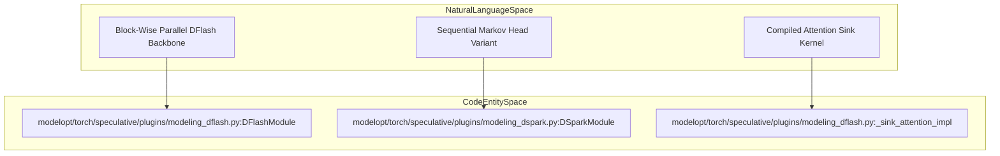
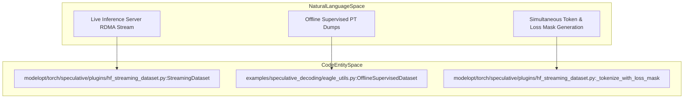

<!-- source: DeepWiki mcp.deepwiki.com · repo NVIDIA/Model-Optimizer · extra page DFlash and DSpark Drafters · fetched 2026-10-26 -->

# DFlash and DSpark Drafters

Relevant source files

The following files were used as context for generating this wiki page:

- [examples/dataset/synthetic_conversations_1k.jsonl](examples/dataset/synthetic_conversations_1k.jsonl)
- [examples/specdec_bench/run.py](examples/specdec_bench/run.py)
- [examples/specdec_bench/specdec_bench/models/auto_deploy.py](examples/specdec_bench/specdec_bench/models/auto_deploy.py)
- [examples/specdec_bench/specdec_bench/models/sglang.py](examples/specdec_bench/specdec_bench/models/sglang.py)
- [examples/specdec_bench/specdec_bench/models/trtllm_torch_api.py](examples/specdec_bench/specdec_bench/models/trtllm_torch_api.py)
- [examples/specdec_bench/specdec_bench/models/vllm.py](examples/specdec_bench/specdec_bench/models/vllm.py)
- [examples/speculative_decoding/distributed_generate/launch.sh](examples/speculative_decoding/distributed_generate/launch.sh)
- [examples/speculative_decoding/distributed_generate/launch_multimodal.sh](examples/speculative_decoding/distributed_generate/launch_multimodal.sh)
- [examples/speculative_decoding/distributed_generate/server_generate_vlm_sglang.py](examples/speculative_decoding/distributed_generate/server_generate_vlm_sglang.py)
- [examples/speculative_decoding/distributed_generate/worker.sh](examples/speculative_decoding/distributed_generate/worker.sh)
- [examples/speculative_decoding/distributed_generate/worker_multimodal.sh](examples/speculative_decoding/distributed_generate/worker_multimodal.sh)
- [examples/speculative_decoding/recipes/merge_dflash_datasets.py](examples/speculative_decoding/recipes/merge_dflash_datasets.py)
- [examples/speculative_decoding/recipes/prepare_multimodal_synthetic_shards.py](examples/speculative_decoding/recipes/prepare_multimodal_synthetic_shards.py)
- [examples/speculative_decoding/recipes/run_multimodal_synthetic_generation.sh](examples/speculative_decoding/recipes/run_multimodal_synthetic_generation.sh)
- [examples/speculative_decoding/recipes/train_dflash_cosmos3_nano.ipynb](examples/speculative_decoding/recipes/train_dflash_cosmos3_nano.ipynb)
- [examples/speculative_decoding/requirements.txt](examples/speculative_decoding/requirements.txt)
- [examples/speculative_decoding/scripts/quantize_drafter.py](examples/speculative_decoding/scripts/quantize_drafter.py)
- [examples/speculative_decoding/scripts/server_generate.py](examples/speculative_decoding/scripts/server_generate.py)
- [modelopt/torch/export/plugins/hf_spec_export.py](modelopt/torch/export/plugins/hf_spec_export.py)
- [modelopt/torch/speculative/config.py](modelopt/torch/speculative/config.py)
- [modelopt/torch/speculative/dflash/conversion.py](modelopt/torch/speculative/dflash/conversion.py)
- [modelopt/torch/speculative/dflash/dflash_model.py](modelopt/torch/speculative/dflash/dflash_model.py)
- [modelopt/torch/speculative/plugins/hf_dflash.py](modelopt/torch/speculative/plugins/hf_dflash.py)
- [modelopt/torch/speculative/plugins/hf_streaming_dataset.py](modelopt/torch/speculative/plugins/hf_streaming_dataset.py)
- [modelopt/torch/speculative/plugins/hf_training_args.py](modelopt/torch/speculative/plugins/hf_training_args.py)
- [modelopt/torch/speculative/plugins/modeling_dflash.py](modelopt/torch/speculative/plugins/modeling_dflash.py)
- [modelopt/torch/speculative/plugins/modeling_draft_checkpoint_compat.py](modelopt/torch/speculative/plugins/modeling_draft_checkpoint_compat.py)
- [modelopt/torch/speculative/plugins/modeling_dspark.py](modelopt/torch/speculative/plugins/modeling_dspark.py)
- [modelopt/torch/speculative/plugins/modeling_fakebase.py](modelopt/torch/speculative/plugins/modeling_fakebase.py)
- [modelopt/torch/speculative/plugins/modeling_final_norm.py](modelopt/torch/speculative/plugins/modeling_final_norm.py)
- [modelopt/torch/utils/plugins/transformers_dataset.py](modelopt/torch/utils/plugins/transformers_dataset.py)
- [tests/regression/torch/speculative/test_dflash_offline.py](tests/regression/torch/speculative/test_dflash_offline.py)
- [tests/unit/torch/export/test_hf_spec_rope_export.py](tests/unit/torch/export/test_hf_spec_rope_export.py)
- [tests/unit/torch/speculative/plugins/test_fakebase.py](tests/unit/torch/speculative/plugins/test_fakebase.py)
- [tests/unit/torch/speculative/plugins/test_hf_dflash.py](tests/unit/torch/speculative/plugins/test_hf_dflash.py)
- [tests/unit/torch/speculative/plugins/test_hf_dspark.py](tests/unit/torch/speculative/plugins/test_hf_dspark.py)
- [tests/unit/torch/speculative/plugins/test_hf_speculative_offline.py](tests/unit/torch/speculative/plugins/test_hf_speculative_offline.py)
- [tests/unit/torch/speculative/plugins/test_hf_streaming_dataset.py](tests/unit/torch/speculative/plugins/test_hf_streaming_dataset.py)
- [tools/launcher/common/eagle3/dump_offline_data_hf.sh](tools/launcher/common/eagle3/dump_offline_data_hf.sh)
- [tools/launcher/common/eagle3/dump_offline_data_vllm.sh](tools/launcher/common/eagle3/dump_offline_data_vllm.sh)
- [tools/launcher/common/eagle3/train_eagle_streaming.sh](tools/launcher/common/eagle3/train_eagle_streaming.sh)
- [tools/launcher/common/specdec/quantize_drafter.sh](tools/launcher/common/specdec/quantize_drafter.sh)
- [tools/launcher/examples/MiniMaxAI/MiniMax-M3/hf_streaming_dspark_multi_node.yaml](tools/launcher/examples/MiniMaxAI/MiniMax-M3/hf_streaming_dspark_multi_node.yaml)
- [tools/launcher/examples/MiniMaxAI/MiniMax-M3/m3_chat_template_generation.jinja](tools/launcher/examples/MiniMaxAI/MiniMax-M3/m3_chat_template_generation.jinja)
- [tools/launcher/examples/Qwen/Qwen3-0.6B/hf_offline_dflash.yaml](tools/launcher/examples/Qwen/Qwen3-0.6B/hf_offline_dflash.yaml)
- [tools/launcher/examples/Qwen/Qwen3-8B/hf_dspark_ptq_nvfp4.yaml](tools/launcher/examples/Qwen/Qwen3-8B/hf_dspark_ptq_nvfp4.yaml)
- [tools/launcher/examples/moonshotai/Kimi-K2.5/specdec_bench.yaml](tools/launcher/examples/moonshotai/Kimi-K2.5/specdec_bench.yaml)
- [tools/launcher/examples/nvidia/NVIDIA-Nemotron-3.5-Lightning-30B-A3B-BF16/engine_args.json](tools/launcher/examples/nvidia/NVIDIA-Nemotron-3.5-Lightning-30B-A3B-BF16/engine_args.json)
- [tools/launcher/examples/nvidia/NVIDIA-Nemotron-3.5-Lightning-30B-A3B-BF16/hf_dspark_ptq_fp8.yaml](tools/launcher/examples/nvidia/NVIDIA-Nemotron-3.5-Lightning-30B-A3B-BF16/hf_dspark_ptq_fp8.yaml)

This page provides a technical guide to the DFlash, DSpark, and Domino speculative decoding draft-model families in NVIDIA Model Optimizer (`modelopt`). It covers their architectural implementation, training workflows supporting both streaming (via NIXL RDMA) and offline datasets, hidden-state collection, loss-objective formulations (such as D-PACE and exponential decay), and performance evaluation using `specdec_bench`.

---

## 1. Overview of DFlash, DSpark, and Domino Draft Families

DFlash introduces block-wise parallel speculative decoding where a lightweight draft network predicts multiple tokens (`dflash_block_size`) simultaneously conditioned on target hidden states [modelopt/torch/speculative/config.py:78-94](). 

- **DFlash**: Employs parallel block diffusion with random anchor sampling and exponential loss decay or confidence-derived weighting [modelopt/torch/speculative/config.py:100-117, modelopt/torch/speculative/plugins/hf_dflash.py:37-46]().
- **DSpark**: Extends the DFlash backbone by appending a lightweight sequential (Markov) head. This injects intra-block causal dependencies into the parallel backbone, mitigating suffix acceptance decay [modelopt/torch/speculative/plugins/modeling_dspark.py:37-51]().
- **Domino**: Shares the philosophy of maintaining a parallel backbone while introducing recurrent structures (such as GRUs over base model embeddings) to manage intra-block dependencies.

Sources:
- `modelopt/torch/speculative/config.py:78-117`
- `modelopt/torch/speculative/plugins/hf_dflash.py:37-46`
- `modelopt/torch/speculative/plugins/modeling_dspark.py:37-51`

---

## 2. Architecture and Implementation

The DFlash and DSpark draft architectures separate the draft network from the base target model. The target model provides hidden states, which are fused via linear projections and RMSNorm before injection into every draft layer [modelopt/torch/speculative/plugins/hf_dflash.py:37-41]().

### Diagram: Natural Language to Code Space Mapping (Architectural Components)

*Sources:* `modelopt/torch/speculative/plugins/modeling_dflash.py:37-113`, `modelopt/torch/speculative/plugins/modeling_dspark.py:82-123`

### Key Architectural Classes and Functions
- **`DFlashModule`**: Core class managing base hidden states, QK-norm attention blocks, mask tokens for unknown positions, and torch compilation [modelopt/torch/speculative/plugins/modeling_dflash.py:60-136]() and [modelopt/torch/speculative/dflash/dflash_model.py:25-55]().
- **`DSparkModule`**: Subclasses `DFlashModule` to add first-order transition embeddings (`markov_w1`, `markov_w2`), gating projections (`gate_proj`), recurrent steps (`joint_proj`), and confidence scoring (`confidence_proj`) [modelopt/torch/speculative/plugins/modeling_dspark.py:82-123]().
- **`_sink_attention_impl`**: Free function implementing eager attention with a learnable per-head sink logit, optimized via `torch.compile` [modelopt/torch/speculative/plugins/modeling_dflash.py:63-113]().
- **`DFlashConfig`**: Configuration schema defining block sizes (`dflash_block_size`), loss objectives (`dflash_loss_objective`), sliding window attention (`dflash_swa_window_size`), and attention patterns (`dflash_draft_attention`) [modelopt/torch/speculative/config.py:78-176]().

Sources:
- `modelopt/torch/speculative/config.py:78-176`
- `modelopt/torch/speculative/dflash/dflash_model.py:25-56`
- `modelopt/torch/speculative/plugins/modeling_dflash.py:37-113`
- `modelopt/torch/speculative/plugins/modeling_dspark.py:82-123`

---

## 3. Training Data Pipelines: Streaming, Offline Datasets, and Hidden-State Collection

Training drafters for DFlash and DSpark requires capturing target model hidden states. Model Optimizer supports both offline datasets (pre-computed `.pt` files) and streaming datasets (fetching hidden states dynamically from a running inference server over NIXL RDMA) [modelopt/torch/speculative/plugins/hf_streaming_dataset.py:16-38]().

### Diagram: Natural Language to Code Space Mapping (Data Pipelines)

*Sources:* `modelopt/torch/speculative/plugins/hf_streaming_dataset.py:37-142`, `tests/unit/torch/speculative/plugins/test_hf_speculative_offline.py:37-40`

### Streaming and Offline Mechanics
- **`StreamingDataset`**: Map-style PyTorch dataset that fetches per-sample hidden states from a live inference server using NIXL RDMA. Sharding is handled natively by `DistributedSampler` across trainer ranks [modelopt/torch/speculative/plugins/hf_streaming_dataset.py:16-38]() and [modelopt/torch/speculative/plugins/hf_streaming_dataset.py:68-77]().
- **`OfflineSupervisedDataset`**: Loads pre-dumped tensor files from disk for offline training loops [tests/unit/torch/speculative/plugins/test_hf_speculative_offline.py:37-40]().
- **`_tokenize_with_loss_mask`**: Executes a single `apply_chat_template` call to ensure `input_ids` and assistant loss masks remain aligned without drift [modelopt/torch/speculative/plugins/hf_streaming_dataset.py:88-105]().

Sources:
- `modelopt/torch/speculative/plugins/hf_streaming_dataset.py:16-142`
- `tests/unit/torch/speculative/plugins/test_hf_speculative_offline.py:37-40`

---

## 4. Loss Objectives, Confidence Scheduling, and Token Distillation

DFlash and DSpark optimize sequence generation using specialized loss objective configurations.

- **Loss Objectives**: Configured via `dflash_loss_objective` (`"decay"` or `"dpace"`) [modelopt/torch/speculative/config.py:100-117]().
  - **Exponential Decay (`"decay"`)**: Applies static exponential loss decay weighted by `dflash_loss_decay_factor` [modelopt/torch/speculative/config.py:104-109]().
  - **D-PACE (`"dpace"`)**: Dynamically derives per-position weights from draft confidences using an asymmetric smoothing factor `dflash_dpace_alpha` [modelopt/torch/speculative/config.py:110-124]() and [modelopt/torch/speculative/plugins/hf_dflash.py:154-162]().
- **Self-Logit Distillation**: Enabled via `dflash_self_logit_distillation` to align draft output probabilities with the target model logits [modelopt/torch/speculative/config.py:100-102]() and [modelopt/torch/speculative/dflash/dflash_model.py:47]().

Sources:
- `modelopt/torch/speculative/config.py:100-124`
- `modelopt/torch/speculative/plugins/hf_dflash.py:154-162`
- `modelopt/torch/speculative/dflash/dflash_model.py:47`

---

## 5. Inference Benchmarking with `specdec_bench`

The `examples/specdec_bench` suite benchmarks speculative decoding performance across backends such as vLLM, SGLang, and TensorRT-LLM [examples/specdec_bench/run.py:31-37]().

### Engine Configurations
- **`VLLMModel`**: Configures vLLM runtime arguments, routing algorithmic flags for `DFLASH`, `DSPARK`, `EAGLE`, and `MTP` [examples/specdec_bench/specdec_bench/models/vllm.py:41-136]().
- **`SGLANGModel`**: Initializes SGLang engine instances, mapping `DFLASH` execution paths and setting flags like `disable_cuda_graph_padding` [examples/specdec_bench/specdec_bench/models/sglang.py:28-102]().
- **Sequence Length Translation**: `_MAX_SEQ_LEN_KEY` normalizes sequence length constraints (`max_model_len` for vLLM, `max_seq_len` for TRTLLM, `context_length` for SGLang) across engines [examples/specdec_bench/run.py:39-52]() and [examples/specdec_bench/run.py:171-180]().

Sources:
- `examples/specdec_bench/run.py:31-52`
- `examples/specdec_bench/run.py:171-180`
- `examples/specdec_bench/specdec_bench/models/vllm.py:41-136`
- `examples/specdec_bench/specdec_bench/models/sglang.py:28-102`

---

