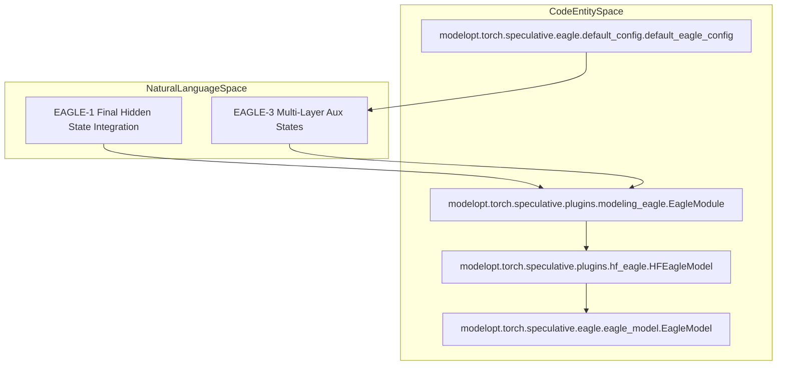
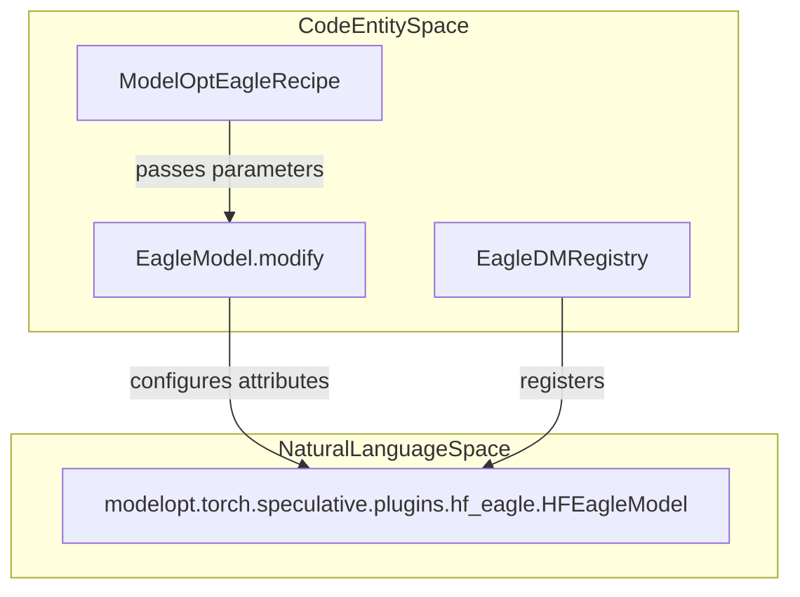
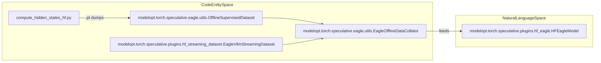

<!-- source: DeepWiki mcp.deepwiki.com · repo NVIDIA/Model-Optimizer · extra page EAGLE Architecture and Training · fetched 2026-10-26 -->

# EAGLE Architecture and Training

Relevant source files

The following files were used as context for generating this wiki page:

- [examples/speculative_decoding/collect_hidden_states/compute_hidden_states_hf.py](examples/speculative_decoding/collect_hidden_states/compute_hidden_states_hf.py)
- [examples/speculative_decoding/eagle_utils.py](examples/speculative_decoding/eagle_utils.py)
- [examples/speculative_decoding/launch_train.sh](examples/speculative_decoding/launch_train.sh)
- [examples/speculative_decoding/main.py](examples/speculative_decoding/main.py)
- [modelopt/torch/speculative/eagle/conversion.py](modelopt/torch/speculative/eagle/conversion.py)
- [modelopt/torch/speculative/eagle/default_config.py](modelopt/torch/speculative/eagle/default_config.py)
- [modelopt/torch/speculative/eagle/eagle_model.py](modelopt/torch/speculative/eagle/eagle_model.py)
- [modelopt/torch/speculative/eagle/utils.py](modelopt/torch/speculative/eagle/utils.py)
- [modelopt/torch/speculative/plugins/hf_eagle.py](modelopt/torch/speculative/plugins/hf_eagle.py)
- [modelopt/torch/speculative/plugins/megatron_eagle.py](modelopt/torch/speculative/plugins/megatron_eagle.py)
- [modelopt/torch/speculative/plugins/modeling_eagle.py](modelopt/torch/speculative/plugins/modeling_eagle.py)
- [modelopt/torch/speculative/plugins/transformers.py](modelopt/torch/speculative/plugins/transformers.py)
- [modelopt/torch/speculative/utils.py](modelopt/torch/speculative/utils.py)
- [modelopt_recipes/general/speculative_decoding/dflash.yaml](modelopt_recipes/general/speculative_decoding/dflash.yaml)
- [modelopt_recipes/general/speculative_decoding/eagle3.yaml](modelopt_recipes/general/speculative_decoding/eagle3.yaml)
- [tests/examples/speculative_decoding/conftest.py](tests/examples/speculative_decoding/conftest.py)
- [tests/examples/speculative_decoding/test_eagle.py](tests/examples/speculative_decoding/test_eagle.py)
- [tests/examples/speculative_decoding/test_eagle_offline_ptq.py](tests/examples/speculative_decoding/test_eagle_offline_ptq.py)
- [tests/gpu/torch/speculative/plugins/test_hf_dflash.py](tests/gpu/torch/speculative/plugins/test_hf_dflash.py)
- [tests/unit/torch/speculative/plugins/test_hf_dflash_offline.py](tests/unit/torch/speculative/plugins/test_hf_dflash_offline.py)
- [tests/unit/torch/speculative/plugins/test_hf_speculative.py](tests/unit/torch/speculative/plugins/test_hf_speculative.py)
- [tests/unit/torch/speculative/test_eagle_config.py](tests/unit/torch/speculative/test_eagle_config.py)
- [tools/launcher/common/eagle3/hf_ptq.sh](tools/launcher/common/eagle3/hf_ptq.sh)

## Purpose and Scope

This document details the EAGLE (Enhanced Autoregressive Generative Engine) architecture and its associated training workflows within the NVIDIA Model Optimizer codebase. EAGLE is a speculative decoding framework that uses a lightweight draft model operating on base model hidden states to predict multiple future tokens in parallel, accelerating large language model (LLM) and vision-language model (VLM) inference. 

This guide covers architectural variants (EAGLE-1 and EAGLE-3), online/offline/streaming training workflows including Training-Time-Testing (TTT), configuration options, and framework integrations for HuggingFace Transformers and Megatron-Core.

For broader context on speculative decoding, see [Speculative Decoding](#3.5). For Medusa-specific details, see [Medusa Architecture and Training](#3.5.2).

Sources: [modelopt/torch/speculative/plugins/hf_eagle.py:16-68](), [examples/speculative_decoding/main.py:32-52]()

---

## EAGLE Architecture Variants

The EAGLE architecture family builds on a base model backbone by attaching a lightweight draft decoder. The draft model consumes base model hidden representations and input tokens to generate speculative token paths.

### EAGLE-1

EAGLE-1 concatenates input embeddings with the base model's final hidden states, passing the combined representation through an FC projection layer into the draft decoder layers.

*   **Input Representation**: `[input_embeddings, hidden_states]` [modelopt/torch/speculative/plugins/hf_eagle.py:67-179]()
*   **Projection & Normalization**: An initial linear projection maps the concatenated dimension to the draft hidden size, using RMSNorm / LayerNorm.
*   **Implementation**: Managed via `HFEagleModel` [modelopt/torch/speculative/plugins/hf_eagle.py:67]() (superseding the legacy shim in `modelopt.torch.speculative.plugins.transformers` [modelopt/torch/speculative/plugins/transformers.py:16-29]()).

### EAGLE-3

EAGLE-3 enhances prediction accuracy by extracting auxiliary hidden states from multiple intermediate layers of the base model, rather than relying solely on the final layer.

*   **Auxiliary Layers**: Default auxiliary layer IDs are chosen near the start, middle, and end of the base model stack (e.g., layers selected via `default_eagle_aux_layer_ids`) [modelopt/torch/speculative/plugins/hf_eagle.py:58-63]().
*   **Concatenation**: Hidden states from the selected auxiliary layers and the final layer are concatenated along the feature dimension before projection.
*   **Default Configuration**: Defined in `default_eagle_config` [modelopt/torch/speculative/eagle/default_config.py:18-45]().

### Parallel Draft Extensions

Both variants support parallel draft steps and multi-layer draft heads to predict tree structures of tokens simultaneously (controlled via configuration flags such as `parallel_draft_step`) [modelopt/torch/speculative/plugins/megatron_eagle.py:124-127]().

**Sources:** [modelopt/torch/speculative/plugins/hf_eagle.py:58-68](), [modelopt/torch/speculative/plugins/transformers.py:16-29](), [modelopt/torch/speculative/eagle/default_config.py:18-45](), [modelopt/torch/speculative/plugins/megatron_eagle.py:115-130]()

---

## Core Components and Configuration System

### Dynamic Module Architecture

The foundational class for all EAGLE draft models is `EagleModel`, which inherits from `DynamicModule` [modelopt/torch/speculative/eagle/eagle_model.py:18-21](). It registers temporary attributes and handles dynamic layer modifications during training conversion.

*   **`EagleModel`**: Base class implementing configuration parsing in `modify()` [modelopt/torch/speculative/eagle/eagle_model.py:27-54]().
*   **`HFEagleModel`**: HuggingFace-specific realization registered in `EagleDMRegistry` [modelopt/torch/speculative/plugins/hf_eagle.py:66-67](). It automatically resolves submodules for embeddings (`_base_model_embeddings`), transformer blocks (`_base_model`), and LM heads (`_base_model_lm_head`) [modelopt/torch/speculative/plugins/hf_eagle.py:74-84]().

### Configuration Parameters

Recipe schemas (such as `ModelOptEagleRecipe`) configure the training behavior and architectural layout via `EagleModel.modify()` [modelopt/torch/speculative/eagle/eagle_model.py:27-54]():

| Field | Code Attribute | Description |
| :--- | :--- | :--- |
| `eagle_offline` | `self.eagle_offline` | Enables offline training using pre-computed hidden state dumps [modelopt/torch/speculative/eagle/eagle_model.py:32]() |
| `eagle_freeze_base_model` | `self.eagle_freeze_base_model` | Freezes base model weights during training [modelopt/torch/speculative/eagle/eagle_model.py:35]() |
| `eagle_ttt_steps` | `self.eagle_ttt_steps` | Number of Training-Time-Testing (TTT) steps [modelopt/torch/speculative/eagle/eagle_model.py:40]() |
| `eagle_mix_hidden_states` | `self.eagle_mix_hidden_states` | Mixes auxiliary hidden states for EAGLE-3 [modelopt/torch/speculative/eagle/eagle_model.py:41]() |
| `eagle_loss_decay_factor` | `self.eagle_loss_decay_factor` | Decay factor applied across multi-step TTT losses [modelopt/torch/speculative/eagle/eagle_model.py:38]() |

**Sources:** [modelopt/torch/speculative/eagle/eagle_model.py:18-54](), [modelopt/torch/speculative/plugins/hf_eagle.py:66-84](), [modelopt/recipe/config.py:53-58]()

---

## Training Workflows

Model Optimizer supports three distinct data and execution workflows for EAGLE training: Online (with TTT), Offline, and Streaming.

### 1. Online Training & Training-Time-Testing (TTT)
In online mode, the full base model and draft head are loaded into memory. 
*   The base model executes forward passes to compute live hidden states and logits.
*   **TTT (Training-Time-Testing)** executes multi-step rollouts where the draft model predicts several steps ahead within a single training iteration.
*   Ring attention and sequence-parallel communication are patched when context parallelism (`cp_size > 1`) is active via `patch_ring_attention_for_ttt` [examples/speculative_decoding/main.py:45]().

### 2. Offline Training
Offline training decouples hidden-state extraction from model training, drastically reducing GPU memory requirements during backpropagation.
*   **Extraction**: Base model hidden states are pre-computed and stored using extraction scripts like `compute_hidden_states_hf.py` [examples/speculative_decoding/collect_hidden_states/compute_hidden_states_hf.py:182-198]().
*   **Dataset Loading**: `OfflineSupervisedDataset` loads `.pt` files containing `input_ids`, `hidden_states`, and `aux_hidden_states` [tests/examples/speculative_decoding/test_eagle.py:52-56]().
*   **Collator**: `EagleOfflineDataCollator` pads and organizes pre-computed features into batches [modelopt/torch/speculative/eagle/utils.py:33]().

### 3. Streaming Training
Streaming mode connects an inference engine (such as vLLM) to stream hidden states directly to the training process using `EagleVllmStreamingDataset` and `EagleVllmStreamingConfig` [examples/speculative_decoding/eagle_utils.py:93-128]().

**Sources:** [examples/speculative_decoding/main.py:45](), [examples/speculative_decoding/eagle_utils.py:93-130](), [examples/speculative_decoding/collect_hidden_states/compute_hidden_states_hf.py:182-198](), [tests/examples/speculative_decoding/test_eagle.py:52-56]()

---

## Key Functions and Classes

*   **`EagleTrainerWithAccLog`**: A custom `Trainer` subclass that logs token acceptance rates alongside training loss components [examples/speculative_decoding/eagle_utils.py:41]().
*   **`make_speculative_data_module`**: Factory function handling dataset instantiation for `online`, `offline`, and `streaming` modes, supporting both language and vision-language data collators [examples/speculative_decoding/eagle_utils.py:56-153]().
*   **`LoRAWarmupCallback`**: Manages parameter freezing and staged warmup for LoRA-adapted base models during EAGLE training [examples/speculative_decoding/eagle_utils.py:43]().
*   **`calibrate_frequent_vocab`**: Identifies frequent token distributions to construct draft vocabulary mappings (`d2t.pt`) for reduced-vocab draft heads [modelopt/torch/speculative/utils.py:62-75](), [tests/examples/speculative_decoding/test_eagle.py:93-115]().

Sources: [examples/speculative_decoding/eagle_utils.py:41-153](), [modelopt/torch/speculative/utils.py:62-75](), [tests/examples/speculative_decoding/test_eagle.py:93-115]()

---

## Implementation Details

### Multi-Step Loss Calculation
The training loss aggregates penalties across all `eagle_ttt_steps`. Each subsequent prediction step is weighted by the `eagle_loss_decay_factor` to prioritize nearer-term token accuracy [modelopt/torch/speculative/eagle/eagle_model.py:38]().

### Reduced Draft Vocabulary Support
To minimize memory overhead in the draft head classification layer, EAGLE supports training with a subset of the full vocabulary. The calibration utility generates a draft-to-target token mapping (`d2t`), verified during tests like `test_calibrate_draft_vocab` [tests/examples/speculative_decoding/test_eagle.py:92-115]().

### Distributed and Context Parallelism
When scaling across multiple nodes or GPUs via `launch_train.sh` and `accelerate`, tensor and context parallelism are configured through `init_distributed_env()` [examples/speculative_decoding/main.py:114-153]() and `ParallelismConfig` [examples/speculative_decoding/main.py:141-151]().

Sources: [modelopt/torch/speculative/eagle/eagle_model.py:38](), [tests/examples/speculative_decoding/test_eagle.py:92-115](), [examples/speculative_decoding/main.py:114-153](), [examples/speculative_decoding/launch_train.sh:25-83]()

---

