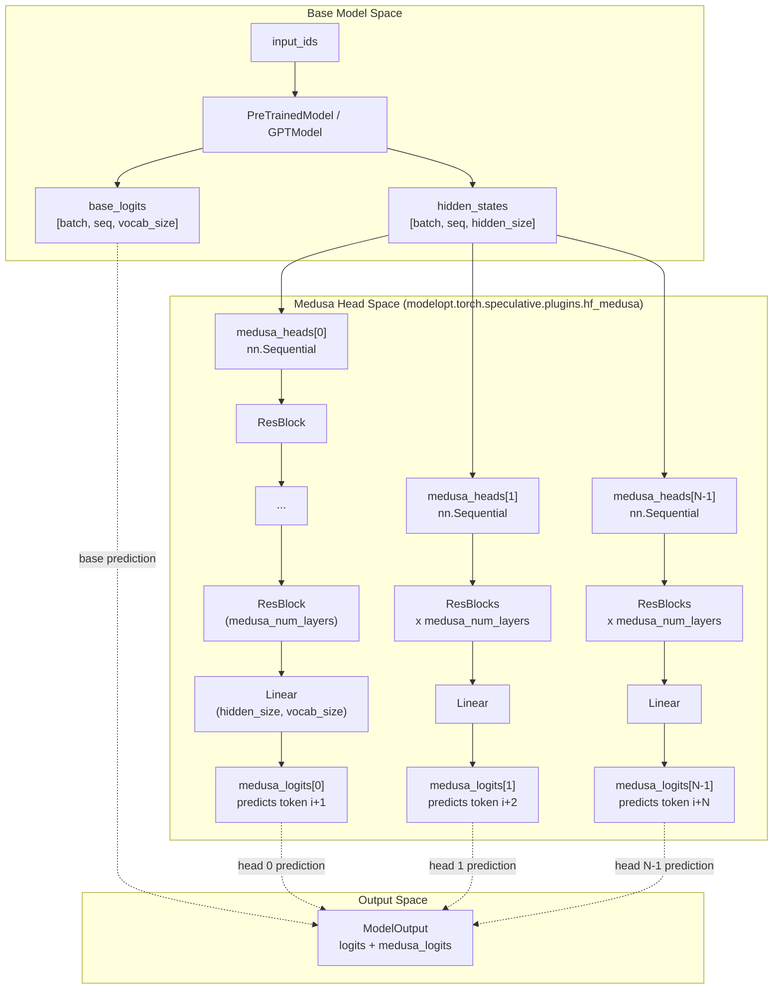
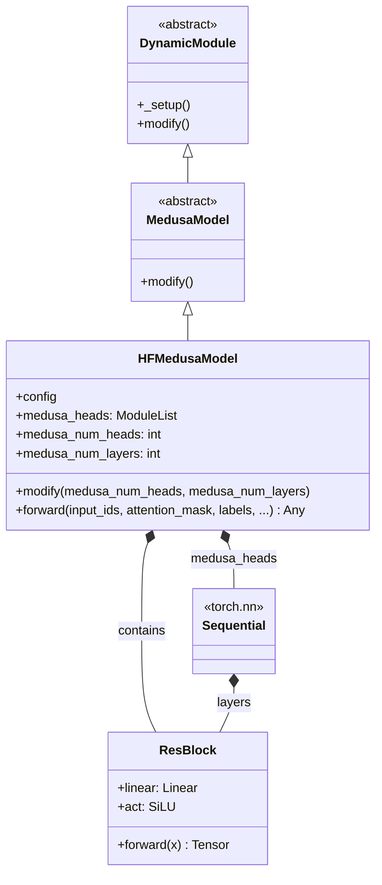
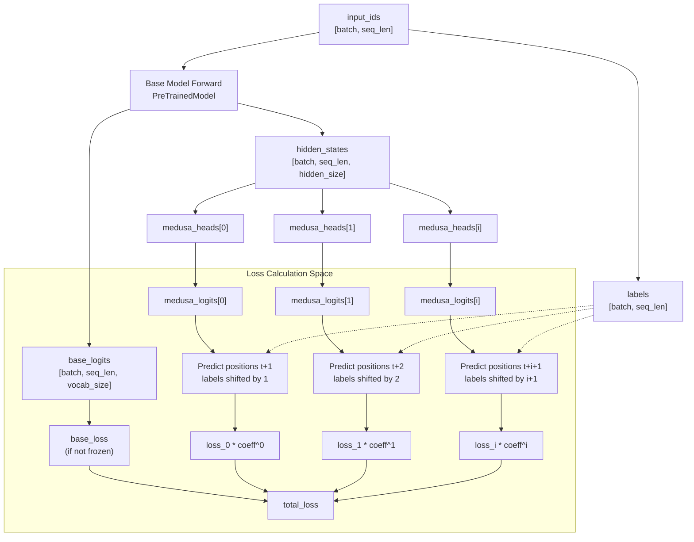
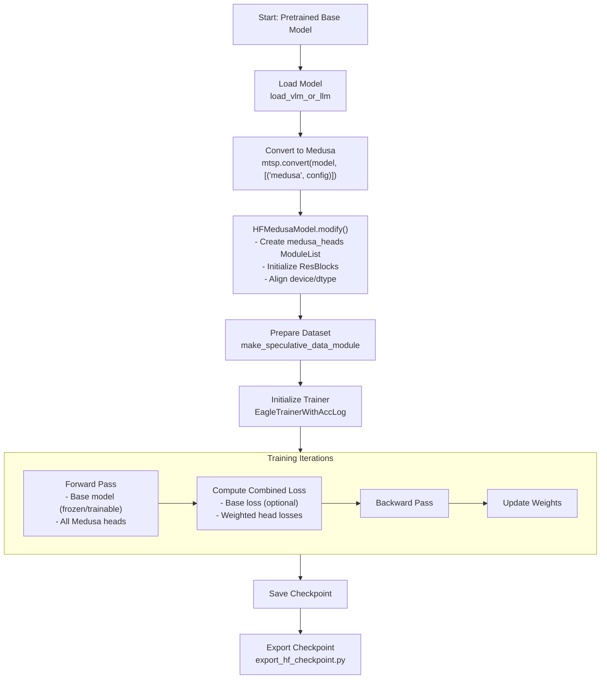

<!-- source: DeepWiki mcp.deepwiki.com · repo NVIDIA/Model-Optimizer · extra page Medusa Architecture and Training · fetched 2026-10-26 -->

# Medusa Architecture and Training

<details>
<summary>Relevant source files</summary>

The following files were used as context for generating this wiki page:

- [examples/speculative_decoding/eagle_utils.py](examples/speculative_decoding/eagle_utils.py)
- [examples/speculative_decoding/launch_train.sh](examples/speculative_decoding/launch_train.sh)
- [examples/speculative_decoding/main.py](examples/speculative_decoding/main.py)
- [examples/speculative_decoding/scripts/ar_validate.py](examples/speculative_decoding/scripts/ar_validate.py)
- [examples/speculative_decoding/scripts/export_hf_checkpoint.py](examples/speculative_decoding/scripts/export_hf_checkpoint.py)
- [modelopt/torch/speculative/eagle/conversion.py](modelopt/torch/speculative/eagle/conversion.py)
- [modelopt/torch/speculative/eagle/default_config.py](modelopt/torch/speculative/eagle/default_config.py)
- [modelopt/torch/speculative/eagle/eagle_model.py](modelopt/torch/speculative/eagle/eagle_model.py)
- [modelopt/torch/speculative/plugins/__init__.py](modelopt/torch/speculative/plugins/__init__.py)
- [modelopt/torch/speculative/plugins/hf_eagle.py](modelopt/torch/speculative/plugins/hf_eagle.py)
- [modelopt/torch/speculative/plugins/megatron_eagle.py](modelopt/torch/speculative/plugins/megatron_eagle.py)
- [modelopt/torch/speculative/plugins/modeling_eagle.py](modelopt/torch/speculative/plugins/modeling_eagle.py)
- [modelopt/torch/speculative/plugins/transformers.py](modelopt/torch/speculative/plugins/transformers.py)
- [modelopt/torch/speculative/utils.py](modelopt/torch/speculative/utils.py)
- [tests/examples/speculative_decoding/test_eagle.py](tests/examples/speculative_decoding/test_eagle.py)
- [tests/unit/torch/speculative/plugins/test_hf_speculative.py](tests/unit/torch/speculative/plugins/test_hf_speculative.py)

</details>


## Purpose and Scope

This document describes the Medusa speculative decoding architecture and training workflow in `modelopt.torch.speculative` [examples/speculative_decoding/main.py:51](). Medusa uses multiple parallel prediction heads attached to a base model to generate multiple candidate tokens in a single forward pass, enabling faster inference through speculative decoding.

For information about EAGLE, an alternative speculative decoding approach that uses an additional draft model, see [3.5.1](). For general speculative decoding concepts, see [3.5]().

---

## Architecture Overview

Medusa extends a base language model by adding multiple parallel prediction heads (`medusa_heads`), each consisting of a stack of residual blocks followed by a language modeling head. During inference, these heads predict multiple future tokens simultaneously based on the base model's hidden states.

### Core Components

The Medusa architecture consists of:

1.  **Base Model**: The original pretrained language model (`PreTrainedModel`) managed via `HFMedusaModel` [modelopt/torch/speculative/plugins/hf_medusa.py:67]() (or `MedusaLayer` in Megatron-Core integration [modelopt/torch/speculative/plugins/megatron_eagle.py:62]()).
2.  **Medusa Heads**: Multiple parallel prediction heads (`medusa_heads`), each predicting tokens at different future positions [modelopt/torch/speculative/plugins/hf_medusa.py:86-94]().
3.  **ResBlock Modules**: Residual blocks (`ResBlock`) within each head that transform hidden states before prediction [modelopt/torch/speculative/utils.py:177-202]().

### Medusa Multi-Head Architecture



Sources: [modelopt/torch/speculative/plugins/hf_medusa.py:67-165](), [modelopt/torch/speculative/utils.py:177-202]()

---

## HFMedusaModel Implementation

The `HFMedusaModel` class implements Medusa for Hugging Face Transformers models through the dynamic module pattern (`DynamicModule`). It is registered in the `MedusaDMRegistry` for `PreTrainedModel` types.

### Class Structure



Sources: [modelopt/torch/speculative/plugins/hf_medusa.py:67-98](), [modelopt/torch/speculative/utils.py:177-202]()

### Initialization Process

The `modify()` method creates and initializes the Medusa heads:

```python
# From modelopt/torch/speculative/plugins/hf_medusa.py:70-101
def modify(self, medusa_num_heads=0, medusa_num_layers=0):
    super().modify(medusa_num_heads=medusa_num_heads, medusa_num_layers=medusa_num_layers)
    self.config.medusa = {
        "num_medusa_heads": medusa_num_heads,
        "num_medusa_layers": medusa_num_layers,
    }

    hidden_size = self.lm_head.weight.shape[-1]
    vocab_size = self.lm_head.weight.shape[0]

    # Create a list of Medusa heads
    self.medusa_heads = nn.ModuleList(
        [
            nn.Sequential(
                *([ResBlock(hidden_size) for _ in range(self.medusa_num_layers)]),
                nn.Linear(hidden_size, vocab_size, bias=False),
            )
            for _ in range(self.medusa_num_heads)
        ]
    )

    # Ensure medusa_head's dtype and device align with the base_model
    self.medusa_heads.to(self.lm_head.weight.dtype).to(self.lm_head.weight.device)
```

**Key Implementation Details:**

*   Each head is an `nn.Sequential` containing `medusa_num_layers` `ResBlock` instances followed by a Linear layer.
*   The final Linear layer projects from `hidden_size` to `vocab_size` without bias.
*   Device placement follows the base model's `lm_head` device and dtype.

Sources: [modelopt/torch/speculative/plugins/hf_medusa.py:70-101]()

---

## Training Process

### Forward Pass and Loss Computation

During training, `HFMedusaModel` computes a combined loss from the base model and all Medusa heads. The base model can be optionally frozen using `freeze_base_model=True`.



Sources: [modelopt/torch/speculative/plugins/hf_medusa.py:103-165]()

### Loss Formula

The total loss combines base model loss (if training base) and weighted Medusa head losses:

$$\text{total\_loss} = \text{base\_model\_loss} + \sum_{i=0}^{N-1} \text{medusa\_loss}_i \cdot \text{decay}^i \cdot \text{coefficient}$$

Implementation excerpt:

```python
# From modelopt/torch/speculative/plugins/hf_medusa.py:156-165
# Base model loss
if not freeze_base_model:
    loss_logits = logits.view(-1, logits.shape[-1])
    loss_labels = labels.view(-1)
    base_model_loss = loss_fct(loss_logits, loss_labels)
    loss += base_model_loss
# Medusa loss
for i in range(self.medusa_num_heads):
    labels = labels[..., 1:].contiguous()
    loss_logits = medusa_logits[i][:, : -(1 + i)].contiguous()
    # ... computation continues ...
```

Sources: [modelopt/torch/speculative/plugins/hf_medusa.py:152-165]()

---

## Configuration and Training Setup

### MedusaConfig and Arguments

The configuration for Medusa is managed through `MedusaConfig` and related arguments in the training recipe and CLI scripts:

| Parameter            | Type | Default | Description                                                                             |
| -------------------- | ---- | ------- | --------------------------------------------------------------------------------------- |
| `medusa_num_heads`   | int  | 2       | Number of parallel prediction heads [modelopt/torch/speculative/config.py:162](), [examples/speculative_decoding/main.py:143]() |
| `medusa_num_layers`  | int  | 1       | Number of `ResBlock` modules per head [modelopt/torch/speculative/config.py:167](), [examples/speculative_decoding/main.py:144]() |

Sources: [modelopt/torch/speculative/config.py:159-171](), [examples/speculative_decoding/main.py:142-144]()

### Training Script Integration

The main training script `examples/speculative_decoding/main.py` supports Medusa training through recipe configuration loading (`ModelOptMedusaRecipe`) [examples/speculative_decoding/main.py:56]().

```bash
# Example launch using launch_train.sh
./launch_train.sh \
    --config ../../modelopt_recipes/general/speculative_decoding/medusa.yaml \
    model.model_name_or_path=meta-llama/Llama-3.2-1B \
    training.output_dir=ckpts/medusa_test
```

**Conversion to Medusa Model:**

```python
# Conversion invocation via mtsp.convert
mtsp.convert(model, mode=[("medusa", config)])
```

The `mtsp.convert()` function applies the Medusa transformation through the `MedusaDMRegistry`.

Sources: [examples/speculative_decoding/main.py:56](), [examples/speculative_decoding/launch_train.sh:18-23]()

---

## ResBlock Component

The `ResBlock` is the fundamental building block of Medusa heads [modelopt/torch/speculative/utils.py:177-202](). It performs a linear transformation followed by a `nn.SiLU()` activation and adds the result to the original input.

```python
# From modelopt/torch/speculative/utils.py:177-202
class ResBlock(nn.Module):
    def __init__(self, hidden_size: int, bias: bool = True):
        super().__init__()
        self.linear = nn.Linear(hidden_size, hidden_size, bias=bias)
        nn.init.zeros_(self.linear.weight) # Initialize as identity
        self.act = nn.SiLU()

    def forward(self, x: torch.Tensor) -> torch.Tensor:
        return x + self.act(self.linear(x))
```

**Design Choices:**

*   **Zero initialization**: Weights initialized to zero via `nn.init.zeros_` so the block starts as an identity mapping.
*   **SiLU activation**: Used for consistency with modern LLM architectures like Llama.

Sources: [modelopt/torch/speculative/utils.py:177-202]()

---

## Training Workflow

### End-to-End Training Process



Sources: [examples/speculative_decoding/main.py:50-68](), [examples/speculative_decoding/scripts/export_hf_checkpoint.py:49]()

---

## Validation and Export

### Acceptance Rate (AR) Validation

Performance is measured by calculating the average number of accepted tokens per step using the `validate_ar` utility [examples/speculative_decoding/scripts/ar_validate.py:28]().

```python
# From examples/speculative_decoding/scripts/ar_validate.py:28-40
def validate_ar(model, tokenizer, ds, steps=3, osl=20, num_samples=80, device=None):
    # Performs speculative decoding and calculates acceptance rate metrics
```

### Export for Deployment

Trained Medusa models are exported to Hugging Face format using the `export_hf_checkpoint.py` script.

```bash
python ./scripts/export_hf_checkpoint.py \
    --model_path <trained_medusa_checkpoint> \
    --export_path <deployment_format_dir>
```

Sources: [examples/speculative_decoding/scripts/ar_validate.py:28-40](), [examples/speculative_decoding/scripts/export_hf_checkpoint.py:49]()

---

