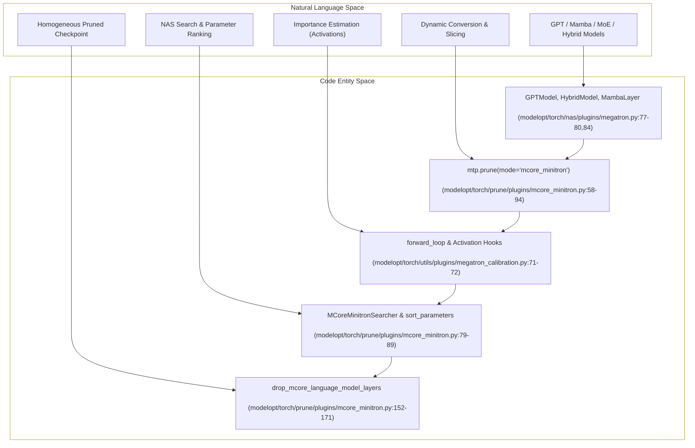
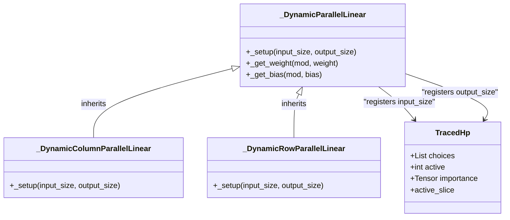

<!-- source: DeepWiki mcp.deepwiki.com · repo NVIDIA/Model-Optimizer · extra page Minitron Pruning for Megatron-Core · fetched 2026-10-26 -->

# Minitron Pruning for Megatron-Core

<details>
<summary>Relevant source files</summary>

The following files were used as context for generating this wiki page:

- [examples/megatron_bridge/README.md](examples/megatron_bridge/README.md)
- [examples/megatron_bridge/distill.py](examples/megatron_bridge/distill.py)
- [examples/megatron_bridge/export_distilled_megatron_to_hf.py](examples/megatron_bridge/export_distilled_megatron_to_hf.py)
- [examples/megatron_bridge/export_quantized_megatron_to_hf.py](examples/megatron_bridge/export_quantized_megatron_to_hf.py)
- [examples/megatron_bridge/prune_minitron.py](examples/megatron_bridge/prune_minitron.py)
- [examples/megatron_bridge/quantize.py](examples/megatron_bridge/quantize.py)
- [examples/pruning/README.md](examples/pruning/README.md)
- [modelopt/torch/nas/plugins/megatron.py](modelopt/torch/nas/plugins/megatron.py)
- [modelopt/torch/nas/plugins/megatron_model_stats.py](modelopt/torch/nas/plugins/megatron_model_stats.py)
- [modelopt/torch/prune/plugins/mcore_minitron.py](modelopt/torch/prune/plugins/mcore_minitron.py)
- [modelopt/torch/utils/plugins/mbridge.py](modelopt/torch/utils/plugins/mbridge.py)
- [tests/_test_utils/torch/megatron/models.py](tests/_test_utils/torch/megatron/models.py)
- [tests/_test_utils/torch/megatron/utils.py](tests/_test_utils/torch/megatron/utils.py)
- [tests/examples/megatron_bridge/test_distill.py](tests/examples/megatron_bridge/test_distill.py)
- [tests/examples/megatron_bridge/test_prune_minitron.py](tests/examples/megatron_bridge/test_prune_minitron.py)
- [tests/examples/megatron_bridge/test_qad.py](tests/examples/megatron_bridge/test_qad.py)
- [tests/gpu_megatron/torch/nas/plugins/test_megatron_gpt_dynamic_modules.py](tests/gpu_megatron/torch/nas/plugins/test_megatron_gpt_dynamic_modules.py)
- [tests/gpu_megatron/torch/nas/plugins/test_megatron_model_stats.py](tests/gpu_megatron/torch/nas/plugins/test_megatron_model_stats.py)
- [tests/gpu_megatron/torch/prune/plugins/test_mcore_gpt_minitron_pruning.py](tests/gpu_megatron/torch/prune/plugins/test_mcore_gpt_minitron_pruning.py)

</details>


## Purpose and Scope

This page documents the Minitron pruning algorithm for NVIDIA Megatron-Core and NeMo 2.0 models. Minitron is a magnitude-based pruning technique that uses activation statistics to identify and remove redundant parameters from large language models (LLMs) while preserving model quality.

**Scope**: This page covers the technical implementation of Minitron pruning specifically for Megatron-Core models including GPT, Mamba, MoE, and hybrid architectures.

**Key Capabilities**:
- **Width pruning**: `hidden_size`, `ffn_hidden_size`, `num_attention_heads`, `mamba_num_heads`, `mamba_head_dim`, `num_moe_experts`, `moe_ffn_hidden_size`, `moe_shared_expert_intermediate_size` [modelopt/torch/prune/plugins/mcore_minitron.py:96-112]().
- **Depth pruning**: `num_layers` [modelopt/torch/prune/plugins/mcore_minitron.py:110-111]().
- **NAS-based Auto Pruning**: Automated search for the best architecture given a target parameter count, active parameter count (for MoE), or memory footprint [examples/megatron_bridge/prune_minitron.py:17-21](), [examples/pruning/README.md:40-46]().
- **Full Distributed Support**: Compatible with Pipeline Parallel (PP), Expert Parallel (EP), and Data Parallel (DP) training [modelopt/torch/prune/plugins/mcore_minitron.py:41-49]().

Sources: [modelopt/torch/prune/plugins/mcore_minitron.py:16-127](), [examples/pruning/README.md:1-47](), [examples/megatron_bridge/prune_minitron.py:15-38]()

---

## System Architecture

### High-Level Pruning Pipeline (Natural Language to Code Entity Mapping)

The Minitron pruning pipeline transforms natural language definitions of model compression into specific Megatron-Core dynamic modules and search operators. The diagram below bridges the system concepts to their concrete code entities.

Title: Minitron Pruning Pipeline Entity Mapping



Sources: [modelopt/torch/prune/plugins/mcore_minitron.py:58-94](), [modelopt/torch/nas/plugins/megatron.py:77-90](), [examples/pruning/README.md:50-85]()

---

## Supported Models and Hyperparameters

### Model Types

Minitron pruning supports the following Megatron-Core model types:

| Model Type | Code Entity | Support Status |
|------------|-------------|----------------|
| GPT | `megatron.core.models.gpt.GPTModel` | Supported [modelopt/torch/nas/plugins/megatron.py:77-78]() |
| Mamba | `megatron.core.ssm.mamba_layer.MambaLayer` | Supported [modelopt/torch/nas/plugins/megatron.py:84]() |
| Hybrid | `megatron.core.models.hybrid.HybridModel` | Supported [modelopt/torch/nas/plugins/megatron.py:79-80]() |
| MoE | `_DynamicMoELayer` | Supported [modelopt/torch/nas/plugins/megatron.py:66]() |

Sources: [modelopt/torch/prune/plugins/mcore_minitron.py:22-25](), [modelopt/torch/nas/plugins/megatron.py:77-90]()

### Prunable Hyperparameters

The algorithm supports two main categories of pruning:

1. **Width Pruning**:
   - `hidden_size`: Global embedding dimension [modelopt/torch/prune/plugins/mcore_minitron.py:98]().
   - `ffn_hidden_size`: MLP intermediate dimension [modelopt/torch/prune/plugins/mcore_minitron.py:99-100]().
   - `num_attention_heads`: Attention head count [modelopt/torch/prune/plugins/mcore_minitron.py:101-102]().
   - `mamba_num_heads` & `mamba_head_dim`: Mamba-specific dimensions [modelopt/torch/prune/plugins/mcore_minitron.py:103-105]().
   - `num_moe_experts`: Number of experts in MoE layers [modelopt/torch/prune/plugins/mcore_minitron.py:109]().
   - `moe_ffn_hidden_size` & `moe_shared_expert_intermediate_size`: Expert dimensions in MoE and DeepSeek-style models [modelopt/torch/prune/plugins/mcore_minitron.py:107-108]().
2. **Depth Pruning**:
   - `num_layers`: Total number of transformer or Mamba layers [modelopt/torch/prune/plugins/mcore_minitron.py:110-111]().

Sources: [modelopt/torch/prune/plugins/mcore_minitron.py:96-112]()

---

## Dynamic Module System

### Module Mapping

During the `convert` phase, standard Megatron-Core layers are replaced with their dynamic counterparts defined in `modelopt.torch.nas.plugins.megatron`.

| Megatron-Core Module | ModelOpt Dynamic Module |
|----------------------|-------------------------|
| `GPTModel` / `HybridModel` | `_DynamicMCoreLanguageModel` [modelopt/torch/nas/plugins/megatron.py:64]() |
| `TransformerLayer` | `_DynamicTransformerLayer` [modelopt/torch/nas/plugins/megatron.py:70]() |
| `SelfAttention` / `MLASelfAttention` | `_DynamicSelfAttention` [modelopt/torch/nas/plugins/megatron.py:67]() |
| `MLP` | `_DynamicMLP` [modelopt/torch/nas/plugins/megatron.py:65]() |
| `MambaMixer` | `_DynamicMambaMixer` [modelopt/torch/nas/plugins/megatron.py:63]() |
| `MoELayer` | `_DynamicMoELayer` [modelopt/torch/nas/plugins/megatron.py:66]() |

Sources: [modelopt/torch/nas/plugins/megatron.py:58-71]()

### Dynamic Slicing Architecture (Code Entity Mapping)

Title: Dynamic Module and Weight Slicing Architecture



Sources: [modelopt/torch/nas/plugins/megatron.py:112-160]()

---

## Importance Estimation

Minitron uses activation magnitudes to estimate the importance of neurons, heads, and layers.

### Width Importance (Magnitude-based)
For linear layers and attention heads, importance is calculated by running a calibration forward loop on data and collecting the L2 norm of activations:
1. **Hooks**: Forward hooks collect activation magnitudes during calibration passes [modelopt/torch/prune/plugins/mcore_minitron.py:18-19]().
2. **Aggregation**: Magnitudes are averaged over sequence lengths and summed over batches.
3. **Distributed Reduction**: Activation scores are reduced across Data Parallel (DP) and gathered across Pipeline Parallel (PP) ranks [modelopt/torch/prune/plugins/mcore_minitron.py:41-49]().

### Depth Importance (Cosine Similarity)
For layer pruning, importance is determined by the cosine similarity between input and output hidden states of each layer:
- Layers with **high cosine similarity** (input ≈ output) are classified as redundant and selected as top candidates for removal [modelopt/torch/prune/plugins/mcore_minitron.py:18-20]().

Sources: [modelopt/torch/prune/plugins/mcore_minitron.py:16-49]()

---

## Pruning Execution

### Layer Dropping (Depth Pruning)
The function `drop_mcore_language_model_layers` handles physical layer removal from the model decoder `nn.ModuleList`. It supports uneven Pipeline Parallelism by re-indexing kept layers across PP ranks using pipeline parallelism groups [modelopt/torch/prune/plugins/mcore_minitron.py:152-180]().

### Manual vs. Auto Pruning
1. **Manual Pruning**: The user specifies an `export_config` with explicit target dimensions (e.g., `hidden_size: 3072`, `num_layers: 32`) [examples/pruning/README.md:43-44,96]().
2. **NAS-based Auto Pruning**: The user specifies constraints like `prune_target_params`, `prune_target_active_params`, or `prune_target_memory_mb` [examples/megatron_bridge/prune_minitron.py:17-21](). The `MCoreMinitronSearcher` utilizes a score function (such as MMLU) to explore architecture candidates [examples/megatron_bridge/prune_minitron.py:22-32]().

Sources: [modelopt/torch/prune/plugins/mcore_minitron.py:152-200](), [examples/pruning/README.md:90-118](), [examples/megatron_bridge/prune_minitron.py:15-38]()

---

## Usage Example (Megatron-Bridge)

The following example demonstrates pruning a model using the `mtp.prune` API within the Megatron-Bridge framework [examples/pruning/README.md:50-85]().

```python
import modelopt.torch.prune as mtp
from modelopt.torch.utils.plugins.mbridge import load_mbridge_model_from_hf

# Load model from Hugging Face
bridge, provider, model, unwrapped_model, tokenizer = load_mbridge_model_from_hf(
    hf_model_name_or_path="Qwen/Qwen3-8B"
)

# Define pruning constraints
constraints = {
    "export_config": {
        "num_layers": 32, 
        "hidden_size": 3584, 
        "ffn_hidden_size": 10240
    }
}

# Execute in-place pruning
mtp.prune(
    unwrapped_model,
    mode="mcore_minitron",
    constraints=constraints,
    config={"forward_loop": forward_loop},
)
```

Sources: [examples/pruning/README.md:50-85](), [examples/megatron_bridge/prune_minitron.py:66-78]()

---

## Distributed Support Details

Minitron pruning integrates cleanly with Megatron-Core distributed paradigms:
- **Pipeline Parallelism (PP)**: `drop_mcore_language_model_layers` synchronizes remaining layer distributions across ranks via `get_pipeline_model_parallel_world_size()` [modelopt/torch/prune/plugins/mcore_minitron.py:41-45,173-180]().
- **Tensor Parallelism (TP)**: Slicing logic adapts to partitioned weights in `_DynamicColumnParallelLinear` and `_DynamicRowParallelLinear` [modelopt/torch/nas/plugins/megatron.py:141-160]().
- **Expert Parallelism (EP)**: Supports expert count and expert-intermediate dimension pruning through `_DynamicMoELayer` [modelopt/torch/nas/plugins/megatron.py:66]().

Sources: [modelopt/torch/prune/plugins/mcore_minitron.py:41-49](), [modelopt/torch/nas/plugins/megatron.py:112-160]()

---

