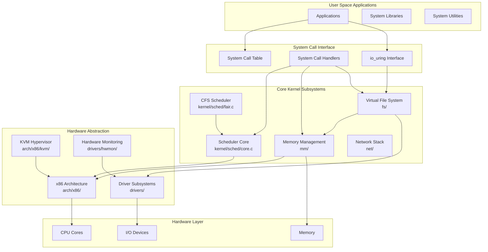
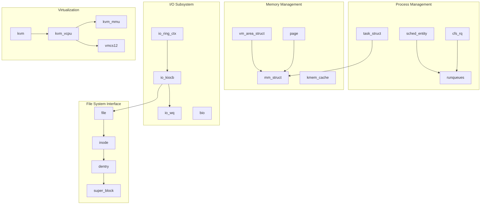
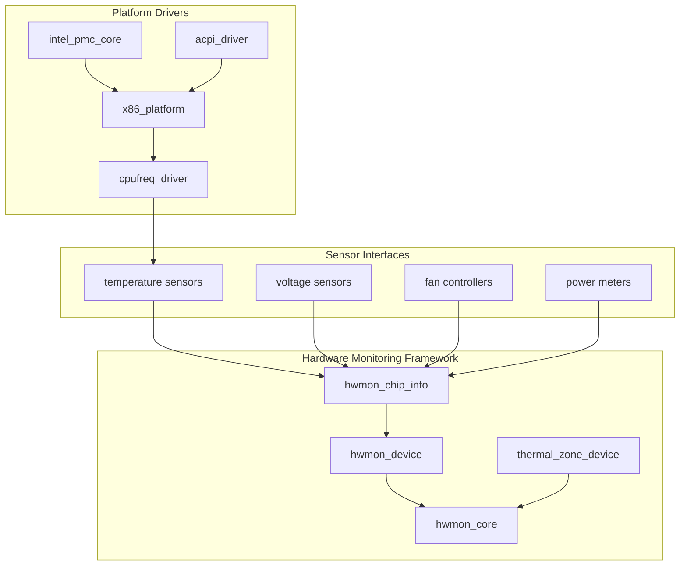
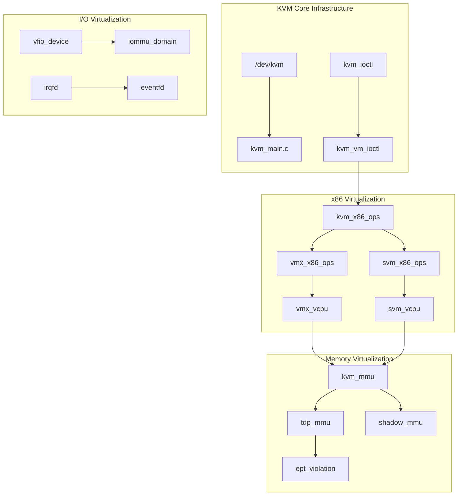
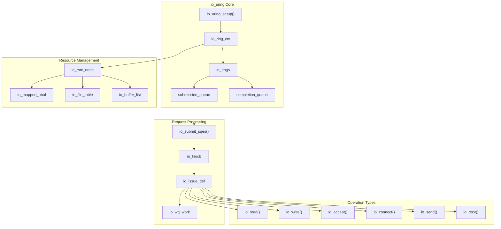
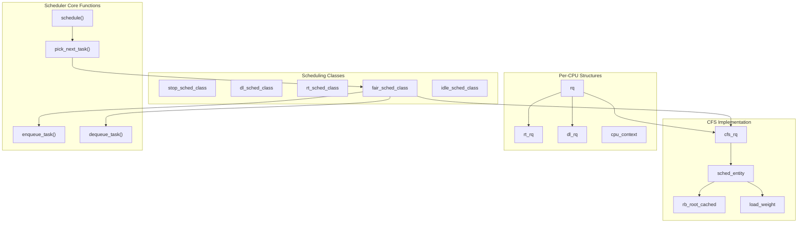
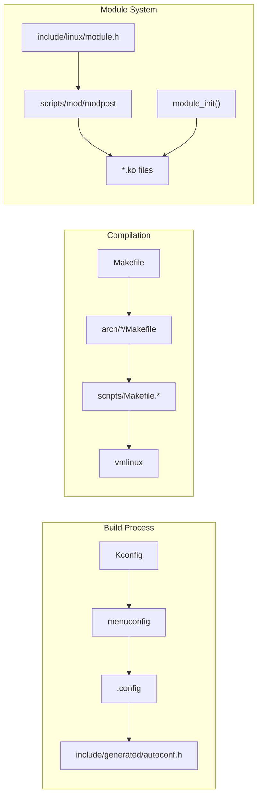

<!-- source: DeepWiki mcp.deepwiki.com · repo NVIDIA/NV-Kernels · page 1 Overview · fetched 2026-10-26 -->

# Overview

Relevant source files

The following files were used as context for generating this wiki page:

- [.get_maintainer.ignore](.get_maintainer.ignore)
- [.gitignore](.gitignore)
- [.mailmap](.mailmap)
- [CREDITS](CREDITS)
- [Documentation/Makefile](Documentation/Makefile)
- [Documentation/accounting/delay-accounting.rst](Documentation/accounting/delay-accounting.rst)
- [Documentation/admin-guide/pm/cpufreq.rst](Documentation/admin-guide/pm/cpufreq.rst)
- [Documentation/conf.py](Documentation/conf.py)
- [Documentation/dev-tools/coccinelle.rst](Documentation/dev-tools/coccinelle.rst)
- [Documentation/devicetree/bindings/serial/atmel,at91-usart.yaml](Documentation/devicetree/bindings/serial/atmel,at91-usart.yaml)
- [Documentation/gpu/introduction.rst](Documentation/gpu/introduction.rst)
- [Documentation/gpu/todo.rst](Documentation/gpu/todo.rst)
- [Documentation/hwmon/acbel-fsg032.rst](Documentation/hwmon/acbel-fsg032.rst)
- [Documentation/hwmon/adm1275.rst](Documentation/hwmon/adm1275.rst)
- [Documentation/hwmon/crps.rst](Documentation/hwmon/crps.rst)
- [Documentation/hwmon/htu31.rst](Documentation/hwmon/htu31.rst)
- [Documentation/hwmon/ina233.rst](Documentation/hwmon/ina233.rst)
- [Documentation/hwmon/ina2xx.rst](Documentation/hwmon/ina2xx.rst)
- [Documentation/hwmon/index.rst](Documentation/hwmon/index.rst)
- [Documentation/hwmon/kbatt.rst](Documentation/hwmon/kbatt.rst)
- [Documentation/hwmon/kfan.rst](Documentation/hwmon/kfan.rst)
- [Documentation/hwmon/lm75.rst](Documentation/hwmon/lm75.rst)
- [Documentation/hwmon/lm90.rst](Documentation/hwmon/lm90.rst)
- [Documentation/hwmon/lt3074.rst](Documentation/hwmon/lt3074.rst)
- [Documentation/hwmon/ltc2978.rst](Documentation/hwmon/ltc2978.rst)
- [Documentation/hwmon/max15301.rst](Documentation/hwmon/max15301.rst)
- [Documentation/hwmon/max77705.rst](Documentation/hwmon/max77705.rst)
- [Documentation/hwmon/tmp108.rst](Documentation/hwmon/tmp108.rst)
- [Documentation/kbuild/kbuild.rst](Documentation/kbuild/kbuild.rst)
- [Documentation/kbuild/modules.rst](Documentation/kbuild/modules.rst)
- [Documentation/kbuild/reproducible-builds.rst](Documentation/kbuild/reproducible-builds.rst)
- [Documentation/networking/batman-adv.rst](Documentation/networking/batman-adv.rst)
- [Documentation/networking/device_drivers/ethernet/index.rst](Documentation/networking/device_drivers/ethernet/index.rst)
- [Documentation/process/changes.rst](Documentation/process/changes.rst)
- [Documentation/rust/arch-support.rst](Documentation/rust/arch-support.rst)
- [Documentation/rust/quick-start.rst](Documentation/rust/quick-start.rst)
- [Documentation/scheduler/schedutil.rst](Documentation/scheduler/schedutil.rst)
- [Documentation/sphinx/kerneldoc-preamble.sty](Documentation/sphinx/kerneldoc-preamble.sty)
- [Documentation/translations/zh_CN/scheduler/schedutil.rst](Documentation/translations/zh_CN/scheduler/schedutil.rst)
- [Documentation/virt/kvm/api.rst](Documentation/virt/kvm/api.rst)
- [Documentation/virt/kvm/locking.rst](Documentation/virt/kvm/locking.rst)
- [Documentation/virt/kvm/x86/amd-memory-encryption.rst](Documentation/virt/kvm/x86/amd-memory-encryption.rst)
- [Kconfig](Kconfig)
- [MAINTAINERS](MAINTAINERS)
- [Makefile](Makefile)
- [arch/arm/Makefile](arch/arm/Makefile)
- [arch/arm/include/asm/fpu.h](arch/arm/include/asm/fpu.h)
- [arch/arm/mach-ep93xx/Kconfig](arch/arm/mach-ep93xx/Kconfig)
- [arch/mips/Makefile.postlink](arch/mips/Makefile.postlink)
- [arch/powerpc/include/asm/cputime.h](arch/powerpc/include/asm/cputime.h)
- [arch/riscv/Makefile.postlink](arch/riscv/Makefile.postlink)
- [arch/riscv/boot/Makefile](arch/riscv/boot/Makefile)
- [arch/s390/Makefile.postlink](arch/s390/Makefile.postlink)
- [arch/x86/Kconfig.cpu](arch/x86/Kconfig.cpu)
- [arch/x86/Makefile](arch/x86/Makefile)
- [arch/x86/boot/startup/la57toggle.S](arch/x86/boot/startup/la57toggle.S)
- [arch/x86/events/amd/power.c](arch/x86/events/amd/power.c)
- [arch/x86/events/probe.c](arch/x86/events/probe.c)
- [arch/x86/include/asm/kvm-x86-ops.h](arch/x86/include/asm/kvm-x86-ops.h)
- [arch/x86/include/asm/kvm-x86-pmu-ops.h](arch/x86/include/asm/kvm-x86-pmu-ops.h)
- [arch/x86/include/asm/kvm_host.h](arch/x86/include/asm/kvm_host.h)
- [arch/x86/include/asm/vmx.h](arch/x86/include/asm/vmx.h)
- [arch/x86/include/uapi/asm/kvm.h](arch/x86/include/uapi/asm/kvm.h)
- [arch/x86/include/uapi/asm/vmx.h](arch/x86/include/uapi/asm/vmx.h)
- [arch/x86/kernel/cpu/aperfmperf.c](arch/x86/kernel/cpu/aperfmperf.c)
- [arch/x86/kernel/cpu/proc.c](arch/x86/kernel/cpu/proc.c)
- [arch/x86/kvm/hyperv.c](arch/x86/kvm/hyperv.c)
- [arch/x86/kvm/irq.c](arch/x86/kvm/irq.c)
- [arch/x86/kvm/lapic.c](arch/x86/kvm/lapic.c)
- [arch/x86/kvm/lapic.h](arch/x86/kvm/lapic.h)
- [arch/x86/kvm/mmu.h](arch/x86/kvm/mmu.h)
- [arch/x86/kvm/mmu/mmu.c](arch/x86/kvm/mmu/mmu.c)
- [arch/x86/kvm/mmu/mmu_internal.h](arch/x86/kvm/mmu/mmu_internal.h)
- [arch/x86/kvm/mmu/mmutrace.h](arch/x86/kvm/mmu/mmutrace.h)
- [arch/x86/kvm/mmu/paging_tmpl.h](arch/x86/kvm/mmu/paging_tmpl.h)
- [arch/x86/kvm/mmu/spte.c](arch/x86/kvm/mmu/spte.c)
- [arch/x86/kvm/mmu/spte.h](arch/x86/kvm/mmu/spte.h)
- [arch/x86/kvm/mmu/tdp_iter.c](arch/x86/kvm/mmu/tdp_iter.c)
- [arch/x86/kvm/mmu/tdp_iter.h](arch/x86/kvm/mmu/tdp_iter.h)
- [arch/x86/kvm/mmu/tdp_mmu.c](arch/x86/kvm/mmu/tdp_mmu.c)
- [arch/x86/kvm/mmu/tdp_mmu.h](arch/x86/kvm/mmu/tdp_mmu.h)
- [arch/x86/kvm/pmu.c](arch/x86/kvm/pmu.c)
- [arch/x86/kvm/pmu.h](arch/x86/kvm/pmu.h)
- [arch/x86/kvm/smm.c](arch/x86/kvm/smm.c)
- [arch/x86/kvm/svm/nested.c](arch/x86/kvm/svm/nested.c)
- [arch/x86/kvm/svm/pmu.c](arch/x86/kvm/svm/pmu.c)
- [arch/x86/kvm/svm/sev.c](arch/x86/kvm/svm/sev.c)
- [arch/x86/kvm/svm/svm.c](arch/x86/kvm/svm/svm.c)
- [arch/x86/kvm/svm/svm.h](arch/x86/kvm/svm/svm.h)
- [arch/x86/kvm/vmx/capabilities.h](arch/x86/kvm/vmx/capabilities.h)
- [arch/x86/kvm/vmx/common.h](arch/x86/kvm/vmx/common.h)
- [arch/x86/kvm/vmx/main.c](arch/x86/kvm/vmx/main.c)
- [arch/x86/kvm/vmx/nested.c](arch/x86/kvm/vmx/nested.c)
- [arch/x86/kvm/vmx/nested.h](arch/x86/kvm/vmx/nested.h)
- [arch/x86/kvm/vmx/pmu_intel.c](arch/x86/kvm/vmx/pmu_intel.c)
- [arch/x86/kvm/vmx/pmu_intel.h](arch/x86/kvm/vmx/pmu_intel.h)
- [arch/x86/kvm/vmx/posted_intr.c](arch/x86/kvm/vmx/posted_intr.c)
- [arch/x86/kvm/vmx/sgx.c](arch/x86/kvm/vmx/sgx.c)
- [arch/x86/kvm/vmx/tdx.c](arch/x86/kvm/vmx/tdx.c)
- [arch/x86/kvm/vmx/tdx.h](arch/x86/kvm/vmx/tdx.h)
- [arch/x86/kvm/vmx/tdx_arch.h](arch/x86/kvm/vmx/tdx_arch.h)
- [arch/x86/kvm/vmx/tdx_errno.h](arch/x86/kvm/vmx/tdx_errno.h)
- [arch/x86/kvm/vmx/vmx.c](arch/x86/kvm/vmx/vmx.c)
- [arch/x86/kvm/vmx/vmx.h](arch/x86/kvm/vmx/vmx.h)
- [arch/x86/kvm/vmx/x86_ops.h](arch/x86/kvm/vmx/x86_ops.h)
- [arch/x86/kvm/x86.c](arch/x86/kvm/x86.c)
- [arch/x86/kvm/x86.h](arch/x86/kvm/x86.h)
- [arch/x86/kvm/xen.c](arch/x86/kvm/xen.c)
- [arch/x86/kvm/xen.h](arch/x86/kvm/xen.h)
- [certs/Kconfig](certs/Kconfig)
- [crypto/asymmetric_keys/restrict.c](crypto/asymmetric_keys/restrict.c)
- [drivers/cpufreq/Kconfig.x86](drivers/cpufreq/Kconfig.x86)
- [drivers/cpufreq/cpufreq.c](drivers/cpufreq/cpufreq.c)
- [drivers/cpufreq/cpufreq_ondemand.c](drivers/cpufreq/cpufreq_ondemand.c)
- [drivers/cpufreq/freq_table.c](drivers/cpufreq/freq_table.c)
- [drivers/hwmon/Kconfig](drivers/hwmon/Kconfig)
- [drivers/hwmon/Makefile](drivers/hwmon/Makefile)
- [drivers/hwmon/htu31.c](drivers/hwmon/htu31.c)
- [drivers/hwmon/ina2xx.c](drivers/hwmon/ina2xx.c)
- [drivers/hwmon/kbatt.c](drivers/hwmon/kbatt.c)
- [drivers/hwmon/kfan.c](drivers/hwmon/kfan.c)
- [drivers/hwmon/lm75.c](drivers/hwmon/lm75.c)
- [drivers/hwmon/lm87.c](drivers/hwmon/lm87.c)
- [drivers/hwmon/lm90.c](drivers/hwmon/lm90.c)
- [drivers/hwmon/lm95241.c](drivers/hwmon/lm95241.c)
- [drivers/hwmon/max6621.c](drivers/hwmon/max6621.c)
- [drivers/hwmon/max77705-hwmon.c](drivers/hwmon/max77705-hwmon.c)
- [drivers/hwmon/pmbus/Kconfig](drivers/hwmon/pmbus/Kconfig)
- [drivers/hwmon/pmbus/Makefile](drivers/hwmon/pmbus/Makefile)
- [drivers/hwmon/pmbus/adm1275.c](drivers/hwmon/pmbus/adm1275.c)
- [drivers/hwmon/pmbus/crps.c](drivers/hwmon/pmbus/crps.c)
- [drivers/hwmon/pmbus/ina233.c](drivers/hwmon/pmbus/ina233.c)
- [drivers/hwmon/pmbus/lt3074.c](drivers/hwmon/pmbus/lt3074.c)
- [drivers/hwmon/pmbus/ltc2978.c](drivers/hwmon/pmbus/ltc2978.c)
- [drivers/hwmon/pmbus/max15301.c](drivers/hwmon/pmbus/max15301.c)
- [drivers/hwmon/tmp108.c](drivers/hwmon/tmp108.c)
- [drivers/media/pci/saa7134/saa7134-cards.c](drivers/media/pci/saa7134/saa7134-cards.c)
- [drivers/net/ethernet/toshiba/Kconfig](drivers/net/ethernet/toshiba/Kconfig)
- [drivers/net/ethernet/toshiba/Makefile](drivers/net/ethernet/toshiba/Makefile)
- [drivers/platform/x86/Kconfig](drivers/platform/x86/Kconfig)
- [drivers/platform/x86/Makefile](drivers/platform/x86/Makefile)
- [drivers/platform/x86/dasharo-acpi.c](drivers/platform/x86/dasharo-acpi.c)
- [drivers/platform/x86/ideapad-laptop.h](drivers/platform/x86/ideapad-laptop.h)
- [drivers/platform/x86/lenovo-wmi-hotkey-utilities.c](drivers/platform/x86/lenovo-wmi-hotkey-utilities.c)
- [drivers/platform/x86/lenovo-ymc.c](drivers/platform/x86/lenovo-ymc.c)
- [drivers/platform/x86/meegopad_anx7428.c](drivers/platform/x86/meegopad_anx7428.c)
- [drivers/platform/x86/oxpec.c](drivers/platform/x86/oxpec.c)
- [drivers/platform/x86/portwell-ec.c](drivers/platform/x86/portwell-ec.c)
- [drivers/platform/x86/tuxedo/Kconfig](drivers/platform/x86/tuxedo/Kconfig)
- [drivers/platform/x86/tuxedo/Makefile](drivers/platform/x86/tuxedo/Makefile)
- [drivers/platform/x86/tuxedo/nb04/Kconfig](drivers/platform/x86/tuxedo/nb04/Kconfig)
- [drivers/platform/x86/tuxedo/nb04/Makefile](drivers/platform/x86/tuxedo/nb04/Makefile)
- [drivers/platform/x86/tuxedo/nb04/wmi_ab.c](drivers/platform/x86/tuxedo/nb04/wmi_ab.c)
- [drivers/platform/x86/tuxedo/nb04/wmi_util.c](drivers/platform/x86/tuxedo/nb04/wmi_util.c)
- [drivers/platform/x86/tuxedo/nb04/wmi_util.h](drivers/platform/x86/tuxedo/nb04/wmi_util.h)
- [fs/proc/array.c](fs/proc/array.c)
- [include/linux/cpufreq.h](include/linux/cpufreq.h)
- [include/linux/delayacct.h](include/linux/delayacct.h)
- [include/linux/energy_model.h](include/linux/energy_model.h)
- [include/linux/io_uring/cmd.h](include/linux/io_uring/cmd.h)
- [include/linux/io_uring_types.h](include/linux/io_uring_types.h)
- [include/linux/kvm_host.h](include/linux/kvm_host.h)
- [include/linux/preempt.h](include/linux/preempt.h)
- [include/linux/psi.h](include/linux/psi.h)
- [include/linux/psi_types.h](include/linux/psi_types.h)
- [include/linux/sched.h](include/linux/sched.h)
- [include/linux/sched/debug.h](include/linux/sched/debug.h)
- [include/linux/sched/sd_flags.h](include/linux/sched/sd_flags.h)
- [include/linux/sched/topology.h](include/linux/sched/topology.h)
- [include/uapi/linux/io_uring.h](include/uapi/linux/io_uring.h)
- [include/uapi/linux/kvm.h](include/uapi/linux/kvm.h)
- [include/uapi/linux/taskstats.h](include/uapi/linux/taskstats.h)
- [init/.kunitconfig](init/.kunitconfig)
- [init/Makefile](init/Makefile)
- [init/initramfs_test.c](init/initramfs_test.c)
- [io_uring/Kconfig](io_uring/Kconfig)
- [io_uring/Makefile](io_uring/Makefile)
- [io_uring/advise.c](io_uring/advise.c)
- [io_uring/alloc_cache.c](io_uring/alloc_cache.c)
- [io_uring/alloc_cache.h](io_uring/alloc_cache.h)
- [io_uring/cancel.c](io_uring/cancel.c)
- [io_uring/cancel.h](io_uring/cancel.h)
- [io_uring/cmd_net.c](io_uring/cmd_net.c)
- [io_uring/epoll.c](io_uring/epoll.c)
- [io_uring/epoll.h](io_uring/epoll.h)
- [io_uring/fdinfo.c](io_uring/fdinfo.c)
- [io_uring/filetable.c](io_uring/filetable.c)
- [io_uring/filetable.h](io_uring/filetable.h)
- [io_uring/fs.c](io_uring/fs.c)
- [io_uring/futex.c](io_uring/futex.c)
- [io_uring/futex.h](io_uring/futex.h)
- [io_uring/io_uring.c](io_uring/io_uring.c)
- [io_uring/io_uring.h](io_uring/io_uring.h)
- [io_uring/kbuf.c](io_uring/kbuf.c)
- [io_uring/kbuf.h](io_uring/kbuf.h)
- [io_uring/memmap.c](io_uring/memmap.c)
- [io_uring/memmap.h](io_uring/memmap.h)
- [io_uring/msg_ring.c](io_uring/msg_ring.c)
- [io_uring/msg_ring.h](io_uring/msg_ring.h)
- [io_uring/net.c](io_uring/net.c)
- [io_uring/net.h](io_uring/net.h)
- [io_uring/nop.c](io_uring/nop.c)
- [io_uring/notif.c](io_uring/notif.c)
- [io_uring/notif.h](io_uring/notif.h)
- [io_uring/opdef.c](io_uring/opdef.c)
- [io_uring/openclose.c](io_uring/openclose.c)
- [io_uring/openclose.h](io_uring/openclose.h)
- [io_uring/poll.c](io_uring/poll.c)
- [io_uring/poll.h](io_uring/poll.h)
- [io_uring/register.c](io_uring/register.c)
- [io_uring/register.h](io_uring/register.h)
- [io_uring/rsrc.c](io_uring/rsrc.c)
- [io_uring/rsrc.h](io_uring/rsrc.h)
- [io_uring/rw.c](io_uring/rw.c)
- [io_uring/rw.h](io_uring/rw.h)
- [io_uring/splice.c](io_uring/splice.c)
- [io_uring/timeout.c](io_uring/timeout.c)
- [io_uring/timeout.h](io_uring/timeout.h)
- [io_uring/uring_cmd.c](io_uring/uring_cmd.c)
- [io_uring/uring_cmd.h](io_uring/uring_cmd.h)
- [io_uring/waitid.c](io_uring/waitid.c)
- [io_uring/zcrx.c](io_uring/zcrx.c)
- [io_uring/zcrx.h](io_uring/zcrx.h)
- [kernel/Kconfig.preempt](kernel/Kconfig.preempt)
- [kernel/delayacct.c](kernel/delayacct.c)
- [kernel/gen_kheaders.sh](kernel/gen_kheaders.sh)
- [kernel/module/Kconfig](kernel/module/Kconfig)
- [kernel/power/energy_model.c](kernel/power/energy_model.c)
- [kernel/sched/build_utility.c](kernel/sched/build_utility.c)
- [kernel/sched/clock.c](kernel/sched/clock.c)
- [kernel/sched/core.c](kernel/sched/core.c)
- [kernel/sched/core_sched.c](kernel/sched/core_sched.c)
- [kernel/sched/cpufreq_schedutil.c](kernel/sched/cpufreq_schedutil.c)
- [kernel/sched/cputime.c](kernel/sched/cputime.c)
- [kernel/sched/deadline.c](kernel/sched/deadline.c)
- [kernel/sched/debug.c](kernel/sched/debug.c)
- [kernel/sched/fair.c](kernel/sched/fair.c)
- [kernel/sched/features.h](kernel/sched/features.h)
- [kernel/sched/idle.c](kernel/sched/idle.c)
- [kernel/sched/loadavg.c](kernel/sched/loadavg.c)
- [kernel/sched/pelt.c](kernel/sched/pelt.c)
- [kernel/sched/pelt.h](kernel/sched/pelt.h)
- [kernel/sched/psi.c](kernel/sched/psi.c)
- [kernel/sched/rt.c](kernel/sched/rt.c)
- [kernel/sched/sched.h](kernel/sched/sched.h)
- [kernel/sched/stats.h](kernel/sched/stats.h)
- [kernel/sched/stop_task.c](kernel/sched/stop_task.c)
- [kernel/sched/syscalls.c](kernel/sched/syscalls.c)
- [kernel/sched/topology.c](kernel/sched/topology.c)
- [net/batman-adv/main.h](net/batman-adv/main.h)
- [rust/.gitignore](rust/.gitignore)
- [rust/Makefile](rust/Makefile)
- [rust/compiler_builtins.rs](rust/compiler_builtins.rs)
- [rust/exports.c](rust/exports.c)
- [scripts/.gitignore](scripts/.gitignore)
- [scripts/Kbuild.include](scripts/Kbuild.include)
- [scripts/Makefile](scripts/Makefile)
- [scripts/Makefile.build](scripts/Makefile.build)
- [scripts/Makefile.clean](scripts/Makefile.clean)
- [scripts/Makefile.host](scripts/Makefile.host)
- [scripts/Makefile.lib](scripts/Makefile.lib)
- [scripts/Makefile.modfinal](scripts/Makefile.modfinal)
- [scripts/Makefile.modinst](scripts/Makefile.modinst)
- [scripts/Makefile.modpost](scripts/Makefile.modpost)
- [scripts/Makefile.package](scripts/Makefile.package)
- [scripts/Makefile.vmlinux](scripts/Makefile.vmlinux)
- [scripts/Makefile.vmlinux_o](scripts/Makefile.vmlinux_o)
- [scripts/build-version](scripts/build-version)
- [scripts/check-git](scripts/check-git)
- [scripts/check-variable-fonts.sh](scripts/check-variable-fonts.sh)
- [scripts/coccicheck](scripts/coccicheck)
- [scripts/coccinelle/misc/add_namespace.cocci](scripts/coccinelle/misc/add_namespace.cocci)
- [scripts/gendwarfksyms/.gitignore](scripts/gendwarfksyms/.gitignore)
- [scripts/generate_rust_analyzer.py](scripts/generate_rust_analyzer.py)
- [scripts/generate_rust_target.rs](scripts/generate_rust_target.rs)
- [scripts/min-tool-version.sh](scripts/min-tool-version.sh)
- [scripts/mod/file2alias.c](scripts/mod/file2alias.c)
- [scripts/mod/modpost.c](scripts/mod/modpost.c)
- [scripts/mod/modpost.h](scripts/mod/modpost.h)
- [scripts/mod/sumversion.c](scripts/mod/sumversion.c)
- [scripts/mod/symsearch.c](scripts/mod/symsearch.c)
- [scripts/module-common.c](scripts/module-common.c)
- [scripts/module.lds.S](scripts/module.lds.S)
- [scripts/nsdeps](scripts/nsdeps)
- [scripts/package/PKGBUILD](scripts/package/PKGBUILD)
- [scripts/package/builddeb](scripts/package/builddeb)
- [scripts/package/buildtar](scripts/package/buildtar)
- [scripts/package/debian/rules](scripts/package/debian/rules)
- [scripts/package/gen-diff-patch](scripts/package/gen-diff-patch)
- [scripts/package/install-extmod-build](scripts/package/install-extmod-build)
- [scripts/package/kernel.spec](scripts/package/kernel.spec)
- [scripts/package/mkdebian](scripts/package/mkdebian)
- [scripts/package/mkspec](scripts/package/mkspec)
- [scripts/rust_is_available.sh](scripts/rust_is_available.sh)
- [scripts/rust_is_available_bindgen_0_66.h](scripts/rust_is_available_bindgen_0_66.h)
- [scripts/rust_is_available_bindgen_libclang_concat.h](scripts/rust_is_available_bindgen_libclang_concat.h)
- [scripts/rust_is_available_test.py](scripts/rust_is_available_test.py)
- [scripts/setlocalversion](scripts/setlocalversion)
- [tools/accounting/getdelays.c](tools/accounting/getdelays.c)
- [virt/kvm/Kconfig](virt/kvm/Kconfig)
- [virt/kvm/guest_memfd.c](virt/kvm/guest_memfd.c)
- [virt/kvm/kvm_main.c](virt/kvm/kvm_main.c)
- [virt/kvm/kvm_mm.h](virt/kvm/kvm_mm.h)
- [virt/kvm/pfncache.c](virt/kvm/pfncache.c)

## Purpose and Scope

This document provides an architectural overview of the Linux kernel codebase, covering the major subsystems, their relationships, and code organization. The Linux kernel is a monolithic, Unix-like operating system kernel that provides core system services including process management, memory management, device drivers, file systems, and networking.

This overview focuses on the kernel's internal architecture and major subsystems. For information about specific hardware drivers, see [Hardware Support](#7). For details about the build system and configuration, see [Build System and Configuration](#8).

## System Architecture Overview

The Linux kernel follows a layered architecture with clear separation between user space, kernel space, and hardware abstraction layers:

**Sources:** [Makefile:1-50](), [arch/x86/kvm/x86.c:1-50](), [kernel/sched/core.c:1-100](), [io_uring/io_uring.c:1-50]()

## Major Subsystem Architecture

The kernel's major subsystems are organized around core functional areas, with clear interfaces and data flow patterns:

**Sources:** [kernel/sched/sched.h:1-50](), [include/linux/io_uring_types.h:1-50](), [arch/x86/include/asm/kvm_host.h:1-100](), [include/linux/kvm_host.h:1-50]()

## Hardware Monitoring and Platform Support

The kernel provides extensive hardware monitoring capabilities through a unified framework that abstracts various hardware sensors and platform-specific features:

**Sources:** [drivers/cpufreq/cpufreq.c:1-50](), [MAINTAINERS:209-220]()

## Virtualization Infrastructure

The kernel's virtualization support centers around the KVM (Kernel-based Virtual Machine) hypervisor, which provides hardware-assisted virtualization for both x86 and ARM64 architectures:

**Sources:** [virt/kvm/kvm_main.c:1-100](), [arch/x86/kvm/x86.c:1-150](), [arch/x86/kvm/vmx/vmx.c:1-100](), [arch/x86/kvm/svm/svm.c:1-100](), [arch/x86/kvm/mmu/mmu.c:1-50](), [arch/x86/kvm/mmu/tdp_mmu.c:1-50]()

## High-Performance I/O Systems

The `io_uring` subsystem provides asynchronous I/O capabilities with minimal system call overhead, designed for high-performance applications:

**Sources:** [io_uring/io_uring.c:1-200](), [io_uring/net.c:1-100](), [io_uring/rw.c:1-50](), [io_uring/rsrc.c:1-100]()

## CPU Scheduling Architecture

The kernel implements multiple scheduling classes with the Completely Fair Scheduler (CFS) as the default for normal tasks:

**Sources:** [kernel/sched/core.c:120-180](), [kernel/sched/fair.c:1-300](), [kernel/sched/sched.h:1-100]()

## Build System and Module Infrastructure

The kernel uses the Kbuild system for configuration and compilation, supporting both built-in and loadable modules:

| Component | File/Directory | Purpose |
|-----------|----------------|---------|
| Main Makefile | [Makefile:1-50]() | Top-level build coordination |
| Architecture Config | `arch/*/Makefile` | Architecture-specific build rules |
| Kconfig | `*/Kconfig` | Configuration option definitions |
| Module Support | [MAINTAINERS:1-100]() | Maintainer and subsystem organization |

**Sources:** [Makefile:1-300](), [MAINTAINERS:1-200]()

## Code Organization and Key Interfaces

The kernel codebase follows a hierarchical organization with clear separation of concerns:

| Directory | Purpose | Key Files |
|-----------|---------|-----------|
| `arch/` | Architecture-specific code | `arch/x86/kvm/`, `arch/arm64/` |
| `kernel/` | Core kernel subsystems | `kernel/sched/`, `kernel/time/` |
| `mm/` | Memory management | `mm/slab.c`, `mm/page_alloc.c` |
| `fs/` | File systems | `fs/ext4/`, `fs/btrfs/` |
| `drivers/` | Device drivers | `drivers/hwmon/`, `drivers/cpufreq/` |
| `net/` | Networking stack | `net/core/`, `net/ipv4/` |
| `io_uring/` | Async I/O framework | `io_uring/io_uring.c` |
| `virt/` | Virtualization support | `virt/kvm/` |

The kernel exposes interfaces through system calls, procfs, sysfs, and specialized character/block devices. Major subsystems communicate through well-defined function pointers and callback structures, enabling modular design while maintaining performance.

**Sources:** [arch/x86/kvm/x86.c:138-148](), [io_uring/io_uring.c:155-170](), [kernel/sched/core.c:120-152]()

---

