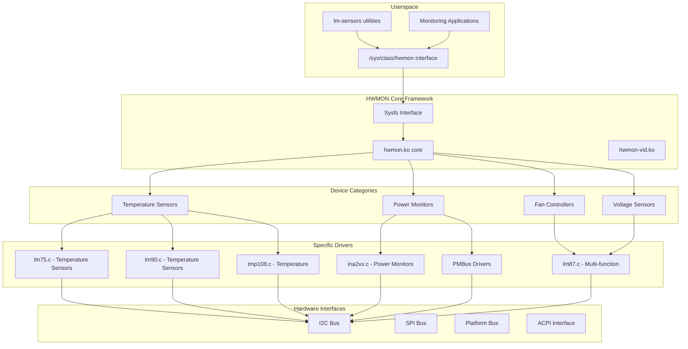
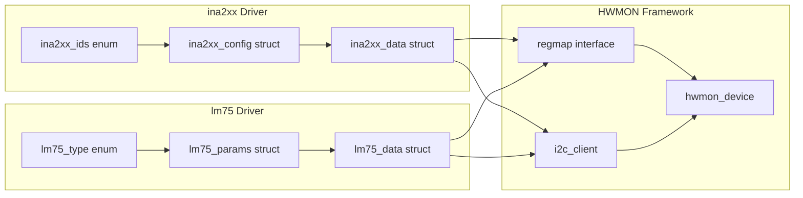
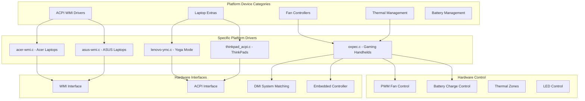
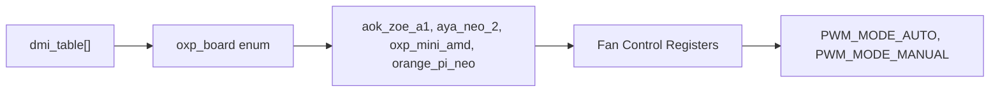
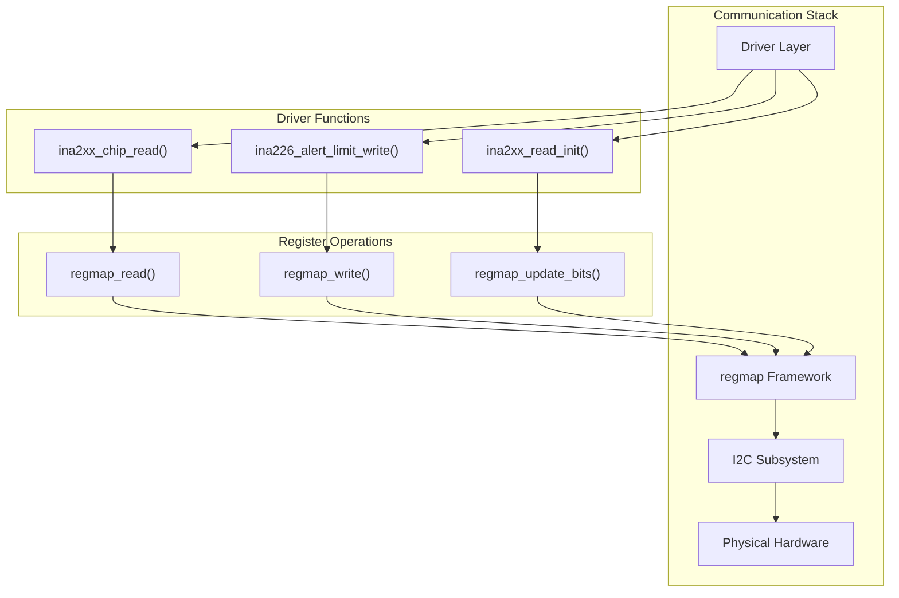

<!-- source: DeepWiki mcp.deepwiki.com · repo NVIDIA/NV-Kernels · page 2 Hardware Monitoring and Platform Support · fetched 2026-10-26 -->

# Hardware Monitoring and Platform Support

Relevant source files

The following files were used as context for generating this wiki page:

- [.get_maintainer.ignore](.get_maintainer.ignore)
- [.mailmap](.mailmap)
- [CREDITS](CREDITS)
- [Documentation/devicetree/bindings/serial/atmel,at91-usart.yaml](Documentation/devicetree/bindings/serial/atmel,at91-usart.yaml)
- [Documentation/gpu/introduction.rst](Documentation/gpu/introduction.rst)
- [Documentation/gpu/todo.rst](Documentation/gpu/todo.rst)
- [Documentation/hwmon/acbel-fsg032.rst](Documentation/hwmon/acbel-fsg032.rst)
- [Documentation/hwmon/adm1275.rst](Documentation/hwmon/adm1275.rst)
- [Documentation/hwmon/crps.rst](Documentation/hwmon/crps.rst)
- [Documentation/hwmon/htu31.rst](Documentation/hwmon/htu31.rst)
- [Documentation/hwmon/ina233.rst](Documentation/hwmon/ina233.rst)
- [Documentation/hwmon/ina2xx.rst](Documentation/hwmon/ina2xx.rst)
- [Documentation/hwmon/index.rst](Documentation/hwmon/index.rst)
- [Documentation/hwmon/kbatt.rst](Documentation/hwmon/kbatt.rst)
- [Documentation/hwmon/kfan.rst](Documentation/hwmon/kfan.rst)
- [Documentation/hwmon/lm75.rst](Documentation/hwmon/lm75.rst)
- [Documentation/hwmon/lm90.rst](Documentation/hwmon/lm90.rst)
- [Documentation/hwmon/lt3074.rst](Documentation/hwmon/lt3074.rst)
- [Documentation/hwmon/ltc2978.rst](Documentation/hwmon/ltc2978.rst)
- [Documentation/hwmon/max15301.rst](Documentation/hwmon/max15301.rst)
- [Documentation/hwmon/max77705.rst](Documentation/hwmon/max77705.rst)
- [Documentation/hwmon/tmp108.rst](Documentation/hwmon/tmp108.rst)
- [Documentation/networking/batman-adv.rst](Documentation/networking/batman-adv.rst)
- [Documentation/networking/device_drivers/ethernet/index.rst](Documentation/networking/device_drivers/ethernet/index.rst)
- [MAINTAINERS](MAINTAINERS)
- [drivers/hwmon/Kconfig](drivers/hwmon/Kconfig)
- [drivers/hwmon/Makefile](drivers/hwmon/Makefile)
- [drivers/hwmon/htu31.c](drivers/hwmon/htu31.c)
- [drivers/hwmon/ina2xx.c](drivers/hwmon/ina2xx.c)
- [drivers/hwmon/kbatt.c](drivers/hwmon/kbatt.c)
- [drivers/hwmon/kfan.c](drivers/hwmon/kfan.c)
- [drivers/hwmon/lm75.c](drivers/hwmon/lm75.c)
- [drivers/hwmon/lm87.c](drivers/hwmon/lm87.c)
- [drivers/hwmon/lm90.c](drivers/hwmon/lm90.c)
- [drivers/hwmon/lm95241.c](drivers/hwmon/lm95241.c)
- [drivers/hwmon/max6621.c](drivers/hwmon/max6621.c)
- [drivers/hwmon/max77705-hwmon.c](drivers/hwmon/max77705-hwmon.c)
- [drivers/hwmon/pmbus/Kconfig](drivers/hwmon/pmbus/Kconfig)
- [drivers/hwmon/pmbus/Makefile](drivers/hwmon/pmbus/Makefile)
- [drivers/hwmon/pmbus/adm1275.c](drivers/hwmon/pmbus/adm1275.c)
- [drivers/hwmon/pmbus/crps.c](drivers/hwmon/pmbus/crps.c)
- [drivers/hwmon/pmbus/ina233.c](drivers/hwmon/pmbus/ina233.c)
- [drivers/hwmon/pmbus/lt3074.c](drivers/hwmon/pmbus/lt3074.c)
- [drivers/hwmon/pmbus/ltc2978.c](drivers/hwmon/pmbus/ltc2978.c)
- [drivers/hwmon/pmbus/max15301.c](drivers/hwmon/pmbus/max15301.c)
- [drivers/hwmon/tmp108.c](drivers/hwmon/tmp108.c)
- [drivers/media/pci/saa7134/saa7134-cards.c](drivers/media/pci/saa7134/saa7134-cards.c)
- [drivers/net/ethernet/toshiba/Kconfig](drivers/net/ethernet/toshiba/Kconfig)
- [drivers/net/ethernet/toshiba/Makefile](drivers/net/ethernet/toshiba/Makefile)
- [drivers/platform/x86/Kconfig](drivers/platform/x86/Kconfig)
- [drivers/platform/x86/Makefile](drivers/platform/x86/Makefile)
- [drivers/platform/x86/dasharo-acpi.c](drivers/platform/x86/dasharo-acpi.c)
- [drivers/platform/x86/ideapad-laptop.h](drivers/platform/x86/ideapad-laptop.h)
- [drivers/platform/x86/lenovo-wmi-hotkey-utilities.c](drivers/platform/x86/lenovo-wmi-hotkey-utilities.c)
- [drivers/platform/x86/lenovo-ymc.c](drivers/platform/x86/lenovo-ymc.c)
- [drivers/platform/x86/meegopad_anx7428.c](drivers/platform/x86/meegopad_anx7428.c)
- [drivers/platform/x86/oxpec.c](drivers/platform/x86/oxpec.c)
- [drivers/platform/x86/portwell-ec.c](drivers/platform/x86/portwell-ec.c)
- [drivers/platform/x86/tuxedo/Kconfig](drivers/platform/x86/tuxedo/Kconfig)
- [drivers/platform/x86/tuxedo/Makefile](drivers/platform/x86/tuxedo/Makefile)
- [drivers/platform/x86/tuxedo/nb04/Kconfig](drivers/platform/x86/tuxedo/nb04/Kconfig)
- [drivers/platform/x86/tuxedo/nb04/Makefile](drivers/platform/x86/tuxedo/nb04/Makefile)
- [drivers/platform/x86/tuxedo/nb04/wmi_ab.c](drivers/platform/x86/tuxedo/nb04/wmi_ab.c)
- [drivers/platform/x86/tuxedo/nb04/wmi_util.c](drivers/platform/x86/tuxedo/nb04/wmi_util.c)
- [drivers/platform/x86/tuxedo/nb04/wmi_util.h](drivers/platform/x86/tuxedo/nb04/wmi_util.h)
- [net/batman-adv/main.h](net/batman-adv/main.h)

This document covers the Linux kernel's comprehensive hardware monitoring subsystem and x86 platform-specific drivers. The hardware monitoring (HWMON) subsystem provides a unified framework for monitoring system health parameters such as temperatures, voltages, currents, power consumption, and fan speeds. The x86 platform drivers provide device-specific support for laptops, embedded systems, and specialized hardware platforms.

For information about virtualization platform support, see [Virtualization Infrastructure](#3). For high-performance I/O systems, see [High-Performance I/O Systems](#4).

## Hardware Monitoring Subsystem Overview

The HWMON subsystem serves as the central framework for hardware health monitoring in Linux. It provides standardized interfaces for sensors and monitoring devices, allowing userspace applications to access hardware health information through a consistent sysfs interface.

### HWMON Architecture

**Sources:** [drivers/hwmon/Kconfig:6-25](), [drivers/hwmon/Makefile:6-7](), [Documentation/hwmon/index.rst:1-21]()

### Core HWMON Data Structures

**Sources:** [drivers/hwmon/ina2xx.c:152-162](), [drivers/hwmon/lm75.c:109-118](), [drivers/hwmon/ina2xx.c:138-151]()

## Device Categories and Drivers

### Power Monitoring Devices

The INA2xx family represents a comprehensive set of power monitoring chips that measure voltage, current, and power consumption. The driver supports multiple variants with different capabilities.

Key functions and registers:
- `ina2xx_get_value()` - Converts raw register values to standard units
- `ina2xx_read_init()` - Handles device initialization and calibration
- Register definitions: `INA2XX_SHUNT_VOLTAGE`, `INA2XX_BUS_VOLTAGE`, `INA2XX_POWER`, `INA2XX_CURRENT`

**Sources:** [drivers/hwmon/ina2xx.c:251-285](), [drivers/hwmon/ina2xx.c:291-353](), [drivers/hwmon/ina2xx.c:42-52]()

### Temperature Sensors

The LM75 driver family provides temperature monitoring for a wide range of sensors. It demonstrates the HWMON subsystem's ability to support multiple device variants through a unified interface.

Supported device types include: `adt75`, `as6200`, `at30ts74`, `ds1775`, `ds75`, `lm75`, `lm75a`, `max6625`, `tmp100`, `tmp101`, and many others.

**Sources:** [drivers/hwmon/lm75.c:27-57](), [drivers/hwmon/lm75.c:130-176]()

### PMBus Power Management

The PMBus subsystem provides standardized power management bus support for server and telecom applications. It includes drivers for power supplies, voltage regulators, and power sequencers.

**Sources:** [drivers/hwmon/pmbus/Kconfig:6-14](), [drivers/hwmon/pmbus/ltc2978.c:22-31](), [drivers/hwmon/pmbus/Makefile:6-7]()

## X86 Platform Drivers

Platform drivers provide device-specific support for x86 systems, particularly laptops and embedded devices. These drivers often combine multiple functions including hardware monitoring, device control, and platform-specific features.

### Platform Driver Architecture

**Sources:** [drivers/platform/x86/Kconfig:6-17](), [drivers/platform/x86/Makefile:7-16](), [drivers/platform/x86/oxpec.c:44-62]()

### Gaming Handheld Support

The OXPEC driver exemplifies modern platform driver design, supporting multiple gaming handheld devices with unified fan control and thermal management.

Device matching through DMI table:

Key registers and functions:
- `OXP_SENSOR_FAN_REG` - Fan speed reading
- `OXP_SENSOR_PWM_REG` - PWM control
- `lock_global_acpi_lock()` / `unlock_global_acpi_lock()` - ACPI synchronization

**Sources:** [drivers/platform/x86/oxpec.c:111-302](), [drivers/platform/x86/oxpec.c:67-79](), [drivers/platform/x86/oxpec.c:34-42]()

## Integration with Hardware Interfaces

### I2C and Device Communication

Most HWMON drivers communicate with hardware through the I2C bus using the regmap framework for standardized register access patterns.

**Sources:** [drivers/hwmon/ina2xx.c:127-136](), [drivers/hwmon/ina2xx.c:291-353](), [drivers/hwmon/ina2xx.c:411-441]()

## Configuration and Build System

The hardware monitoring and platform support subsystems use Kconfig for configuration management and integrated Makefiles for build coordination.

### Build Configuration

| Subsystem | Config Option | Module Name | Key Dependencies |
|-----------|---------------|-------------|------------------|
| HWMON Core | `CONFIG_HWMON` | `hwmon.ko` | `HAS_IOMEM` |
| INA2xx Power | `CONFIG_SENSORS_INA2XX` | `ina2xx.ko` | `I2C`, `REGMAP` |
| LM75 Temperature | `CONFIG_SENSORS_LM75` | `lm75.ko` | `I2C`, `REGMAP` |
| PMBus Core | `CONFIG_PMBUS` | `pmbus_core.ko` | `I2C` |
| X86 Platforms | `CONFIG_X86_PLATFORM_DEVICES` | Various | `X86`, `ACPI` |

**Sources:** [drivers/hwmon/Kconfig:6-25](), [drivers/platform/x86/Kconfig:6-16](), [drivers/hwmon/Makefile:6-7](), [drivers/platform/x86/Makefile:6-16]()

## Maintenance and Development

The subsystem maintenance follows the standard Linux kernel development model with designated maintainers for different components. The `MAINTAINERS` file provides the authoritative source for maintainer information and contribution guidelines.

Key maintainer categories:
- HWMON subsystem maintainers
- Individual driver maintainers  
- Platform-specific driver maintainers
- PMBus subsystem maintainers

**Sources:** [MAINTAINERS:209-219](), [MAINTAINERS:209-219](), [Documentation/hwmon/index.rst:1-21]()

The hardware monitoring and platform support subsystems represent critical infrastructure for system health monitoring and device-specific functionality in modern Linux systems. They provide the foundation for thermal management, power monitoring, and platform-specific features across a wide range of hardware platforms.

---

