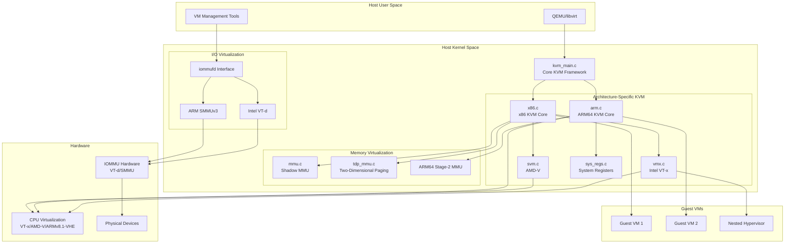
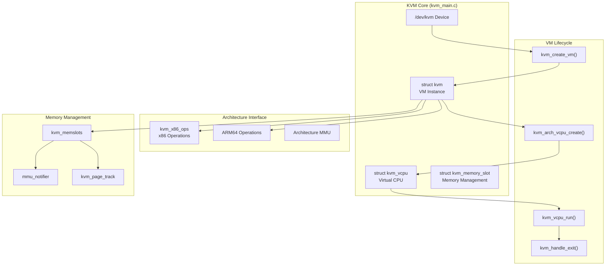
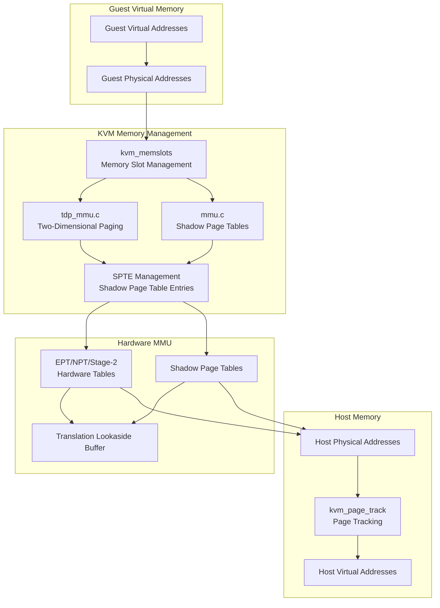
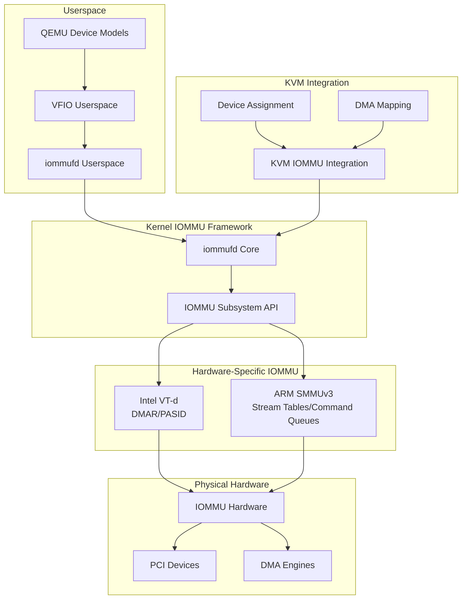
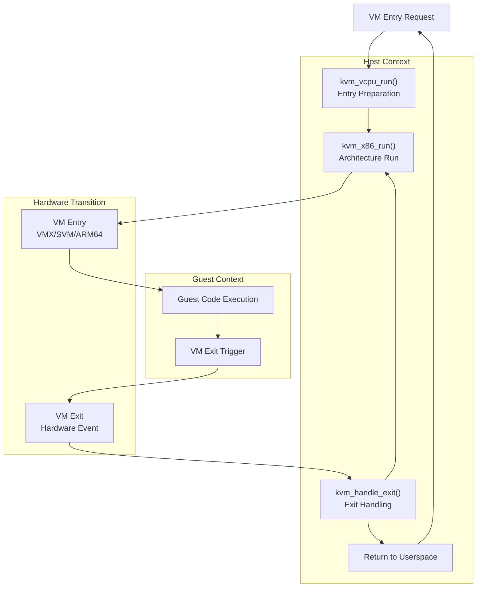

<!-- source: DeepWiki mcp.deepwiki.com · repo NVIDIA/NV-Kernels · page 3 Virtualization Infrastructure · fetched 2026-10-26 -->

# Virtualization Infrastructure

Relevant source files

The following files were used as context for generating this wiki page:

- [Documentation/virt/kvm/api.rst](Documentation/virt/kvm/api.rst)
- [Documentation/virt/kvm/locking.rst](Documentation/virt/kvm/locking.rst)
- [Documentation/virt/kvm/x86/amd-memory-encryption.rst](Documentation/virt/kvm/x86/amd-memory-encryption.rst)
- [arch/arm/include/asm/arm_pmuv3.h](arch/arm/include/asm/arm_pmuv3.h)
- [arch/arm64/include/asm/arm_pmuv3.h](arch/arm64/include/asm/arm_pmuv3.h)
- [arch/arm64/include/asm/el2_setup.h](arch/arm64/include/asm/el2_setup.h)
- [arch/arm64/include/asm/hardirq.h](arch/arm64/include/asm/hardirq.h)
- [arch/arm64/include/asm/kvm_arm.h](arch/arm64/include/asm/kvm_arm.h)
- [arch/arm64/include/asm/kvm_asm.h](arch/arm64/include/asm/kvm_asm.h)
- [arch/arm64/include/asm/kvm_emulate.h](arch/arm64/include/asm/kvm_emulate.h)
- [arch/arm64/include/asm/kvm_host.h](arch/arm64/include/asm/kvm_host.h)
- [arch/arm64/include/asm/kvm_hyp.h](arch/arm64/include/asm/kvm_hyp.h)
- [arch/arm64/include/asm/kvm_mmu.h](arch/arm64/include/asm/kvm_mmu.h)
- [arch/arm64/include/asm/kvm_nested.h](arch/arm64/include/asm/kvm_nested.h)
- [arch/arm64/include/asm/kvm_pgtable.h](arch/arm64/include/asm/kvm_pgtable.h)
- [arch/arm64/include/asm/kvm_pkvm.h](arch/arm64/include/asm/kvm_pkvm.h)
- [arch/arm64/include/asm/memory.h](arch/arm64/include/asm/memory.h)
- [arch/arm64/include/asm/module.h](arch/arm64/include/asm/module.h)
- [arch/arm64/include/asm/module.lds.h](arch/arm64/include/asm/module.lds.h)
- [arch/arm64/include/asm/runtime-const.h](arch/arm64/include/asm/runtime-const.h)
- [arch/arm64/include/asm/scs.h](arch/arm64/include/asm/scs.h)
- [arch/arm64/include/asm/sections.h](arch/arm64/include/asm/sections.h)
- [arch/arm64/include/asm/stacktrace/nvhe.h](arch/arm64/include/asm/stacktrace/nvhe.h)
- [arch/arm64/include/asm/sysreg.h](arch/arm64/include/asm/sysreg.h)
- [arch/arm64/include/asm/vncr_mapping.h](arch/arm64/include/asm/vncr_mapping.h)
- [arch/arm64/kernel/head.S](arch/arm64/kernel/head.S)
- [arch/arm64/kernel/hyp-stub.S](arch/arm64/kernel/hyp-stub.S)
- [arch/arm64/kernel/image-vars.h](arch/arm64/kernel/image-vars.h)
- [arch/arm64/kernel/kaslr.c](arch/arm64/kernel/kaslr.c)
- [arch/arm64/kernel/module-plts.c](arch/arm64/kernel/module-plts.c)
- [arch/arm64/kernel/module.c](arch/arm64/kernel/module.c)
- [arch/arm64/kernel/pi/kaslr_early.c](arch/arm64/kernel/pi/kaslr_early.c)
- [arch/arm64/kernel/pi/patch-scs.c](arch/arm64/kernel/pi/patch-scs.c)
- [arch/arm64/kernel/pi/pi.h](arch/arm64/kernel/pi/pi.h)
- [arch/arm64/kernel/vmlinux.lds.S](arch/arm64/kernel/vmlinux.lds.S)
- [arch/arm64/kvm/arm.c](arch/arm64/kvm/arm.c)
- [arch/arm64/kvm/at.c](arch/arm64/kvm/at.c)
- [arch/arm64/kvm/debug.c](arch/arm64/kvm/debug.c)
- [arch/arm64/kvm/emulate-nested.c](arch/arm64/kvm/emulate-nested.c)
- [arch/arm64/kvm/fpsimd.c](arch/arm64/kvm/fpsimd.c)
- [arch/arm64/kvm/handle_exit.c](arch/arm64/kvm/handle_exit.c)
- [arch/arm64/kvm/hyp/fpsimd.S](arch/arm64/kvm/hyp/fpsimd.S)
- [arch/arm64/kvm/hyp/hyp-entry.S](arch/arm64/kvm/hyp/hyp-entry.S)
- [arch/arm64/kvm/hyp/include/hyp/debug-sr.h](arch/arm64/kvm/hyp/include/hyp/debug-sr.h)
- [arch/arm64/kvm/hyp/include/hyp/switch.h](arch/arm64/kvm/hyp/include/hyp/switch.h)
- [arch/arm64/kvm/hyp/include/hyp/sysreg-sr.h](arch/arm64/kvm/hyp/include/hyp/sysreg-sr.h)
- [arch/arm64/kvm/hyp/include/nvhe/gfp.h](arch/arm64/kvm/hyp/include/nvhe/gfp.h)
- [arch/arm64/kvm/hyp/include/nvhe/mem_protect.h](arch/arm64/kvm/hyp/include/nvhe/mem_protect.h)
- [arch/arm64/kvm/hyp/include/nvhe/memory.h](arch/arm64/kvm/hyp/include/nvhe/memory.h)
- [arch/arm64/kvm/hyp/include/nvhe/mm.h](arch/arm64/kvm/hyp/include/nvhe/mm.h)
- [arch/arm64/kvm/hyp/include/nvhe/pkvm.h](arch/arm64/kvm/hyp/include/nvhe/pkvm.h)
- [arch/arm64/kvm/hyp/nvhe/debug-sr.c](arch/arm64/kvm/hyp/nvhe/debug-sr.c)
- [arch/arm64/kvm/hyp/nvhe/host.S](arch/arm64/kvm/hyp/nvhe/host.S)
- [arch/arm64/kvm/hyp/nvhe/hyp-init.S](arch/arm64/kvm/hyp/nvhe/hyp-init.S)
- [arch/arm64/kvm/hyp/nvhe/hyp-main.c](arch/arm64/kvm/hyp/nvhe/hyp-main.c)
- [arch/arm64/kvm/hyp/nvhe/hyp.lds.S](arch/arm64/kvm/hyp/nvhe/hyp.lds.S)
- [arch/arm64/kvm/hyp/nvhe/mem_protect.c](arch/arm64/kvm/hyp/nvhe/mem_protect.c)
- [arch/arm64/kvm/hyp/nvhe/mm.c](arch/arm64/kvm/hyp/nvhe/mm.c)
- [arch/arm64/kvm/hyp/nvhe/page_alloc.c](arch/arm64/kvm/hyp/nvhe/page_alloc.c)
- [arch/arm64/kvm/hyp/nvhe/pkvm.c](arch/arm64/kvm/hyp/nvhe/pkvm.c)
- [arch/arm64/kvm/hyp/nvhe/psci-relay.c](arch/arm64/kvm/hyp/nvhe/psci-relay.c)
- [arch/arm64/kvm/hyp/nvhe/setup.c](arch/arm64/kvm/hyp/nvhe/setup.c)
- [arch/arm64/kvm/hyp/nvhe/stacktrace.c](arch/arm64/kvm/hyp/nvhe/stacktrace.c)
- [arch/arm64/kvm/hyp/nvhe/switch.c](arch/arm64/kvm/hyp/nvhe/switch.c)
- [arch/arm64/kvm/hyp/nvhe/sys_regs.c](arch/arm64/kvm/hyp/nvhe/sys_regs.c)
- [arch/arm64/kvm/hyp/nvhe/sysreg-sr.c](arch/arm64/kvm/hyp/nvhe/sysreg-sr.c)
- [arch/arm64/kvm/hyp/pgtable.c](arch/arm64/kvm/hyp/pgtable.c)
- [arch/arm64/kvm/hyp/vhe/debug-sr.c](arch/arm64/kvm/hyp/vhe/debug-sr.c)
- [arch/arm64/kvm/hyp/vhe/switch.c](arch/arm64/kvm/hyp/vhe/switch.c)
- [arch/arm64/kvm/hyp/vhe/sysreg-sr.c](arch/arm64/kvm/hyp/vhe/sysreg-sr.c)
- [arch/arm64/kvm/mmu.c](arch/arm64/kvm/mmu.c)
- [arch/arm64/kvm/nested.c](arch/arm64/kvm/nested.c)
- [arch/arm64/kvm/pkvm.c](arch/arm64/kvm/pkvm.c)
- [arch/arm64/kvm/pmu-emul.c](arch/arm64/kvm/pmu-emul.c)
- [arch/arm64/kvm/pmu.c](arch/arm64/kvm/pmu.c)
- [arch/arm64/kvm/reset.c](arch/arm64/kvm/reset.c)
- [arch/arm64/kvm/stacktrace.c](arch/arm64/kvm/stacktrace.c)
- [arch/arm64/kvm/sys_regs.c](arch/arm64/kvm/sys_regs.c)
- [arch/arm64/kvm/sys_regs.h](arch/arm64/kvm/sys_regs.h)
- [arch/arm64/kvm/trace_handle_exit.h](arch/arm64/kvm/trace_handle_exit.h)
- [arch/arm64/kvm/vgic-sys-reg-v3.c](arch/arm64/kvm/vgic-sys-reg-v3.c)
- [arch/arm64/mm/init.c](arch/arm64/mm/init.c)
- [arch/arm64/tools/sysreg](arch/arm64/tools/sysreg)
- [arch/x86/include/asm/kvm-x86-ops.h](arch/x86/include/asm/kvm-x86-ops.h)
- [arch/x86/include/asm/kvm-x86-pmu-ops.h](arch/x86/include/asm/kvm-x86-pmu-ops.h)
- [arch/x86/include/asm/kvm_host.h](arch/x86/include/asm/kvm_host.h)
- [arch/x86/include/asm/vmx.h](arch/x86/include/asm/vmx.h)
- [arch/x86/include/uapi/asm/kvm.h](arch/x86/include/uapi/asm/kvm.h)
- [arch/x86/include/uapi/asm/vmx.h](arch/x86/include/uapi/asm/vmx.h)
- [arch/x86/kvm/hyperv.c](arch/x86/kvm/hyperv.c)
- [arch/x86/kvm/irq.c](arch/x86/kvm/irq.c)
- [arch/x86/kvm/lapic.c](arch/x86/kvm/lapic.c)
- [arch/x86/kvm/lapic.h](arch/x86/kvm/lapic.h)
- [arch/x86/kvm/mmu.h](arch/x86/kvm/mmu.h)
- [arch/x86/kvm/mmu/mmu.c](arch/x86/kvm/mmu/mmu.c)
- [arch/x86/kvm/mmu/mmu_internal.h](arch/x86/kvm/mmu/mmu_internal.h)
- [arch/x86/kvm/mmu/mmutrace.h](arch/x86/kvm/mmu/mmutrace.h)
- [arch/x86/kvm/mmu/paging_tmpl.h](arch/x86/kvm/mmu/paging_tmpl.h)
- [arch/x86/kvm/mmu/spte.c](arch/x86/kvm/mmu/spte.c)
- [arch/x86/kvm/mmu/spte.h](arch/x86/kvm/mmu/spte.h)
- [arch/x86/kvm/mmu/tdp_iter.c](arch/x86/kvm/mmu/tdp_iter.c)
- [arch/x86/kvm/mmu/tdp_iter.h](arch/x86/kvm/mmu/tdp_iter.h)
- [arch/x86/kvm/mmu/tdp_mmu.c](arch/x86/kvm/mmu/tdp_mmu.c)
- [arch/x86/kvm/mmu/tdp_mmu.h](arch/x86/kvm/mmu/tdp_mmu.h)
- [arch/x86/kvm/pmu.c](arch/x86/kvm/pmu.c)
- [arch/x86/kvm/pmu.h](arch/x86/kvm/pmu.h)
- [arch/x86/kvm/smm.c](arch/x86/kvm/smm.c)
- [arch/x86/kvm/svm/nested.c](arch/x86/kvm/svm/nested.c)
- [arch/x86/kvm/svm/pmu.c](arch/x86/kvm/svm/pmu.c)
- [arch/x86/kvm/svm/sev.c](arch/x86/kvm/svm/sev.c)
- [arch/x86/kvm/svm/svm.c](arch/x86/kvm/svm/svm.c)
- [arch/x86/kvm/svm/svm.h](arch/x86/kvm/svm/svm.h)
- [arch/x86/kvm/vmx/capabilities.h](arch/x86/kvm/vmx/capabilities.h)
- [arch/x86/kvm/vmx/common.h](arch/x86/kvm/vmx/common.h)
- [arch/x86/kvm/vmx/main.c](arch/x86/kvm/vmx/main.c)
- [arch/x86/kvm/vmx/nested.c](arch/x86/kvm/vmx/nested.c)
- [arch/x86/kvm/vmx/nested.h](arch/x86/kvm/vmx/nested.h)
- [arch/x86/kvm/vmx/pmu_intel.c](arch/x86/kvm/vmx/pmu_intel.c)
- [arch/x86/kvm/vmx/pmu_intel.h](arch/x86/kvm/vmx/pmu_intel.h)
- [arch/x86/kvm/vmx/posted_intr.c](arch/x86/kvm/vmx/posted_intr.c)
- [arch/x86/kvm/vmx/sgx.c](arch/x86/kvm/vmx/sgx.c)
- [arch/x86/kvm/vmx/tdx.c](arch/x86/kvm/vmx/tdx.c)
- [arch/x86/kvm/vmx/tdx.h](arch/x86/kvm/vmx/tdx.h)
- [arch/x86/kvm/vmx/tdx_arch.h](arch/x86/kvm/vmx/tdx_arch.h)
- [arch/x86/kvm/vmx/tdx_errno.h](arch/x86/kvm/vmx/tdx_errno.h)
- [arch/x86/kvm/vmx/vmx.c](arch/x86/kvm/vmx/vmx.c)
- [arch/x86/kvm/vmx/vmx.h](arch/x86/kvm/vmx/vmx.h)
- [arch/x86/kvm/vmx/x86_ops.h](arch/x86/kvm/vmx/x86_ops.h)
- [arch/x86/kvm/x86.c](arch/x86/kvm/x86.c)
- [arch/x86/kvm/x86.h](arch/x86/kvm/x86.h)
- [arch/x86/kvm/xen.c](arch/x86/kvm/xen.c)
- [arch/x86/kvm/xen.h](arch/x86/kvm/xen.h)
- [drivers/perf/arm_pmu.c](drivers/perf/arm_pmu.c)
- [drivers/perf/arm_pmuv3.c](drivers/perf/arm_pmuv3.c)
- [drivers/perf/arm_v6_pmu.c](drivers/perf/arm_v6_pmu.c)
- [drivers/perf/arm_v7_pmu.c](drivers/perf/arm_v7_pmu.c)
- [drivers/perf/arm_xscale_pmu.c](drivers/perf/arm_xscale_pmu.c)
- [include/kvm/arm_pmu.h](include/kvm/arm_pmu.h)
- [include/linux/kvm_host.h](include/linux/kvm_host.h)
- [include/linux/perf/arm_pmu.h](include/linux/perf/arm_pmu.h)
- [include/linux/perf/arm_pmuv3.h](include/linux/perf/arm_pmuv3.h)
- [include/uapi/linux/kvm.h](include/uapi/linux/kvm.h)
- [tools/arch/arm64/include/asm/gpr-num.h](tools/arch/arm64/include/asm/gpr-num.h)
- [tools/arch/arm64/include/asm/sysreg.h](tools/arch/arm64/include/asm/sysreg.h)
- [tools/include/linux/kasan-tags.h](tools/include/linux/kasan-tags.h)
- [virt/kvm/Kconfig](virt/kvm/Kconfig)
- [virt/kvm/guest_memfd.c](virt/kvm/guest_memfd.c)
- [virt/kvm/kvm_main.c](virt/kvm/kvm_main.c)
- [virt/kvm/kvm_mm.h](virt/kvm/kvm_mm.h)
- [virt/kvm/pfncache.c](virt/kvm/pfncache.c)

This document covers the Linux kernel's comprehensive virtualization infrastructure, primarily centered around the KVM (Kernel-based Virtual Machine) hypervisor. The scope includes the core KVM framework, architecture-specific implementations for x86 and ARM64, memory virtualization through MMU support, and I/O virtualization via IOMMU integration.

For detailed information about specific implementations, see [KVM x86 Virtualization](#3.1), [KVM ARM64 Virtualization](#3.2), and [IOMMU Support](#3.3). For high-performance I/O systems that complement virtualization, see [High-Performance I/O Systems](#4).

## Architecture Overview

The virtualization infrastructure is built around a layered architecture where the KVM hypervisor runs in kernel space, managing guest virtual machines and coordinating with hardware virtualization features.

### Overall Virtualization Architecture

Sources: [virt/kvm/kvm_main.c:1-100](), [arch/x86/kvm/x86.c:1-50](), [arch/arm64/kvm/arm.c:1-50]()

## KVM Core Infrastructure

The KVM core provides the fundamental virtualization framework that is shared across all supported architectures. The main entry point is through the `/dev/kvm` device interface managed by `kvm_main.c`.

### Core KVM Components

Sources: [virt/kvm/kvm_main.c:110-200](), [include/linux/kvm_host.h:1-100]()

The core KVM infrastructure manages virtual machine lifecycle through several key functions:

- `kvm_create_vm()` - Creates a new VM instance
- `kvm_arch_vcpu_create()` - Architecture-specific VCPU creation
- `kvm_vcpu_run()` - Main execution loop for virtual CPUs
- `kvm_handle_exit()` - Handles VM exits and returns to guest

## Architecture-Specific Implementations

### x86 Virtualization

The x86 KVM implementation supports both Intel VT-x (VMX) and AMD-V (SVM) hardware virtualization extensions. The core x86 logic is in `x86.c` with vendor-specific implementations in separate modules.

Key x86 KVM structures include:
- `struct kvm_caps` - Tracks KVM capabilities [arch/x86/kvm/x86.c:99]()
- `struct kvm_vcpu_arch` - x86-specific VCPU state
- `struct kvm_x86_ops` - Function pointers for vendor operations [arch/x86/kvm/x86.c:139]()

### ARM64 Virtualization 

The ARM64 implementation leverages ARMv8 virtualization extensions including VHE (Virtualization Host Extensions) and nested virtualization support. The main ARM64 KVM logic handles system register emulation, exception handling, and stage-2 memory management.

Key ARM64 structures:
- `struct kvm_arch` - ARM64-specific VM state [arch/arm64/include/asm/kvm_host.h:293-407]()
- `struct kvm_vcpu_fault_info` - Exception information [arch/arm64/include/asm/kvm_host.h:409-414]()
- System register array for virtualization [arch/arm64/include/asm/kvm_host.h:436-500]()

## Memory Virtualization

Memory virtualization in KVM supports both shadow page tables and hardware-assisted two-dimensional paging (Intel EPT/AMD NPT/ARM64 Stage-2).

### Memory Management Architecture

Sources: [arch/x86/kvm/mmu/mmu.c:1-100](), [arch/x86/kvm/mmu/tdp_mmu.c:1-50]()

The memory virtualization layer provides:

- **Shadow Page Tables**: Software-managed translation from guest physical to host physical addresses
- **Two-Dimensional Paging**: Hardware-assisted translation using EPT/NPT/Stage-2 tables
- **Memory Slot Management**: Tracking of guest memory regions via `kvm_memslots`
- **Page Tracking**: Monitoring page access patterns for optimization

## I/O Virtualization and Device Assignment

I/O virtualization enables secure and efficient device sharing between host and guest systems through IOMMU hardware support.

### IOMMU Integration Architecture

Sources: [arch/x86/kvm/x86.c:46](), [arch/arm64/kvm/arm.c:40]()

The IOMMU integration provides:

- **Device Assignment**: Direct assignment of physical devices to guest VMs
- **DMA Protection**: Isolation of DMA transactions per VM using IOMMU translation
- **PASID Support**: Process Address Space ID for fine-grained access control
- **Interrupt Remapping**: Secure delivery of device interrupts to guests

## Virtualization Control Flow

The main execution flow for virtualized workloads follows a well-defined pattern of VM entry, guest execution, VM exit handling, and return to guest.

### VM Execution Cycle

Sources: [virt/kvm/kvm_main.c:164-183](), [arch/x86/kvm/x86.c:128-134]()

Key execution functions:
- `vcpu_load()` / `vcpu_put()` - VCPU context switching [virt/kvm/kvm_main.c:164-183]()
- `kvm_arch_vcpu_run()` - Architecture-specific execution
- VM exit handlers for various exception types and hardware events

The virtualization infrastructure provides a robust foundation for running multiple operating systems concurrently with hardware-assisted isolation and performance. The modular design allows for architecture-specific optimizations while maintaining a common framework for memory management, device assignment, and guest lifecycle management.

---

