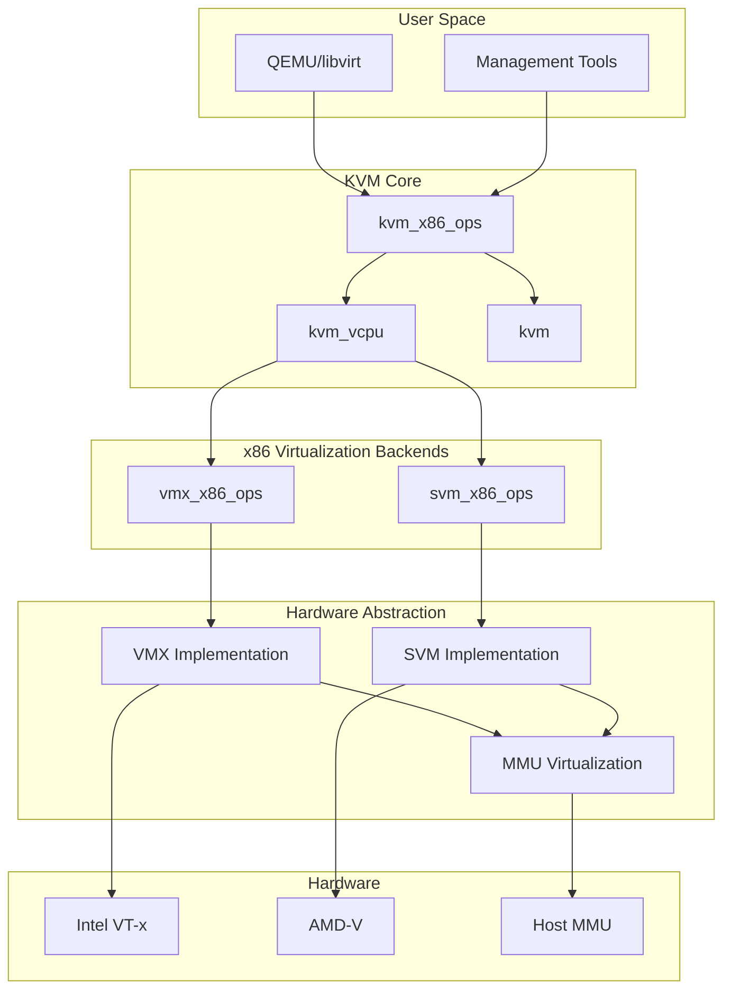
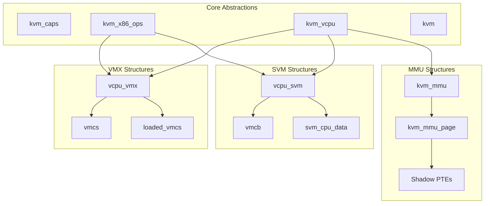
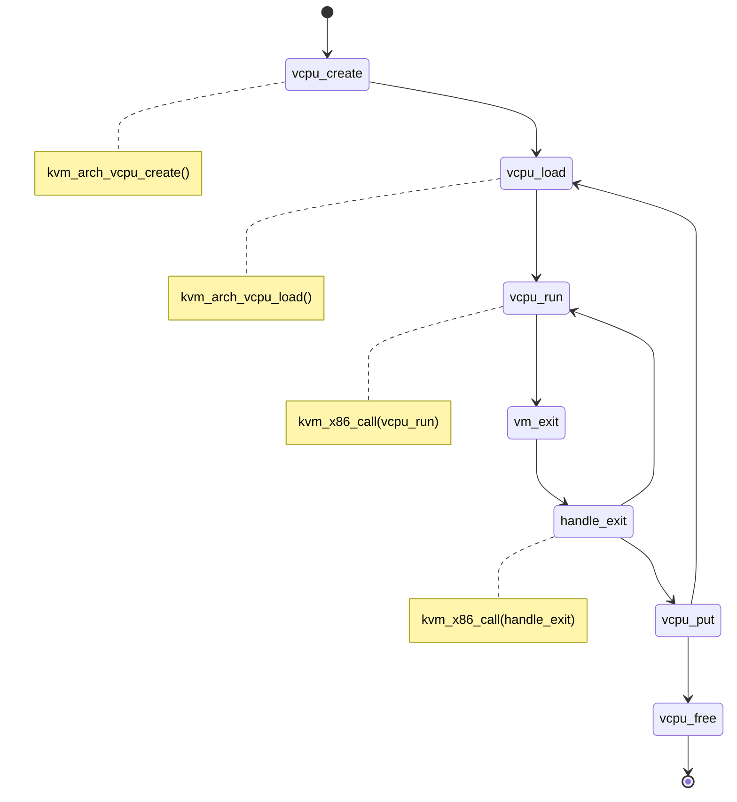
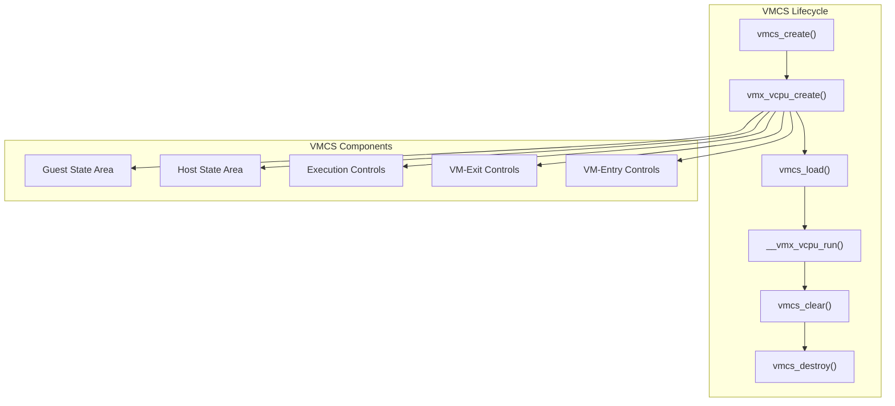
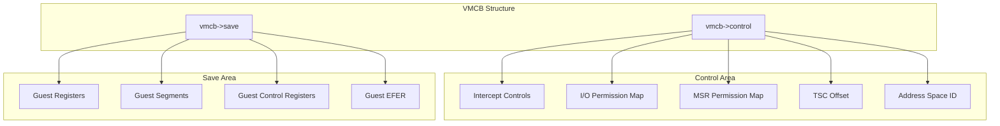
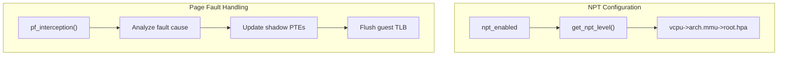
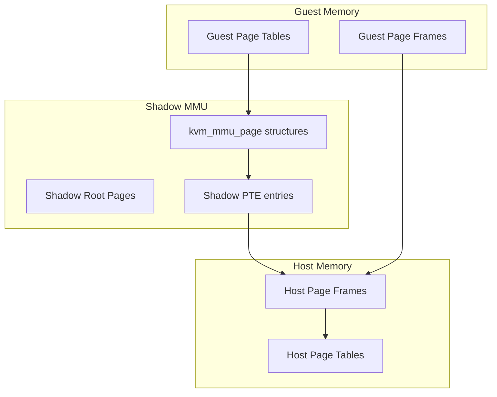
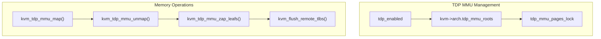

<!-- source: DeepWiki mcp.deepwiki.com · repo NVIDIA/NV-Kernels · page 3.1 KVM x86 Virtualization · fetched 2026-10-26 -->

# KVM x86 Virtualization

Relevant source files

The following files were used as context for generating this wiki page:

- [Documentation/virt/kvm/api.rst](Documentation/virt/kvm/api.rst)
- [Documentation/virt/kvm/locking.rst](Documentation/virt/kvm/locking.rst)
- [Documentation/virt/kvm/x86/amd-memory-encryption.rst](Documentation/virt/kvm/x86/amd-memory-encryption.rst)
- [arch/x86/include/asm/kvm-x86-ops.h](arch/x86/include/asm/kvm-x86-ops.h)
- [arch/x86/include/asm/kvm-x86-pmu-ops.h](arch/x86/include/asm/kvm-x86-pmu-ops.h)
- [arch/x86/include/asm/kvm_host.h](arch/x86/include/asm/kvm_host.h)
- [arch/x86/include/asm/vmx.h](arch/x86/include/asm/vmx.h)
- [arch/x86/include/uapi/asm/kvm.h](arch/x86/include/uapi/asm/kvm.h)
- [arch/x86/include/uapi/asm/vmx.h](arch/x86/include/uapi/asm/vmx.h)
- [arch/x86/kvm/hyperv.c](arch/x86/kvm/hyperv.c)
- [arch/x86/kvm/irq.c](arch/x86/kvm/irq.c)
- [arch/x86/kvm/lapic.c](arch/x86/kvm/lapic.c)
- [arch/x86/kvm/lapic.h](arch/x86/kvm/lapic.h)
- [arch/x86/kvm/mmu.h](arch/x86/kvm/mmu.h)
- [arch/x86/kvm/mmu/mmu.c](arch/x86/kvm/mmu/mmu.c)
- [arch/x86/kvm/mmu/mmu_internal.h](arch/x86/kvm/mmu/mmu_internal.h)
- [arch/x86/kvm/mmu/mmutrace.h](arch/x86/kvm/mmu/mmutrace.h)
- [arch/x86/kvm/mmu/paging_tmpl.h](arch/x86/kvm/mmu/paging_tmpl.h)
- [arch/x86/kvm/mmu/spte.c](arch/x86/kvm/mmu/spte.c)
- [arch/x86/kvm/mmu/spte.h](arch/x86/kvm/mmu/spte.h)
- [arch/x86/kvm/mmu/tdp_iter.c](arch/x86/kvm/mmu/tdp_iter.c)
- [arch/x86/kvm/mmu/tdp_iter.h](arch/x86/kvm/mmu/tdp_iter.h)
- [arch/x86/kvm/mmu/tdp_mmu.c](arch/x86/kvm/mmu/tdp_mmu.c)
- [arch/x86/kvm/mmu/tdp_mmu.h](arch/x86/kvm/mmu/tdp_mmu.h)
- [arch/x86/kvm/pmu.c](arch/x86/kvm/pmu.c)
- [arch/x86/kvm/pmu.h](arch/x86/kvm/pmu.h)
- [arch/x86/kvm/smm.c](arch/x86/kvm/smm.c)
- [arch/x86/kvm/svm/nested.c](arch/x86/kvm/svm/nested.c)
- [arch/x86/kvm/svm/pmu.c](arch/x86/kvm/svm/pmu.c)
- [arch/x86/kvm/svm/sev.c](arch/x86/kvm/svm/sev.c)
- [arch/x86/kvm/svm/svm.c](arch/x86/kvm/svm/svm.c)
- [arch/x86/kvm/svm/svm.h](arch/x86/kvm/svm/svm.h)
- [arch/x86/kvm/vmx/capabilities.h](arch/x86/kvm/vmx/capabilities.h)
- [arch/x86/kvm/vmx/common.h](arch/x86/kvm/vmx/common.h)
- [arch/x86/kvm/vmx/main.c](arch/x86/kvm/vmx/main.c)
- [arch/x86/kvm/vmx/nested.c](arch/x86/kvm/vmx/nested.c)
- [arch/x86/kvm/vmx/nested.h](arch/x86/kvm/vmx/nested.h)
- [arch/x86/kvm/vmx/pmu_intel.c](arch/x86/kvm/vmx/pmu_intel.c)
- [arch/x86/kvm/vmx/pmu_intel.h](arch/x86/kvm/vmx/pmu_intel.h)
- [arch/x86/kvm/vmx/posted_intr.c](arch/x86/kvm/vmx/posted_intr.c)
- [arch/x86/kvm/vmx/sgx.c](arch/x86/kvm/vmx/sgx.c)
- [arch/x86/kvm/vmx/tdx.c](arch/x86/kvm/vmx/tdx.c)
- [arch/x86/kvm/vmx/tdx.h](arch/x86/kvm/vmx/tdx.h)
- [arch/x86/kvm/vmx/tdx_arch.h](arch/x86/kvm/vmx/tdx_arch.h)
- [arch/x86/kvm/vmx/tdx_errno.h](arch/x86/kvm/vmx/tdx_errno.h)
- [arch/x86/kvm/vmx/vmx.c](arch/x86/kvm/vmx/vmx.c)
- [arch/x86/kvm/vmx/vmx.h](arch/x86/kvm/vmx/vmx.h)
- [arch/x86/kvm/vmx/x86_ops.h](arch/x86/kvm/vmx/x86_ops.h)
- [arch/x86/kvm/x86.c](arch/x86/kvm/x86.c)
- [arch/x86/kvm/x86.h](arch/x86/kvm/x86.h)
- [arch/x86/kvm/xen.c](arch/x86/kvm/xen.c)
- [arch/x86/kvm/xen.h](arch/x86/kvm/xen.h)
- [include/linux/kvm_host.h](include/linux/kvm_host.h)
- [include/uapi/linux/kvm.h](include/uapi/linux/kvm.h)
- [virt/kvm/Kconfig](virt/kvm/Kconfig)
- [virt/kvm/guest_memfd.c](virt/kvm/guest_memfd.c)
- [virt/kvm/kvm_main.c](virt/kvm/kvm_main.c)
- [virt/kvm/kvm_mm.h](virt/kvm/kvm_mm.h)
- [virt/kvm/pfncache.c](virt/kvm/pfncache.c)

This document covers the x86-specific implementation of the Kernel-based Virtual Machine (KVM) hypervisor, focusing on Intel VMX and AMD SVM virtualization technologies, memory management unit (MMU) virtualization, and virtual CPU lifecycle management. For general KVM infrastructure and cross-architecture components, see [Virtualization Infrastructure](#3). For ARM64-specific virtualization, see [KVM ARM64 Virtualization](#3.2).

## Architecture Overview

The x86 KVM implementation provides a hardware-assisted virtualization layer that leverages Intel VT-x (VMX) and AMD-V (SVM) extensions to create and manage virtual machines with near-native performance.

### High-Level System Architecture

Sources: [arch/x86/kvm/x86.c:139-148](), [arch/x86/kvm/vmx/vmx.c:1-30](), [arch/x86/kvm/svm/svm.c:1-30]()

### Core Data Structures and Operations

Sources: [arch/x86/include/asm/kvm_host.h:500-800](), [arch/x86/kvm/vmx/vmx.h:100-200](), [arch/x86/kvm/svm/svm.h:100-300]()

## Core x86 Infrastructure

The central x86 KVM implementation is built around the `kvm_x86_ops` interface, which provides hardware-agnostic abstractions for virtualization operations. The main implementation resides in [arch/x86/kvm/x86.c]() and serves as the foundation for both Intel VMX and AMD SVM backends.

### Hardware Capabilities Detection

The system initializes hardware capabilities through the `kvm_caps` structure, which tracks supported features across different CPU vendors:

| Capability | VMX Support | SVM Support | Purpose |
|------------|-------------|-------------|---------|
| `has_tsc_control` | Yes | Yes | TSC scaling/offsetting |
| `supported_xcr0` | Yes | Yes | XSAVE feature support |
| `supported_xss` | Yes | Yes | Supervisor XSAVE support |
| `max_guest_tsc_khz` | Hardware-dependent | Hardware-dependent | Guest TSC frequency limits |

The capability detection occurs during module initialization through vendor-specific hardware setup routines.

Sources: [arch/x86/kvm/x86.c:99-100](), [arch/x86/kvm/x86.h:15-50]()

### Virtual CPU Lifecycle Management

The x86 KVM implementation manages virtual CPUs through a well-defined lifecycle with specific entry and exit points:

The lifecycle is implemented through function pointers in `kvm_x86_ops`, allowing vendor-specific implementations to override behavior at each stage.

Sources: [arch/x86/kvm/x86.c:12000-12500](), [virt/kvm/kvm_main.c:164-182]()

## Intel VMX Implementation

The Intel VMX implementation leverages Virtual Machine Extensions (VT-x) to provide hardware-assisted virtualization. The core implementation is located in [arch/x86/kvm/vmx/vmx.c]() and provides the `vmx_x86_ops` operations structure.

### VMCS Management

VMX uses Virtual Machine Control Structures (VMCS) to manage guest state and control VM execution:

The VMCS is managed through the `loaded_vmcs` structure, which tracks the currently active VMCS and provides per-CPU management.

Sources: [arch/x86/kvm/vmx/vmx.c:496-502](), [arch/x86/kvm/vmx/vmcs.h:1-50]()

### VM-Exit Handling

VMX handles VM exits through a centralized dispatch mechanism in `vmx_handle_exit()`:

| Exit Reason | Handler Function | Purpose |
|-------------|------------------|---------|
| `EXIT_REASON_CPUID` | `kvm_emulate_cpuid()` | CPUID instruction emulation |
| `EXIT_REASON_IO_INSTRUCTION` | `handle_io()` | I/O port access |
| `EXIT_REASON_MSR_READ` | `handle_rdmsr()` | MSR read operations |
| `EXIT_REASON_MSR_WRITE` | `handle_wrmsr()` | MSR write operations |
| `EXIT_REASON_EPT_VIOLATION` | `handle_ept_violation()` | Memory access violations |
| `EXIT_REASON_EXTERNAL_INTERRUPT` | `handle_external_interrupt()` | External interrupt injection |

Sources: [arch/x86/kvm/vmx/vmx.c:6500-6800]()

## AMD SVM Implementation

The AMD SVM implementation uses Secure Virtual Machine (AMD-V) technology to provide hardware virtualization. The implementation is located in [arch/x86/kvm/svm/svm.c]() and provides the `svm_x86_ops` operations structure.

### VMCB Management

SVM uses Virtual Machine Control Blocks (VMCB) to manage guest execution state:

The VMCB is allocated per-vCPU and managed through the `vcpu_svm` structure.

Sources: [arch/x86/kvm/svm/svm.c:1500-1800](), [arch/x86/kvm/svm/svm.h:150-250]()

### Nested Page Tables (NPT)

SVM supports hardware-assisted memory virtualization through Nested Page Tables when available:

Sources: [arch/x86/kvm/svm/svm.c:294-301](), [arch/x86/kvm/svm/svm.c:203-204]()

## Memory Virtualization

The x86 KVM memory management unit handles address translation between guest virtual addresses, guest physical addresses, and host physical addresses. The implementation supports both shadow paging and hardware-assisted virtualization (EPT/NPT).

### Shadow Page Tables

When hardware-assisted memory virtualization is unavailable, KVM maintains shadow page tables that mirror guest page tables:

The shadow MMU is managed through the `kvm_mmu` structure, with individual shadow pages tracked by `kvm_mmu_page` structures.

Sources: [arch/x86/kvm/mmu/mmu.c:500-800](), [arch/x86/kvm/mmu/spte.h:1-50]()

### TDP MMU (Two-Dimensional Paging)

Modern x86 systems support hardware-assisted memory virtualization through EPT (Intel) or NPT (AMD), implemented in the TDP MMU:

The TDP MMU provides lockless operations for improved scalability on large systems.

Sources: [arch/x86/kvm/mmu/tdp_mmu.c:15-54](), [arch/x86/kvm/mmu/mmu.c:106-115]()

### Memory Management Operations

Key memory management operations are abstracted through the MMU interface:

| Operation | Function | Purpose |
|-----------|----------|---------|
| Page Fault | `kvm_mmu_page_fault()` | Handle guest memory access violations |
| TLB Flush | `kvm_flush_remote_tlbs()` | Invalidate cached translations |
| Memory Slot | `kvm_arch_commit_memory_region()` | Update memory layout |
| SPTE Update | `mmu_spte_update()` | Modify shadow page table entries |

Sources: [arch/x86/kvm/mmu/mmu.c:4000-5000](), [arch/x86/kvm/x86.c:12000-13000]()

---

