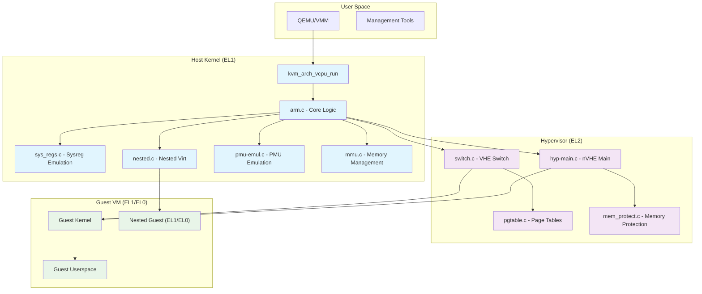
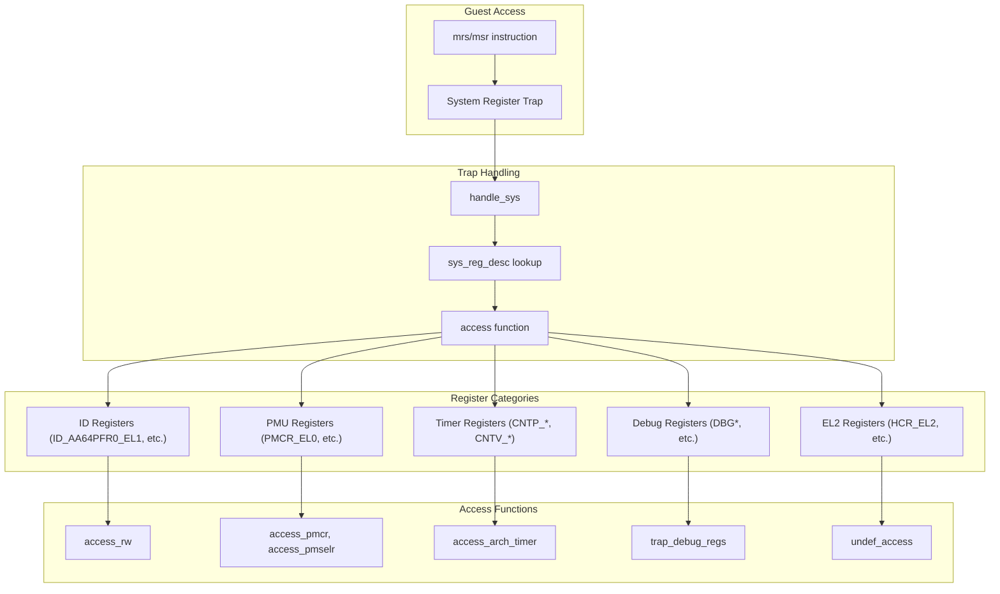
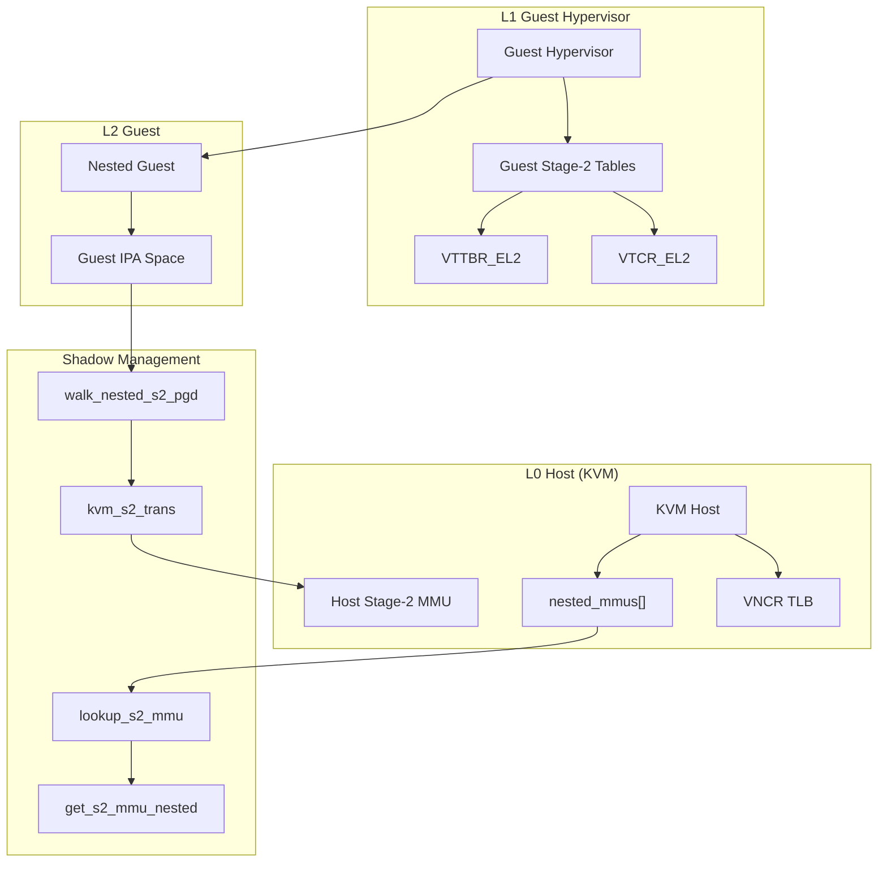
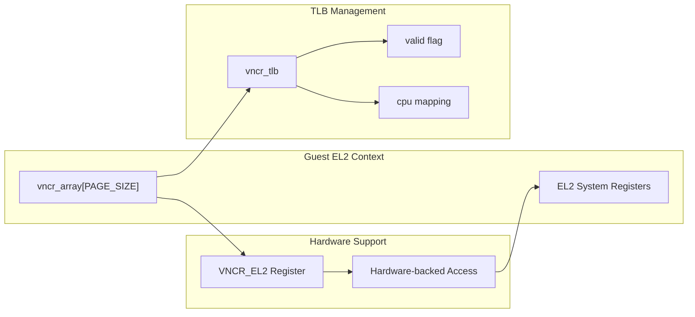
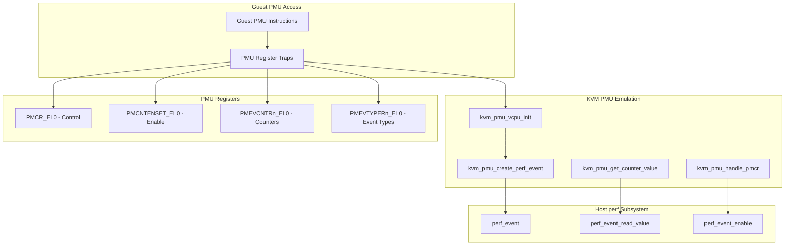
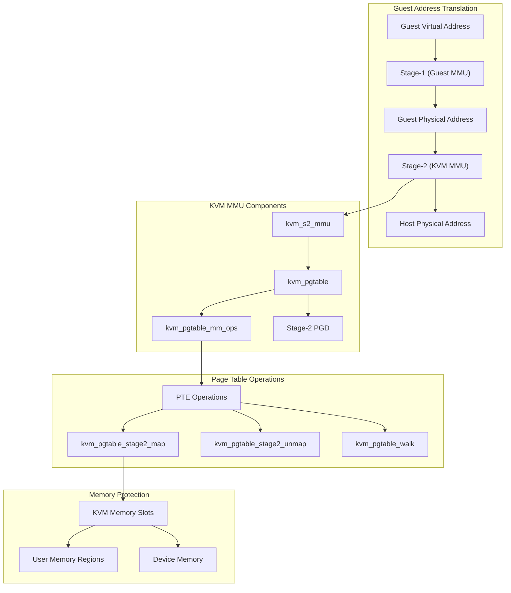
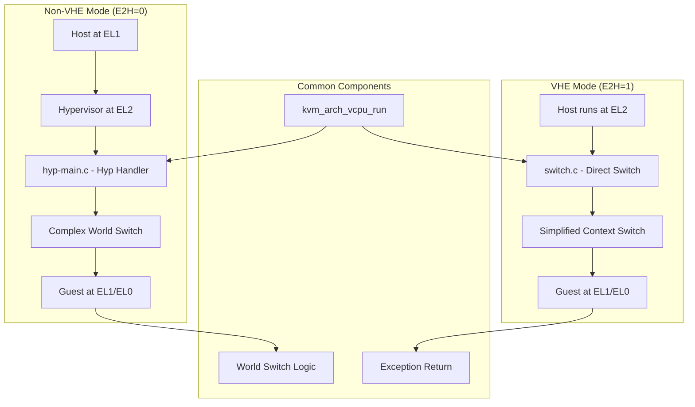

<!-- source: DeepWiki mcp.deepwiki.com · repo NVIDIA/NV-Kernels · page 3.2 KVM ARM64 Virtualization · fetched 2026-10-26 -->

# KVM ARM64 Virtualization

<details>
<summary>Relevant source files</summary>

The following files were used as context for generating this wiki page:

- [arch/arm/include/asm/arm_pmuv3.h](arch/arm/include/asm/arm_pmuv3.h)
- [arch/arm64/include/asm/arm_pmuv3.h](arch/arm64/include/asm/arm_pmuv3.h)
- [arch/arm64/include/asm/el2_setup.h](arch/arm64/include/asm/el2_setup.h)
- [arch/arm64/include/asm/hardirq.h](arch/arm64/include/asm/hardirq.h)
- [arch/arm64/include/asm/kvm_arm.h](arch/arm64/include/asm/kvm_arm.h)
- [arch/arm64/include/asm/kvm_asm.h](arch/arm64/include/asm/kvm_asm.h)
- [arch/arm64/include/asm/kvm_emulate.h](arch/arm64/include/asm/kvm_emulate.h)
- [arch/arm64/include/asm/kvm_host.h](arch/arm64/include/asm/kvm_host.h)
- [arch/arm64/include/asm/kvm_hyp.h](arch/arm64/include/asm/kvm_hyp.h)
- [arch/arm64/include/asm/kvm_mmu.h](arch/arm64/include/asm/kvm_mmu.h)
- [arch/arm64/include/asm/kvm_nested.h](arch/arm64/include/asm/kvm_nested.h)
- [arch/arm64/include/asm/kvm_pgtable.h](arch/arm64/include/asm/kvm_pgtable.h)
- [arch/arm64/include/asm/kvm_pkvm.h](arch/arm64/include/asm/kvm_pkvm.h)
- [arch/arm64/include/asm/memory.h](arch/arm64/include/asm/memory.h)
- [arch/arm64/include/asm/module.h](arch/arm64/include/asm/module.h)
- [arch/arm64/include/asm/module.lds.h](arch/arm64/include/asm/module.lds.h)
- [arch/arm64/include/asm/runtime-const.h](arch/arm64/include/asm/runtime-const.h)
- [arch/arm64/include/asm/scs.h](arch/arm64/include/asm/scs.h)
- [arch/arm64/include/asm/sections.h](arch/arm64/include/asm/sections.h)
- [arch/arm64/include/asm/stacktrace/nvhe.h](arch/arm64/include/asm/stacktrace/nvhe.h)
- [arch/arm64/include/asm/sysreg.h](arch/arm64/include/asm/sysreg.h)
- [arch/arm64/include/asm/vncr_mapping.h](arch/arm64/include/asm/vncr_mapping.h)
- [arch/arm64/kernel/head.S](arch/arm64/kernel/head.S)
- [arch/arm64/kernel/hyp-stub.S](arch/arm64/kernel/hyp-stub.S)
- [arch/arm64/kernel/image-vars.h](arch/arm64/kernel/image-vars.h)
- [arch/arm64/kernel/kaslr.c](arch/arm64/kernel/kaslr.c)
- [arch/arm64/kernel/module-plts.c](arch/arm64/kernel/module-plts.c)
- [arch/arm64/kernel/module.c](arch/arm64/kernel/module.c)
- [arch/arm64/kernel/pi/kaslr_early.c](arch/arm64/kernel/pi/kaslr_early.c)
- [arch/arm64/kernel/pi/patch-scs.c](arch/arm64/kernel/pi/patch-scs.c)
- [arch/arm64/kernel/pi/pi.h](arch/arm64/kernel/pi/pi.h)
- [arch/arm64/kernel/vmlinux.lds.S](arch/arm64/kernel/vmlinux.lds.S)
- [arch/arm64/kvm/arm.c](arch/arm64/kvm/arm.c)
- [arch/arm64/kvm/at.c](arch/arm64/kvm/at.c)
- [arch/arm64/kvm/debug.c](arch/arm64/kvm/debug.c)
- [arch/arm64/kvm/emulate-nested.c](arch/arm64/kvm/emulate-nested.c)
- [arch/arm64/kvm/fpsimd.c](arch/arm64/kvm/fpsimd.c)
- [arch/arm64/kvm/handle_exit.c](arch/arm64/kvm/handle_exit.c)
- [arch/arm64/kvm/hyp/fpsimd.S](arch/arm64/kvm/hyp/fpsimd.S)
- [arch/arm64/kvm/hyp/hyp-entry.S](arch/arm64/kvm/hyp/hyp-entry.S)
- [arch/arm64/kvm/hyp/include/hyp/debug-sr.h](arch/arm64/kvm/hyp/include/hyp/debug-sr.h)
- [arch/arm64/kvm/hyp/include/hyp/switch.h](arch/arm64/kvm/hyp/include/hyp/switch.h)
- [arch/arm64/kvm/hyp/include/hyp/sysreg-sr.h](arch/arm64/kvm/hyp/include/hyp/sysreg-sr.h)
- [arch/arm64/kvm/hyp/include/nvhe/gfp.h](arch/arm64/kvm/hyp/include/nvhe/gfp.h)
- [arch/arm64/kvm/hyp/include/nvhe/mem_protect.h](arch/arm64/kvm/hyp/include/nvhe/mem_protect.h)
- [arch/arm64/kvm/hyp/include/nvhe/memory.h](arch/arm64/kvm/hyp/include/nvhe/memory.h)
- [arch/arm64/kvm/hyp/include/nvhe/mm.h](arch/arm64/kvm/hyp/include/nvhe/mm.h)
- [arch/arm64/kvm/hyp/include/nvhe/pkvm.h](arch/arm64/kvm/hyp/include/nvhe/pkvm.h)
- [arch/arm64/kvm/hyp/nvhe/debug-sr.c](arch/arm64/kvm/hyp/nvhe/debug-sr.c)
- [arch/arm64/kvm/hyp/nvhe/host.S](arch/arm64/kvm/hyp/nvhe/host.S)
- [arch/arm64/kvm/hyp/nvhe/hyp-init.S](arch/arm64/kvm/hyp/nvhe/hyp-init.S)
- [arch/arm64/kvm/hyp/nvhe/hyp-main.c](arch/arm64/kvm/hyp/nvhe/hyp-main.c)
- [arch/arm64/kvm/hyp/nvhe/hyp.lds.S](arch/arm64/kvm/hyp/nvhe/hyp.lds.S)
- [arch/arm64/kvm/hyp/nvhe/mem_protect.c](arch/arm64/kvm/hyp/nvhe/mem_protect.c)
- [arch/arm64/kvm/hyp/nvhe/mm.c](arch/arm64/kvm/hyp/nvhe/mm.c)
- [arch/arm64/kvm/hyp/nvhe/page_alloc.c](arch/arm64/kvm/hyp/nvhe/page_alloc.c)
- [arch/arm64/kvm/hyp/nvhe/pkvm.c](arch/arm64/kvm/hyp/nvhe/pkvm.c)
- [arch/arm64/kvm/hyp/nvhe/psci-relay.c](arch/arm64/kvm/hyp/nvhe/psci-relay.c)
- [arch/arm64/kvm/hyp/nvhe/setup.c](arch/arm64/kvm/hyp/nvhe/setup.c)
- [arch/arm64/kvm/hyp/nvhe/stacktrace.c](arch/arm64/kvm/hyp/nvhe/stacktrace.c)
- [arch/arm64/kvm/hyp/nvhe/switch.c](arch/arm64/kvm/hyp/nvhe/switch.c)
- [arch/arm64/kvm/hyp/nvhe/sys_regs.c](arch/arm64/kvm/hyp/nvhe/sys_regs.c)
- [arch/arm64/kvm/hyp/nvhe/sysreg-sr.c](arch/arm64/kvm/hyp/nvhe/sysreg-sr.c)
- [arch/arm64/kvm/hyp/pgtable.c](arch/arm64/kvm/hyp/pgtable.c)
- [arch/arm64/kvm/hyp/vhe/debug-sr.c](arch/arm64/kvm/hyp/vhe/debug-sr.c)
- [arch/arm64/kvm/hyp/vhe/switch.c](arch/arm64/kvm/hyp/vhe/switch.c)
- [arch/arm64/kvm/hyp/vhe/sysreg-sr.c](arch/arm64/kvm/hyp/vhe/sysreg-sr.c)
- [arch/arm64/kvm/mmu.c](arch/arm64/kvm/mmu.c)
- [arch/arm64/kvm/nested.c](arch/arm64/kvm/nested.c)
- [arch/arm64/kvm/pkvm.c](arch/arm64/kvm/pkvm.c)
- [arch/arm64/kvm/pmu-emul.c](arch/arm64/kvm/pmu-emul.c)
- [arch/arm64/kvm/pmu.c](arch/arm64/kvm/pmu.c)
- [arch/arm64/kvm/reset.c](arch/arm64/kvm/reset.c)
- [arch/arm64/kvm/stacktrace.c](arch/arm64/kvm/stacktrace.c)
- [arch/arm64/kvm/sys_regs.c](arch/arm64/kvm/sys_regs.c)
- [arch/arm64/kvm/sys_regs.h](arch/arm64/kvm/sys_regs.h)
- [arch/arm64/kvm/trace_handle_exit.h](arch/arm64/kvm/trace_handle_exit.h)
- [arch/arm64/kvm/vgic-sys-reg-v3.c](arch/arm64/kvm/vgic-sys-reg-v3.c)
- [arch/arm64/mm/init.c](arch/arm64/mm/init.c)
- [arch/arm64/tools/sysreg](arch/arm64/tools/sysreg)
- [drivers/perf/arm_pmu.c](drivers/perf/arm_pmu.c)
- [drivers/perf/arm_pmuv3.c](drivers/perf/arm_pmuv3.c)
- [drivers/perf/arm_v6_pmu.c](drivers/perf/arm_v6_pmu.c)
- [drivers/perf/arm_v7_pmu.c](drivers/perf/arm_v7_pmu.c)
- [drivers/perf/arm_xscale_pmu.c](drivers/perf/arm_xscale_pmu.c)
- [include/kvm/arm_pmu.h](include/kvm/arm_pmu.h)
- [include/linux/perf/arm_pmu.h](include/linux/perf/arm_pmu.h)
- [include/linux/perf/arm_pmuv3.h](include/linux/perf/arm_pmuv3.h)
- [tools/arch/arm64/include/asm/gpr-num.h](tools/arch/arm64/include/asm/gpr-num.h)
- [tools/arch/arm64/include/asm/sysreg.h](tools/arch/arm64/include/asm/sysreg.h)
- [tools/include/linux/kasan-tags.h](tools/include/linux/kasan-tags.h)

</details>


This document covers the ARM64-specific implementation of the KVM hypervisor, focusing on system register emulation, nested virtualization capabilities, and ARM64 architectural features. For x86 KVM implementation details, see [KVM x86 Virtualization](#3.1). For IOMMU support that works with ARM64 virtualization, see [IOMMU Support](#3.3).

## Core ARM64 KVM Architecture

The ARM64 KVM implementation provides hardware-assisted virtualization using ARM's Virtualization Extensions, supporting both VHE (Virtualization Host Extensions) and non-VHE configurations. The core architecture revolves around efficient guest/host context switching and ARM64-specific system register virtualization.



Sources: [arch/arm64/kvm/arm.c:1-1000](), [arch/arm64/kvm/sys_regs.c:1-100](), [arch/arm64/kvm/nested.c:1-100]()

## System Register Emulation

The ARM64 KVM implementation provides comprehensive system register emulation through a sophisticated trap-and-emulate mechanism. The `sys_regs.c` file contains the core system register handling logic with over 4000 lines of emulation code.

### System Register Access Framework



The system register framework uses a table-driven approach where each register is described by a `sys_reg_desc` structure containing access functions, reset values, and visibility controls.

Sources: [arch/arm64/kvm/sys_regs.c:48-83](), [arch/arm64/kvm/sys_regs.c:362-372]()

### Key System Register Categories

| Register Category | Purpose | Key Functions |
|------------------|---------|---------------|
| ID Registers | Feature discovery | `set_id_reg`, `kvm_vcpu_apply_reg_masks` |
| Timer Registers | Virtual timer control | `access_arch_timer` |
| PMU Registers | Performance monitoring | `access_pmcr`, `access_pmu_evcntr` |
| Debug Registers | Debug/trace control | `trap_debug_regs`, `trap_dbg_wb_reg` |
| GIC Registers | Interrupt controller | `access_gic_sgi`, `access_gic_sre` |

The register emulation supports both read and write operations with proper exception handling and guest state validation.

Sources: [arch/arm64/kvm/sys_regs.c:1304-1400](), [arch/arm64/kvm/sys_regs.c:874-901]()

## Nested Virtualization

ARM64 KVM supports nested virtualization, allowing a guest hypervisor to run its own virtual machines. This is implemented through shadow stage-2 page tables and comprehensive EL2 register emulation.

### Nested Virtualization Architecture



Sources: [arch/arm64/kvm/nested.c:44-124](), [arch/arm64/kvm/nested.c:612-700]()

### Shadow Stage-2 MMU Management

The nested virtualization implementation maintains multiple shadow stage-2 MMUs to handle different guest hypervisor configurations:

```c
// Key data structures from nested.c
struct kvm_s2_mmu {
    struct kvm_vmid vmid;
    phys_addr_t pgd_phys;
    struct kvm_pgtable *pgt;
    u64 vtcr;
    u64 tlb_vttbr;
    u64 tlb_vtcr;
    bool nested_stage2_enabled;
    atomic_t refcnt;
};
```

The `lookup_s2_mmu` function determines which shadow MMU context to use based on the guest's `VTTBR_EL2` and `VTCR_EL2` configuration.

Sources: [arch/arm64/kvm/nested.c:612-659](), [arch/arm64/include/asm/kvm_host.h:152-230]()

### VNCR (Virtual Non-secure Context Register) Support

For nested virtualization, ARM64 KVM implements VNCR support for efficient EL2 register context switching:



Sources: [arch/arm64/kvm/nested.c:20-36](), [arch/arm64/include/asm/kvm_host.h:880-882]()

## Performance Monitoring Unit (PMU) Emulation

ARM64 KVM provides comprehensive PMU virtualization supporting guest performance monitoring with proper isolation and event filtering.

### PMU Architecture



Sources: [arch/arm64/kvm/pmu-emul.c:252-272](), [arch/arm64/kvm/pmu-emul.c:328-350]()

### PMU Counter Management

The PMU emulation manages up to `KVM_ARMV8_PMU_MAX_COUNTERS` performance counters, each backed by a host `perf_event`:

| Function | Purpose | Key Operations |
|----------|---------|----------------|
| `kvm_pmu_get_counter_value` | Read counter value | Combines register value with perf event count |
| `kvm_pmu_set_counter_value` | Write counter value | Updates register and recreates perf event |
| `kvm_pmu_create_perf_event` | Create backing event | Configures host perf_event with guest parameters |
| `kvm_pmu_release_perf_event` | Destroy backing event | Cleans up perf_event resources |

The PMU emulation supports both 32-bit and 64-bit counter modes and handles counter chaining for extended precision.

Sources: [arch/arm64/kvm/pmu-emul.c:128-148](), [arch/arm64/kvm/pmu-emul.c:160-185]()

## Memory Management and Stage-2 MMU

ARM64 KVM implements sophisticated two-stage address translation with hardware-assisted stage-2 page tables for guest physical memory management.

### Stage-2 MMU Architecture



Sources: [arch/arm64/kvm/mmu.c:1-100](), [arch/arm64/include/asm/kvm_host.h:152-196]()

### Stage-2 Page Table Management

The stage-2 MMU supports multiple page sizes and provides efficient memory management through the `kvm_pgtable` abstraction:

| Feature | Implementation | Key Functions |
|---------|----------------|---------------|
| Concatenated PGDs | Multi-level page tables | `kvm_init_stage2_mmu` |
| Block mappings | Large page support | `stage2_map_walker` |
| Device memory | MMIO region mapping | `kvm_phys_addr_ioremap` |
| Memory slots | Guest RAM regions | `kvm_arch_prepare_memory_region` |
| Dirty logging | Page modification tracking | `stage2_wp_range` |

The implementation supports both 4KB and 64KB page granules with appropriate translation table formats.

Sources: [arch/arm64/kvm/hyp/pgtable.c:1-100](), [arch/arm64/kvm/mmu.c:1000-1100]()

## Hypervisor Entry/Exit Mechanisms

ARM64 KVM implements efficient guest/host world switching through both VHE (Virtualization Host Extensions) and non-VHE code paths.

### VHE vs Non-VHE Architecture



Sources: [arch/arm64/kvm/hyp/vhe/switch.c:1-50](), [arch/arm64/kvm/hyp/nvhe/hyp-main.c:1-50]()

### Context Switch Operations

The hypervisor entry/exit involves comprehensive state management:

| Component | VHE Implementation | Non-VHE Implementation |
|-----------|-------------------|------------------------|
| System Registers | Direct EL2 access | Hypervisor stub |
| Memory Management | Shared address space | Separate hyp mappings |
| Interrupt Handling | EL2 vectors | Hyp-specific vectors |
| Debug Support | Native debug support | Limited debug context |
| Performance | Minimal overhead | Additional world switch cost |

The context switch preserves all necessary architectural state while maintaining security boundaries between host and guest.

Sources: [arch/arm64/kvm/hyp/include/hyp/switch.h:185-300](), [arch/arm64/kvm/arm.c:567-667]()

---

