<!-- source: DeepWiki mcp.deepwiki.com · repo NVIDIA/NV-Kernels · page 3.3 IOMMU Support · fetched 2026-10-26 -->

# IOMMU Support

<details>
<summary>Relevant source files</summary>

The following files were used as context for generating this wiki page:

- [arch/arm/xen/mm.c](arch/arm/xen/mm.c)
- [arch/mips/pci/pci-octeon.c](arch/mips/pci/pci-octeon.c)
- [arch/powerpc/platforms/pseries/svm.c](arch/powerpc/platforms/pseries/svm.c)
- [arch/powerpc/sysdev/fsl_pci.c](arch/powerpc/sysdev/fsl_pci.c)
- [arch/x86/include/asm/irq_remapping.h](arch/x86/include/asm/irq_remapping.h)
- [drivers/base/devres.c](drivers/base/devres.c)
- [drivers/iommu/Kconfig](drivers/iommu/Kconfig)
- [drivers/iommu/Makefile](drivers/iommu/Makefile)
- [drivers/iommu/amd/Kconfig](drivers/iommu/amd/Kconfig)
- [drivers/iommu/amd/Makefile](drivers/iommu/amd/Makefile)
- [drivers/iommu/amd/amd_iommu.h](drivers/iommu/amd/amd_iommu.h)
- [drivers/iommu/amd/amd_iommu_types.h](drivers/iommu/amd/amd_iommu_types.h)
- [drivers/iommu/amd/init.c](drivers/iommu/amd/init.c)
- [drivers/iommu/amd/io_pgtable.c](drivers/iommu/amd/io_pgtable.c)
- [drivers/iommu/amd/io_pgtable_v2.c](drivers/iommu/amd/io_pgtable_v2.c)
- [drivers/iommu/amd/iommu.c](drivers/iommu/amd/iommu.c)
- [drivers/iommu/amd/pasid.c](drivers/iommu/amd/pasid.c)
- [drivers/iommu/amd/ppr.c](drivers/iommu/amd/ppr.c)
- [drivers/iommu/arm/Kconfig](drivers/iommu/arm/Kconfig)
- [drivers/iommu/arm/Makefile](drivers/iommu/arm/Makefile)
- [drivers/iommu/arm/arm-smmu-v3/Makefile](drivers/iommu/arm/arm-smmu-v3/Makefile)
- [drivers/iommu/arm/arm-smmu-v3/arm-smmu-v3-iommufd.c](drivers/iommu/arm/arm-smmu-v3/arm-smmu-v3-iommufd.c)
- [drivers/iommu/arm/arm-smmu-v3/arm-smmu-v3-sva.c](drivers/iommu/arm/arm-smmu-v3/arm-smmu-v3-sva.c)
- [drivers/iommu/arm/arm-smmu-v3/arm-smmu-v3-test.c](drivers/iommu/arm/arm-smmu-v3/arm-smmu-v3-test.c)
- [drivers/iommu/arm/arm-smmu-v3/arm-smmu-v3.c](drivers/iommu/arm/arm-smmu-v3/arm-smmu-v3.c)
- [drivers/iommu/arm/arm-smmu-v3/arm-smmu-v3.h](drivers/iommu/arm/arm-smmu-v3/arm-smmu-v3.h)
- [drivers/iommu/arm/arm-smmu-v3/tegra241-cmdqv.c](drivers/iommu/arm/arm-smmu-v3/tegra241-cmdqv.c)
- [drivers/iommu/dma-iommu.c](drivers/iommu/dma-iommu.c)
- [drivers/iommu/dma-iommu.h](drivers/iommu/dma-iommu.h)
- [drivers/iommu/exynos-iommu.c](drivers/iommu/exynos-iommu.c)
- [drivers/iommu/fsl_pamu_domain.c](drivers/iommu/fsl_pamu_domain.c)
- [drivers/iommu/intel/Kconfig](drivers/iommu/intel/Kconfig)
- [drivers/iommu/intel/Makefile](drivers/iommu/intel/Makefile)
- [drivers/iommu/intel/cache.c](drivers/iommu/intel/cache.c)
- [drivers/iommu/intel/debugfs.c](drivers/iommu/intel/debugfs.c)
- [drivers/iommu/intel/dmar.c](drivers/iommu/intel/dmar.c)
- [drivers/iommu/intel/iommu.c](drivers/iommu/intel/iommu.c)
- [drivers/iommu/intel/iommu.h](drivers/iommu/intel/iommu.h)
- [drivers/iommu/intel/irq_remapping.c](drivers/iommu/intel/irq_remapping.c)
- [drivers/iommu/intel/nested.c](drivers/iommu/intel/nested.c)
- [drivers/iommu/intel/pasid.c](drivers/iommu/intel/pasid.c)
- [drivers/iommu/intel/pasid.h](drivers/iommu/intel/pasid.h)
- [drivers/iommu/intel/perf.h](drivers/iommu/intel/perf.h)
- [drivers/iommu/intel/perfmon.c](drivers/iommu/intel/perfmon.c)
- [drivers/iommu/intel/prq.c](drivers/iommu/intel/prq.c)
- [drivers/iommu/intel/svm.c](drivers/iommu/intel/svm.c)
- [drivers/iommu/intel/trace.h](drivers/iommu/intel/trace.h)
- [drivers/iommu/io-pgfault.c](drivers/iommu/io-pgfault.c)
- [drivers/iommu/io-pgtable-arm-v7s.c](drivers/iommu/io-pgtable-arm-v7s.c)
- [drivers/iommu/io-pgtable-arm.c](drivers/iommu/io-pgtable-arm.c)
- [drivers/iommu/io-pgtable-dart.c](drivers/iommu/io-pgtable-dart.c)
- [drivers/iommu/iommu-pages.c](drivers/iommu/iommu-pages.c)
- [drivers/iommu/iommu-pages.h](drivers/iommu/iommu-pages.h)
- [drivers/iommu/iommu-priv.h](drivers/iommu/iommu-priv.h)
- [drivers/iommu/iommu-sva.c](drivers/iommu/iommu-sva.c)
- [drivers/iommu/iommu.c](drivers/iommu/iommu.c)
- [drivers/iommu/iommufd/Kconfig](drivers/iommu/iommufd/Kconfig)
- [drivers/iommu/iommufd/Makefile](drivers/iommu/iommufd/Makefile)
- [drivers/iommu/iommufd/device.c](drivers/iommu/iommufd/device.c)
- [drivers/iommu/iommufd/driver.c](drivers/iommu/iommufd/driver.c)
- [drivers/iommu/iommufd/eventq.c](drivers/iommu/iommufd/eventq.c)
- [drivers/iommu/iommufd/hw_pagetable.c](drivers/iommu/iommufd/hw_pagetable.c)
- [drivers/iommu/iommufd/io_pagetable.c](drivers/iommu/iommufd/io_pagetable.c)
- [drivers/iommu/iommufd/io_pagetable.h](drivers/iommu/iommufd/io_pagetable.h)
- [drivers/iommu/iommufd/ioas.c](drivers/iommu/iommufd/ioas.c)
- [drivers/iommu/iommufd/iommufd_private.h](drivers/iommu/iommufd/iommufd_private.h)
- [drivers/iommu/iommufd/iommufd_test.h](drivers/iommu/iommufd/iommufd_test.h)
- [drivers/iommu/iommufd/iova_bitmap.c](drivers/iommu/iommufd/iova_bitmap.c)
- [drivers/iommu/iommufd/main.c](drivers/iommu/iommufd/main.c)
- [drivers/iommu/iommufd/pages.c](drivers/iommu/iommufd/pages.c)
- [drivers/iommu/iommufd/selftest.c](drivers/iommu/iommufd/selftest.c)
- [drivers/iommu/iommufd/viommu.c](drivers/iommu/iommufd/viommu.c)
- [drivers/iommu/irq_remapping.c](drivers/iommu/irq_remapping.c)
- [drivers/iommu/irq_remapping.h](drivers/iommu/irq_remapping.h)
- [drivers/iommu/of_iommu.c](drivers/iommu/of_iommu.c)
- [drivers/iommu/riscv/Kconfig](drivers/iommu/riscv/Kconfig)
- [drivers/iommu/riscv/Makefile](drivers/iommu/riscv/Makefile)
- [drivers/iommu/riscv/iommu-bits.h](drivers/iommu/riscv/iommu-bits.h)
- [drivers/iommu/riscv/iommu-pci.c](drivers/iommu/riscv/iommu-pci.c)
- [drivers/iommu/riscv/iommu-platform.c](drivers/iommu/riscv/iommu-platform.c)
- [drivers/iommu/riscv/iommu.c](drivers/iommu/riscv/iommu.c)
- [drivers/iommu/riscv/iommu.h](drivers/iommu/riscv/iommu.h)
- [drivers/iommu/rockchip-iommu.c](drivers/iommu/rockchip-iommu.c)
- [drivers/iommu/sun50i-iommu.c](drivers/iommu/sun50i-iommu.c)
- [drivers/iommu/tegra-smmu.c](drivers/iommu/tegra-smmu.c)
- [drivers/xen/swiotlb-xen.c](drivers/xen/swiotlb-xen.c)
- [include/linux/device.h](include/linux/device.h)
- [include/linux/device/devres.h](include/linux/device/devres.h)
- [include/linux/dma-map-ops.h](include/linux/dma-map-ops.h)
- [include/linux/dma-mapping.h](include/linux/dma-mapping.h)
- [include/linux/dmar.h](include/linux/dmar.h)
- [include/linux/io-pgtable.h](include/linux/io-pgtable.h)
- [include/linux/iommu-dma.h](include/linux/iommu-dma.h)
- [include/linux/iommu.h](include/linux/iommu.h)
- [include/linux/iommufd.h](include/linux/iommufd.h)
- [include/linux/iov_iter.h](include/linux/iov_iter.h)
- [include/linux/pci-p2pdma.h](include/linux/pci-p2pdma.h)
- [include/linux/scatterlist.h](include/linux/scatterlist.h)
- [include/linux/swiotlb.h](include/linux/swiotlb.h)
- [include/trace/events/dma.h](include/trace/events/dma.h)
- [include/uapi/linux/iommufd.h](include/uapi/linux/iommufd.h)
- [kernel/dma/Kconfig](kernel/dma/Kconfig)
- [kernel/dma/Makefile](kernel/dma/Makefile)
- [kernel/dma/debug.c](kernel/dma/debug.c)
- [kernel/dma/direct.c](kernel/dma/direct.c)
- [kernel/dma/direct.h](kernel/dma/direct.h)
- [kernel/dma/dummy.c](kernel/dma/dummy.c)
- [kernel/dma/mapping.c](kernel/dma/mapping.c)
- [kernel/dma/ops_helpers.c](kernel/dma/ops_helpers.c)
- [kernel/dma/swiotlb.c](kernel/dma/swiotlb.c)
- [lib/scatterlist.c](lib/scatterlist.c)
- [tools/testing/selftests/iommu/Makefile](tools/testing/selftests/iommu/Makefile)
- [tools/testing/selftests/iommu/iommufd.c](tools/testing/selftests/iommu/iommufd.c)
- [tools/testing/selftests/iommu/iommufd_fail_nth.c](tools/testing/selftests/iommu/iommufd_fail_nth.c)
- [tools/testing/selftests/iommu/iommufd_utils.h](tools/testing/selftests/iommu/iommufd_utils.h)

</details>


This document covers the Linux kernel's Input/Output Memory Management Unit (IOMMU) subsystem, which provides device DMA isolation, address translation, and secure device assignment capabilities for virtualization. The IOMMU subsystem supports multiple hardware implementations including Intel VT-d, ARM SMMUv3, and AMD IOMMU, along with a unified framework for device virtualization through IOMMUFD.

For information about hypervisor-specific virtualization features, see [KVM x86 Virtualization](#3.1) and [KVM ARM64 Virtualization](#3.2).

## Architecture Overview

The IOMMU subsystem provides a layered architecture that abstracts hardware-specific IOMMU implementations behind a common framework, enabling secure device assignment and DMA isolation for both native and virtualized environments.

### IOMMU Subsystem Architecture

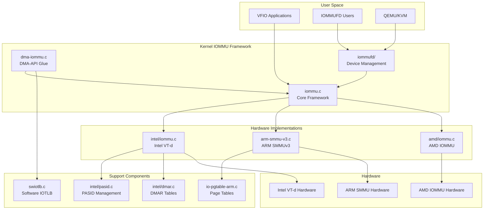

Sources: [drivers/iommu/iommu.c:1-3147](), [drivers/iommu/dma-iommu.c:1-1854](), [drivers/iommu/iommufd/device.c:1-1326]()

### Core IOMMU Operations

The IOMMU framework defines a standardized set of operations implemented by each hardware-specific driver:

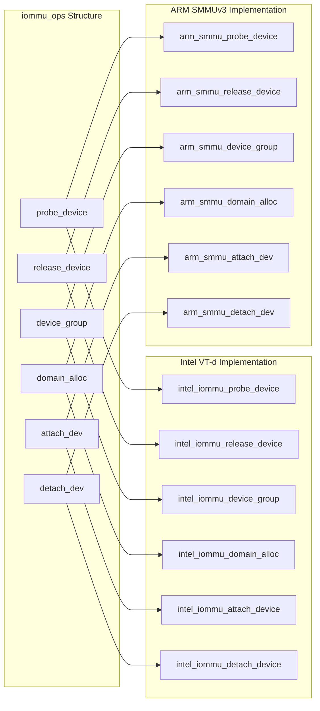

Sources: [include/linux/iommu.h:588-665](), [drivers/iommu/intel/iommu.c:4996-5014](), [drivers/iommu/arm/arm-smmu-v3/arm-smmu-v3.c:3041-3058]()

## Intel VT-d Implementation

Intel VT-d (Virtualization Technology for Directed I/O) provides hardware-assisted DMA remapping and interrupt remapping capabilities. The implementation supports both first-level (FL) and second-level (SL) page tables, PASID-based address spaces, and scalable mode operation.

### Intel VT-d Components

The Intel VT-d implementation consists of several key components that manage device contexts, page tables, and address translation:

| Component | File | Purpose |
|-----------|------|---------|
| `intel_iommu` | [drivers/iommu/intel/iommu.c]() | Main IOMMU device management |
| `dmar_domain` | [drivers/iommu/intel/iommu.h:622-654]() | DMA remapping domain |
| `context_entry` | [drivers/iommu/intel/iommu.h:267-272]() | Device context table entry |
| `pasid_entry` | [drivers/iommu/intel/pasid.h:50-57]() | PASID table entry |
| `dma_pte` | [drivers/iommu/intel/iommu.h:273-279]() | Page table entry |

### Intel VT-d Domain Management

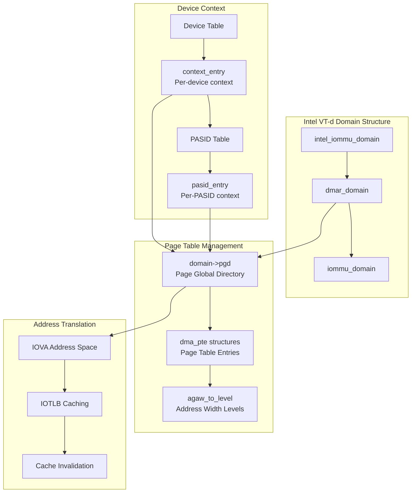

Sources: [drivers/iommu/intel/iommu.h:622-654](), [drivers/iommu/intel/iommu.c:708-890](), [drivers/iommu/intel/pasid.c:1-847]()

### Intel VT-d Hardware Interface

The VT-d hardware interface provides memory-mapped registers for controlling DMA remapping and interrupt remapping:

| Register Group | Purpose | Key Registers |
|----------------|---------|---------------|
| Capability | Hardware capabilities | `DMAR_CAP_REG`, `DMAR_ECAP_REG` |
| Control | Global control | `DMAR_GCMD_REG`, `DMAR_GSTS_REG` |
| Root Table | Device context root | `DMAR_RTADDR_REG` |
| Context Command | Context cache control | `DMAR_CCMD_REG` |
| Invalidation Queue | Command queuing | `DMAR_IQH_REG`, `DMAR_IQT_REG` |
| Fault Reporting | Error handling | `DMAR_FSTS_REG`, `DMAR_FECTL_REG` |

Sources: [drivers/iommu/intel/iommu.h:68-144](), [drivers/iommu/intel/iommu.c:1034-1050](), [drivers/iommu/intel/iommu.c:1256-1290]()

## ARM SMMUv3 Implementation

ARM SMMUv3 (System Memory Management Unit version 3) provides a command-queue based interface with support for both stage-1 and stage-2 translation, stream tables for device identification, and context descriptors for address space management.

### ARM SMMUv3 Architecture

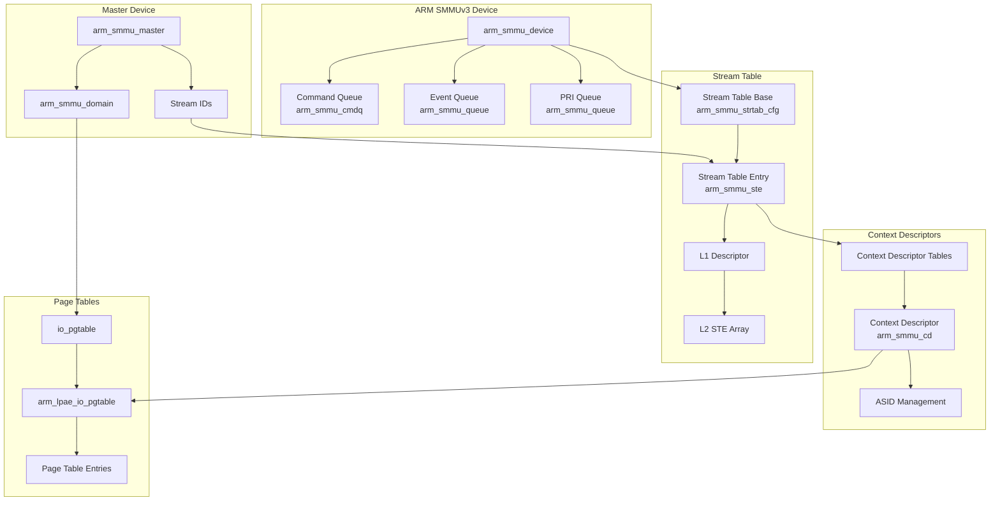

Sources: [drivers/iommu/arm/arm-smmu-v3/arm-smmu-v3.h:557-707](), [drivers/iommu/arm/arm-smmu-v3/arm-smmu-v3.c:1905-2089](), [drivers/iommu/io-pgtable-arm.c:1-1279]()

### ARM SMMUv3 Command Processing

SMMUv3 uses a command queue interface for configuration and cache maintenance operations:

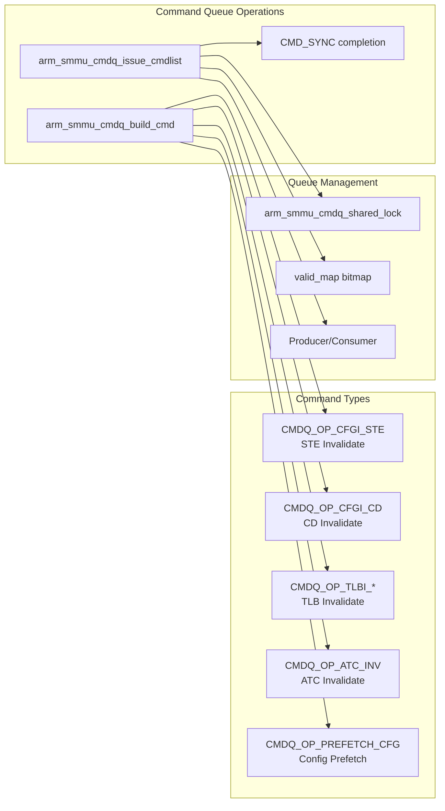

Sources: [drivers/iommu/arm/arm-smmu-v3/arm-smmu-v3.c:269-368](), [drivers/iommu/arm/arm-smmu-v3/arm-smmu-v3.c:790-908](), [drivers/iommu/arm/arm-smmu-v3/arm-smmu-v3.h:399-448]()

## AMD IOMMU Implementation

AMD IOMMU provides DMA remapping with support for device tables, page tables, and interrupt remapping. The implementation includes support for guest-host page table sharing and PASID-based address spaces.

### AMD IOMMU Components

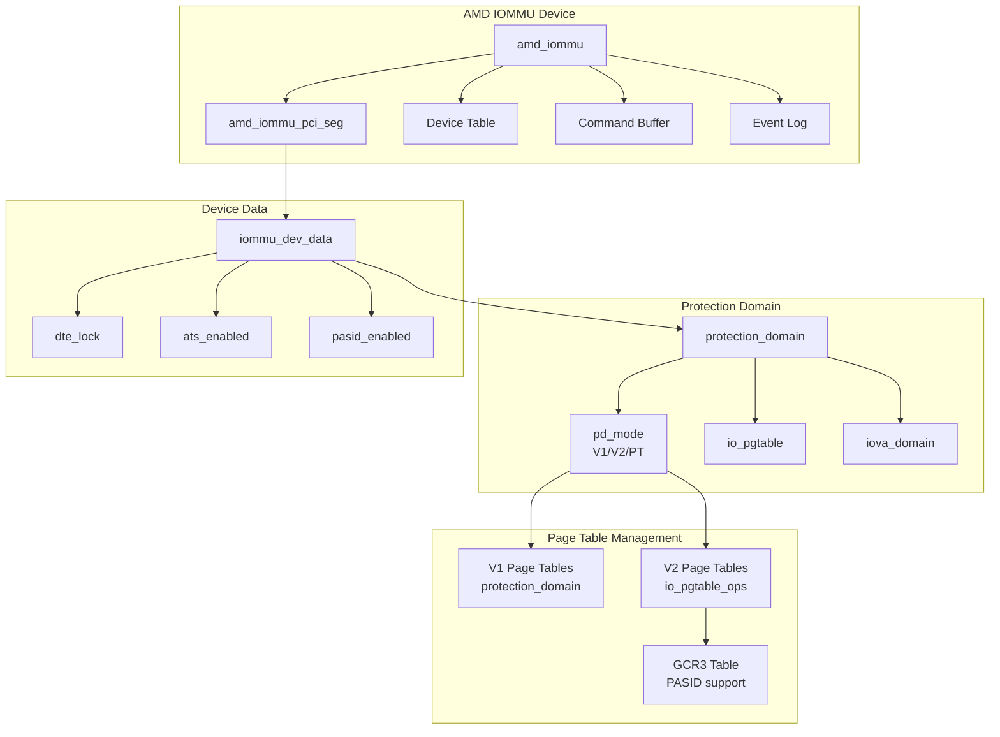

Sources: [drivers/iommu/amd/amd_iommu_types.h:405-484](), [drivers/iommu/amd/iommu.c:139-203](), [drivers/iommu/amd/iommu.c:679-750]()

## Core IOMMU Framework

The core IOMMU framework provides device management, domain allocation, and a unified API for all IOMMU implementations. It manages IOMMU groups, default domains, and device attachment.

### IOMMU Device and Group Management

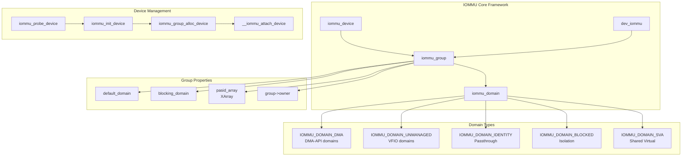

Sources: [drivers/iommu/iommu.c:412-491](), [drivers/iommu/iommu.c:559-638](), [include/linux/iommu.h:52-68](), [include/linux/iommu.h:222-250]()

### IOMMU Domain Operations

The IOMMU framework defines domain-specific operations for memory management and device attachment:

| Operation Category | Operations | Purpose |
|-------------------|------------|---------|
| Domain Management | `domain_alloc`, `domain_free` | Domain lifecycle |
| Device Attachment | `attach_dev`, `detach_dev` | Device-domain binding |
| Memory Mapping | `map`, `unmap`, `map_pages`, `unmap_pages` | Address translation setup |
| Cache Management | `flush_iotlb_all`, `iotlb_sync` | TLB maintenance |
| PASID Support | `set_dev_pasid`, `remove_dev_pasid` | Multi-address space |
| Fault Handling | `device_group`, `get_resv_regions` | Error and resource management |

Sources: [include/linux/iommu.h:406-516](), [drivers/iommu/iommu.c:2217-2348](), [drivers/iommu/iommu.c:2687-2734]()

## IOMMUFD Subsystem

IOMMUFD provides a modern interface for userspace IOMMU management, replacing the device assignment portions of VFIO. It supports hardware page tables, device attachment, and advanced features like nested translation.

### IOMMUFD Architecture

```mermaid
graph TB
    subgraph "User Space Interface"
        IOMMUFD_USER[/dev/iommu]
        IOCTL_API[IOMMUFD IOCTLs]
        HWPT_ALLOC[HWPT Allocation]
        DEVICE_ATTACH[Device Attachment]
    end
    
    subgraph "IOMMUFD Core"
        IOMMUFD_CTX[iommufd_ctx]
        OBJECTS[objects XArray]
        GROUPS[groups XArray]
        IOMMUFD_GROUP[iommufd_group]
    end
    
    subgraph "Hardware Page Tables"
        HWPT_PAGING[iommufd_hwpt_paging]
        HWPT_NESTED[iommufd_hwpt_nested]
        IOMMU_DOMAIN_PTR[iommu_domain]
        IO_PAGETABLE[io_pagetable]
    end
    
    subgraph "Device Management"
        IOMMUFD_DEVICE[iommufd_device]
        ATTACH_HANDLE[iommu_attach_handle]
        GROUP_DEVICE[group_device]
    end
    
    subgraph "Access Rights"
        IOAS[iommufd_ioas<br/>IO Address Space]
        ACCESS[iommufd_access]
        IOPT_AREA[iopt_area]
        IOPT_PAGES[iopt_pages]
    end
    
    IOMMUFD_USER --> IOCTL_API
    IOCTL_API --> HWPT_ALLOC
    IOCTL_API --> DEVICE_ATTACH
    
    HWPT_ALLOC --> IOMMUFD_CTX
    DEVICE_ATTACH --> IOMMUFD_CTX
    
    IOMMUFD_CTX --> OBJECTS
    IOMMUFD_CTX --> GROUPS
    OBJECTS --> HWPT_PAGING
    OBJECTS --> HWPT_NESTED
    GROUPS --> IOMMUFD_GROUP
    
    HWPT_PAGING --> IOMMU_DOMAIN_PTR
    HWPT_PAGING --> IO_PAGETABLE
    HWPT_NESTED --> IOMMU_DOMAIN_PTR
    
    IOMMUFD_GROUP --> IOMMUFD_DEVICE
    IOMMUFD_DEVICE --> ATTACH_HANDLE
    ATTACH_HANDLE --> GROUP_DEVICE
    
    IO_PAGETABLE --> IOAS
    IOAS --> ACCESS
    ACCESS --> IOPT_AREA
    IOPT_AREA --> IOPT_PAGES
```

Sources: [drivers/iommu/iommufd/iommufd_private.h:41-109](), [drivers/iommu/iommufd/device.c:21-58](), [drivers/iommu/iommufd/hw_pagetable.c:1-512]()

### IOMMUFD Hardware Page Table Management

IOMMUFD manages hardware page tables through a two-level abstraction supporting both direct and nested translation modes:

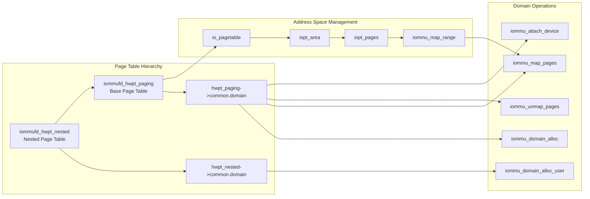

Sources: [drivers/iommu/iommufd/hw_pagetable.c:24-89](), [drivers/iommu/iommufd/hw_pagetable.c:157-234](), [drivers/iommu/iommufd/io_pagetable.c:1-1735]()

## DMA Remapping and Translation

The DMA-IOMMU layer provides integration between the DMA-API and IOMMU subsystem, enabling transparent IOVA allocation and mapping for device drivers while maintaining isolation between devices.

### DMA-IOMMU Integration

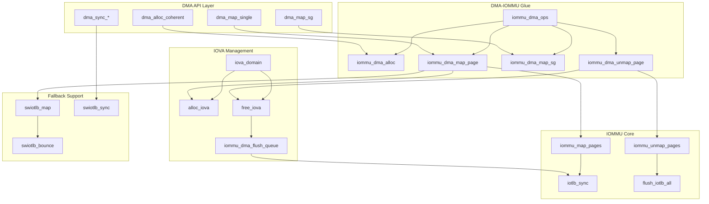

Sources: [drivers/iommu/dma-iommu.c:1079-1144](), [drivers/iommu/dma-iommu.c:1465-1528](), [drivers/iommu/dma-iommu.c:1764-1854](), [kernel/dma/swiotlb.c:1456-1570]()

### IOVA Allocation and Management

The IOVA (I/O Virtual Address) subsystem manages virtual address space allocation for DMA mappings:

| Component | Purpose | Key Functions |
|-----------|---------|---------------|
| `iova_domain` | IOVA allocator state | `init_iova_domain`, `put_iova_domain` |
| `iova` | Individual IOVA range | `alloc_iova`, `free_iova` |
| `iova_rcache` | IOVA recycling cache | `iova_rcache_get`, `iova_rcache_insert` |
| `flush_queue` | Deferred TLB flushing | `queue_iova`, `fq_flush_timeout` |

Sources: [drivers/iommu/dma-iommu.c:156-287](), [drivers/iommu/dma-iommu.c:465-591](), [lib/iova.c:1-904]()

## Device Assignment and Virtualization

The IOMMU subsystem enables secure device assignment to virtual machines by providing isolation between devices and controlled access to guest physical memory through nested page tables.

### Virtualization Support Components

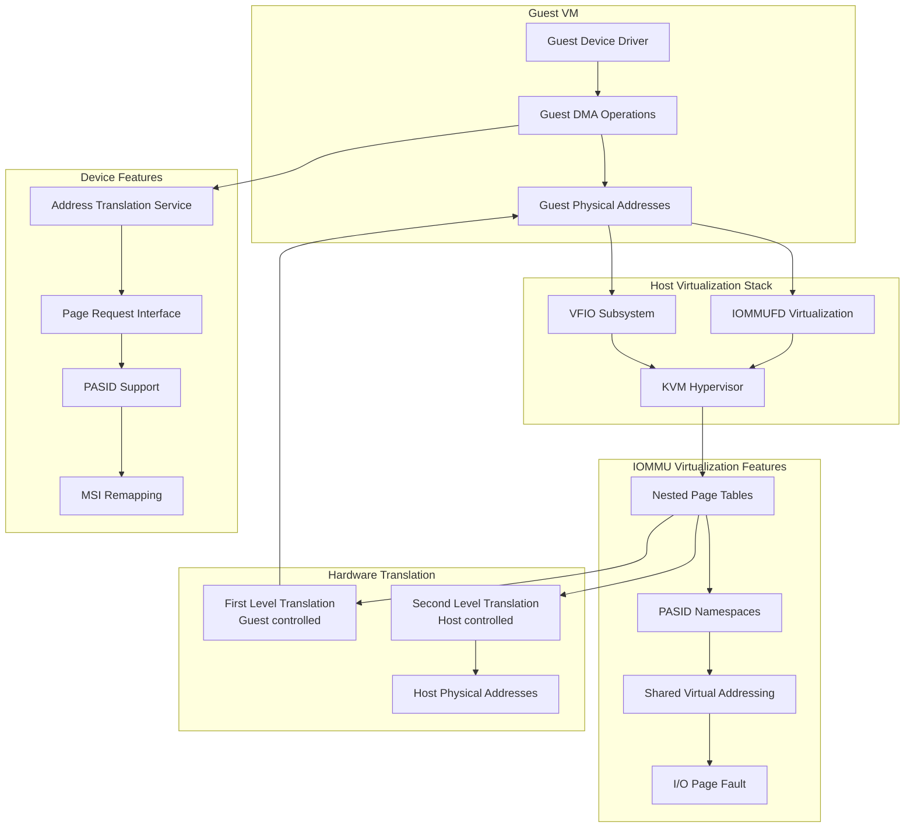

Sources: [drivers/iommu/intel/iommu.c:4360-4452](), [drivers/iommu/arm/arm-smmu-v3/arm-smmu-v3-sva.c:1-336](), [drivers/iommu/iommufd/device.c:413-523]()

### PASID and SVA Support

Process Address Space Identifiers (PASIDs) enable devices to access multiple address spaces, supporting Shared Virtual Addressing (SVA) where devices can directly access process virtual memory:

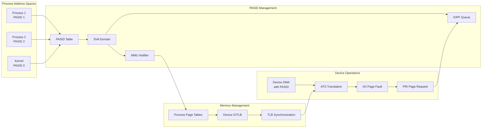

Sources: [drivers/iommu/intel/pasid.c:500-598](), [drivers/iommu/arm/arm-smmu-v3/arm-smmu-v3-sva.c:75-156](), [drivers/iommu/iommu-sva.c:1-284]()

---

