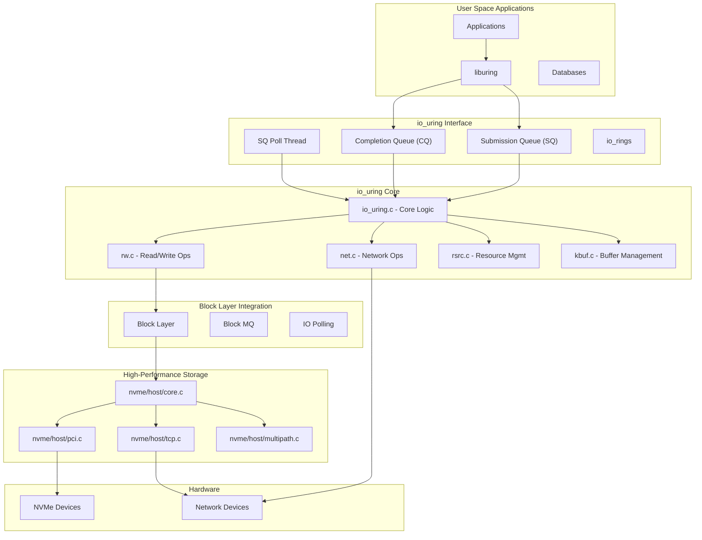
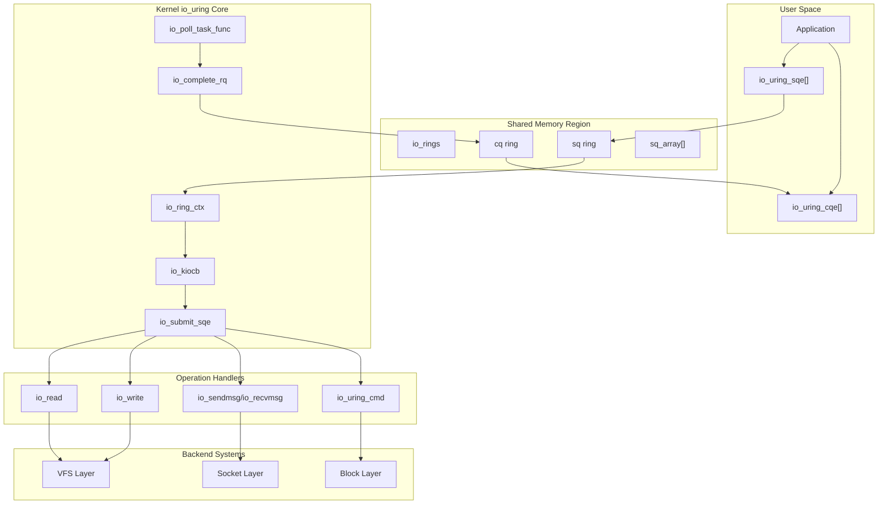
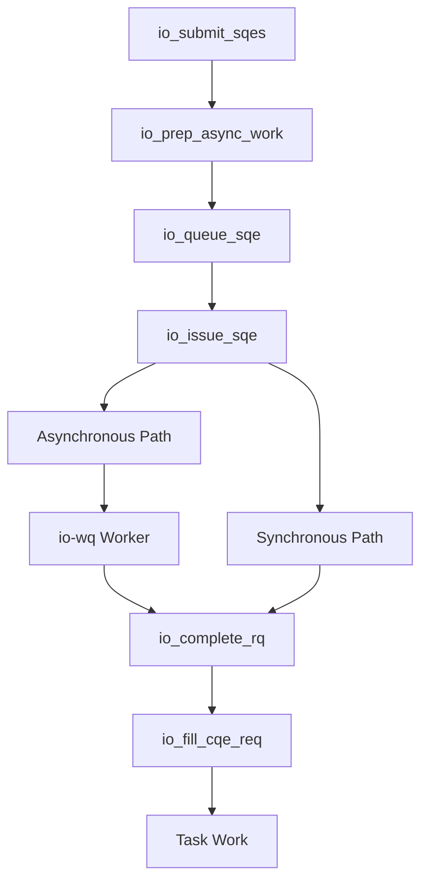
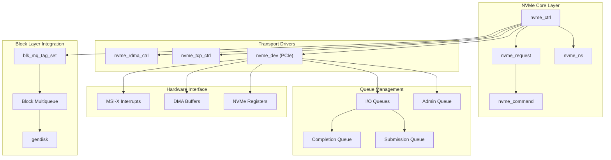
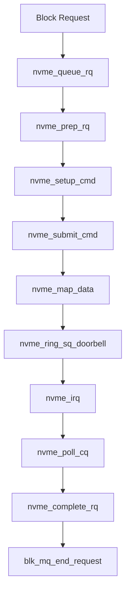
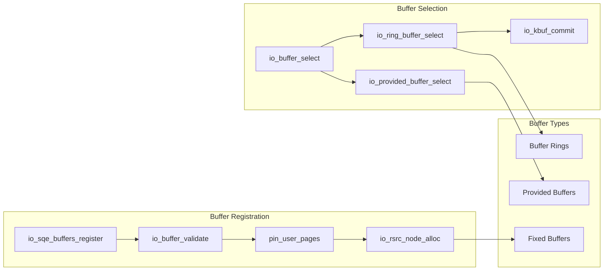

<!-- source: DeepWiki mcp.deepwiki.com · repo NVIDIA/NV-Kernels · page 4 High-Performance I/O Systems · fetched 2026-10-26 -->

# High-Performance I/O Systems

Relevant source files

The following files were used as context for generating this wiki page:

- [Kconfig](Kconfig)
- [drivers/nvme/common/Kconfig](drivers/nvme/common/Kconfig)
- [drivers/nvme/common/auth.c](drivers/nvme/common/auth.c)
- [drivers/nvme/common/keyring.c](drivers/nvme/common/keyring.c)
- [drivers/nvme/host/Kconfig](drivers/nvme/host/Kconfig)
- [drivers/nvme/host/auth.c](drivers/nvme/host/auth.c)
- [drivers/nvme/host/constants.c](drivers/nvme/host/constants.c)
- [drivers/nvme/host/core.c](drivers/nvme/host/core.c)
- [drivers/nvme/host/fabrics.c](drivers/nvme/host/fabrics.c)
- [drivers/nvme/host/fabrics.h](drivers/nvme/host/fabrics.h)
- [drivers/nvme/host/fault_inject.c](drivers/nvme/host/fault_inject.c)
- [drivers/nvme/host/fc.c](drivers/nvme/host/fc.c)
- [drivers/nvme/host/multipath.c](drivers/nvme/host/multipath.c)
- [drivers/nvme/host/nvme.h](drivers/nvme/host/nvme.h)
- [drivers/nvme/host/pci.c](drivers/nvme/host/pci.c)
- [drivers/nvme/host/pr.c](drivers/nvme/host/pr.c)
- [drivers/nvme/host/rdma.c](drivers/nvme/host/rdma.c)
- [drivers/nvme/host/sysfs.c](drivers/nvme/host/sysfs.c)
- [drivers/nvme/host/tcp.c](drivers/nvme/host/tcp.c)
- [drivers/nvme/target/admin-cmd.c](drivers/nvme/target/admin-cmd.c)
- [drivers/nvme/target/auth.c](drivers/nvme/target/auth.c)
- [drivers/nvme/target/configfs.c](drivers/nvme/target/configfs.c)
- [drivers/nvme/target/core.c](drivers/nvme/target/core.c)
- [drivers/nvme/target/discovery.c](drivers/nvme/target/discovery.c)
- [drivers/nvme/target/fabrics-cmd-auth.c](drivers/nvme/target/fabrics-cmd-auth.c)
- [drivers/nvme/target/fabrics-cmd.c](drivers/nvme/target/fabrics-cmd.c)
- [drivers/nvme/target/fc.c](drivers/nvme/target/fc.c)
- [drivers/nvme/target/io-cmd-bdev.c](drivers/nvme/target/io-cmd-bdev.c)
- [drivers/nvme/target/loop.c](drivers/nvme/target/loop.c)
- [drivers/nvme/target/nvmet.h](drivers/nvme/target/nvmet.h)
- [drivers/nvme/target/passthru.c](drivers/nvme/target/passthru.c)
- [drivers/nvme/target/pci-epf.c](drivers/nvme/target/pci-epf.c)
- [drivers/nvme/target/pr.c](drivers/nvme/target/pr.c)
- [drivers/nvme/target/rdma.c](drivers/nvme/target/rdma.c)
- [drivers/nvme/target/tcp.c](drivers/nvme/target/tcp.c)
- [include/linux/io_uring/cmd.h](include/linux/io_uring/cmd.h)
- [include/linux/io_uring_types.h](include/linux/io_uring_types.h)
- [include/linux/nvme-auth.h](include/linux/nvme-auth.h)
- [include/linux/nvme-keyring.h](include/linux/nvme-keyring.h)
- [include/linux/nvme.h](include/linux/nvme.h)
- [include/uapi/linux/io_uring.h](include/uapi/linux/io_uring.h)
- [io_uring/Kconfig](io_uring/Kconfig)
- [io_uring/Makefile](io_uring/Makefile)
- [io_uring/advise.c](io_uring/advise.c)
- [io_uring/alloc_cache.c](io_uring/alloc_cache.c)
- [io_uring/alloc_cache.h](io_uring/alloc_cache.h)
- [io_uring/cancel.c](io_uring/cancel.c)
- [io_uring/cancel.h](io_uring/cancel.h)
- [io_uring/cmd_net.c](io_uring/cmd_net.c)
- [io_uring/epoll.c](io_uring/epoll.c)
- [io_uring/epoll.h](io_uring/epoll.h)
- [io_uring/fdinfo.c](io_uring/fdinfo.c)
- [io_uring/filetable.c](io_uring/filetable.c)
- [io_uring/filetable.h](io_uring/filetable.h)
- [io_uring/fs.c](io_uring/fs.c)
- [io_uring/futex.c](io_uring/futex.c)
- [io_uring/futex.h](io_uring/futex.h)
- [io_uring/io_uring.c](io_uring/io_uring.c)
- [io_uring/io_uring.h](io_uring/io_uring.h)
- [io_uring/kbuf.c](io_uring/kbuf.c)
- [io_uring/kbuf.h](io_uring/kbuf.h)
- [io_uring/memmap.c](io_uring/memmap.c)
- [io_uring/memmap.h](io_uring/memmap.h)
- [io_uring/msg_ring.c](io_uring/msg_ring.c)
- [io_uring/msg_ring.h](io_uring/msg_ring.h)
- [io_uring/net.c](io_uring/net.c)
- [io_uring/net.h](io_uring/net.h)
- [io_uring/nop.c](io_uring/nop.c)
- [io_uring/notif.c](io_uring/notif.c)
- [io_uring/notif.h](io_uring/notif.h)
- [io_uring/opdef.c](io_uring/opdef.c)
- [io_uring/openclose.c](io_uring/openclose.c)
- [io_uring/openclose.h](io_uring/openclose.h)
- [io_uring/poll.c](io_uring/poll.c)
- [io_uring/poll.h](io_uring/poll.h)
- [io_uring/register.c](io_uring/register.c)
- [io_uring/register.h](io_uring/register.h)
- [io_uring/rsrc.c](io_uring/rsrc.c)
- [io_uring/rsrc.h](io_uring/rsrc.h)
- [io_uring/rw.c](io_uring/rw.c)
- [io_uring/rw.h](io_uring/rw.h)
- [io_uring/splice.c](io_uring/splice.c)
- [io_uring/timeout.c](io_uring/timeout.c)
- [io_uring/timeout.h](io_uring/timeout.h)
- [io_uring/uring_cmd.c](io_uring/uring_cmd.c)
- [io_uring/uring_cmd.h](io_uring/uring_cmd.h)
- [io_uring/waitid.c](io_uring/waitid.c)
- [io_uring/zcrx.c](io_uring/zcrx.c)
- [io_uring/zcrx.h](io_uring/zcrx.h)

This document covers the kernel's high-performance I/O subsystems designed for modern storage and networking workloads. The primary focus is on the `io_uring` asynchronous I/O interface and high-performance storage drivers including NVMe. These systems provide scalable, low-latency I/O operations that bypass traditional blocking syscall patterns.

For information about hardware monitoring and platform drivers, see [Hardware Monitoring and Platform Support](#2). For details about virtualization I/O, see [Virtualization Infrastructure](#3). For general kernel scheduling and memory management that supports I/O operations, see [Core Kernel Subsystems](#5).

## Architecture Overview

The high-performance I/O systems are built around two main pillars: the `io_uring` interface for efficient user-kernel I/O communication, and modern storage drivers like NVMe that leverage hardware capabilities for maximum performance.

### High-Performance I/O Architecture

Sources: [io_uring/io_uring.c:1-100](), [drivers/nvme/host/core.c:1-50](), [io_uring/net.c:1-50](), [io_uring/rw.c:1-50]()

## io_uring Subsystem

The `io_uring` subsystem provides a high-performance interface for asynchronous I/O operations. It uses shared memory rings between user and kernel space to minimize syscall overhead and enable efficient batching of operations.

### io_uring Core Components

Sources: [io_uring/io_uring.c:182-200](), [include/linux/io_uring_types.h:237-350](), [io_uring/rw.c:29-50]()

The core `io_ring_ctx` structure [io_uring/io_uring.c:237-380]() manages the ring state, including submission and completion queues, resource tables for files and buffers, and various allocation caches for performance.

### Request Processing Flow

Sources: [io_uring/io_uring.c:1044-1152](), [io_uring/io_uring.c:456-495]()

## Storage Subsystems

The high-performance storage stack centers around NVMe drivers that provide direct hardware access with minimal overhead. These drivers integrate with `io_uring` to enable efficient storage operations.

### NVMe Driver Architecture

Sources: [drivers/nvme/host/nvme.h:139-300](), [drivers/nvme/host/core.c:36-100](), [drivers/nvme/host/pci.c:139-242]()

### NVMe Request Processing

The NVMe driver processes I/O requests through a multi-queue architecture that minimizes lock contention and enables parallel processing across multiple CPU cores.

Sources: [drivers/nvme/host/pci.c:913-980](), [drivers/nvme/host/core.c:457-496]()

The key structures include `nvme_dev` [drivers/nvme/host/pci.c:139-185]() which represents a PCIe NVMe controller, and `nvme_queue` [drivers/nvme/host/pci.c:212-241]() which manages individual submission and completion queue pairs.

## Resource Management

High-performance I/O systems require efficient resource management to minimize allocation overhead and enable buffer sharing between user and kernel space.

### io_uring Resource Tables

The `io_uring` subsystem maintains registered resources including file descriptors and memory buffers to avoid repeated registration overhead during I/O operations.

| Resource Type | Structure | Management |
|---------------|-----------|------------|
| Files | `io_file_table` | Fixed file descriptor registration |
| Buffers | `io_rsrc_data` | Pre-registered memory buffers |
| Buffer Rings | `io_buffer_list` | Ring-based buffer pools |
| Network Buffers | `io_zcrx_area` | Zero-copy receive areas |

Sources: [io_uring/rsrc.c:59-89](), [io_uring/kbuf.c:70-89](), [include/linux/io_uring_types.h:64-68]()

### Buffer Management

Sources: [io_uring/rsrc.c:606-685](), [io_uring/kbuf.c:154-213]()

## Integration with Kernel Subsystems

The high-performance I/O systems integrate deeply with the kernel's block layer, networking stack, and memory management to provide optimal performance characteristics.

### Block Layer Integration

The NVMe drivers use the block layer's multiqueue infrastructure (`blk-mq`) to distribute I/O operations across multiple hardware queues, reducing lock contention and improving CPU cache locality.

### Network Integration

The `io_uring` networking operations [io_uring/net.c]() provide high-performance socket I/O with features like:
- Zero-copy receive (`IORING_OP_RECV_ZC`)
- Message bundling for reduced syscall overhead
- Integration with kernel's networking stack

### Memory Management Integration

Both systems work closely with the kernel's memory management:
- DMA mapping for direct hardware access
- Page pinning for user buffer registration
- NUMA-aware memory allocation for optimal performance

Sources: [drivers/nvme/host/pci.c:513-578](), [io_uring/net.c:99-145](), [io_uring/rsrc.c:655-685]()

---

