<!-- source: DeepWiki mcp.deepwiki.com · repo NVIDIA/NV-Kernels · page 4.1 io_uring Asynchronous I/O · fetched 2026-10-26 -->

# io_uring Asynchronous I/O

Relevant source files

The following files were used as context for generating this wiki page:

- [Kconfig](Kconfig)
- [include/linux/io_uring/cmd.h](include/linux/io_uring/cmd.h)
- [include/linux/io_uring_types.h](include/linux/io_uring_types.h)
- [include/uapi/linux/io_uring.h](include/uapi/linux/io_uring.h)
- [io_uring/Kconfig](io_uring/Kconfig)
- [io_uring/Makefile](io_uring/Makefile)
- [io_uring/advise.c](io_uring/advise.c)
- [io_uring/alloc_cache.c](io_uring/alloc_cache.c)
- [io_uring/alloc_cache.h](io_uring/alloc_cache.h)
- [io_uring/cancel.c](io_uring/cancel.c)
- [io_uring/cancel.h](io_uring/cancel.h)
- [io_uring/cmd_net.c](io_uring/cmd_net.c)
- [io_uring/epoll.c](io_uring/epoll.c)
- [io_uring/epoll.h](io_uring/epoll.h)
- [io_uring/fdinfo.c](io_uring/fdinfo.c)
- [io_uring/filetable.c](io_uring/filetable.c)
- [io_uring/filetable.h](io_uring/filetable.h)
- [io_uring/fs.c](io_uring/fs.c)
- [io_uring/futex.c](io_uring/futex.c)
- [io_uring/futex.h](io_uring/futex.h)
- [io_uring/io_uring.c](io_uring/io_uring.c)
- [io_uring/io_uring.h](io_uring/io_uring.h)
- [io_uring/kbuf.c](io_uring/kbuf.c)
- [io_uring/kbuf.h](io_uring/kbuf.h)
- [io_uring/memmap.c](io_uring/memmap.c)
- [io_uring/memmap.h](io_uring/memmap.h)
- [io_uring/msg_ring.c](io_uring/msg_ring.c)
- [io_uring/msg_ring.h](io_uring/msg_ring.h)
- [io_uring/net.c](io_uring/net.c)
- [io_uring/net.h](io_uring/net.h)
- [io_uring/nop.c](io_uring/nop.c)
- [io_uring/notif.c](io_uring/notif.c)
- [io_uring/notif.h](io_uring/notif.h)
- [io_uring/opdef.c](io_uring/opdef.c)
- [io_uring/openclose.c](io_uring/openclose.c)
- [io_uring/openclose.h](io_uring/openclose.h)
- [io_uring/poll.c](io_uring/poll.c)
- [io_uring/poll.h](io_uring/poll.h)
- [io_uring/register.c](io_uring/register.c)
- [io_uring/register.h](io_uring/register.h)
- [io_uring/rsrc.c](io_uring/rsrc.c)
- [io_uring/rsrc.h](io_uring/rsrc.h)
- [io_uring/rw.c](io_uring/rw.c)
- [io_uring/rw.h](io_uring/rw.h)
- [io_uring/splice.c](io_uring/splice.c)
- [io_uring/timeout.c](io_uring/timeout.c)
- [io_uring/timeout.h](io_uring/timeout.h)
- [io_uring/uring_cmd.c](io_uring/uring_cmd.c)
- [io_uring/uring_cmd.h](io_uring/uring_cmd.h)
- [io_uring/waitid.c](io_uring/waitid.c)
- [io_uring/zcrx.c](io_uring/zcrx.c)
- [io_uring/zcrx.h](io_uring/zcrx.h)

This document covers the io_uring subsystem, a high-performance asynchronous I/O interface for the Linux kernel. io_uring provides efficient mechanisms for submitting and completing I/O operations through shared memory rings between userspace and kernel space, supporting a wide variety of operations including file I/O, network operations, and system calls.

For information about storage subsystems that integrate with io_uring, see [Storage Subsystems](#4.2). For details about CPU scheduling that affects io_uring performance, see [CPU Scheduling](#5.1).

## Architecture Overview

io_uring implements a submission/completion queue pair architecture where userspace applications submit operations through a submission queue (SQ) and receive completions through a completion queue (CQ). Both queues are implemented as lock-free ring buffers shared between userspace and kernel space.

### High-Level Architecture

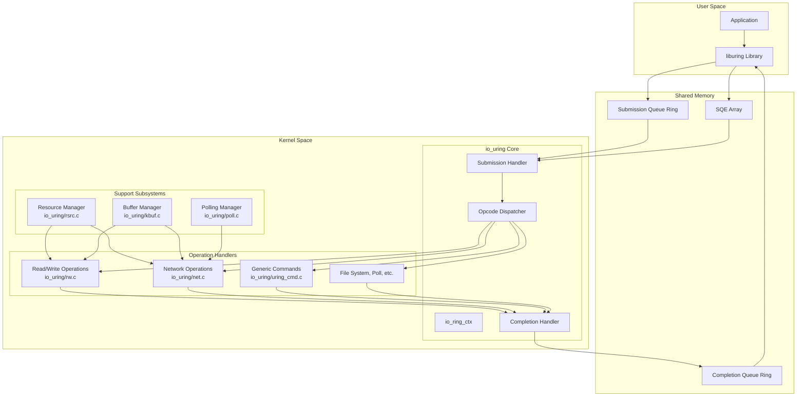

Sources: [io_uring/io_uring.c:1-4500](), [include/linux/io_uring_types.h:1-600](), [include/uapi/linux/io_uring.h:1-800]()

## Core Data Structures

### Ring Context

The `io_ring_ctx` structure is the central data structure that manages an io_uring instance:

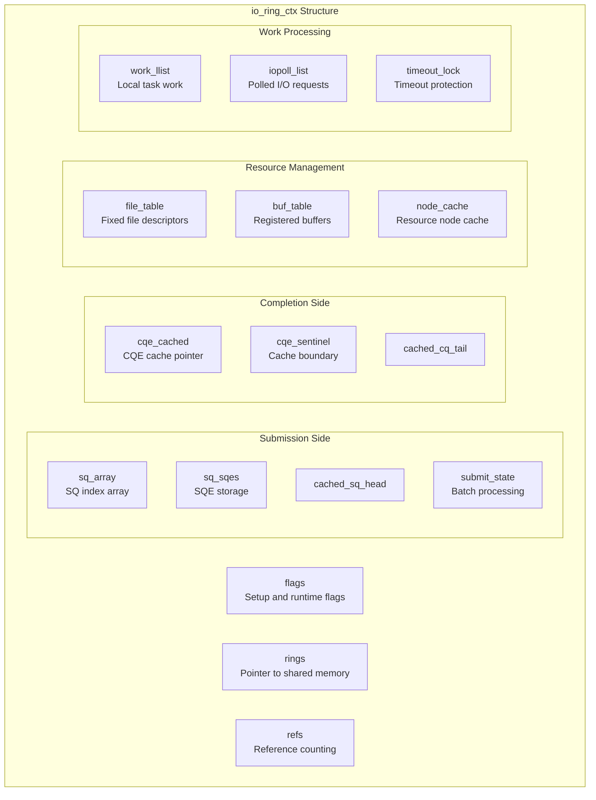

Sources: [include/linux/io_uring_types.h:237-451](), [io_uring/io_uring.c:298-382]()

### Request Structure

Each I/O operation is represented by an `io_kiocb` structure:

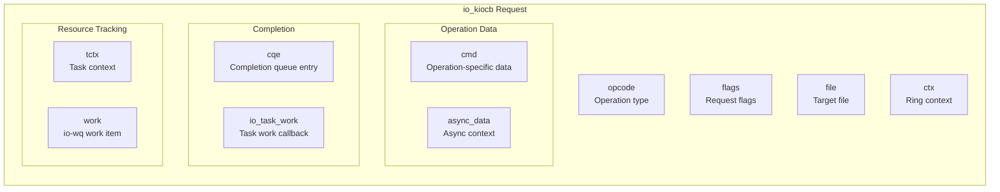

Sources: [include/linux/io_uring_types.h:563-700](), [io_uring/io_uring.c:129-132]()

## Submission and Completion Queues

### Queue Implementation

The submission and completion queues are implemented as lock-free ring buffers in shared memory:

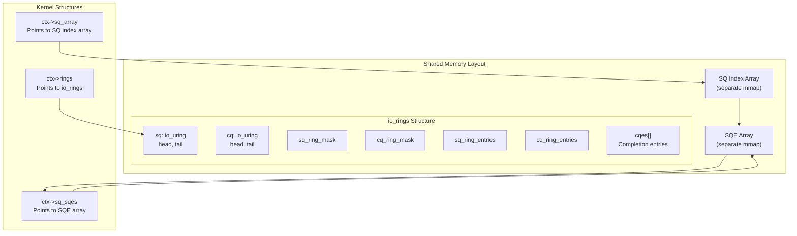

Sources: [include/linux/io_uring_types.h:131-200](), [io_uring/io_uring.c:182-190](), [io_uring/memmap.c:1-400]()

### Submission Processing

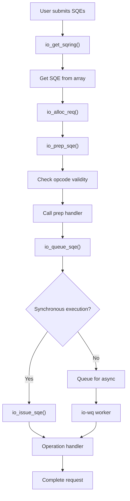

Sources: [io_uring/io_uring.c:2500-2800](), [io_uring/opdef.c:42-600]()

## Operation Types and Handling

### Operation Dispatch

io_uring supports a wide variety of operations defined in the opcode table:

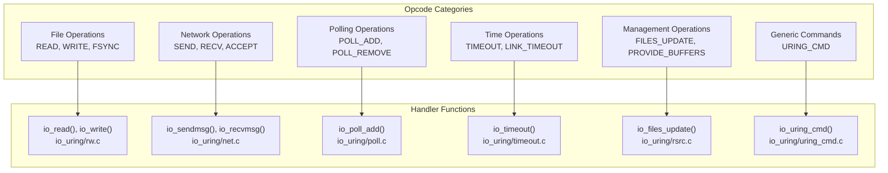

Sources: [io_uring/opdef.c:490-800](), [include/uapi/linux/io_uring.h:228-295]()

### Read/Write Operations

The read/write operation handling demonstrates io_uring's approach to high-performance I/O:

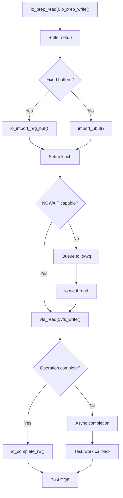

Sources: [io_uring/rw.c:327-460](), [io_uring/rw.c:585-670]()

## Buffer Management

### Buffer Types

io_uring supports multiple buffer management strategies:

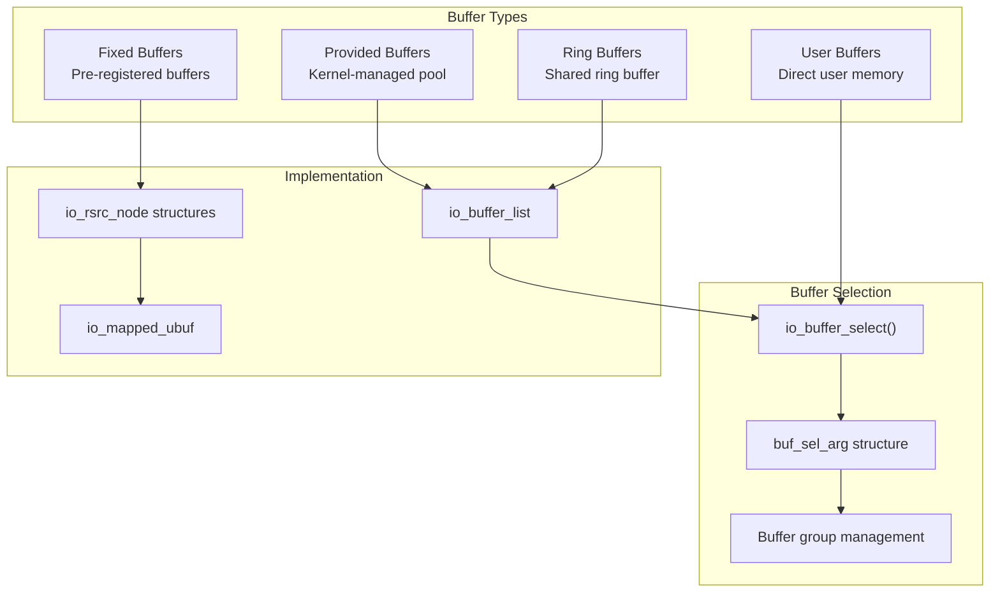

Sources: [io_uring/kbuf.c:195-350](), [io_uring/rsrc.c:771-850](), [io_uring/kbuf.h:15-63]()

### Buffer Selection Flow

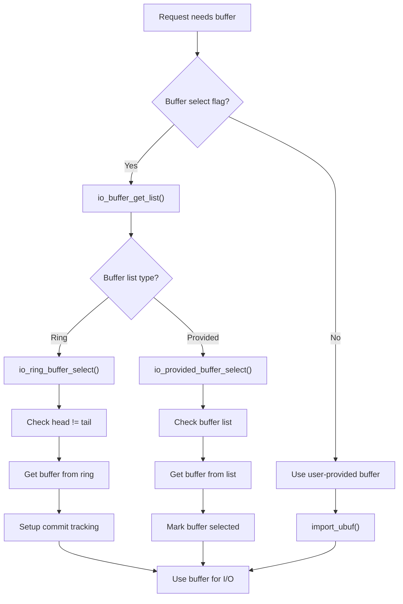

Sources: [io_uring/kbuf.c:154-213](), [io_uring/kbuf.c:118-152]()

## Advanced Features

### Zero-Copy Receive

io_uring implements zero-copy receive functionality for network operations:

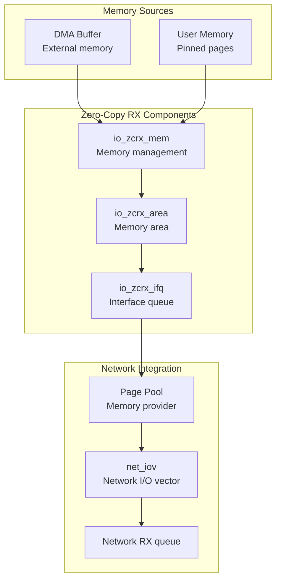

Sources: [io_uring/zcrx.c:31-200](), [io_uring/zcrx.h:11-80](), [io_uring/net.c:91-98]()

### Task Work and Completion

io_uring uses task work for efficient completion handling:

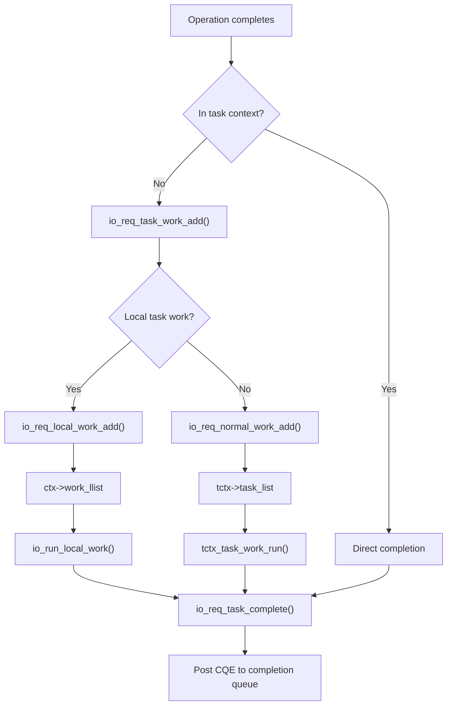

Sources: [io_uring/io_uring.c:1155-1270](), [io_uring/io_uring.c:1305-1350]()

### Polling Support

io_uring supports both interrupt-driven and polling modes:

```mermaid
graph TB
    subgraph "IOPOLL Mode"
        IOPOLL_LIST["ctx->iopoll_list"]
        IOPOLL_COMPLETE["io_complete_rw_iopoll()"]
        IOPOLL_DO["io_do_iopoll()"]
    end
    
    subgraph "Regular Polling"
        POLL_ADD["IORING_OP_POLL_ADD"]
        POLL_TABLE["poll_table_struct"]
        POLL_WAKE["Poll wake callback"]
    end
    
    subgraph "Hybrid Polling" 
        HYBRID_CHECK["Hybrid polling check"]
        POLL_FIRST["Poll first attempt"]
        SCHEDULE_LATER["Schedule if needed"]
    end
    
    IOPOLL_LIST --> IOPOLL_DO
    IOPOLL_DO --> IOPOLL_COMPLETE
    
    POLL_ADD --> POLL_TABLE
    POLL_TABLE --> POLL_WAKE
    
    HYBRID_CHECK --> POLL_FIRST
    POLL_FIRST --> SCHEDULE_LATER
```

Sources: [io_uring/poll.c:600-900](), [io_uring/io_uring.c:2700-2900]()

---

