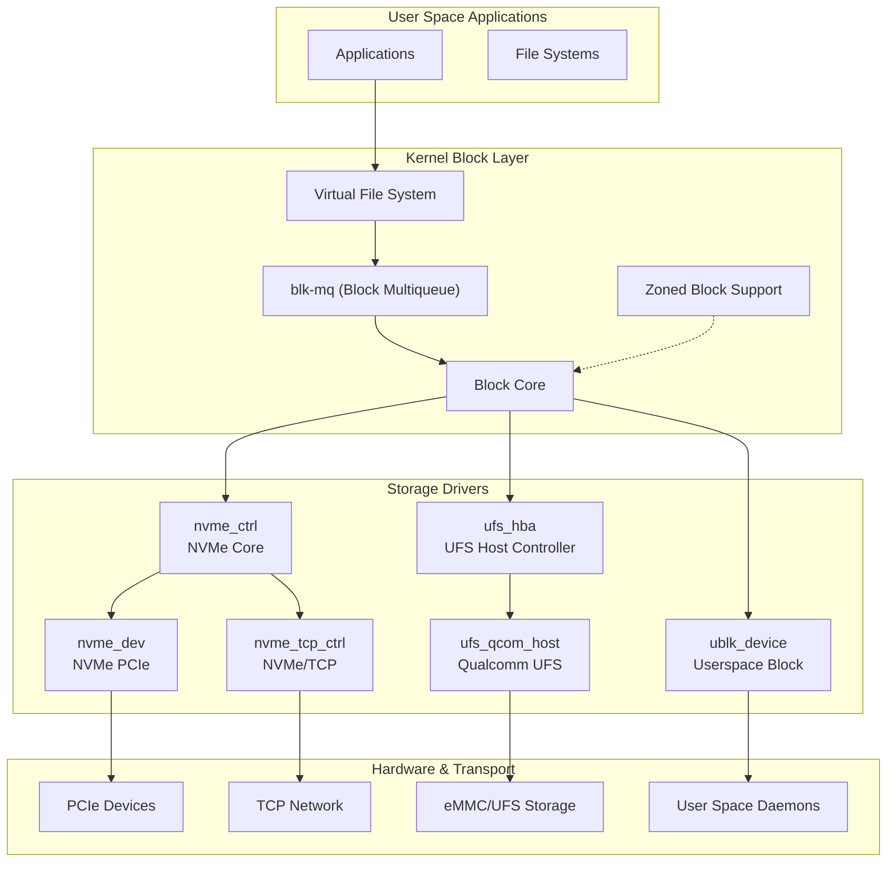
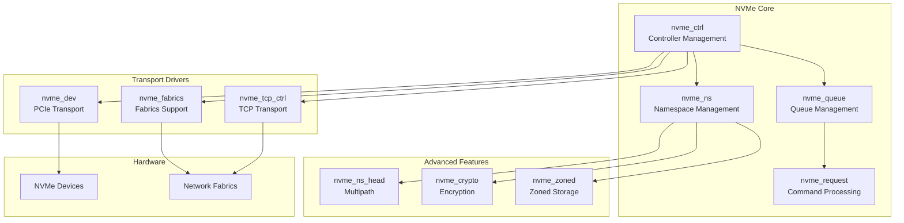
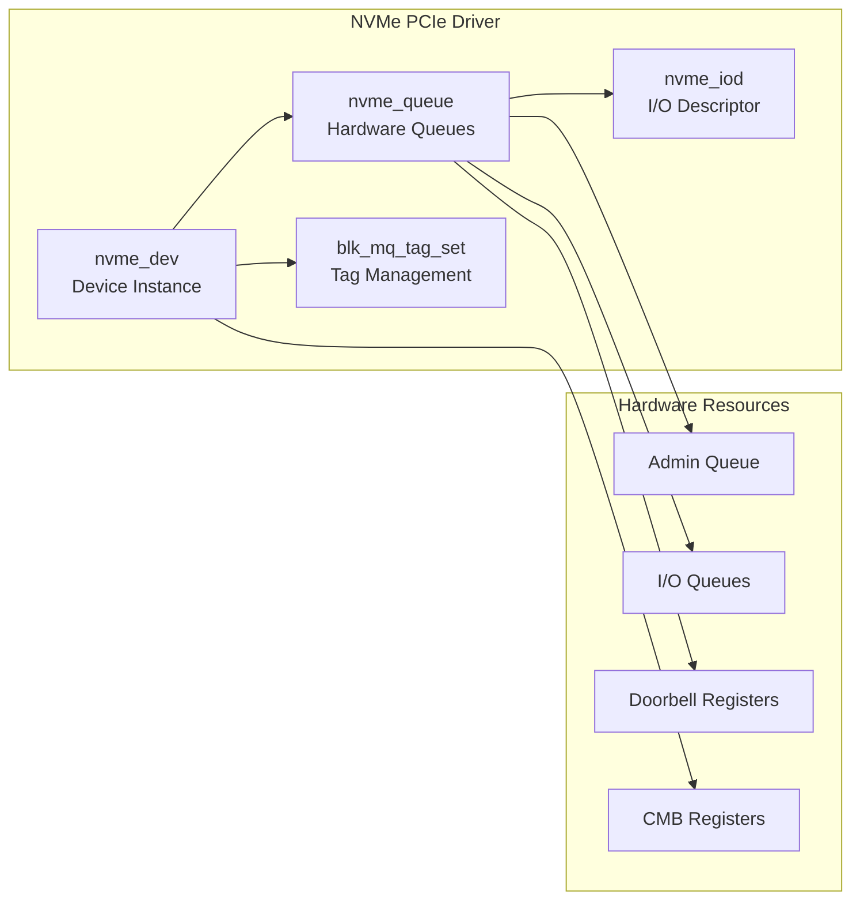
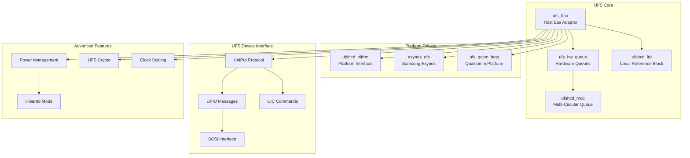
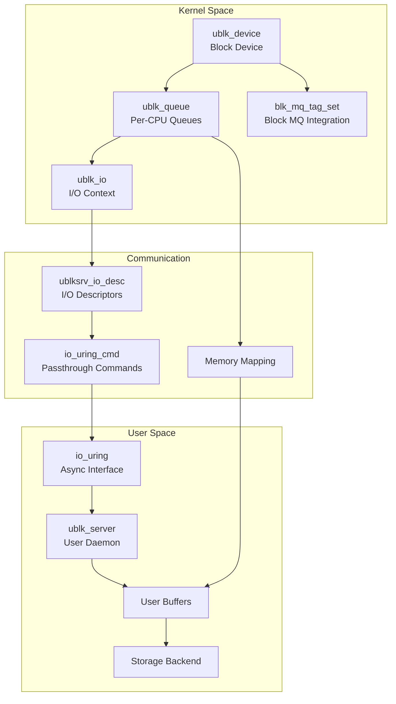
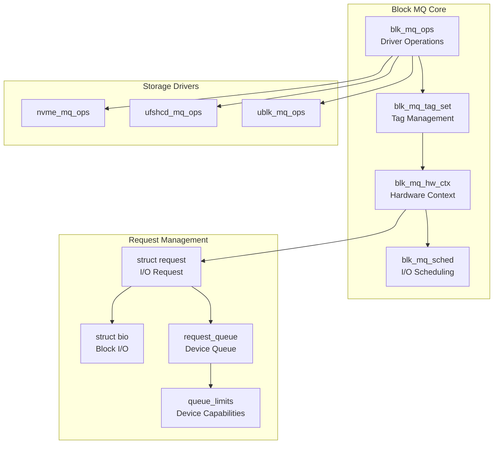
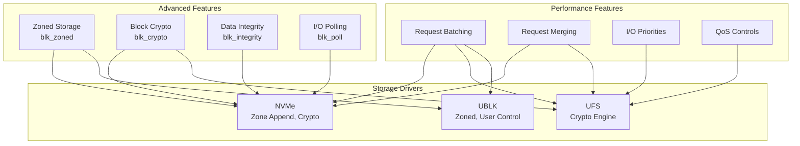

<!-- source: DeepWiki mcp.deepwiki.com · repo NVIDIA/NV-Kernels · page 4.2 Storage Subsystems · fetched 2026-10-26 -->

# Storage Subsystems

Relevant source files

The following files were used as context for generating this wiki page:

- [Documentation/ABI/testing/sysfs-driver-ufs](Documentation/ABI/testing/sysfs-driver-ufs)
- [Documentation/fault-injection/fault-injection.rst](Documentation/fault-injection/fault-injection.rst)
- [Documentation/filesystems/btrfs.rst](Documentation/filesystems/btrfs.rst)
- [arch/sh/drivers/push-switch.c](arch/sh/drivers/push-switch.c)
- [block/bdev.c](block/bdev.c)
- [block/blk-core.c](block/blk-core.c)
- [block/blk-flush.c](block/blk-flush.c)
- [block/blk-ia-ranges.c](block/blk-ia-ranges.c)
- [block/blk-lib.c](block/blk-lib.c)
- [block/blk-merge.c](block/blk-merge.c)
- [block/blk-mq-debugfs.c](block/blk-mq-debugfs.c)
- [block/blk-mq-debugfs.h](block/blk-mq-debugfs.h)
- [block/blk-mq-sched.c](block/blk-mq-sched.c)
- [block/blk-mq-sysfs.c](block/blk-mq-sysfs.c)
- [block/blk-mq-tag.c](block/blk-mq-tag.c)
- [block/blk-mq.c](block/blk-mq.c)
- [block/blk-mq.h](block/blk-mq.h)
- [block/blk-settings.c](block/blk-settings.c)
- [block/blk-sysfs.c](block/blk-sysfs.c)
- [block/blk-zoned.c](block/blk-zoned.c)
- [block/blk.h](block/blk.h)
- [block/bsg-lib.c](block/bsg-lib.c)
- [block/early-lookup.c](block/early-lookup.c)
- [block/elevator.c](block/elevator.c)
- [block/elevator.h](block/elevator.h)
- [block/fops.c](block/fops.c)
- [block/genhd.c](block/genhd.c)
- [block/ioctl.c](block/ioctl.c)
- [block/kyber-iosched.c](block/kyber-iosched.c)
- [block/partitions/core.c](block/partitions/core.c)
- [drivers/atm/idt77252.c](drivers/atm/idt77252.c)
- [drivers/block/Kconfig](drivers/block/Kconfig)
- [drivers/block/amiflop.c](drivers/block/amiflop.c)
- [drivers/block/aoe/aoeblk.c](drivers/block/aoe/aoeblk.c)
- [drivers/block/drbd/Kconfig](drivers/block/drbd/Kconfig)
- [drivers/block/drbd/drbd_int.h](drivers/block/drbd/drbd_int.h)
- [drivers/block/drbd/drbd_main.c](drivers/block/drbd/drbd_main.c)
- [drivers/block/floppy.c](drivers/block/floppy.c)
- [drivers/block/null_blk/Kconfig](drivers/block/null_blk/Kconfig)
- [drivers/block/null_blk/main.c](drivers/block/null_blk/main.c)
- [drivers/block/null_blk/null_blk.h](drivers/block/null_blk/null_blk.h)
- [drivers/block/null_blk/trace.h](drivers/block/null_blk/trace.h)
- [drivers/block/null_blk/zoned.c](drivers/block/null_blk/zoned.c)
- [drivers/block/ublk_drv.c](drivers/block/ublk_drv.c)
- [drivers/block/virtio_blk.c](drivers/block/virtio_blk.c)
- [drivers/bluetooth/hci_bcsp.c](drivers/bluetooth/hci_bcsp.c)
- [drivers/gpu/drm/i915/i915_sw_fence.c](drivers/gpu/drm/i915/i915_sw_fence.c)
- [drivers/hid/hid-wiimote-core.c](drivers/hid/hid-wiimote-core.c)
- [drivers/md/dm-zoned-reclaim.c](drivers/md/dm-zoned-reclaim.c)
- [drivers/md/persistent-data/Kconfig](drivers/md/persistent-data/Kconfig)
- [drivers/mmc/core/sd_ops.c](drivers/mmc/core/sd_ops.c)
- [drivers/mmc/host/cqhci-crypto.c](drivers/mmc/host/cqhci-crypto.c)
- [drivers/mmc/host/cqhci.h](drivers/mmc/host/cqhci.h)
- [drivers/mmc/host/sdhci-msm.c](drivers/mmc/host/sdhci-msm.c)
- [drivers/net/ethernet/cavium/Kconfig](drivers/net/ethernet/cavium/Kconfig)
- [drivers/nvme/common/Kconfig](drivers/nvme/common/Kconfig)
- [drivers/nvme/common/auth.c](drivers/nvme/common/auth.c)
- [drivers/nvme/common/keyring.c](drivers/nvme/common/keyring.c)
- [drivers/nvme/host/Kconfig](drivers/nvme/host/Kconfig)
- [drivers/nvme/host/apple.c](drivers/nvme/host/apple.c)
- [drivers/nvme/host/auth.c](drivers/nvme/host/auth.c)
- [drivers/nvme/host/constants.c](drivers/nvme/host/constants.c)
- [drivers/nvme/host/core.c](drivers/nvme/host/core.c)
- [drivers/nvme/host/fabrics.c](drivers/nvme/host/fabrics.c)
- [drivers/nvme/host/fabrics.h](drivers/nvme/host/fabrics.h)
- [drivers/nvme/host/fault_inject.c](drivers/nvme/host/fault_inject.c)
- [drivers/nvme/host/fc.c](drivers/nvme/host/fc.c)
- [drivers/nvme/host/multipath.c](drivers/nvme/host/multipath.c)
- [drivers/nvme/host/nvme.h](drivers/nvme/host/nvme.h)
- [drivers/nvme/host/pci.c](drivers/nvme/host/pci.c)
- [drivers/nvme/host/pr.c](drivers/nvme/host/pr.c)
- [drivers/nvme/host/rdma.c](drivers/nvme/host/rdma.c)
- [drivers/nvme/host/sysfs.c](drivers/nvme/host/sysfs.c)
- [drivers/nvme/host/tcp.c](drivers/nvme/host/tcp.c)
- [drivers/nvme/host/zns.c](drivers/nvme/host/zns.c)
- [drivers/nvme/target/admin-cmd.c](drivers/nvme/target/admin-cmd.c)
- [drivers/nvme/target/auth.c](drivers/nvme/target/auth.c)
- [drivers/nvme/target/configfs.c](drivers/nvme/target/configfs.c)
- [drivers/nvme/target/core.c](drivers/nvme/target/core.c)
- [drivers/nvme/target/discovery.c](drivers/nvme/target/discovery.c)
- [drivers/nvme/target/fabrics-cmd-auth.c](drivers/nvme/target/fabrics-cmd-auth.c)
- [drivers/nvme/target/fabrics-cmd.c](drivers/nvme/target/fabrics-cmd.c)
- [drivers/nvme/target/fc.c](drivers/nvme/target/fc.c)
- [drivers/nvme/target/io-cmd-bdev.c](drivers/nvme/target/io-cmd-bdev.c)
- [drivers/nvme/target/loop.c](drivers/nvme/target/loop.c)
- [drivers/nvme/target/nvmet.h](drivers/nvme/target/nvmet.h)
- [drivers/nvme/target/passthru.c](drivers/nvme/target/passthru.c)
- [drivers/nvme/target/pci-epf.c](drivers/nvme/target/pci-epf.c)
- [drivers/nvme/target/pr.c](drivers/nvme/target/pr.c)
- [drivers/nvme/target/rdma.c](drivers/nvme/target/rdma.c)
- [drivers/nvme/target/tcp.c](drivers/nvme/target/tcp.c)
- [drivers/s390/block/dasd.c](drivers/s390/block/dasd.c)
- [drivers/s390/block/dasd_3990_erp.c](drivers/s390/block/dasd_3990_erp.c)
- [drivers/s390/block/dasd_devmap.c](drivers/s390/block/dasd_devmap.c)
- [drivers/s390/block/dasd_diag.c](drivers/s390/block/dasd_diag.c)
- [drivers/s390/block/dasd_eckd.c](drivers/s390/block/dasd_eckd.c)
- [drivers/s390/block/dasd_fba.c](drivers/s390/block/dasd_fba.c)
- [drivers/s390/block/dasd_genhd.c](drivers/s390/block/dasd_genhd.c)
- [drivers/s390/block/dasd_int.h](drivers/s390/block/dasd_int.h)
- [drivers/s390/block/dasd_ioctl.c](drivers/s390/block/dasd_ioctl.c)
- [drivers/scsi/scsicam.c](drivers/scsi/scsicam.c)
- [drivers/scsi/sd_zbc.c](drivers/scsi/sd_zbc.c)
- [drivers/soc/qcom/ice.c](drivers/soc/qcom/ice.c)
- [drivers/ufs/core/ufs-mcq.c](drivers/ufs/core/ufs-mcq.c)
- [drivers/ufs/core/ufs-sysfs.c](drivers/ufs/core/ufs-sysfs.c)
- [drivers/ufs/core/ufs_bsg.c](drivers/ufs/core/ufs_bsg.c)
- [drivers/ufs/core/ufs_trace.h](drivers/ufs/core/ufs_trace.h)
- [drivers/ufs/core/ufshcd-crypto.c](drivers/ufs/core/ufshcd-crypto.c)
- [drivers/ufs/core/ufshcd-priv.h](drivers/ufs/core/ufshcd-priv.h)
- [drivers/ufs/core/ufshcd.c](drivers/ufs/core/ufshcd.c)
- [drivers/ufs/host/Kconfig](drivers/ufs/host/Kconfig)
- [drivers/ufs/host/Makefile](drivers/ufs/host/Makefile)
- [drivers/ufs/host/cdns-pltfrm.c](drivers/ufs/host/cdns-pltfrm.c)
- [drivers/ufs/host/tc-dwc-g210-pci.c](drivers/ufs/host/tc-dwc-g210-pci.c)
- [drivers/ufs/host/tc-dwc-g210-pltfrm.c](drivers/ufs/host/tc-dwc-g210-pltfrm.c)
- [drivers/ufs/host/ti-j721e-ufs.c](drivers/ufs/host/ti-j721e-ufs.c)
- [drivers/ufs/host/ufs-exynos.c](drivers/ufs/host/ufs-exynos.c)
- [drivers/ufs/host/ufs-exynos.h](drivers/ufs/host/ufs-exynos.h)
- [drivers/ufs/host/ufs-hisi.c](drivers/ufs/host/ufs-hisi.c)
- [drivers/ufs/host/ufs-mediatek.c](drivers/ufs/host/ufs-mediatek.c)
- [drivers/ufs/host/ufs-qcom.c](drivers/ufs/host/ufs-qcom.c)
- [drivers/ufs/host/ufs-qcom.h](drivers/ufs/host/ufs-qcom.h)
- [drivers/ufs/host/ufs-renesas.c](drivers/ufs/host/ufs-renesas.c)
- [drivers/ufs/host/ufs-rockchip.c](drivers/ufs/host/ufs-rockchip.c)
- [drivers/ufs/host/ufs-rockchip.h](drivers/ufs/host/ufs-rockchip.h)
- [drivers/ufs/host/ufs-sprd.c](drivers/ufs/host/ufs-sprd.c)
- [drivers/ufs/host/ufshcd-pci.c](drivers/ufs/host/ufshcd-pci.c)
- [drivers/ufs/host/ufshcd-pltfrm.c](drivers/ufs/host/ufshcd-pltfrm.c)
- [drivers/ufs/host/ufshcd-pltfrm.h](drivers/ufs/host/ufshcd-pltfrm.h)
- [fs/btrfs/Kconfig](fs/btrfs/Kconfig)
- [fs/ceph/Kconfig](fs/ceph/Kconfig)
- [fs/gfs2/Kconfig](fs/gfs2/Kconfig)
- [include/linux/blk-mq.h](include/linux/blk-mq.h)
- [include/linux/blk_types.h](include/linux/blk_types.h)
- [include/linux/blkdev.h](include/linux/blkdev.h)
- [include/linux/mmc/host.h](include/linux/mmc/host.h)
- [include/linux/nvme-auth.h](include/linux/nvme-auth.h)
- [include/linux/nvme-keyring.h](include/linux/nvme-keyring.h)
- [include/linux/nvme.h](include/linux/nvme.h)
- [include/linux/part_stat.h](include/linux/part_stat.h)
- [include/soc/qcom/ice.h](include/soc/qcom/ice.h)
- [include/uapi/linux/blkdev.h](include/uapi/linux/blkdev.h)
- [include/uapi/linux/ublk_cmd.h](include/uapi/linux/ublk_cmd.h)
- [include/ufs/ufs.h](include/ufs/ufs.h)
- [include/ufs/ufshcd.h](include/ufs/ufshcd.h)
- [include/ufs/ufshci.h](include/ufs/ufshci.h)

This document covers the modern storage subsystems in the Linux kernel, focusing on high-performance storage drivers and their integration with the block layer. The primary storage subsystems documented here are NVMe (Non-Volatile Memory Express), UFS (Universal Flash Storage), and UBLK (Userspace Block Devices).

For information about advanced I/O interfaces like io_uring, see [io_uring Asynchronous I/O](#4.1). For details about CPU scheduling and memory management that support these storage systems, see [Core Kernel Subsystems](#5).

## Storage Subsystem Architecture

The storage subsystems are built on a layered architecture with the block layer providing common infrastructure for all storage devices.

Sources: [include/linux/blkdev.h:142-222](), [block/blk-mq.c:1-50](), [drivers/nvme/host/core.c:1-50](), [drivers/ufs/core/ufshcd.c:1-50](), [drivers/block/ublk_drv.c:1-50]()

## NVMe Subsystem

The NVMe subsystem provides support for NVM Express storage devices across multiple transports including PCIe, TCP, and Fabrics.

### NVMe Core Architecture

The NVMe core manages controllers through the `nvme_ctrl` structure defined in [drivers/nvme/host/nvme.h:347-423](). Key components include:

- **Controller Management**: The `nvme_ctrl` structure handles controller state, admin queues, and device capabilities
- **Namespace Handling**: `nvme_ns` structures represent individual storage namespaces
- **Queue Management**: I/O queues are managed per-CPU for optimal performance
- **Request Processing**: Commands are built using `nvme_command` structures and tracked via `nvme_request`

Sources: [drivers/nvme/host/core.c:36-157](), [drivers/nvme/host/nvme.h:347-423](), [include/linux/nvme.h:1-100]()

### NVMe PCIe Transport

The PCIe transport is the most common NVMe implementation, providing direct hardware access through PCIe interfaces.

Key PCIe-specific features include:
- **Queue Management**: Hardware submission and completion queues with doorbell registers
- **Memory Mapping**: Controller Memory Buffer (CMB) and Host Memory Buffer (HMB) support
- **Interrupt Handling**: MSI-X interrupts for scalable performance
- **DMA Operations**: Direct memory access for data transfers

Sources: [drivers/nvme/host/pci.c:139-185](), [drivers/nvme/host/pci.c:212-267]()

## UFS Subsystem

Universal Flash Storage (UFS) provides high-performance storage for mobile and embedded devices with advanced power management and command queueing capabilities.

### UFS Host Controller Architecture

The UFS subsystem centers around the `ufs_hba` structure defined in [include/ufs/ufshcd.h:680-1010](). Key components include:

- **Host Bus Adapter**: Central management structure for UFS controllers
- **Multi-Circular Queue (MCQ)**: Advanced queueing for UFSHCI 4.0+ controllers
- **Local Reference Blocks**: Track individual commands and their completion
- **Platform Abstraction**: Vendor-specific implementations for different SoCs

Sources: [drivers/ufs/core/ufshcd.c:117-142](), [include/ufs/ufshcd.h:680-1010](), [drivers/ufs/core/ufs-mcq.c:1-50]()

### UFS Command Processing

```mermaid
graph LR
    subgraph "Command Path"
        SCSIBLK["SCSI Block Layer"]
        UFSHCD["ufshcd_queuecommand"]
        BUILDUPIU["ufshcd_compose_upiu"]
        SENDCMD["ufshcd_send_command"]
        HBAQUEUE["ufshcd_hba->lrb[]"]
    end
    
    subgraph "Hardware Interface"
        UTRD["UTRD<br/>Transfer Request"]
        UCD["UCD<br/>Command Descriptor"]
        PRDT["PRDT<br/>Data Transfer"]
        HWQUEUE["Hardware Queue"]
    end
    
    subgraph "Completion"
        ISR["ufshcd_intr"]
        COMPL["ufshcd_transfer_req_compl"]
        SCSICOMP["scsi_done"]
    end
    
    SCSIBLK --> UFSHCD
    UFSHCD --> BUILDUPIU
    BUILDUPIU --> SENDCMD
    SENDCMD --> HBAQUEUE
    
    HBAQUEUE --> UTRD
    UTRD --> UCD
    UCD --> PRDT
    PRDT --> HWQUEUE
    
    HWQUEUE --> ISR
    ISR --> COMPL
    COMPL --> SCSICOMP
```

UFS command processing involves several key structures:
- **UTRD**: UTP Transfer Request Descriptors that describe commands
- **UCD**: UFS Command Descriptors containing UPIU messages
- **PRDT**: Physical Region Description Table for data transfers
- **LRB**: Local Reference Blocks tracking command lifecycle

Sources: [drivers/ufs/core/ufshcd.c:322-400](), [drivers/ufs/core/ufshcd.c:2800-3000]()

## Userspace Block Devices (UBLK)

UBLK enables userspace applications to implement block devices with kernel-level performance by leveraging io_uring for efficient communication.

### UBLK Architecture

UBLK provides several key capabilities:
- **Zero-Copy I/O**: Direct memory mapping between kernel and userspace
- **Async Communication**: io_uring passthrough commands for efficient control
- **Per-CPU Queues**: Scalable architecture with dedicated queues per CPU
- **Advanced Features**: Support for zoned storage, encryption, and various I/O modes

Sources: [drivers/block/ublk_drv.c:190-220](), [drivers/block/ublk_drv.c:85-155]()

### UBLK I/O Flow

```mermaid
graph LR
    subgraph "Request Processing"
        BLKREQ["Block Request"]
        UBLKQUEUE["ublk_queue_rq"]
        UBLKIO["ublk_io[]"]
        IODESC["ublksrv_io_desc"]
    end
    
    subgraph "User Communication"
        IOCMD["UBLK_IO_FETCH_REQ"]
        IOURING["io_uring_cmd"]
        USERPROC["User Processing"]
        COMMIT["UBLK_IO_COMMIT_AND_FETCH"]
    end
    
    subgraph "Completion"
        UBLKCOMP["ublk_complete_rq"]
        BLKCOMP["blk_mq_end_request"]
    end
    
    BLKREQ --> UBLKQUEUE
    UBLKQUEUE --> UBLKIO
    UBLKIO --> IODESC
    
    IODESC --> IOCMD
    IOCMD --> IOURING
    IOURING --> USERPROC
    USERPROC --> COMMIT
    
    COMMIT --> UBLKCOMP
    UBLKCOMP --> BLKCOMP
```

The UBLK I/O flow demonstrates the integration between kernel block layer and userspace:
1. Block requests are queued through `ublk_queue_rq()`
2. Userspace fetches requests via `UBLK_IO_FETCH_REQ` io_uring commands
3. User daemon processes I/O and commits results via `UBLK_IO_COMMIT_AND_FETCH`
4. Kernel completes the original block request

Sources: [drivers/block/ublk_drv.c:1500-1600](), [drivers/block/ublk_drv.c:2000-2100]()

## Block Layer Integration

All storage subsystems integrate with the Linux block layer through the block multiqueue (blk-mq) infrastructure, providing unified interfaces and advanced features.

### Block Multiqueue Architecture

Key block layer components include:
- **Tag Sets**: Manage command tags across multiple hardware queues
- **Hardware Contexts**: Per-CPU or per-NUMA-node queue contexts
- **Request Queues**: Device-specific queue management and limits
- **I/O Scheduling**: Various algorithms for optimizing I/O ordering

Sources: [block/blk-mq.c:400-500](), [include/linux/blk-mq.h:200-300](), [include/linux/blkdev.h:460-632]()

### Storage Feature Integration

Modern storage subsystems support advanced block layer features:
- **Zoned Storage**: Support for SMR drives and ZNS SSDs through `blk_zoned`
- **Inline Encryption**: Hardware-accelerated encryption in NVMe and UFS
- **Data Integrity**: T10 DIF/DIX protection information
- **I/O Polling**: Low-latency polling mode for NVMe devices

Sources: [block/blk-zoned.c:1-50](), [drivers/nvme/host/core.c:900-1000](), [drivers/ufs/core/ufshcd.c:367-400]()

## Performance and Scalability

The storage subsystems are designed for high performance and scalability across different deployment scenarios.

| Subsystem | Queue Model | Max Queues | Key Features |
|-----------|-------------|------------|--------------|
| NVMe PCIe | Per-CPU HW Queues | 65535 | Direct HW access, MSI-X |
| NVMe TCP | Per-CPU SW Queues | Configurable | Network transport, TLS |
| UFS | MCQ (4.0+) or SQ | 32 MCQ / 1 SQ | Mobile optimized, power mgmt |
| UBLK | Per-CPU Queues | CPU count | User flexibility, io_uring |

### Performance Characteristics

- **NVMe PCIe**: Lowest latency with direct hardware queues and interrupt handling
- **UFS MCQ**: Optimized for mobile workloads with advanced power management
- **UBLK**: Flexible userspace implementation with near-native performance
- **Block Layer**: Unified interface with per-CPU queues and efficient request batching

Sources: [drivers/nvme/host/pci.c:513-540](), [drivers/ufs/core/ufs-mcq.c:1-100](), [drivers/block/ublk_drv.c:174-188](), [block/blk-mq.c:2500-2600]()

---

