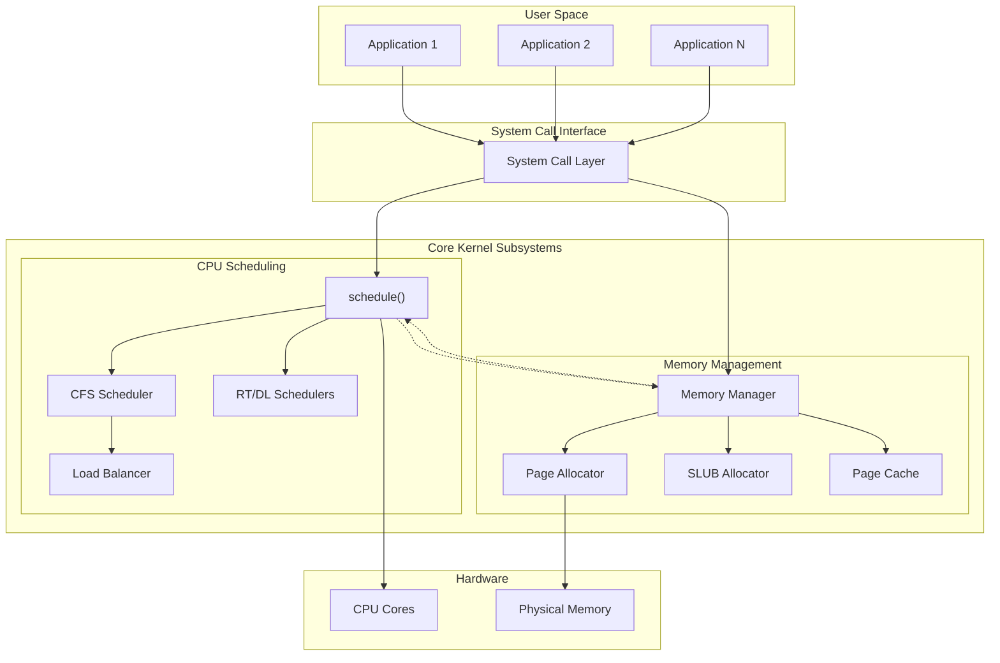
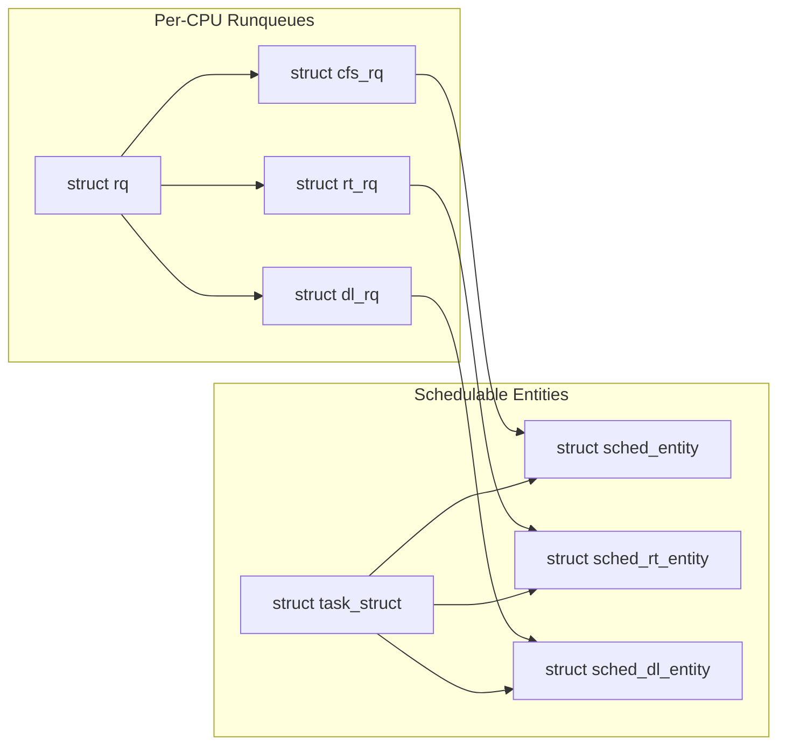
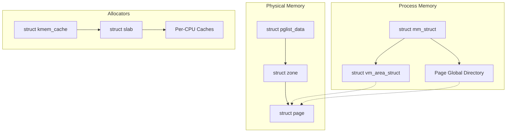
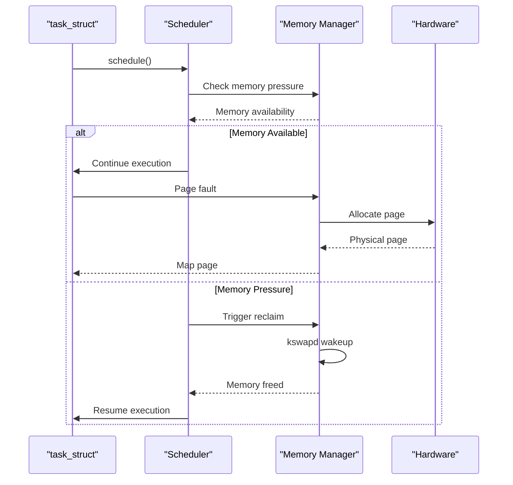
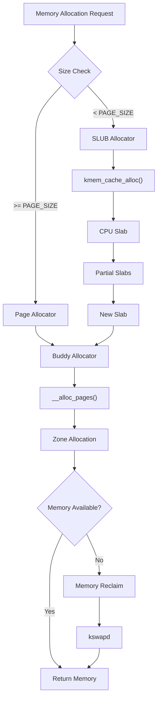
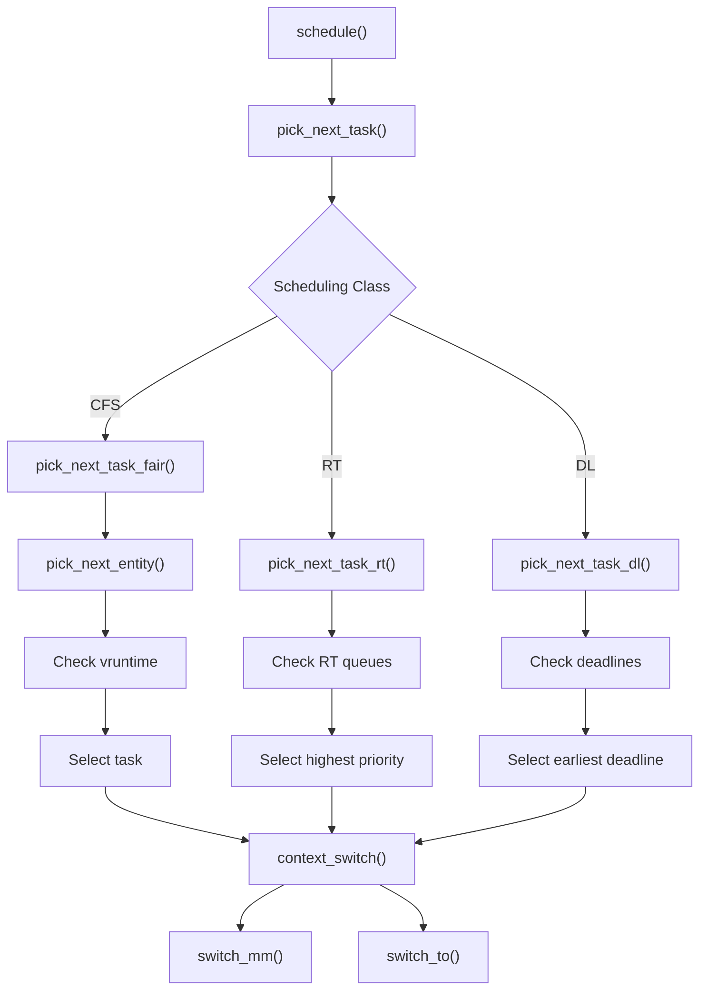

<!-- source: DeepWiki mcp.deepwiki.com · repo NVIDIA/NV-Kernels · page 5 Core Kernel Subsystems · fetched 2026-10-26 -->

# Core Kernel Subsystems

Relevant source files

The following files were used as context for generating this wiki page:

- [Documentation/accounting/delay-accounting.rst](Documentation/accounting/delay-accounting.rst)
- [Documentation/admin-guide/cgroup-v1/cgroups.rst](Documentation/admin-guide/cgroup-v1/cgroups.rst)
- [Documentation/admin-guide/cgroup-v1/memory.rst](Documentation/admin-guide/cgroup-v1/memory.rst)
- [Documentation/admin-guide/cgroup-v1/pids.rst](Documentation/admin-guide/cgroup-v1/pids.rst)
- [Documentation/admin-guide/cgroup-v2.rst](Documentation/admin-guide/cgroup-v2.rst)
- [Documentation/admin-guide/mm/transhuge.rst](Documentation/admin-guide/mm/transhuge.rst)
- [Documentation/admin-guide/pm/cpufreq.rst](Documentation/admin-guide/pm/cpufreq.rst)
- [Documentation/core-api/memory-allocation.rst](Documentation/core-api/memory-allocation.rst)
- [Documentation/scheduler/schedutil.rst](Documentation/scheduler/schedutil.rst)
- [Documentation/translations/zh_CN/scheduler/schedutil.rst](Documentation/translations/zh_CN/scheduler/schedutil.rst)
- [arch/alpha/include/uapi/asm/mman.h](arch/alpha/include/uapi/asm/mman.h)
- [arch/arm/mm/flush.c](arch/arm/mm/flush.c)
- [arch/arm64/include/asm/mman.h](arch/arm64/include/asm/mman.h)
- [arch/arm64/include/asm/mte.h](arch/arm64/include/asm/mte.h)
- [arch/arm64/kernel/elfcore.c](arch/arm64/kernel/elfcore.c)
- [arch/arm64/kernel/hibernate.c](arch/arm64/kernel/hibernate.c)
- [arch/arm64/kernel/mte.c](arch/arm64/kernel/mte.c)
- [arch/arm64/mm/copypage.c](arch/arm64/mm/copypage.c)
- [arch/arm64/mm/mmap.c](arch/arm64/mm/mmap.c)
- [arch/mips/include/uapi/asm/mman.h](arch/mips/include/uapi/asm/mman.h)
- [arch/parisc/include/asm/mman.h](arch/parisc/include/asm/mman.h)
- [arch/parisc/include/uapi/asm/mman.h](arch/parisc/include/uapi/asm/mman.h)
- [arch/powerpc/include/asm/cputime.h](arch/powerpc/include/asm/cputime.h)
- [arch/x86/events/amd/power.c](arch/x86/events/amd/power.c)
- [arch/x86/events/probe.c](arch/x86/events/probe.c)
- [arch/x86/kernel/cpu/aperfmperf.c](arch/x86/kernel/cpu/aperfmperf.c)
- [arch/x86/kernel/cpu/proc.c](arch/x86/kernel/cpu/proc.c)
- [arch/x86/mm/pat/memtype.c](arch/x86/mm/pat/memtype.c)
- [arch/xtensa/include/uapi/asm/mman.h](arch/xtensa/include/uapi/asm/mman.h)
- [block/blk-wbt.c](block/blk-wbt.c)
- [drivers/android/binder_alloc.c](drivers/android/binder_alloc.c)
- [drivers/android/binder_alloc.h](drivers/android/binder_alloc.h)
- [drivers/cpufreq/Kconfig.x86](drivers/cpufreq/Kconfig.x86)
- [drivers/cpufreq/cpufreq.c](drivers/cpufreq/cpufreq.c)
- [drivers/cpufreq/cpufreq_ondemand.c](drivers/cpufreq/cpufreq_ondemand.c)
- [drivers/cpufreq/freq_table.c](drivers/cpufreq/freq_table.c)
- [fs/hugetlbfs/inode.c](fs/hugetlbfs/inode.c)
- [fs/nfs/nfs42xattr.c](fs/nfs/nfs42xattr.c)
- [fs/proc/array.c](fs/proc/array.c)
- [fs/proc/meminfo.c](fs/proc/meminfo.c)
- [fs/proc/task_mmu.c](fs/proc/task_mmu.c)
- [fs/userfaultfd.c](fs/userfaultfd.c)
- [include/asm-generic/tlb.h](include/asm-generic/tlb.h)
- [include/linux/backing-dev-defs.h](include/linux/backing-dev-defs.h)
- [include/linux/cpufreq.h](include/linux/cpufreq.h)
- [include/linux/delayacct.h](include/linux/delayacct.h)
- [include/linux/elfcore.h](include/linux/elfcore.h)
- [include/linux/energy_model.h](include/linux/energy_model.h)
- [include/linux/highmem.h](include/linux/highmem.h)
- [include/linux/huge_mm.h](include/linux/huge_mm.h)
- [include/linux/hugetlb.h](include/linux/hugetlb.h)
- [include/linux/khugepaged.h](include/linux/khugepaged.h)
- [include/linux/list_lru.h](include/linux/list_lru.h)
- [include/linux/memcontrol.h](include/linux/memcontrol.h)
- [include/linux/memfd.h](include/linux/memfd.h)
- [include/linux/minmax.h](include/linux/minmax.h)
- [include/linux/misc_cgroup.h](include/linux/misc_cgroup.h)
- [include/linux/mm.h](include/linux/mm.h)
- [include/linux/mm_inline.h](include/linux/mm_inline.h)
- [include/linux/mm_types.h](include/linux/mm_types.h)
- [include/linux/mman.h](include/linux/mman.h)
- [include/linux/mmzone.h](include/linux/mmzone.h)
- [include/linux/page-flags.h](include/linux/page-flags.h)
- [include/linux/page_ref.h](include/linux/page_ref.h)
- [include/linux/pageblock-flags.h](include/linux/pageblock-flags.h)
- [include/linux/pagemap.h](include/linux/pagemap.h)
- [include/linux/pagewalk.h](include/linux/pagewalk.h)
- [include/linux/pgalloc_tag.h](include/linux/pgalloc_tag.h)
- [include/linux/pgtable.h](include/linux/pgtable.h)
- [include/linux/preempt.h](include/linux/preempt.h)
- [include/linux/psi.h](include/linux/psi.h)
- [include/linux/psi_types.h](include/linux/psi_types.h)
- [include/linux/sched.h](include/linux/sched.h)
- [include/linux/sched/debug.h](include/linux/sched/debug.h)
- [include/linux/sched/sd_flags.h](include/linux/sched/sd_flags.h)
- [include/linux/sched/topology.h](include/linux/sched/topology.h)
- [include/linux/shmem_fs.h](include/linux/shmem_fs.h)
- [include/linux/slab.h](include/linux/slab.h)
- [include/linux/swap.h](include/linux/swap.h)
- [include/linux/swapops.h](include/linux/swapops.h)
- [include/linux/userfaultfd_k.h](include/linux/userfaultfd_k.h)
- [include/linux/vm_event_item.h](include/linux/vm_event_item.h)
- [include/linux/vmstat.h](include/linux/vmstat.h)
- [include/linux/zswap.h](include/linux/zswap.h)
- [include/trace/events/huge_memory.h](include/trace/events/huge_memory.h)
- [include/trace/events/kmem.h](include/trace/events/kmem.h)
- [include/trace/events/mmflags.h](include/trace/events/mmflags.h)
- [include/uapi/asm-generic/mman-common.h](include/uapi/asm-generic/mman-common.h)
- [include/uapi/linux/mman.h](include/uapi/linux/mman.h)
- [include/uapi/linux/taskstats.h](include/uapi/linux/taskstats.h)
- [init/Kconfig](init/Kconfig)
- [kernel/Kconfig.preempt](kernel/Kconfig.preempt)
- [kernel/cgroup/misc.c](kernel/cgroup/misc.c)
- [kernel/cgroup/pids.c](kernel/cgroup/pids.c)
- [kernel/delayacct.c](kernel/delayacct.c)
- [kernel/power/energy_model.c](kernel/power/energy_model.c)
- [kernel/sched/build_utility.c](kernel/sched/build_utility.c)
- [kernel/sched/clock.c](kernel/sched/clock.c)
- [kernel/sched/core.c](kernel/sched/core.c)
- [kernel/sched/core_sched.c](kernel/sched/core_sched.c)
- [kernel/sched/cpufreq_schedutil.c](kernel/sched/cpufreq_schedutil.c)
- [kernel/sched/cputime.c](kernel/sched/cputime.c)
- [kernel/sched/deadline.c](kernel/sched/deadline.c)
- [kernel/sched/debug.c](kernel/sched/debug.c)
- [kernel/sched/fair.c](kernel/sched/fair.c)
- [kernel/sched/features.h](kernel/sched/features.h)
- [kernel/sched/idle.c](kernel/sched/idle.c)
- [kernel/sched/loadavg.c](kernel/sched/loadavg.c)
- [kernel/sched/pelt.c](kernel/sched/pelt.c)
- [kernel/sched/pelt.h](kernel/sched/pelt.h)
- [kernel/sched/psi.c](kernel/sched/psi.c)
- [kernel/sched/rt.c](kernel/sched/rt.c)
- [kernel/sched/sched.h](kernel/sched/sched.h)
- [kernel/sched/stats.h](kernel/sched/stats.h)
- [kernel/sched/stop_task.c](kernel/sched/stop_task.c)
- [kernel/sched/syscalls.c](kernel/sched/syscalls.c)
- [kernel/sched/topology.c](kernel/sched/topology.c)
- [lib/kunit/user_alloc.c](lib/kunit/user_alloc.c)
- [mm/Kconfig](mm/Kconfig)
- [mm/Makefile](mm/Makefile)
- [mm/backing-dev.c](mm/backing-dev.c)
- [mm/filemap.c](mm/filemap.c)
- [mm/folio-compat.c](mm/folio-compat.c)
- [mm/gup.c](mm/gup.c)
- [mm/huge_memory.c](mm/huge_memory.c)
- [mm/hugetlb.c](mm/hugetlb.c)
- [mm/hugetlb_vmemmap.c](mm/hugetlb_vmemmap.c)
- [mm/internal.h](mm/internal.h)
- [mm/khugepaged.c](mm/khugepaged.c)
- [mm/list_lru.c](mm/list_lru.c)
- [mm/madvise.c](mm/madvise.c)
- [mm/memcontrol-v1.c](mm/memcontrol-v1.c)
- [mm/memcontrol.c](mm/memcontrol.c)
- [mm/memfd.c](mm/memfd.c)
- [mm/memory.c](mm/memory.c)
- [mm/memremap.c](mm/memremap.c)
- [mm/migrate.c](mm/migrate.c)
- [mm/mlock.c](mm/mlock.c)
- [mm/mm_init.c](mm/mm_init.c)
- [mm/mmap.c](mm/mmap.c)
- [mm/mmu_gather.c](mm/mmu_gather.c)
- [mm/mprotect.c](mm/mprotect.c)
- [mm/mremap.c](mm/mremap.c)
- [mm/mseal.c](mm/mseal.c)
- [mm/nommu.c](mm/nommu.c)
- [mm/page-writeback.c](mm/page-writeback.c)
- [mm/page_alloc.c](mm/page_alloc.c)
- [mm/page_ext.c](mm/page_ext.c)
- [mm/page_io.c](mm/page_io.c)
- [mm/page_isolation.c](mm/page_isolation.c)
- [mm/pagewalk.c](mm/pagewalk.c)
- [mm/readahead.c](mm/readahead.c)
- [mm/shmem.c](mm/shmem.c)
- [mm/show_mem.c](mm/show_mem.c)
- [mm/slab.h](mm/slab.h)
- [mm/slab_common.c](mm/slab_common.c)
- [mm/slub.c](mm/slub.c)
- [mm/swap.c](mm/swap.c)
- [mm/swap.h](mm/swap.h)
- [mm/swap_state.c](mm/swap_state.c)
- [mm/swapfile.c](mm/swapfile.c)
- [mm/truncate.c](mm/truncate.c)
- [mm/userfaultfd.c](mm/userfaultfd.c)
- [mm/util.c](mm/util.c)
- [mm/vma.c](mm/vma.c)
- [mm/vma.h](mm/vma.h)
- [mm/vma_init.c](mm/vma_init.c)
- [mm/vmscan.c](mm/vmscan.c)
- [mm/vmstat.c](mm/vmstat.c)
- [mm/workingset.c](mm/workingset.c)
- [mm/zpdesc.h](mm/zpdesc.h)
- [mm/zswap.c](mm/zswap.c)
- [tools/accounting/getdelays.c](tools/accounting/getdelays.c)
- [tools/testing/vma/vma_internal.h](tools/testing/vma/vma_internal.h)

This document provides an overview of the fundamental kernel subsystems that form the foundation of Linux kernel operation: CPU scheduling and memory management. These subsystems are responsible for managing the allocation and scheduling of the two most critical system resources - processor time and memory space.

For detailed information about specific scheduling policies and algorithms, see [CPU Scheduling](#5.1). For comprehensive coverage of memory allocation strategies and virtual memory management, see [Memory Management](#5.2).

## Architecture Overview

The core kernel subsystems operate as interconnected components that work together to provide efficient resource management. The scheduler determines which tasks run when, while the memory management subsystem ensures tasks have access to the memory they need.

**Sources:** [kernel/sched/core.c:1-100](), [mm/memory.c:1-100](), [kernel/sched/sched.h:1-100]()

## Key Data Structures

The core subsystems are built around several fundamental data structures that maintain system state and coordinate resource allocation.

### Scheduling Data Structures

**Sources:** [kernel/sched/sched.h:644-741](), [include/linux/sched.h:51-2000]()

### Memory Management Data Structures

**Sources:** [include/linux/mm.h:1-4000](), [mm/slub.c:383-433](), [include/linux/mm_types.h:1-1000]()

## Subsystem Interactions

The CPU scheduler and memory management subsystem have several critical interaction points that ensure system stability and performance.

### Scheduler-Memory Manager Coordination

**Sources:** [kernel/sched/core.c:6000-6500](), [mm/vmscan.c:1-100](), [mm/page_alloc.c:4000-4500]()

## Resource Allocation Flow

The kernel follows a coordinated approach to resource allocation that involves both subsystems working together to maintain system responsiveness and stability.

### Memory Allocation Path

**Sources:** [mm/slub.c:3000-3200](), [mm/page_alloc.c:5000-5500](), [mm/vmscan.c:2000-2500]()

### Task Scheduling Path

**Sources:** [kernel/sched/core.c:6000-6200](), [kernel/sched/fair.c:4000-4200](), [kernel/sched/rt.c:1500-1700]()

## Performance Considerations

The design of core kernel subsystems prioritizes performance through several key mechanisms:

### CPU Scheduling Optimizations

- **Per-CPU runqueues** minimize lock contention in SMP systems
- **Load balancing** distributes work across available CPUs
- **NUMA-aware scheduling** reduces memory access latency
- **Cache-conscious algorithms** improve memory locality

### Memory Management Optimizations

- **Per-CPU caches** in SLUB reduce allocation overhead
- **Lazy TLB** minimizes page table updates during context switches
- **Memory compaction** reduces fragmentation
- **Readahead mechanisms** improve I/O performance

**Sources:** [kernel/sched/fair.c:8000-9000](), [mm/slub.c:2500-2800](), [mm/compaction.c:1-100]()

## Configuration and Tuning

Both subsystems provide extensive configuration options through kernel parameters, sysctl interfaces, and cgroup controls.

### Key Configuration Parameters

| Subsystem | Parameter | Purpose |
|-----------|-----------|---------|
| Scheduler | `sched_base_slice` | CFS scheduling quantum |
| Scheduler | `sched_migration_cost` | Migration threshold |
| Memory | `vm.swappiness` | Swap behavior control |
| Memory | `vm.dirty_ratio` | Page cache writeback |

**Sources:** [kernel/sched/fair.c:70-130](), [Documentation/admin-guide/sysctl/vm.rst:1-100]()

## Integration with Hardware

Core kernel subsystems must efficiently interface with hardware features to maximize performance and provide necessary abstractions.

### CPU Features Integration

- **SMP support** through per-CPU data structures
- **NUMA topology** awareness for memory allocation
- **Power management** integration with CPU governors
- **Hardware virtualization** support for containers

### Memory Hardware Integration

- **MMU management** for virtual memory translation
- **Cache coherency** protocols for SMP systems
- **IOMMU support** for device memory access
- **Memory ordering** guarantees for different architectures

**Sources:** [arch/x86/kernel/smp.c:1-100](), [mm/mmu_notifier.c:1-100](), [drivers/cpufreq/cpufreq.c:1-100]()

## Error Handling and Recovery

Robust error handling mechanisms ensure system stability when resource allocation fails or hardware issues occur.

### Memory Allocation Failures

- **OOM killer** as last resort for memory exhaustion
- **Memory reclaim** through `kswapd` and direct reclaim
- **Fallback allocation** strategies for different zones
- **Memory control groups** for resource isolation

### Scheduling Failures

- **Load balancing** recovery from CPU hotplug events
- **RT throttling** to prevent starvation of other tasks
- **Deadline budget** enforcement for real-time guarantees

**Sources:** [mm/oom_kill.c:1-100](), [kernel/sched/rt.c:800-1000](), [kernel/sched/deadline.c:1000-1200]()

The core kernel subsystems form the foundation upon which all other kernel functionality is built. Their efficient operation is critical to overall system performance and stability. For detailed implementation specifics, refer to the dedicated pages on [CPU Scheduling](#5.1) and [Memory Management](#5.2).

---

