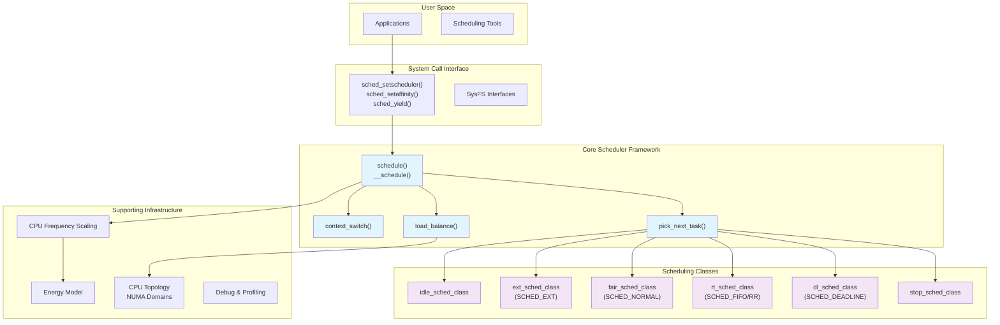
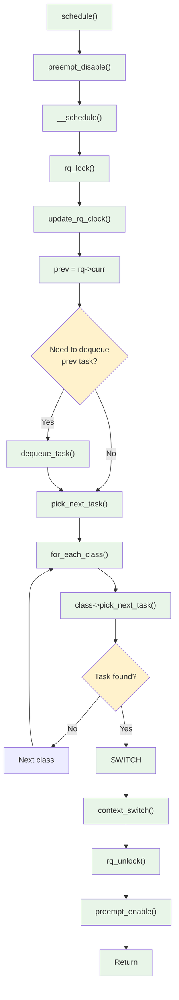
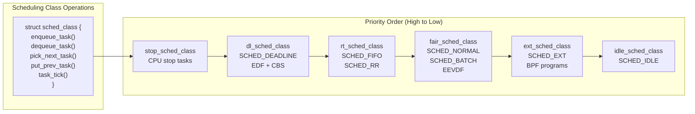
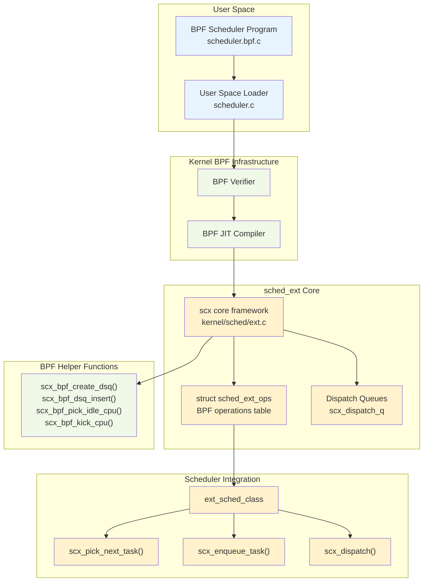
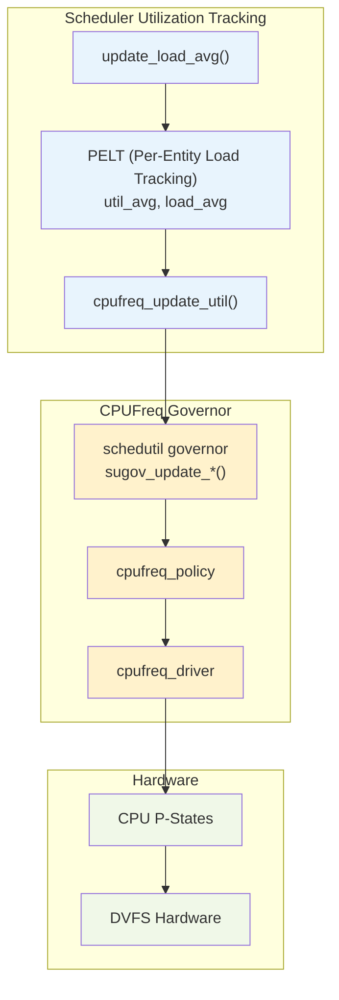

<!-- source: DeepWiki mcp.deepwiki.com · repo NVIDIA/NV-Kernels · page 5.1 CPU Scheduling · fetched 2026-10-26 -->

# CPU Scheduling

Relevant source files

The following files were used as context for generating this wiki page:

- [Documentation/ABI/testing/sysfs-kernel-hardlockup_count](Documentation/ABI/testing/sysfs-kernel-hardlockup_count)
- [Documentation/ABI/testing/sysfs-kernel-softlockup_count](Documentation/ABI/testing/sysfs-kernel-softlockup_count)
- [Documentation/accounting/delay-accounting.rst](Documentation/accounting/delay-accounting.rst)
- [Documentation/admin-guide/pm/cpufreq.rst](Documentation/admin-guide/pm/cpufreq.rst)
- [Documentation/scheduler/sched-ext.rst](Documentation/scheduler/sched-ext.rst)
- [Documentation/scheduler/schedutil.rst](Documentation/scheduler/schedutil.rst)
- [Documentation/translations/zh_CN/scheduler/schedutil.rst](Documentation/translations/zh_CN/scheduler/schedutil.rst)
- [arch/powerpc/include/asm/cputime.h](arch/powerpc/include/asm/cputime.h)
- [arch/x86/events/amd/power.c](arch/x86/events/amd/power.c)
- [arch/x86/events/probe.c](arch/x86/events/probe.c)
- [arch/x86/kernel/cpu/aperfmperf.c](arch/x86/kernel/cpu/aperfmperf.c)
- [arch/x86/kernel/cpu/proc.c](arch/x86/kernel/cpu/proc.c)
- [drivers/cpufreq/Kconfig.x86](drivers/cpufreq/Kconfig.x86)
- [drivers/cpufreq/cpufreq.c](drivers/cpufreq/cpufreq.c)
- [drivers/cpufreq/cpufreq_ondemand.c](drivers/cpufreq/cpufreq_ondemand.c)
- [drivers/cpufreq/freq_table.c](drivers/cpufreq/freq_table.c)
- [fs/proc/array.c](fs/proc/array.c)
- [include/linux/cpufreq.h](include/linux/cpufreq.h)
- [include/linux/delayacct.h](include/linux/delayacct.h)
- [include/linux/energy_model.h](include/linux/energy_model.h)
- [include/linux/nmi.h](include/linux/nmi.h)
- [include/linux/preempt.h](include/linux/preempt.h)
- [include/linux/psi.h](include/linux/psi.h)
- [include/linux/psi_types.h](include/linux/psi_types.h)
- [include/linux/sched.h](include/linux/sched.h)
- [include/linux/sched/debug.h](include/linux/sched/debug.h)
- [include/linux/sched/ext.h](include/linux/sched/ext.h)
- [include/linux/sched/sd_flags.h](include/linux/sched/sd_flags.h)
- [include/linux/sched/topology.h](include/linux/sched/topology.h)
- [include/uapi/linux/taskstats.h](include/uapi/linux/taskstats.h)
- [kernel/Kconfig.preempt](kernel/Kconfig.preempt)
- [kernel/delayacct.c](kernel/delayacct.c)
- [kernel/power/energy_model.c](kernel/power/energy_model.c)
- [kernel/sched/autogroup.c](kernel/sched/autogroup.c)
- [kernel/sched/build_policy.c](kernel/sched/build_policy.c)
- [kernel/sched/build_utility.c](kernel/sched/build_utility.c)
- [kernel/sched/clock.c](kernel/sched/clock.c)
- [kernel/sched/core.c](kernel/sched/core.c)
- [kernel/sched/core_sched.c](kernel/sched/core_sched.c)
- [kernel/sched/cpufreq_schedutil.c](kernel/sched/cpufreq_schedutil.c)
- [kernel/sched/cputime.c](kernel/sched/cputime.c)
- [kernel/sched/deadline.c](kernel/sched/deadline.c)
- [kernel/sched/debug.c](kernel/sched/debug.c)
- [kernel/sched/ext.c](kernel/sched/ext.c)
- [kernel/sched/ext.h](kernel/sched/ext.h)
- [kernel/sched/ext_idle.c](kernel/sched/ext_idle.c)
- [kernel/sched/ext_idle.h](kernel/sched/ext_idle.h)
- [kernel/sched/fair.c](kernel/sched/fair.c)
- [kernel/sched/features.h](kernel/sched/features.h)
- [kernel/sched/idle.c](kernel/sched/idle.c)
- [kernel/sched/loadavg.c](kernel/sched/loadavg.c)
- [kernel/sched/pelt.c](kernel/sched/pelt.c)
- [kernel/sched/pelt.h](kernel/sched/pelt.h)
- [kernel/sched/psi.c](kernel/sched/psi.c)
- [kernel/sched/rt.c](kernel/sched/rt.c)
- [kernel/sched/sched.h](kernel/sched/sched.h)
- [kernel/sched/stats.h](kernel/sched/stats.h)
- [kernel/sched/stop_task.c](kernel/sched/stop_task.c)
- [kernel/sched/syscalls.c](kernel/sched/syscalls.c)
- [kernel/sched/topology.c](kernel/sched/topology.c)
- [kernel/watchdog.c](kernel/watchdog.c)
- [kernel/watchdog_perf.c](kernel/watchdog_perf.c)
- [tools/accounting/getdelays.c](tools/accounting/getdelays.c)
- [tools/sched_ext/include/scx/common.bpf.h](tools/sched_ext/include/scx/common.bpf.h)
- [tools/sched_ext/include/scx/common.h](tools/sched_ext/include/scx/common.h)
- [tools/sched_ext/include/scx/compat.bpf.h](tools/sched_ext/include/scx/compat.bpf.h)
- [tools/sched_ext/include/scx/compat.h](tools/sched_ext/include/scx/compat.h)
- [tools/sched_ext/include/scx/enum_defs.autogen.h](tools/sched_ext/include/scx/enum_defs.autogen.h)
- [tools/sched_ext/include/scx/enums.autogen.bpf.h](tools/sched_ext/include/scx/enums.autogen.bpf.h)
- [tools/sched_ext/include/scx/enums.autogen.h](tools/sched_ext/include/scx/enums.autogen.h)
- [tools/sched_ext/include/scx/enums.bpf.h](tools/sched_ext/include/scx/enums.bpf.h)
- [tools/sched_ext/include/scx/enums.h](tools/sched_ext/include/scx/enums.h)
- [tools/sched_ext/include/scx/user_exit_info.h](tools/sched_ext/include/scx/user_exit_info.h)
- [tools/sched_ext/scx_central.bpf.c](tools/sched_ext/scx_central.bpf.c)
- [tools/sched_ext/scx_central.c](tools/sched_ext/scx_central.c)
- [tools/sched_ext/scx_flatcg.bpf.c](tools/sched_ext/scx_flatcg.bpf.c)
- [tools/sched_ext/scx_flatcg.c](tools/sched_ext/scx_flatcg.c)
- [tools/sched_ext/scx_qmap.bpf.c](tools/sched_ext/scx_qmap.bpf.c)
- [tools/sched_ext/scx_qmap.c](tools/sched_ext/scx_qmap.c)
- [tools/sched_ext/scx_show_state.py](tools/sched_ext/scx_show_state.py)
- [tools/sched_ext/scx_simple.bpf.c](tools/sched_ext/scx_simple.bpf.c)

This document covers the Linux kernel's CPU scheduling subsystem, which is responsible for deciding which tasks run on which CPUs and when. The scheduler implements multiple scheduling policies through a framework of scheduling classes, supports CPU frequency scaling integration, and provides an extensible BPF-based scheduler framework.

For information about memory management and virtual memory, see [5.2](#5.2). For details on hardware monitoring and platform support, see [2](#2).

## Overview and Architecture

The Linux kernel scheduler is built around a multi-class architecture where different scheduling policies are implemented as separate scheduling classes. The core scheduler framework coordinates between these classes and handles fundamental operations like task switching, load balancing, and CPU topology management.

**Core Scheduler Architecture**

Sources: [kernel/sched/core.c:1-100](), [kernel/sched/sched.h:1-100](), [include/linux/sched.h:1-50]()

## Core Scheduling Framework

The core scheduler framework provides the fundamental infrastructure for task scheduling, implemented primarily in `kernel/sched/core.c`. The main entry point is the `schedule()` function, which calls `__schedule()` to perform the actual scheduling decisions.

### Key Data Structures

The scheduler operates on several key data structures:

| Structure | Purpose | Location |
|-----------|---------|----------|
| `struct task_struct` | Represents a schedulable task | [include/linux/sched.h:83]() |
| `struct rq` | Per-CPU runqueue | [kernel/sched/sched.h:78]() |
| `struct sched_class` | Scheduling class operations | [kernel/sched/sched.h:300]() |
| `struct sched_entity` | CFS scheduling entity | [kernel/sched/sched.h:400]() |
| `struct sched_dl_entity` | Deadline scheduling entity | [kernel/sched/sched.h:77]() |

### Core Scheduling Flow

**Core Scheduling Decision Flow**

Sources: [kernel/sched/core.c:6800-6900](), [kernel/sched/core.c:4000-4100]()

## Scheduling Classes

The kernel implements multiple scheduling classes in priority order, where higher-priority classes preempt lower-priority ones.

### Class Hierarchy and Operations

**Scheduling Classes and Their Operations**

Sources: [kernel/sched/sched.h:2300-2400](), [kernel/sched/core.c:6600-6700]()

### Completely Fair Scheduler (CFS)

CFS implements the default scheduling policy for normal tasks using the Earliest Eligible Virtual Deadline First (EEVDF) algorithm. It maintains tasks in a red-black tree ordered by virtual runtime.

Key CFS concepts:
- **Virtual Runtime (`vruntime`)**: Tracks how much CPU time a task has consumed
- **Virtual Deadline**: Computed as `vruntime + slice/weight`
- **Eligibility**: Tasks with `vruntime ≤ avg_vruntime` are eligible to run
- **EEVDF Selection**: Pick eligible task with earliest deadline

Sources: [kernel/sched/fair.c:1-100](), [kernel/sched/fair.c:900-1000]()

### Real-Time Scheduler

The RT scheduler implements fixed-priority preemptive scheduling for `SCHED_FIFO` and `SCHED_RR` tasks, with bandwidth throttling to prevent RT tasks from starving the system.

Sources: [kernel/sched/rt.c:1-100](), [kernel/sched/rt.c:2400-2500]()

### Deadline Scheduler  

The deadline scheduler implements Earliest Deadline First (EDF) scheduling with Constant Bandwidth Server (CBS) for sporadic real-time tasks with explicit timing constraints.

Sources: [kernel/sched/deadline.c:1-100](), [kernel/sched/deadline.c:1800-1900]()

## Extensible Scheduler Framework

The extensible scheduler (`sched_ext`) allows BPF programs to implement custom scheduling policies, providing a powerful framework for experimentation and specialized scheduling needs.

### sched_ext Architecture

**sched_ext BPF Scheduler Architecture**

### Key sched_ext Components

The extensible scheduler provides several key abstractions:

| Component | Purpose | Implementation |
|-----------|---------|----------------|
| `struct sched_ext_ops` | BPF operations table defining scheduler behavior | [kernel/sched/ext.c:250-760]() |
| Dispatch Queues (DSQ) | FIFO queues for scheduling tasks | [kernel/sched/ext.c:1089-1200]() |
| Built-in idle tracking | CPU idle state management | [kernel/sched/ext_idle.c:15-50]() |
| BPF kfuncs | Helper functions for BPF schedulers | [tools/sched_ext/include/scx/common.bpf.h:49-90]() |

### BPF Scheduler Operations

A BPF scheduler implements the `sched_ext_ops` interface with callbacks for key scheduling events:

- `select_cpu()`: Choose target CPU for waking task
- `enqueue()`: Add task to scheduler data structures  
- `dispatch()`: Move tasks from scheduler to dispatch queues
- `running()`: Task starts execution
- `stopping()`: Task stops execution
- `init_task()`: Initialize per-task data

Sources: [kernel/sched/ext.c:250-600](), [tools/sched_ext/include/scx/common.bpf.h:1-100]()

## CPU Frequency Integration

The scheduler integrates tightly with CPU frequency scaling through the `schedutil` governor, which adjusts CPU frequency based on scheduler utilization signals.

### Frequency Scaling Architecture

**Scheduler-CPUFreq Integration**

The scheduler provides utilization signals to the `schedutil` governor through `cpufreq_update_util()` calls, allowing the system to dynamically adjust CPU frequency based on workload demands.

Sources: [kernel/sched/cpufreq_schedutil.c:1-100](), [drivers/cpufreq/cpufreq.c:250-350]()

## Load Balancing and Topology

The scheduler implements sophisticated load balancing across CPU topology levels (SMT, MC, NUMA) to maximize system throughput while respecting cache locality and energy efficiency.

### Topology-Aware Scheduling

The scheduler builds a hierarchy of scheduling domains that mirror the hardware topology:

- **SMT level**: Hyperthread siblings sharing execution resources
- **MC level**: Cores sharing last-level cache
- **NUMA level**: NUMA nodes with local memory

Load balancing operates at each level with different policies and frequencies.

Sources: [kernel/sched/topology.c:1-100](), [kernel/sched/fair.c:8000-8100]()

## System Call Interface

The scheduler exposes its functionality through several system calls that allow user space to control scheduling behavior:

| System Call | Purpose | Implementation |
|-------------|---------|----------------|
| `sched_setscheduler()` | Set task scheduling policy and parameters | [kernel/sched/syscalls.c:1000-1100]() |
| `sched_setaffinity()` | Set task CPU affinity mask | [kernel/sched/syscalls.c:1200-1300]() |
| `sched_yield()` | Voluntarily yield CPU to other tasks | [kernel/sched/syscalls.c:500-600]() |
| `sched_get_priority_*()` | Query priority ranges for policies | [kernel/sched/syscalls.c:1400-1500]() |

Sources: [kernel/sched/syscalls.c:1-100](), [include/linux/sched.h:320-350]()

---

