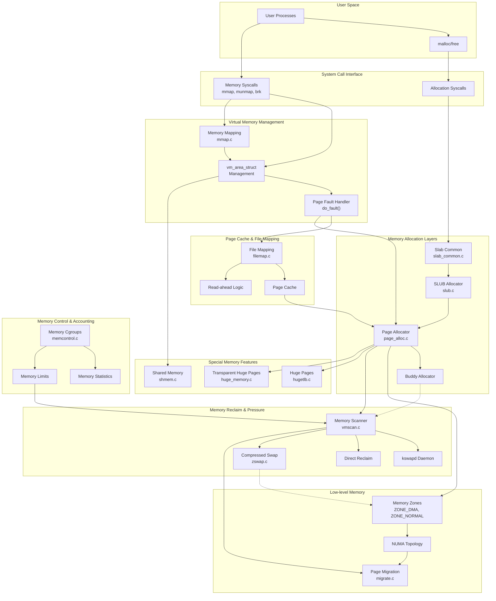
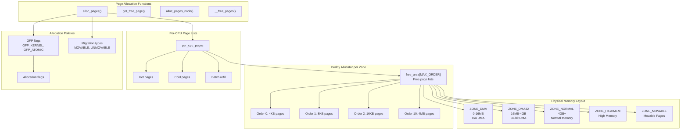
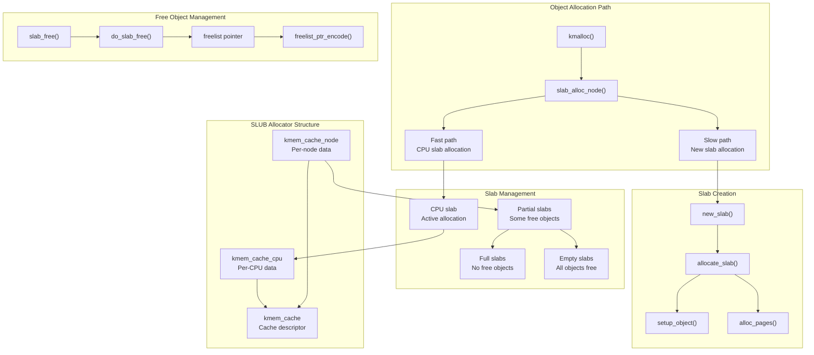
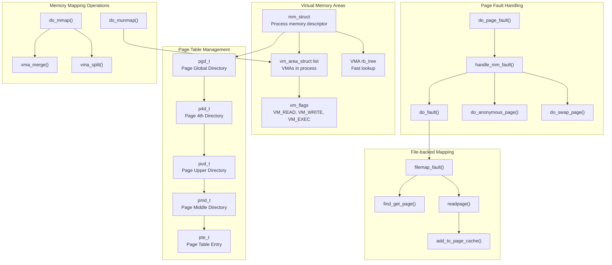
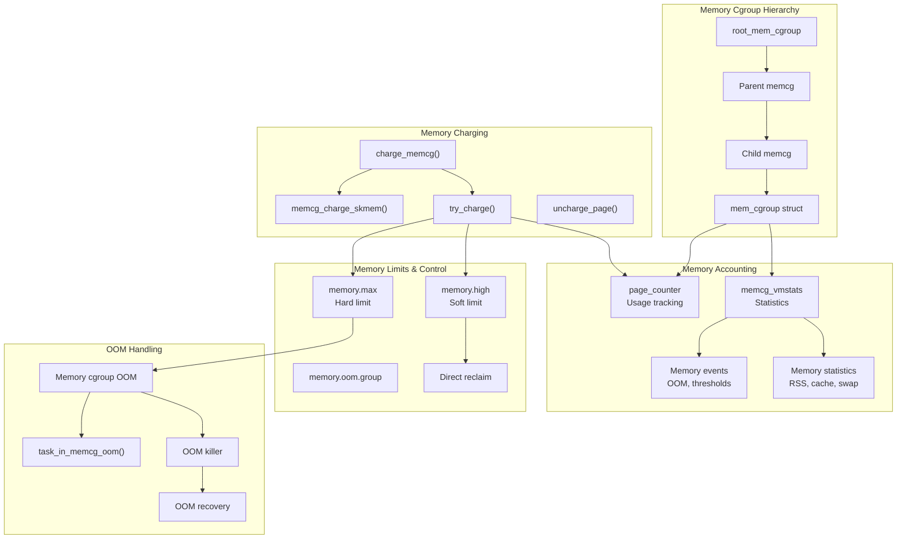
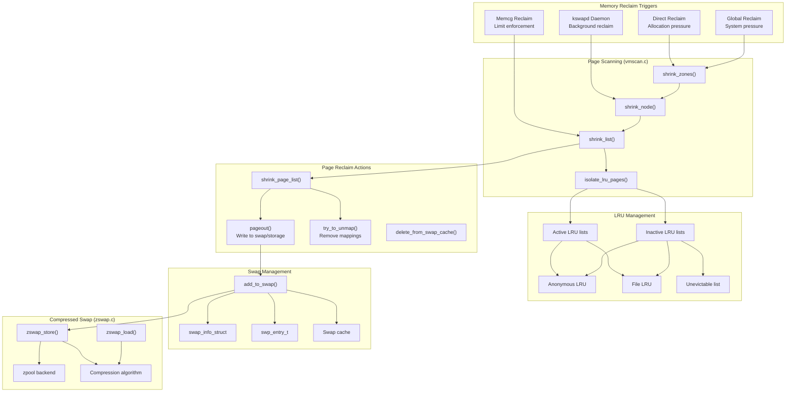
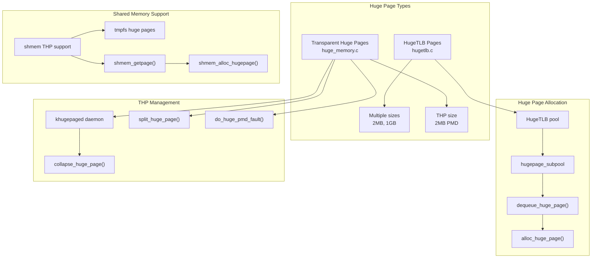

<!-- source: DeepWiki mcp.deepwiki.com · repo NVIDIA/NV-Kernels · page 5.2 Memory Management · fetched 2026-10-26 -->

# Memory Management

Relevant source files

The following files were used as context for generating this wiki page:

- [Documentation/admin-guide/cgroup-v1/cgroups.rst](Documentation/admin-guide/cgroup-v1/cgroups.rst)
- [Documentation/admin-guide/cgroup-v1/memory.rst](Documentation/admin-guide/cgroup-v1/memory.rst)
- [Documentation/admin-guide/cgroup-v1/pids.rst](Documentation/admin-guide/cgroup-v1/pids.rst)
- [Documentation/admin-guide/cgroup-v2.rst](Documentation/admin-guide/cgroup-v2.rst)
- [Documentation/admin-guide/mm/transhuge.rst](Documentation/admin-guide/mm/transhuge.rst)
- [Documentation/core-api/memory-allocation.rst](Documentation/core-api/memory-allocation.rst)
- [arch/alpha/include/uapi/asm/mman.h](arch/alpha/include/uapi/asm/mman.h)
- [arch/arm/mm/flush.c](arch/arm/mm/flush.c)
- [arch/arm64/include/asm/mman.h](arch/arm64/include/asm/mman.h)
- [arch/arm64/include/asm/mte.h](arch/arm64/include/asm/mte.h)
- [arch/arm64/kernel/elfcore.c](arch/arm64/kernel/elfcore.c)
- [arch/arm64/kernel/hibernate.c](arch/arm64/kernel/hibernate.c)
- [arch/arm64/kernel/mte.c](arch/arm64/kernel/mte.c)
- [arch/arm64/mm/copypage.c](arch/arm64/mm/copypage.c)
- [arch/arm64/mm/mmap.c](arch/arm64/mm/mmap.c)
- [arch/mips/include/uapi/asm/mman.h](arch/mips/include/uapi/asm/mman.h)
- [arch/parisc/include/asm/mman.h](arch/parisc/include/asm/mman.h)
- [arch/parisc/include/uapi/asm/mman.h](arch/parisc/include/uapi/asm/mman.h)
- [arch/x86/mm/pat/memtype.c](arch/x86/mm/pat/memtype.c)
- [arch/xtensa/include/uapi/asm/mman.h](arch/xtensa/include/uapi/asm/mman.h)
- [block/blk-wbt.c](block/blk-wbt.c)
- [drivers/android/binder_alloc.c](drivers/android/binder_alloc.c)
- [drivers/android/binder_alloc.h](drivers/android/binder_alloc.h)
- [fs/hugetlbfs/inode.c](fs/hugetlbfs/inode.c)
- [fs/nfs/nfs42xattr.c](fs/nfs/nfs42xattr.c)
- [fs/proc/meminfo.c](fs/proc/meminfo.c)
- [fs/proc/task_mmu.c](fs/proc/task_mmu.c)
- [fs/userfaultfd.c](fs/userfaultfd.c)
- [include/asm-generic/tlb.h](include/asm-generic/tlb.h)
- [include/linux/backing-dev-defs.h](include/linux/backing-dev-defs.h)
- [include/linux/elfcore.h](include/linux/elfcore.h)
- [include/linux/highmem.h](include/linux/highmem.h)
- [include/linux/huge_mm.h](include/linux/huge_mm.h)
- [include/linux/hugetlb.h](include/linux/hugetlb.h)
- [include/linux/khugepaged.h](include/linux/khugepaged.h)
- [include/linux/list_lru.h](include/linux/list_lru.h)
- [include/linux/memcontrol.h](include/linux/memcontrol.h)
- [include/linux/memfd.h](include/linux/memfd.h)
- [include/linux/minmax.h](include/linux/minmax.h)
- [include/linux/misc_cgroup.h](include/linux/misc_cgroup.h)
- [include/linux/mm.h](include/linux/mm.h)
- [include/linux/mm_inline.h](include/linux/mm_inline.h)
- [include/linux/mm_types.h](include/linux/mm_types.h)
- [include/linux/mman.h](include/linux/mman.h)
- [include/linux/mmzone.h](include/linux/mmzone.h)
- [include/linux/page-flags.h](include/linux/page-flags.h)
- [include/linux/page_ref.h](include/linux/page_ref.h)
- [include/linux/pageblock-flags.h](include/linux/pageblock-flags.h)
- [include/linux/pagemap.h](include/linux/pagemap.h)
- [include/linux/pagewalk.h](include/linux/pagewalk.h)
- [include/linux/pgalloc_tag.h](include/linux/pgalloc_tag.h)
- [include/linux/pgtable.h](include/linux/pgtable.h)
- [include/linux/shmem_fs.h](include/linux/shmem_fs.h)
- [include/linux/slab.h](include/linux/slab.h)
- [include/linux/swap.h](include/linux/swap.h)
- [include/linux/swapops.h](include/linux/swapops.h)
- [include/linux/userfaultfd_k.h](include/linux/userfaultfd_k.h)
- [include/linux/vm_event_item.h](include/linux/vm_event_item.h)
- [include/linux/vmstat.h](include/linux/vmstat.h)
- [include/linux/zswap.h](include/linux/zswap.h)
- [include/trace/events/huge_memory.h](include/trace/events/huge_memory.h)
- [include/trace/events/kmem.h](include/trace/events/kmem.h)
- [include/trace/events/mmflags.h](include/trace/events/mmflags.h)
- [include/uapi/asm-generic/mman-common.h](include/uapi/asm-generic/mman-common.h)
- [include/uapi/linux/mman.h](include/uapi/linux/mman.h)
- [init/Kconfig](init/Kconfig)
- [kernel/cgroup/misc.c](kernel/cgroup/misc.c)
- [kernel/cgroup/pids.c](kernel/cgroup/pids.c)
- [lib/kunit/user_alloc.c](lib/kunit/user_alloc.c)
- [mm/Kconfig](mm/Kconfig)
- [mm/Makefile](mm/Makefile)
- [mm/backing-dev.c](mm/backing-dev.c)
- [mm/filemap.c](mm/filemap.c)
- [mm/folio-compat.c](mm/folio-compat.c)
- [mm/gup.c](mm/gup.c)
- [mm/huge_memory.c](mm/huge_memory.c)
- [mm/hugetlb.c](mm/hugetlb.c)
- [mm/hugetlb_vmemmap.c](mm/hugetlb_vmemmap.c)
- [mm/internal.h](mm/internal.h)
- [mm/khugepaged.c](mm/khugepaged.c)
- [mm/list_lru.c](mm/list_lru.c)
- [mm/madvise.c](mm/madvise.c)
- [mm/memcontrol-v1.c](mm/memcontrol-v1.c)
- [mm/memcontrol.c](mm/memcontrol.c)
- [mm/memfd.c](mm/memfd.c)
- [mm/memory.c](mm/memory.c)
- [mm/memremap.c](mm/memremap.c)
- [mm/migrate.c](mm/migrate.c)
- [mm/mlock.c](mm/mlock.c)
- [mm/mm_init.c](mm/mm_init.c)
- [mm/mmap.c](mm/mmap.c)
- [mm/mmu_gather.c](mm/mmu_gather.c)
- [mm/mprotect.c](mm/mprotect.c)
- [mm/mremap.c](mm/mremap.c)
- [mm/mseal.c](mm/mseal.c)
- [mm/nommu.c](mm/nommu.c)
- [mm/page-writeback.c](mm/page-writeback.c)
- [mm/page_alloc.c](mm/page_alloc.c)
- [mm/page_ext.c](mm/page_ext.c)
- [mm/page_io.c](mm/page_io.c)
- [mm/page_isolation.c](mm/page_isolation.c)
- [mm/pagewalk.c](mm/pagewalk.c)
- [mm/readahead.c](mm/readahead.c)
- [mm/shmem.c](mm/shmem.c)
- [mm/show_mem.c](mm/show_mem.c)
- [mm/slab.h](mm/slab.h)
- [mm/slab_common.c](mm/slab_common.c)
- [mm/slub.c](mm/slub.c)
- [mm/swap.c](mm/swap.c)
- [mm/swap.h](mm/swap.h)
- [mm/swap_state.c](mm/swap_state.c)
- [mm/swapfile.c](mm/swapfile.c)
- [mm/truncate.c](mm/truncate.c)
- [mm/userfaultfd.c](mm/userfaultfd.c)
- [mm/util.c](mm/util.c)
- [mm/vma.c](mm/vma.c)
- [mm/vma.h](mm/vma.h)
- [mm/vma_init.c](mm/vma_init.c)
- [mm/vmscan.c](mm/vmscan.c)
- [mm/vmstat.c](mm/vmstat.c)
- [mm/workingset.c](mm/workingset.c)
- [mm/zpdesc.h](mm/zpdesc.h)
- [mm/zswap.c](mm/zswap.c)
- [tools/testing/vma/vma_internal.h](tools/testing/vma/vma_internal.h)

This document covers the Linux kernel's memory management subsystem, including physical memory allocation, virtual memory management, and the SLUB allocator. For information about CPU scheduling, see [CPU Scheduling](#5.1). For information about file system memory usage, see [File Systems](#6).

The memory management subsystem is responsible for managing both physical and virtual memory, providing allocation services to the kernel and user space, implementing memory protection, and handling memory pressure through reclamation mechanisms.

## Architecture Overview

The memory management subsystem consists of several interconnected components that work together to provide efficient memory allocation and management services.

**Core Memory Management Architecture**

Sources: [mm/memory.c:1-100](), [mm/page_alloc.c:1-100](), [include/linux/mm.h:1-100](), [mm/mmap.c:1-100]()

## Page Allocation System

The page allocator is the foundation of the memory management system, implementing a buddy allocator algorithm to manage physical memory pages efficiently.

### Memory Zones and Page Allocation

**Page Allocator Structure and Zones**

The buddy allocator maintains free page lists organized by order (power-of-2 sizes) within each memory zone. The `get_page_from_freelist()` function implements the core allocation logic, while `free_one_page()` handles page freeing and coalescing.

Key data structures:
- `struct zone` represents memory zones with their own buddy allocators
- `struct free_area` maintains free page lists for each order
- `struct per_cpu_pages` provides fast per-CPU page caching

Sources: [mm/page_alloc.c:217-353](), [mm/page_alloc.c:2000-2200](), [include/linux/mm.h:1200-1300]()

## SLUB Allocator

The SLUB allocator provides efficient allocation of small kernel objects by organizing them into slabs (groups of pages containing objects of the same size).

### SLUB Architecture and Object Management

**SLUB Allocation Fast and Slow Paths**

The SLUB allocator optimizes for the common case with a lockless fast path that allocates from per-CPU slabs. When the fast path fails, it falls back to slower operations like acquiring new slabs from the page allocator.

Key functions:
- `slab_alloc_node()` - Main allocation entry point  
- `___slab_alloc()` - Slow path handler
- `allocate_slab()` - Creates new slabs from page allocator
- `setup_object()` - Initializes object layout and debugging

Sources: [mm/slub.c:2800-3000](), [mm/slub.c:3200-3400](), [mm/slub.c:1600-1800](), [mm/slab_common.c:200-400]()

## Virtual Memory Management

Virtual memory management handles the mapping between virtual addresses and physical memory, managing virtual memory areas (VMAs) and handling page faults.

### VMA Management and Page Fault Handling

**Virtual Memory Management Core Components**

The virtual memory subsystem manages the mapping between virtual addresses and physical memory through a multi-level page table structure and virtual memory areas that define the properties of memory regions.

Key operations:
- Page fault handling routes faults to appropriate handlers based on VMA type
- Anonymous pages are allocated on-demand during page faults
- File-backed pages are loaded from storage through the page cache
- Memory mapping operations create, merge, and split VMAs

Sources: [mm/memory.c:4000-4200](), [mm/mmap.c:1200-1400](), [mm/filemap.c:3000-3200](), [include/linux/mm.h:500-700]()

## Memory Control Groups (memcg)

Memory control groups provide resource isolation and accounting for memory usage, allowing administrators to limit and monitor memory consumption by process groups.

### Memory Cgroup Architecture

**Memory Cgroup Resource Control**

Memory cgroups implement hierarchical memory resource control through charging/uncharging operations and limit enforcement. When limits are exceeded, the system triggers reclaim or OOM handling.

Key components:
- `try_charge()` enforces memory limits during allocation
- Statistics tracking through `memcg_vmstats` structures
- Hierarchical limit inheritance and enforcement
- Integration with memory reclaim and OOM handling

Sources: [mm/memcontrol.c:2500-2700](), [mm/memcontrol.c:6000-6200](), [mm/memcontrol.c:1600-1800](), [mm/memcontrol.c:4000-4200]()

## Memory Reclaim and Swapping

The memory reclaim subsystem manages memory pressure by freeing pages and swapping content to storage when physical memory becomes scarce.

### Memory Scanner and Reclaim

**Memory Reclaim and Swap Subsystem**

The memory reclaim system uses LRU (Least Recently Used) lists to track page usage and selectively reclaim pages when memory pressure occurs. The system can write pages to swap storage or compress them in memory using zswap.

Reclaim mechanisms:
- `kswapd` daemon performs background reclaim to maintain free memory
- Direct reclaim occurs during allocation when memory is low
- LRU lists separate anonymous and file pages for different reclaim strategies  
- zswap provides compressed swap caching to reduce I/O

Sources: [mm/vmscan.c:2000-2200](), [mm/vmscan.c:1000-1200](), [mm/zswap.c:1000-1200](), [mm/swapfile.c:2000-2200]()

## Special Memory Features

### Huge Pages and Transparent Huge Pages

**Huge Page Implementation**

The kernel supports two types of huge pages: explicit HugeTLB pages allocated from reserved pools, and Transparent Huge Pages (THP) that are allocated automatically. Both reduce TLB pressure and improve performance for large memory allocations.

Sources: [mm/hugetlb.c:3000-3200](), [mm/huge_memory.c:1000-1200](), [mm/shmem.c:1500-1700](), [mm/khugepaged.c:500-700]()

## Memory Management APIs

### Core Allocation Interfaces

| Function | Purpose | Source Location |
|----------|---------|-----------------|
| `kmalloc()` | General kernel memory allocation | [include/linux/slab.h:500-520]() |
| `kfree()` | Free kernel memory | [mm/slab_common.c:1000-1020]() |
| `alloc_pages()` | Allocate physical pages | [mm/page_alloc.c:4000-4020]() |
| `get_user_pages()` | Pin user pages in memory | [mm/gup.c:1000-1020]() |
| `vmalloc()` | Allocate virtually contiguous memory | [mm/vmalloc.c:2000-2020]() |
| `mmap()` | Map memory regions | [mm/mmap.c:1500-1520]() |

### Memory Control and Monitoring

| Interface | Purpose | Source Location |
|-----------|---------|-----------------|
| `try_charge()` | Charge memory to cgroup | [mm/memcontrol.c:2600-2620]() |
| `mem_cgroup_charge()` | Charge page to memcg | [mm/memcontrol.c:6800-6820]() |
| `lruvec_add_folio()` | Add page to LRU | [include/linux/mm_inline.h:100-120]() |
| `shrink_page_list()` | Reclaim pages | [mm/vmscan.c:1500-1520]() |

The memory management subsystem provides a layered API structure where high-level interfaces like `kmalloc()` build upon lower-level primitives like the page allocator. Memory cgroups integrate with these allocation paths to provide resource control and accounting.

Sources: [include/linux/slab.h:400-600](), [include/linux/mm.h:2000-2200](), [mm/slab_common.c:800-1000](), [mm/memcontrol.c:6600-6800]()

---

