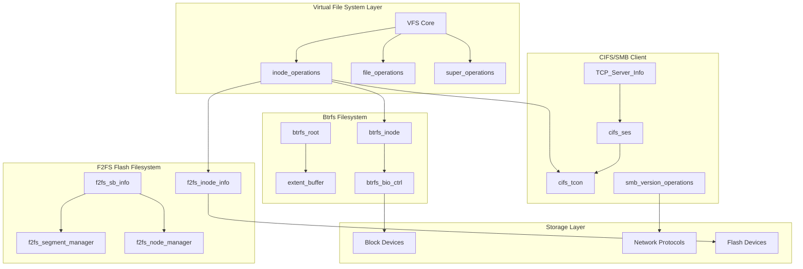
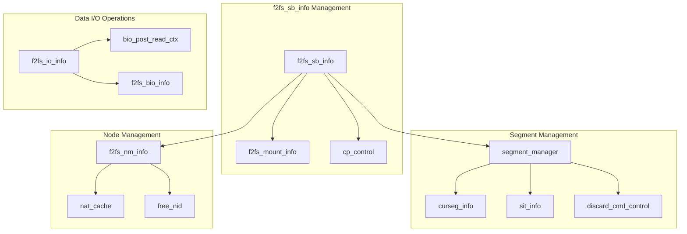
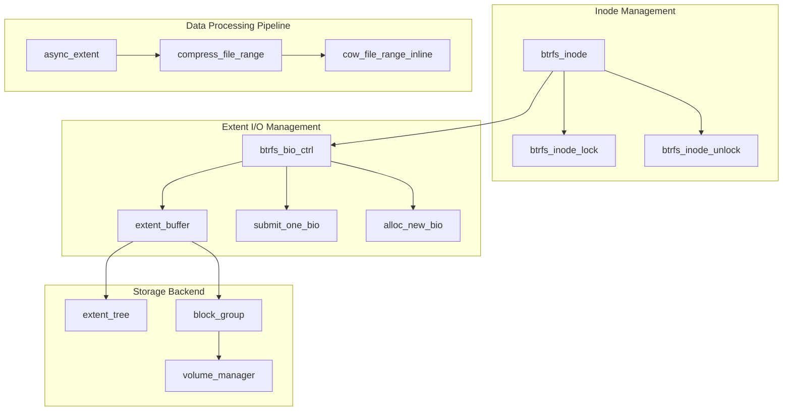
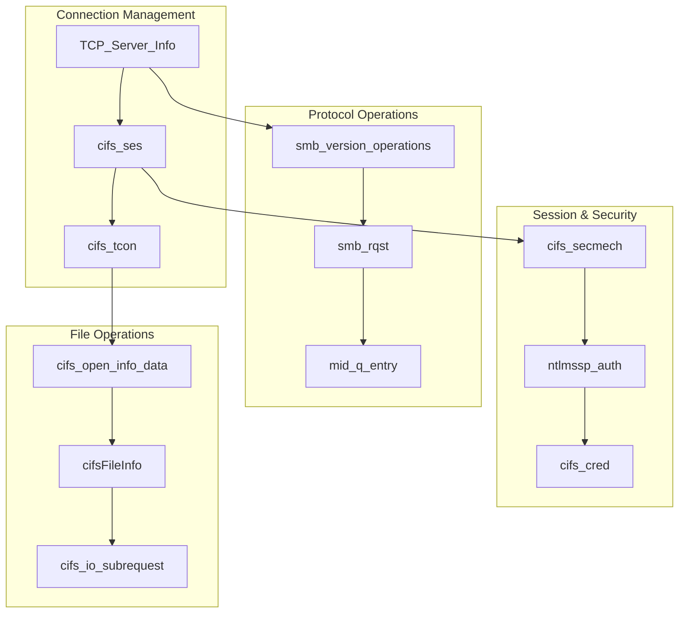

<!-- source: DeepWiki mcp.deepwiki.com · repo NVIDIA/NV-Kernels · page 6 File Systems · fetched 2026-10-26 -->

# File Systems

<details>
<summary>Relevant source files</summary>

The following files were used as context for generating this wiki page:

- [Documentation/ABI/testing/sysfs-fs-f2fs](Documentation/ABI/testing/sysfs-fs-f2fs)
- [Documentation/filesystems/f2fs.rst](Documentation/filesystems/f2fs.rst)
- [drivers/irqchip/irq-sun6i-r.c](drivers/irqchip/irq-sun6i-r.c)
- [drivers/net/can/usb/etas_es58x/es58x_devlink.c](drivers/net/can/usb/etas_es58x/es58x_devlink.c)
- [fs/btrfs/Makefile](fs/btrfs/Makefile)
- [fs/btrfs/accessors.h](fs/btrfs/accessors.h)
- [fs/btrfs/backref.c](fs/btrfs/backref.c)
- [fs/btrfs/bio.c](fs/btrfs/bio.c)
- [fs/btrfs/bio.h](fs/btrfs/bio.h)
- [fs/btrfs/block-group.c](fs/btrfs/block-group.c)
- [fs/btrfs/block-group.h](fs/btrfs/block-group.h)
- [fs/btrfs/block-rsv.c](fs/btrfs/block-rsv.c)
- [fs/btrfs/block-rsv.h](fs/btrfs/block-rsv.h)
- [fs/btrfs/btrfs_inode.h](fs/btrfs/btrfs_inode.h)
- [fs/btrfs/compression.c](fs/btrfs/compression.c)
- [fs/btrfs/compression.h](fs/btrfs/compression.h)
- [fs/btrfs/ctree.c](fs/btrfs/ctree.c)
- [fs/btrfs/ctree.h](fs/btrfs/ctree.h)
- [fs/btrfs/defrag.c](fs/btrfs/defrag.c)
- [fs/btrfs/defrag.h](fs/btrfs/defrag.h)
- [fs/btrfs/delalloc-space.c](fs/btrfs/delalloc-space.c)
- [fs/btrfs/delalloc-space.h](fs/btrfs/delalloc-space.h)
- [fs/btrfs/delayed-inode.c](fs/btrfs/delayed-inode.c)
- [fs/btrfs/delayed-inode.h](fs/btrfs/delayed-inode.h)
- [fs/btrfs/delayed-ref.c](fs/btrfs/delayed-ref.c)
- [fs/btrfs/delayed-ref.h](fs/btrfs/delayed-ref.h)
- [fs/btrfs/dev-replace.c](fs/btrfs/dev-replace.c)
- [fs/btrfs/direct-io.c](fs/btrfs/direct-io.c)
- [fs/btrfs/direct-io.h](fs/btrfs/direct-io.h)
- [fs/btrfs/discard.c](fs/btrfs/discard.c)
- [fs/btrfs/disk-io.c](fs/btrfs/disk-io.c)
- [fs/btrfs/disk-io.h](fs/btrfs/disk-io.h)
- [fs/btrfs/export.c](fs/btrfs/export.c)
- [fs/btrfs/extent-io-tree.c](fs/btrfs/extent-io-tree.c)
- [fs/btrfs/extent-io-tree.h](fs/btrfs/extent-io-tree.h)
- [fs/btrfs/extent-tree.c](fs/btrfs/extent-tree.c)
- [fs/btrfs/extent-tree.h](fs/btrfs/extent-tree.h)
- [fs/btrfs/extent_io.c](fs/btrfs/extent_io.c)
- [fs/btrfs/extent_io.h](fs/btrfs/extent_io.h)
- [fs/btrfs/extent_map.c](fs/btrfs/extent_map.c)
- [fs/btrfs/file-item.c](fs/btrfs/file-item.c)
- [fs/btrfs/file-item.h](fs/btrfs/file-item.h)
- [fs/btrfs/file.c](fs/btrfs/file.c)
- [fs/btrfs/file.h](fs/btrfs/file.h)
- [fs/btrfs/free-space-cache.c](fs/btrfs/free-space-cache.c)
- [fs/btrfs/free-space-tree.c](fs/btrfs/free-space-tree.c)
- [fs/btrfs/fs.h](fs/btrfs/fs.h)
- [fs/btrfs/inode-item.c](fs/btrfs/inode-item.c)
- [fs/btrfs/inode.c](fs/btrfs/inode.c)
- [fs/btrfs/ioctl.c](fs/btrfs/ioctl.c)
- [fs/btrfs/ioctl.h](fs/btrfs/ioctl.h)
- [fs/btrfs/locking.h](fs/btrfs/locking.h)
- [fs/btrfs/lzo.c](fs/btrfs/lzo.c)
- [fs/btrfs/messages.c](fs/btrfs/messages.c)
- [fs/btrfs/messages.h](fs/btrfs/messages.h)
- [fs/btrfs/ordered-data.c](fs/btrfs/ordered-data.c)
- [fs/btrfs/ordered-data.h](fs/btrfs/ordered-data.h)
- [fs/btrfs/print-tree.c](fs/btrfs/print-tree.c)
- [fs/btrfs/props.c](fs/btrfs/props.c)
- [fs/btrfs/props.h](fs/btrfs/props.h)
- [fs/btrfs/qgroup.c](fs/btrfs/qgroup.c)
- [fs/btrfs/qgroup.h](fs/btrfs/qgroup.h)
- [fs/btrfs/raid-stripe-tree.c](fs/btrfs/raid-stripe-tree.c)
- [fs/btrfs/raid-stripe-tree.h](fs/btrfs/raid-stripe-tree.h)
- [fs/btrfs/raid56.c](fs/btrfs/raid56.c)
- [fs/btrfs/raid56.h](fs/btrfs/raid56.h)
- [fs/btrfs/reflink.c](fs/btrfs/reflink.c)
- [fs/btrfs/relocation.c](fs/btrfs/relocation.c)
- [fs/btrfs/scrub.c](fs/btrfs/scrub.c)
- [fs/btrfs/scrub.h](fs/btrfs/scrub.h)
- [fs/btrfs/send.c](fs/btrfs/send.c)
- [fs/btrfs/send.h](fs/btrfs/send.h)
- [fs/btrfs/space-info.c](fs/btrfs/space-info.c)
- [fs/btrfs/space-info.h](fs/btrfs/space-info.h)
- [fs/btrfs/subpage.c](fs/btrfs/subpage.c)
- [fs/btrfs/subpage.h](fs/btrfs/subpage.h)
- [fs/btrfs/super.c](fs/btrfs/super.c)
- [fs/btrfs/sysfs.c](fs/btrfs/sysfs.c)
- [fs/btrfs/sysfs.h](fs/btrfs/sysfs.h)
- [fs/btrfs/tests/extent-map-tests.c](fs/btrfs/tests/extent-map-tests.c)
- [fs/btrfs/transaction.c](fs/btrfs/transaction.c)
- [fs/btrfs/transaction.h](fs/btrfs/transaction.h)
- [fs/btrfs/tree-checker.c](fs/btrfs/tree-checker.c)
- [fs/btrfs/tree-checker.h](fs/btrfs/tree-checker.h)
- [fs/btrfs/tree-log.c](fs/btrfs/tree-log.c)
- [fs/btrfs/tree-log.h](fs/btrfs/tree-log.h)
- [fs/btrfs/verity.c](fs/btrfs/verity.c)
- [fs/btrfs/volumes.c](fs/btrfs/volumes.c)
- [fs/btrfs/volumes.h](fs/btrfs/volumes.h)
- [fs/btrfs/xattr.c](fs/btrfs/xattr.c)
- [fs/btrfs/zlib.c](fs/btrfs/zlib.c)
- [fs/btrfs/zoned.c](fs/btrfs/zoned.c)
- [fs/btrfs/zoned.h](fs/btrfs/zoned.h)
- [fs/btrfs/zstd.c](fs/btrfs/zstd.c)
- [fs/f2fs/acl.c](fs/f2fs/acl.c)
- [fs/f2fs/checkpoint.c](fs/f2fs/checkpoint.c)
- [fs/f2fs/compress.c](fs/f2fs/compress.c)
- [fs/f2fs/data.c](fs/f2fs/data.c)
- [fs/f2fs/debug.c](fs/f2fs/debug.c)
- [fs/f2fs/dir.c](fs/f2fs/dir.c)
- [fs/f2fs/extent_cache.c](fs/f2fs/extent_cache.c)
- [fs/f2fs/f2fs.h](fs/f2fs/f2fs.h)
- [fs/f2fs/file.c](fs/f2fs/file.c)
- [fs/f2fs/gc.c](fs/f2fs/gc.c)
- [fs/f2fs/gc.h](fs/f2fs/gc.h)
- [fs/f2fs/inline.c](fs/f2fs/inline.c)
- [fs/f2fs/inode.c](fs/f2fs/inode.c)
- [fs/f2fs/namei.c](fs/f2fs/namei.c)
- [fs/f2fs/node.c](fs/f2fs/node.c)
- [fs/f2fs/node.h](fs/f2fs/node.h)
- [fs/f2fs/recovery.c](fs/f2fs/recovery.c)
- [fs/f2fs/segment.c](fs/f2fs/segment.c)
- [fs/f2fs/segment.h](fs/f2fs/segment.h)
- [fs/f2fs/super.c](fs/f2fs/super.c)
- [fs/f2fs/sysfs.c](fs/f2fs/sysfs.c)
- [fs/f2fs/xattr.c](fs/f2fs/xattr.c)
- [fs/f2fs/xattr.h](fs/f2fs/xattr.h)
- [fs/smb/client/cached_dir.c](fs/smb/client/cached_dir.c)
- [fs/smb/client/cached_dir.h](fs/smb/client/cached_dir.h)
- [fs/smb/client/cifs_ioctl.h](fs/smb/client/cifs_ioctl.h)
- [fs/smb/client/cifsacl.c](fs/smb/client/cifsacl.c)
- [fs/smb/client/cifsacl.h](fs/smb/client/cifsacl.h)
- [fs/smb/client/cifsencrypt.c](fs/smb/client/cifsencrypt.c)
- [fs/smb/client/cifsfs.c](fs/smb/client/cifsfs.c)
- [fs/smb/client/cifsfs.h](fs/smb/client/cifsfs.h)
- [fs/smb/client/cifsglob.h](fs/smb/client/cifsglob.h)
- [fs/smb/client/cifspdu.h](fs/smb/client/cifspdu.h)
- [fs/smb/client/cifsproto.h](fs/smb/client/cifsproto.h)
- [fs/smb/client/cifssmb.c](fs/smb/client/cifssmb.c)
- [fs/smb/client/connect.c](fs/smb/client/connect.c)
- [fs/smb/client/dfs.c](fs/smb/client/dfs.c)
- [fs/smb/client/dfs.h](fs/smb/client/dfs.h)
- [fs/smb/client/dfs_cache.c](fs/smb/client/dfs_cache.c)
- [fs/smb/client/dns_resolve.c](fs/smb/client/dns_resolve.c)
- [fs/smb/client/dns_resolve.h](fs/smb/client/dns_resolve.h)
- [fs/smb/client/file.c](fs/smb/client/file.c)
- [fs/smb/client/fs_context.c](fs/smb/client/fs_context.c)
- [fs/smb/client/fs_context.h](fs/smb/client/fs_context.h)
- [fs/smb/client/inode.c](fs/smb/client/inode.c)
- [fs/smb/client/ioctl.c](fs/smb/client/ioctl.c)
- [fs/smb/client/link.c](fs/smb/client/link.c)
- [fs/smb/client/misc.c](fs/smb/client/misc.c)
- [fs/smb/client/namespace.c](fs/smb/client/namespace.c)
- [fs/smb/client/readdir.c](fs/smb/client/readdir.c)
- [fs/smb/client/reparse.c](fs/smb/client/reparse.c)
- [fs/smb/client/reparse.h](fs/smb/client/reparse.h)
- [fs/smb/client/sess.c](fs/smb/client/sess.c)
- [fs/smb/client/smb1ops.c](fs/smb/client/smb1ops.c)
- [fs/smb/client/smb2file.c](fs/smb/client/smb2file.c)
- [fs/smb/client/smb2glob.h](fs/smb/client/smb2glob.h)
- [fs/smb/client/smb2inode.c](fs/smb/client/smb2inode.c)
- [fs/smb/client/smb2misc.c](fs/smb/client/smb2misc.c)
- [fs/smb/client/smb2ops.c](fs/smb/client/smb2ops.c)
- [fs/smb/client/smb2pdu.c](fs/smb/client/smb2pdu.c)
- [fs/smb/client/smb2pdu.h](fs/smb/client/smb2pdu.h)
- [fs/smb/client/smb2proto.h](fs/smb/client/smb2proto.h)
- [fs/smb/client/smb2transport.c](fs/smb/client/smb2transport.c)
- [fs/smb/client/trace.h](fs/smb/client/trace.h)
- [fs/smb/client/transport.c](fs/smb/client/transport.c)
- [fs/smb/client/xattr.c](fs/smb/client/xattr.c)
- [fs/smb/common/smb2pdu.h](fs/smb/common/smb2pdu.h)
- [fs/smb/common/smbacl.h](fs/smb/common/smbacl.h)
- [fs/smb/server/smbacl.c](fs/smb/server/smbacl.c)
- [fs/smb/server/smbacl.h](fs/smb/server/smbacl.h)
- [include/linux/f2fs_fs.h](include/linux/f2fs_fs.h)
- [include/trace/events/btrfs.h](include/trace/events/btrfs.h)
- [include/trace/events/f2fs.h](include/trace/events/f2fs.h)
- [include/uapi/linux/btrfs.h](include/uapi/linux/btrfs.h)
- [include/uapi/linux/btrfs_tree.h](include/uapi/linux/btrfs_tree.h)

</details>


## Purpose and Scope

This document covers the major file systems implemented in the Linux kernel codebase, focusing on three primary file systems: F2FS (Flash-Friendly File System), Btrfs (B-tree File System), and the CIFS/SMB client for network file systems. Each file system provides unique capabilities and is optimized for different storage scenarios and use cases.

For information about high-performance I/O systems that work with these file systems, see [High-Performance I/O Systems](#4). For details about storage drivers that interface with these file systems, see [Storage Subsystems](#4.2).

## File System Architecture Overview



Sources: [fs/f2fs/f2fs.h:840-900](), [fs/btrfs/inode.c:75-85](), [fs/smb/client/cifsglob.h:298-312]()

## Core File System Data Structures

The three file systems implement distinct architectural approaches, each with specialized data structures optimized for their target use cases:

| File System | Primary Structure | Key Components | Storage Target |
|-------------|------------------|----------------|----------------|
| F2FS | `f2fs_sb_info` | segment manager, node manager | NAND Flash |
| Btrfs | `btrfs_root` | extent trees, copy-on-write | General purpose |
| CIFS/SMB | `TCP_Server_Info` | session management, protocol ops | Network shares |

```mermaid
graph LR
    subgraph "F2FS_Core" ["F2FS Core Structures"]
        F2FS_SBI["f2fs_sb_info"]
        F2FS_MOUNT["f2fs_mount_info"]
        F2FS_INODE_INFO["f2fs_inode_info"]
        F2FS_RWSEM["f2fs_rwsem"]
    end
    
    subgraph "Btrfs_Core" ["Btrfs Core Structures"]  
        BTRFS_IGET["btrfs_iget_args"]
        BTRFS_RENAME["btrfs_rename_ctx"]
        BTRFS_BIO_CTRL["btrfs_bio_ctrl"]
        EXTENT_BUFFER["extent_buffer"]
    end
    
    subgraph "CIFS_Core" ["CIFS Core Structures"]
        CIFS_SECMECH["cifs_secmech"]
        CIFS_CRED["cifs_cred"]
        CIFS_OPEN_INFO["cifs_open_info_data"]
        SMB_RQST["smb_rqst"]
    end
    
    F2FS_SBI --> F2FS_MOUNT
    F2FS_SBI --> F2FS_INODE_INFO
    F2FS_INODE_INFO --> F2FS_RWSEM
    
    BTRFS_IGET --> BTRFS_RENAME
    BTRFS_BIO_CTRL --> EXTENT_BUFFER
    
    CIFS_SECMECH --> CIFS_CRED
    CIFS_OPEN_INFO --> SMB_RQST
```

Sources: [fs/f2fs/f2fs.h:172-216](), [fs/btrfs/inode.c:75-95](), [fs/smb/client/cifsglob.h:222-296]()

## F2FS Flash Filesystem

F2FS is specifically designed for NAND flash storage devices, implementing a log-structured file system that aligns with flash memory characteristics to minimize write amplification and improve performance.

### F2FS Architecture Components

The F2FS implementation centers around the `f2fs_sb_info` structure which manages the overall file system state, including segment management, node management, and garbage collection:



Sources: [fs/f2fs/f2fs.h:1600-1900](), [fs/f2fs/segment.c:28-35](), [fs/f2fs/node.c:25-29](), [fs/f2fs/data.c:109-122]()

### F2FS Key Operations

F2FS implements specialized operations for flash-optimized I/O, including post-read processing for encryption, compression, and verification:

- **Read Path**: `f2fs_read_end_io()` handles bio completion with optional decryption, decompression, and verification via `bio_post_read_ctx`
- **Write Path**: `f2fs_write_end_io()` manages write completion and ordered extent handling
- **Segment Management**: Log-structured allocation through segment manager for wear leveling
- **Node Management**: Node address translation via NAT (Node Address Table)

Sources: [fs/f2fs/data.c:281-317](), [fs/f2fs/data.c:319-371](), [fs/f2fs/segment.c:171-186]()

## Btrfs Filesystem

Btrfs is a copy-on-write file system that provides advanced features including snapshots, checksumming, and multi-device support through a sophisticated extent-based architecture.

### Btrfs Core Architecture



Sources: [fs/btrfs/inode.c:345-383](), [fs/btrfs/extent_io.c:97-113](), [fs/btrfs/extent_io.c:658-696]()

### Btrfs I/O Operations

Btrfs implements a sophisticated I/O pipeline that handles compression, checksumming, and multi-device operations:

- **Bio Control**: `btrfs_bio_ctrl` structure manages bio assembly and submission with compression support
- **Extent Buffers**: `extent_buffer` provides cached access to tree nodes with integrity checking
- **Async Compression**: `compress_file_range()` handles background compression with worker queues
- **Inline Extents**: Small files embedded directly in metadata via `cow_file_range_inline()`

The `submit_extent_folio()` function demonstrates the integration of extent management with the bio layer, handling both compressed and uncompressed data paths.

Sources: [fs/btrfs/inode.c:843-1033](), [fs/btrfs/extent_io.c:710-781]()

## CIFS/SMB Client

The CIFS/SMB client provides network file system access to SMB/CIFS shares, implementing the SMB2/SMB3 protocol suite with support for modern features like multichannel, encryption, and compression.

### CIFS Client Architecture



Sources: [fs/smb/client/cifsglob.h:314-559](), [fs/smb/client/cifsglob.h:222-251](), [fs/smb/client/cifsglob.h:253-277]()

### SMB Protocol Implementation

The CIFS client implements a layered approach to SMB protocol handling:

- **Version Operations**: `smb_version_operations` provides protocol-specific function pointers for different SMB versions
- **Request Management**: `smb_rqst` structures represent SMB requests with associated metadata and data buffers
- **Credit Management**: SMB2/SMB3 credit-based flow control via `smb2_wait_mtu_credits()` and `smb2_add_credits()`
- **Reconnection Logic**: `smb2_reconnect()` handles automatic reconnection with session and tree connection recovery

The SMB2 PDU construction is handled by `smb2_hdr_assemble()` which builds protocol headers with proper credit requests and security flags.

Sources: [fs/smb/client/smb2pdu.c:94-165](), [fs/smb/client/smb2pdu.c:217-491](), [fs/smb/client/smb2ops.c:234-297]()

## Inter-File System Integration

All three file systems integrate with the Linux VFS layer and share common kernel infrastructure:

- **Page Cache Integration**: All file systems use the page cache for buffering, with specialized handling for compression and encryption
- **Bio Layer**: Direct integration with the block I/O layer for efficient storage access
- **Netfs Library**: The CIFS client leverages the netfs library for high-performance network I/O
- **Writeback Subsystem**: Common writeback infrastructure with file system-specific `writepage` operations

The file systems also interact with core kernel subsystems documented in [Core Kernel Subsystems](#5) and utilize high-performance I/O mechanisms covered in [High-Performance I/O Systems](#4).

Sources: [fs/f2fs/data.c:137-160](), [fs/btrfs/extent_io.c:445-477](), [fs/smb/client/file.c:47-78]()

---

