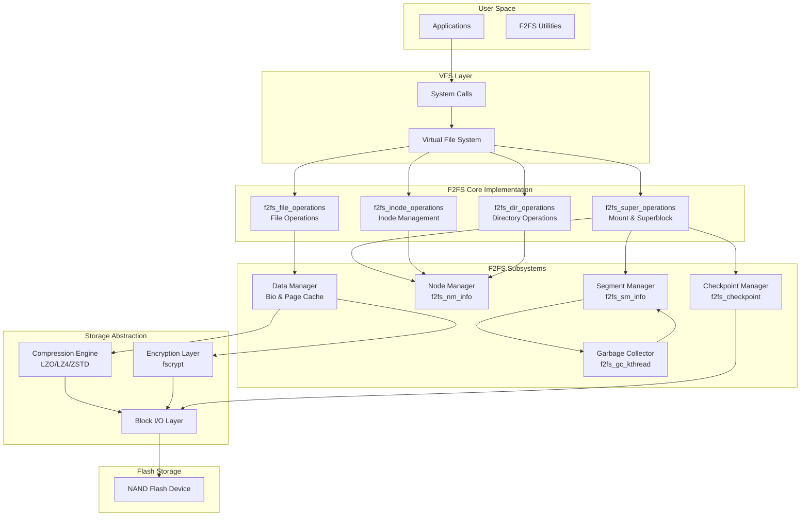
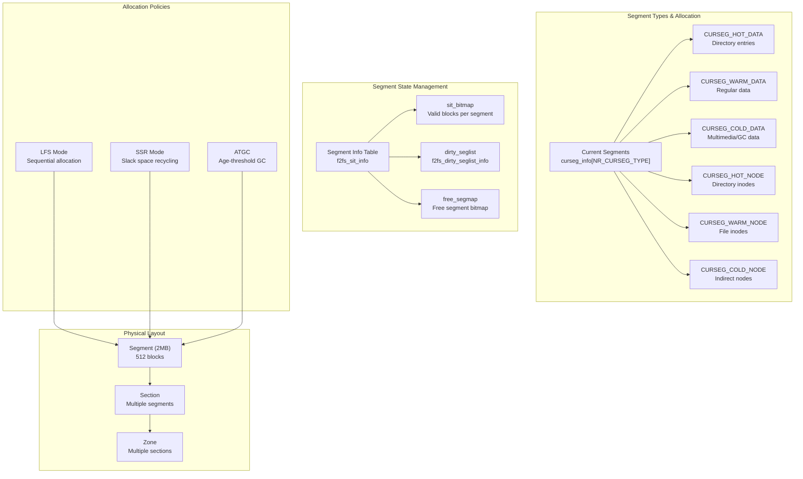
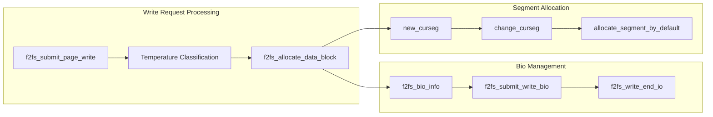
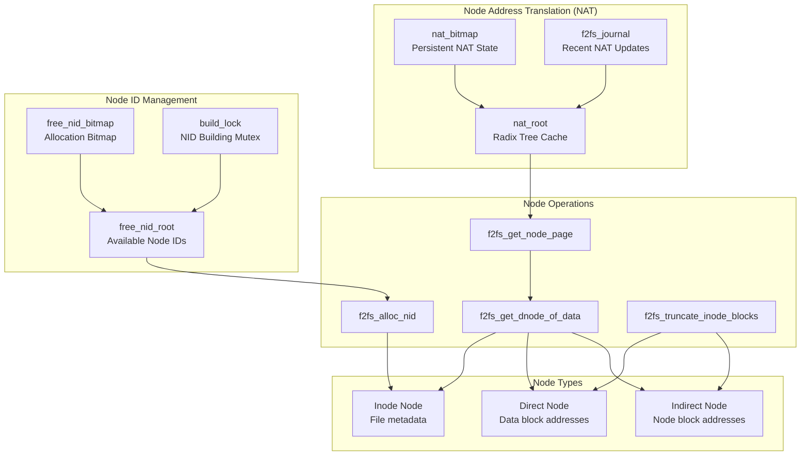
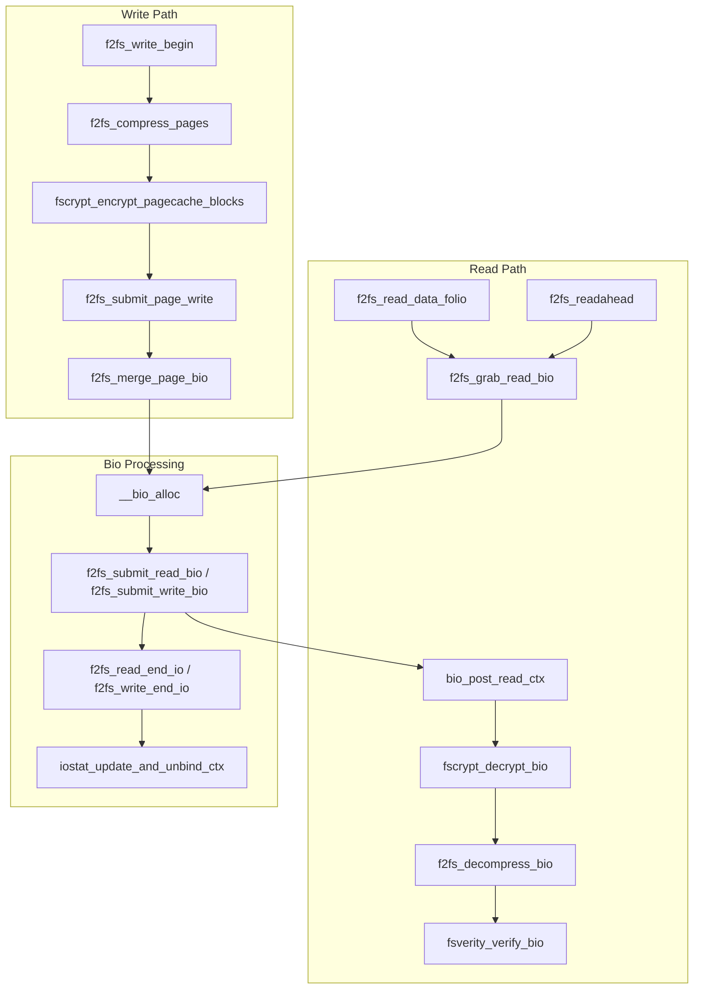
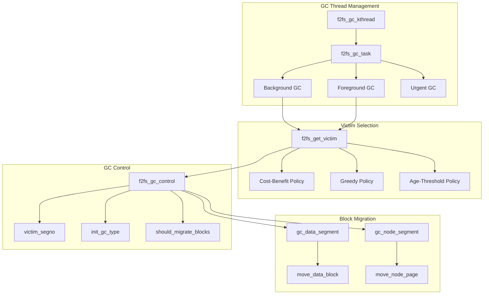
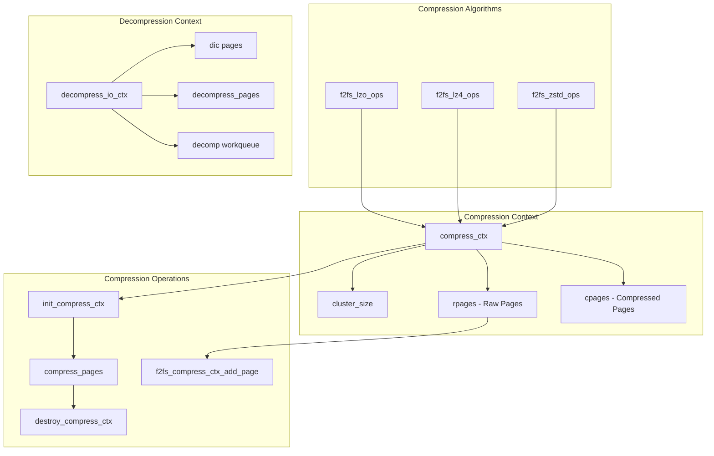
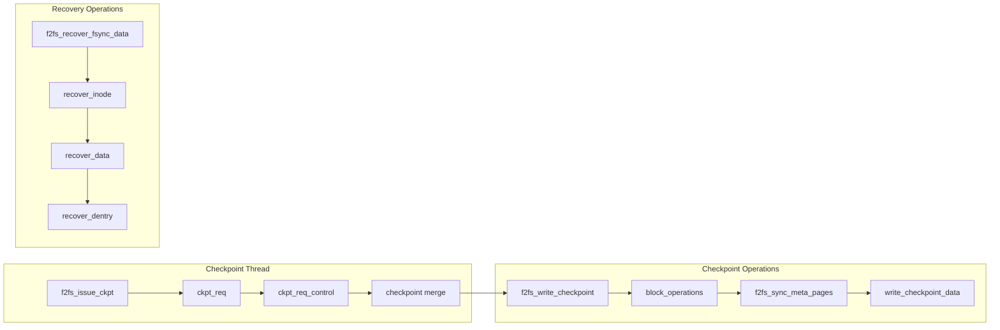
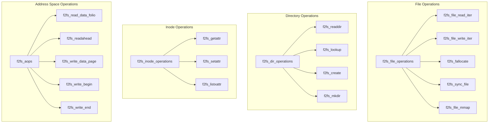

<!-- source: DeepWiki mcp.deepwiki.com · repo NVIDIA/NV-Kernels · page 6.1 F2FS Flash Filesystem · fetched 2026-10-26 -->

# F2FS Flash Filesystem

Relevant source files

The following files were used as context for generating this wiki page:

- [Documentation/ABI/testing/sysfs-fs-f2fs](Documentation/ABI/testing/sysfs-fs-f2fs)
- [Documentation/filesystems/f2fs.rst](Documentation/filesystems/f2fs.rst)
- [fs/f2fs/acl.c](fs/f2fs/acl.c)
- [fs/f2fs/checkpoint.c](fs/f2fs/checkpoint.c)
- [fs/f2fs/compress.c](fs/f2fs/compress.c)
- [fs/f2fs/data.c](fs/f2fs/data.c)
- [fs/f2fs/debug.c](fs/f2fs/debug.c)
- [fs/f2fs/dir.c](fs/f2fs/dir.c)
- [fs/f2fs/extent_cache.c](fs/f2fs/extent_cache.c)
- [fs/f2fs/f2fs.h](fs/f2fs/f2fs.h)
- [fs/f2fs/file.c](fs/f2fs/file.c)
- [fs/f2fs/gc.c](fs/f2fs/gc.c)
- [fs/f2fs/gc.h](fs/f2fs/gc.h)
- [fs/f2fs/inline.c](fs/f2fs/inline.c)
- [fs/f2fs/inode.c](fs/f2fs/inode.c)
- [fs/f2fs/namei.c](fs/f2fs/namei.c)
- [fs/f2fs/node.c](fs/f2fs/node.c)
- [fs/f2fs/node.h](fs/f2fs/node.h)
- [fs/f2fs/recovery.c](fs/f2fs/recovery.c)
- [fs/f2fs/segment.c](fs/f2fs/segment.c)
- [fs/f2fs/segment.h](fs/f2fs/segment.h)
- [fs/f2fs/super.c](fs/f2fs/super.c)
- [fs/f2fs/sysfs.c](fs/f2fs/sysfs.c)
- [fs/f2fs/xattr.c](fs/f2fs/xattr.c)
- [fs/f2fs/xattr.h](fs/f2fs/xattr.h)
- [include/linux/f2fs_fs.h](include/linux/f2fs_fs.h)
- [include/trace/events/f2fs.h](include/trace/events/f2fs.h)

This document covers the F2FS (Flash-Friendly File System) implementation in the Linux kernel, focusing on its architecture, core subsystems, and optimization strategies for NAND flash storage devices. F2FS is designed to address the specific characteristics of flash memory through log-structured design principles and advanced garbage collection mechanisms.

For general filesystem concepts and VFS integration, see [Virtual File System](#6). For storage device drivers that F2FS operates on, see [Storage Subsystems](#4.2).

## Architecture Overview

F2FS implements a log-structured file system optimized for NAND flash characteristics, featuring segment-based allocation, multi-head logging, and adaptive garbage collection. The filesystem organizes storage into hierarchical units: blocks, segments, sections, and zones.

### High-Level System Architecture

Sources: [fs/f2fs/f2fs.h:1-300](), [fs/f2fs/super.c:1-100](), [fs/f2fs/segment.c:1-50]()

## Core Data Structures

F2FS organizes its metadata around several key data structures that manage the filesystem state and coordinate between different subsystems.

### Primary Control Structures

```mermaid
graph TB
    subgraph "f2fs_sb_info - Main Superblock"
        SBI_SUPER["raw_super: f2fs_super_block"]
        SBI_SM["sm_info: Segment Manager"]
        SBI_NM["nm_info: Node Manager"]
        SBI_CKPT["ckpt: Checkpoint"]
        SBI_GC["gc_thread: Garbage Collection"]
        SBI_WRITE_IO["write_io: Bio Management"]
    end
    
    subgraph "f2fs_sm_info - Segment Management"
        SM_SIT["sit_info: Segment Info Table"]
        SM_FREE["free_info: Free Segment Info"]
        SM_DIRTY["dirty_seglist: Dirty Segments"]
        SM_CURSEG["curseg_array: Current Segments"]
        SM_DCC["dcc_info: Discard Control"]
    end
    
    subgraph "f2fs_nm_info - Node Management"
        NM_NAT_ROOT["nat_root: NAT Cache"]
        NM_FREE_NIDS["free_nid_root: Free Node IDs"]
        NM_NAT_BITMAP["nat_bitmap: NAT Bitmap"]
        NM_NEXT_SCAN["next_scan_nid: Scan Position"]
    end
    
    subgraph "f2fs_checkpoint - Consistency"
        CP_VERSION["version: Checkpoint Version"]
        CP_VALID_BLOCKS["valid_block_count: Block Count"]
        CP_SIT_NAT_VERSION["sit_ver_bitmap_bytesize"]
        CP_ORPHAN_COUNT["orphan_count: Orphaned Inodes"]
    end
    
    SBI_SM --> SM_SIT
    SBI_SM --> SM_FREE
    SBI_SM --> SM_DIRTY
    SBI_SM --> SM_CURSEG
    SBI_SM --> SM_DCC
    
    SBI_NM --> NM_NAT_ROOT
    SBI_NM --> NM_FREE_NIDS
    SBI_NM --> NM_NAT_BITMAP
    SBI_NM --> NM_NEXT_SCAN
    
    SBI_CKPT --> CP_VERSION
    SBI_CKPT --> CP_VALID_BLOCKS
    SBI_CKPT --> CP_SIT_NAT_VERSION
    SBI_CKPT --> CP_ORPHAN_COUNT
```

Sources: [fs/f2fs/f2fs.h:1670-1900](), [fs/f2fs/f2fs.h:1200-1400](), [fs/f2fs/f2fs.h:960-1100]()

## Segment Management System

The segment manager is F2FS's core allocation engine, implementing a log-structured approach optimized for flash storage characteristics.

### Segment Allocation Architecture

Sources: [fs/f2fs/segment.c:1044-1100](), [fs/f2fs/segment.h:100-200](), [fs/f2fs/f2fs.h:1100-1200]()

### Write Path and Segment Selection

The segment manager coordinates write operations through multi-head logging with temperature-based data classification.

Sources: [fs/f2fs/segment.c:3200-3400](), [fs/f2fs/data.c:947-1040](), [fs/f2fs/segment.c:2800-3000]()

## Node Management System

The node manager handles the filesystem's node-based metadata structure, including inodes, direct nodes, and indirect nodes, with efficient caching and allocation strategies.

### Node Address Translation

Sources: [fs/f2fs/node.c:200-400](), [fs/f2fs/node.c:2400-2600](), [fs/f2fs/f2fs.h:960-1100]()

## Data I/O System

F2FS implements an advanced I/O system with support for compression, encryption, and efficient bio management optimized for flash storage.

### Read/Write Path Architecture

Sources: [fs/f2fs/data.c:1089-1200](), [fs/f2fs/data.c:2300-2500](), [fs/f2fs/data.c:456-550]()

## Garbage Collection System

F2FS implements sophisticated garbage collection with both background and foreground modes, supporting multiple collection policies optimized for different workload patterns.

### GC Thread Architecture

Sources: [fs/f2fs/gc.c:31-187](), [fs/f2fs/gc.c:400-600](), [fs/f2fs/gc.c:1200-1400]()

## Compression System

F2FS provides built-in compression support with multiple algorithms, transparent to applications and integrated with the I/O path.

### Compression Engine Architecture

Sources: [fs/f2fs/compress.c:51-400](), [fs/f2fs/compress.c:180-350](), [fs/f2fs/compress.c:1200-1500]()

## Checkpoint and Recovery System

F2FS implements a checkpoint mechanism for filesystem consistency and crash recovery, with support for both synchronous and asynchronous checkpoint operations.

### Checkpoint Management

Sources: [fs/f2fs/checkpoint.c:1400-1600](), [fs/f2fs/checkpoint.c:340-450](), [fs/f2fs/recovery.c:600-800]()

## File and Directory Operations

F2FS implements standard POSIX file and directory operations with optimizations for flash storage, including inline data support for small files.

### File Operations Integration

Sources: [fs/f2fs/file.c:3300-3400](), [fs/f2fs/dir.c:1100-1200](), [fs/f2fs/namei.c:1200-1300]()

---

