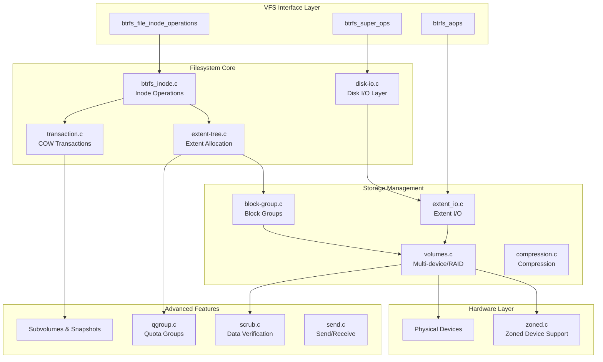
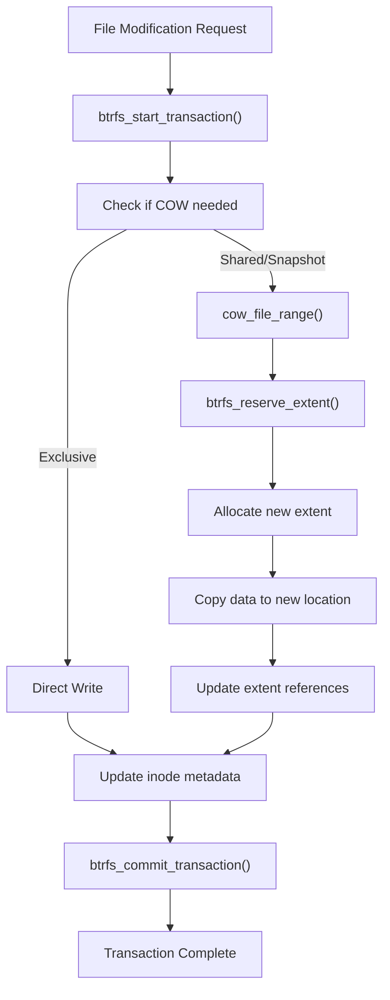
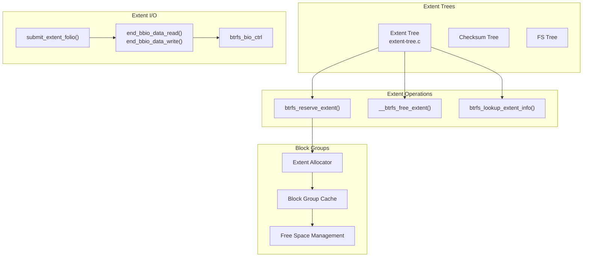
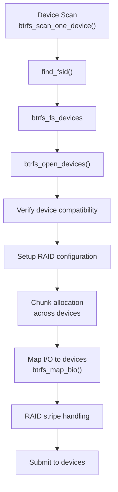
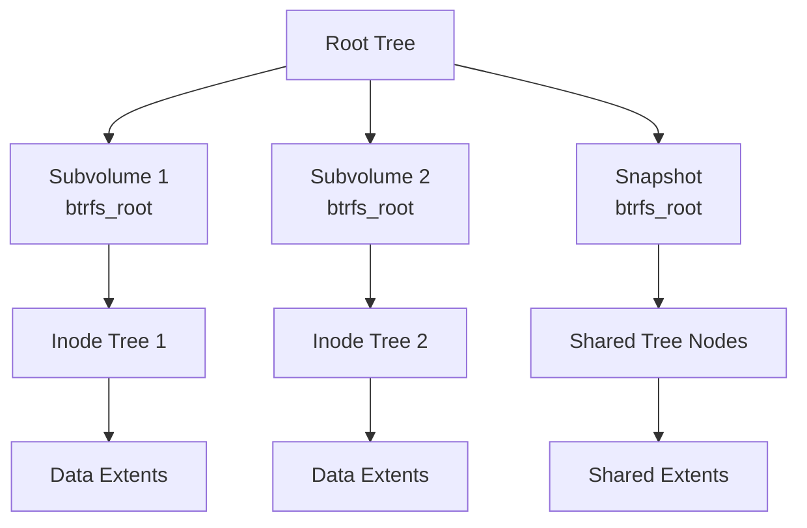
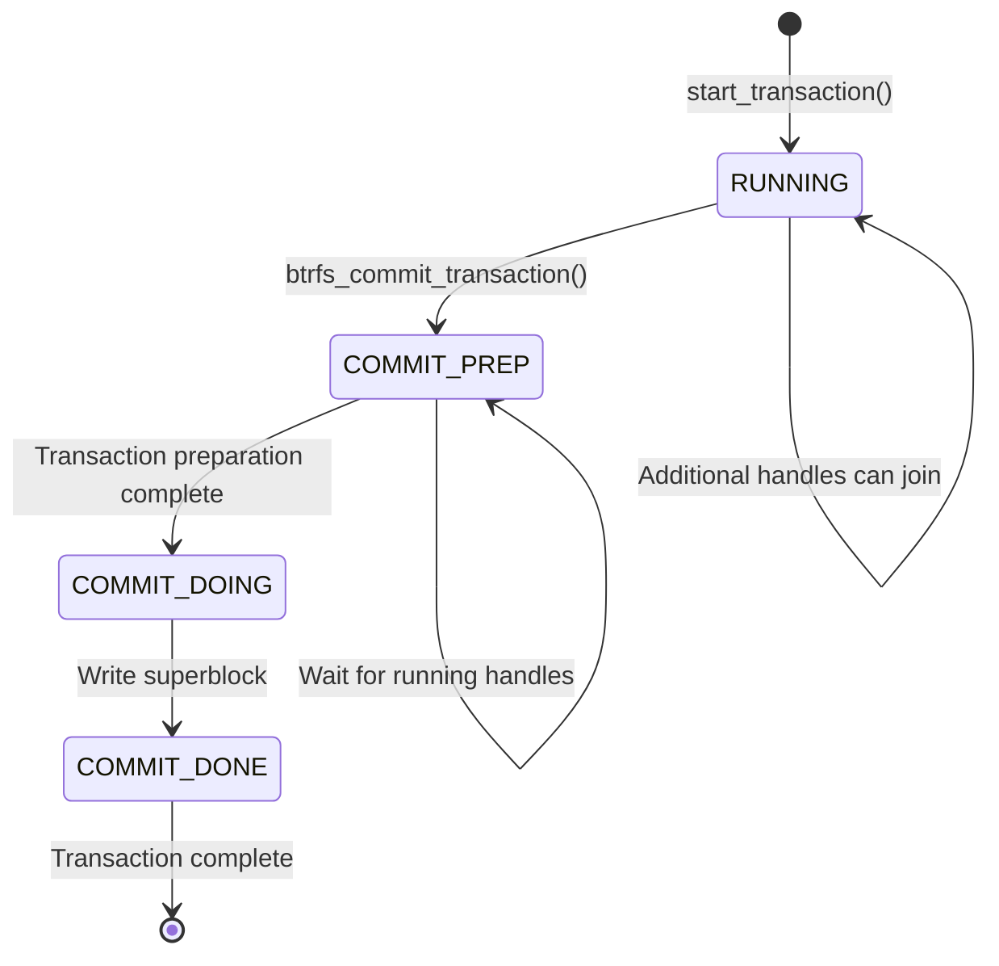

<!-- source: DeepWiki mcp.deepwiki.com · repo NVIDIA/NV-Kernels · page 6.2 Btrfs Filesystem · fetched 2026-10-26 -->

# Btrfs Filesystem

Relevant source files

The following files were used as context for generating this wiki page:

- [drivers/irqchip/irq-sun6i-r.c](drivers/irqchip/irq-sun6i-r.c)
- [drivers/net/can/usb/etas_es58x/es58x_devlink.c](drivers/net/can/usb/etas_es58x/es58x_devlink.c)
- [fs/btrfs/Makefile](fs/btrfs/Makefile)
- [fs/btrfs/accessors.h](fs/btrfs/accessors.h)
- [fs/btrfs/backref.c](fs/btrfs/backref.c)
- [fs/btrfs/bio.c](fs/btrfs/bio.c)
- [fs/btrfs/bio.h](fs/btrfs/bio.h)
- [fs/btrfs/block-group.c](fs/btrfs/block-group.c)
- [fs/btrfs/block-group.h](fs/btrfs/block-group.h)
- [fs/btrfs/block-rsv.c](fs/btrfs/block-rsv.c)
- [fs/btrfs/block-rsv.h](fs/btrfs/block-rsv.h)
- [fs/btrfs/btrfs_inode.h](fs/btrfs/btrfs_inode.h)
- [fs/btrfs/compression.c](fs/btrfs/compression.c)
- [fs/btrfs/compression.h](fs/btrfs/compression.h)
- [fs/btrfs/ctree.c](fs/btrfs/ctree.c)
- [fs/btrfs/ctree.h](fs/btrfs/ctree.h)
- [fs/btrfs/defrag.c](fs/btrfs/defrag.c)
- [fs/btrfs/defrag.h](fs/btrfs/defrag.h)
- [fs/btrfs/delalloc-space.c](fs/btrfs/delalloc-space.c)
- [fs/btrfs/delalloc-space.h](fs/btrfs/delalloc-space.h)
- [fs/btrfs/delayed-inode.c](fs/btrfs/delayed-inode.c)
- [fs/btrfs/delayed-inode.h](fs/btrfs/delayed-inode.h)
- [fs/btrfs/delayed-ref.c](fs/btrfs/delayed-ref.c)
- [fs/btrfs/delayed-ref.h](fs/btrfs/delayed-ref.h)
- [fs/btrfs/dev-replace.c](fs/btrfs/dev-replace.c)
- [fs/btrfs/direct-io.c](fs/btrfs/direct-io.c)
- [fs/btrfs/direct-io.h](fs/btrfs/direct-io.h)
- [fs/btrfs/discard.c](fs/btrfs/discard.c)
- [fs/btrfs/disk-io.c](fs/btrfs/disk-io.c)
- [fs/btrfs/disk-io.h](fs/btrfs/disk-io.h)
- [fs/btrfs/export.c](fs/btrfs/export.c)
- [fs/btrfs/extent-io-tree.c](fs/btrfs/extent-io-tree.c)
- [fs/btrfs/extent-io-tree.h](fs/btrfs/extent-io-tree.h)
- [fs/btrfs/extent-tree.c](fs/btrfs/extent-tree.c)
- [fs/btrfs/extent-tree.h](fs/btrfs/extent-tree.h)
- [fs/btrfs/extent_io.c](fs/btrfs/extent_io.c)
- [fs/btrfs/extent_io.h](fs/btrfs/extent_io.h)
- [fs/btrfs/extent_map.c](fs/btrfs/extent_map.c)
- [fs/btrfs/file-item.c](fs/btrfs/file-item.c)
- [fs/btrfs/file-item.h](fs/btrfs/file-item.h)
- [fs/btrfs/file.c](fs/btrfs/file.c)
- [fs/btrfs/file.h](fs/btrfs/file.h)
- [fs/btrfs/free-space-cache.c](fs/btrfs/free-space-cache.c)
- [fs/btrfs/free-space-tree.c](fs/btrfs/free-space-tree.c)
- [fs/btrfs/fs.h](fs/btrfs/fs.h)
- [fs/btrfs/inode-item.c](fs/btrfs/inode-item.c)
- [fs/btrfs/inode.c](fs/btrfs/inode.c)
- [fs/btrfs/ioctl.c](fs/btrfs/ioctl.c)
- [fs/btrfs/ioctl.h](fs/btrfs/ioctl.h)
- [fs/btrfs/locking.h](fs/btrfs/locking.h)
- [fs/btrfs/lzo.c](fs/btrfs/lzo.c)
- [fs/btrfs/messages.c](fs/btrfs/messages.c)
- [fs/btrfs/messages.h](fs/btrfs/messages.h)
- [fs/btrfs/ordered-data.c](fs/btrfs/ordered-data.c)
- [fs/btrfs/ordered-data.h](fs/btrfs/ordered-data.h)
- [fs/btrfs/print-tree.c](fs/btrfs/print-tree.c)
- [fs/btrfs/props.c](fs/btrfs/props.c)
- [fs/btrfs/props.h](fs/btrfs/props.h)
- [fs/btrfs/qgroup.c](fs/btrfs/qgroup.c)
- [fs/btrfs/qgroup.h](fs/btrfs/qgroup.h)
- [fs/btrfs/raid-stripe-tree.c](fs/btrfs/raid-stripe-tree.c)
- [fs/btrfs/raid-stripe-tree.h](fs/btrfs/raid-stripe-tree.h)
- [fs/btrfs/raid56.c](fs/btrfs/raid56.c)
- [fs/btrfs/raid56.h](fs/btrfs/raid56.h)
- [fs/btrfs/reflink.c](fs/btrfs/reflink.c)
- [fs/btrfs/relocation.c](fs/btrfs/relocation.c)
- [fs/btrfs/scrub.c](fs/btrfs/scrub.c)
- [fs/btrfs/scrub.h](fs/btrfs/scrub.h)
- [fs/btrfs/send.c](fs/btrfs/send.c)
- [fs/btrfs/send.h](fs/btrfs/send.h)
- [fs/btrfs/space-info.c](fs/btrfs/space-info.c)
- [fs/btrfs/space-info.h](fs/btrfs/space-info.h)
- [fs/btrfs/subpage.c](fs/btrfs/subpage.c)
- [fs/btrfs/subpage.h](fs/btrfs/subpage.h)
- [fs/btrfs/super.c](fs/btrfs/super.c)
- [fs/btrfs/sysfs.c](fs/btrfs/sysfs.c)
- [fs/btrfs/sysfs.h](fs/btrfs/sysfs.h)
- [fs/btrfs/tests/extent-map-tests.c](fs/btrfs/tests/extent-map-tests.c)
- [fs/btrfs/transaction.c](fs/btrfs/transaction.c)
- [fs/btrfs/transaction.h](fs/btrfs/transaction.h)
- [fs/btrfs/tree-checker.c](fs/btrfs/tree-checker.c)
- [fs/btrfs/tree-checker.h](fs/btrfs/tree-checker.h)
- [fs/btrfs/tree-log.c](fs/btrfs/tree-log.c)
- [fs/btrfs/tree-log.h](fs/btrfs/tree-log.h)
- [fs/btrfs/verity.c](fs/btrfs/verity.c)
- [fs/btrfs/volumes.c](fs/btrfs/volumes.c)
- [fs/btrfs/volumes.h](fs/btrfs/volumes.h)
- [fs/btrfs/xattr.c](fs/btrfs/xattr.c)
- [fs/btrfs/zlib.c](fs/btrfs/zlib.c)
- [fs/btrfs/zoned.c](fs/btrfs/zoned.c)
- [fs/btrfs/zoned.h](fs/btrfs/zoned.h)
- [fs/btrfs/zstd.c](fs/btrfs/zstd.c)
- [include/trace/events/btrfs.h](include/trace/events/btrfs.h)
- [include/uapi/linux/btrfs.h](include/uapi/linux/btrfs.h)
- [include/uapi/linux/btrfs_tree.h](include/uapi/linux/btrfs_tree.h)

This document covers the Btrfs (B-tree File System) implementation, a copy-on-write filesystem with advanced features including snapshots, subvolumes, multi-device support, and built-in RAID capabilities. For information about F2FS flash filesystem, see [F2FS Flash Filesystem](#6.1). For SMB/CIFS network filesystem support, see [CIFS/SMB Client](#6.3).

## Architecture Overview

Btrfs is implemented as a sophisticated multi-layered filesystem with several key subsystems working together to provide advanced features like copy-on-write semantics, extent-based storage, and multi-device support.

### Core Subsystem Architecture

Sources: [fs/btrfs/inode.c:106-112](), [fs/btrfs/super.c:66-67](), [fs/btrfs/extent-tree.c:1-43](), [fs/btrfs/volumes.c:54-172]()

## Copy-on-Write (COW) Implementation

Btrfs implements copy-on-write semantics through a sophisticated transaction system that ensures data integrity and enables advanced features like snapshots.

### COW Transaction Flow

The COW implementation is primarily handled in the `run_delalloc_cow` function, which determines when data needs to be copied versus when it can be written in place.

Sources: [fs/btrfs/inode.c:118-121](), [fs/btrfs/transaction.c:1-35](), [fs/btrfs/extent-tree.c:95-218]()

## Extent-Based Storage Management

Btrfs uses an extent-based storage model where data is stored in variable-sized extents rather than fixed-size blocks, providing better space efficiency and enabling advanced features.

### Extent Management Architecture

The extent allocation system works through `btrfs_reserve_extent()` which finds appropriate free space in block groups and allocates extents of the requested size.

Sources: [fs/btrfs/extent-tree.c:47-63](), [fs/btrfs/extent_io.c:710-781](), [fs/btrfs/block-group.c:1-35]()

## Multi-Device and RAID Support

Btrfs provides sophisticated multi-device support with various RAID levels implemented at the filesystem level.

### RAID Configuration Matrix

| RAID Level | Min Devices | Fault Tolerance | Use Case |
|------------|-------------|-----------------|----------|
| Single | 1 | 0 | Single device |
| DUP | 1 | 0 | Metadata duplication on single device |
| RAID0 | 1 | 0 | Striping for performance |
| RAID1 | 2 | 1 device | Mirroring |
| RAID1C3 | 3 | 2 devices | Triple mirroring |
| RAID1C4 | 4 | 3 devices | Quad mirroring |
| RAID5 | 2 | 1 device | Striping with parity |
| RAID6 | 3 | 2 devices | Striping with dual parity |
| RAID10 | 2 | 1 device | Striped mirrors |

### Device Management Flow

The `btrfs_raid_array` structure defines the characteristics of each RAID level, including device requirements and fault tolerance.

Sources: [fs/btrfs/volumes.c:54-172](), [fs/btrfs/volumes.c:646-696](), [fs/btrfs/volumes.c:573-639]()

## I/O Subsystem

Btrfs implements a sophisticated I/O subsystem that handles extent-based operations, compression, and checksumming.

### I/O Processing Pipeline

The I/O system uses `btrfs_bio_ctrl` structures to manage bio assembly and submission, with special handling for compressed data and RAID configurations.

Sources: [fs/btrfs/extent_io.c:97-113](), [fs/btrfs/extent_io.c:658-696](), [fs/btrfs/extent_io.c:710-781]()

## Advanced Features

### Subvolumes and Snapshots

Btrfs subvolumes are independent filesystem trees that can be snapshotted efficiently due to the COW design.

### Compression Support

Btrfs supports multiple compression algorithms transparently at the extent level:

- **ZLIB** - Good compression ratio, moderate CPU usage
- **LZO** - Fast compression/decompression, lower ratio  
- **ZSTD** - Best of both worlds, configurable levels
- **LZ4** - Fastest compression, lowest CPU overhead

Sources: [fs/btrfs/ioctl.c:499-522](), [fs/btrfs/compression.c:1-10](), [fs/btrfs/inode.c:774-798]()

## Checksumming and Data Integrity

Btrfs implements comprehensive data integrity through checksumming of both data and metadata.

### Checksum Types

| Algorithm | Use Case | Performance |
|-----------|----------|-------------|
| CRC32C | Default, hardware accelerated | High |
| XXHASH | Better distribution | High |
| SHA256 | Cryptographic strength | Medium |
| BLAKE2 | Modern, fast | High |

The checksum verification happens during read operations in `end_bbio_data_read()`, and checksum calculation occurs during write operations.

Sources: [fs/btrfs/disk-io.c:142-153](), [fs/btrfs/disk-io.c:259-330](), [fs/btrfs/inode.c:304-333]()

## Transaction System

Btrfs uses a sophisticated transaction system to maintain filesystem consistency and enable atomic operations.

### Transaction States

The transaction system ensures that all filesystem modifications are atomic and consistent, supporting the COW semantics that enable snapshots and other advanced features.

Sources: [fs/btrfs/transaction.c:38-57](), [fs/btrfs/transaction.c:1-35]()

---

