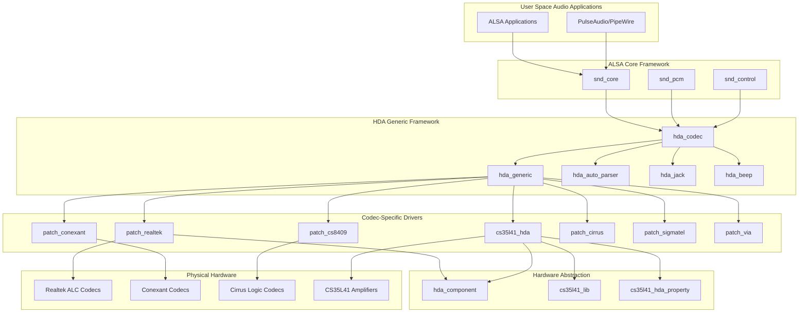
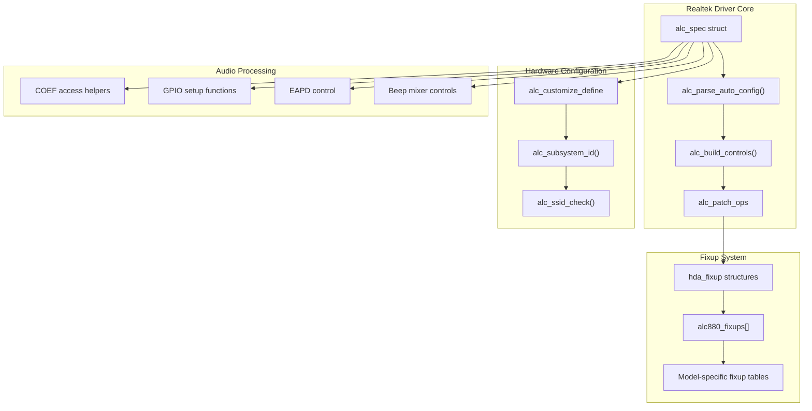
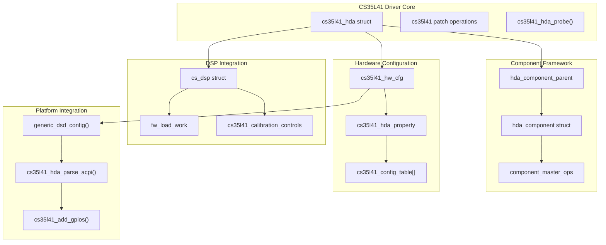
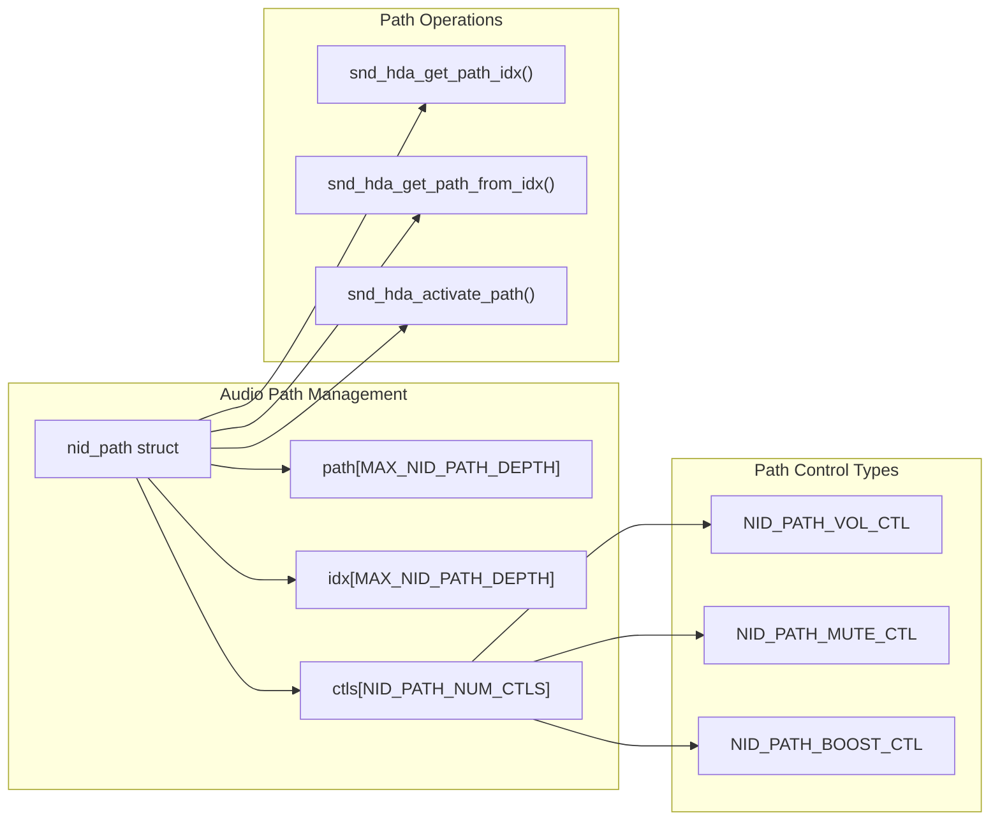
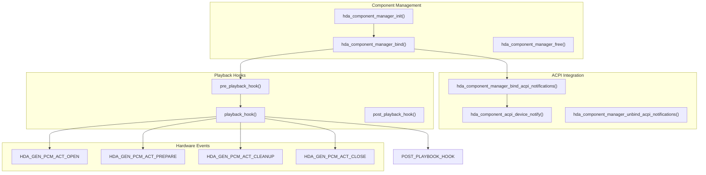
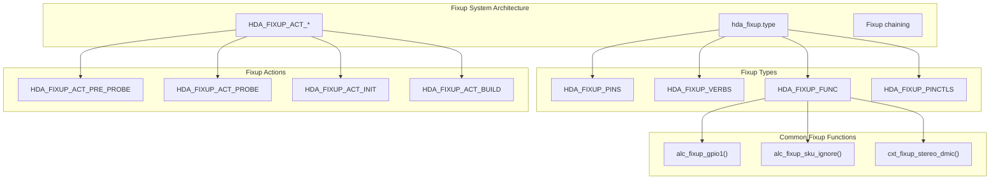
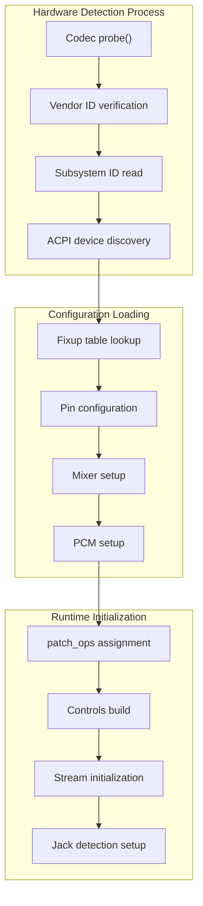
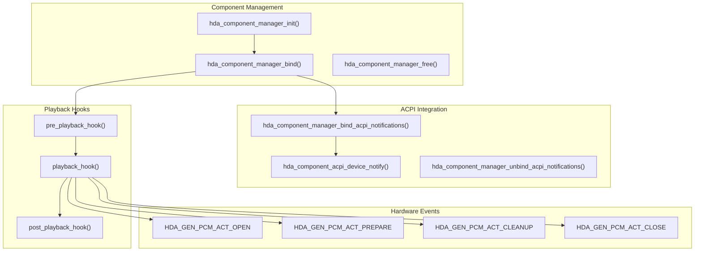

<!-- source: DeepWiki mcp.deepwiki.com · repo NVIDIA/NV-Kernels · page 7 Hardware Support · fetched 2026-10-26 -->

# Hardware Support

<details>
<summary>Relevant source files</summary>

The following files were used as context for generating this wiki page:

- [include/sound/cs35l41.h](include/sound/cs35l41.h)
- [include/sound/hda_codec.h](include/sound/hda_codec.h)
- [sound/pci/hda/cs35l41_hda.c](sound/pci/hda/cs35l41_hda.c)
- [sound/pci/hda/cs35l41_hda.h](sound/pci/hda/cs35l41_hda.h)
- [sound/pci/hda/cs35l41_hda_property.c](sound/pci/hda/cs35l41_hda_property.c)
- [sound/pci/hda/hda_auto_parser.c](sound/pci/hda/hda_auto_parser.c)
- [sound/pci/hda/hda_auto_parser.h](sound/pci/hda/hda_auto_parser.h)
- [sound/pci/hda/hda_beep.c](sound/pci/hda/hda_beep.c)
- [sound/pci/hda/hda_component.c](sound/pci/hda/hda_component.c)
- [sound/pci/hda/hda_component.h](sound/pci/hda/hda_component.h)
- [sound/pci/hda/hda_generic.c](sound/pci/hda/hda_generic.c)
- [sound/pci/hda/hda_generic.h](sound/pci/hda/hda_generic.h)
- [sound/pci/hda/ideapad_hotkey_led_helper.c](sound/pci/hda/ideapad_hotkey_led_helper.c)
- [sound/pci/hda/patch_analog.c](sound/pci/hda/patch_analog.c)
- [sound/pci/hda/patch_cirrus.c](sound/pci/hda/patch_cirrus.c)
- [sound/pci/hda/patch_conexant.c](sound/pci/hda/patch_conexant.c)
- [sound/pci/hda/patch_cs8409-tables.c](sound/pci/hda/patch_cs8409-tables.c)
- [sound/pci/hda/patch_cs8409.c](sound/pci/hda/patch_cs8409.c)
- [sound/pci/hda/patch_cs8409.h](sound/pci/hda/patch_cs8409.h)
- [sound/pci/hda/patch_realtek.c](sound/pci/hda/patch_realtek.c)
- [sound/pci/hda/patch_sigmatel.c](sound/pci/hda/patch_sigmatel.c)
- [sound/pci/hda/patch_via.c](sound/pci/hda/patch_via.c)
- [sound/soc/codecs/cs35l41-lib.c](sound/soc/codecs/cs35l41-lib.c)

</details>


## Purpose and Scope

This document covers the hardware-specific drivers and support subsystems within the Linux kernel, with particular focus on the High Definition Audio (HDA) subsystem which represents the most extensively developed hardware support component in this codebase. The primary coverage includes audio codec drivers, hardware abstraction frameworks, and platform-specific implementations.

For detailed information about the audio subsystem specifically, see [Audio Subsystem](#7.1).

## Hardware Support Architecture

The hardware support infrastructure follows a layered architecture pattern, with generic frameworks providing common functionality and specific codec drivers implementing hardware-specific features.

### HDA Framework Architecture



Sources: [sound/pci/hda/hda_generic.c:1-50](), [sound/pci/hda/hda_component.h:1-30](), [sound/pci/hda/patch_realtek.c:1-50]()

## Major Codec Driver Implementations

### Realtek ALC Codec Support

The Realtek driver represents the most comprehensive codec implementation, supporting a vast array of consumer audio hardware through the `alc_spec` structure and extensive fixup mechanisms.



Sources: [sound/pci/hda/patch_realtek.c:84-140](), [sound/pci/hda/patch_realtek.c:1282-1400]()

### CS35L41 Component Architecture

The CS35L41 driver implements a sophisticated component-based architecture for modern audio amplifiers with DSP capabilities.



Sources: [sound/pci/hda/cs35l41_hda.c:55-140](), [sound/pci/hda/cs35l41_hda_property.c:17-150](), [sound/pci/hda/hda_component.h:20-35]()

## Hardware Abstraction and Generic Framework

### HDA Generic Parser

The `hda_generic` module provides the foundation for all codec drivers through automated parsing and configuration.

| Component | Function | Key Structures |
|-----------|----------|----------------|
| `snd_hda_gen_spec_init()` | Initialize generic spec | `hda_gen_spec` |
| `snd_hda_gen_parse_auto_config()` | Auto-configure codec | `auto_pin_cfg` |
| `snd_hda_gen_build_controls()` | Build ALSA controls | `snd_kcontrol_new` |
| `snd_hda_gen_build_pcms()` | Build PCM streams | `hda_pcm_stream` |

The generic parser implements path-based audio routing through the `nid_path` structure:



Sources: [sound/pci/hda/hda_generic.h:34-54](), [sound/pci/hda/hda_generic.c:287-316]()

### Component Binding Framework

The HDA component framework enables dynamic binding between codec drivers and external amplifier/DSP components.



Sources: [sound/pci/hda/hda_component.c:72-150](), [sound/pci/hda/hda_component.h:69-83]()

## Platform-Specific Implementations

### ACPI Integration and Device Configuration

Modern codec drivers extensively use ACPI for hardware discovery and configuration, particularly for laptop and embedded systems.

The CS35L41 driver implements a comprehensive ACPI property system:

| Configuration Method | Function | Purpose |
|---------------------|----------|---------|
| `generic_dsd_config()` | Generic ACPI _DSD parsing | Standard ACPI device properties |
| `hp_i2c_int_2amp_dual_spkid()` | HP-specific dual speaker ID | HP laptop speaker configuration |
| `lenovo_legion_no_acpi()` | Lenovo Legion fallback | Non-ACPI Lenovo systems |
| `missing_speaker_id_gpio2()` | GPIO-based speaker ID | Systems with GPIO speaker identification |

### Hardware-Specific Quirks and Fixups

Each codec driver maintains extensive fixup tables to handle hardware variations and manufacturer-specific implementations:



Sources: [sound/pci/hda/patch_realtek.c:670-690](), [sound/pci/hda/patch_conexant.c:320-350](), [sound/pci/hda/cs35l41_hda_property.c:235-270]()

## Hardware Detection and Identification

### Subsystem ID Verification

Codec drivers implement sophisticated hardware detection mechanisms using PCI subsystem IDs, ACPI device properties, and codec-specific identification methods:

```c
// Example from patch_realtek.c
static int alc_subsystem_id(struct hda_codec *codec, const hda_nid_t *ports)
{
    unsigned int ass, tmp, i;
    unsigned nid;
    struct alc_spec *spec = codec->spec;
    
    if (spec->cdefine.fixup) {
        ass = spec->cdefine.sku_cfg;
        if (ass == ALC_FIXUP_SKU_IGNORE)
            return 0;
        goto do_sku;
    }
    
    ass = codec->core.subsystem_id & 0xffff;
    // ... hardware-specific validation logic
}
```

### Codec Identification Flow



Sources: [sound/pci/hda/patch_realtek.c:782-894](), [sound/pci/hda/cs35l41_hda.c:864-890](), [sound/pci/hda/hda_auto_parser.c:108-127]()

# Hardware Support

## Purpose and Scope

This document covers the hardware-specific drivers and support subsystems within the Linux kernel, with particular focus on the High Definition Audio (HDA) subsystem which represents the most extensively developed hardware support component in this codebase. The primary coverage includes audio codec drivers, hardware abstraction frameworks, and platform-specific implementations.

For detailed information about the audio subsystem specifically, see [Audio Subsystem](#7.1).

## Hardware Support Architecture

The hardware support infrastructure follows a layered architecture pattern, with generic frameworks providing common functionality and specific codec drivers implementing hardware-specific features.

### HDA Framework Architecture


Sources: [sound/pci/hda/hda_generic.c:1-50](), [sound/pci/hda/hda_component.h:1-30](), [sound/pci/hda/patch_realtek.c:1-50]()

## Major Codec Driver Implementations

### Realtek ALC Codec Support

The Realtek driver represents the most comprehensive codec implementation, supporting a vast array of consumer audio hardware through the `alc_spec` structure and extensive fixup mechanisms.


Sources: [sound/pci/hda/patch_realtek.c:84-140](), [sound/pci/hda/patch_realtek.c:1282-1400]()

### CS35L41 Component Architecture

The CS35L41 driver implements a sophisticated component-based architecture for modern audio amplifiers with DSP capabilities.


Sources: [sound/pci/hda/cs35l41_hda.c:55-140](), [sound/pci/hda/cs35l41_hda_property.c:17-150](), [sound/pci/hda/hda_component.h:20-35]()

## Hardware Abstraction and Generic Framework

### HDA Generic Parser

The `hda_generic` module provides the foundation for all codec drivers through automated parsing and configuration.

| Component | Function | Key Structures |
|-----------|----------|----------------|
| `snd_hda_gen_spec_init()` | Initialize generic spec | `hda_gen_spec` |
| `snd_hda_gen_parse_auto_config()` | Auto-configure codec | `auto_pin_cfg` |
| `snd_hda_gen_build_controls()` | Build ALSA controls | `snd_kcontrol_new` |
| `snd_hda_gen_build_pcms()` | Build PCM streams | `hda_pcm_stream` |

The generic parser implements path-based audio routing through the `nid_path` structure:


Sources: [sound/pci/hda/hda_generic.h:34-54](), [sound/pci/hda/hda_generic.c:287-316]()

### Component Binding Framework

The HDA component framework enables dynamic binding between codec drivers and external amplifier/DSP components.



Sources: [sound/pci/hda/hda_component.c:72-150](), [sound/pci/hda/hda_component.h:69-83]()

## Platform-Specific Implementations

### ACPI Integration and Device Configuration

Modern codec drivers extensively use ACPI for hardware discovery and configuration, particularly for laptop and embedded systems.

The CS35L41 driver implements a comprehensive ACPI property system:

| Configuration Method | Function | Purpose |
|---------------------|----------|---------|
| `generic_dsd_config()` | Generic ACPI _DSD parsing | Standard ACPI device properties |
| `hp_i2c_int_2amp_dual_spkid()` | HP-specific dual speaker ID | HP laptop speaker configuration |
| `lenovo_legion_no_acpi()` | Lenovo Legion fallback | Non-ACPI Lenovo systems |
| `missing_speaker_id_gpio2()` | GPIO-based speaker ID | Systems with GPIO speaker identification |

### Hardware-Specific Quirks and Fixups

Each codec driver maintains extensive fixup tables to handle hardware variations and manufacturer-specific implementations:


Sources: [sound/pci/hda/patch_realtek.c:670-690](), [sound/pci/hda/patch_conexant.c:320-350](), [sound/pci/hda/cs35l41_hda_property.c:235-270]()

## Hardware Detection and Identification

### Codec Identification Flow


Sources: [sound/pci/hda/patch_realtek.c:782-894](), [sound/pci/hda/cs35l41_hda.c:864-890](), [sound/pci/hda/hda_auto_parser.c:108-127]()

---

