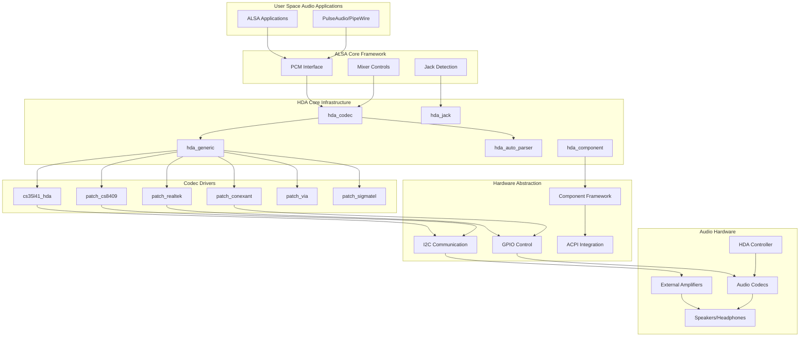
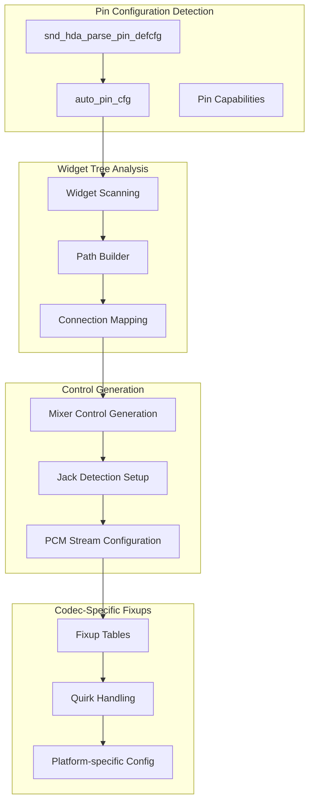
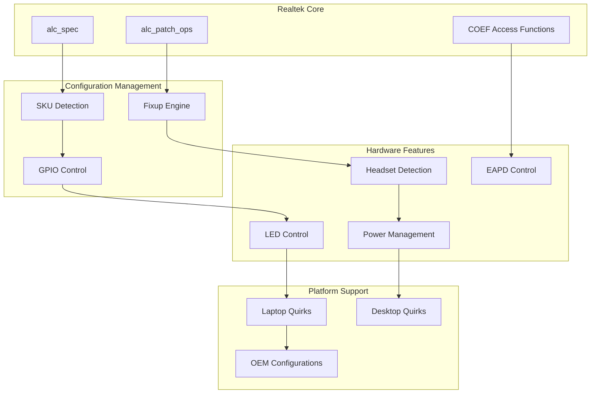
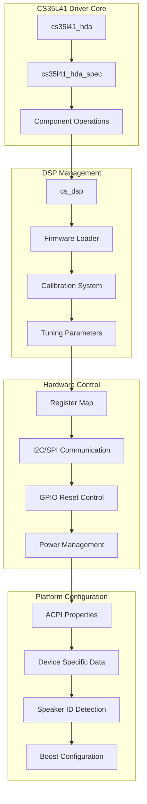
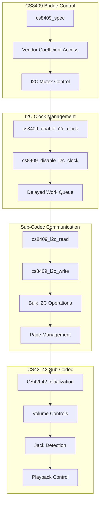
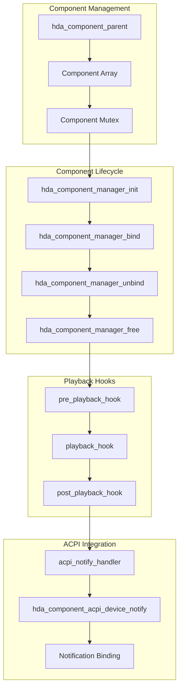
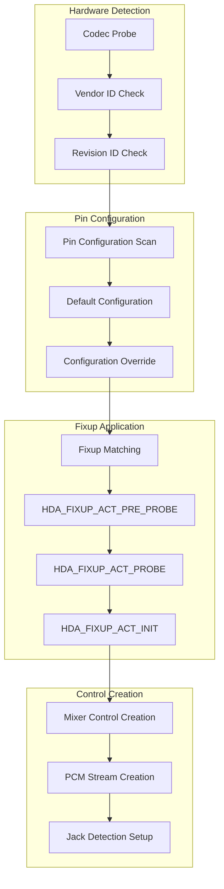

<!-- source: DeepWiki mcp.deepwiki.com · repo NVIDIA/NV-Kernels · page 7.1 Audio Subsystem · fetched 2026-10-26 -->

# Audio Subsystem

Relevant source files

The following files were used as context for generating this wiki page:

- [include/sound/cs35l41.h](include/sound/cs35l41.h)
- [include/sound/hda_codec.h](include/sound/hda_codec.h)
- [sound/pci/hda/cs35l41_hda.c](sound/pci/hda/cs35l41_hda.c)
- [sound/pci/hda/cs35l41_hda.h](sound/pci/hda/cs35l41_hda.h)
- [sound/pci/hda/cs35l41_hda_property.c](sound/pci/hda/cs35l41_hda_property.c)
- [sound/pci/hda/hda_auto_parser.c](sound/pci/hda/hda_auto_parser.c)
- [sound/pci/hda/hda_auto_parser.h](sound/pci/hda/hda_auto_parser.h)
- [sound/pci/hda/hda_beep.c](sound/pci/hda/hda_beep.c)
- [sound/pci/hda/hda_component.c](sound/pci/hda/hda_component.c)
- [sound/pci/hda/hda_component.h](sound/pci/hda/hda_component.h)
- [sound/pci/hda/hda_generic.c](sound/pci/hda/hda_generic.c)
- [sound/pci/hda/hda_generic.h](sound/pci/hda/hda_generic.h)
- [sound/pci/hda/ideapad_hotkey_led_helper.c](sound/pci/hda/ideapad_hotkey_led_helper.c)
- [sound/pci/hda/patch_analog.c](sound/pci/hda/patch_analog.c)
- [sound/pci/hda/patch_cirrus.c](sound/pci/hda/patch_cirrus.c)
- [sound/pci/hda/patch_conexant.c](sound/pci/hda/patch_conexant.c)
- [sound/pci/hda/patch_cs8409-tables.c](sound/pci/hda/patch_cs8409-tables.c)
- [sound/pci/hda/patch_cs8409.c](sound/pci/hda/patch_cs8409.c)
- [sound/pci/hda/patch_cs8409.h](sound/pci/hda/patch_cs8409.h)
- [sound/pci/hda/patch_realtek.c](sound/pci/hda/patch_realtek.c)
- [sound/pci/hda/patch_sigmatel.c](sound/pci/hda/patch_sigmatel.c)
- [sound/pci/hda/patch_via.c](sound/pci/hda/patch_via.c)
- [sound/soc/codecs/cs35l41-lib.c](sound/soc/codecs/cs35l41-lib.c)

## Purpose and Scope

This document covers the HDA (High Definition Audio) codec drivers and audio hardware support subsystem within the Linux kernel. The audio subsystem provides device drivers for various audio codecs from manufacturers including Realtek, Cirrus Logic, Conexant, VIA, and SigmaTel, along with the core HDA infrastructure for codec detection, configuration, and control.

For information about the broader kernel audio framework (ALSA core), see other audio documentation. For storage and virtualization audio components, see [4.2](#4.2) and [3.1](#3.1) respectively.

## Architecture Overview

The audio subsystem is structured around the HDA specification with a layered architecture consisting of core infrastructure, codec-specific drivers, and hardware abstraction components.

### HDA Subsystem Architecture

Sources: [sound/pci/hda/hda_generic.c:1-50](), [sound/pci/hda/hda_component.h:1-103](), [sound/pci/hda/hda_auto_parser.c:1-50]()

## Core HDA Infrastructure

### Generic HDA Framework

The `hda_generic` module provides the foundation for all HDA codec drivers through a unified widget tree parser and control interface.

**Key Components:**

| Component | Purpose | File Location |
|-----------|---------|---------------|
| `hda_gen_spec` | Generic specification structure | [sound/pci/hda/hda_generic.h:90-200]() |
| `snd_hda_gen_spec_init` | Spec initialization | [sound/pci/hda/hda_generic.c:37-44]() |
| `snd_hda_gen_parse_auto_config` | Auto-configuration parser | [sound/pci/hda/hda_generic.c:5800-5900]() |
| `nid_path` | Widget connection paths | [sound/pci/hda/hda_generic.h:44-54]() |

### Auto Parser Framework

Sources: [sound/pci/hda/hda_auto_parser.c:55-150](), [sound/pci/hda/hda_generic.c:200-400]()

## Codec Driver Implementation

### Realtek ALC Codecs

The Realtek driver is the most comprehensive codec implementation, supporting a wide range of ALC (Audio Logic Controller) codecs.

**Architecture:**

**Key Data Structures:**

- `alc_spec`: Extended specification structure for Realtek codecs [sound/pci/hda/patch_realtek.c:84-140]()
- `alc_customize_define`: SKU configuration parsing [sound/pci/hda/patch_realtek.c:64-75]()
- `hda_fixup`: Platform-specific fixup system [sound/pci/hda/patch_realtek.c:1282-1400]()

Sources: [sound/pci/hda/patch_realtek.c:1-500](), [sound/pci/hda/patch_realtek.c:1200-1300]()

### Cirrus Logic CS35L41 Audio Amplifier

The CS35L41 driver implements support for Cirrus Logic's smart amplifier with DSP capabilities.

**Component Integration:**

**Key Functions:**

| Function | Purpose | Location |
|----------|---------|----------|
| `cs35l41_hda_playbook_hook` | Playback control | [sound/pci/hda/cs35l41_hda.c:783-827]() |
| `cs35l41_request_firmware_files` | Firmware loading | [sound/pci/hda/cs35l41_hda.c:349-409]() |
| `cs35l41_hda_apply_calibration` | Calibration application | [sound/pci/hda/cs35l41_hda.c:412-425]() |
| `generic_dsd_config` | Platform configuration | [sound/pci/hda/cs35l41_hda_property.c:235-363]() |

Sources: [sound/pci/hda/cs35l41_hda.c:1-200](), [sound/pci/hda/cs35l41_hda_property.c:1-100]()

### Cirrus Logic CS8409 HDA Bridge

The CS8409 driver supports Cirrus Logic's HDA bridge chip with I2C sub-codec communication.

**I2C Communication Architecture:**

**I2C Communication Functions:**

- `cs8409_i2c_read`: Read from I2C sub-codec [sound/pci/hda/patch_cs8409.c:197-230]()
- `cs8409_i2c_write`: Write to I2C sub-codec [sound/pci/hda/patch_cs8409.c:285-315]()
- `cs8409_enable_i2c_clock`: Enable I2C clock with auto-disable [sound/pci/hda/patch_cs8409.c:120-137]()

Sources: [sound/pci/hda/patch_cs8409.c:50-200](), [sound/pci/hda/patch_cs8409.h:290-400]()

## Component Framework Integration

### HDA Component Manager

The component framework enables coordination between HDA codecs and external audio components like amplifiers.

**Component Structure:**

- `hda_component`: Individual component description [sound/pci/hda/hda_component.h:20-29]()
- `hda_component_parent`: Parent component manager [sound/pci/hda/hda_component.h:31-35]()

Sources: [sound/pci/hda/hda_component.c:1-100](), [sound/pci/hda/hda_component.h:1-50]()

## Hardware Platform Support

### GPIO and LED Control

Audio codecs often require GPIO control for external amplifiers, LED indicators, and power management.

**GPIO Control Examples:**

| Codec | GPIO Function | Implementation |
|-------|---------------|----------------|
| Realtek ALC | Amplifier enable | [sound/pci/hda/patch_realtek.c:270-315]() |
| Conexant | Mute LED control | [sound/pci/hda/patch_conexant.c:152-165]() |
| CS35L41 | Reset control | [sound/pci/hda/cs35l41_hda_property.c:330-333]() |
| CS8409 | CS42L42 reset | [sound/pci/hda/patch_cs8409.h:240-241]() |

### ACPI and Platform Integration

Modern systems use ACPI for audio hardware discovery and configuration.

**ACPI Integration Points:**

- Device property parsing for CS35L41 [sound/pci/hda/cs35l41_hda_property.c:235-363]()
- GPIO mapping through ACPI [sound/pci/hda/cs35l41_hda_property.c:141-233]()
- Platform-specific quirk tables [sound/pci/hda/cs35l41_hda_property.c:455-550]()

Sources: [sound/pci/hda/cs35l41_hda_property.c:200-400](), [sound/pci/hda/patch_realtek.c:800-900]()

## Codec Detection and Configuration

### Auto-Configuration Process

**Configuration Flow:**

1. **Hardware Detection**: Codec vendor and device ID verification
2. **Pin Analysis**: Automatic detection of pin capabilities and connections
3. **Fixup Application**: Platform-specific quirks and configurations
4. **Control Setup**: Creation of ALSA mixer controls and PCM devices

Sources: [sound/pci/hda/hda_auto_parser.c:300-500](), [sound/pci/hda/hda_generic.c:5000-5200]()

---

