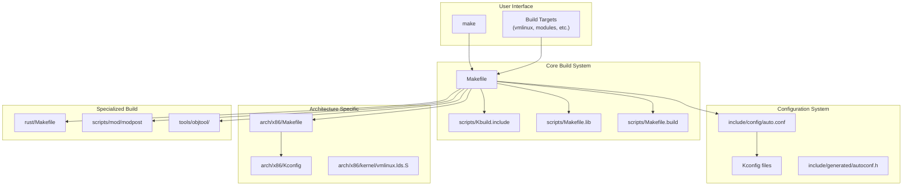
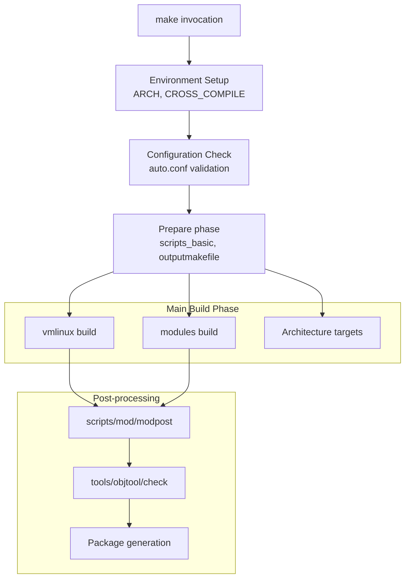
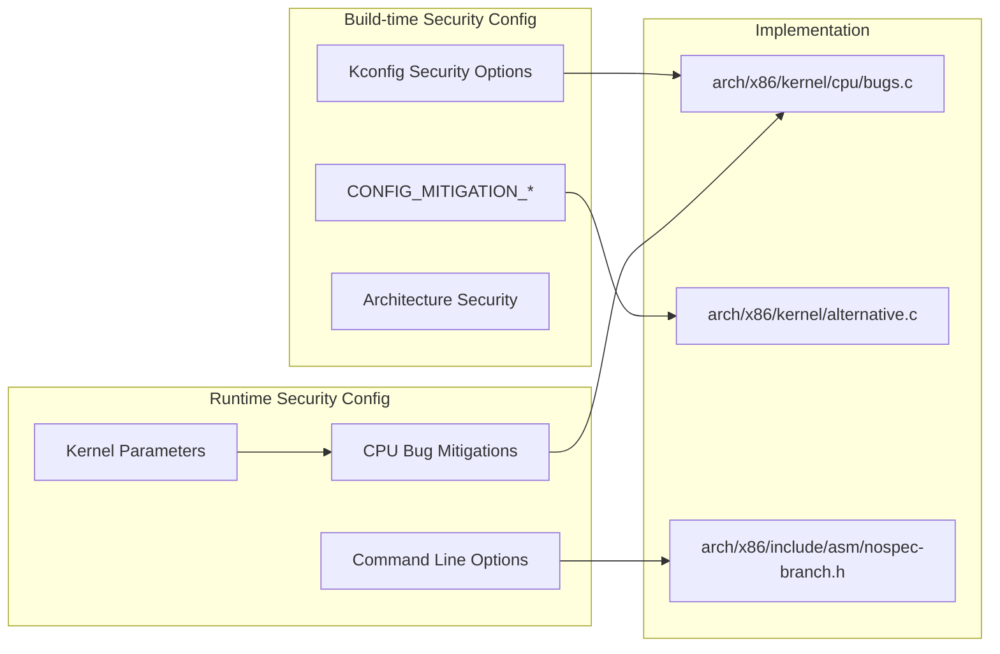
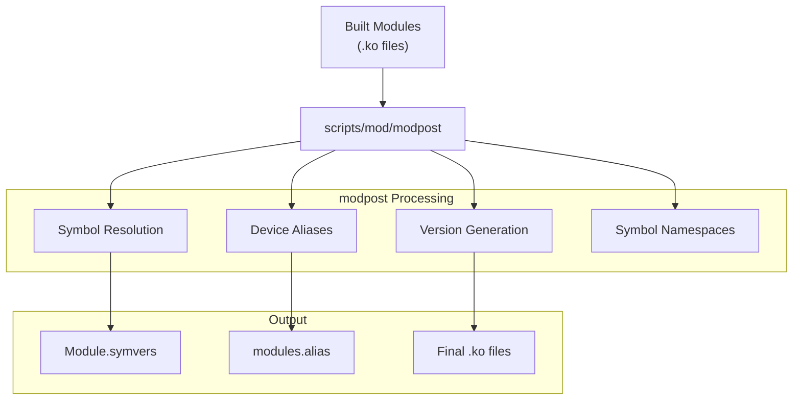
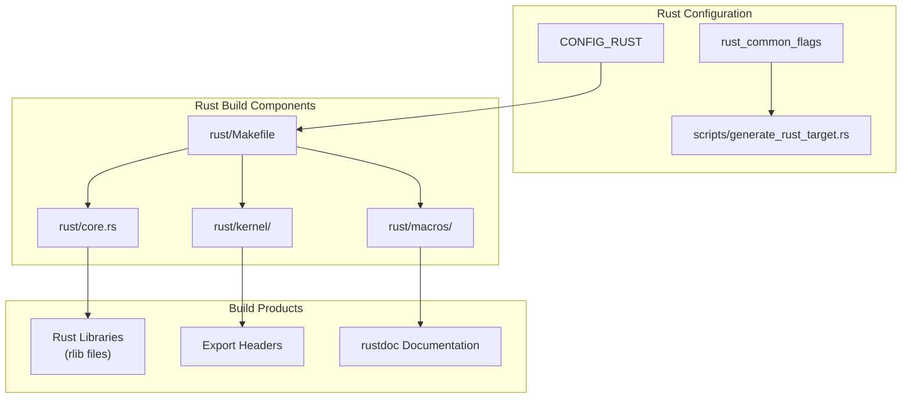
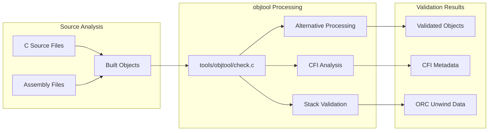
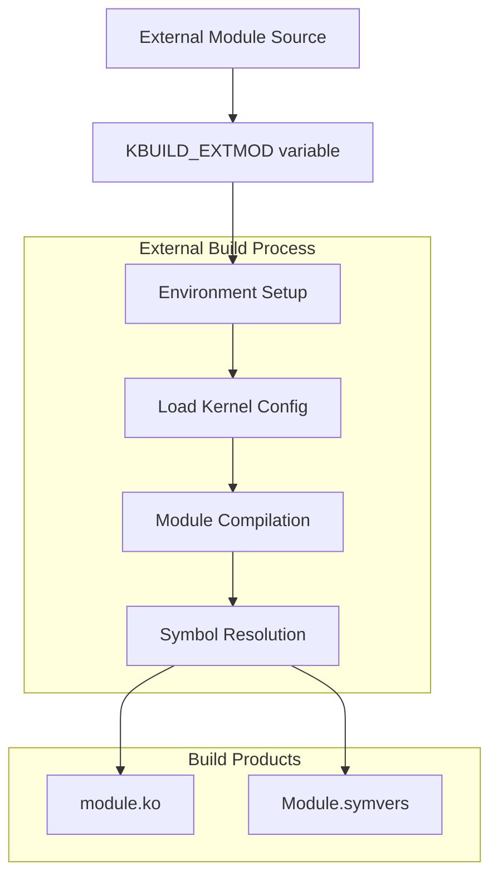

<!-- source: DeepWiki mcp.deepwiki.com · repo NVIDIA/NV-Kernels · page 8 Build System and Configuration · fetched 2026-10-26 -->

# Build System and Configuration

Relevant source files

The following files were used as context for generating this wiki page:

- [.gitignore](.gitignore)
- [Documentation/Makefile](Documentation/Makefile)
- [Documentation/admin-guide/hw-vuln/spectre.rst](Documentation/admin-guide/hw-vuln/spectre.rst)
- [Documentation/admin-guide/kernel-parameters.txt](Documentation/admin-guide/kernel-parameters.txt)
- [Documentation/conf.py](Documentation/conf.py)
- [Documentation/dev-tools/autofdo.rst](Documentation/dev-tools/autofdo.rst)
- [Documentation/dev-tools/coccinelle.rst](Documentation/dev-tools/coccinelle.rst)
- [Documentation/kbuild/kbuild.rst](Documentation/kbuild/kbuild.rst)
- [Documentation/kbuild/modules.rst](Documentation/kbuild/modules.rst)
- [Documentation/kbuild/reproducible-builds.rst](Documentation/kbuild/reproducible-builds.rst)
- [Documentation/process/changes.rst](Documentation/process/changes.rst)
- [Documentation/rust/arch-support.rst](Documentation/rust/arch-support.rst)
- [Documentation/rust/quick-start.rst](Documentation/rust/quick-start.rst)
- [Documentation/sphinx/kerneldoc-preamble.sty](Documentation/sphinx/kerneldoc-preamble.sty)
- [Makefile](Makefile)
- [arch/arm/Makefile](arch/arm/Makefile)
- [arch/arm/include/asm/fpu.h](arch/arm/include/asm/fpu.h)
- [arch/arm/mach-ep93xx/Kconfig](arch/arm/mach-ep93xx/Kconfig)
- [arch/loongarch/Kconfig.debug](arch/loongarch/Kconfig.debug)
- [arch/loongarch/include/asm/bug.h](arch/loongarch/include/asm/bug.h)
- [arch/loongarch/include/asm/module.h](arch/loongarch/include/asm/module.h)
- [arch/loongarch/include/asm/orc_header.h](arch/loongarch/include/asm/orc_header.h)
- [arch/loongarch/include/asm/orc_lookup.h](arch/loongarch/include/asm/orc_lookup.h)
- [arch/loongarch/include/asm/orc_types.h](arch/loongarch/include/asm/orc_types.h)
- [arch/mips/Makefile.postlink](arch/mips/Makefile.postlink)
- [arch/riscv/Makefile.postlink](arch/riscv/Makefile.postlink)
- [arch/riscv/boot/Makefile](arch/riscv/boot/Makefile)
- [arch/s390/Makefile.postlink](arch/s390/Makefile.postlink)
- [arch/sparc/kernel/vmlinux.lds.S](arch/sparc/kernel/vmlinux.lds.S)
- [arch/x86/Kconfig](arch/x86/Kconfig)
- [arch/x86/Kconfig.cpu](arch/x86/Kconfig.cpu)
- [arch/x86/Makefile](arch/x86/Makefile)
- [arch/x86/boot/startup/la57toggle.S](arch/x86/boot/startup/la57toggle.S)
- [arch/x86/entry/Makefile](arch/x86/entry/Makefile)
- [arch/x86/entry/calling.h](arch/x86/entry/calling.h)
- [arch/x86/entry/entry.S](arch/x86/entry/entry.S)
- [arch/x86/entry/entry_64.S](arch/x86/entry/entry_64.S)
- [arch/x86/entry/entry_64_compat.S](arch/x86/entry/entry_64_compat.S)
- [arch/x86/entry/syscall_32.c](arch/x86/entry/syscall_32.c)
- [arch/x86/entry/syscall_64.c](arch/x86/entry/syscall_64.c)
- [arch/x86/entry/thunk.S](arch/x86/entry/thunk.S)
- [arch/x86/include/asm/alternative.h](arch/x86/include/asm/alternative.h)
- [arch/x86/include/asm/asm-prototypes.h](arch/x86/include/asm/asm-prototypes.h)
- [arch/x86/include/asm/bug.h](arch/x86/include/asm/bug.h)
- [arch/x86/include/asm/gsseg.h](arch/x86/include/asm/gsseg.h)
- [arch/x86/include/asm/irq_stack.h](arch/x86/include/asm/irq_stack.h)
- [arch/x86/include/asm/nospec-branch.h](arch/x86/include/asm/nospec-branch.h)
- [arch/x86/include/asm/orc_header.h](arch/x86/include/asm/orc_header.h)
- [arch/x86/include/asm/seccomp.h](arch/x86/include/asm/seccomp.h)
- [arch/x86/include/asm/syscall.h](arch/x86/include/asm/syscall.h)
- [arch/x86/include/asm/text-patching.h](arch/x86/include/asm/text-patching.h)
- [arch/x86/kernel/acpi/wakeup_64.S](arch/x86/kernel/acpi/wakeup_64.S)
- [arch/x86/kernel/alternative.c](arch/x86/kernel/alternative.c)
- [arch/x86/kernel/callthunks.c](arch/x86/kernel/callthunks.c)
- [arch/x86/kernel/cpu/bugs.c](arch/x86/kernel/cpu/bugs.c)
- [arch/x86/kernel/kprobes/common.h](arch/x86/kernel/kprobes/common.h)
- [arch/x86/kernel/kprobes/core.c](arch/x86/kernel/kprobes/core.c)
- [arch/x86/kernel/kprobes/opt.c](arch/x86/kernel/kprobes/opt.c)
- [arch/x86/kernel/signal_32.c](arch/x86/kernel/signal_32.c)
- [arch/x86/kernel/tls.c](arch/x86/kernel/tls.c)
- [arch/x86/kernel/unwind_orc.c](arch/x86/kernel/unwind_orc.c)
- [arch/x86/kernel/vmlinux.lds.S](arch/x86/kernel/vmlinux.lds.S)
- [arch/x86/kvm/emulate.c](arch/x86/kvm/emulate.c)
- [arch/x86/kvm/kvm_emulate.h](arch/x86/kvm/kvm_emulate.h)
- [arch/x86/kvm/trace.h](arch/x86/kvm/trace.h)
- [arch/x86/kvm/vmx/run_flags.h](arch/x86/kvm/vmx/run_flags.h)
- [arch/x86/kvm/vmx/vmenter.S](arch/x86/kvm/vmx/vmenter.S)
- [arch/x86/lib/retpoline.S](arch/x86/lib/retpoline.S)
- [arch/x86/um/sys_call_table_32.c](arch/x86/um/sys_call_table_32.c)
- [arch/x86/um/sys_call_table_64.c](arch/x86/um/sys_call_table_64.c)
- [certs/Kconfig](certs/Kconfig)
- [crypto/asymmetric_keys/restrict.c](crypto/asymmetric_keys/restrict.c)
- [include/asm-generic/vmlinux.lds.h](include/asm-generic/vmlinux.lds.h)
- [include/linux/instrumentation.h](include/linux/instrumentation.h)
- [include/linux/linkage.h](include/linux/linkage.h)
- [include/linux/objtool.h](include/linux/objtool.h)
- [include/linux/objtool_types.h](include/linux/objtool_types.h)
- [init/.kunitconfig](init/.kunitconfig)
- [init/Makefile](init/Makefile)
- [init/initramfs_test.c](init/initramfs_test.c)
- [kernel/bpf/sysfs_btf.c](kernel/bpf/sysfs_btf.c)
- [kernel/gen_kheaders.sh](kernel/gen_kheaders.sh)
- [kernel/module/Kconfig](kernel/module/Kconfig)
- [rust/.gitignore](rust/.gitignore)
- [rust/Makefile](rust/Makefile)
- [rust/compiler_builtins.rs](rust/compiler_builtins.rs)
- [rust/exports.c](rust/exports.c)
- [scripts/.gitignore](scripts/.gitignore)
- [scripts/Kbuild.include](scripts/Kbuild.include)
- [scripts/Makefile](scripts/Makefile)
- [scripts/Makefile.autofdo](scripts/Makefile.autofdo)
- [scripts/Makefile.build](scripts/Makefile.build)
- [scripts/Makefile.clean](scripts/Makefile.clean)
- [scripts/Makefile.host](scripts/Makefile.host)
- [scripts/Makefile.lib](scripts/Makefile.lib)
- [scripts/Makefile.modfinal](scripts/Makefile.modfinal)
- [scripts/Makefile.modinst](scripts/Makefile.modinst)
- [scripts/Makefile.modpost](scripts/Makefile.modpost)
- [scripts/Makefile.package](scripts/Makefile.package)
- [scripts/Makefile.vmlinux](scripts/Makefile.vmlinux)
- [scripts/Makefile.vmlinux_o](scripts/Makefile.vmlinux_o)
- [scripts/build-version](scripts/build-version)
- [scripts/check-git](scripts/check-git)
- [scripts/check-variable-fonts.sh](scripts/check-variable-fonts.sh)
- [scripts/coccicheck](scripts/coccicheck)
- [scripts/coccinelle/misc/add_namespace.cocci](scripts/coccinelle/misc/add_namespace.cocci)
- [scripts/gendwarfksyms/.gitignore](scripts/gendwarfksyms/.gitignore)
- [scripts/generate_rust_analyzer.py](scripts/generate_rust_analyzer.py)
- [scripts/generate_rust_target.rs](scripts/generate_rust_target.rs)
- [scripts/min-tool-version.sh](scripts/min-tool-version.sh)
- [scripts/mod/file2alias.c](scripts/mod/file2alias.c)
- [scripts/mod/modpost.c](scripts/mod/modpost.c)
- [scripts/mod/modpost.h](scripts/mod/modpost.h)
- [scripts/mod/sumversion.c](scripts/mod/sumversion.c)
- [scripts/mod/symsearch.c](scripts/mod/symsearch.c)
- [scripts/module-common.c](scripts/module-common.c)
- [scripts/module.lds.S](scripts/module.lds.S)
- [scripts/nsdeps](scripts/nsdeps)
- [scripts/orc_hash.sh](scripts/orc_hash.sh)
- [scripts/package/PKGBUILD](scripts/package/PKGBUILD)
- [scripts/package/builddeb](scripts/package/builddeb)
- [scripts/package/buildtar](scripts/package/buildtar)
- [scripts/package/debian/rules](scripts/package/debian/rules)
- [scripts/package/gen-diff-patch](scripts/package/gen-diff-patch)
- [scripts/package/install-extmod-build](scripts/package/install-extmod-build)
- [scripts/package/kernel.spec](scripts/package/kernel.spec)
- [scripts/package/mkdebian](scripts/package/mkdebian)
- [scripts/package/mkspec](scripts/package/mkspec)
- [scripts/rust_is_available.sh](scripts/rust_is_available.sh)
- [scripts/rust_is_available_bindgen_0_66.h](scripts/rust_is_available_bindgen_0_66.h)
- [scripts/rust_is_available_bindgen_libclang_concat.h](scripts/rust_is_available_bindgen_libclang_concat.h)
- [scripts/rust_is_available_test.py](scripts/rust_is_available_test.py)
- [scripts/setlocalversion](scripts/setlocalversion)
- [scripts/syscalltbl.sh](scripts/syscalltbl.sh)
- [tools/arch/loongarch/include/asm/orc_types.h](tools/arch/loongarch/include/asm/orc_types.h)
- [tools/include/linux/objtool_types.h](tools/include/linux/objtool_types.h)
- [tools/objtool/Documentation/objtool.txt](tools/objtool/Documentation/objtool.txt)
- [tools/objtool/arch/loongarch/Build](tools/objtool/arch/loongarch/Build)
- [tools/objtool/arch/loongarch/decode.c](tools/objtool/arch/loongarch/decode.c)
- [tools/objtool/arch/loongarch/include/arch/cfi_regs.h](tools/objtool/arch/loongarch/include/arch/cfi_regs.h)
- [tools/objtool/arch/loongarch/include/arch/elf.h](tools/objtool/arch/loongarch/include/arch/elf.h)
- [tools/objtool/arch/loongarch/include/arch/special.h](tools/objtool/arch/loongarch/include/arch/special.h)
- [tools/objtool/arch/loongarch/orc.c](tools/objtool/arch/loongarch/orc.c)
- [tools/objtool/arch/powerpc/decode.c](tools/objtool/arch/powerpc/decode.c)
- [tools/objtool/arch/x86/decode.c](tools/objtool/arch/x86/decode.c)
- [tools/objtool/arch/x86/orc.c](tools/objtool/arch/x86/orc.c)
- [tools/objtool/builtin-check.c](tools/objtool/builtin-check.c)
- [tools/objtool/check.c](tools/objtool/check.c)
- [tools/objtool/elf.c](tools/objtool/elf.c)
- [tools/objtool/include/objtool/arch.h](tools/objtool/include/objtool/arch.h)
- [tools/objtool/include/objtool/builtin.h](tools/objtool/include/objtool/builtin.h)
- [tools/objtool/include/objtool/elf.h](tools/objtool/include/objtool/elf.h)
- [tools/objtool/include/objtool/warn.h](tools/objtool/include/objtool/warn.h)
- [tools/objtool/noreturns.h](tools/objtool/noreturns.h)
- [tools/objtool/objtool.c](tools/objtool/objtool.c)
- [tools/objtool/orc_dump.c](tools/objtool/orc_dump.c)
- [tools/objtool/special.c](tools/objtool/special.c)

## Purpose and Scope

This document describes the kernel's build system architecture and configuration mechanisms. It covers the Kbuild system, kernel configuration (Kconfig), module building, Rust integration, and packaging infrastructure. For information about individual subsystem configurations, see the respective subsystem documentation pages.

## Build System Overview

The Linux kernel uses a sophisticated build system called Kbuild, orchestrated by the top-level [Makefile:1-100]() and a hierarchy of build scripts. The system supports both in-tree and out-of-tree builds, cross-compilation, and modular compilation.

### Build System Architecture

**Sources:** [Makefile:1-1000](), [scripts/Kbuild.include:1-50](), [scripts/Makefile.lib:1-50](), [scripts/Makefile.build:1-50]()

The build system supports multiple output modes controlled by variables like `KBUILD_VERBOSE`, `KBUILD_EXTMOD`, and `KBUILD_OUTPUT` defined in [Makefile:82-182](). The system automatically detects whether it's building the kernel itself or external modules.

### Build Flow and Target Processing

**Sources:** [Makefile:740-800](), [scripts/Makefile.vmlinux:1-50](), [scripts/mod/modpost.c:1-100]()

## Configuration System (Kconfig)

The kernel configuration system uses Kconfig to manage build-time options. Configuration files define available options, their dependencies, and default values.

### Configuration Architecture

| Component | Purpose | Key Files |
|-----------|---------|-----------|
| `Kconfig` | Configuration definitions | [arch/x86/Kconfig:1-100](), [kernel/module/Kconfig:1-50]() |
| `auto.conf` | Generated configuration | [Makefile:779-780]() |
| `autoconf.h` | C header definitions | Generated from Kconfig |
| `rustc_cfg` | Rust configuration | Generated from Kconfig |

The configuration system supports conditional compilation through options like `CONFIG_RUST`, `CONFIG_MODULES`, and architecture-specific settings defined in [arch/x86/Kconfig:60-336]().

### Security Configuration

The kernel includes extensive security mitigations configured through both build-time and runtime parameters:

**Sources:** [arch/x86/kernel/cpu/bugs.c:191-275](), [Documentation/admin-guide/kernel-parameters.txt:1-100](), [arch/x86/Kconfig:70]()

Security mitigations are initialized through `cpu_select_mitigations()` in [arch/x86/kernel/cpu/bugs.c:191-275]() and can be controlled via kernel parameters documented in [Documentation/admin-guide/kernel-parameters.txt:367-394]().

## Core Build Components

### Kbuild Infrastructure

The build system consists of several key Makefile components:

| Makefile | Purpose | Key Functions |
|----------|---------|---------------|
| `Makefile` | Main orchestration | Target definitions, variable setup |
| `scripts/Makefile.lib` | Common build rules | Flag processing, sanitizer setup |
| `scripts/Makefile.build` | Object compilation | Per-directory build logic |
| `scripts/Makefile.vmlinux` | Kernel image creation | Final linking, symbol resolution |

Build flags are processed through a sophisticated system in [scripts/Makefile.lib:26-91]() that handles sanitizers (KASAN, KMSAN, UBSAN), coverage tools (KCOV, GCOV), and optimization settings.

### Module Post-processing

The `modpost` tool processes kernel modules and symbols:

**Sources:** [scripts/mod/modpost.c:31-100](), [scripts/mod/file2alias.c:1-50]()

The `modpost` tool resolves symbol dependencies, generates version information, and creates device alias tables used by the module loading infrastructure.

## Rust Integration

The kernel includes comprehensive Rust support integrated into the build system:

### Rust Build Architecture

**Sources:** [rust/Makefile:1-100](), [scripts/generate_rust_target.rs:1-50](), [Makefile:471-492]()

Rust compilation uses custom target specifications generated by [scripts/generate_rust_target.rs:1-50]() and common flags defined in [Makefile:473-491]() including panic handling, LTO settings, and debugging options.

### Rust Build Flags and Configuration

The Rust build system uses sophisticated flag management:

- **Common flags**: Defined in [Makefile:473-491]() for edition, debugging, and linting
- **Kernel flags**: Specific settings in [Makefile:588-594]() for panic=abort and optimization
- **Host flags**: Separate settings for build-time tools in [Makefile:497-498]()

## Object Tool Integration

The build system integrates objtool for binary analysis and validation:

**Sources:** [tools/objtool/check.c:1-100](), [tools/objtool/builtin-check.c:1-50]()

## Package Generation

The build system supports multiple package formats through [scripts/package/]:

### Package Build Flow

| Package Type | Script | Output |
|--------------|--------|--------|
| Debian | [scripts/package/mkdebian](), [scripts/package/builddeb]() | `.deb` packages |
| RPM | `scripts/package/mkspec`, `scripts/package/buildrpm` | `.rpm` packages |
| tar | `scripts/package/buildtar` | `.tar.gz` archives |

The Debian package generation uses [scripts/package/mkdebian:1-100]() to create package metadata and [scripts/package/builddeb:1-50]() for the actual package construction, with architecture detection in [scripts/package/mkdebian:21-83]().

**Sources:** [scripts/package/mkdebian:1-100](), [scripts/package/builddeb:1-50](), [scripts/Makefile.package:1-50]()

## External Module Building

The build system supports building external modules through the `KBUILD_EXTMOD` mechanism:

**Sources:** [Makefile:131-153](), [Documentation/kbuild/modules.rst:1-100]()

External module building is controlled by the `KBUILD_EXTMOD` variable set in [Makefile:133-135]() and follows the process documented in [Documentation/kbuild/modules.rst:1-100]().

---

