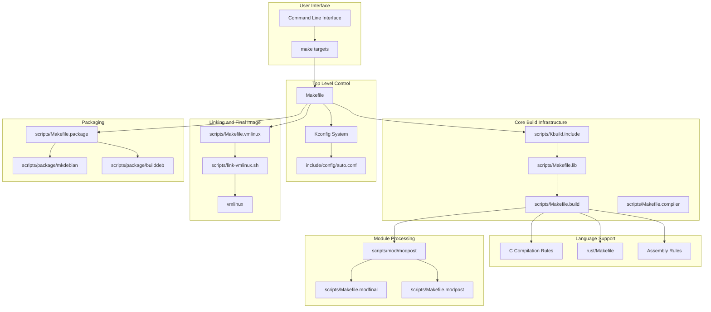
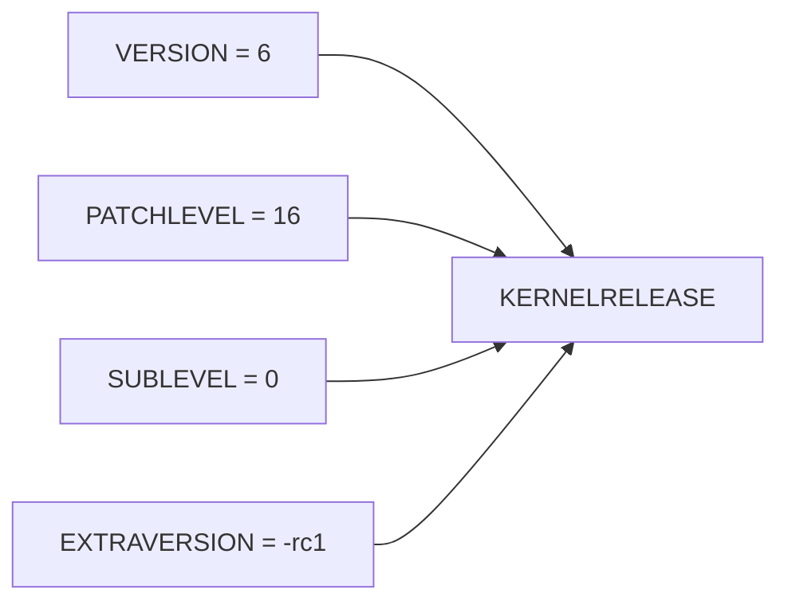
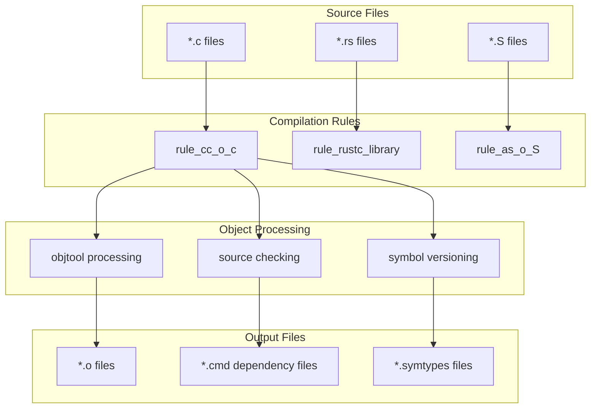
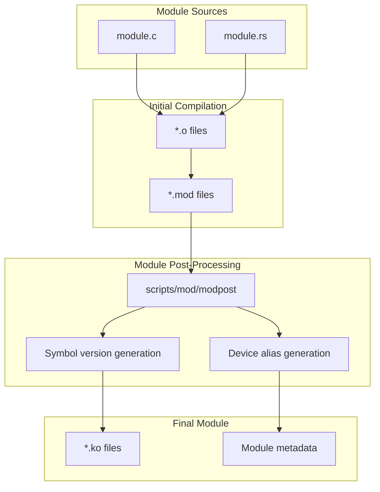
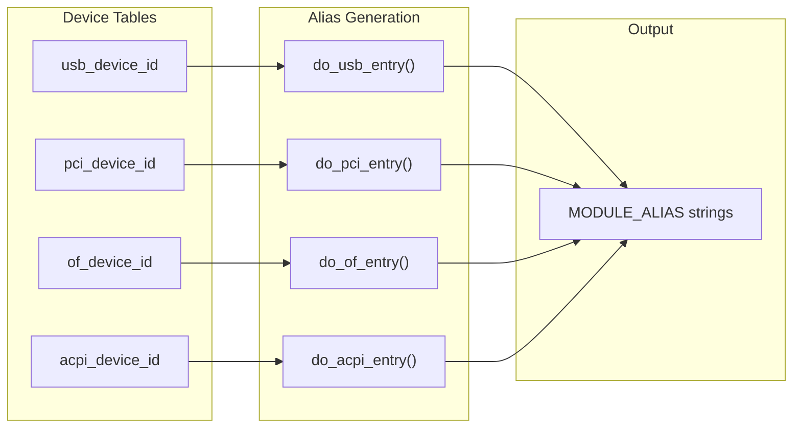
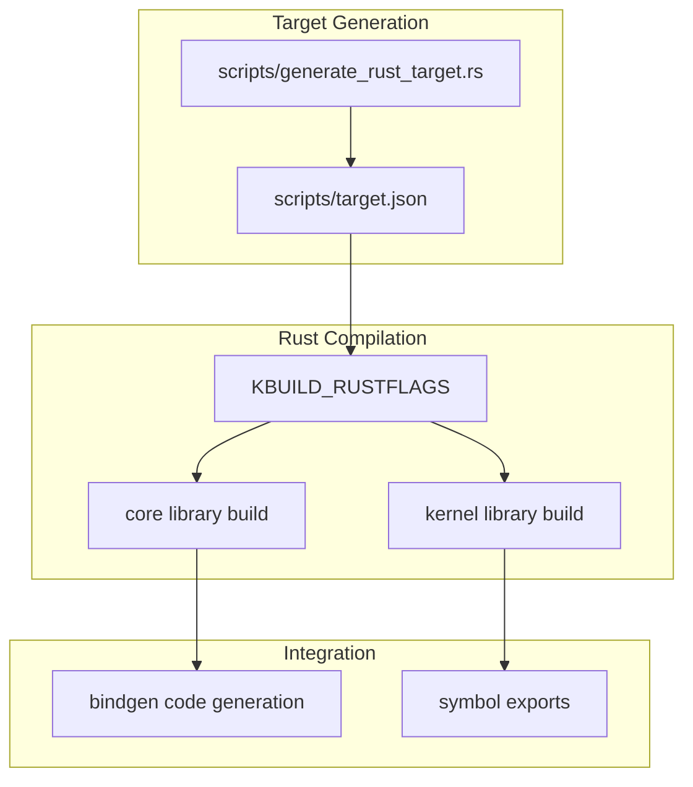
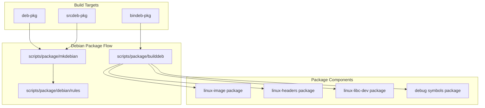

<!-- source: DeepWiki mcp.deepwiki.com · repo NVIDIA/NV-Kernels · page 8.1 Kernel Build System · fetched 2026-10-26 -->

# Kernel Build System

Relevant source files

The following files were used as context for generating this wiki page:

- [.gitignore](.gitignore)
- [Documentation/Makefile](Documentation/Makefile)
- [Documentation/conf.py](Documentation/conf.py)
- [Documentation/dev-tools/coccinelle.rst](Documentation/dev-tools/coccinelle.rst)
- [Documentation/kbuild/kbuild.rst](Documentation/kbuild/kbuild.rst)
- [Documentation/kbuild/modules.rst](Documentation/kbuild/modules.rst)
- [Documentation/kbuild/reproducible-builds.rst](Documentation/kbuild/reproducible-builds.rst)
- [Documentation/process/changes.rst](Documentation/process/changes.rst)
- [Documentation/rust/arch-support.rst](Documentation/rust/arch-support.rst)
- [Documentation/rust/quick-start.rst](Documentation/rust/quick-start.rst)
- [Documentation/sphinx/kerneldoc-preamble.sty](Documentation/sphinx/kerneldoc-preamble.sty)
- [Makefile](Makefile)
- [arch/arm/Makefile](arch/arm/Makefile)
- [arch/arm/include/asm/fpu.h](arch/arm/include/asm/fpu.h)
- [arch/arm/mach-ep93xx/Kconfig](arch/arm/mach-ep93xx/Kconfig)
- [arch/mips/Makefile.postlink](arch/mips/Makefile.postlink)
- [arch/riscv/Makefile.postlink](arch/riscv/Makefile.postlink)
- [arch/riscv/boot/Makefile](arch/riscv/boot/Makefile)
- [arch/s390/Makefile.postlink](arch/s390/Makefile.postlink)
- [arch/x86/Kconfig.cpu](arch/x86/Kconfig.cpu)
- [arch/x86/Makefile](arch/x86/Makefile)
- [arch/x86/boot/startup/la57toggle.S](arch/x86/boot/startup/la57toggle.S)
- [certs/Kconfig](certs/Kconfig)
- [crypto/asymmetric_keys/restrict.c](crypto/asymmetric_keys/restrict.c)
- [init/.kunitconfig](init/.kunitconfig)
- [init/Makefile](init/Makefile)
- [init/initramfs_test.c](init/initramfs_test.c)
- [kernel/gen_kheaders.sh](kernel/gen_kheaders.sh)
- [kernel/module/Kconfig](kernel/module/Kconfig)
- [rust/.gitignore](rust/.gitignore)
- [rust/Makefile](rust/Makefile)
- [rust/compiler_builtins.rs](rust/compiler_builtins.rs)
- [rust/exports.c](rust/exports.c)
- [scripts/.gitignore](scripts/.gitignore)
- [scripts/Kbuild.include](scripts/Kbuild.include)
- [scripts/Makefile](scripts/Makefile)
- [scripts/Makefile.build](scripts/Makefile.build)
- [scripts/Makefile.clean](scripts/Makefile.clean)
- [scripts/Makefile.host](scripts/Makefile.host)
- [scripts/Makefile.lib](scripts/Makefile.lib)
- [scripts/Makefile.modfinal](scripts/Makefile.modfinal)
- [scripts/Makefile.modinst](scripts/Makefile.modinst)
- [scripts/Makefile.modpost](scripts/Makefile.modpost)
- [scripts/Makefile.package](scripts/Makefile.package)
- [scripts/Makefile.vmlinux](scripts/Makefile.vmlinux)
- [scripts/Makefile.vmlinux_o](scripts/Makefile.vmlinux_o)
- [scripts/build-version](scripts/build-version)
- [scripts/check-git](scripts/check-git)
- [scripts/check-variable-fonts.sh](scripts/check-variable-fonts.sh)
- [scripts/coccicheck](scripts/coccicheck)
- [scripts/coccinelle/misc/add_namespace.cocci](scripts/coccinelle/misc/add_namespace.cocci)
- [scripts/gendwarfksyms/.gitignore](scripts/gendwarfksyms/.gitignore)
- [scripts/generate_rust_analyzer.py](scripts/generate_rust_analyzer.py)
- [scripts/generate_rust_target.rs](scripts/generate_rust_target.rs)
- [scripts/min-tool-version.sh](scripts/min-tool-version.sh)
- [scripts/mod/file2alias.c](scripts/mod/file2alias.c)
- [scripts/mod/modpost.c](scripts/mod/modpost.c)
- [scripts/mod/modpost.h](scripts/mod/modpost.h)
- [scripts/mod/sumversion.c](scripts/mod/sumversion.c)
- [scripts/mod/symsearch.c](scripts/mod/symsearch.c)
- [scripts/module-common.c](scripts/module-common.c)
- [scripts/module.lds.S](scripts/module.lds.S)
- [scripts/nsdeps](scripts/nsdeps)
- [scripts/package/PKGBUILD](scripts/package/PKGBUILD)
- [scripts/package/builddeb](scripts/package/builddeb)
- [scripts/package/buildtar](scripts/package/buildtar)
- [scripts/package/debian/rules](scripts/package/debian/rules)
- [scripts/package/gen-diff-patch](scripts/package/gen-diff-patch)
- [scripts/package/install-extmod-build](scripts/package/install-extmod-build)
- [scripts/package/kernel.spec](scripts/package/kernel.spec)
- [scripts/package/mkdebian](scripts/package/mkdebian)
- [scripts/package/mkspec](scripts/package/mkspec)
- [scripts/rust_is_available.sh](scripts/rust_is_available.sh)
- [scripts/rust_is_available_bindgen_0_66.h](scripts/rust_is_available_bindgen_0_66.h)
- [scripts/rust_is_available_bindgen_libclang_concat.h](scripts/rust_is_available_bindgen_libclang_concat.h)
- [scripts/rust_is_available_test.py](scripts/rust_is_available_test.py)
- [scripts/setlocalversion](scripts/setlocalversion)

## Purpose and Scope

The kernel build system, commonly referred to as "Kbuild", is the comprehensive infrastructure responsible for compiling the Linux kernel from source code into bootable images, loadable modules, and distributable packages. This system handles dependency tracking, cross-compilation support, incremental builds, module processing, and integration with multiple programming languages including C, Assembly, and Rust.

This document covers the core build infrastructure, compilation processes, module handling, and packaging systems. For information about kernel configuration options, see [Kernel Parameters and Security](#8.2).

## Build System Architecture

The kernel build system follows a hierarchical structure with the main `Makefile` orchestrating the entire build process through specialized sub-makefiles and scripts.

Sources: [Makefile:1-2000](), [scripts/Kbuild.include:1-50](), [scripts/Makefile.lib:1-50](), [scripts/Makefile.build:1-50]()

## Main Makefile Structure

The top-level `Makefile` serves as the entry point and coordinator for the entire build system. It handles version information, architecture detection, toolchain configuration, and build target dispatch.

### Version and Architecture Setup

The kernel version is defined at the beginning of the main Makefile:

The build system determines the target architecture and sets up cross-compilation:

- `ARCH` variable specifies target architecture
- `CROSS_COMPILE` sets toolchain prefix
- `SRCARCH` normalizes architecture names (e.g., i386/x86_64 → x86)

Sources: [Makefile:2-6](), [Makefile:403-433]()

### Build Targets and Flow

The main Makefile defines several key build targets that control different aspects of the build process:

| Target | Purpose | Key Files Generated |
|--------|---------|-------------------|
| `all` | Default target, builds vmlinux | `vmlinux`, modules |
| `modules` | Build loadable kernel modules | `*.ko` files |
| `modules_install` | Install modules to filesystem | `/lib/modules/$(KERNELRELEASE)/` |
| `vmlinux` | Build kernel image | `vmlinux` |
| `bzImage` | Build compressed kernel (x86) | `arch/x86/boot/bzImage` |
| `clean` | Remove generated files | - |
| `mrproper` | Deep clean including config | - |

Sources: [Makefile:744-774](), [Makefile:793]()

## Kbuild Infrastructure

The Kbuild infrastructure consists of several specialized makefiles that handle different aspects of the build process.

### Build Rules and Compilation

The `scripts/Makefile.build` file contains the core logic for compiling source files and managing dependencies:

Key compilation commands are defined in `scripts/Makefile.lib`:
- `cmd_cc_o_c` for C compilation
- `cmd_rustc_library` for Rust compilation  
- `cmd_as_o_S` for assembly

Sources: [scripts/Makefile.build:175-255](), [scripts/Makefile.lib:242-255]()

### Dependency Tracking

The build system uses advanced dependency tracking to enable incremental builds:

- **`.cmd` files**: Store command lines and dependencies for each target
- **`if_changed` macro**: Rebuilds targets only when commands or dependencies change
- **`if_changed_dep` macro**: Additional dependency file processing

Sources: [scripts/Kbuild.include:142-180]()

## Module Processing System

Kernel modules require specialized processing after compilation to handle symbol resolution, versioning, and metadata generation.

### Module Compilation Flow

### Modpost Tool

The `modpost` tool is responsible for module post-processing:

- **Symbol resolution**: Resolves undefined symbols against kernel exports
- **Version checking**: Validates symbol versions for compatibility
- **Alias generation**: Creates device aliases for module autoloading
- **Section validation**: Checks for section mismatches and other issues

Key functions in `scripts/mod/modpost.c`:
- `read_symbols()`: Reads symbol tables from object files
- `check_exports()`: Validates exported symbols
- `write_dump()`: Generates symbol version information

Sources: [scripts/mod/modpost.c:1-100](), [scripts/mod/modpost.c:405-576]()

### Device Alias Generation

The `file2alias.c` component generates MODULE_ALIAS() statements for automatic module loading:

Sources: [scripts/mod/file2alias.c:182-246](), [scripts/mod/file2alias.c:420-472]()

## Rust Integration

The kernel build system includes comprehensive support for Rust code compilation and integration.

### Rust Build Configuration

The `rust/Makefile` handles Rust-specific build requirements:

- **Core library**: Builds kernel-specific `core` library with custom target
- **Bindgen integration**: Generates Rust bindings for C kernel APIs
- **Procedural macros**: Compiles proc macros for kernel development
- **Documentation**: Generates rustdoc documentation

Key Rust build targets:
- `rust/core.o`: Core Rust library for kernel
- `rust/bindings.o`: C API bindings
- `rust/kernel.o`: Kernel Rust support library

Sources: [rust/Makefile:6-28](), [rust/Makefile:488-543]()

### Rust Target Specification

The build system generates custom Rust target specifications for kernel compilation:

Sources: [scripts/generate_rust_target.rs:1-50](), [rust/Makefile:78-79]()

## Cross-Platform Support

The build system supports multiple architectures through architecture-specific makefiles and configuration.

### Architecture-Specific Configuration

Each architecture provides its own Makefile with platform-specific settings:

- **Compiler flags**: Architecture-specific CFLAGS and RUSTFLAGS
- **Linker configuration**: Memory layout and linking requirements  
- **Boot image format**: Architecture-specific kernel image formats

Example from x86 architecture:
- 32-bit: Uses `-m32`, `-mregparm=3`, stack alignment optimizations
- 64-bit: Uses `-m64`, `-mcmodel=kernel`, red zone disabled

Sources: [arch/x86/Makefile:117-190]()

### Cross-Compilation Support

The build system enables cross-compilation through:

- `CROSS_COMPILE` prefix for toolchain binaries
- `ARCH` specification for target architecture
- Automatic host/target detection and configuration

Sources: [Makefile:385-433]()

## Packaging System

The kernel build system includes comprehensive packaging support for different Linux distributions.

### Debian Package Generation

The Debian packaging system creates multiple packages:
- **linux-image**: Kernel binary, modules, and boot files
- **linux-headers**: Headers for external module compilation
- **linux-libc-dev**: Userspace headers for glibc
- **debug package**: Debug symbols for kernel debugging

Sources: [scripts/package/mkdebian:134-177](), [scripts/package/builddeb:29-71]()

### RPM Package Support

Similar packaging support exists for RPM-based distributions through:
- `scripts/package/mkspec`: Generates RPM spec files
- `scripts/package/kernel.spec`: Template spec file
- Targets: `rpm-pkg`, `srcrpm-pkg`, `binrpm-pkg`

Sources: [scripts/package/mkspec:1-50](), [scripts/Makefile.package:47-82]()

## Build Optimization Features

### Incremental Build Support

The build system includes several optimizations for faster incremental builds:

- **Dependency tracking**: Only rebuilds when sources or dependencies change
- **Command change detection**: Rebuilds when compilation commands change
- **Timestamp-based checks**: Avoids unnecessary work when files are unchanged

### Parallel Build Support

The build system is designed for parallel execution:
- Recursive make with proper dependency ordering
- Per-directory build parallelization
- Module compilation parallelization

Sources: [Makefile:47-49](), [scripts/Makefile.build:68-158]()

### Link-Time Optimization

Support for various optimization techniques:
- **LTO (Link Time Optimization)**: Cross-module optimization
- **CFI (Control Flow Integrity)**: Security hardening
- **Dead code elimination**: Removes unused code sections

Sources: [Makefile:998-1014](), [Makefile:1016-1033]()

## Configuration Integration

The build system tightly integrates with the kernel configuration system:

### Configuration Files

- **`.config`**: Main configuration file
- **`include/config/auto.conf`**: Makefile-compatible configuration
- **`include/generated/autoconf.h`**: C header with configuration
- **`include/generated/rustc_cfg`**: Rust configuration flags

### Conditional Compilation

The build system uses configuration to control:
- Which files are compiled
- Compiler flags and optimizations
- Feature availability
- Module vs. built-in compilation

Sources: [Makefile:778-858](), [scripts/Makefile.lib:45-106]()

---

