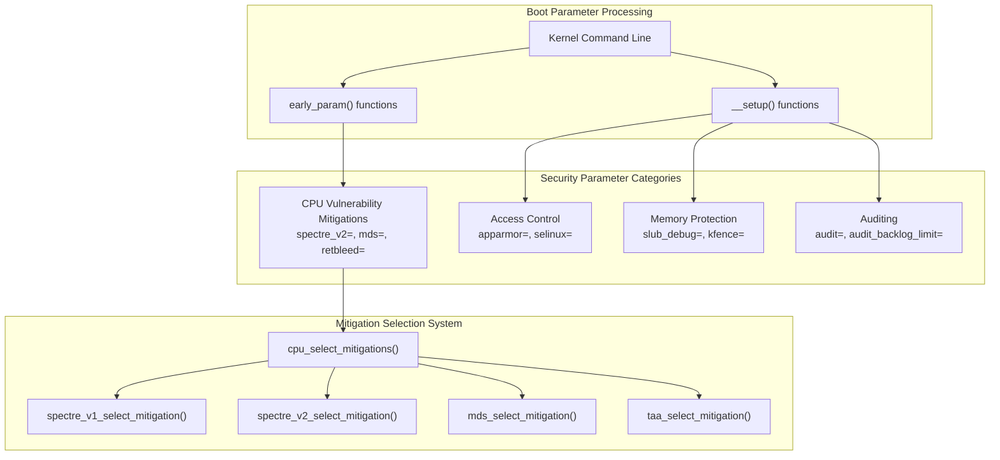
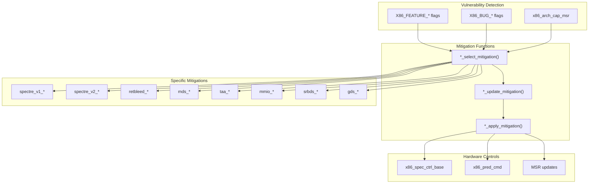
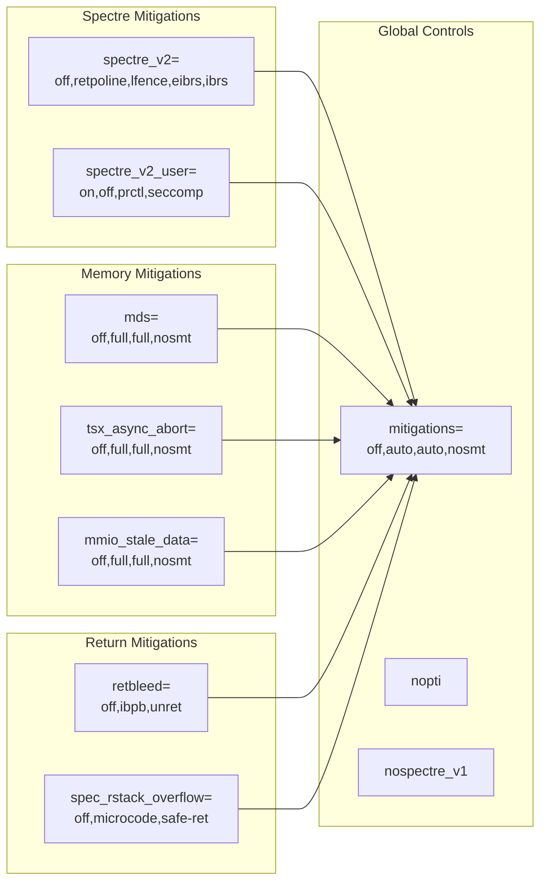
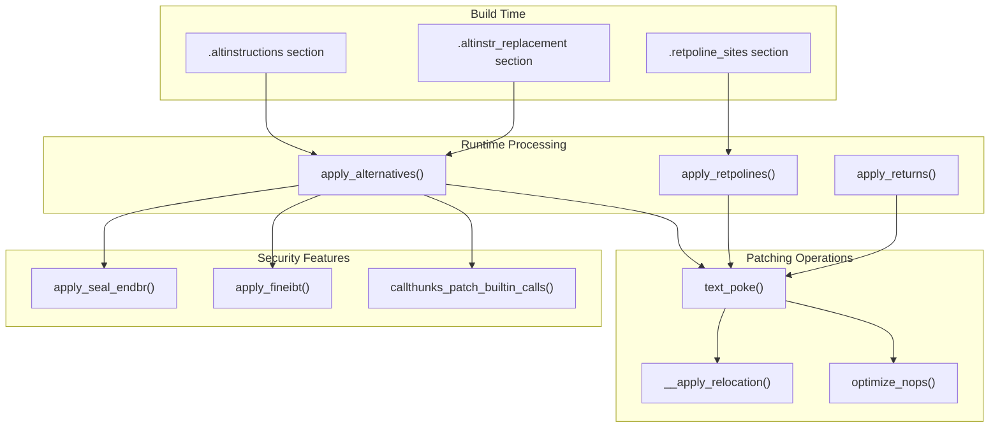
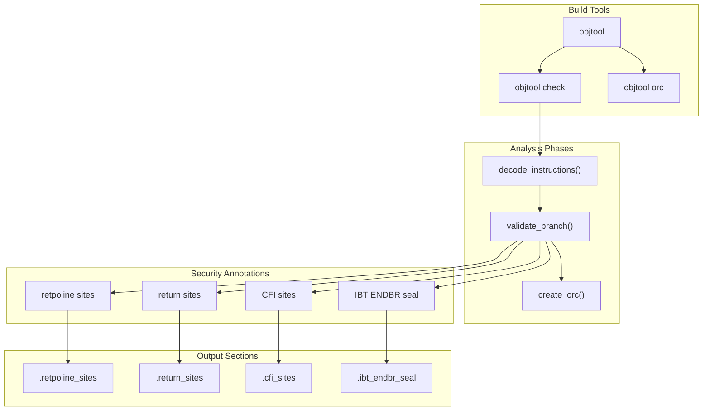
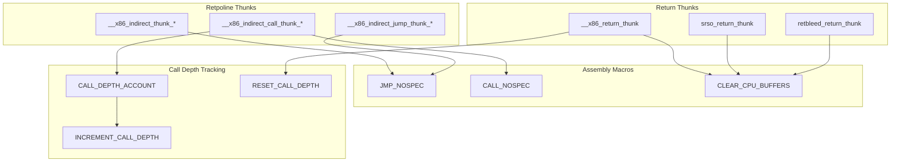
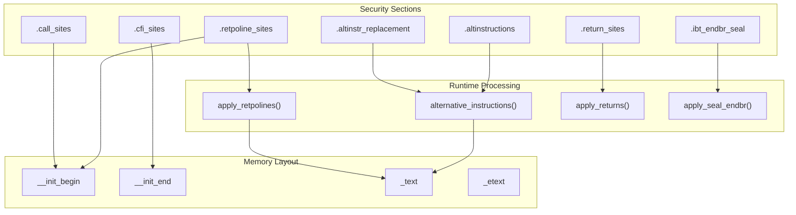
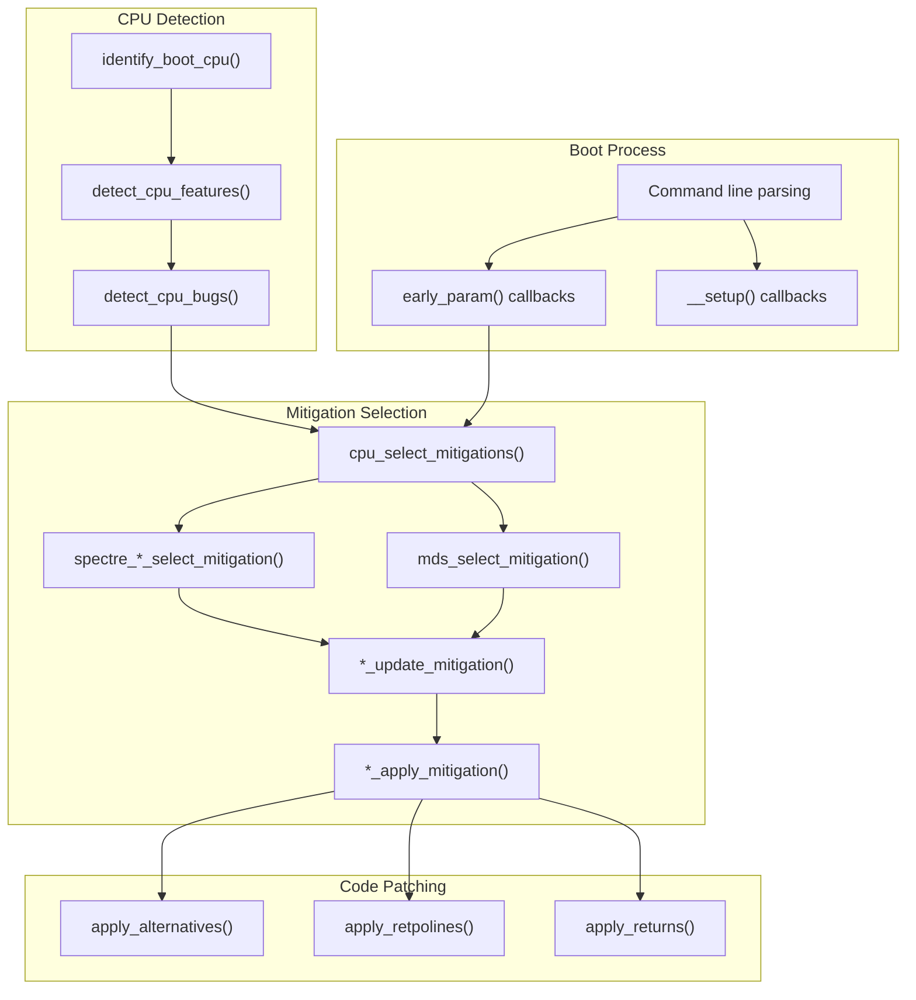

<!-- source: DeepWiki mcp.deepwiki.com · repo NVIDIA/NV-Kernels · page 8.2 Kernel Parameters and Security · fetched 2026-10-26 -->

# Kernel Parameters and Security

Relevant source files

The following files were used as context for generating this wiki page:

- [Documentation/admin-guide/hw-vuln/spectre.rst](Documentation/admin-guide/hw-vuln/spectre.rst)
- [Documentation/admin-guide/kernel-parameters.txt](Documentation/admin-guide/kernel-parameters.txt)
- [Documentation/dev-tools/autofdo.rst](Documentation/dev-tools/autofdo.rst)
- [arch/loongarch/Kconfig.debug](arch/loongarch/Kconfig.debug)
- [arch/loongarch/include/asm/bug.h](arch/loongarch/include/asm/bug.h)
- [arch/loongarch/include/asm/module.h](arch/loongarch/include/asm/module.h)
- [arch/loongarch/include/asm/orc_header.h](arch/loongarch/include/asm/orc_header.h)
- [arch/loongarch/include/asm/orc_lookup.h](arch/loongarch/include/asm/orc_lookup.h)
- [arch/loongarch/include/asm/orc_types.h](arch/loongarch/include/asm/orc_types.h)
- [arch/sparc/kernel/vmlinux.lds.S](arch/sparc/kernel/vmlinux.lds.S)
- [arch/x86/Kconfig](arch/x86/Kconfig)
- [arch/x86/entry/Makefile](arch/x86/entry/Makefile)
- [arch/x86/entry/calling.h](arch/x86/entry/calling.h)
- [arch/x86/entry/entry.S](arch/x86/entry/entry.S)
- [arch/x86/entry/entry_64.S](arch/x86/entry/entry_64.S)
- [arch/x86/entry/entry_64_compat.S](arch/x86/entry/entry_64_compat.S)
- [arch/x86/entry/syscall_32.c](arch/x86/entry/syscall_32.c)
- [arch/x86/entry/syscall_64.c](arch/x86/entry/syscall_64.c)
- [arch/x86/entry/thunk.S](arch/x86/entry/thunk.S)
- [arch/x86/include/asm/alternative.h](arch/x86/include/asm/alternative.h)
- [arch/x86/include/asm/asm-prototypes.h](arch/x86/include/asm/asm-prototypes.h)
- [arch/x86/include/asm/bug.h](arch/x86/include/asm/bug.h)
- [arch/x86/include/asm/gsseg.h](arch/x86/include/asm/gsseg.h)
- [arch/x86/include/asm/irq_stack.h](arch/x86/include/asm/irq_stack.h)
- [arch/x86/include/asm/nospec-branch.h](arch/x86/include/asm/nospec-branch.h)
- [arch/x86/include/asm/orc_header.h](arch/x86/include/asm/orc_header.h)
- [arch/x86/include/asm/seccomp.h](arch/x86/include/asm/seccomp.h)
- [arch/x86/include/asm/syscall.h](arch/x86/include/asm/syscall.h)
- [arch/x86/include/asm/text-patching.h](arch/x86/include/asm/text-patching.h)
- [arch/x86/kernel/acpi/wakeup_64.S](arch/x86/kernel/acpi/wakeup_64.S)
- [arch/x86/kernel/alternative.c](arch/x86/kernel/alternative.c)
- [arch/x86/kernel/callthunks.c](arch/x86/kernel/callthunks.c)
- [arch/x86/kernel/cpu/bugs.c](arch/x86/kernel/cpu/bugs.c)
- [arch/x86/kernel/kprobes/common.h](arch/x86/kernel/kprobes/common.h)
- [arch/x86/kernel/kprobes/core.c](arch/x86/kernel/kprobes/core.c)
- [arch/x86/kernel/kprobes/opt.c](arch/x86/kernel/kprobes/opt.c)
- [arch/x86/kernel/signal_32.c](arch/x86/kernel/signal_32.c)
- [arch/x86/kernel/tls.c](arch/x86/kernel/tls.c)
- [arch/x86/kernel/unwind_orc.c](arch/x86/kernel/unwind_orc.c)
- [arch/x86/kernel/vmlinux.lds.S](arch/x86/kernel/vmlinux.lds.S)
- [arch/x86/kvm/emulate.c](arch/x86/kvm/emulate.c)
- [arch/x86/kvm/kvm_emulate.h](arch/x86/kvm/kvm_emulate.h)
- [arch/x86/kvm/trace.h](arch/x86/kvm/trace.h)
- [arch/x86/kvm/vmx/run_flags.h](arch/x86/kvm/vmx/run_flags.h)
- [arch/x86/kvm/vmx/vmenter.S](arch/x86/kvm/vmx/vmenter.S)
- [arch/x86/lib/retpoline.S](arch/x86/lib/retpoline.S)
- [arch/x86/um/sys_call_table_32.c](arch/x86/um/sys_call_table_32.c)
- [arch/x86/um/sys_call_table_64.c](arch/x86/um/sys_call_table_64.c)
- [include/asm-generic/vmlinux.lds.h](include/asm-generic/vmlinux.lds.h)
- [include/linux/instrumentation.h](include/linux/instrumentation.h)
- [include/linux/linkage.h](include/linux/linkage.h)
- [include/linux/objtool.h](include/linux/objtool.h)
- [include/linux/objtool_types.h](include/linux/objtool_types.h)
- [kernel/bpf/sysfs_btf.c](kernel/bpf/sysfs_btf.c)
- [scripts/Makefile.autofdo](scripts/Makefile.autofdo)
- [scripts/orc_hash.sh](scripts/orc_hash.sh)
- [scripts/syscalltbl.sh](scripts/syscalltbl.sh)
- [tools/arch/loongarch/include/asm/orc_types.h](tools/arch/loongarch/include/asm/orc_types.h)
- [tools/include/linux/objtool_types.h](tools/include/linux/objtool_types.h)
- [tools/objtool/Documentation/objtool.txt](tools/objtool/Documentation/objtool.txt)
- [tools/objtool/arch/loongarch/Build](tools/objtool/arch/loongarch/Build)
- [tools/objtool/arch/loongarch/decode.c](tools/objtool/arch/loongarch/decode.c)
- [tools/objtool/arch/loongarch/include/arch/cfi_regs.h](tools/objtool/arch/loongarch/include/arch/cfi_regs.h)
- [tools/objtool/arch/loongarch/include/arch/elf.h](tools/objtool/arch/loongarch/include/arch/elf.h)
- [tools/objtool/arch/loongarch/include/arch/special.h](tools/objtool/arch/loongarch/include/arch/special.h)
- [tools/objtool/arch/loongarch/orc.c](tools/objtool/arch/loongarch/orc.c)
- [tools/objtool/arch/powerpc/decode.c](tools/objtool/arch/powerpc/decode.c)
- [tools/objtool/arch/x86/decode.c](tools/objtool/arch/x86/decode.c)
- [tools/objtool/arch/x86/orc.c](tools/objtool/arch/x86/orc.c)
- [tools/objtool/builtin-check.c](tools/objtool/builtin-check.c)
- [tools/objtool/check.c](tools/objtool/check.c)
- [tools/objtool/elf.c](tools/objtool/elf.c)
- [tools/objtool/include/objtool/arch.h](tools/objtool/include/objtool/arch.h)
- [tools/objtool/include/objtool/builtin.h](tools/objtool/include/objtool/builtin.h)
- [tools/objtool/include/objtool/elf.h](tools/objtool/include/objtool/elf.h)
- [tools/objtool/include/objtool/warn.h](tools/objtool/include/objtool/warn.h)
- [tools/objtool/noreturns.h](tools/objtool/noreturns.h)
- [tools/objtool/objtool.c](tools/objtool/objtool.c)
- [tools/objtool/orc_dump.c](tools/objtool/orc_dump.c)
- [tools/objtool/special.c](tools/objtool/special.c)

## Purpose and Scope

This document covers the Linux kernel's security configuration system, focusing on kernel boot parameters and CPU vulnerability mitigations. It details how security features are configured at boot time, how CPU-specific security mitigations are selected and applied, and the build-time infrastructure that supports runtime security patching.

For information about specific virtualization security features, see [Virtualization Infrastructure](#3). For details about hardware monitoring and platform-specific security, see [Hardware Monitoring and Platform Support](#2).

## Security Parameter System Overview

The kernel provides an extensive set of boot parameters that control security features and vulnerability mitigations. These parameters allow administrators to configure security policies, enable or disable specific mitigations, and tune security features for their environment.

Sources: [Documentation/admin-guide/kernel-parameters.txt:1-500](), [arch/x86/kernel/cpu/bugs.c:191-275]()

## CPU Vulnerability Mitigation Architecture

The kernel implements a comprehensive system for detecting and mitigating CPU vulnerabilities. This system automatically selects appropriate mitigations based on CPU features and user configuration.

### Mitigation Selection Framework

Sources: [arch/x86/kernel/cpu/bugs.c:191-275](), [arch/x86/kernel/cpu/bugs.c:98-152]()

### Mitigation State Management

The kernel maintains per-CPU and global state for security mitigations:

| State Variable | Purpose | Location |
|----------------|---------|----------|
| `x86_spec_ctrl_base` | Base SPEC_CTRL MSR value | [arch/x86/kernel/cpu/bugs.c:99]() |
| `x86_spec_ctrl_current` | Per-CPU current SPEC_CTRL value | [arch/x86/kernel/cpu/bugs.c:103]() |
| `x86_pred_cmd` | PRED_CMD MSR value | [arch/x86/kernel/cpu/bugs.c:106]() |
| `x86_return_thunk` | Current return thunk function | [arch/x86/kernel/cpu/bugs.c:112]() |

Sources: [arch/x86/kernel/cpu/bugs.c:98-120]()

## Key Security Parameters

### CPU Vulnerability Mitigations

The kernel supports numerous parameters for controlling CPU vulnerability mitigations:

Sources: [arch/x86/kernel/cpu/bugs.c:427-446](), [arch/x86/kernel/cpu/bugs.c:537-556](), [arch/x86/kernel/cpu/bugs.c:646-665]()

### Security Configuration Parameters

| Parameter | Purpose | Handler Function |
|-----------|---------|------------------|
| `mitigations=` | Global mitigation control | `cpu_mitigations_off()` |
| `spectre_v2=` | Spectre v2 mitigation | `spectre_v2_parse_cmdline()` |
| `mds=` | MDS mitigation control | `mds_cmdline()` |
| `tsx_async_abort=` | TAA mitigation | `tsx_async_abort_parse_cmdline()` |
| `retbleed=` | RETBleed mitigation | `retbleed_parse_cmdline()` |
| `apparmor=` | AppArmor LSM control | Early parameter handler |
| `audit=` | Audit subsystem | Early parameter handler |

Sources: [Documentation/admin-guide/kernel-parameters.txt:439-444](), [Documentation/admin-guide/kernel-parameters.txt:497-507]()

## Alternative Instruction System

The kernel uses an alternative instruction system to patch code at runtime based on CPU features and security requirements.

### Alternative Instruction Processing

Sources: [arch/x86/kernel/alternative.c:589-620](), [arch/x86/kernel/alternative.c:1180-1220]()

### Build-Time Security Infrastructure

The kernel build system integrates security analysis and patching tools:

Sources: [tools/objtool/check.c:426-541](), [tools/objtool/builtin-check.c:74-106]()

## Retpoline and Return Thunk System

The kernel implements sophisticated indirect branch protection through retpolines and return thunks.

### Retpoline Implementation

Sources: [arch/x86/lib/retpoline.S:33-45](), [arch/x86/lib/retpoline.S:76-88](), [arch/x86/include/asm/nospec-branch.h:75-102]()

## Configuration and Build Integration

### Kernel Configuration Options

The security parameter system integrates with the kernel configuration system:

| Config Option | Purpose | Code Impact |
|---------------|---------|-------------|
| `CONFIG_MITIGATION_RETPOLINE` | Enable retpoline support | Compiles retpoline thunks |
| `CONFIG_MITIGATION_RETHUNK` | Return thunk support | Compiles return thunks |
| `CONFIG_MITIGATION_CALL_DEPTH_TRACKING` | Call depth tracking | Enables call depth accounting |
| `CONFIG_MITIGATION_SRSO` | SRSO mitigation | SRSO-specific return thunks |
| `CONFIG_X86_KERNEL_IBT` | Indirect Branch Tracking | IBT ENDBR instructions |

Sources: [arch/x86/Kconfig:70](), [arch/x86/kernel/vmlinux.lds.S:154-157]()

### Linker Script Integration

The kernel linker script defines special sections for security infrastructure:

Sources: [arch/x86/kernel/vmlinux.lds.S:255-275](), [arch/x86/kernel/vmlinux.lds.S:286-293]()

## Security Parameter Processing Flow

The complete flow from boot parameter to active mitigation involves multiple subsystems:

Sources: [arch/x86/kernel/cpu/bugs.c:191-275](), [arch/x86/kernel/alternative.c:1400-1450]()