# Page: Overview

# Overview

<details>
<summary>Relevant source files</summary>

The following files were used as context for generating this wiki page:

- [.get_maintainer.ignore](.get_maintainer.ignore)
- [.gitignore](.gitignore)
- [.mailmap](.mailmap)
- [CREDITS](CREDITS)
- [Documentation/Makefile](Documentation/Makefile)
- [Documentation/accounting/delay-accounting.rst](Documentation/accounting/delay-accounting.rst)
- [Documentation/admin-guide/pm/cpufreq.rst](Documentation/admin-guide/pm/cpufreq.rst)
- [Documentation/conf.py](Documentation/conf.py)
- [Documentation/dev-tools/coccinelle.rst](Documentation/dev-tools/coccinelle.rst)
- [Documentation/devicetree/bindings/serial/atmel,at91-usart.yaml](Documentation/devicetree/bindings/serial/atmel,at91-usart.yaml)
- [Documentation/gpu/introduction.rst](Documentation/gpu/introduction.rst)
- [Documentation/gpu/todo.rst](Documentation/gpu/todo.rst)
- [Documentation/hwmon/acbel-fsg032.rst](Documentation/hwmon/acbel-fsg032.rst)
- [Documentation/hwmon/adm1275.rst](Documentation/hwmon/adm1275.rst)
- [Documentation/hwmon/crps.rst](Documentation/hwmon/crps.rst)
- [Documentation/hwmon/htu31.rst](Documentation/hwmon/htu31.rst)
- [Documentation/hwmon/ina233.rst](Documentation/hwmon/ina233.rst)
- [Documentation/hwmon/ina2xx.rst](Documentation/hwmon/ina2xx.rst)
- [Documentation/hwmon/index.rst](Documentation/hwmon/index.rst)
- [Documentation/hwmon/kbatt.rst](Documentation/hwmon/kbatt.rst)
- [Documentation/hwmon/kfan.rst](Documentation/hwmon/kfan.rst)
- [Documentation/hwmon/lm75.rst](Documentation/hwmon/lm75.rst)
- [Documentation/hwmon/lm90.rst](Documentation/hwmon/lm90.rst)
- [Documentation/hwmon/lt3074.rst](Documentation/hwmon/lt3074.rst)
- [Documentation/hwmon/ltc2978.rst](Documentation/hwmon/ltc2978.rst)
- [Documentation/hwmon/max15301.rst](Documentation/hwmon/max15301.rst)
- [Documentation/hwmon/max77705.rst](Documentation/hwmon/max77705.rst)
- [Documentation/hwmon/tmp108.rst](Documentation/hwmon/tmp108.rst)
- [Documentation/kbuild/kbuild.rst](Documentation/kbuild/kbuild.rst)
- [Documentation/kbuild/modules.rst](Documentation/kbuild/modules.rst)
- [Documentation/kbuild/reproducible-builds.rst](Documentation/kbuild/reproducible-builds.rst)
- [Documentation/networking/batman-adv.rst](Documentation/networking/batman-adv.rst)
- [Documentation/networking/device_drivers/ethernet/index.rst](Documentation/networking/device_drivers/ethernet/index.rst)
- [Documentation/process/changes.rst](Documentation/process/changes.rst)
- [Documentation/rust/arch-support.rst](Documentation/rust/arch-support.rst)
- [Documentation/rust/quick-start.rst](Documentation/rust/quick-start.rst)
- [Documentation/scheduler/schedutil.rst](Documentation/scheduler/schedutil.rst)
- [Documentation/sphinx/kerneldoc-preamble.sty](Documentation/sphinx/kerneldoc-preamble.sty)
- [Documentation/translations/zh_CN/scheduler/schedutil.rst](Documentation/translations/zh_CN/scheduler/schedutil.rst)
- [Documentation/virt/kvm/api.rst](Documentation/virt/kvm/api.rst)
- [Documentation/virt/kvm/locking.rst](Documentation/virt/kvm/locking.rst)
- [Documentation/virt/kvm/x86/amd-memory-encryption.rst](Documentation/virt/kvm/x86/amd-memory-encryption.rst)
- [Kconfig](Kconfig)
- [MAINTAINERS](MAINTAINERS)
- [Makefile](Makefile)
- [arch/arm/Makefile](arch/arm/Makefile)
- [arch/arm/include/asm/fpu.h](arch/arm/include/asm/fpu.h)
- [arch/arm/mach-ep93xx/Kconfig](arch/arm/mach-ep93xx/Kconfig)
- [arch/mips/Makefile.postlink](arch/mips/Makefile.postlink)
- [arch/powerpc/include/asm/cputime.h](arch/powerpc/include/asm/cputime.h)
- [arch/riscv/Makefile.postlink](arch/riscv/Makefile.postlink)
- [arch/riscv/boot/Makefile](arch/riscv/boot/Makefile)
- [arch/s390/Makefile.postlink](arch/s390/Makefile.postlink)
- [arch/x86/Kconfig.cpu](arch/x86/Kconfig.cpu)
- [arch/x86/Makefile](arch/x86/Makefile)
- [arch/x86/boot/startup/la57toggle.S](arch/x86/boot/startup/la57toggle.S)
- [arch/x86/events/amd/power.c](arch/x86/events/amd/power.c)
- [arch/x86/events/probe.c](arch/x86/events/probe.c)
- [arch/x86/include/asm/kvm-x86-ops.h](arch/x86/include/asm/kvm-x86-ops.h)
- [arch/x86/include/asm/kvm-x86-pmu-ops.h](arch/x86/include/asm/kvm-x86-pmu-ops.h)
- [arch/x86/include/asm/kvm_host.h](arch/x86/include/asm/kvm_host.h)
- [arch/x86/include/asm/vmx.h](arch/x86/include/asm/vmx.h)
- [arch/x86/include/uapi/asm/kvm.h](arch/x86/include/uapi/asm/kvm.h)
- [arch/x86/include/uapi/asm/vmx.h](arch/x86/include/uapi/asm/vmx.h)
- [arch/x86/kernel/cpu/aperfmperf.c](arch/x86/kernel/cpu/aperfmperf.c)
- [arch/x86/kernel/cpu/proc.c](arch/x86/kernel/cpu/proc.c)
- [arch/x86/kvm/hyperv.c](arch/x86/kvm/hyperv.c)
- [arch/x86/kvm/irq.c](arch/x86/kvm/irq.c)
- [arch/x86/kvm/lapic.c](arch/x86/kvm/lapic.c)
- [arch/x86/kvm/lapic.h](arch/x86/kvm/lapic.h)
- [arch/x86/kvm/mmu.h](arch/x86/kvm/mmu.h)
- [arch/x86/kvm/mmu/mmu.c](arch/x86/kvm/mmu/mmu.c)
- [arch/x86/kvm/mmu/mmu_internal.h](arch/x86/kvm/mmu/mmu_internal.h)
- [arch/x86/kvm/mmu/mmutrace.h](arch/x86/kvm/mmu/mmutrace.h)
- [arch/x86/kvm/mmu/paging_tmpl.h](arch/x86/kvm/mmu/paging_tmpl.h)
- [arch/x86/kvm/mmu/spte.c](arch/x86/kvm/mmu/spte.c)
- [arch/x86/kvm/mmu/spte.h](arch/x86/kvm/mmu/spte.h)
- [arch/x86/kvm/mmu/tdp_iter.c](arch/x86/kvm/mmu/tdp_iter.c)
- [arch/x86/kvm/mmu/tdp_iter.h](arch/x86/kvm/mmu/tdp_iter.h)
- [arch/x86/kvm/mmu/tdp_mmu.c](arch/x86/kvm/mmu/tdp_mmu.c)
- [arch/x86/kvm/mmu/tdp_mmu.h](arch/x86/kvm/mmu/tdp_mmu.h)
- [arch/x86/kvm/pmu.c](arch/x86/kvm/pmu.c)
- [arch/x86/kvm/pmu.h](arch/x86/kvm/pmu.h)
- [arch/x86/kvm/smm.c](arch/x86/kvm/smm.c)
- [arch/x86/kvm/svm/nested.c](arch/x86/kvm/svm/nested.c)
- [arch/x86/kvm/svm/pmu.c](arch/x86/kvm/svm/pmu.c)
- [arch/x86/kvm/svm/sev.c](arch/x86/kvm/svm/sev.c)
- [arch/x86/kvm/svm/svm.c](arch/x86/kvm/svm/svm.c)
- [arch/x86/kvm/svm/svm.h](arch/x86/kvm/svm/svm.h)
- [arch/x86/kvm/vmx/capabilities.h](arch/x86/kvm/vmx/capabilities.h)
- [arch/x86/kvm/vmx/common.h](arch/x86/kvm/vmx/common.h)
- [arch/x86/kvm/vmx/main.c](arch/x86/kvm/vmx/main.c)
- [arch/x86/kvm/vmx/nested.c](arch/x86/kvm/vmx/nested.c)
- [arch/x86/kvm/vmx/nested.h](arch/x86/kvm/vmx/nested.h)
- [arch/x86/kvm/vmx/pmu_intel.c](arch/x86/kvm/vmx/pmu_intel.c)
- [arch/x86/kvm/vmx/pmu_intel.h](arch/x86/kvm/vmx/pmu_intel.h)
- [arch/x86/kvm/vmx/posted_intr.c](arch/x86/kvm/vmx/posted_intr.c)
- [arch/x86/kvm/vmx/sgx.c](arch/x86/kvm/vmx/sgx.c)
- [arch/x86/kvm/vmx/tdx.c](arch/x86/kvm/vmx/tdx.c)
- [arch/x86/kvm/vmx/tdx.h](arch/x86/kvm/vmx/tdx.h)
- [arch/x86/kvm/vmx/tdx_arch.h](arch/x86/kvm/vmx/tdx_arch.h)
- [arch/x86/kvm/vmx/tdx_errno.h](arch/x86/kvm/vmx/tdx_errno.h)
- [arch/x86/kvm/vmx/vmx.c](arch/x86/kvm/vmx/vmx.c)
- [arch/x86/kvm/vmx/vmx.h](arch/x86/kvm/vmx/vmx.h)
- [arch/x86/kvm/vmx/x86_ops.h](arch/x86/kvm/vmx/x86_ops.h)
- [arch/x86/kvm/x86.c](arch/x86/kvm/x86.c)
- [arch/x86/kvm/x86.h](arch/x86/kvm/x86.h)
- [arch/x86/kvm/xen.c](arch/x86/kvm/xen.c)
- [arch/x86/kvm/xen.h](arch/x86/kvm/xen.h)
- [certs/Kconfig](certs/Kconfig)
- [crypto/asymmetric_keys/restrict.c](crypto/asymmetric_keys/restrict.c)
- [drivers/cpufreq/Kconfig.x86](drivers/cpufreq/Kconfig.x86)
- [drivers/cpufreq/cpufreq.c](drivers/cpufreq/cpufreq.c)
- [drivers/cpufreq/cpufreq_ondemand.c](drivers/cpufreq/cpufreq_ondemand.c)
- [drivers/cpufreq/freq_table.c](drivers/cpufreq/freq_table.c)
- [drivers/hwmon/Kconfig](drivers/hwmon/Kconfig)
- [drivers/hwmon/Makefile](drivers/hwmon/Makefile)
- [drivers/hwmon/htu31.c](drivers/hwmon/htu31.c)
- [drivers/hwmon/ina2xx.c](drivers/hwmon/ina2xx.c)
- [drivers/hwmon/kbatt.c](drivers/hwmon/kbatt.c)
- [drivers/hwmon/kfan.c](drivers/hwmon/kfan.c)
- [drivers/hwmon/lm75.c](drivers/hwmon/lm75.c)
- [drivers/hwmon/lm87.c](drivers/hwmon/lm87.c)
- [drivers/hwmon/lm90.c](drivers/hwmon/lm90.c)
- [drivers/hwmon/lm95241.c](drivers/hwmon/lm95241.c)
- [drivers/hwmon/max6621.c](drivers/hwmon/max6621.c)
- [drivers/hwmon/max77705-hwmon.c](drivers/hwmon/max77705-hwmon.c)
- [drivers/hwmon/pmbus/Kconfig](drivers/hwmon/pmbus/Kconfig)
- [drivers/hwmon/pmbus/Makefile](drivers/hwmon/pmbus/Makefile)
- [drivers/hwmon/pmbus/adm1275.c](drivers/hwmon/pmbus/adm1275.c)
- [drivers/hwmon/pmbus/crps.c](drivers/hwmon/pmbus/crps.c)
- [drivers/hwmon/pmbus/ina233.c](drivers/hwmon/pmbus/ina233.c)
- [drivers/hwmon/pmbus/lt3074.c](drivers/hwmon/pmbus/lt3074.c)
- [drivers/hwmon/pmbus/ltc2978.c](drivers/hwmon/pmbus/ltc2978.c)
- [drivers/hwmon/pmbus/max15301.c](drivers/hwmon/pmbus/max15301.c)
- [drivers/hwmon/tmp108.c](drivers/hwmon/tmp108.c)
- [drivers/media/pci/saa7134/saa7134-cards.c](drivers/media/pci/saa7134/saa7134-cards.c)
- [drivers/net/ethernet/toshiba/Kconfig](drivers/net/ethernet/toshiba/Kconfig)
- [drivers/net/ethernet/toshiba/Makefile](drivers/net/ethernet/toshiba/Makefile)
- [drivers/platform/x86/Kconfig](drivers/platform/x86/Kconfig)
- [drivers/platform/x86/Makefile](drivers/platform/x86/Makefile)
- [drivers/platform/x86/dasharo-acpi.c](drivers/platform/x86/dasharo-acpi.c)
- [drivers/platform/x86/ideapad-laptop.h](drivers/platform/x86/ideapad-laptop.h)
- [drivers/platform/x86/lenovo-wmi-hotkey-utilities.c](drivers/platform/x86/lenovo-wmi-hotkey-utilities.c)
- [drivers/platform/x86/lenovo-ymc.c](drivers/platform/x86/lenovo-ymc.c)
- [drivers/platform/x86/meegopad_anx7428.c](drivers/platform/x86/meegopad_anx7428.c)
- [drivers/platform/x86/oxpec.c](drivers/platform/x86/oxpec.c)
- [drivers/platform/x86/portwell-ec.c](drivers/platform/x86/portwell-ec.c)
- [drivers/platform/x86/tuxedo/Kconfig](drivers/platform/x86/tuxedo/Kconfig)
- [drivers/platform/x86/tuxedo/Makefile](drivers/platform/x86/tuxedo/Makefile)
- [drivers/platform/x86/tuxedo/nb04/Kconfig](drivers/platform/x86/tuxedo/nb04/Kconfig)
- [drivers/platform/x86/tuxedo/nb04/Makefile](drivers/platform/x86/tuxedo/nb04/Makefile)
- [drivers/platform/x86/tuxedo/nb04/wmi_ab.c](drivers/platform/x86/tuxedo/nb04/wmi_ab.c)
- [drivers/platform/x86/tuxedo/nb04/wmi_util.c](drivers/platform/x86/tuxedo/nb04/wmi_util.c)
- [drivers/platform/x86/tuxedo/nb04/wmi_util.h](drivers/platform/x86/tuxedo/nb04/wmi_util.h)
- [fs/proc/array.c](fs/proc/array.c)
- [include/linux/cpufreq.h](include/linux/cpufreq.h)
- [include/linux/delayacct.h](include/linux/delayacct.h)
- [include/linux/energy_model.h](include/linux/energy_model.h)
- [include/linux/io_uring/cmd.h](include/linux/io_uring/cmd.h)
- [include/linux/io_uring_types.h](include/linux/io_uring_types.h)
- [include/linux/kvm_host.h](include/linux/kvm_host.h)
- [include/linux/preempt.h](include/linux/preempt.h)
- [include/linux/psi.h](include/linux/psi.h)
- [include/linux/psi_types.h](include/linux/psi_types.h)
- [include/linux/sched.h](include/linux/sched.h)
- [include/linux/sched/debug.h](include/linux/sched/debug.h)
- [include/linux/sched/sd_flags.h](include/linux/sched/sd_flags.h)
- [include/linux/sched/topology.h](include/linux/sched/topology.h)
- [include/uapi/linux/io_uring.h](include/uapi/linux/io_uring.h)
- [include/uapi/linux/kvm.h](include/uapi/linux/kvm.h)
- [include/uapi/linux/taskstats.h](include/uapi/linux/taskstats.h)
- [init/.kunitconfig](init/.kunitconfig)
- [init/Makefile](init/Makefile)
- [init/initramfs_test.c](init/initramfs_test.c)
- [io_uring/Kconfig](io_uring/Kconfig)
- [io_uring/Makefile](io_uring/Makefile)
- [io_uring/advise.c](io_uring/advise.c)
- [io_uring/alloc_cache.c](io_uring/alloc_cache.c)
- [io_uring/alloc_cache.h](io_uring/alloc_cache.h)
- [io_uring/cancel.c](io_uring/cancel.c)
- [io_uring/cancel.h](io_uring/cancel.h)
- [io_uring/cmd_net.c](io_uring/cmd_net.c)
- [io_uring/epoll.c](io_uring/epoll.c)
- [io_uring/epoll.h](io_uring/epoll.h)
- [io_uring/fdinfo.c](io_uring/fdinfo.c)
- [io_uring/filetable.c](io_uring/filetable.c)
- [io_uring/filetable.h](io_uring/filetable.h)
- [io_uring/fs.c](io_uring/fs.c)
- [io_uring/futex.c](io_uring/futex.c)
- [io_uring/futex.h](io_uring/futex.h)
- [io_uring/io_uring.c](io_uring/io_uring.c)
- [io_uring/io_uring.h](io_uring/io_uring.h)
- [io_uring/kbuf.c](io_uring/kbuf.c)
- [io_uring/kbuf.h](io_uring/kbuf.h)
- [io_uring/memmap.c](io_uring/memmap.c)
- [io_uring/memmap.h](io_uring/memmap.h)
- [io_uring/msg_ring.c](io_uring/msg_ring.c)
- [io_uring/msg_ring.h](io_uring/msg_ring.h)
- [io_uring/net.c](io_uring/net.c)
- [io_uring/net.h](io_uring/net.h)
- [io_uring/nop.c](io_uring/nop.c)
- [io_uring/notif.c](io_uring/notif.c)
- [io_uring/notif.h](io_uring/notif.h)
- [io_uring/opdef.c](io_uring/opdef.c)
- [io_uring/openclose.c](io_uring/openclose.c)
- [io_uring/openclose.h](io_uring/openclose.h)
- [io_uring/poll.c](io_uring/poll.c)
- [io_uring/poll.h](io_uring/poll.h)
- [io_uring/register.c](io_uring/register.c)
- [io_uring/register.h](io_uring/register.h)
- [io_uring/rsrc.c](io_uring/rsrc.c)
- [io_uring/rsrc.h](io_uring/rsrc.h)
- [io_uring/rw.c](io_uring/rw.c)
- [io_uring/rw.h](io_uring/rw.h)
- [io_uring/splice.c](io_uring/splice.c)
- [io_uring/timeout.c](io_uring/timeout.c)
- [io_uring/timeout.h](io_uring/timeout.h)
- [io_uring/uring_cmd.c](io_uring/uring_cmd.c)
- [io_uring/uring_cmd.h](io_uring/uring_cmd.h)
- [io_uring/waitid.c](io_uring/waitid.c)
- [io_uring/zcrx.c](io_uring/zcrx.c)
- [io_uring/zcrx.h](io_uring/zcrx.h)
- [kernel/Kconfig.preempt](kernel/Kconfig.preempt)
- [kernel/delayacct.c](kernel/delayacct.c)
- [kernel/gen_kheaders.sh](kernel/gen_kheaders.sh)
- [kernel/module/Kconfig](kernel/module/Kconfig)
- [kernel/power/energy_model.c](kernel/power/energy_model.c)
- [kernel/sched/build_utility.c](kernel/sched/build_utility.c)
- [kernel/sched/clock.c](kernel/sched/clock.c)
- [kernel/sched/core.c](kernel/sched/core.c)
- [kernel/sched/core_sched.c](kernel/sched/core_sched.c)
- [kernel/sched/cpufreq_schedutil.c](kernel/sched/cpufreq_schedutil.c)
- [kernel/sched/cputime.c](kernel/sched/cputime.c)
- [kernel/sched/deadline.c](kernel/sched/deadline.c)
- [kernel/sched/debug.c](kernel/sched/debug.c)
- [kernel/sched/fair.c](kernel/sched/fair.c)
- [kernel/sched/features.h](kernel/sched/features.h)
- [kernel/sched/idle.c](kernel/sched/idle.c)
- [kernel/sched/loadavg.c](kernel/sched/loadavg.c)
- [kernel/sched/pelt.c](kernel/sched/pelt.c)
- [kernel/sched/pelt.h](kernel/sched/pelt.h)
- [kernel/sched/psi.c](kernel/sched/psi.c)
- [kernel/sched/rt.c](kernel/sched/rt.c)
- [kernel/sched/sched.h](kernel/sched/sched.h)
- [kernel/sched/stats.h](kernel/sched/stats.h)
- [kernel/sched/stop_task.c](kernel/sched/stop_task.c)
- [kernel/sched/syscalls.c](kernel/sched/syscalls.c)
- [kernel/sched/topology.c](kernel/sched/topology.c)
- [net/batman-adv/main.h](net/batman-adv/main.h)
- [rust/.gitignore](rust/.gitignore)
- [rust/Makefile](rust/Makefile)
- [rust/compiler_builtins.rs](rust/compiler_builtins.rs)
- [rust/exports.c](rust/exports.c)
- [scripts/.gitignore](scripts/.gitignore)
- [scripts/Kbuild.include](scripts/Kbuild.include)
- [scripts/Makefile](scripts/Makefile)
- [scripts/Makefile.build](scripts/Makefile.build)
- [scripts/Makefile.clean](scripts/Makefile.clean)
- [scripts/Makefile.host](scripts/Makefile.host)
- [scripts/Makefile.lib](scripts/Makefile.lib)
- [scripts/Makefile.modfinal](scripts/Makefile.modfinal)
- [scripts/Makefile.modinst](scripts/Makefile.modinst)
- [scripts/Makefile.modpost](scripts/Makefile.modpost)
- [scripts/Makefile.package](scripts/Makefile.package)
- [scripts/Makefile.vmlinux](scripts/Makefile.vmlinux)
- [scripts/Makefile.vmlinux_o](scripts/Makefile.vmlinux_o)
- [scripts/build-version](scripts/build-version)
- [scripts/check-git](scripts/check-git)
- [scripts/check-variable-fonts.sh](scripts/check-variable-fonts.sh)
- [scripts/coccicheck](scripts/coccicheck)
- [scripts/coccinelle/misc/add_namespace.cocci](scripts/coccinelle/misc/add_namespace.cocci)
- [scripts/gendwarfksyms/.gitignore](scripts/gendwarfksyms/.gitignore)
- [scripts/generate_rust_analyzer.py](scripts/generate_rust_analyzer.py)
- [scripts/generate_rust_target.rs](scripts/generate_rust_target.rs)
- [scripts/min-tool-version.sh](scripts/min-tool-version.sh)
- [scripts/mod/file2alias.c](scripts/mod/file2alias.c)
- [scripts/mod/modpost.c](scripts/mod/modpost.c)
- [scripts/mod/modpost.h](scripts/mod/modpost.h)
- [scripts/mod/sumversion.c](scripts/mod/sumversion.c)
- [scripts/mod/symsearch.c](scripts/mod/symsearch.c)
- [scripts/module-common.c](scripts/module-common.c)
- [scripts/module.lds.S](scripts/module.lds.S)
- [scripts/nsdeps](scripts/nsdeps)
- [scripts/package/PKGBUILD](scripts/package/PKGBUILD)
- [scripts/package/builddeb](scripts/package/builddeb)
- [scripts/package/buildtar](scripts/package/buildtar)
- [scripts/package/debian/rules](scripts/package/debian/rules)
- [scripts/package/gen-diff-patch](scripts/package/gen-diff-patch)
- [scripts/package/install-extmod-build](scripts/package/install-extmod-build)
- [scripts/package/kernel.spec](scripts/package/kernel.spec)
- [scripts/package/mkdebian](scripts/package/mkdebian)
- [scripts/package/mkspec](scripts/package/mkspec)
- [scripts/rust_is_available.sh](scripts/rust_is_available.sh)
- [scripts/rust_is_available_bindgen_0_66.h](scripts/rust_is_available_bindgen_0_66.h)
- [scripts/rust_is_available_bindgen_libclang_concat.h](scripts/rust_is_available_bindgen_libclang_concat.h)
- [scripts/rust_is_available_test.py](scripts/rust_is_available_test.py)
- [scripts/setlocalversion](scripts/setlocalversion)
- [tools/accounting/getdelays.c](tools/accounting/getdelays.c)
- [virt/kvm/Kconfig](virt/kvm/Kconfig)
- [virt/kvm/guest_memfd.c](virt/kvm/guest_memfd.c)
- [virt/kvm/kvm_main.c](virt/kvm/kvm_main.c)
- [virt/kvm/kvm_mm.h](virt/kvm/kvm_mm.h)
- [virt/kvm/pfncache.c](virt/kvm/pfncache.c)

</details>


## Purpose and Scope

This document provides an architectural overview of the Linux kernel codebase, covering the major subsystems, their relationships, and code organization. The Linux kernel is a monolithic, Unix-like operating system kernel that provides core system services including process management, memory management, device drivers, file systems, and networking.

This overview focuses on the kernel's internal architecture and major subsystems. For information about specific hardware drivers, see [Hardware Support](#7). For details about the build system and configuration, see [Build System and Configuration](#8).

## System Architecture Overview

The Linux kernel follows a layered architecture with clear separation between user space, kernel space, and hardware abstraction layers:

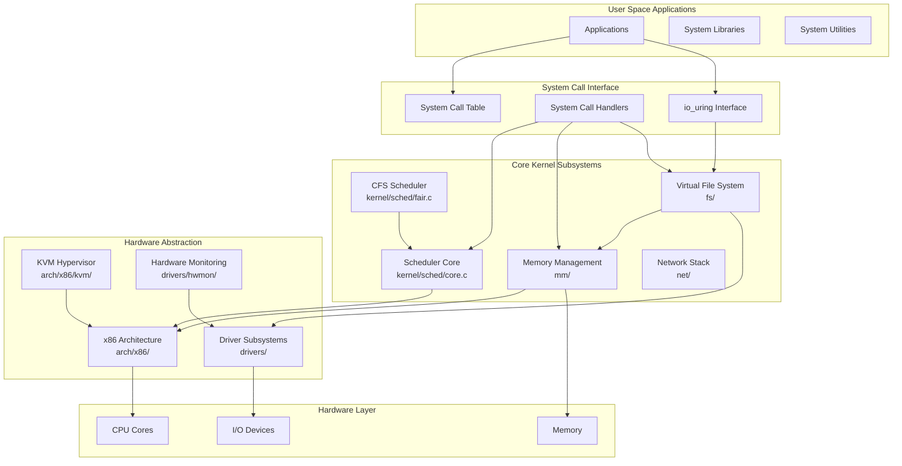

**Sources:** [Makefile:1-50](), [arch/x86/kvm/x86.c:1-50](), [kernel/sched/core.c:1-100](), [io_uring/io_uring.c:1-50]()

## Major Subsystem Architecture

The kernel's major subsystems are organized around core functional areas, with clear interfaces and data flow patterns:

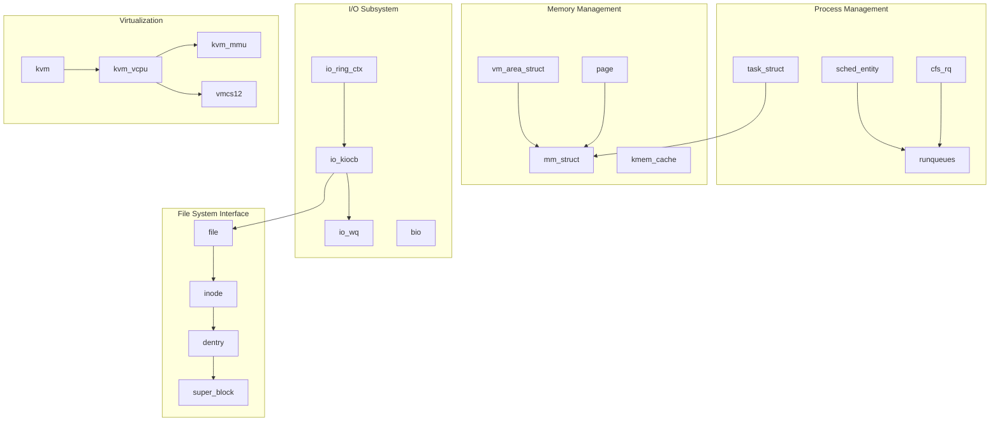

**Sources:** [kernel/sched/sched.h:1-50](), [include/linux/io_uring_types.h:1-50](), [arch/x86/include/asm/kvm_host.h:1-100](), [include/linux/kvm_host.h:1-50]()

## Hardware Monitoring and Platform Support

The kernel provides extensive hardware monitoring capabilities through a unified framework that abstracts various hardware sensors and platform-specific features:

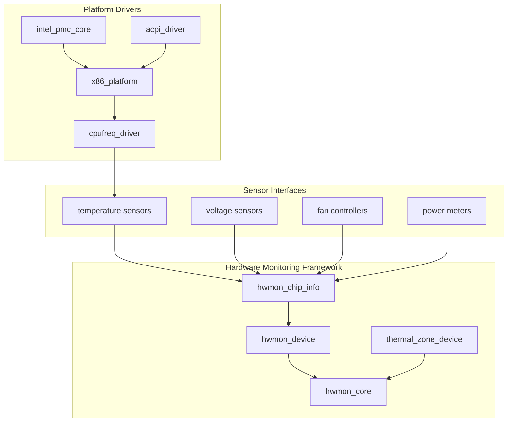

**Sources:** [drivers/cpufreq/cpufreq.c:1-50](), [MAINTAINERS:209-220]()

## Virtualization Infrastructure

The kernel's virtualization support centers around the KVM (Kernel-based Virtual Machine) hypervisor, which provides hardware-assisted virtualization for both x86 and ARM64 architectures:

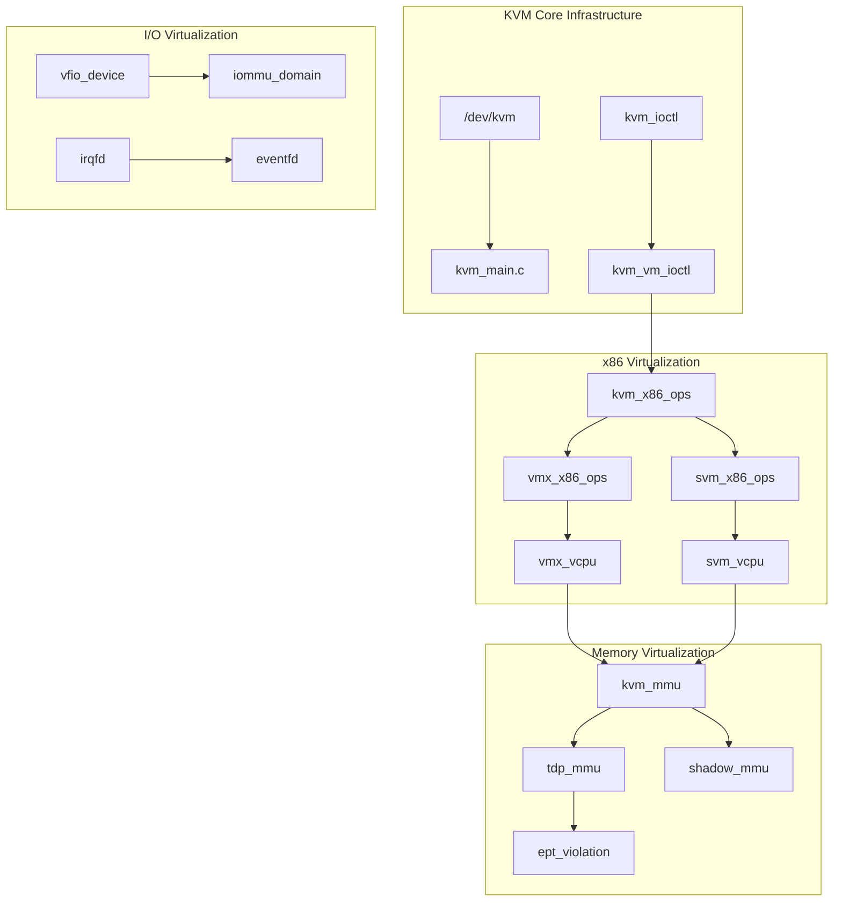

**Sources:** [virt/kvm/kvm_main.c:1-100](), [arch/x86/kvm/x86.c:1-150](), [arch/x86/kvm/vmx/vmx.c:1-100](), [arch/x86/kvm/svm/svm.c:1-100](), [arch/x86/kvm/mmu/mmu.c:1-50](), [arch/x86/kvm/mmu/tdp_mmu.c:1-50]()

## High-Performance I/O Systems

The `io_uring` subsystem provides asynchronous I/O capabilities with minimal system call overhead, designed for high-performance applications:

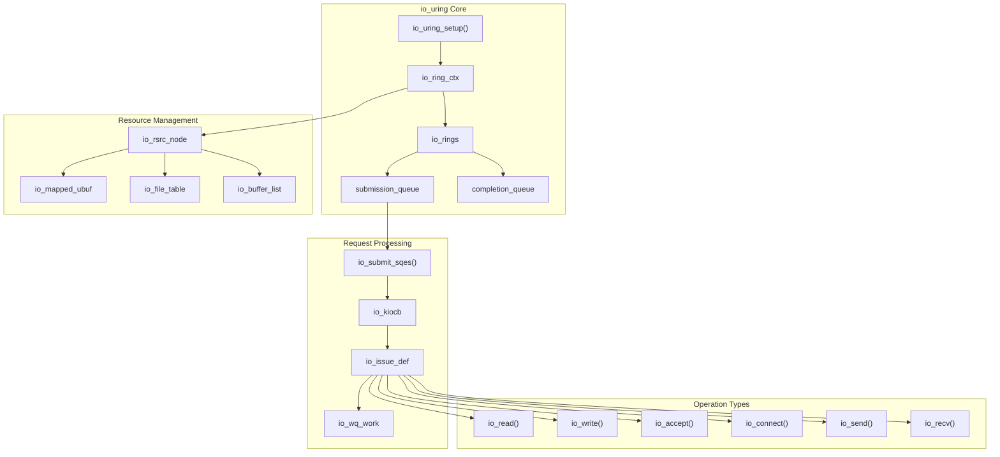

**Sources:** [io_uring/io_uring.c:1-200](), [io_uring/net.c:1-100](), [io_uring/rw.c:1-50](), [io_uring/rsrc.c:1-100]()

## CPU Scheduling Architecture

The kernel implements multiple scheduling classes with the Completely Fair Scheduler (CFS) as the default for normal tasks:

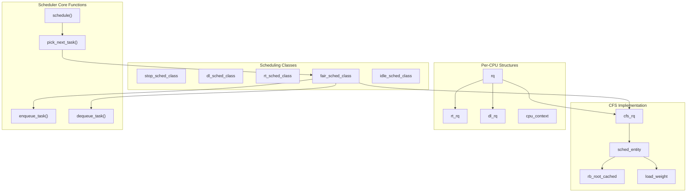

**Sources:** [kernel/sched/core.c:120-180](), [kernel/sched/fair.c:1-300](), [kernel/sched/sched.h:1-100]()

## Build System and Module Infrastructure

The kernel uses the Kbuild system for configuration and compilation, supporting both built-in and loadable modules:

| Component | File/Directory | Purpose |
|-----------|----------------|---------|
| Main Makefile | [Makefile:1-50]() | Top-level build coordination |
| Architecture Config | `arch/*/Makefile` | Architecture-specific build rules |
| Kconfig | `*/Kconfig` | Configuration option definitions |
| Module Support | [MAINTAINERS:1-100]() | Maintainer and subsystem organization |

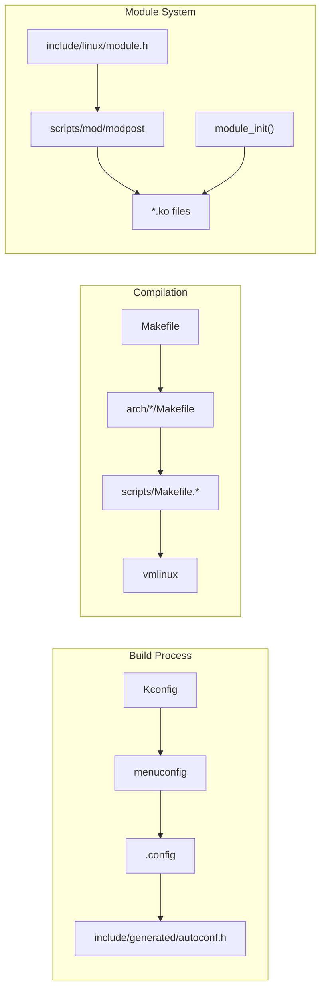

**Sources:** [Makefile:1-300](), [MAINTAINERS:1-200]()

## Code Organization and Key Interfaces

The kernel codebase follows a hierarchical organization with clear separation of concerns:

| Directory | Purpose | Key Files |
|-----------|---------|-----------|
| `arch/` | Architecture-specific code | `arch/x86/kvm/`, `arch/arm64/` |
| `kernel/` | Core kernel subsystems | `kernel/sched/`, `kernel/time/` |
| `mm/` | Memory management | `mm/slab.c`, `mm/page_alloc.c` |
| `fs/` | File systems | `fs/ext4/`, `fs/btrfs/` |
| `drivers/` | Device drivers | `drivers/hwmon/`, `drivers/cpufreq/` |
| `net/` | Networking stack | `net/core/`, `net/ipv4/` |
| `io_uring/` | Async I/O framework | `io_uring/io_uring.c` |
| `virt/` | Virtualization support | `virt/kvm/` |

The kernel exposes interfaces through system calls, procfs, sysfs, and specialized character/block devices. Major subsystems communicate through well-defined function pointers and callback structures, enabling modular design while maintaining performance.

**Sources:** [arch/x86/kvm/x86.c:138-148](), [io_uring/io_uring.c:155-170](), [kernel/sched/core.c:120-152]()

---

# Page: Hardware Monitoring and Platform Support

# Hardware Monitoring and Platform Support

<details>
<summary>Relevant source files</summary>

The following files were used as context for generating this wiki page:

- [.get_maintainer.ignore](.get_maintainer.ignore)
- [.mailmap](.mailmap)
- [CREDITS](CREDITS)
- [Documentation/devicetree/bindings/serial/atmel,at91-usart.yaml](Documentation/devicetree/bindings/serial/atmel,at91-usart.yaml)
- [Documentation/gpu/introduction.rst](Documentation/gpu/introduction.rst)
- [Documentation/gpu/todo.rst](Documentation/gpu/todo.rst)
- [Documentation/hwmon/acbel-fsg032.rst](Documentation/hwmon/acbel-fsg032.rst)
- [Documentation/hwmon/adm1275.rst](Documentation/hwmon/adm1275.rst)
- [Documentation/hwmon/crps.rst](Documentation/hwmon/crps.rst)
- [Documentation/hwmon/htu31.rst](Documentation/hwmon/htu31.rst)
- [Documentation/hwmon/ina233.rst](Documentation/hwmon/ina233.rst)
- [Documentation/hwmon/ina2xx.rst](Documentation/hwmon/ina2xx.rst)
- [Documentation/hwmon/index.rst](Documentation/hwmon/index.rst)
- [Documentation/hwmon/kbatt.rst](Documentation/hwmon/kbatt.rst)
- [Documentation/hwmon/kfan.rst](Documentation/hwmon/kfan.rst)
- [Documentation/hwmon/lm75.rst](Documentation/hwmon/lm75.rst)
- [Documentation/hwmon/lm90.rst](Documentation/hwmon/lm90.rst)
- [Documentation/hwmon/lt3074.rst](Documentation/hwmon/lt3074.rst)
- [Documentation/hwmon/ltc2978.rst](Documentation/hwmon/ltc2978.rst)
- [Documentation/hwmon/max15301.rst](Documentation/hwmon/max15301.rst)
- [Documentation/hwmon/max77705.rst](Documentation/hwmon/max77705.rst)
- [Documentation/hwmon/tmp108.rst](Documentation/hwmon/tmp108.rst)
- [Documentation/networking/batman-adv.rst](Documentation/networking/batman-adv.rst)
- [Documentation/networking/device_drivers/ethernet/index.rst](Documentation/networking/device_drivers/ethernet/index.rst)
- [MAINTAINERS](MAINTAINERS)
- [drivers/hwmon/Kconfig](drivers/hwmon/Kconfig)
- [drivers/hwmon/Makefile](drivers/hwmon/Makefile)
- [drivers/hwmon/htu31.c](drivers/hwmon/htu31.c)
- [drivers/hwmon/ina2xx.c](drivers/hwmon/ina2xx.c)
- [drivers/hwmon/kbatt.c](drivers/hwmon/kbatt.c)
- [drivers/hwmon/kfan.c](drivers/hwmon/kfan.c)
- [drivers/hwmon/lm75.c](drivers/hwmon/lm75.c)
- [drivers/hwmon/lm87.c](drivers/hwmon/lm87.c)
- [drivers/hwmon/lm90.c](drivers/hwmon/lm90.c)
- [drivers/hwmon/lm95241.c](drivers/hwmon/lm95241.c)
- [drivers/hwmon/max6621.c](drivers/hwmon/max6621.c)
- [drivers/hwmon/max77705-hwmon.c](drivers/hwmon/max77705-hwmon.c)
- [drivers/hwmon/pmbus/Kconfig](drivers/hwmon/pmbus/Kconfig)
- [drivers/hwmon/pmbus/Makefile](drivers/hwmon/pmbus/Makefile)
- [drivers/hwmon/pmbus/adm1275.c](drivers/hwmon/pmbus/adm1275.c)
- [drivers/hwmon/pmbus/crps.c](drivers/hwmon/pmbus/crps.c)
- [drivers/hwmon/pmbus/ina233.c](drivers/hwmon/pmbus/ina233.c)
- [drivers/hwmon/pmbus/lt3074.c](drivers/hwmon/pmbus/lt3074.c)
- [drivers/hwmon/pmbus/ltc2978.c](drivers/hwmon/pmbus/ltc2978.c)
- [drivers/hwmon/pmbus/max15301.c](drivers/hwmon/pmbus/max15301.c)
- [drivers/hwmon/tmp108.c](drivers/hwmon/tmp108.c)
- [drivers/media/pci/saa7134/saa7134-cards.c](drivers/media/pci/saa7134/saa7134-cards.c)
- [drivers/net/ethernet/toshiba/Kconfig](drivers/net/ethernet/toshiba/Kconfig)
- [drivers/net/ethernet/toshiba/Makefile](drivers/net/ethernet/toshiba/Makefile)
- [drivers/platform/x86/Kconfig](drivers/platform/x86/Kconfig)
- [drivers/platform/x86/Makefile](drivers/platform/x86/Makefile)
- [drivers/platform/x86/dasharo-acpi.c](drivers/platform/x86/dasharo-acpi.c)
- [drivers/platform/x86/ideapad-laptop.h](drivers/platform/x86/ideapad-laptop.h)
- [drivers/platform/x86/lenovo-wmi-hotkey-utilities.c](drivers/platform/x86/lenovo-wmi-hotkey-utilities.c)
- [drivers/platform/x86/lenovo-ymc.c](drivers/platform/x86/lenovo-ymc.c)
- [drivers/platform/x86/meegopad_anx7428.c](drivers/platform/x86/meegopad_anx7428.c)
- [drivers/platform/x86/oxpec.c](drivers/platform/x86/oxpec.c)
- [drivers/platform/x86/portwell-ec.c](drivers/platform/x86/portwell-ec.c)
- [drivers/platform/x86/tuxedo/Kconfig](drivers/platform/x86/tuxedo/Kconfig)
- [drivers/platform/x86/tuxedo/Makefile](drivers/platform/x86/tuxedo/Makefile)
- [drivers/platform/x86/tuxedo/nb04/Kconfig](drivers/platform/x86/tuxedo/nb04/Kconfig)
- [drivers/platform/x86/tuxedo/nb04/Makefile](drivers/platform/x86/tuxedo/nb04/Makefile)
- [drivers/platform/x86/tuxedo/nb04/wmi_ab.c](drivers/platform/x86/tuxedo/nb04/wmi_ab.c)
- [drivers/platform/x86/tuxedo/nb04/wmi_util.c](drivers/platform/x86/tuxedo/nb04/wmi_util.c)
- [drivers/platform/x86/tuxedo/nb04/wmi_util.h](drivers/platform/x86/tuxedo/nb04/wmi_util.h)
- [net/batman-adv/main.h](net/batman-adv/main.h)

</details>


This document covers the Linux kernel's comprehensive hardware monitoring subsystem and x86 platform-specific drivers. The hardware monitoring (HWMON) subsystem provides a unified framework for monitoring system health parameters such as temperatures, voltages, currents, power consumption, and fan speeds. The x86 platform drivers provide device-specific support for laptops, embedded systems, and specialized hardware platforms.

For information about virtualization platform support, see [Virtualization Infrastructure](#3). For high-performance I/O systems, see [High-Performance I/O Systems](#4).

## Hardware Monitoring Subsystem Overview

The HWMON subsystem serves as the central framework for hardware health monitoring in Linux. It provides standardized interfaces for sensors and monitoring devices, allowing userspace applications to access hardware health information through a consistent sysfs interface.

### HWMON Architecture

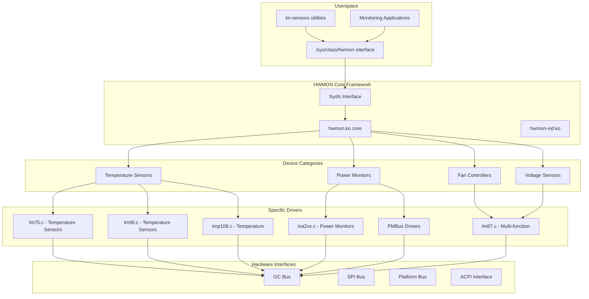

**Sources:** [drivers/hwmon/Kconfig:6-25](), [drivers/hwmon/Makefile:6-7](), [Documentation/hwmon/index.rst:1-21]()

### Core HWMON Data Structures

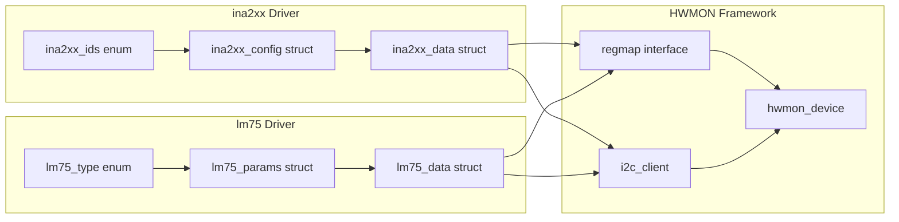

**Sources:** [drivers/hwmon/ina2xx.c:152-162](), [drivers/hwmon/lm75.c:109-118](), [drivers/hwmon/ina2xx.c:138-151]()

## Device Categories and Drivers

### Power Monitoring Devices

The INA2xx family represents a comprehensive set of power monitoring chips that measure voltage, current, and power consumption. The driver supports multiple variants with different capabilities.

Key functions and registers:
- `ina2xx_get_value()` - Converts raw register values to standard units
- `ina2xx_read_init()` - Handles device initialization and calibration
- Register definitions: `INA2XX_SHUNT_VOLTAGE`, `INA2XX_BUS_VOLTAGE`, `INA2XX_POWER`, `INA2XX_CURRENT`

**Sources:** [drivers/hwmon/ina2xx.c:251-285](), [drivers/hwmon/ina2xx.c:291-353](), [drivers/hwmon/ina2xx.c:42-52]()

### Temperature Sensors

The LM75 driver family provides temperature monitoring for a wide range of sensors. It demonstrates the HWMON subsystem's ability to support multiple device variants through a unified interface.

Supported device types include: `adt75`, `as6200`, `at30ts74`, `ds1775`, `ds75`, `lm75`, `lm75a`, `max6625`, `tmp100`, `tmp101`, and many others.

**Sources:** [drivers/hwmon/lm75.c:27-57](), [drivers/hwmon/lm75.c:130-176]()

### PMBus Power Management

The PMBus subsystem provides standardized power management bus support for server and telecom applications. It includes drivers for power supplies, voltage regulators, and power sequencers.

**Sources:** [drivers/hwmon/pmbus/Kconfig:6-14](), [drivers/hwmon/pmbus/ltc2978.c:22-31](), [drivers/hwmon/pmbus/Makefile:6-7]()

## X86 Platform Drivers

Platform drivers provide device-specific support for x86 systems, particularly laptops and embedded devices. These drivers often combine multiple functions including hardware monitoring, device control, and platform-specific features.

### Platform Driver Architecture

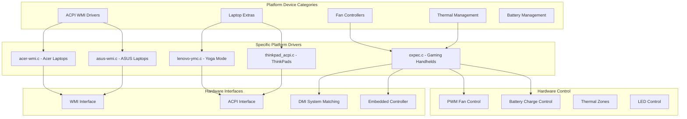

**Sources:** [drivers/platform/x86/Kconfig:6-17](), [drivers/platform/x86/Makefile:7-16](), [drivers/platform/x86/oxpec.c:44-62]()

### Gaming Handheld Support

The OXPEC driver exemplifies modern platform driver design, supporting multiple gaming handheld devices with unified fan control and thermal management.

Device matching through DMI table:
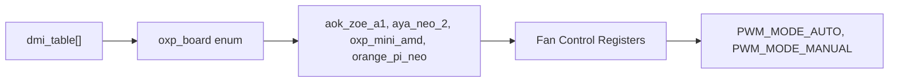

Key registers and functions:
- `OXP_SENSOR_FAN_REG` - Fan speed reading
- `OXP_SENSOR_PWM_REG` - PWM control
- `lock_global_acpi_lock()` / `unlock_global_acpi_lock()` - ACPI synchronization

**Sources:** [drivers/platform/x86/oxpec.c:111-302](), [drivers/platform/x86/oxpec.c:67-79](), [drivers/platform/x86/oxpec.c:34-42]()

## Integration with Hardware Interfaces

### I2C and Device Communication

Most HWMON drivers communicate with hardware through the I2C bus using the regmap framework for standardized register access patterns.

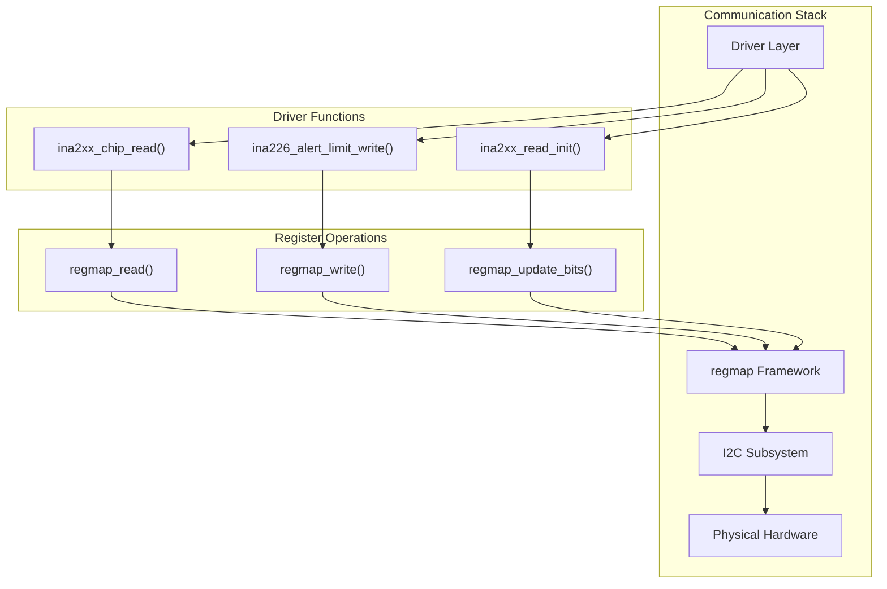

**Sources:** [drivers/hwmon/ina2xx.c:127-136](), [drivers/hwmon/ina2xx.c:291-353](), [drivers/hwmon/ina2xx.c:411-441]()

## Configuration and Build System

The hardware monitoring and platform support subsystems use Kconfig for configuration management and integrated Makefiles for build coordination.

### Build Configuration

| Subsystem | Config Option | Module Name | Key Dependencies |
|-----------|---------------|-------------|------------------|
| HWMON Core | `CONFIG_HWMON` | `hwmon.ko` | `HAS_IOMEM` |
| INA2xx Power | `CONFIG_SENSORS_INA2XX` | `ina2xx.ko` | `I2C`, `REGMAP` |
| LM75 Temperature | `CONFIG_SENSORS_LM75` | `lm75.ko` | `I2C`, `REGMAP` |
| PMBus Core | `CONFIG_PMBUS` | `pmbus_core.ko` | `I2C` |
| X86 Platforms | `CONFIG_X86_PLATFORM_DEVICES` | Various | `X86`, `ACPI` |

**Sources:** [drivers/hwmon/Kconfig:6-25](), [drivers/platform/x86/Kconfig:6-16](), [drivers/hwmon/Makefile:6-7](), [drivers/platform/x86/Makefile:6-16]()

## Maintenance and Development

The subsystem maintenance follows the standard Linux kernel development model with designated maintainers for different components. The `MAINTAINERS` file provides the authoritative source for maintainer information and contribution guidelines.

Key maintainer categories:
- HWMON subsystem maintainers
- Individual driver maintainers  
- Platform-specific driver maintainers
- PMBus subsystem maintainers

**Sources:** [MAINTAINERS:209-219](), [MAINTAINERS:209-219](), [Documentation/hwmon/index.rst:1-21]()

The hardware monitoring and platform support subsystems represent critical infrastructure for system health monitoring and device-specific functionality in modern Linux systems. They provide the foundation for thermal management, power monitoring, and platform-specific features across a wide range of hardware platforms.

---

# Page: Virtualization Infrastructure

# Virtualization Infrastructure

<details>
<summary>Relevant source files</summary>

The following files were used as context for generating this wiki page:

- [Documentation/virt/kvm/api.rst](Documentation/virt/kvm/api.rst)
- [Documentation/virt/kvm/locking.rst](Documentation/virt/kvm/locking.rst)
- [Documentation/virt/kvm/x86/amd-memory-encryption.rst](Documentation/virt/kvm/x86/amd-memory-encryption.rst)
- [arch/arm/include/asm/arm_pmuv3.h](arch/arm/include/asm/arm_pmuv3.h)
- [arch/arm64/include/asm/arm_pmuv3.h](arch/arm64/include/asm/arm_pmuv3.h)
- [arch/arm64/include/asm/el2_setup.h](arch/arm64/include/asm/el2_setup.h)
- [arch/arm64/include/asm/hardirq.h](arch/arm64/include/asm/hardirq.h)
- [arch/arm64/include/asm/kvm_arm.h](arch/arm64/include/asm/kvm_arm.h)
- [arch/arm64/include/asm/kvm_asm.h](arch/arm64/include/asm/kvm_asm.h)
- [arch/arm64/include/asm/kvm_emulate.h](arch/arm64/include/asm/kvm_emulate.h)
- [arch/arm64/include/asm/kvm_host.h](arch/arm64/include/asm/kvm_host.h)
- [arch/arm64/include/asm/kvm_hyp.h](arch/arm64/include/asm/kvm_hyp.h)
- [arch/arm64/include/asm/kvm_mmu.h](arch/arm64/include/asm/kvm_mmu.h)
- [arch/arm64/include/asm/kvm_nested.h](arch/arm64/include/asm/kvm_nested.h)
- [arch/arm64/include/asm/kvm_pgtable.h](arch/arm64/include/asm/kvm_pgtable.h)
- [arch/arm64/include/asm/kvm_pkvm.h](arch/arm64/include/asm/kvm_pkvm.h)
- [arch/arm64/include/asm/memory.h](arch/arm64/include/asm/memory.h)
- [arch/arm64/include/asm/module.h](arch/arm64/include/asm/module.h)
- [arch/arm64/include/asm/module.lds.h](arch/arm64/include/asm/module.lds.h)
- [arch/arm64/include/asm/runtime-const.h](arch/arm64/include/asm/runtime-const.h)
- [arch/arm64/include/asm/scs.h](arch/arm64/include/asm/scs.h)
- [arch/arm64/include/asm/sections.h](arch/arm64/include/asm/sections.h)
- [arch/arm64/include/asm/stacktrace/nvhe.h](arch/arm64/include/asm/stacktrace/nvhe.h)
- [arch/arm64/include/asm/sysreg.h](arch/arm64/include/asm/sysreg.h)
- [arch/arm64/include/asm/vncr_mapping.h](arch/arm64/include/asm/vncr_mapping.h)
- [arch/arm64/kernel/head.S](arch/arm64/kernel/head.S)
- [arch/arm64/kernel/hyp-stub.S](arch/arm64/kernel/hyp-stub.S)
- [arch/arm64/kernel/image-vars.h](arch/arm64/kernel/image-vars.h)
- [arch/arm64/kernel/kaslr.c](arch/arm64/kernel/kaslr.c)
- [arch/arm64/kernel/module-plts.c](arch/arm64/kernel/module-plts.c)
- [arch/arm64/kernel/module.c](arch/arm64/kernel/module.c)
- [arch/arm64/kernel/pi/kaslr_early.c](arch/arm64/kernel/pi/kaslr_early.c)
- [arch/arm64/kernel/pi/patch-scs.c](arch/arm64/kernel/pi/patch-scs.c)
- [arch/arm64/kernel/pi/pi.h](arch/arm64/kernel/pi/pi.h)
- [arch/arm64/kernel/vmlinux.lds.S](arch/arm64/kernel/vmlinux.lds.S)
- [arch/arm64/kvm/arm.c](arch/arm64/kvm/arm.c)
- [arch/arm64/kvm/at.c](arch/arm64/kvm/at.c)
- [arch/arm64/kvm/debug.c](arch/arm64/kvm/debug.c)
- [arch/arm64/kvm/emulate-nested.c](arch/arm64/kvm/emulate-nested.c)
- [arch/arm64/kvm/fpsimd.c](arch/arm64/kvm/fpsimd.c)
- [arch/arm64/kvm/handle_exit.c](arch/arm64/kvm/handle_exit.c)
- [arch/arm64/kvm/hyp/fpsimd.S](arch/arm64/kvm/hyp/fpsimd.S)
- [arch/arm64/kvm/hyp/hyp-entry.S](arch/arm64/kvm/hyp/hyp-entry.S)
- [arch/arm64/kvm/hyp/include/hyp/debug-sr.h](arch/arm64/kvm/hyp/include/hyp/debug-sr.h)
- [arch/arm64/kvm/hyp/include/hyp/switch.h](arch/arm64/kvm/hyp/include/hyp/switch.h)
- [arch/arm64/kvm/hyp/include/hyp/sysreg-sr.h](arch/arm64/kvm/hyp/include/hyp/sysreg-sr.h)
- [arch/arm64/kvm/hyp/include/nvhe/gfp.h](arch/arm64/kvm/hyp/include/nvhe/gfp.h)
- [arch/arm64/kvm/hyp/include/nvhe/mem_protect.h](arch/arm64/kvm/hyp/include/nvhe/mem_protect.h)
- [arch/arm64/kvm/hyp/include/nvhe/memory.h](arch/arm64/kvm/hyp/include/nvhe/memory.h)
- [arch/arm64/kvm/hyp/include/nvhe/mm.h](arch/arm64/kvm/hyp/include/nvhe/mm.h)
- [arch/arm64/kvm/hyp/include/nvhe/pkvm.h](arch/arm64/kvm/hyp/include/nvhe/pkvm.h)
- [arch/arm64/kvm/hyp/nvhe/debug-sr.c](arch/arm64/kvm/hyp/nvhe/debug-sr.c)
- [arch/arm64/kvm/hyp/nvhe/host.S](arch/arm64/kvm/hyp/nvhe/host.S)
- [arch/arm64/kvm/hyp/nvhe/hyp-init.S](arch/arm64/kvm/hyp/nvhe/hyp-init.S)
- [arch/arm64/kvm/hyp/nvhe/hyp-main.c](arch/arm64/kvm/hyp/nvhe/hyp-main.c)
- [arch/arm64/kvm/hyp/nvhe/hyp.lds.S](arch/arm64/kvm/hyp/nvhe/hyp.lds.S)
- [arch/arm64/kvm/hyp/nvhe/mem_protect.c](arch/arm64/kvm/hyp/nvhe/mem_protect.c)
- [arch/arm64/kvm/hyp/nvhe/mm.c](arch/arm64/kvm/hyp/nvhe/mm.c)
- [arch/arm64/kvm/hyp/nvhe/page_alloc.c](arch/arm64/kvm/hyp/nvhe/page_alloc.c)
- [arch/arm64/kvm/hyp/nvhe/pkvm.c](arch/arm64/kvm/hyp/nvhe/pkvm.c)
- [arch/arm64/kvm/hyp/nvhe/psci-relay.c](arch/arm64/kvm/hyp/nvhe/psci-relay.c)
- [arch/arm64/kvm/hyp/nvhe/setup.c](arch/arm64/kvm/hyp/nvhe/setup.c)
- [arch/arm64/kvm/hyp/nvhe/stacktrace.c](arch/arm64/kvm/hyp/nvhe/stacktrace.c)
- [arch/arm64/kvm/hyp/nvhe/switch.c](arch/arm64/kvm/hyp/nvhe/switch.c)
- [arch/arm64/kvm/hyp/nvhe/sys_regs.c](arch/arm64/kvm/hyp/nvhe/sys_regs.c)
- [arch/arm64/kvm/hyp/nvhe/sysreg-sr.c](arch/arm64/kvm/hyp/nvhe/sysreg-sr.c)
- [arch/arm64/kvm/hyp/pgtable.c](arch/arm64/kvm/hyp/pgtable.c)
- [arch/arm64/kvm/hyp/vhe/debug-sr.c](arch/arm64/kvm/hyp/vhe/debug-sr.c)
- [arch/arm64/kvm/hyp/vhe/switch.c](arch/arm64/kvm/hyp/vhe/switch.c)
- [arch/arm64/kvm/hyp/vhe/sysreg-sr.c](arch/arm64/kvm/hyp/vhe/sysreg-sr.c)
- [arch/arm64/kvm/mmu.c](arch/arm64/kvm/mmu.c)
- [arch/arm64/kvm/nested.c](arch/arm64/kvm/nested.c)
- [arch/arm64/kvm/pkvm.c](arch/arm64/kvm/pkvm.c)
- [arch/arm64/kvm/pmu-emul.c](arch/arm64/kvm/pmu-emul.c)
- [arch/arm64/kvm/pmu.c](arch/arm64/kvm/pmu.c)
- [arch/arm64/kvm/reset.c](arch/arm64/kvm/reset.c)
- [arch/arm64/kvm/stacktrace.c](arch/arm64/kvm/stacktrace.c)
- [arch/arm64/kvm/sys_regs.c](arch/arm64/kvm/sys_regs.c)
- [arch/arm64/kvm/sys_regs.h](arch/arm64/kvm/sys_regs.h)
- [arch/arm64/kvm/trace_handle_exit.h](arch/arm64/kvm/trace_handle_exit.h)
- [arch/arm64/kvm/vgic-sys-reg-v3.c](arch/arm64/kvm/vgic-sys-reg-v3.c)
- [arch/arm64/mm/init.c](arch/arm64/mm/init.c)
- [arch/arm64/tools/sysreg](arch/arm64/tools/sysreg)
- [arch/x86/include/asm/kvm-x86-ops.h](arch/x86/include/asm/kvm-x86-ops.h)
- [arch/x86/include/asm/kvm-x86-pmu-ops.h](arch/x86/include/asm/kvm-x86-pmu-ops.h)
- [arch/x86/include/asm/kvm_host.h](arch/x86/include/asm/kvm_host.h)
- [arch/x86/include/asm/vmx.h](arch/x86/include/asm/vmx.h)
- [arch/x86/include/uapi/asm/kvm.h](arch/x86/include/uapi/asm/kvm.h)
- [arch/x86/include/uapi/asm/vmx.h](arch/x86/include/uapi/asm/vmx.h)
- [arch/x86/kvm/hyperv.c](arch/x86/kvm/hyperv.c)
- [arch/x86/kvm/irq.c](arch/x86/kvm/irq.c)
- [arch/x86/kvm/lapic.c](arch/x86/kvm/lapic.c)
- [arch/x86/kvm/lapic.h](arch/x86/kvm/lapic.h)
- [arch/x86/kvm/mmu.h](arch/x86/kvm/mmu.h)
- [arch/x86/kvm/mmu/mmu.c](arch/x86/kvm/mmu/mmu.c)
- [arch/x86/kvm/mmu/mmu_internal.h](arch/x86/kvm/mmu/mmu_internal.h)
- [arch/x86/kvm/mmu/mmutrace.h](arch/x86/kvm/mmu/mmutrace.h)
- [arch/x86/kvm/mmu/paging_tmpl.h](arch/x86/kvm/mmu/paging_tmpl.h)
- [arch/x86/kvm/mmu/spte.c](arch/x86/kvm/mmu/spte.c)
- [arch/x86/kvm/mmu/spte.h](arch/x86/kvm/mmu/spte.h)
- [arch/x86/kvm/mmu/tdp_iter.c](arch/x86/kvm/mmu/tdp_iter.c)
- [arch/x86/kvm/mmu/tdp_iter.h](arch/x86/kvm/mmu/tdp_iter.h)
- [arch/x86/kvm/mmu/tdp_mmu.c](arch/x86/kvm/mmu/tdp_mmu.c)
- [arch/x86/kvm/mmu/tdp_mmu.h](arch/x86/kvm/mmu/tdp_mmu.h)
- [arch/x86/kvm/pmu.c](arch/x86/kvm/pmu.c)
- [arch/x86/kvm/pmu.h](arch/x86/kvm/pmu.h)
- [arch/x86/kvm/smm.c](arch/x86/kvm/smm.c)
- [arch/x86/kvm/svm/nested.c](arch/x86/kvm/svm/nested.c)
- [arch/x86/kvm/svm/pmu.c](arch/x86/kvm/svm/pmu.c)
- [arch/x86/kvm/svm/sev.c](arch/x86/kvm/svm/sev.c)
- [arch/x86/kvm/svm/svm.c](arch/x86/kvm/svm/svm.c)
- [arch/x86/kvm/svm/svm.h](arch/x86/kvm/svm/svm.h)
- [arch/x86/kvm/vmx/capabilities.h](arch/x86/kvm/vmx/capabilities.h)
- [arch/x86/kvm/vmx/common.h](arch/x86/kvm/vmx/common.h)
- [arch/x86/kvm/vmx/main.c](arch/x86/kvm/vmx/main.c)
- [arch/x86/kvm/vmx/nested.c](arch/x86/kvm/vmx/nested.c)
- [arch/x86/kvm/vmx/nested.h](arch/x86/kvm/vmx/nested.h)
- [arch/x86/kvm/vmx/pmu_intel.c](arch/x86/kvm/vmx/pmu_intel.c)
- [arch/x86/kvm/vmx/pmu_intel.h](arch/x86/kvm/vmx/pmu_intel.h)
- [arch/x86/kvm/vmx/posted_intr.c](arch/x86/kvm/vmx/posted_intr.c)
- [arch/x86/kvm/vmx/sgx.c](arch/x86/kvm/vmx/sgx.c)
- [arch/x86/kvm/vmx/tdx.c](arch/x86/kvm/vmx/tdx.c)
- [arch/x86/kvm/vmx/tdx.h](arch/x86/kvm/vmx/tdx.h)
- [arch/x86/kvm/vmx/tdx_arch.h](arch/x86/kvm/vmx/tdx_arch.h)
- [arch/x86/kvm/vmx/tdx_errno.h](arch/x86/kvm/vmx/tdx_errno.h)
- [arch/x86/kvm/vmx/vmx.c](arch/x86/kvm/vmx/vmx.c)
- [arch/x86/kvm/vmx/vmx.h](arch/x86/kvm/vmx/vmx.h)
- [arch/x86/kvm/vmx/x86_ops.h](arch/x86/kvm/vmx/x86_ops.h)
- [arch/x86/kvm/x86.c](arch/x86/kvm/x86.c)
- [arch/x86/kvm/x86.h](arch/x86/kvm/x86.h)
- [arch/x86/kvm/xen.c](arch/x86/kvm/xen.c)
- [arch/x86/kvm/xen.h](arch/x86/kvm/xen.h)
- [drivers/perf/arm_pmu.c](drivers/perf/arm_pmu.c)
- [drivers/perf/arm_pmuv3.c](drivers/perf/arm_pmuv3.c)
- [drivers/perf/arm_v6_pmu.c](drivers/perf/arm_v6_pmu.c)
- [drivers/perf/arm_v7_pmu.c](drivers/perf/arm_v7_pmu.c)
- [drivers/perf/arm_xscale_pmu.c](drivers/perf/arm_xscale_pmu.c)
- [include/kvm/arm_pmu.h](include/kvm/arm_pmu.h)
- [include/linux/kvm_host.h](include/linux/kvm_host.h)
- [include/linux/perf/arm_pmu.h](include/linux/perf/arm_pmu.h)
- [include/linux/perf/arm_pmuv3.h](include/linux/perf/arm_pmuv3.h)
- [include/uapi/linux/kvm.h](include/uapi/linux/kvm.h)
- [tools/arch/arm64/include/asm/gpr-num.h](tools/arch/arm64/include/asm/gpr-num.h)
- [tools/arch/arm64/include/asm/sysreg.h](tools/arch/arm64/include/asm/sysreg.h)
- [tools/include/linux/kasan-tags.h](tools/include/linux/kasan-tags.h)
- [virt/kvm/Kconfig](virt/kvm/Kconfig)
- [virt/kvm/guest_memfd.c](virt/kvm/guest_memfd.c)
- [virt/kvm/kvm_main.c](virt/kvm/kvm_main.c)
- [virt/kvm/kvm_mm.h](virt/kvm/kvm_mm.h)
- [virt/kvm/pfncache.c](virt/kvm/pfncache.c)

</details>


This document covers the Linux kernel's comprehensive virtualization infrastructure, primarily centered around the KVM (Kernel-based Virtual Machine) hypervisor. The scope includes the core KVM framework, architecture-specific implementations for x86 and ARM64, memory virtualization through MMU support, and I/O virtualization via IOMMU integration.

For detailed information about specific implementations, see [KVM x86 Virtualization](#3.1), [KVM ARM64 Virtualization](#3.2), and [IOMMU Support](#3.3). For high-performance I/O systems that complement virtualization, see [High-Performance I/O Systems](#4).

## Architecture Overview

The virtualization infrastructure is built around a layered architecture where the KVM hypervisor runs in kernel space, managing guest virtual machines and coordinating with hardware virtualization features.

### Overall Virtualization Architecture

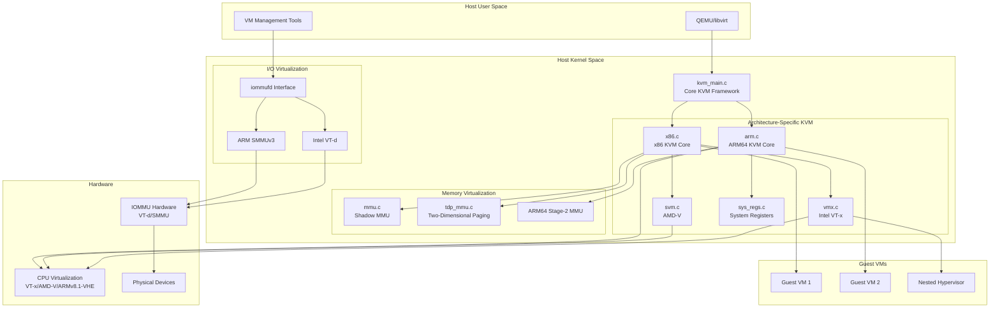

Sources: [virt/kvm/kvm_main.c:1-100](), [arch/x86/kvm/x86.c:1-50](), [arch/arm64/kvm/arm.c:1-50]()

## KVM Core Infrastructure

The KVM core provides the fundamental virtualization framework that is shared across all supported architectures. The main entry point is through the `/dev/kvm` device interface managed by `kvm_main.c`.

### Core KVM Components

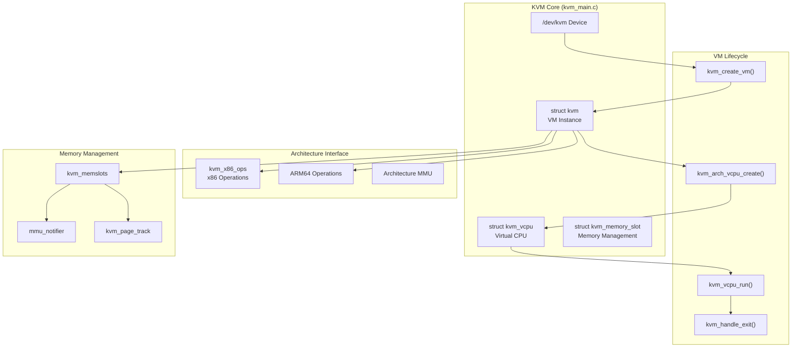

Sources: [virt/kvm/kvm_main.c:110-200](), [include/linux/kvm_host.h:1-100]()

The core KVM infrastructure manages virtual machine lifecycle through several key functions:

- `kvm_create_vm()` - Creates a new VM instance
- `kvm_arch_vcpu_create()` - Architecture-specific VCPU creation
- `kvm_vcpu_run()` - Main execution loop for virtual CPUs
- `kvm_handle_exit()` - Handles VM exits and returns to guest

## Architecture-Specific Implementations

### x86 Virtualization

The x86 KVM implementation supports both Intel VT-x (VMX) and AMD-V (SVM) hardware virtualization extensions. The core x86 logic is in `x86.c` with vendor-specific implementations in separate modules.

Key x86 KVM structures include:
- `struct kvm_caps` - Tracks KVM capabilities [arch/x86/kvm/x86.c:99]()
- `struct kvm_vcpu_arch` - x86-specific VCPU state
- `struct kvm_x86_ops` - Function pointers for vendor operations [arch/x86/kvm/x86.c:139]()

### ARM64 Virtualization 

The ARM64 implementation leverages ARMv8 virtualization extensions including VHE (Virtualization Host Extensions) and nested virtualization support. The main ARM64 KVM logic handles system register emulation, exception handling, and stage-2 memory management.

Key ARM64 structures:
- `struct kvm_arch` - ARM64-specific VM state [arch/arm64/include/asm/kvm_host.h:293-407]()
- `struct kvm_vcpu_fault_info` - Exception information [arch/arm64/include/asm/kvm_host.h:409-414]()
- System register array for virtualization [arch/arm64/include/asm/kvm_host.h:436-500]()

## Memory Virtualization

Memory virtualization in KVM supports both shadow page tables and hardware-assisted two-dimensional paging (Intel EPT/AMD NPT/ARM64 Stage-2).

### Memory Management Architecture

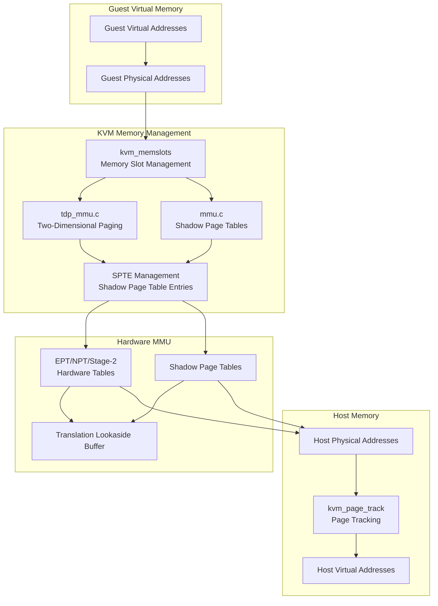

Sources: [arch/x86/kvm/mmu/mmu.c:1-100](), [arch/x86/kvm/mmu/tdp_mmu.c:1-50]()

The memory virtualization layer provides:

- **Shadow Page Tables**: Software-managed translation from guest physical to host physical addresses
- **Two-Dimensional Paging**: Hardware-assisted translation using EPT/NPT/Stage-2 tables
- **Memory Slot Management**: Tracking of guest memory regions via `kvm_memslots`
- **Page Tracking**: Monitoring page access patterns for optimization

## I/O Virtualization and Device Assignment

I/O virtualization enables secure and efficient device sharing between host and guest systems through IOMMU hardware support.

### IOMMU Integration Architecture

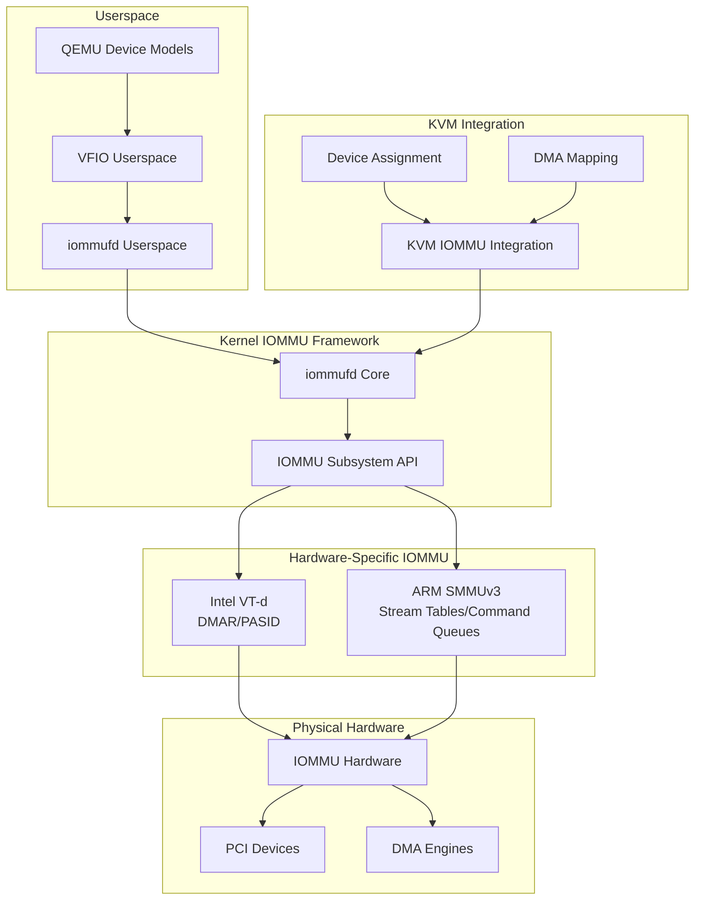

Sources: [arch/x86/kvm/x86.c:46](), [arch/arm64/kvm/arm.c:40]()

The IOMMU integration provides:

- **Device Assignment**: Direct assignment of physical devices to guest VMs
- **DMA Protection**: Isolation of DMA transactions per VM using IOMMU translation
- **PASID Support**: Process Address Space ID for fine-grained access control
- **Interrupt Remapping**: Secure delivery of device interrupts to guests

## Virtualization Control Flow

The main execution flow for virtualized workloads follows a well-defined pattern of VM entry, guest execution, VM exit handling, and return to guest.

### VM Execution Cycle

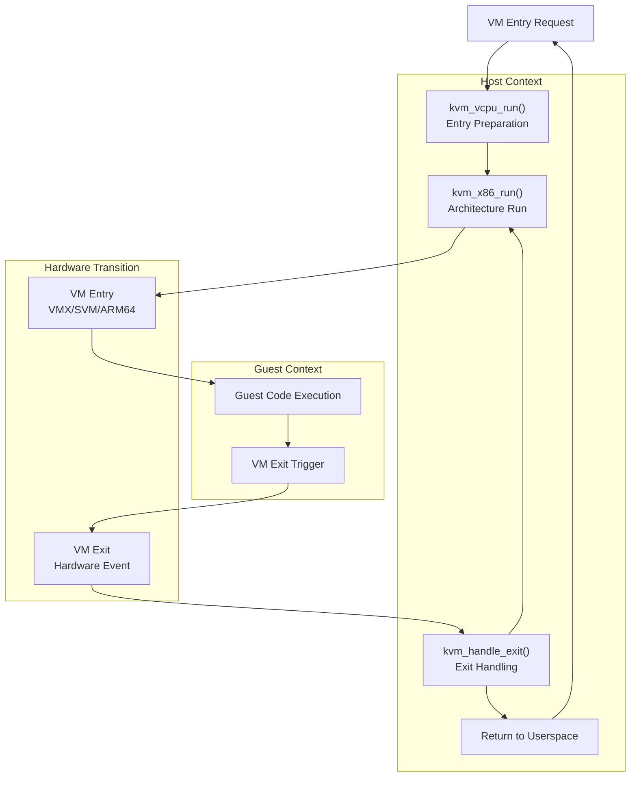

Sources: [virt/kvm/kvm_main.c:164-183](), [arch/x86/kvm/x86.c:128-134]()

Key execution functions:
- `vcpu_load()` / `vcpu_put()` - VCPU context switching [virt/kvm/kvm_main.c:164-183]()
- `kvm_arch_vcpu_run()` - Architecture-specific execution
- VM exit handlers for various exception types and hardware events

The virtualization infrastructure provides a robust foundation for running multiple operating systems concurrently with hardware-assisted isolation and performance. The modular design allows for architecture-specific optimizations while maintaining a common framework for memory management, device assignment, and guest lifecycle management.

---

# Page: KVM x86 Virtualization

# KVM x86 Virtualization

<details>
<summary>Relevant source files</summary>

The following files were used as context for generating this wiki page:

- [Documentation/virt/kvm/api.rst](Documentation/virt/kvm/api.rst)
- [Documentation/virt/kvm/locking.rst](Documentation/virt/kvm/locking.rst)
- [Documentation/virt/kvm/x86/amd-memory-encryption.rst](Documentation/virt/kvm/x86/amd-memory-encryption.rst)
- [arch/x86/include/asm/kvm-x86-ops.h](arch/x86/include/asm/kvm-x86-ops.h)
- [arch/x86/include/asm/kvm-x86-pmu-ops.h](arch/x86/include/asm/kvm-x86-pmu-ops.h)
- [arch/x86/include/asm/kvm_host.h](arch/x86/include/asm/kvm_host.h)
- [arch/x86/include/asm/vmx.h](arch/x86/include/asm/vmx.h)
- [arch/x86/include/uapi/asm/kvm.h](arch/x86/include/uapi/asm/kvm.h)
- [arch/x86/include/uapi/asm/vmx.h](arch/x86/include/uapi/asm/vmx.h)
- [arch/x86/kvm/hyperv.c](arch/x86/kvm/hyperv.c)
- [arch/x86/kvm/irq.c](arch/x86/kvm/irq.c)
- [arch/x86/kvm/lapic.c](arch/x86/kvm/lapic.c)
- [arch/x86/kvm/lapic.h](arch/x86/kvm/lapic.h)
- [arch/x86/kvm/mmu.h](arch/x86/kvm/mmu.h)
- [arch/x86/kvm/mmu/mmu.c](arch/x86/kvm/mmu/mmu.c)
- [arch/x86/kvm/mmu/mmu_internal.h](arch/x86/kvm/mmu/mmu_internal.h)
- [arch/x86/kvm/mmu/mmutrace.h](arch/x86/kvm/mmu/mmutrace.h)
- [arch/x86/kvm/mmu/paging_tmpl.h](arch/x86/kvm/mmu/paging_tmpl.h)
- [arch/x86/kvm/mmu/spte.c](arch/x86/kvm/mmu/spte.c)
- [arch/x86/kvm/mmu/spte.h](arch/x86/kvm/mmu/spte.h)
- [arch/x86/kvm/mmu/tdp_iter.c](arch/x86/kvm/mmu/tdp_iter.c)
- [arch/x86/kvm/mmu/tdp_iter.h](arch/x86/kvm/mmu/tdp_iter.h)
- [arch/x86/kvm/mmu/tdp_mmu.c](arch/x86/kvm/mmu/tdp_mmu.c)
- [arch/x86/kvm/mmu/tdp_mmu.h](arch/x86/kvm/mmu/tdp_mmu.h)
- [arch/x86/kvm/pmu.c](arch/x86/kvm/pmu.c)
- [arch/x86/kvm/pmu.h](arch/x86/kvm/pmu.h)
- [arch/x86/kvm/smm.c](arch/x86/kvm/smm.c)
- [arch/x86/kvm/svm/nested.c](arch/x86/kvm/svm/nested.c)
- [arch/x86/kvm/svm/pmu.c](arch/x86/kvm/svm/pmu.c)
- [arch/x86/kvm/svm/sev.c](arch/x86/kvm/svm/sev.c)
- [arch/x86/kvm/svm/svm.c](arch/x86/kvm/svm/svm.c)
- [arch/x86/kvm/svm/svm.h](arch/x86/kvm/svm/svm.h)
- [arch/x86/kvm/vmx/capabilities.h](arch/x86/kvm/vmx/capabilities.h)
- [arch/x86/kvm/vmx/common.h](arch/x86/kvm/vmx/common.h)
- [arch/x86/kvm/vmx/main.c](arch/x86/kvm/vmx/main.c)
- [arch/x86/kvm/vmx/nested.c](arch/x86/kvm/vmx/nested.c)
- [arch/x86/kvm/vmx/nested.h](arch/x86/kvm/vmx/nested.h)
- [arch/x86/kvm/vmx/pmu_intel.c](arch/x86/kvm/vmx/pmu_intel.c)
- [arch/x86/kvm/vmx/pmu_intel.h](arch/x86/kvm/vmx/pmu_intel.h)
- [arch/x86/kvm/vmx/posted_intr.c](arch/x86/kvm/vmx/posted_intr.c)
- [arch/x86/kvm/vmx/sgx.c](arch/x86/kvm/vmx/sgx.c)
- [arch/x86/kvm/vmx/tdx.c](arch/x86/kvm/vmx/tdx.c)
- [arch/x86/kvm/vmx/tdx.h](arch/x86/kvm/vmx/tdx.h)
- [arch/x86/kvm/vmx/tdx_arch.h](arch/x86/kvm/vmx/tdx_arch.h)
- [arch/x86/kvm/vmx/tdx_errno.h](arch/x86/kvm/vmx/tdx_errno.h)
- [arch/x86/kvm/vmx/vmx.c](arch/x86/kvm/vmx/vmx.c)
- [arch/x86/kvm/vmx/vmx.h](arch/x86/kvm/vmx/vmx.h)
- [arch/x86/kvm/vmx/x86_ops.h](arch/x86/kvm/vmx/x86_ops.h)
- [arch/x86/kvm/x86.c](arch/x86/kvm/x86.c)
- [arch/x86/kvm/x86.h](arch/x86/kvm/x86.h)
- [arch/x86/kvm/xen.c](arch/x86/kvm/xen.c)
- [arch/x86/kvm/xen.h](arch/x86/kvm/xen.h)
- [include/linux/kvm_host.h](include/linux/kvm_host.h)
- [include/uapi/linux/kvm.h](include/uapi/linux/kvm.h)
- [virt/kvm/Kconfig](virt/kvm/Kconfig)
- [virt/kvm/guest_memfd.c](virt/kvm/guest_memfd.c)
- [virt/kvm/kvm_main.c](virt/kvm/kvm_main.c)
- [virt/kvm/kvm_mm.h](virt/kvm/kvm_mm.h)
- [virt/kvm/pfncache.c](virt/kvm/pfncache.c)

</details>


This document covers the x86-specific implementation of the Kernel-based Virtual Machine (KVM) hypervisor, focusing on Intel VMX and AMD SVM virtualization technologies, memory management unit (MMU) virtualization, and virtual CPU lifecycle management. For general KVM infrastructure and cross-architecture components, see [Virtualization Infrastructure](#3). For ARM64-specific virtualization, see [KVM ARM64 Virtualization](#3.2).

## Architecture Overview

The x86 KVM implementation provides a hardware-assisted virtualization layer that leverages Intel VT-x (VMX) and AMD-V (SVM) extensions to create and manage virtual machines with near-native performance.

### High-Level System Architecture

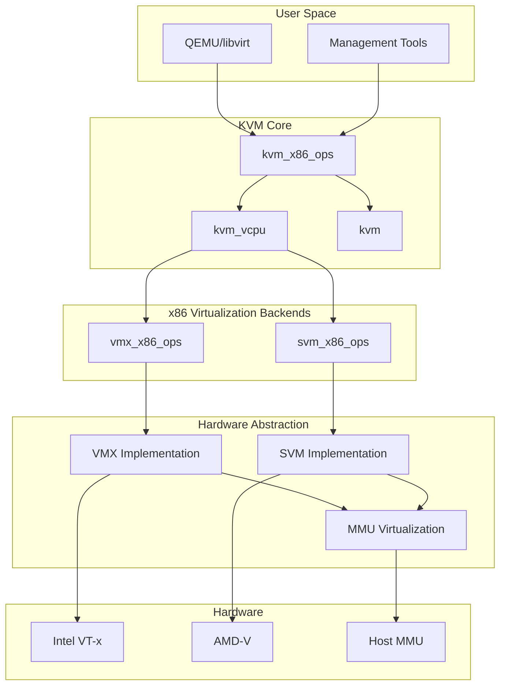

Sources: [arch/x86/kvm/x86.c:139-148](), [arch/x86/kvm/vmx/vmx.c:1-30](), [arch/x86/kvm/svm/svm.c:1-30]()

### Core Data Structures and Operations

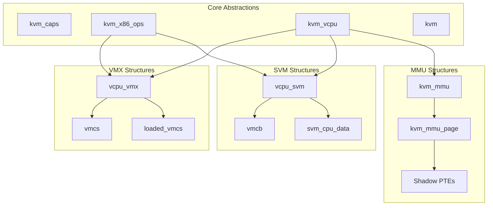

Sources: [arch/x86/include/asm/kvm_host.h:500-800](), [arch/x86/kvm/vmx/vmx.h:100-200](), [arch/x86/kvm/svm/svm.h:100-300]()

## Core x86 Infrastructure

The central x86 KVM implementation is built around the `kvm_x86_ops` interface, which provides hardware-agnostic abstractions for virtualization operations. The main implementation resides in [arch/x86/kvm/x86.c]() and serves as the foundation for both Intel VMX and AMD SVM backends.

### Hardware Capabilities Detection

The system initializes hardware capabilities through the `kvm_caps` structure, which tracks supported features across different CPU vendors:

| Capability | VMX Support | SVM Support | Purpose |
|------------|-------------|-------------|---------|
| `has_tsc_control` | Yes | Yes | TSC scaling/offsetting |
| `supported_xcr0` | Yes | Yes | XSAVE feature support |
| `supported_xss` | Yes | Yes | Supervisor XSAVE support |
| `max_guest_tsc_khz` | Hardware-dependent | Hardware-dependent | Guest TSC frequency limits |

The capability detection occurs during module initialization through vendor-specific hardware setup routines.

Sources: [arch/x86/kvm/x86.c:99-100](), [arch/x86/kvm/x86.h:15-50]()

### Virtual CPU Lifecycle Management

The x86 KVM implementation manages virtual CPUs through a well-defined lifecycle with specific entry and exit points:

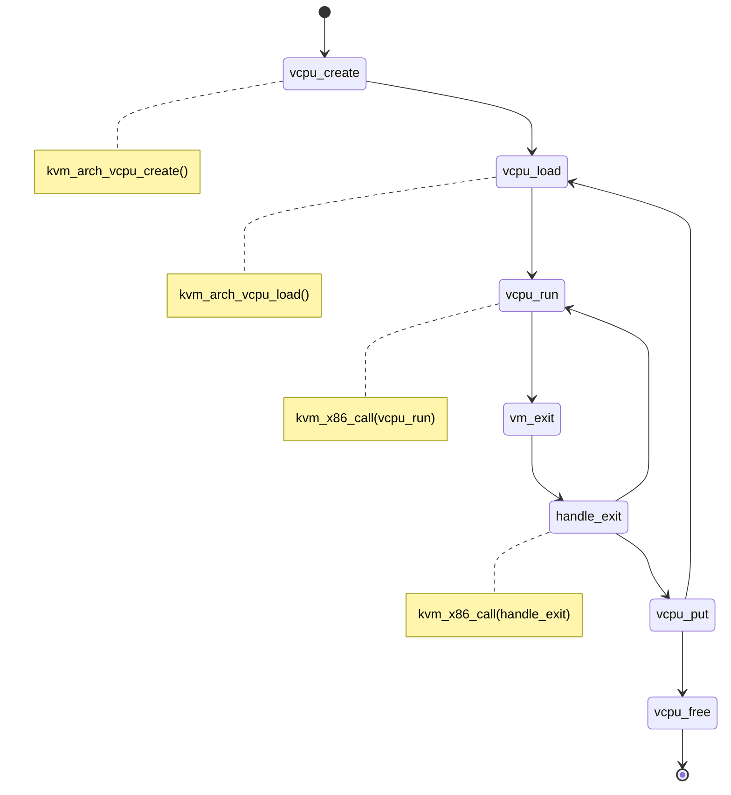

The lifecycle is implemented through function pointers in `kvm_x86_ops`, allowing vendor-specific implementations to override behavior at each stage.

Sources: [arch/x86/kvm/x86.c:12000-12500](), [virt/kvm/kvm_main.c:164-182]()

## Intel VMX Implementation

The Intel VMX implementation leverages Virtual Machine Extensions (VT-x) to provide hardware-assisted virtualization. The core implementation is located in [arch/x86/kvm/vmx/vmx.c]() and provides the `vmx_x86_ops` operations structure.

### VMCS Management

VMX uses Virtual Machine Control Structures (VMCS) to manage guest state and control VM execution:

```mermaid
graph TB
    subgraph "VMCS Lifecycle"
        VMCS_ALLOC["vmcs_create()"]
        VMCS_INIT["vmx_vcpu_create()"]
        VMCS_LOAD["vmcs_load()"]
        VMCS_RUN["__vmx_vcpu_run()"]
        VMCS_CLEAR["vmcs_clear()"]
        VMCS_FREE["vmcs_destroy()"]
    end
    
    subgraph "VMCS Components"
        GUEST_STATE["Guest State Area"]
        HOST_STATE["Host State Area"]
        EXEC_CONTROLS["Execution Controls"]
        EXIT_CONTROLS["VM-Exit Controls"]
        ENTRY_CONTROLS["VM-Entry Controls"]
    end
    
    VMCS_ALLOC --> VMCS_INIT
    VMCS_INIT --> VMCS_LOAD
    VMCS_LOAD --> VMCS_RUN
    VMCS_RUN --> VMCS_CLEAR
    VMCS_CLEAR --> VMCS_FREE
    
    VMCS_INIT --> GUEST_STATE
    VMCS_INIT --> HOST_STATE
    VMCS_INIT --> EXEC_CONTROLS
    VMCS_INIT --> EXIT_CONTROLS
    VMCS_INIT --> ENTRY_CONTROLS
```

The VMCS is managed through the `loaded_vmcs` structure, which tracks the currently active VMCS and provides per-CPU management.

Sources: [arch/x86/kvm/vmx/vmx.c:496-502](), [arch/x86/kvm/vmx/vmcs.h:1-50]()

### VM-Exit Handling

VMX handles VM exits through a centralized dispatch mechanism in `vmx_handle_exit()`:

| Exit Reason | Handler Function | Purpose |
|-------------|------------------|---------|
| `EXIT_REASON_CPUID` | `kvm_emulate_cpuid()` | CPUID instruction emulation |
| `EXIT_REASON_IO_INSTRUCTION` | `handle_io()` | I/O port access |
| `EXIT_REASON_MSR_READ` | `handle_rdmsr()` | MSR read operations |
| `EXIT_REASON_MSR_WRITE` | `handle_wrmsr()` | MSR write operations |
| `EXIT_REASON_EPT_VIOLATION` | `handle_ept_violation()` | Memory access violations |
| `EXIT_REASON_EXTERNAL_INTERRUPT` | `handle_external_interrupt()` | External interrupt injection |

Sources: [arch/x86/kvm/vmx/vmx.c:6500-6800]()

## AMD SVM Implementation

The AMD SVM implementation uses Secure Virtual Machine (AMD-V) technology to provide hardware virtualization. The implementation is located in [arch/x86/kvm/svm/svm.c]() and provides the `svm_x86_ops` operations structure.

### VMCB Management

SVM uses Virtual Machine Control Blocks (VMCB) to manage guest execution state:

```mermaid
graph TB
    subgraph "VMCB Structure"
        VMCB_CONTROL["vmcb->control"]
        VMCB_SAVE["vmcb->save"]
    end
    
    subgraph "Control Area"
        INTERCEPTS["Intercept Controls"]
        IOPM["I/O Permission Map"]
        MSRPM["MSR Permission Map"]
        TSC_OFFSET["TSC Offset"]
        ASID["Address Space ID"]
    end
    
    subgraph "Save Area"
        GUEST_REGS["Guest Registers"]
        GUEST_SEGS["Guest Segments"]
        GUEST_CTRL["Guest Control Registers"]
        GUEST_EFER["Guest EFER"]
    end
    
    VMCB_CONTROL --> INTERCEPTS
    VMCB_CONTROL --> IOPM
    VMCB_CONTROL --> MSRPM
    VMCB_CONTROL --> TSC_OFFSET
    VMCB_CONTROL --> ASID
    
    VMCB_SAVE --> GUEST_REGS
    VMCB_SAVE --> GUEST_SEGS
    VMCB_SAVE --> GUEST_CTRL
    VMCB_SAVE --> GUEST_EFER
```

The VMCB is allocated per-vCPU and managed through the `vcpu_svm` structure.

Sources: [arch/x86/kvm/svm/svm.c:1500-1800](), [arch/x86/kvm/svm/svm.h:150-250]()

### Nested Page Tables (NPT)

SVM supports hardware-assisted memory virtualization through Nested Page Tables when available:

```mermaid
graph TB
    subgraph "NPT Configuration"
        NPT_ENABLED["npt_enabled"]
        NPT_LEVEL["get_npt_level()"]
        NPT_ROOT["vcpu->arch.mmu->root.hpa"]
    end
    
    subgraph "Page Fault Handling"
        NPF_HANDLER["pf_interception()"]
        FAULT_ANALYSIS["Analyze fault cause"]
        SPTE_UPDATE["Update shadow PTEs"]
        TLB_FLUSH["Flush guest TLB"]
    end
    
    NPT_ENABLED --> NPT_LEVEL
    NPT_LEVEL --> NPT_ROOT
    
    NPF_HANDLER --> FAULT_ANALYSIS
    FAULT_ANALYSIS --> SPTE_UPDATE
    SPTE_UPDATE --> TLB_FLUSH
```

Sources: [arch/x86/kvm/svm/svm.c:294-301](), [arch/x86/kvm/svm/svm.c:203-204]()

## Memory Virtualization

The x86 KVM memory management unit handles address translation between guest virtual addresses, guest physical addresses, and host physical addresses. The implementation supports both shadow paging and hardware-assisted virtualization (EPT/NPT).

### Shadow Page Tables

When hardware-assisted memory virtualization is unavailable, KVM maintains shadow page tables that mirror guest page tables:

```mermaid
graph TB
    subgraph "Shadow MMU"
        SHADOW_ROOT["Shadow Root Pages"]
        SHADOW_PAGES["kvm_mmu_page structures"]
        SPTE_ENTRIES["Shadow PTE entries"]
    end
    
    subgraph "Guest Memory"
        GUEST_PT["Guest Page Tables"]
        GUEST_PFN["Guest Page Frames"]
    end
    
    subgraph "Host Memory"
        HOST_PFN["Host Page Frames"]
        HOST_PT["Host Page Tables"]
    end
    
    GUEST_PT --> SHADOW_PAGES
    SHADOW_PAGES --> SPTE_ENTRIES
    SPTE_ENTRIES --> HOST_PFN
    GUEST_PFN --> HOST_PFN
    HOST_PFN --> HOST_PT
```

The shadow MMU is managed through the `kvm_mmu` structure, with individual shadow pages tracked by `kvm_mmu_page` structures.

Sources: [arch/x86/kvm/mmu/mmu.c:500-800](), [arch/x86/kvm/mmu/spte.h:1-50]()

### TDP MMU (Two-Dimensional Paging)

Modern x86 systems support hardware-assisted memory virtualization through EPT (Intel) or NPT (AMD), implemented in the TDP MMU:

```mermaid
graph TB
    subgraph "TDP MMU Management"
        TDP_ENABLED["tdp_enabled"]
        TDP_ROOTS["kvm->arch.tdp_mmu_roots"]
        TDP_PAGES["tdp_mmu_pages_lock"]
    end
    
    subgraph "Memory Operations"
        TDP_MAP["kvm_tdp_mmu_map()"]
        TDP_UNMAP["kvm_tdp_mmu_unmap()"]
        TDP_ZAP["kvm_tdp_mmu_zap_leafs()"]
        TDP_FLUSH["kvm_flush_remote_tlbs()"]
    end
    
    TDP_ENABLED --> TDP_ROOTS
    TDP_ROOTS --> TDP_PAGES
    
    TDP_MAP --> TDP_UNMAP
    TDP_UNMAP --> TDP_ZAP
    TDP_ZAP --> TDP_FLUSH
```

The TDP MMU provides lockless operations for improved scalability on large systems.

Sources: [arch/x86/kvm/mmu/tdp_mmu.c:15-54](), [arch/x86/kvm/mmu/mmu.c:106-115]()

### Memory Management Operations

Key memory management operations are abstracted through the MMU interface:

| Operation | Function | Purpose |
|-----------|----------|---------|
| Page Fault | `kvm_mmu_page_fault()` | Handle guest memory access violations |
| TLB Flush | `kvm_flush_remote_tlbs()` | Invalidate cached translations |
| Memory Slot | `kvm_arch_commit_memory_region()` | Update memory layout |
| SPTE Update | `mmu_spte_update()` | Modify shadow page table entries |

Sources: [arch/x86/kvm/mmu/mmu.c:4000-5000](), [arch/x86/kvm/x86.c:12000-13000]()

---

# Page: KVM ARM64 Virtualization

# KVM ARM64 Virtualization

<details>
<summary>Relevant source files</summary>

The following files were used as context for generating this wiki page:

- [arch/arm/include/asm/arm_pmuv3.h](arch/arm/include/asm/arm_pmuv3.h)
- [arch/arm64/include/asm/arm_pmuv3.h](arch/arm64/include/asm/arm_pmuv3.h)
- [arch/arm64/include/asm/el2_setup.h](arch/arm64/include/asm/el2_setup.h)
- [arch/arm64/include/asm/hardirq.h](arch/arm64/include/asm/hardirq.h)
- [arch/arm64/include/asm/kvm_arm.h](arch/arm64/include/asm/kvm_arm.h)
- [arch/arm64/include/asm/kvm_asm.h](arch/arm64/include/asm/kvm_asm.h)
- [arch/arm64/include/asm/kvm_emulate.h](arch/arm64/include/asm/kvm_emulate.h)
- [arch/arm64/include/asm/kvm_host.h](arch/arm64/include/asm/kvm_host.h)
- [arch/arm64/include/asm/kvm_hyp.h](arch/arm64/include/asm/kvm_hyp.h)
- [arch/arm64/include/asm/kvm_mmu.h](arch/arm64/include/asm/kvm_mmu.h)
- [arch/arm64/include/asm/kvm_nested.h](arch/arm64/include/asm/kvm_nested.h)
- [arch/arm64/include/asm/kvm_pgtable.h](arch/arm64/include/asm/kvm_pgtable.h)
- [arch/arm64/include/asm/kvm_pkvm.h](arch/arm64/include/asm/kvm_pkvm.h)
- [arch/arm64/include/asm/memory.h](arch/arm64/include/asm/memory.h)
- [arch/arm64/include/asm/module.h](arch/arm64/include/asm/module.h)
- [arch/arm64/include/asm/module.lds.h](arch/arm64/include/asm/module.lds.h)
- [arch/arm64/include/asm/runtime-const.h](arch/arm64/include/asm/runtime-const.h)
- [arch/arm64/include/asm/scs.h](arch/arm64/include/asm/scs.h)
- [arch/arm64/include/asm/sections.h](arch/arm64/include/asm/sections.h)
- [arch/arm64/include/asm/stacktrace/nvhe.h](arch/arm64/include/asm/stacktrace/nvhe.h)
- [arch/arm64/include/asm/sysreg.h](arch/arm64/include/asm/sysreg.h)
- [arch/arm64/include/asm/vncr_mapping.h](arch/arm64/include/asm/vncr_mapping.h)
- [arch/arm64/kernel/head.S](arch/arm64/kernel/head.S)
- [arch/arm64/kernel/hyp-stub.S](arch/arm64/kernel/hyp-stub.S)
- [arch/arm64/kernel/image-vars.h](arch/arm64/kernel/image-vars.h)
- [arch/arm64/kernel/kaslr.c](arch/arm64/kernel/kaslr.c)
- [arch/arm64/kernel/module-plts.c](arch/arm64/kernel/module-plts.c)
- [arch/arm64/kernel/module.c](arch/arm64/kernel/module.c)
- [arch/arm64/kernel/pi/kaslr_early.c](arch/arm64/kernel/pi/kaslr_early.c)
- [arch/arm64/kernel/pi/patch-scs.c](arch/arm64/kernel/pi/patch-scs.c)
- [arch/arm64/kernel/pi/pi.h](arch/arm64/kernel/pi/pi.h)
- [arch/arm64/kernel/vmlinux.lds.S](arch/arm64/kernel/vmlinux.lds.S)
- [arch/arm64/kvm/arm.c](arch/arm64/kvm/arm.c)
- [arch/arm64/kvm/at.c](arch/arm64/kvm/at.c)
- [arch/arm64/kvm/debug.c](arch/arm64/kvm/debug.c)
- [arch/arm64/kvm/emulate-nested.c](arch/arm64/kvm/emulate-nested.c)
- [arch/arm64/kvm/fpsimd.c](arch/arm64/kvm/fpsimd.c)
- [arch/arm64/kvm/handle_exit.c](arch/arm64/kvm/handle_exit.c)
- [arch/arm64/kvm/hyp/fpsimd.S](arch/arm64/kvm/hyp/fpsimd.S)
- [arch/arm64/kvm/hyp/hyp-entry.S](arch/arm64/kvm/hyp/hyp-entry.S)
- [arch/arm64/kvm/hyp/include/hyp/debug-sr.h](arch/arm64/kvm/hyp/include/hyp/debug-sr.h)
- [arch/arm64/kvm/hyp/include/hyp/switch.h](arch/arm64/kvm/hyp/include/hyp/switch.h)
- [arch/arm64/kvm/hyp/include/hyp/sysreg-sr.h](arch/arm64/kvm/hyp/include/hyp/sysreg-sr.h)
- [arch/arm64/kvm/hyp/include/nvhe/gfp.h](arch/arm64/kvm/hyp/include/nvhe/gfp.h)
- [arch/arm64/kvm/hyp/include/nvhe/mem_protect.h](arch/arm64/kvm/hyp/include/nvhe/mem_protect.h)
- [arch/arm64/kvm/hyp/include/nvhe/memory.h](arch/arm64/kvm/hyp/include/nvhe/memory.h)
- [arch/arm64/kvm/hyp/include/nvhe/mm.h](arch/arm64/kvm/hyp/include/nvhe/mm.h)
- [arch/arm64/kvm/hyp/include/nvhe/pkvm.h](arch/arm64/kvm/hyp/include/nvhe/pkvm.h)
- [arch/arm64/kvm/hyp/nvhe/debug-sr.c](arch/arm64/kvm/hyp/nvhe/debug-sr.c)
- [arch/arm64/kvm/hyp/nvhe/host.S](arch/arm64/kvm/hyp/nvhe/host.S)
- [arch/arm64/kvm/hyp/nvhe/hyp-init.S](arch/arm64/kvm/hyp/nvhe/hyp-init.S)
- [arch/arm64/kvm/hyp/nvhe/hyp-main.c](arch/arm64/kvm/hyp/nvhe/hyp-main.c)
- [arch/arm64/kvm/hyp/nvhe/hyp.lds.S](arch/arm64/kvm/hyp/nvhe/hyp.lds.S)
- [arch/arm64/kvm/hyp/nvhe/mem_protect.c](arch/arm64/kvm/hyp/nvhe/mem_protect.c)
- [arch/arm64/kvm/hyp/nvhe/mm.c](arch/arm64/kvm/hyp/nvhe/mm.c)
- [arch/arm64/kvm/hyp/nvhe/page_alloc.c](arch/arm64/kvm/hyp/nvhe/page_alloc.c)
- [arch/arm64/kvm/hyp/nvhe/pkvm.c](arch/arm64/kvm/hyp/nvhe/pkvm.c)
- [arch/arm64/kvm/hyp/nvhe/psci-relay.c](arch/arm64/kvm/hyp/nvhe/psci-relay.c)
- [arch/arm64/kvm/hyp/nvhe/setup.c](arch/arm64/kvm/hyp/nvhe/setup.c)
- [arch/arm64/kvm/hyp/nvhe/stacktrace.c](arch/arm64/kvm/hyp/nvhe/stacktrace.c)
- [arch/arm64/kvm/hyp/nvhe/switch.c](arch/arm64/kvm/hyp/nvhe/switch.c)
- [arch/arm64/kvm/hyp/nvhe/sys_regs.c](arch/arm64/kvm/hyp/nvhe/sys_regs.c)
- [arch/arm64/kvm/hyp/nvhe/sysreg-sr.c](arch/arm64/kvm/hyp/nvhe/sysreg-sr.c)
- [arch/arm64/kvm/hyp/pgtable.c](arch/arm64/kvm/hyp/pgtable.c)
- [arch/arm64/kvm/hyp/vhe/debug-sr.c](arch/arm64/kvm/hyp/vhe/debug-sr.c)
- [arch/arm64/kvm/hyp/vhe/switch.c](arch/arm64/kvm/hyp/vhe/switch.c)
- [arch/arm64/kvm/hyp/vhe/sysreg-sr.c](arch/arm64/kvm/hyp/vhe/sysreg-sr.c)
- [arch/arm64/kvm/mmu.c](arch/arm64/kvm/mmu.c)
- [arch/arm64/kvm/nested.c](arch/arm64/kvm/nested.c)
- [arch/arm64/kvm/pkvm.c](arch/arm64/kvm/pkvm.c)
- [arch/arm64/kvm/pmu-emul.c](arch/arm64/kvm/pmu-emul.c)
- [arch/arm64/kvm/pmu.c](arch/arm64/kvm/pmu.c)
- [arch/arm64/kvm/reset.c](arch/arm64/kvm/reset.c)
- [arch/arm64/kvm/stacktrace.c](arch/arm64/kvm/stacktrace.c)
- [arch/arm64/kvm/sys_regs.c](arch/arm64/kvm/sys_regs.c)
- [arch/arm64/kvm/sys_regs.h](arch/arm64/kvm/sys_regs.h)
- [arch/arm64/kvm/trace_handle_exit.h](arch/arm64/kvm/trace_handle_exit.h)
- [arch/arm64/kvm/vgic-sys-reg-v3.c](arch/arm64/kvm/vgic-sys-reg-v3.c)
- [arch/arm64/mm/init.c](arch/arm64/mm/init.c)
- [arch/arm64/tools/sysreg](arch/arm64/tools/sysreg)
- [drivers/perf/arm_pmu.c](drivers/perf/arm_pmu.c)
- [drivers/perf/arm_pmuv3.c](drivers/perf/arm_pmuv3.c)
- [drivers/perf/arm_v6_pmu.c](drivers/perf/arm_v6_pmu.c)
- [drivers/perf/arm_v7_pmu.c](drivers/perf/arm_v7_pmu.c)
- [drivers/perf/arm_xscale_pmu.c](drivers/perf/arm_xscale_pmu.c)
- [include/kvm/arm_pmu.h](include/kvm/arm_pmu.h)
- [include/linux/perf/arm_pmu.h](include/linux/perf/arm_pmu.h)
- [include/linux/perf/arm_pmuv3.h](include/linux/perf/arm_pmuv3.h)
- [tools/arch/arm64/include/asm/gpr-num.h](tools/arch/arm64/include/asm/gpr-num.h)
- [tools/arch/arm64/include/asm/sysreg.h](tools/arch/arm64/include/asm/sysreg.h)
- [tools/include/linux/kasan-tags.h](tools/include/linux/kasan-tags.h)

</details>


This document covers the ARM64-specific implementation of the KVM hypervisor, focusing on system register emulation, nested virtualization capabilities, and ARM64 architectural features. For x86 KVM implementation details, see [KVM x86 Virtualization](#3.1). For IOMMU support that works with ARM64 virtualization, see [IOMMU Support](#3.3).

## Core ARM64 KVM Architecture

The ARM64 KVM implementation provides hardware-assisted virtualization using ARM's Virtualization Extensions, supporting both VHE (Virtualization Host Extensions) and non-VHE configurations. The core architecture revolves around efficient guest/host context switching and ARM64-specific system register virtualization.

```mermaid
graph TB
    subgraph "User Space"
        QEMU["QEMU/VMM"]
        MGMT["Management Tools"]
    end
    
    subgraph "Host Kernel (EL1)"
        KVM_ARM["kvm_arch_vcpu_run"]
        ARM_C["arm.c - Core Logic"]
        SYSREG["sys_regs.c - Sysreg Emulation"]
        NESTED["nested.c - Nested Virt"]
        PMU_EMUL["pmu-emul.c - PMU Emulation"]
        MMU_C["mmu.c - Memory Management"]
    end
    
    subgraph "Hypervisor (EL2)"
        VHE_SWITCH["switch.c - VHE Switch"]
        NVHE_MAIN["hyp-main.c - nVHE Main"]
        PGTABLE["pgtable.c - Page Tables"]
        MEM_PROTECT["mem_protect.c - Memory Protection"]
    end
    
    subgraph "Guest VM (EL1/EL0)"
        GUEST_KERNEL["Guest Kernel"]
        GUEST_USER["Guest Userspace"]
        NESTED_GUEST["Nested Guest (EL1/EL0)"]
    end
    
    QEMU --> KVM_ARM
    KVM_ARM --> ARM_C
    ARM_C --> SYSREG
    ARM_C --> NESTED
    ARM_C --> PMU_EMUL
    ARM_C --> MMU_C
    
    ARM_C --> VHE_SWITCH
    ARM_C --> NVHE_MAIN
    VHE_SWITCH --> PGTABLE
    NVHE_MAIN --> MEM_PROTECT
    
    VHE_SWITCH --> GUEST_KERNEL
    NVHE_MAIN --> GUEST_KERNEL
    GUEST_KERNEL --> GUEST_USER
    
    NESTED --> NESTED_GUEST
    
    classDef kernel fill:#e1f5fe
    classDef hypervisor fill:#f3e5f5
    classDef guest fill:#e8f5e8
    
    class KVM_ARM,ARM_C,SYSREG,NESTED,PMU_EMUL,MMU_C kernel
    class VHE_SWITCH,NVHE_MAIN,PGTABLE,MEM_PROTECT hypervisor
    class GUEST_KERNEL,GUEST_USER,NESTED_GUEST guest
```

Sources: [arch/arm64/kvm/arm.c:1-1000](), [arch/arm64/kvm/sys_regs.c:1-100](), [arch/arm64/kvm/nested.c:1-100]()

## System Register Emulation

The ARM64 KVM implementation provides comprehensive system register emulation through a sophisticated trap-and-emulate mechanism. The `sys_regs.c` file contains the core system register handling logic with over 4000 lines of emulation code.

### System Register Access Framework

```mermaid
graph TB
    subgraph "Guest Access"
        GUEST_MSR["mrs/msr instruction"]
        TRAP["System Register Trap"]
    end
    
    subgraph "Trap Handling"
        HANDLE_SYS["handle_sys"]
        SYS_REG_DESC["sys_reg_desc lookup"]
        ACCESS_FN["access function"]
    end
    
    subgraph "Register Categories"
        ID_REGS["ID Registers (ID_AA64PFR0_EL1, etc.)"]
        TIMER_REGS["Timer Registers (CNTP_*, CNTV_*)"]
        PMU_REGS["PMU Registers (PMCR_EL0, etc.)"]
        DEBUG_REGS["Debug Registers (DBG*, etc.)"]
        EL2_REGS["EL2 Registers (HCR_EL2, etc.)"]
    end
    
    subgraph "Access Functions"
        ACCESS_RW["access_rw"]
        ACCESS_PMU["access_pmcr, access_pmselr"]
        ACCESS_TIMER["access_arch_timer"]
        ACCESS_DEBUG["trap_debug_regs"]
        UNDEF_ACCESS["undef_access"]
    end
    
    GUEST_MSR --> TRAP
    TRAP --> HANDLE_SYS
    HANDLE_SYS --> SYS_REG_DESC
    SYS_REG_DESC --> ACCESS_FN
    
    ACCESS_FN --> ID_REGS
    ACCESS_FN --> TIMER_REGS
    ACCESS_FN --> PMU_REGS
    ACCESS_FN --> DEBUG_REGS
    ACCESS_FN --> EL2_REGS
    
    ID_REGS --> ACCESS_RW
    TIMER_REGS --> ACCESS_TIMER
    PMU_REGS --> ACCESS_PMU
    DEBUG_REGS --> ACCESS_DEBUG
    EL2_REGS --> UNDEF_ACCESS
```

The system register framework uses a table-driven approach where each register is described by a `sys_reg_desc` structure containing access functions, reset values, and visibility controls.

Sources: [arch/arm64/kvm/sys_regs.c:48-83](), [arch/arm64/kvm/sys_regs.c:362-372]()

### Key System Register Categories

| Register Category | Purpose | Key Functions |
|------------------|---------|---------------|
| ID Registers | Feature discovery | `set_id_reg`, `kvm_vcpu_apply_reg_masks` |
| Timer Registers | Virtual timer control | `access_arch_timer` |
| PMU Registers | Performance monitoring | `access_pmcr`, `access_pmu_evcntr` |
| Debug Registers | Debug/trace control | `trap_debug_regs`, `trap_dbg_wb_reg` |
| GIC Registers | Interrupt controller | `access_gic_sgi`, `access_gic_sre` |

The register emulation supports both read and write operations with proper exception handling and guest state validation.

Sources: [arch/arm64/kvm/sys_regs.c:1304-1400](), [arch/arm64/kvm/sys_regs.c:874-901]()

## Nested Virtualization

ARM64 KVM supports nested virtualization, allowing a guest hypervisor to run its own virtual machines. This is implemented through shadow stage-2 page tables and comprehensive EL2 register emulation.

### Nested Virtualization Architecture

```mermaid
graph TB
    subgraph "L0 Host (KVM)"
        L0_KVM["KVM Host"]
        L0_MMU["Host Stage-2 MMU"]
        NESTED_MMUS["nested_mmus[]"]
        VNCR_TLB["VNCR TLB"]
    end
    
    subgraph "L1 Guest Hypervisor"
        L1_HV["Guest Hypervisor"]
        L1_STAGE2["Guest Stage-2 Tables"]
        VTTBR_EL2["VTTBR_EL2"]
        VTCR_EL2["VTCR_EL2"]
    end
    
    subgraph "L2 Guest"
        L2_GUEST["Nested Guest"]
        L2_IPA["Guest IPA Space"]
    end
    
    subgraph "Shadow Management"
        LOOKUP_S2["lookup_s2_mmu"]
        GET_S2["get_s2_mmu_nested"]
        WALK_S2["walk_nested_s2_pgd"]
        S2_TRANS["kvm_s2_trans"]
    end
    
    L1_HV --> L1_STAGE2
    L1_STAGE2 --> VTTBR_EL2
    L1_STAGE2 --> VTCR_EL2
    
    L0_KVM --> NESTED_MMUS
    L0_KVM --> VNCR_TLB
    NESTED_MMUS --> LOOKUP_S2
    LOOKUP_S2 --> GET_S2
    
    L2_GUEST --> L2_IPA
    L2_IPA --> WALK_S2
    WALK_S2 --> S2_TRANS
    S2_TRANS --> L0_MMU
    
    L1_HV --> L2_GUEST
```

Sources: [arch/arm64/kvm/nested.c:44-124](), [arch/arm64/kvm/nested.c:612-700]()

### Shadow Stage-2 MMU Management

The nested virtualization implementation maintains multiple shadow stage-2 MMUs to handle different guest hypervisor configurations:

```c
// Key data structures from nested.c
struct kvm_s2_mmu {
    struct kvm_vmid vmid;
    phys_addr_t pgd_phys;
    struct kvm_pgtable *pgt;
    u64 vtcr;
    u64 tlb_vttbr;
    u64 tlb_vtcr;
    bool nested_stage2_enabled;
    atomic_t refcnt;
};
```

The `lookup_s2_mmu` function determines which shadow MMU context to use based on the guest's `VTTBR_EL2` and `VTCR_EL2` configuration.

Sources: [arch/arm64/kvm/nested.c:612-659](), [arch/arm64/include/asm/kvm_host.h:152-230]()

### VNCR (Virtual Non-secure Context Register) Support

For nested virtualization, ARM64 KVM implements VNCR support for efficient EL2 register context switching:

```mermaid
graph LR
    subgraph "Guest EL2 Context"
        VNCR_ARRAY["vncr_array[PAGE_SIZE]"]
        EL2_REGS["EL2 System Registers"]
    end
    
    subgraph "Hardware Support"
        VNCR_EL2["VNCR_EL2 Register"]
        HW_BACKING["Hardware-backed Access"]
    end
    
    subgraph "TLB Management"
        VNCR_TLB_STRUCT["vncr_tlb"]
        TLB_VALID["valid flag"]
        TLB_CPU["cpu mapping"]
    end
    
    VNCR_ARRAY --> VNCR_EL2
    VNCR_EL2 --> HW_BACKING
    HW_BACKING --> EL2_REGS
    
    VNCR_ARRAY --> VNCR_TLB_STRUCT
    VNCR_TLB_STRUCT --> TLB_VALID
    VNCR_TLB_STRUCT --> TLB_CPU
```

Sources: [arch/arm64/kvm/nested.c:20-36](), [arch/arm64/include/asm/kvm_host.h:880-882]()

## Performance Monitoring Unit (PMU) Emulation

ARM64 KVM provides comprehensive PMU virtualization supporting guest performance monitoring with proper isolation and event filtering.

### PMU Architecture

```mermaid
graph TB
    subgraph "Guest PMU Access"
        GUEST_PMU["Guest PMU Instructions"]
        PMU_TRAPS["PMU Register Traps"]
    end
    
    subgraph "KVM PMU Emulation"
        PMU_VCPU_INIT["kvm_pmu_vcpu_init"]
        PMU_CREATE["kvm_pmu_create_perf_event"]
        PMU_HANDLE["kvm_pmu_handle_pmcr"]
        PMU_COUNTER["kvm_pmu_get_counter_value"]
    end
    
    subgraph "Host perf Subsystem"
        PERF_EVENT["perf_event"]
        PERF_READ["perf_event_read_value"]
        PERF_ENABLE["perf_event_enable"]
    end
    
    subgraph "PMU Registers"
        PMCR_EL0["PMCR_EL0 - Control"]
        PMCNTENSET["PMCNTENSET_EL0 - Enable"]
        PMEVCNTR["PMEVCNTRn_EL0 - Counters"]
        PMEVTYPER["PMEVTYPERn_EL0 - Event Types"]
    end
    
    GUEST_PMU --> PMU_TRAPS
    PMU_TRAPS --> PMU_VCPU_INIT
    PMU_VCPU_INIT --> PMU_CREATE
    PMU_CREATE --> PERF_EVENT
    
    PMU_HANDLE --> PERF_ENABLE
    PMU_COUNTER --> PERF_READ
    
    PMU_TRAPS --> PMCR_EL0
    PMU_TRAPS --> PMCNTENSET
    PMU_TRAPS --> PMEVCNTR
    PMU_TRAPS --> PMEVTYPER
```

Sources: [arch/arm64/kvm/pmu-emul.c:252-272](), [arch/arm64/kvm/pmu-emul.c:328-350]()

### PMU Counter Management

The PMU emulation manages up to `KVM_ARMV8_PMU_MAX_COUNTERS` performance counters, each backed by a host `perf_event`:

| Function | Purpose | Key Operations |
|----------|---------|----------------|
| `kvm_pmu_get_counter_value` | Read counter value | Combines register value with perf event count |
| `kvm_pmu_set_counter_value` | Write counter value | Updates register and recreates perf event |
| `kvm_pmu_create_perf_event` | Create backing event | Configures host perf_event with guest parameters |
| `kvm_pmu_release_perf_event` | Destroy backing event | Cleans up perf_event resources |

The PMU emulation supports both 32-bit and 64-bit counter modes and handles counter chaining for extended precision.

Sources: [arch/arm64/kvm/pmu-emul.c:128-148](), [arch/arm64/kvm/pmu-emul.c:160-185]()

## Memory Management and Stage-2 MMU

ARM64 KVM implements sophisticated two-stage address translation with hardware-assisted stage-2 page tables for guest physical memory management.

### Stage-2 MMU Architecture

```mermaid
graph TB
    subgraph "Guest Address Translation"
        GVA["Guest Virtual Address"]
        GPA["Guest Physical Address"]
        HPA["Host Physical Address"]
        STAGE1["Stage-1 (Guest MMU)"]
        STAGE2["Stage-2 (KVM MMU)"]
    end
    
    subgraph "KVM MMU Components"
        KVM_S2_MMU["kvm_s2_mmu"]
        KVM_PGTABLE["kvm_pgtable"]
        PGTABLE_OPS["kvm_pgtable_mm_ops"]
        STAGE2_PGD["Stage-2 PGD"]
    end
    
    subgraph "Page Table Operations"
        PTE_OPS["PTE Operations"]
        MAP_RANGE["kvm_pgtable_stage2_map"]
        UNMAP_RANGE["kvm_pgtable_stage2_unmap"]
        WALK["kvm_pgtable_walk"]
    end
    
    subgraph "Memory Protection"
        MEMSLOTS["KVM Memory Slots"]
        USER_MEM_REG["User Memory Regions"]
        DEVICE_MEM["Device Memory"]
    end
    
    GVA --> STAGE1
    STAGE1 --> GPA
    GPA --> STAGE2
    STAGE2 --> HPA
    
    STAGE2 --> KVM_S2_MMU
    KVM_S2_MMU --> KVM_PGTABLE
    KVM_PGTABLE --> PGTABLE_OPS
    KVM_PGTABLE --> STAGE2_PGD
    
    PGTABLE_OPS --> PTE_OPS
    PTE_OPS --> MAP_RANGE
    PTE_OPS --> UNMAP_RANGE
    PTE_OPS --> WALK
    
    MAP_RANGE --> MEMSLOTS
    MEMSLOTS --> USER_MEM_REG
    MEMSLOTS --> DEVICE_MEM
```

Sources: [arch/arm64/kvm/mmu.c:1-100](), [arch/arm64/include/asm/kvm_host.h:152-196]()

### Stage-2 Page Table Management

The stage-2 MMU supports multiple page sizes and provides efficient memory management through the `kvm_pgtable` abstraction:

| Feature | Implementation | Key Functions |
|---------|----------------|---------------|
| Concatenated PGDs | Multi-level page tables | `kvm_init_stage2_mmu` |
| Block mappings | Large page support | `stage2_map_walker` |
| Device memory | MMIO region mapping | `kvm_phys_addr_ioremap` |
| Memory slots | Guest RAM regions | `kvm_arch_prepare_memory_region` |
| Dirty logging | Page modification tracking | `stage2_wp_range` |

The implementation supports both 4KB and 64KB page granules with appropriate translation table formats.

Sources: [arch/arm64/kvm/hyp/pgtable.c:1-100](), [arch/arm64/kvm/mmu.c:1000-1100]()

## Hypervisor Entry/Exit Mechanisms

ARM64 KVM implements efficient guest/host world switching through both VHE (Virtualization Host Extensions) and non-VHE code paths.

### VHE vs Non-VHE Architecture

```mermaid
graph TB
    subgraph "VHE Mode (E2H=1)"
        VHE_HOST["Host runs at EL2"]
        VHE_SWITCH["switch.c - Direct Switch"]
        VHE_GUEST["Guest at EL1/EL0"]
        VHE_SIMPLE["Simplified Context Switch"]
    end
    
    subgraph "Non-VHE Mode (E2H=0)"
        NVHE_HOST["Host at EL1"]
        NVHE_HYP["Hypervisor at EL2"]
        NVHE_MAIN["hyp-main.c - Hyp Handler"]
        NVHE_GUEST["Guest at EL1/EL0"]
        NVHE_COMPLEX["Complex World Switch"]
    end
    
    subgraph "Common Components"
        VCPU_RUN["kvm_arch_vcpu_run"]
        WORLD_SWITCH["World Switch Logic"]
        EXCEPTION_RETURN["Exception Return"]
    end
    
    VCPU_RUN --> VHE_SWITCH
    VCPU_RUN --> NVHE_MAIN
    
    VHE_SWITCH --> VHE_SIMPLE
    VHE_SIMPLE --> VHE_GUEST
    VHE_GUEST --> EXCEPTION_RETURN
    
    NVHE_MAIN --> NVHE_COMPLEX
    NVHE_COMPLEX --> NVHE_GUEST
    NVHE_GUEST --> WORLD_SWITCH
    
    VHE_HOST --> VHE_SWITCH
    NVHE_HOST --> NVHE_HYP
    NVHE_HYP --> NVHE_MAIN
```

Sources: [arch/arm64/kvm/hyp/vhe/switch.c:1-50](), [arch/arm64/kvm/hyp/nvhe/hyp-main.c:1-50]()

### Context Switch Operations

The hypervisor entry/exit involves comprehensive state management:

| Component | VHE Implementation | Non-VHE Implementation |
|-----------|-------------------|------------------------|
| System Registers | Direct EL2 access | Hypervisor stub |
| Memory Management | Shared address space | Separate hyp mappings |
| Interrupt Handling | EL2 vectors | Hyp-specific vectors |
| Debug Support | Native debug support | Limited debug context |
| Performance | Minimal overhead | Additional world switch cost |

The context switch preserves all necessary architectural state while maintaining security boundaries between host and guest.

Sources: [arch/arm64/kvm/hyp/include/hyp/switch.h:185-300](), [arch/arm64/kvm/arm.c:567-667]()

---

# Page: IOMMU Support

# IOMMU Support

<details>
<summary>Relevant source files</summary>

The following files were used as context for generating this wiki page:

- [arch/arm/xen/mm.c](arch/arm/xen/mm.c)
- [arch/mips/pci/pci-octeon.c](arch/mips/pci/pci-octeon.c)
- [arch/powerpc/platforms/pseries/svm.c](arch/powerpc/platforms/pseries/svm.c)
- [arch/powerpc/sysdev/fsl_pci.c](arch/powerpc/sysdev/fsl_pci.c)
- [arch/x86/include/asm/irq_remapping.h](arch/x86/include/asm/irq_remapping.h)
- [drivers/base/devres.c](drivers/base/devres.c)
- [drivers/iommu/Kconfig](drivers/iommu/Kconfig)
- [drivers/iommu/Makefile](drivers/iommu/Makefile)
- [drivers/iommu/amd/Kconfig](drivers/iommu/amd/Kconfig)
- [drivers/iommu/amd/Makefile](drivers/iommu/amd/Makefile)
- [drivers/iommu/amd/amd_iommu.h](drivers/iommu/amd/amd_iommu.h)
- [drivers/iommu/amd/amd_iommu_types.h](drivers/iommu/amd/amd_iommu_types.h)
- [drivers/iommu/amd/init.c](drivers/iommu/amd/init.c)
- [drivers/iommu/amd/io_pgtable.c](drivers/iommu/amd/io_pgtable.c)
- [drivers/iommu/amd/io_pgtable_v2.c](drivers/iommu/amd/io_pgtable_v2.c)
- [drivers/iommu/amd/iommu.c](drivers/iommu/amd/iommu.c)
- [drivers/iommu/amd/pasid.c](drivers/iommu/amd/pasid.c)
- [drivers/iommu/amd/ppr.c](drivers/iommu/amd/ppr.c)
- [drivers/iommu/arm/Kconfig](drivers/iommu/arm/Kconfig)
- [drivers/iommu/arm/Makefile](drivers/iommu/arm/Makefile)
- [drivers/iommu/arm/arm-smmu-v3/Makefile](drivers/iommu/arm/arm-smmu-v3/Makefile)
- [drivers/iommu/arm/arm-smmu-v3/arm-smmu-v3-iommufd.c](drivers/iommu/arm/arm-smmu-v3/arm-smmu-v3-iommufd.c)
- [drivers/iommu/arm/arm-smmu-v3/arm-smmu-v3-sva.c](drivers/iommu/arm/arm-smmu-v3/arm-smmu-v3-sva.c)
- [drivers/iommu/arm/arm-smmu-v3/arm-smmu-v3-test.c](drivers/iommu/arm/arm-smmu-v3/arm-smmu-v3-test.c)
- [drivers/iommu/arm/arm-smmu-v3/arm-smmu-v3.c](drivers/iommu/arm/arm-smmu-v3/arm-smmu-v3.c)
- [drivers/iommu/arm/arm-smmu-v3/arm-smmu-v3.h](drivers/iommu/arm/arm-smmu-v3/arm-smmu-v3.h)
- [drivers/iommu/arm/arm-smmu-v3/tegra241-cmdqv.c](drivers/iommu/arm/arm-smmu-v3/tegra241-cmdqv.c)
- [drivers/iommu/dma-iommu.c](drivers/iommu/dma-iommu.c)
- [drivers/iommu/dma-iommu.h](drivers/iommu/dma-iommu.h)
- [drivers/iommu/exynos-iommu.c](drivers/iommu/exynos-iommu.c)
- [drivers/iommu/fsl_pamu_domain.c](drivers/iommu/fsl_pamu_domain.c)
- [drivers/iommu/intel/Kconfig](drivers/iommu/intel/Kconfig)
- [drivers/iommu/intel/Makefile](drivers/iommu/intel/Makefile)
- [drivers/iommu/intel/cache.c](drivers/iommu/intel/cache.c)
- [drivers/iommu/intel/debugfs.c](drivers/iommu/intel/debugfs.c)
- [drivers/iommu/intel/dmar.c](drivers/iommu/intel/dmar.c)
- [drivers/iommu/intel/iommu.c](drivers/iommu/intel/iommu.c)
- [drivers/iommu/intel/iommu.h](drivers/iommu/intel/iommu.h)
- [drivers/iommu/intel/irq_remapping.c](drivers/iommu/intel/irq_remapping.c)
- [drivers/iommu/intel/nested.c](drivers/iommu/intel/nested.c)
- [drivers/iommu/intel/pasid.c](drivers/iommu/intel/pasid.c)
- [drivers/iommu/intel/pasid.h](drivers/iommu/intel/pasid.h)
- [drivers/iommu/intel/perf.h](drivers/iommu/intel/perf.h)
- [drivers/iommu/intel/perfmon.c](drivers/iommu/intel/perfmon.c)
- [drivers/iommu/intel/prq.c](drivers/iommu/intel/prq.c)
- [drivers/iommu/intel/svm.c](drivers/iommu/intel/svm.c)
- [drivers/iommu/intel/trace.h](drivers/iommu/intel/trace.h)
- [drivers/iommu/io-pgfault.c](drivers/iommu/io-pgfault.c)
- [drivers/iommu/io-pgtable-arm-v7s.c](drivers/iommu/io-pgtable-arm-v7s.c)
- [drivers/iommu/io-pgtable-arm.c](drivers/iommu/io-pgtable-arm.c)
- [drivers/iommu/io-pgtable-dart.c](drivers/iommu/io-pgtable-dart.c)
- [drivers/iommu/iommu-pages.c](drivers/iommu/iommu-pages.c)
- [drivers/iommu/iommu-pages.h](drivers/iommu/iommu-pages.h)
- [drivers/iommu/iommu-priv.h](drivers/iommu/iommu-priv.h)
- [drivers/iommu/iommu-sva.c](drivers/iommu/iommu-sva.c)
- [drivers/iommu/iommu.c](drivers/iommu/iommu.c)
- [drivers/iommu/iommufd/Kconfig](drivers/iommu/iommufd/Kconfig)
- [drivers/iommu/iommufd/Makefile](drivers/iommu/iommufd/Makefile)
- [drivers/iommu/iommufd/device.c](drivers/iommu/iommufd/device.c)
- [drivers/iommu/iommufd/driver.c](drivers/iommu/iommufd/driver.c)
- [drivers/iommu/iommufd/eventq.c](drivers/iommu/iommufd/eventq.c)
- [drivers/iommu/iommufd/hw_pagetable.c](drivers/iommu/iommufd/hw_pagetable.c)
- [drivers/iommu/iommufd/io_pagetable.c](drivers/iommu/iommufd/io_pagetable.c)
- [drivers/iommu/iommufd/io_pagetable.h](drivers/iommu/iommufd/io_pagetable.h)
- [drivers/iommu/iommufd/ioas.c](drivers/iommu/iommufd/ioas.c)
- [drivers/iommu/iommufd/iommufd_private.h](drivers/iommu/iommufd/iommufd_private.h)
- [drivers/iommu/iommufd/iommufd_test.h](drivers/iommu/iommufd/iommufd_test.h)
- [drivers/iommu/iommufd/iova_bitmap.c](drivers/iommu/iommufd/iova_bitmap.c)
- [drivers/iommu/iommufd/main.c](drivers/iommu/iommufd/main.c)
- [drivers/iommu/iommufd/pages.c](drivers/iommu/iommufd/pages.c)
- [drivers/iommu/iommufd/selftest.c](drivers/iommu/iommufd/selftest.c)
- [drivers/iommu/iommufd/viommu.c](drivers/iommu/iommufd/viommu.c)
- [drivers/iommu/irq_remapping.c](drivers/iommu/irq_remapping.c)
- [drivers/iommu/irq_remapping.h](drivers/iommu/irq_remapping.h)
- [drivers/iommu/of_iommu.c](drivers/iommu/of_iommu.c)
- [drivers/iommu/riscv/Kconfig](drivers/iommu/riscv/Kconfig)
- [drivers/iommu/riscv/Makefile](drivers/iommu/riscv/Makefile)
- [drivers/iommu/riscv/iommu-bits.h](drivers/iommu/riscv/iommu-bits.h)
- [drivers/iommu/riscv/iommu-pci.c](drivers/iommu/riscv/iommu-pci.c)
- [drivers/iommu/riscv/iommu-platform.c](drivers/iommu/riscv/iommu-platform.c)
- [drivers/iommu/riscv/iommu.c](drivers/iommu/riscv/iommu.c)
- [drivers/iommu/riscv/iommu.h](drivers/iommu/riscv/iommu.h)
- [drivers/iommu/rockchip-iommu.c](drivers/iommu/rockchip-iommu.c)
- [drivers/iommu/sun50i-iommu.c](drivers/iommu/sun50i-iommu.c)
- [drivers/iommu/tegra-smmu.c](drivers/iommu/tegra-smmu.c)
- [drivers/xen/swiotlb-xen.c](drivers/xen/swiotlb-xen.c)
- [include/linux/device.h](include/linux/device.h)
- [include/linux/device/devres.h](include/linux/device/devres.h)
- [include/linux/dma-map-ops.h](include/linux/dma-map-ops.h)
- [include/linux/dma-mapping.h](include/linux/dma-mapping.h)
- [include/linux/dmar.h](include/linux/dmar.h)
- [include/linux/io-pgtable.h](include/linux/io-pgtable.h)
- [include/linux/iommu-dma.h](include/linux/iommu-dma.h)
- [include/linux/iommu.h](include/linux/iommu.h)
- [include/linux/iommufd.h](include/linux/iommufd.h)
- [include/linux/iov_iter.h](include/linux/iov_iter.h)
- [include/linux/pci-p2pdma.h](include/linux/pci-p2pdma.h)
- [include/linux/scatterlist.h](include/linux/scatterlist.h)
- [include/linux/swiotlb.h](include/linux/swiotlb.h)
- [include/trace/events/dma.h](include/trace/events/dma.h)
- [include/uapi/linux/iommufd.h](include/uapi/linux/iommufd.h)
- [kernel/dma/Kconfig](kernel/dma/Kconfig)
- [kernel/dma/Makefile](kernel/dma/Makefile)
- [kernel/dma/debug.c](kernel/dma/debug.c)
- [kernel/dma/direct.c](kernel/dma/direct.c)
- [kernel/dma/direct.h](kernel/dma/direct.h)
- [kernel/dma/dummy.c](kernel/dma/dummy.c)
- [kernel/dma/mapping.c](kernel/dma/mapping.c)
- [kernel/dma/ops_helpers.c](kernel/dma/ops_helpers.c)
- [kernel/dma/swiotlb.c](kernel/dma/swiotlb.c)
- [lib/scatterlist.c](lib/scatterlist.c)
- [tools/testing/selftests/iommu/Makefile](tools/testing/selftests/iommu/Makefile)
- [tools/testing/selftests/iommu/iommufd.c](tools/testing/selftests/iommu/iommufd.c)
- [tools/testing/selftests/iommu/iommufd_fail_nth.c](tools/testing/selftests/iommu/iommufd_fail_nth.c)
- [tools/testing/selftests/iommu/iommufd_utils.h](tools/testing/selftests/iommu/iommufd_utils.h)

</details>


This document covers the Linux kernel's Input/Output Memory Management Unit (IOMMU) subsystem, which provides device DMA isolation, address translation, and secure device assignment capabilities for virtualization. The IOMMU subsystem supports multiple hardware implementations including Intel VT-d, ARM SMMUv3, and AMD IOMMU, along with a unified framework for device virtualization through IOMMUFD.

For information about hypervisor-specific virtualization features, see [KVM x86 Virtualization](#3.1) and [KVM ARM64 Virtualization](#3.2).

## Architecture Overview

The IOMMU subsystem provides a layered architecture that abstracts hardware-specific IOMMU implementations behind a common framework, enabling secure device assignment and DMA isolation for both native and virtualized environments.

### IOMMU Subsystem Architecture

```mermaid
graph TB
    subgraph "User Space"
        VFIO[VFIO Applications]
        IOMMUFD_USER[IOMMUFD Users]
        QEMU[QEMU/KVM]
    end
    
    subgraph "Kernel IOMMU Framework"
        IOMMU_CORE[iommu.c<br/>Core Framework]
        DMA_IOMMU[dma-iommu.c<br/>DMA-API Glue]
        IOMMUFD[iommufd/<br/>Device Management]
    end
    
    subgraph "Hardware Implementations"
        INTEL_VTD[intel/iommu.c<br/>Intel VT-d]
        ARM_SMMU[arm-smmu-v3.c<br/>ARM SMMUv3]  
        AMD_IOMMU[amd/iommu.c<br/>AMD IOMMU]
    end
    
    subgraph "Support Components"
        PASID[intel/pasid.c<br/>PASID Management]
        DMAR[intel/dmar.c<br/>DMAR Tables]
        SWIOTLB[swiotlb.c<br/>Software IOTLB]
        IO_PGTABLE[io-pgtable-arm.c<br/>Page Tables]
    end
    
    subgraph "Hardware"
        INTEL_HW[Intel VT-d Hardware]
        ARM_HW[ARM SMMU Hardware]
        AMD_HW[AMD IOMMU Hardware]
    end
    
    VFIO --> IOMMU_CORE
    IOMMUFD_USER --> IOMMUFD
    QEMU --> IOMMUFD
    
    IOMMUFD --> IOMMU_CORE
    DMA_IOMMU --> IOMMU_CORE
    
    IOMMU_CORE --> INTEL_VTD
    IOMMU_CORE --> ARM_SMMU
    IOMMU_CORE --> AMD_IOMMU
    
    INTEL_VTD --> PASID
    INTEL_VTD --> DMAR
    ARM_SMMU --> IO_PGTABLE
    DMA_IOMMU --> SWIOTLB
    
    INTEL_VTD --> INTEL_HW
    ARM_SMMU --> ARM_HW
    AMD_IOMMU --> AMD_HW
```

Sources: [drivers/iommu/iommu.c:1-3147](), [drivers/iommu/dma-iommu.c:1-1854](), [drivers/iommu/iommufd/device.c:1-1326]()

### Core IOMMU Operations

The IOMMU framework defines a standardized set of operations implemented by each hardware-specific driver:

```mermaid
graph LR
    subgraph "iommu_ops Structure"
        PROBE[probe_device]
        RELEASE[release_device]
        DEVICE_GROUP[device_group]
        DOMAIN_ALLOC[domain_alloc]
        ATTACH[attach_dev]
        DETACH[detach_dev]
    end
    
    subgraph "Intel VT-d Implementation"
        INTEL_PROBE[intel_iommu_probe_device]
        INTEL_RELEASE[intel_iommu_release_device]
        INTEL_GROUP[intel_iommu_device_group]
        INTEL_ALLOC[intel_iommu_domain_alloc]
        INTEL_ATTACH[intel_iommu_attach_device]
        INTEL_DETACH[intel_iommu_detach_device]
    end
    
    subgraph "ARM SMMUv3 Implementation"
        ARM_PROBE[arm_smmu_probe_device]
        ARM_RELEASE[arm_smmu_release_device]
        ARM_GROUP[arm_smmu_device_group]
        ARM_ALLOC[arm_smmu_domain_alloc]
        ARM_ATTACH[arm_smmu_attach_dev]
        ARM_DETACH[arm_smmu_detach_dev]
    end
    
    PROBE --> INTEL_PROBE
    PROBE --> ARM_PROBE
    RELEASE --> INTEL_RELEASE
    RELEASE --> ARM_RELEASE
    DEVICE_GROUP --> INTEL_GROUP
    DEVICE_GROUP --> ARM_GROUP
    DOMAIN_ALLOC --> INTEL_ALLOC
    DOMAIN_ALLOC --> ARM_ALLOC
    ATTACH --> INTEL_ATTACH
    ATTACH --> ARM_ATTACH
    DETACH --> INTEL_DETACH
    DETACH --> ARM_DETACH
```

Sources: [include/linux/iommu.h:588-665](), [drivers/iommu/intel/iommu.c:4996-5014](), [drivers/iommu/arm/arm-smmu-v3/arm-smmu-v3.c:3041-3058]()

## Intel VT-d Implementation

Intel VT-d (Virtualization Technology for Directed I/O) provides hardware-assisted DMA remapping and interrupt remapping capabilities. The implementation supports both first-level (FL) and second-level (SL) page tables, PASID-based address spaces, and scalable mode operation.

### Intel VT-d Components

The Intel VT-d implementation consists of several key components that manage device contexts, page tables, and address translation:

| Component | File | Purpose |
|-----------|------|---------|
| `intel_iommu` | [drivers/iommu/intel/iommu.c]() | Main IOMMU device management |
| `dmar_domain` | [drivers/iommu/intel/iommu.h:622-654]() | DMA remapping domain |
| `context_entry` | [drivers/iommu/intel/iommu.h:267-272]() | Device context table entry |
| `pasid_entry` | [drivers/iommu/intel/pasid.h:50-57]() | PASID table entry |
| `dma_pte` | [drivers/iommu/intel/iommu.h:273-279]() | Page table entry |

### Intel VT-d Domain Management

```mermaid
graph TB
    subgraph "Intel VT-d Domain Structure"
        INTEL_DOMAIN[intel_iommu_domain]
        DMAR_DOMAIN[dmar_domain]
        IOMMU_DOMAIN[iommu_domain]
    end
    
    subgraph "Page Table Management" 
        PGD[domain->pgd<br/>Page Global Directory]
        DMA_PTE[dma_pte structures<br/>Page Table Entries]
        LEVELS[agaw_to_level<br/>Address Width Levels]
    end
    
    subgraph "Device Context"
        DEV_TABLE[Device Table]
        CONTEXT_ENTRY[context_entry<br/>Per-device context]
        PASID_TABLE[PASID Table]
        PASID_ENTRY[pasid_entry<br/>Per-PASID context]
    end
    
    subgraph "Address Translation"
        IOVA[IOVA Address Space]
        IOTLB[IOTLB Caching]
        FLUSH[Cache Invalidation]
    end
    
    INTEL_DOMAIN --> DMAR_DOMAIN
    DMAR_DOMAIN --> IOMMU_DOMAIN
    DMAR_DOMAIN --> PGD
    PGD --> DMA_PTE
    DMA_PTE --> LEVELS
    
    DEV_TABLE --> CONTEXT_ENTRY
    CONTEXT_ENTRY --> PASID_TABLE
    PASID_TABLE --> PASID_ENTRY
    
    CONTEXT_ENTRY --> PGD
    PASID_ENTRY --> PGD
    
    PGD --> IOVA
    IOVA --> IOTLB
    IOTLB --> FLUSH
```

Sources: [drivers/iommu/intel/iommu.h:622-654](), [drivers/iommu/intel/iommu.c:708-890](), [drivers/iommu/intel/pasid.c:1-847]()

### Intel VT-d Hardware Interface

The VT-d hardware interface provides memory-mapped registers for controlling DMA remapping and interrupt remapping:

| Register Group | Purpose | Key Registers |
|----------------|---------|---------------|
| Capability | Hardware capabilities | `DMAR_CAP_REG`, `DMAR_ECAP_REG` |
| Control | Global control | `DMAR_GCMD_REG`, `DMAR_GSTS_REG` |
| Root Table | Device context root | `DMAR_RTADDR_REG` |
| Context Command | Context cache control | `DMAR_CCMD_REG` |
| Invalidation Queue | Command queuing | `DMAR_IQH_REG`, `DMAR_IQT_REG` |
| Fault Reporting | Error handling | `DMAR_FSTS_REG`, `DMAR_FECTL_REG` |

Sources: [drivers/iommu/intel/iommu.h:68-144](), [drivers/iommu/intel/iommu.c:1034-1050](), [drivers/iommu/intel/iommu.c:1256-1290]()

## ARM SMMUv3 Implementation

ARM SMMUv3 (System Memory Management Unit version 3) provides a command-queue based interface with support for both stage-1 and stage-2 translation, stream tables for device identification, and context descriptors for address space management.

### ARM SMMUv3 Architecture

```mermaid
graph TB
    subgraph "ARM SMMUv3 Device"
        SMMU_DEV[arm_smmu_device]
        CMDQ[Command Queue<br/>arm_smmu_cmdq]
        EVTQ[Event Queue<br/>arm_smmu_queue]
        PRIQ[PRI Queue<br/>arm_smmu_queue]
    end
    
    subgraph "Stream Table"
        STRTAB[Stream Table Base<br/>arm_smmu_strtab_cfg]
        STE[Stream Table Entry<br/>arm_smmu_ste]
        L1_DESC[L1 Descriptor]
        L2_STES[L2 STE Array]
    end
    
    subgraph "Context Descriptors"
        CDTAB[Context Descriptor Tables]
        CD[Context Descriptor<br/>arm_smmu_cd]
        ASID[ASID Management]
    end
    
    subgraph "Master Device"
        MASTER[arm_smmu_master]
        STREAMS[Stream IDs]
        DOMAIN[arm_smmu_domain]
    end
    
    subgraph "Page Tables"
        IO_PGTABLE[io_pgtable]
        ARM_LPAE[arm_lpae_io_pgtable]
        PTE[Page Table Entries]
    end
    
    SMMU_DEV --> CMDQ
    SMMU_DEV --> EVTQ
    SMMU_DEV --> PRIQ
    SMMU_DEV --> STRTAB
    
    STRTAB --> STE
    STE --> L1_DESC
    L1_DESC --> L2_STES
    STE --> CDTAB
    
    CDTAB --> CD
    CD --> ASID
    
    MASTER --> STREAMS
    MASTER --> DOMAIN
    STREAMS --> STE
    
    DOMAIN --> IO_PGTABLE
    IO_PGTABLE --> ARM_LPAE
    ARM_LPAE --> PTE
    CD --> ARM_LPAE
```

Sources: [drivers/iommu/arm/arm-smmu-v3/arm-smmu-v3.h:557-707](), [drivers/iommu/arm/arm-smmu-v3/arm-smmu-v3.c:1905-2089](), [drivers/iommu/io-pgtable-arm.c:1-1279]()

### ARM SMMUv3 Command Processing

SMMUv3 uses a command queue interface for configuration and cache maintenance operations:

```mermaid
graph LR
    subgraph "Command Queue Operations"
        CMD_BUILD[arm_smmu_cmdq_build_cmd]
        CMD_ISSUE[arm_smmu_cmdq_issue_cmdlist]
        CMD_SYNC[CMD_SYNC completion]
    end
    
    subgraph "Command Types"
        CFGI_STE[CMDQ_OP_CFGI_STE<br/>STE Invalidate]
        CFGI_CD[CMDQ_OP_CFGI_CD<br/>CD Invalidate]
        TLBI[CMDQ_OP_TLBI_*<br/>TLB Invalidate]
        ATC_INV[CMDQ_OP_ATC_INV<br/>ATC Invalidate]
        PREFETCH[CMDQ_OP_PREFETCH_CFG<br/>Config Prefetch]
    end
    
    subgraph "Queue Management"
        CMDQ_LOCK[arm_smmu_cmdq_shared_lock]
        VALID_MAP[valid_map bitmap]
        PROD_CONS[Producer/Consumer]
    end
    
    CMD_BUILD --> CFGI_STE
    CMD_BUILD --> CFGI_CD
    CMD_BUILD --> TLBI
    CMD_BUILD --> ATC_INV
    CMD_BUILD --> PREFETCH
    
    CMD_ISSUE --> CMDQ_LOCK
    CMD_ISSUE --> VALID_MAP
    CMD_ISSUE --> PROD_CONS
    CMD_ISSUE --> CMD_SYNC
```

Sources: [drivers/iommu/arm/arm-smmu-v3/arm-smmu-v3.c:269-368](), [drivers/iommu/arm/arm-smmu-v3/arm-smmu-v3.c:790-908](), [drivers/iommu/arm/arm-smmu-v3/arm-smmu-v3.h:399-448]()

## AMD IOMMU Implementation

AMD IOMMU provides DMA remapping with support for device tables, page tables, and interrupt remapping. The implementation includes support for guest-host page table sharing and PASID-based address spaces.

### AMD IOMMU Components

```mermaid
graph TB
    subgraph "AMD IOMMU Device"
        AMD_IOMMU[amd_iommu]
        PCI_SEG[amd_iommu_pci_seg]
        DEV_TABLE[Device Table]
        CMD_BUF[Command Buffer]
        EVT_LOG[Event Log]
    end
    
    subgraph "Protection Domain"
        PROT_DOMAIN[protection_domain]
        PD_MODE[pd_mode<br/>V1/V2/PT]
        IO_PGTABLE[io_pgtable]
        IOVA_DOMAIN[iova_domain]
    end
    
    subgraph "Device Data"
        DEV_DATA[iommu_dev_data]
        DTE_LOCK[dte_lock]
        ATS_ENABLED[ats_enabled]
        PASID_ENABLED[pasid_enabled]
    end
    
    subgraph "Page Table Management"
        V1_PGTBL[V1 Page Tables<br/>protection_domain]
        V2_PGTBL[V2 Page Tables<br/>io_pgtable_ops]
        GCTR3[GCR3 Table<br/>PASID support]
    end
    
    AMD_IOMMU --> PCI_SEG
    AMD_IOMMU --> DEV_TABLE
    AMD_IOMMU --> CMD_BUF
    AMD_IOMMU --> EVT_LOG
    
    PCI_SEG --> DEV_DATA
    DEV_DATA --> DTE_LOCK
    DEV_DATA --> ATS_ENABLED
    DEV_DATA --> PASID_ENABLED
    
    DEV_DATA --> PROT_DOMAIN
    PROT_DOMAIN --> PD_MODE
    PROT_DOMAIN --> IO_PGTABLE
    PROT_DOMAIN --> IOVA_DOMAIN
    
    PD_MODE --> V1_PGTBL
    PD_MODE --> V2_PGTBL
    V2_PGTBL --> GCTR3
```

Sources: [drivers/iommu/amd/amd_iommu_types.h:405-484](), [drivers/iommu/amd/iommu.c:139-203](), [drivers/iommu/amd/iommu.c:679-750]()

## Core IOMMU Framework

The core IOMMU framework provides device management, domain allocation, and a unified API for all IOMMU implementations. It manages IOMMU groups, default domains, and device attachment.

### IOMMU Device and Group Management

```mermaid
graph TB
    subgraph "IOMMU Core Framework"
        IOMMU_DEVICE[iommu_device]
        IOMMU_GROUP[iommu_group]
        IOMMU_DOMAIN[iommu_domain]
        DEV_IOMMU[dev_iommu]
    end
    
    subgraph "Device Management"
        PROBE[iommu_probe_device]
        INIT[iommu_init_device]
        GROUP_ALLOC[iommu_group_alloc_device]
        ATTACH[__iommu_attach_device]
    end
    
    subgraph "Domain Types"
        DMA_DOMAIN[IOMMU_DOMAIN_DMA<br/>DMA-API domains]
        UNMANAGED[IOMMU_DOMAIN_UNMANAGED<br/>VFIO domains]
        IDENTITY[IOMMU_DOMAIN_IDENTITY<br/>Passthrough]
        BLOCKED[IOMMU_DOMAIN_BLOCKED<br/>Isolation]
        SVA[IOMMU_DOMAIN_SVA<br/>Shared Virtual]
    end
    
    subgraph "Group Properties"
        DEFAULT_DOM[default_domain]
        BLOCKING_DOM[blocking_domain]
        PASID_ARRAY[pasid_array<br/>XArray]
        OWNER[group->owner]
    end
    
    IOMMU_DEVICE --> IOMMU_GROUP
    IOMMU_GROUP --> IOMMU_DOMAIN
    DEV_IOMMU --> IOMMU_GROUP
    
    PROBE --> INIT
    INIT --> GROUP_ALLOC
    GROUP_ALLOC --> ATTACH
    
    IOMMU_DOMAIN --> DMA_DOMAIN
    IOMMU_DOMAIN --> UNMANAGED
    IOMMU_DOMAIN --> IDENTITY
    IOMMU_DOMAIN --> BLOCKED
    IOMMU_DOMAIN --> SVA
    
    IOMMU_GROUP --> DEFAULT_DOM
    IOMMU_GROUP --> BLOCKING_DOM
    IOMMU_GROUP --> PASID_ARRAY
    IOMMU_GROUP --> OWNER
```

Sources: [drivers/iommu/iommu.c:412-491](), [drivers/iommu/iommu.c:559-638](), [include/linux/iommu.h:52-68](), [include/linux/iommu.h:222-250]()

### IOMMU Domain Operations

The IOMMU framework defines domain-specific operations for memory management and device attachment:

| Operation Category | Operations | Purpose |
|-------------------|------------|---------|
| Domain Management | `domain_alloc`, `domain_free` | Domain lifecycle |
| Device Attachment | `attach_dev`, `detach_dev` | Device-domain binding |
| Memory Mapping | `map`, `unmap`, `map_pages`, `unmap_pages` | Address translation setup |
| Cache Management | `flush_iotlb_all`, `iotlb_sync` | TLB maintenance |
| PASID Support | `set_dev_pasid`, `remove_dev_pasid` | Multi-address space |
| Fault Handling | `device_group`, `get_resv_regions` | Error and resource management |

Sources: [include/linux/iommu.h:406-516](), [drivers/iommu/iommu.c:2217-2348](), [drivers/iommu/iommu.c:2687-2734]()

## IOMMUFD Subsystem

IOMMUFD provides a modern interface for userspace IOMMU management, replacing the device assignment portions of VFIO. It supports hardware page tables, device attachment, and advanced features like nested translation.

### IOMMUFD Architecture

```mermaid
graph TB
    subgraph "User Space Interface"
        IOMMUFD_USER[/dev/iommu]
        IOCTL_API[IOMMUFD IOCTLs]
        HWPT_ALLOC[HWPT Allocation]
        DEVICE_ATTACH[Device Attachment]
    end
    
    subgraph "IOMMUFD Core"
        IOMMUFD_CTX[iommufd_ctx]
        OBJECTS[objects XArray]
        GROUPS[groups XArray]
        IOMMUFD_GROUP[iommufd_group]
    end
    
    subgraph "Hardware Page Tables"
        HWPT_PAGING[iommufd_hwpt_paging]
        HWPT_NESTED[iommufd_hwpt_nested]
        IOMMU_DOMAIN_PTR[iommu_domain]
        IO_PAGETABLE[io_pagetable]
    end
    
    subgraph "Device Management"
        IOMMUFD_DEVICE[iommufd_device]
        ATTACH_HANDLE[iommu_attach_handle]
        GROUP_DEVICE[group_device]
    end
    
    subgraph "Access Rights"
        IOAS[iommufd_ioas<br/>IO Address Space]
        ACCESS[iommufd_access]
        IOPT_AREA[iopt_area]
        IOPT_PAGES[iopt_pages]
    end
    
    IOMMUFD_USER --> IOCTL_API
    IOCTL_API --> HWPT_ALLOC
    IOCTL_API --> DEVICE_ATTACH
    
    HWPT_ALLOC --> IOMMUFD_CTX
    DEVICE_ATTACH --> IOMMUFD_CTX
    
    IOMMUFD_CTX --> OBJECTS
    IOMMUFD_CTX --> GROUPS
    OBJECTS --> HWPT_PAGING
    OBJECTS --> HWPT_NESTED
    GROUPS --> IOMMUFD_GROUP
    
    HWPT_PAGING --> IOMMU_DOMAIN_PTR
    HWPT_PAGING --> IO_PAGETABLE
    HWPT_NESTED --> IOMMU_DOMAIN_PTR
    
    IOMMUFD_GROUP --> IOMMUFD_DEVICE
    IOMMUFD_DEVICE --> ATTACH_HANDLE
    ATTACH_HANDLE --> GROUP_DEVICE
    
    IO_PAGETABLE --> IOAS
    IOAS --> ACCESS
    ACCESS --> IOPT_AREA
    IOPT_AREA --> IOPT_PAGES
```

Sources: [drivers/iommu/iommufd/iommufd_private.h:41-109](), [drivers/iommu/iommufd/device.c:21-58](), [drivers/iommu/iommufd/hw_pagetable.c:1-512]()

### IOMMUFD Hardware Page Table Management

IOMMUFD manages hardware page tables through a two-level abstraction supporting both direct and nested translation modes:

```mermaid
graph LR
    subgraph "Page Table Hierarchy"
        HWPT_PAGING[iommufd_hwpt_paging<br/>Base Page Table]
        HWPT_NESTED[iommufd_hwpt_nested<br/>Nested Page Table]
        PARENT[hwpt_paging->common.domain]
        NESTED_DOMAIN[hwpt_nested->common.domain]
    end
    
    subgraph "Domain Operations"
        ALLOC[iommu_domain_alloc]
        MAP[iommu_map_pages]
        UNMAP[iommu_unmap_pages]
        ATTACH[iommu_attach_device]
        NESTED_ALLOC[iommu_domain_alloc_user]
    end
    
    subgraph "Address Space Management"
        IOPT[io_pagetable]
        IOVA_AREA[iopt_area]
        USER_PAGES[iopt_pages]
        DMA_MAP[iommu_map_range]
    end
    
    HWPT_PAGING --> PARENT
    HWPT_NESTED --> NESTED_DOMAIN
    HWPT_NESTED --> HWPT_PAGING
    
    PARENT --> ALLOC
    PARENT --> MAP
    PARENT --> UNMAP
    PARENT --> ATTACH
    NESTED_DOMAIN --> NESTED_ALLOC
    
    HWPT_PAGING --> IOPT
    IOPT --> IOVA_AREA
    IOVA_AREA --> USER_PAGES
    USER_PAGES --> DMA_MAP
    DMA_MAP --> MAP
```

Sources: [drivers/iommu/iommufd/hw_pagetable.c:24-89](), [drivers/iommu/iommufd/hw_pagetable.c:157-234](), [drivers/iommu/iommufd/io_pagetable.c:1-1735]()

## DMA Remapping and Translation

The DMA-IOMMU layer provides integration between the DMA-API and IOMMU subsystem, enabling transparent IOVA allocation and mapping for device drivers while maintaining isolation between devices.

### DMA-IOMMU Integration

```mermaid
graph TB
    subgraph "DMA API Layer"
        DMA_ALLOC[dma_alloc_coherent]
        DMA_MAP[dma_map_single]
        DMA_MAP_SG[dma_map_sg]
        DMA_SYNC[dma_sync_*]
    end
    
    subgraph "DMA-IOMMU Glue"
        IOMMU_DMA_OPS[iommu_dma_ops]
        IOMMU_ALLOC[iommu_dma_alloc]
        IOMMU_MAP[iommu_dma_map_page]
        IOMMU_MAP_SG[iommu_dma_map_sg]
        IOMMU_UNMAP[iommu_dma_unmap_page]
    end
    
    subgraph "IOVA Management"
        IOVA_DOMAIN[iova_domain]
        IOVA_ALLOC[alloc_iova]
        IOVA_FREE[free_iova]
        FLUSH_QUEUE[iommu_dma_flush_queue]
    end
    
    subgraph "IOMMU Core"
        IOMMU_MAP_PAGES[iommu_map_pages]
        IOMMU_UNMAP_PAGES[iommu_unmap_pages]
        IOTLB_SYNC[iotlb_sync]
        DOMAIN_FLUSH[flush_iotlb_all]
    end
    
    subgraph "Fallback Support"
        SWIOTLB_MAP[swiotlb_map]
        SWIOTLB_BOUNCE[swiotlb_bounce]
        SWIOTLB_SYNC[swiotlb_sync]
    end
    
    DMA_ALLOC --> IOMMU_ALLOC
    DMA_MAP --> IOMMU_MAP
    DMA_MAP_SG --> IOMMU_MAP_SG
    DMA_SYNC --> SWIOTLB_SYNC
    
    IOMMU_DMA_OPS --> IOMMU_ALLOC
    IOMMU_DMA_OPS --> IOMMU_MAP
    IOMMU_DMA_OPS --> IOMMU_MAP_SG
    IOMMU_DMA_OPS --> IOMMU_UNMAP
    
    IOMMU_MAP --> IOVA_ALLOC
    IOMMU_MAP --> IOMMU_MAP_PAGES
    IOMMU_UNMAP --> IOVA_FREE
    IOMMU_UNMAP --> IOMMU_UNMAP_PAGES
    
    IOVA_DOMAIN --> IOVA_ALLOC
    IOVA_DOMAIN --> IOVA_FREE
    IOVA_FREE --> FLUSH_QUEUE
    FLUSH_QUEUE --> IOTLB_SYNC
    
    IOMMU_MAP_PAGES --> IOTLB_SYNC
    IOMMU_UNMAP_PAGES --> DOMAIN_FLUSH
    
    IOMMU_MAP --> SWIOTLB_MAP
    SWIOTLB_MAP --> SWIOTLB_BOUNCE
```

Sources: [drivers/iommu/dma-iommu.c:1079-1144](), [drivers/iommu/dma-iommu.c:1465-1528](), [drivers/iommu/dma-iommu.c:1764-1854](), [kernel/dma/swiotlb.c:1456-1570]()

### IOVA Allocation and Management

The IOVA (I/O Virtual Address) subsystem manages virtual address space allocation for DMA mappings:

| Component | Purpose | Key Functions |
|-----------|---------|---------------|
| `iova_domain` | IOVA allocator state | `init_iova_domain`, `put_iova_domain` |
| `iova` | Individual IOVA range | `alloc_iova`, `free_iova` |
| `iova_rcache` | IOVA recycling cache | `iova_rcache_get`, `iova_rcache_insert` |
| `flush_queue` | Deferred TLB flushing | `queue_iova`, `fq_flush_timeout` |

Sources: [drivers/iommu/dma-iommu.c:156-287](), [drivers/iommu/dma-iommu.c:465-591](), [lib/iova.c:1-904]()

## Device Assignment and Virtualization

The IOMMU subsystem enables secure device assignment to virtual machines by providing isolation between devices and controlled access to guest physical memory through nested page tables.

### Virtualization Support Components

```mermaid
graph TB
    subgraph "Guest VM"
        GUEST_DRIVER[Guest Device Driver]
        GUEST_DMA[Guest DMA Operations]
        GPA[Guest Physical Addresses]
    end
    
    subgraph "Host Virtualization Stack"
        VFIO[VFIO Subsystem]
        IOMMUFD_VIRT[IOMMUFD Virtualization]
        KVM[KVM Hypervisor]
    end
    
    subgraph "IOMMU Virtualization Features"
        NESTED_PT[Nested Page Tables]
        PASID_NS[PASID Namespaces]
        SVA[Shared Virtual Addressing]
        IOPF[I/O Page Fault]
    end
    
    subgraph "Hardware Translation"
        FIRST_LEVEL[First Level Translation<br/>Guest controlled]
        SECOND_LEVEL[Second Level Translation<br/>Host controlled]
        HPA[Host Physical Addresses]
    end
    
    subgraph "Device Features"
        ATS[Address Translation Service]
        PRI[Page Request Interface]
        PASID_HW[PASID Support]
        MSI_REMAP[MSI Remapping]
    end
    
    GUEST_DRIVER --> GUEST_DMA
    GUEST_DMA --> GPA
    
    GPA --> VFIO
    GPA --> IOMMUFD_VIRT
    VFIO --> KVM
    IOMMUFD_VIRT --> KVM
    
    KVM --> NESTED_PT
    NESTED_PT --> PASID_NS
    PASID_NS --> SVA
    SVA --> IOPF
    
    NESTED_PT --> FIRST_LEVEL
    NESTED_PT --> SECOND_LEVEL
    FIRST_LEVEL --> GPA
    SECOND_LEVEL --> HPA
    
    GUEST_DMA --> ATS
    ATS --> PRI
    PRI --> PASID_HW
    PASID_HW --> MSI_REMAP
```

Sources: [drivers/iommu/intel/iommu.c:4360-4452](), [drivers/iommu/arm/arm-smmu-v3/arm-smmu-v3-sva.c:1-336](), [drivers/iommu/iommufd/device.c:413-523]()

### PASID and SVA Support

Process Address Space Identifiers (PASIDs) enable devices to access multiple address spaces, supporting Shared Virtual Addressing (SVA) where devices can directly access process virtual memory:

```mermaid
graph LR
    subgraph "Process Address Spaces"
        PROCESS_1[Process 1<br/>PASID 1]
        PROCESS_2[Process 2<br/>PASID 2]
        KERNEL_AS[Kernel<br/>PASID 0]
    end
    
    subgraph "PASID Management"
        PASID_TABLE[PASID Table]
        SVA_DOMAIN[SVA Domain]
        MMU_NOTIFIER[MMU Notifier]
        IOPF_QUEUE[IOPF Queue]
    end
    
    subgraph "Device Operations"
        DEVICE_DMA[Device DMA<br/>with PASID]
        PAGE_FAULT[I/O Page Fault]
        ATS_REQUEST[ATS Translation]
        PRI_REQUEST[PRI Page Request]
    end
    
    subgraph "Memory Management"
        PROCESS_PT[Process Page Tables]
        DEVICE_IOTLB[Device IOTLB]
        TLB_SYNC[TLB Synchronization]
    end
    
    PROCESS_1 --> PASID_TABLE
    PROCESS_2 --> PASID_TABLE
    KERNEL_AS --> PASID_TABLE
    
    PASID_TABLE --> SVA_DOMAIN
    SVA_DOMAIN --> MMU_NOTIFIER
    SVA_DOMAIN --> IOPF_QUEUE
    
    DEVICE_DMA --> ATS_REQUEST
    ATS_REQUEST --> PAGE_FAULT
    PAGE_FAULT --> PRI_REQUEST
    PRI_REQUEST --> IOPF_QUEUE
    
    MMU_NOTIFIER --> PROCESS_PT
    PROCESS_PT --> DEVICE_IOTLB
    DEVICE_IOTLB --> TLB_SYNC
    TLB_SYNC --> ATS_REQUEST
```

Sources: [drivers/iommu/intel/pasid.c:500-598](), [drivers/iommu/arm/arm-smmu-v3/arm-smmu-v3-sva.c:75-156](), [drivers/iommu/iommu-sva.c:1-284]()

---

# Page: High-Performance I/O Systems

# High-Performance I/O Systems

<details>
<summary>Relevant source files</summary>

The following files were used as context for generating this wiki page:

- [Kconfig](Kconfig)
- [drivers/nvme/common/Kconfig](drivers/nvme/common/Kconfig)
- [drivers/nvme/common/auth.c](drivers/nvme/common/auth.c)
- [drivers/nvme/common/keyring.c](drivers/nvme/common/keyring.c)
- [drivers/nvme/host/Kconfig](drivers/nvme/host/Kconfig)
- [drivers/nvme/host/auth.c](drivers/nvme/host/auth.c)
- [drivers/nvme/host/constants.c](drivers/nvme/host/constants.c)
- [drivers/nvme/host/core.c](drivers/nvme/host/core.c)
- [drivers/nvme/host/fabrics.c](drivers/nvme/host/fabrics.c)
- [drivers/nvme/host/fabrics.h](drivers/nvme/host/fabrics.h)
- [drivers/nvme/host/fault_inject.c](drivers/nvme/host/fault_inject.c)
- [drivers/nvme/host/fc.c](drivers/nvme/host/fc.c)
- [drivers/nvme/host/multipath.c](drivers/nvme/host/multipath.c)
- [drivers/nvme/host/nvme.h](drivers/nvme/host/nvme.h)
- [drivers/nvme/host/pci.c](drivers/nvme/host/pci.c)
- [drivers/nvme/host/pr.c](drivers/nvme/host/pr.c)
- [drivers/nvme/host/rdma.c](drivers/nvme/host/rdma.c)
- [drivers/nvme/host/sysfs.c](drivers/nvme/host/sysfs.c)
- [drivers/nvme/host/tcp.c](drivers/nvme/host/tcp.c)
- [drivers/nvme/target/admin-cmd.c](drivers/nvme/target/admin-cmd.c)
- [drivers/nvme/target/auth.c](drivers/nvme/target/auth.c)
- [drivers/nvme/target/configfs.c](drivers/nvme/target/configfs.c)
- [drivers/nvme/target/core.c](drivers/nvme/target/core.c)
- [drivers/nvme/target/discovery.c](drivers/nvme/target/discovery.c)
- [drivers/nvme/target/fabrics-cmd-auth.c](drivers/nvme/target/fabrics-cmd-auth.c)
- [drivers/nvme/target/fabrics-cmd.c](drivers/nvme/target/fabrics-cmd.c)
- [drivers/nvme/target/fc.c](drivers/nvme/target/fc.c)
- [drivers/nvme/target/io-cmd-bdev.c](drivers/nvme/target/io-cmd-bdev.c)
- [drivers/nvme/target/loop.c](drivers/nvme/target/loop.c)
- [drivers/nvme/target/nvmet.h](drivers/nvme/target/nvmet.h)
- [drivers/nvme/target/passthru.c](drivers/nvme/target/passthru.c)
- [drivers/nvme/target/pci-epf.c](drivers/nvme/target/pci-epf.c)
- [drivers/nvme/target/pr.c](drivers/nvme/target/pr.c)
- [drivers/nvme/target/rdma.c](drivers/nvme/target/rdma.c)
- [drivers/nvme/target/tcp.c](drivers/nvme/target/tcp.c)
- [include/linux/io_uring/cmd.h](include/linux/io_uring/cmd.h)
- [include/linux/io_uring_types.h](include/linux/io_uring_types.h)
- [include/linux/nvme-auth.h](include/linux/nvme-auth.h)
- [include/linux/nvme-keyring.h](include/linux/nvme-keyring.h)
- [include/linux/nvme.h](include/linux/nvme.h)
- [include/uapi/linux/io_uring.h](include/uapi/linux/io_uring.h)
- [io_uring/Kconfig](io_uring/Kconfig)
- [io_uring/Makefile](io_uring/Makefile)
- [io_uring/advise.c](io_uring/advise.c)
- [io_uring/alloc_cache.c](io_uring/alloc_cache.c)
- [io_uring/alloc_cache.h](io_uring/alloc_cache.h)
- [io_uring/cancel.c](io_uring/cancel.c)
- [io_uring/cancel.h](io_uring/cancel.h)
- [io_uring/cmd_net.c](io_uring/cmd_net.c)
- [io_uring/epoll.c](io_uring/epoll.c)
- [io_uring/epoll.h](io_uring/epoll.h)
- [io_uring/fdinfo.c](io_uring/fdinfo.c)
- [io_uring/filetable.c](io_uring/filetable.c)
- [io_uring/filetable.h](io_uring/filetable.h)
- [io_uring/fs.c](io_uring/fs.c)
- [io_uring/futex.c](io_uring/futex.c)
- [io_uring/futex.h](io_uring/futex.h)
- [io_uring/io_uring.c](io_uring/io_uring.c)
- [io_uring/io_uring.h](io_uring/io_uring.h)
- [io_uring/kbuf.c](io_uring/kbuf.c)
- [io_uring/kbuf.h](io_uring/kbuf.h)
- [io_uring/memmap.c](io_uring/memmap.c)
- [io_uring/memmap.h](io_uring/memmap.h)
- [io_uring/msg_ring.c](io_uring/msg_ring.c)
- [io_uring/msg_ring.h](io_uring/msg_ring.h)
- [io_uring/net.c](io_uring/net.c)
- [io_uring/net.h](io_uring/net.h)
- [io_uring/nop.c](io_uring/nop.c)
- [io_uring/notif.c](io_uring/notif.c)
- [io_uring/notif.h](io_uring/notif.h)
- [io_uring/opdef.c](io_uring/opdef.c)
- [io_uring/openclose.c](io_uring/openclose.c)
- [io_uring/openclose.h](io_uring/openclose.h)
- [io_uring/poll.c](io_uring/poll.c)
- [io_uring/poll.h](io_uring/poll.h)
- [io_uring/register.c](io_uring/register.c)
- [io_uring/register.h](io_uring/register.h)
- [io_uring/rsrc.c](io_uring/rsrc.c)
- [io_uring/rsrc.h](io_uring/rsrc.h)
- [io_uring/rw.c](io_uring/rw.c)
- [io_uring/rw.h](io_uring/rw.h)
- [io_uring/splice.c](io_uring/splice.c)
- [io_uring/timeout.c](io_uring/timeout.c)
- [io_uring/timeout.h](io_uring/timeout.h)
- [io_uring/uring_cmd.c](io_uring/uring_cmd.c)
- [io_uring/uring_cmd.h](io_uring/uring_cmd.h)
- [io_uring/waitid.c](io_uring/waitid.c)
- [io_uring/zcrx.c](io_uring/zcrx.c)
- [io_uring/zcrx.h](io_uring/zcrx.h)

</details>


This document covers the kernel's high-performance I/O subsystems designed for modern storage and networking workloads. The primary focus is on the `io_uring` asynchronous I/O interface and high-performance storage drivers including NVMe. These systems provide scalable, low-latency I/O operations that bypass traditional blocking syscall patterns.

For information about hardware monitoring and platform drivers, see [Hardware Monitoring and Platform Support](#2). For details about virtualization I/O, see [Virtualization Infrastructure](#3). For general kernel scheduling and memory management that supports I/O operations, see [Core Kernel Subsystems](#5).

## Architecture Overview

The high-performance I/O systems are built around two main pillars: the `io_uring` interface for efficient user-kernel I/O communication, and modern storage drivers like NVMe that leverage hardware capabilities for maximum performance.

### High-Performance I/O Architecture

```mermaid
graph TB
    subgraph "User Space Applications"
        APP["Applications"]
        LIB["liburing"]
        DB["Databases"]
    end
    
    subgraph "io_uring Interface"
        SQ["Submission Queue (SQ)"]
        CQ["Completion Queue (CQ)"]
        SQPOLL["SQ Poll Thread"]
        RINGS["io_rings"]
    end
    
    subgraph "io_uring Core"
        CORE["io_uring.c - Core Logic"]
        NET["net.c - Network Ops"]
        RW["rw.c - Read/Write Ops"]
        RSRC["rsrc.c - Resource Mgmt"]
        KBUF["kbuf.c - Buffer Management"]
    end
    
    subgraph "Block Layer Integration"
        BLK["Block Layer"]
        IOMMU_INTEGRATION["Block MQ"]
        IOPOLL["IO Polling"]
    end
    
    subgraph "High-Performance Storage"
        NVME_CORE["nvme/host/core.c"]
        NVME_PCI["nvme/host/pci.c"]
        NVME_TCP["nvme/host/tcp.c"]
        NVME_MPATH["nvme/host/multipath.c"]
    end
    
    subgraph "Hardware"
        NVME_DEV["NVMe Devices"]
        NET_DEV["Network Devices"]
    end
    
    APP --> LIB
    LIB --> SQ
    LIB --> CQ
    
    SQ --> CORE
    CQ --> CORE
    SQPOLL --> CORE
    
    CORE --> NET
    CORE --> RW
    CORE --> RSRC
    CORE --> KBUF
    
    RW --> BLK
    NET --> NET_DEV
    
    BLK --> NVME_CORE
    NVME_CORE --> NVME_PCI
    NVME_CORE --> NVME_TCP
    NVME_CORE --> NVME_MPATH
    
    NVME_PCI --> NVME_DEV
    NVME_TCP --> NET_DEV
```

Sources: [io_uring/io_uring.c:1-100](), [drivers/nvme/host/core.c:1-50](), [io_uring/net.c:1-50](), [io_uring/rw.c:1-50]()

## io_uring Subsystem

The `io_uring` subsystem provides a high-performance interface for asynchronous I/O operations. It uses shared memory rings between user and kernel space to minimize syscall overhead and enable efficient batching of operations.

### io_uring Core Components

```mermaid
graph TB
    subgraph "User Space"
        APP["Application"]
        SQE["io_uring_sqe[]"]
        CQE["io_uring_cqe[]"]
    end
    
    subgraph "Shared Memory Region"
        RINGS["io_rings"]
        SQ_RING["sq ring"]
        CQ_RING["cq ring"]
        SQ_ARRAY["sq_array[]"]
    end
    
    subgraph "Kernel io_uring Core"
        CTX["io_ring_ctx"]
        KIOCB["io_kiocb"]
        SUBMIT["io_submit_sqe"]
        COMPLETE["io_complete_rq"]
        POLL["io_poll_task_func"]
    end
    
    subgraph "Operation Handlers"
        READ_OP["io_read"]
        WRITE_OP["io_write"]
        NET_OP["io_sendmsg/io_recvmsg"]
        CMD_OP["io_uring_cmd"]
    end
    
    subgraph "Backend Systems"
        VFS["VFS Layer"]
        SOCKET["Socket Layer"]
        BLK_LAYER["Block Layer"]
    end
    
    APP --> SQE
    APP --> CQE
    SQE --> SQ_RING
    CQ_RING --> CQE
    
    SQ_RING --> CTX
    CTX --> KIOCB
    KIOCB --> SUBMIT
    
    SUBMIT --> READ_OP
    SUBMIT --> WRITE_OP
    SUBMIT --> NET_OP
    SUBMIT --> CMD_OP
    
    READ_OP --> VFS
    WRITE_OP --> VFS
    NET_OP --> SOCKET
    CMD_OP --> BLK_LAYER
    
    COMPLETE --> CQ_RING
    POLL --> COMPLETE
```

Sources: [io_uring/io_uring.c:182-200](), [include/linux/io_uring_types.h:237-350](), [io_uring/rw.c:29-50]()

The core `io_ring_ctx` structure [io_uring/io_uring.c:237-380]() manages the ring state, including submission and completion queues, resource tables for files and buffers, and various allocation caches for performance.

### Request Processing Flow

```mermaid
graph TD
    SQE_SUBMIT["io_submit_sqes"]
    SQE_PREP["io_prep_async_work"]
    QUEUE_SQE["io_queue_sqe"]
    ISSUE_SQE["io_issue_sqe"]
    
    SYNC_PATH["Synchronous Path"]
    ASYNC_PATH["Asynchronous Path"]
    IOWQ["io-wq Worker"]
    
    COMPLETE["io_complete_rq"]
    CQE_POST["io_fill_cqe_req"]
    TASKWORK["Task Work"]
    
    SQE_SUBMIT --> SQE_PREP
    SQE_PREP --> QUEUE_SQE
    QUEUE_SQE --> ISSUE_SQE
    
    ISSUE_SQE --> SYNC_PATH
    ISSUE_SQE --> ASYNC_PATH
    
    ASYNC_PATH --> IOWQ
    IOWQ --> COMPLETE
    SYNC_PATH --> COMPLETE
    
    COMPLETE --> CQE_POST
    CQE_POST --> TASKWORK
```

Sources: [io_uring/io_uring.c:1044-1152](), [io_uring/io_uring.c:456-495]()

## Storage Subsystems

The high-performance storage stack centers around NVMe drivers that provide direct hardware access with minimal overhead. These drivers integrate with `io_uring` to enable efficient storage operations.

### NVMe Driver Architecture

```mermaid
graph TB
    subgraph "NVMe Core Layer"
        NVME_CORE["nvme_ctrl"]
        NVME_NS["nvme_ns"]
        NVME_REQ["nvme_request"]
        NVME_CMD["nvme_command"]
    end
    
    subgraph "Transport Drivers"
        PCI_TRANSPORT["nvme_dev (PCIe)"]
        TCP_TRANSPORT["nvme_tcp_ctrl"]
        RDMA_TRANSPORT["nvme_rdma_ctrl"]
    end
    
    subgraph "Queue Management"
        ADMIN_Q["Admin Queue"]
        IO_Q["I/O Queues"]
        SQ["Submission Queue"]
        CQ["Completion Queue"]
    end
    
    subgraph "Block Layer Integration"
        TAGSET["blk_mq_tag_set"]
        BLK_MQ["Block Multiqueue"]
        GENDISK["gendisk"]
    end
    
    subgraph "Hardware Interface"
        NVME_REGS["NVMe Registers"]
        DMA_BUF["DMA Buffers"]
        MSI_X["MSI-X Interrupts"]
    end
    
    NVME_CORE --> NVME_NS
    NVME_CORE --> NVME_REQ
    NVME_REQ --> NVME_CMD
    
    NVME_CORE --> PCI_TRANSPORT
    NVME_CORE --> TCP_TRANSPORT
    NVME_CORE --> RDMA_TRANSPORT
    
    PCI_TRANSPORT --> ADMIN_Q
    PCI_TRANSPORT --> IO_Q
    IO_Q --> SQ
    IO_Q --> CQ
    
    NVME_CORE --> TAGSET
    TAGSET --> BLK_MQ
    BLK_MQ --> GENDISK
    
    PCI_TRANSPORT --> NVME_REGS
    PCI_TRANSPORT --> DMA_BUF
    PCI_TRANSPORT --> MSI_X
```

Sources: [drivers/nvme/host/nvme.h:139-300](), [drivers/nvme/host/core.c:36-100](), [drivers/nvme/host/pci.c:139-242]()

### NVMe Request Processing

The NVMe driver processes I/O requests through a multi-queue architecture that minimizes lock contention and enables parallel processing across multiple CPU cores.

```mermaid
graph TD
    BLK_REQ["Block Request"]
    NVME_QUEUE_RQ["nvme_queue_rq"]
    NVME_PREP["nvme_prep_rq"]
    NVME_SETUP["nvme_setup_cmd"]
    
    SQ_SUBMIT["nvme_submit_cmd"]
    DMA_MAP["nvme_map_data"]
    DOORBELL["nvme_ring_sq_doorbell"]
    
    IRQ_HANDLER["nvme_irq"]
    CQ_POLL["nvme_poll_cq"]
    COMPLETE["nvme_complete_rq"]
    BLK_COMPLETE["blk_mq_end_request"]
    
    BLK_REQ --> NVME_QUEUE_RQ
    NVME_QUEUE_RQ --> NVME_PREP
    NVME_PREP --> NVME_SETUP
    NVME_SETUP --> SQ_SUBMIT
    
    SQ_SUBMIT --> DMA_MAP
    DMA_MAP --> DOORBELL
    
    DOORBELL --> IRQ_HANDLER
    IRQ_HANDLER --> CQ_POLL
    CQ_POLL --> COMPLETE
    COMPLETE --> BLK_COMPLETE
```

Sources: [drivers/nvme/host/pci.c:913-980](), [drivers/nvme/host/core.c:457-496]()

The key structures include `nvme_dev` [drivers/nvme/host/pci.c:139-185]() which represents a PCIe NVMe controller, and `nvme_queue` [drivers/nvme/host/pci.c:212-241]() which manages individual submission and completion queue pairs.

## Resource Management

High-performance I/O systems require efficient resource management to minimize allocation overhead and enable buffer sharing between user and kernel space.

### io_uring Resource Tables

The `io_uring` subsystem maintains registered resources including file descriptors and memory buffers to avoid repeated registration overhead during I/O operations.

| Resource Type | Structure | Management |
|---------------|-----------|------------|
| Files | `io_file_table` | Fixed file descriptor registration |
| Buffers | `io_rsrc_data` | Pre-registered memory buffers |
| Buffer Rings | `io_buffer_list` | Ring-based buffer pools |
| Network Buffers | `io_zcrx_area` | Zero-copy receive areas |

Sources: [io_uring/rsrc.c:59-89](), [io_uring/kbuf.c:70-89](), [include/linux/io_uring_types.h:64-68]()

### Buffer Management

```mermaid
graph LR
    subgraph "Buffer Registration"
        REG["io_sqe_buffers_register"]
        VALIDATE["io_buffer_validate"]
        PIN["pin_user_pages"]
        NODE["io_rsrc_node_alloc"]
    end
    
    subgraph "Buffer Selection"
        SELECT["io_buffer_select"]
        RING_BUF["io_ring_buffer_select"]
        PROVIDED_BUF["io_provided_buffer_select"]
        COMMIT["io_kbuf_commit"]
    end
    
    subgraph "Buffer Types"
        FIXED["Fixed Buffers"]
        RING["Buffer Rings"]
        PROVIDED["Provided Buffers"]
    end
    
    REG --> VALIDATE
    VALIDATE --> PIN
    PIN --> NODE
    
    SELECT --> RING_BUF
    SELECT --> PROVIDED_BUF
    RING_BUF --> COMMIT
    
    NODE --> FIXED
    RING_BUF --> RING
    PROVIDED_BUF --> PROVIDED
```

Sources: [io_uring/rsrc.c:606-685](), [io_uring/kbuf.c:154-213]()

## Integration with Kernel Subsystems

The high-performance I/O systems integrate deeply with the kernel's block layer, networking stack, and memory management to provide optimal performance characteristics.

### Block Layer Integration

The NVMe drivers use the block layer's multiqueue infrastructure (`blk-mq`) to distribute I/O operations across multiple hardware queues, reducing lock contention and improving CPU cache locality.

### Network Integration

The `io_uring` networking operations [io_uring/net.c]() provide high-performance socket I/O with features like:
- Zero-copy receive (`IORING_OP_RECV_ZC`)
- Message bundling for reduced syscall overhead
- Integration with kernel's networking stack

### Memory Management Integration

Both systems work closely with the kernel's memory management:
- DMA mapping for direct hardware access
- Page pinning for user buffer registration
- NUMA-aware memory allocation for optimal performance

Sources: [drivers/nvme/host/pci.c:513-578](), [io_uring/net.c:99-145](), [io_uring/rsrc.c:655-685]()

---

# Page: io_uring Asynchronous I/O

# io_uring Asynchronous I/O

<details>
<summary>Relevant source files</summary>

The following files were used as context for generating this wiki page:

- [Kconfig](Kconfig)
- [include/linux/io_uring/cmd.h](include/linux/io_uring/cmd.h)
- [include/linux/io_uring_types.h](include/linux/io_uring_types.h)
- [include/uapi/linux/io_uring.h](include/uapi/linux/io_uring.h)
- [io_uring/Kconfig](io_uring/Kconfig)
- [io_uring/Makefile](io_uring/Makefile)
- [io_uring/advise.c](io_uring/advise.c)
- [io_uring/alloc_cache.c](io_uring/alloc_cache.c)
- [io_uring/alloc_cache.h](io_uring/alloc_cache.h)
- [io_uring/cancel.c](io_uring/cancel.c)
- [io_uring/cancel.h](io_uring/cancel.h)
- [io_uring/cmd_net.c](io_uring/cmd_net.c)
- [io_uring/epoll.c](io_uring/epoll.c)
- [io_uring/epoll.h](io_uring/epoll.h)
- [io_uring/fdinfo.c](io_uring/fdinfo.c)
- [io_uring/filetable.c](io_uring/filetable.c)
- [io_uring/filetable.h](io_uring/filetable.h)
- [io_uring/fs.c](io_uring/fs.c)
- [io_uring/futex.c](io_uring/futex.c)
- [io_uring/futex.h](io_uring/futex.h)
- [io_uring/io_uring.c](io_uring/io_uring.c)
- [io_uring/io_uring.h](io_uring/io_uring.h)
- [io_uring/kbuf.c](io_uring/kbuf.c)
- [io_uring/kbuf.h](io_uring/kbuf.h)
- [io_uring/memmap.c](io_uring/memmap.c)
- [io_uring/memmap.h](io_uring/memmap.h)
- [io_uring/msg_ring.c](io_uring/msg_ring.c)
- [io_uring/msg_ring.h](io_uring/msg_ring.h)
- [io_uring/net.c](io_uring/net.c)
- [io_uring/net.h](io_uring/net.h)
- [io_uring/nop.c](io_uring/nop.c)
- [io_uring/notif.c](io_uring/notif.c)
- [io_uring/notif.h](io_uring/notif.h)
- [io_uring/opdef.c](io_uring/opdef.c)
- [io_uring/openclose.c](io_uring/openclose.c)
- [io_uring/openclose.h](io_uring/openclose.h)
- [io_uring/poll.c](io_uring/poll.c)
- [io_uring/poll.h](io_uring/poll.h)
- [io_uring/register.c](io_uring/register.c)
- [io_uring/register.h](io_uring/register.h)
- [io_uring/rsrc.c](io_uring/rsrc.c)
- [io_uring/rsrc.h](io_uring/rsrc.h)
- [io_uring/rw.c](io_uring/rw.c)
- [io_uring/rw.h](io_uring/rw.h)
- [io_uring/splice.c](io_uring/splice.c)
- [io_uring/timeout.c](io_uring/timeout.c)
- [io_uring/timeout.h](io_uring/timeout.h)
- [io_uring/uring_cmd.c](io_uring/uring_cmd.c)
- [io_uring/uring_cmd.h](io_uring/uring_cmd.h)
- [io_uring/waitid.c](io_uring/waitid.c)
- [io_uring/zcrx.c](io_uring/zcrx.c)
- [io_uring/zcrx.h](io_uring/zcrx.h)

</details>


This document covers the io_uring subsystem, a high-performance asynchronous I/O interface for the Linux kernel. io_uring provides efficient mechanisms for submitting and completing I/O operations through shared memory rings between userspace and kernel space, supporting a wide variety of operations including file I/O, network operations, and system calls.

For information about storage subsystems that integrate with io_uring, see [Storage Subsystems](#4.2). For details about CPU scheduling that affects io_uring performance, see [CPU Scheduling](#5.1).

## Architecture Overview

io_uring implements a submission/completion queue pair architecture where userspace applications submit operations through a submission queue (SQ) and receive completions through a completion queue (CQ). Both queues are implemented as lock-free ring buffers shared between userspace and kernel space.

### High-Level Architecture

```mermaid
graph TB
    subgraph "User Space"
        APP["Application"]
        LIBURING["liburing Library"]
    end
    
    subgraph "Kernel Space"
        subgraph "io_uring Core"
            CTX["io_ring_ctx"]
            SQ_HANDLER["Submission Handler"]
            CQ_HANDLER["Completion Handler"] 
            OPCODE_DISPATCH["Opcode Dispatcher"]
        end
        
        subgraph "Operation Handlers"
            RW_OPS["Read/Write Operations<br/>io_uring/rw.c"]
            NET_OPS["Network Operations<br/>io_uring/net.c"]
            URING_CMD["Generic Commands<br/>io_uring/uring_cmd.c"]
            OTHER_OPS["File System, Poll, etc."]
        end
        
        subgraph "Support Subsystems"
            RSRC_MGR["Resource Manager<br/>io_uring/rsrc.c"]
            KBUF_MGR["Buffer Manager<br/>io_uring/kbuf.c"]
            POLL_MGR["Polling Manager<br/>io_uring/poll.c"]
        end
    end
    
    subgraph "Shared Memory"
        SQ_RING["Submission Queue Ring"]
        CQ_RING["Completion Queue Ring"]
        SQE_ARRAY["SQE Array"]
    end
    
    APP --> LIBURING
    LIBURING --> SQ_RING
    LIBURING --> SQE_ARRAY
    CQ_RING --> LIBURING
    
    SQ_RING --> SQ_HANDLER
    SQE_ARRAY --> SQ_HANDLER
    SQ_HANDLER --> OPCODE_DISPATCH
    
    OPCODE_DISPATCH --> RW_OPS
    OPCODE_DISPATCH --> NET_OPS
    OPCODE_DISPATCH --> URING_CMD
    OPCODE_DISPATCH --> OTHER_OPS
    
    RW_OPS --> CQ_HANDLER
    NET_OPS --> CQ_HANDLER
    URING_CMD --> CQ_HANDLER
    OTHER_OPS --> CQ_HANDLER
    
    CQ_HANDLER --> CQ_RING
    
    RSRC_MGR --> RW_OPS
    RSRC_MGR --> NET_OPS
    KBUF_MGR --> RW_OPS
    KBUF_MGR --> NET_OPS
    POLL_MGR --> NET_OPS
```

Sources: [io_uring/io_uring.c:1-4500](), [include/linux/io_uring_types.h:1-600](), [include/uapi/linux/io_uring.h:1-800]()

## Core Data Structures

### Ring Context

The `io_ring_ctx` structure is the central data structure that manages an io_uring instance:

```mermaid
graph TB
    subgraph "io_ring_ctx Structure"
        FLAGS["flags<br/>Setup and runtime flags"]
        RINGS["rings<br/>Pointer to shared memory"]
        REFS["refs<br/>Reference counting"]
        
        subgraph "Submission Side"
            SQ_ARRAY["sq_array<br/>SQ index array"]
            SQ_SQES["sq_sqes<br/>SQE storage"]
            CACHED_SQ_HEAD["cached_sq_head"]
            SUBMIT_STATE["submit_state<br/>Batch processing"]
        end
        
        subgraph "Completion Side" 
            CQE_CACHED["cqe_cached<br/>CQE cache pointer"]
            CQE_SENTINEL["cqe_sentinel<br/>Cache boundary"]
            CACHED_CQ_TAIL["cached_cq_tail"]
        end
        
        subgraph "Resource Management"
            FILE_TABLE["file_table<br/>Fixed file descriptors"]
            BUF_TABLE["buf_table<br/>Registered buffers"]
            NODE_CACHE["node_cache<br/>Resource node cache"]
        end
        
        subgraph "Work Processing"
            WORK_LLIST["work_llist<br/>Local task work"]
            IOPOLL_LIST["iopoll_list<br/>Polled I/O requests"]
            TIMEOUT_LOCK["timeout_lock<br/>Timeout protection"]
        end
    end
```

Sources: [include/linux/io_uring_types.h:237-451](), [io_uring/io_uring.c:298-382]()

### Request Structure

Each I/O operation is represented by an `io_kiocb` structure:

```mermaid
graph LR
    subgraph "io_kiocb Request"
        OPCODE["opcode<br/>Operation type"]
        FLAGS["flags<br/>Request flags"]
        FILE["file<br/>Target file"]
        CTX["ctx<br/>Ring context"]
        
        subgraph "Operation Data"
            CMD_DATA["cmd<br/>Operation-specific data"]
            ASYNC_DATA["async_data<br/>Async context"]
        end
        
        subgraph "Completion"
            CQE["cqe<br/>Completion queue entry"]
            IO_TASK_WORK["io_task_work<br/>Task work callback"]
        end
        
        subgraph "Resource Tracking"
            TCTX["tctx<br/>Task context"]
            WORK["work<br/>io-wq work item"]
        end
    end
```

Sources: [include/linux/io_uring_types.h:563-700](), [io_uring/io_uring.c:129-132]()

## Submission and Completion Queues

### Queue Implementation

The submission and completion queues are implemented as lock-free ring buffers in shared memory:

```mermaid
graph TB
    subgraph "Shared Memory Layout"
        subgraph "io_rings Structure"
            SQ_RING["sq: io_uring<br/>head, tail"]
            CQ_RING["cq: io_uring<br/>head, tail"] 
            SQ_MASK["sq_ring_mask"]
            CQ_MASK["cq_ring_mask"]
            SQ_ENTRIES["sq_ring_entries"]
            CQ_ENTRIES["cq_ring_entries"]
            CQES["cqes[]<br/>Completion entries"]
        end
        
        SQ_ARRAY_MEM["SQ Index Array<br/>(separate mmap)"]
        SQE_ARRAY_MEM["SQE Array<br/>(separate mmap)"]
    end
    
    subgraph "Kernel Structures"
        CTX_SQ_ARRAY["ctx->sq_array<br/>Points to SQ index array"]
        CTX_SQ_SQES["ctx->sq_sqes<br/>Points to SQE array"]
        CTX_RINGS["ctx->rings<br/>Points to io_rings"]
    end
    
    CTX_RINGS --> SQ_RING
    CTX_SQ_ARRAY --> SQ_ARRAY_MEM
    CTX_SQ_SQES --> SQE_ARRAY_MEM
    
    SQ_ARRAY_MEM --> SQE_ARRAY_MEM
    SQE_ARRAY_MEM --> CTX_SQ_SQES
```

Sources: [include/linux/io_uring_types.h:131-200](), [io_uring/io_uring.c:182-190](), [io_uring/memmap.c:1-400]()

### Submission Processing

```mermaid
flowchart TD
    USER_SUBMIT["User submits SQEs"] --> SQ_READ["io_get_sqring()"]
    SQ_READ --> SQE_GET["Get SQE from array"]
    SQE_GET --> REQ_ALLOC["io_alloc_req()"]
    REQ_ALLOC --> PREP["io_prep_sqe()"]
    
    PREP --> OPCODE_CHECK["Check opcode validity"]
    OPCODE_CHECK --> PREP_HANDLER["Call prep handler"]
    PREP_HANDLER --> QUEUE_REQ["io_queue_sqe()"]
    
    QUEUE_REQ --> SYNC_CHECK{"Synchronous execution?"}
    SYNC_CHECK -->|Yes| ISSUE_SQES["io_issue_sqe()"]
    SYNC_CHECK -->|No| QUEUE_ASYNC["Queue for async"]
    
    ISSUE_SQES --> OP_HANDLER["Operation handler"]
    OP_HANDLER --> COMPLETE["Complete request"]
    
    QUEUE_ASYNC --> IO_WQ["io-wq worker"]
    IO_WQ --> OP_HANDLER
```

Sources: [io_uring/io_uring.c:2500-2800](), [io_uring/opdef.c:42-600]()

## Operation Types and Handling

### Operation Dispatch

io_uring supports a wide variety of operations defined in the opcode table:

```mermaid
graph TB
    subgraph "Opcode Categories"
        FILE_OPS["File Operations<br/>READ, WRITE, FSYNC"]
        NET_OPS["Network Operations<br/>SEND, RECV, ACCEPT"]
        POLL_OPS["Polling Operations<br/>POLL_ADD, POLL_REMOVE"]
        TIME_OPS["Time Operations<br/>TIMEOUT, LINK_TIMEOUT"]
        MGMT_OPS["Management Operations<br/>FILES_UPDATE, PROVIDE_BUFFERS"]
        CMD_OPS["Generic Commands<br/>URING_CMD"]
    end
    
    subgraph "Handler Functions"
        RW_HANDLERS["io_read(), io_write()<br/>io_uring/rw.c"]
        NET_HANDLERS["io_sendmsg(), io_recvmsg()<br/>io_uring/net.c"]
        POLL_HANDLERS["io_poll_add()<br/>io_uring/poll.c"]
        TIMEOUT_HANDLERS["io_timeout()<br/>io_uring/timeout.c"]
        RSRC_HANDLERS["io_files_update()<br/>io_uring/rsrc.c"]
        CMD_HANDLERS["io_uring_cmd()<br/>io_uring/uring_cmd.c"]
    end
    
    FILE_OPS --> RW_HANDLERS
    NET_OPS --> NET_HANDLERS
    POLL_OPS --> POLL_HANDLERS
    TIME_OPS --> TIMEOUT_HANDLERS
    MGMT_OPS --> RSRC_HANDLERS
    CMD_OPS --> CMD_HANDLERS
```

Sources: [io_uring/opdef.c:490-800](), [include/uapi/linux/io_uring.h:228-295]()

### Read/Write Operations

The read/write operation handling demonstrates io_uring's approach to high-performance I/O:

```mermaid
flowchart TD
    PREP["io_prep_read()/io_prep_write()"] --> BUFFER_SETUP["Buffer setup"]
    BUFFER_SETUP --> FIXED_CHECK{"Fixed buffers?"}
    
    FIXED_CHECK -->|Yes| REG_BUFFER["io_import_reg_buf()"]
    FIXED_CHECK -->|No| USER_BUFFER["import_ubuf()"]
    
    REG_BUFFER --> KIOCB_SETUP["Setup kiocb"]
    USER_BUFFER --> KIOCB_SETUP
    
    KIOCB_SETUP --> NOWAIT_CHECK{"NOWAIT capable?"}
    NOWAIT_CHECK -->|Yes| VFS_CALL["vfs_read()/vfs_write()"]
    NOWAIT_CHECK -->|No| ASYNC_QUEUE["Queue to io-wq"]
    
    VFS_CALL --> COMPLETE_CHECK{"Operation complete?"}
    COMPLETE_CHECK -->|Yes| COMPLETE_SYNC["io_complete_rw()"]
    COMPLETE_CHECK -->|No| COMPLETE_ASYNC["Async completion"]
    
    ASYNC_QUEUE --> IO_WQ_WORKER["io-wq thread"]
    IO_WQ_WORKER --> VFS_CALL
    
    COMPLETE_SYNC --> CQE_POST["Post CQE"]
    COMPLETE_ASYNC --> TASK_WORK["Task work callback"]
    TASK_WORK --> CQE_POST
```

Sources: [io_uring/rw.c:327-460](), [io_uring/rw.c:585-670]()

## Buffer Management

### Buffer Types

io_uring supports multiple buffer management strategies:

```mermaid
graph TB
    subgraph "Buffer Types"
        USER_BUFS["User Buffers<br/>Direct user memory"]
        FIXED_BUFS["Fixed Buffers<br/>Pre-registered buffers"]
        PROVIDED_BUFS["Provided Buffers<br/>Kernel-managed pool"]
        RING_BUFS["Ring Buffers<br/>Shared ring buffer"]
    end
    
    subgraph "Buffer Selection"
        BUFFER_SELECT["io_buffer_select()"]
        BUF_ARG["buf_sel_arg structure"]
        KBUF_MGR["Buffer group management"]
    end
    
    subgraph "Implementation"
        RSRC_NODES["io_rsrc_node structures"]
        BUF_LIST["io_buffer_list"]
        MAPPED_UBUF["io_mapped_ubuf"]
    end
    
    USER_BUFS --> BUFFER_SELECT
    FIXED_BUFS --> RSRC_NODES
    PROVIDED_BUFS --> BUF_LIST
    RING_BUFS --> BUF_LIST
    
    BUFFER_SELECT --> BUF_ARG
    BUF_ARG --> KBUF_MGR
    
    RSRC_NODES --> MAPPED_UBUF
    BUF_LIST --> BUFFER_SELECT
```

Sources: [io_uring/kbuf.c:195-350](), [io_uring/rsrc.c:771-850](), [io_uring/kbuf.h:15-63]()

### Buffer Selection Flow

```mermaid
flowchart TD
    REQ_BUFFER["Request needs buffer"] --> BUFFER_SELECT_CHECK{"Buffer select flag?"}
    
    BUFFER_SELECT_CHECK -->|No| USER_PROVIDED["Use user-provided buffer"]
    BUFFER_SELECT_CHECK -->|Yes| GET_BUF_LIST["io_buffer_get_list()"]
    
    GET_BUF_LIST --> BUF_TYPE_CHECK{"Buffer list type?"}
    
    BUF_TYPE_CHECK -->|Ring| RING_SELECT["io_ring_buffer_select()"]
    BUF_TYPE_CHECK -->|Provided| PROVIDED_SELECT["io_provided_buffer_select()"]
    
    RING_SELECT --> HEAD_TAIL_CHECK["Check head != tail"]
    HEAD_TAIL_CHECK --> GET_RING_BUF["Get buffer from ring"]
    GET_RING_BUF --> COMMIT_SETUP["Setup commit tracking"]
    
    PROVIDED_SELECT --> LIST_CHECK["Check buffer list"]
    LIST_CHECK --> GET_PROVIDED_BUF["Get buffer from list"]
    GET_PROVIDED_BUF --> MARK_SELECTED["Mark buffer selected"]
    
    USER_PROVIDED --> IMPORT_UBUF["import_ubuf()"]
    COMMIT_SETUP --> USE_BUFFER["Use buffer for I/O"]
    MARK_SELECTED --> USE_BUFFER
    IMPORT_UBUF --> USE_BUFFER
```

Sources: [io_uring/kbuf.c:154-213](), [io_uring/kbuf.c:118-152]()

## Advanced Features

### Zero-Copy Receive

io_uring implements zero-copy receive functionality for network operations:

```mermaid
graph TB
    subgraph "Zero-Copy RX Components"
        ZCRX_IFQ["io_zcrx_ifq<br/>Interface queue"]
        ZCRX_AREA["io_zcrx_area<br/>Memory area"]
        ZCRX_MEM["io_zcrx_mem<br/>Memory management"]
    end
    
    subgraph "Memory Sources"
        DMABUF["DMA Buffer<br/>External memory"]
        USER_MEM["User Memory<br/>Pinned pages"]
    end
    
    subgraph "Network Integration"
        PAGE_POOL["Page Pool<br/>Memory provider"]
        NET_IOV["net_iov<br/>Network I/O vector"]
        RX_QUEUE["Network RX queue"]
    end
    
    DMABUF --> ZCRX_MEM
    USER_MEM --> ZCRX_MEM
    ZCRX_MEM --> ZCRX_AREA
    ZCRX_AREA --> ZCRX_IFQ
    
    ZCRX_IFQ --> PAGE_POOL
    PAGE_POOL --> NET_IOV
    NET_IOV --> RX_QUEUE
```

Sources: [io_uring/zcrx.c:31-200](), [io_uring/zcrx.h:11-80](), [io_uring/net.c:91-98]()

### Task Work and Completion

io_uring uses task work for efficient completion handling:

```mermaid
flowchart TD
    COMPLETION["Operation completes"] --> CONTEXT_CHECK{"In task context?"}
    
    CONTEXT_CHECK -->|Yes| DIRECT_COMPLETE["Direct completion"]
    CONTEXT_CHECK -->|No| TASK_WORK_ADD["io_req_task_work_add()"]
    
    TASK_WORK_ADD --> LOCAL_CHECK{"Local task work?"}
    
    LOCAL_CHECK -->|Yes| LOCAL_QUEUE["io_req_local_work_add()"]
    LOCAL_CHECK -->|No| NORMAL_QUEUE["io_req_normal_work_add()"]
    
    LOCAL_QUEUE --> WORK_LLIST["ctx->work_llist"]
    NORMAL_QUEUE --> TASK_LIST["tctx->task_list"]
    
    WORK_LLIST --> LOCAL_RUN["io_run_local_work()"]
    TASK_LIST --> TASK_WORK_RUN["tctx_task_work_run()"]
    
    LOCAL_RUN --> COMPLETE_HANDLER["io_req_task_complete()"]
    TASK_WORK_RUN --> COMPLETE_HANDLER
    DIRECT_COMPLETE --> COMPLETE_HANDLER
    
    COMPLETE_HANDLER --> POST_CQE["Post CQE to completion queue"]
```

Sources: [io_uring/io_uring.c:1155-1270](), [io_uring/io_uring.c:1305-1350]()

### Polling Support

io_uring supports both interrupt-driven and polling modes:

```mermaid
graph TB
    subgraph "IOPOLL Mode"
        IOPOLL_LIST["ctx->iopoll_list"]
        IOPOLL_COMPLETE["io_complete_rw_iopoll()"]
        IOPOLL_DO["io_do_iopoll()"]
    end
    
    subgraph "Regular Polling"
        POLL_ADD["IORING_OP_POLL_ADD"]
        POLL_TABLE["poll_table_struct"]
        POLL_WAKE["Poll wake callback"]
    end
    
    subgraph "Hybrid Polling" 
        HYBRID_CHECK["Hybrid polling check"]
        POLL_FIRST["Poll first attempt"]
        SCHEDULE_LATER["Schedule if needed"]
    end
    
    IOPOLL_LIST --> IOPOLL_DO
    IOPOLL_DO --> IOPOLL_COMPLETE
    
    POLL_ADD --> POLL_TABLE
    POLL_TABLE --> POLL_WAKE
    
    HYBRID_CHECK --> POLL_FIRST
    POLL_FIRST --> SCHEDULE_LATER
```

Sources: [io_uring/poll.c:600-900](), [io_uring/io_uring.c:2700-2900]()

---

# Page: Storage Subsystems

# Storage Subsystems

<details>
<summary>Relevant source files</summary>

The following files were used as context for generating this wiki page:

- [Documentation/ABI/testing/sysfs-driver-ufs](Documentation/ABI/testing/sysfs-driver-ufs)
- [Documentation/fault-injection/fault-injection.rst](Documentation/fault-injection/fault-injection.rst)
- [Documentation/filesystems/btrfs.rst](Documentation/filesystems/btrfs.rst)
- [arch/sh/drivers/push-switch.c](arch/sh/drivers/push-switch.c)
- [block/bdev.c](block/bdev.c)
- [block/blk-core.c](block/blk-core.c)
- [block/blk-flush.c](block/blk-flush.c)
- [block/blk-ia-ranges.c](block/blk-ia-ranges.c)
- [block/blk-lib.c](block/blk-lib.c)
- [block/blk-merge.c](block/blk-merge.c)
- [block/blk-mq-debugfs.c](block/blk-mq-debugfs.c)
- [block/blk-mq-debugfs.h](block/blk-mq-debugfs.h)
- [block/blk-mq-sched.c](block/blk-mq-sched.c)
- [block/blk-mq-sysfs.c](block/blk-mq-sysfs.c)
- [block/blk-mq-tag.c](block/blk-mq-tag.c)
- [block/blk-mq.c](block/blk-mq.c)
- [block/blk-mq.h](block/blk-mq.h)
- [block/blk-settings.c](block/blk-settings.c)
- [block/blk-sysfs.c](block/blk-sysfs.c)
- [block/blk-zoned.c](block/blk-zoned.c)
- [block/blk.h](block/blk.h)
- [block/bsg-lib.c](block/bsg-lib.c)
- [block/early-lookup.c](block/early-lookup.c)
- [block/elevator.c](block/elevator.c)
- [block/elevator.h](block/elevator.h)
- [block/fops.c](block/fops.c)
- [block/genhd.c](block/genhd.c)
- [block/ioctl.c](block/ioctl.c)
- [block/kyber-iosched.c](block/kyber-iosched.c)
- [block/partitions/core.c](block/partitions/core.c)
- [drivers/atm/idt77252.c](drivers/atm/idt77252.c)
- [drivers/block/Kconfig](drivers/block/Kconfig)
- [drivers/block/amiflop.c](drivers/block/amiflop.c)
- [drivers/block/aoe/aoeblk.c](drivers/block/aoe/aoeblk.c)
- [drivers/block/drbd/Kconfig](drivers/block/drbd/Kconfig)
- [drivers/block/drbd/drbd_int.h](drivers/block/drbd/drbd_int.h)
- [drivers/block/drbd/drbd_main.c](drivers/block/drbd/drbd_main.c)
- [drivers/block/floppy.c](drivers/block/floppy.c)
- [drivers/block/null_blk/Kconfig](drivers/block/null_blk/Kconfig)
- [drivers/block/null_blk/main.c](drivers/block/null_blk/main.c)
- [drivers/block/null_blk/null_blk.h](drivers/block/null_blk/null_blk.h)
- [drivers/block/null_blk/trace.h](drivers/block/null_blk/trace.h)
- [drivers/block/null_blk/zoned.c](drivers/block/null_blk/zoned.c)
- [drivers/block/ublk_drv.c](drivers/block/ublk_drv.c)
- [drivers/block/virtio_blk.c](drivers/block/virtio_blk.c)
- [drivers/bluetooth/hci_bcsp.c](drivers/bluetooth/hci_bcsp.c)
- [drivers/gpu/drm/i915/i915_sw_fence.c](drivers/gpu/drm/i915/i915_sw_fence.c)
- [drivers/hid/hid-wiimote-core.c](drivers/hid/hid-wiimote-core.c)
- [drivers/md/dm-zoned-reclaim.c](drivers/md/dm-zoned-reclaim.c)
- [drivers/md/persistent-data/Kconfig](drivers/md/persistent-data/Kconfig)
- [drivers/mmc/core/sd_ops.c](drivers/mmc/core/sd_ops.c)
- [drivers/mmc/host/cqhci-crypto.c](drivers/mmc/host/cqhci-crypto.c)
- [drivers/mmc/host/cqhci.h](drivers/mmc/host/cqhci.h)
- [drivers/mmc/host/sdhci-msm.c](drivers/mmc/host/sdhci-msm.c)
- [drivers/net/ethernet/cavium/Kconfig](drivers/net/ethernet/cavium/Kconfig)
- [drivers/nvme/common/Kconfig](drivers/nvme/common/Kconfig)
- [drivers/nvme/common/auth.c](drivers/nvme/common/auth.c)
- [drivers/nvme/common/keyring.c](drivers/nvme/common/keyring.c)
- [drivers/nvme/host/Kconfig](drivers/nvme/host/Kconfig)
- [drivers/nvme/host/apple.c](drivers/nvme/host/apple.c)
- [drivers/nvme/host/auth.c](drivers/nvme/host/auth.c)
- [drivers/nvme/host/constants.c](drivers/nvme/host/constants.c)
- [drivers/nvme/host/core.c](drivers/nvme/host/core.c)
- [drivers/nvme/host/fabrics.c](drivers/nvme/host/fabrics.c)
- [drivers/nvme/host/fabrics.h](drivers/nvme/host/fabrics.h)
- [drivers/nvme/host/fault_inject.c](drivers/nvme/host/fault_inject.c)
- [drivers/nvme/host/fc.c](drivers/nvme/host/fc.c)
- [drivers/nvme/host/multipath.c](drivers/nvme/host/multipath.c)
- [drivers/nvme/host/nvme.h](drivers/nvme/host/nvme.h)
- [drivers/nvme/host/pci.c](drivers/nvme/host/pci.c)
- [drivers/nvme/host/pr.c](drivers/nvme/host/pr.c)
- [drivers/nvme/host/rdma.c](drivers/nvme/host/rdma.c)
- [drivers/nvme/host/sysfs.c](drivers/nvme/host/sysfs.c)
- [drivers/nvme/host/tcp.c](drivers/nvme/host/tcp.c)
- [drivers/nvme/host/zns.c](drivers/nvme/host/zns.c)
- [drivers/nvme/target/admin-cmd.c](drivers/nvme/target/admin-cmd.c)
- [drivers/nvme/target/auth.c](drivers/nvme/target/auth.c)
- [drivers/nvme/target/configfs.c](drivers/nvme/target/configfs.c)
- [drivers/nvme/target/core.c](drivers/nvme/target/core.c)
- [drivers/nvme/target/discovery.c](drivers/nvme/target/discovery.c)
- [drivers/nvme/target/fabrics-cmd-auth.c](drivers/nvme/target/fabrics-cmd-auth.c)
- [drivers/nvme/target/fabrics-cmd.c](drivers/nvme/target/fabrics-cmd.c)
- [drivers/nvme/target/fc.c](drivers/nvme/target/fc.c)
- [drivers/nvme/target/io-cmd-bdev.c](drivers/nvme/target/io-cmd-bdev.c)
- [drivers/nvme/target/loop.c](drivers/nvme/target/loop.c)
- [drivers/nvme/target/nvmet.h](drivers/nvme/target/nvmet.h)
- [drivers/nvme/target/passthru.c](drivers/nvme/target/passthru.c)
- [drivers/nvme/target/pci-epf.c](drivers/nvme/target/pci-epf.c)
- [drivers/nvme/target/pr.c](drivers/nvme/target/pr.c)
- [drivers/nvme/target/rdma.c](drivers/nvme/target/rdma.c)
- [drivers/nvme/target/tcp.c](drivers/nvme/target/tcp.c)
- [drivers/s390/block/dasd.c](drivers/s390/block/dasd.c)
- [drivers/s390/block/dasd_3990_erp.c](drivers/s390/block/dasd_3990_erp.c)
- [drivers/s390/block/dasd_devmap.c](drivers/s390/block/dasd_devmap.c)
- [drivers/s390/block/dasd_diag.c](drivers/s390/block/dasd_diag.c)
- [drivers/s390/block/dasd_eckd.c](drivers/s390/block/dasd_eckd.c)
- [drivers/s390/block/dasd_fba.c](drivers/s390/block/dasd_fba.c)
- [drivers/s390/block/dasd_genhd.c](drivers/s390/block/dasd_genhd.c)
- [drivers/s390/block/dasd_int.h](drivers/s390/block/dasd_int.h)
- [drivers/s390/block/dasd_ioctl.c](drivers/s390/block/dasd_ioctl.c)
- [drivers/scsi/scsicam.c](drivers/scsi/scsicam.c)
- [drivers/scsi/sd_zbc.c](drivers/scsi/sd_zbc.c)
- [drivers/soc/qcom/ice.c](drivers/soc/qcom/ice.c)
- [drivers/ufs/core/ufs-mcq.c](drivers/ufs/core/ufs-mcq.c)
- [drivers/ufs/core/ufs-sysfs.c](drivers/ufs/core/ufs-sysfs.c)
- [drivers/ufs/core/ufs_bsg.c](drivers/ufs/core/ufs_bsg.c)
- [drivers/ufs/core/ufs_trace.h](drivers/ufs/core/ufs_trace.h)
- [drivers/ufs/core/ufshcd-crypto.c](drivers/ufs/core/ufshcd-crypto.c)
- [drivers/ufs/core/ufshcd-priv.h](drivers/ufs/core/ufshcd-priv.h)
- [drivers/ufs/core/ufshcd.c](drivers/ufs/core/ufshcd.c)
- [drivers/ufs/host/Kconfig](drivers/ufs/host/Kconfig)
- [drivers/ufs/host/Makefile](drivers/ufs/host/Makefile)
- [drivers/ufs/host/cdns-pltfrm.c](drivers/ufs/host/cdns-pltfrm.c)
- [drivers/ufs/host/tc-dwc-g210-pci.c](drivers/ufs/host/tc-dwc-g210-pci.c)
- [drivers/ufs/host/tc-dwc-g210-pltfrm.c](drivers/ufs/host/tc-dwc-g210-pltfrm.c)
- [drivers/ufs/host/ti-j721e-ufs.c](drivers/ufs/host/ti-j721e-ufs.c)
- [drivers/ufs/host/ufs-exynos.c](drivers/ufs/host/ufs-exynos.c)
- [drivers/ufs/host/ufs-exynos.h](drivers/ufs/host/ufs-exynos.h)
- [drivers/ufs/host/ufs-hisi.c](drivers/ufs/host/ufs-hisi.c)
- [drivers/ufs/host/ufs-mediatek.c](drivers/ufs/host/ufs-mediatek.c)
- [drivers/ufs/host/ufs-qcom.c](drivers/ufs/host/ufs-qcom.c)
- [drivers/ufs/host/ufs-qcom.h](drivers/ufs/host/ufs-qcom.h)
- [drivers/ufs/host/ufs-renesas.c](drivers/ufs/host/ufs-renesas.c)
- [drivers/ufs/host/ufs-rockchip.c](drivers/ufs/host/ufs-rockchip.c)
- [drivers/ufs/host/ufs-rockchip.h](drivers/ufs/host/ufs-rockchip.h)
- [drivers/ufs/host/ufs-sprd.c](drivers/ufs/host/ufs-sprd.c)
- [drivers/ufs/host/ufshcd-pci.c](drivers/ufs/host/ufshcd-pci.c)
- [drivers/ufs/host/ufshcd-pltfrm.c](drivers/ufs/host/ufshcd-pltfrm.c)
- [drivers/ufs/host/ufshcd-pltfrm.h](drivers/ufs/host/ufshcd-pltfrm.h)
- [fs/btrfs/Kconfig](fs/btrfs/Kconfig)
- [fs/ceph/Kconfig](fs/ceph/Kconfig)
- [fs/gfs2/Kconfig](fs/gfs2/Kconfig)
- [include/linux/blk-mq.h](include/linux/blk-mq.h)
- [include/linux/blk_types.h](include/linux/blk_types.h)
- [include/linux/blkdev.h](include/linux/blkdev.h)
- [include/linux/mmc/host.h](include/linux/mmc/host.h)
- [include/linux/nvme-auth.h](include/linux/nvme-auth.h)
- [include/linux/nvme-keyring.h](include/linux/nvme-keyring.h)
- [include/linux/nvme.h](include/linux/nvme.h)
- [include/linux/part_stat.h](include/linux/part_stat.h)
- [include/soc/qcom/ice.h](include/soc/qcom/ice.h)
- [include/uapi/linux/blkdev.h](include/uapi/linux/blkdev.h)
- [include/uapi/linux/ublk_cmd.h](include/uapi/linux/ublk_cmd.h)
- [include/ufs/ufs.h](include/ufs/ufs.h)
- [include/ufs/ufshcd.h](include/ufs/ufshcd.h)
- [include/ufs/ufshci.h](include/ufs/ufshci.h)

</details>


This document covers the modern storage subsystems in the Linux kernel, focusing on high-performance storage drivers and their integration with the block layer. The primary storage subsystems documented here are NVMe (Non-Volatile Memory Express), UFS (Universal Flash Storage), and UBLK (Userspace Block Devices).

For information about advanced I/O interfaces like io_uring, see [io_uring Asynchronous I/O](#4.1). For details about CPU scheduling and memory management that support these storage systems, see [Core Kernel Subsystems](#5).

## Storage Subsystem Architecture

The storage subsystems are built on a layered architecture with the block layer providing common infrastructure for all storage devices.

```mermaid
graph TB
    subgraph "User Space Applications"
        APPS["Applications"]
        FUSE["File Systems"]
    end
    
    subgraph "Kernel Block Layer"
        VFS["Virtual File System"]
        BLKMQ["blk-mq (Block Multiqueue)"]
        BLKCORE["Block Core"]
        BLKZONED["Zoned Block Support"]
    end
    
    subgraph "Storage Drivers"
        NVMECORE["nvme_ctrl<br/>NVMe Core"]
        NVMEPCI["nvme_dev<br/>NVMe PCIe"]
        NVMETCP["nvme_tcp_ctrl<br/>NVMe/TCP"]
        UFSHCD["ufs_hba<br/>UFS Host Controller"]
        UFSQCOM["ufs_qcom_host<br/>Qualcomm UFS"]
        UBLKDEV["ublk_device<br/>Userspace Block"]
    end
    
    subgraph "Hardware & Transport"
        PCIE["PCIe Devices"]
        TCP["TCP Network"]
        EMMC["eMMC/UFS Storage"]
        USERSPACE["User Space Daemons"]
    end
    
    APPS --> VFS
    VFS --> BLKMQ
    BLKMQ --> BLKCORE
    BLKCORE --> NVMECORE
    BLKCORE --> UFSHCD
    BLKCORE --> UBLKDEV
    
    NVMECORE --> NVMEPCI
    NVMECORE --> NVMETCP
    UFSHCD --> UFSQCOM
    
    NVMEPCI --> PCIE
    NVMETCP --> TCP
    UFSQCOM --> EMMC
    UBLKDEV --> USERSPACE
    
    BLKZONED -.-> BLKCORE
```

Sources: [include/linux/blkdev.h:142-222](), [block/blk-mq.c:1-50](), [drivers/nvme/host/core.c:1-50](), [drivers/ufs/core/ufshcd.c:1-50](), [drivers/block/ublk_drv.c:1-50]()

## NVMe Subsystem

The NVMe subsystem provides support for NVM Express storage devices across multiple transports including PCIe, TCP, and Fabrics.

### NVMe Core Architecture

```mermaid
graph TB
    subgraph "NVMe Core"
        NVMECTRL["nvme_ctrl<br/>Controller Management"]
        NVMENS["nvme_ns<br/>Namespace Management"]
        NVMEREQ["nvme_request<br/>Command Processing"]
        NVMEQUEUE["nvme_queue<br/>Queue Management"]
    end
    
    subgraph "Transport Drivers"
        PCITRANS["nvme_dev<br/>PCIe Transport"]
        TCPTRANS["nvme_tcp_ctrl<br/>TCP Transport"]
        FABRICS["nvme_fabrics<br/>Fabrics Support"]
    end
    
    subgraph "Advanced Features"
        MPATH["nvme_ns_head<br/>Multipath"]
        CRYPTO["nvme_crypto<br/>Encryption"]
        ZONED["nvme_zoned<br/>Zoned Storage"]
    end
    
    subgraph "Hardware"
        NVMEDEV["NVMe Devices"]
        NETWORK["Network Fabrics"]
    end
    
    NVMECTRL --> NVMENS
    NVMECTRL --> NVMEQUEUE
    NVMEQUEUE --> NVMEREQ
    
    NVMECTRL --> PCITRANS
    NVMECTRL --> TCPTRANS
    NVMECTRL --> FABRICS
    
    NVMENS --> MPATH
    NVMENS --> CRYPTO
    NVMENS --> ZONED
    
    PCITRANS --> NVMEDEV
    TCPTRANS --> NETWORK
    FABRICS --> NETWORK
```

The NVMe core manages controllers through the `nvme_ctrl` structure defined in [drivers/nvme/host/nvme.h:347-423](). Key components include:

- **Controller Management**: The `nvme_ctrl` structure handles controller state, admin queues, and device capabilities
- **Namespace Handling**: `nvme_ns` structures represent individual storage namespaces
- **Queue Management**: I/O queues are managed per-CPU for optimal performance
- **Request Processing**: Commands are built using `nvme_command` structures and tracked via `nvme_request`

Sources: [drivers/nvme/host/core.c:36-157](), [drivers/nvme/host/nvme.h:347-423](), [include/linux/nvme.h:1-100]()

### NVMe PCIe Transport

The PCIe transport is the most common NVMe implementation, providing direct hardware access through PCIe interfaces.

```mermaid
graph LR
    subgraph "NVMe PCIe Driver"
        NVMEDEV["nvme_dev<br/>Device Instance"]
        NVMEQUEUE["nvme_queue<br/>Hardware Queues"]
        NVMEIOD["nvme_iod<br/>I/O Descriptor"]
        TAGSET["blk_mq_tag_set<br/>Tag Management"]
    end
    
    subgraph "Hardware Resources"
        ADMINQ["Admin Queue"]
        IOQ["I/O Queues"]
        DOORBELL["Doorbell Registers"]
        CMBREG["CMB Registers"]
    end
    
    NVMEDEV --> NVMEQUEUE
    NVMEQUEUE --> NVMEIOD
    NVMEDEV --> TAGSET
    
    NVMEQUEUE --> ADMINQ
    NVMEQUEUE --> IOQ
    NVMEQUEUE --> DOORBELL
    NVMEDEV --> CMBREG
```

Key PCIe-specific features include:
- **Queue Management**: Hardware submission and completion queues with doorbell registers
- **Memory Mapping**: Controller Memory Buffer (CMB) and Host Memory Buffer (HMB) support
- **Interrupt Handling**: MSI-X interrupts for scalable performance
- **DMA Operations**: Direct memory access for data transfers

Sources: [drivers/nvme/host/pci.c:139-185](), [drivers/nvme/host/pci.c:212-267]()

## UFS Subsystem

Universal Flash Storage (UFS) provides high-performance storage for mobile and embedded devices with advanced power management and command queueing capabilities.

### UFS Host Controller Architecture

```mermaid
graph TB
    subgraph "UFS Core"
        UFSHBA["ufs_hba<br/>Host Bus Adapter"]
        UFSLRB["ufshcd_lrb<br/>Local Reference Block"]
        UFSQUEUE["ufs_hw_queue<br/>Hardware Queues"]
        UFSMCQ["ufshcd_mcq<br/>Multi-Circular Queue"]
    end
    
    subgraph "Platform Drivers"
        QCOMHOST["ufs_qcom_host<br/>Qualcomm Platform"]
        EXYNOSHOST["exynos_ufs<br/>Samsung Exynos"]
        PLAT["ufshcd_pltfrm<br/>Platform Interface"]
    end
    
    subgraph "UFS Device Interface"
        UNIPRO["UniPro Protocol"]
        UIC["UIC Commands"]
        UPIU["UPIU Messages"]
        SCSIINT["SCSI Interface"]
    end
    
    subgraph "Advanced Features"
        CLKSCALE["Clock Scaling"]
        CRYPTO["UFS Crypto"]
        PM["Power Management"]
        HIBERN8["Hibern8 Mode"]
    end
    
    UFSHBA --> UFSLRB
    UFSHBA --> UFSQUEUE
    UFSQUEUE --> UFSMCQ
    
    UFSHBA --> QCOMHOST
    UFSHBA --> EXYNOSHOST
    UFSHBA --> PLAT
    
    UFSHBA --> UNIPRO
    UNIPRO --> UIC
    UNIPRO --> UPIU
    UPIU --> SCSIINT
    
    UFSHBA --> CLKSCALE
    UFSHBA --> CRYPTO
    UFSHBA --> PM
    PM --> HIBERN8
```

The UFS subsystem centers around the `ufs_hba` structure defined in [include/ufs/ufshcd.h:680-1010](). Key components include:

- **Host Bus Adapter**: Central management structure for UFS controllers
- **Multi-Circular Queue (MCQ)**: Advanced queueing for UFSHCI 4.0+ controllers
- **Local Reference Blocks**: Track individual commands and their completion
- **Platform Abstraction**: Vendor-specific implementations for different SoCs

Sources: [drivers/ufs/core/ufshcd.c:117-142](), [include/ufs/ufshcd.h:680-1010](), [drivers/ufs/core/ufs-mcq.c:1-50]()

### UFS Command Processing

```mermaid
graph LR
    subgraph "Command Path"
        SCSIBLK["SCSI Block Layer"]
        UFSHCD["ufshcd_queuecommand"]
        BUILDUPIU["ufshcd_compose_upiu"]
        SENDCMD["ufshcd_send_command"]
        HBAQUEUE["ufshcd_hba->lrb[]"]
    end
    
    subgraph "Hardware Interface"
        UTRD["UTRD<br/>Transfer Request"]
        UCD["UCD<br/>Command Descriptor"]
        PRDT["PRDT<br/>Data Transfer"]
        HWQUEUE["Hardware Queue"]
    end
    
    subgraph "Completion"
        ISR["ufshcd_intr"]
        COMPL["ufshcd_transfer_req_compl"]
        SCSICOMP["scsi_done"]
    end
    
    SCSIBLK --> UFSHCD
    UFSHCD --> BUILDUPIU
    BUILDUPIU --> SENDCMD
    SENDCMD --> HBAQUEUE
    
    HBAQUEUE --> UTRD
    UTRD --> UCD
    UCD --> PRDT
    PRDT --> HWQUEUE
    
    HWQUEUE --> ISR
    ISR --> COMPL
    COMPL --> SCSICOMP
```

UFS command processing involves several key structures:
- **UTRD**: UTP Transfer Request Descriptors that describe commands
- **UCD**: UFS Command Descriptors containing UPIU messages
- **PRDT**: Physical Region Description Table for data transfers
- **LRB**: Local Reference Blocks tracking command lifecycle

Sources: [drivers/ufs/core/ufshcd.c:322-400](), [drivers/ufs/core/ufshcd.c:2800-3000]()

## Userspace Block Devices (UBLK)

UBLK enables userspace applications to implement block devices with kernel-level performance by leveraging io_uring for efficient communication.

### UBLK Architecture

```mermaid
graph TB
    subgraph "Kernel Space"
        UBLKDEV["ublk_device<br/>Block Device"]
        UBLKQUEUE["ublk_queue<br/>Per-CPU Queues"]
        UBLKIO["ublk_io<br/>I/O Context"]
        BLKMQ["blk_mq_tag_set<br/>Block MQ Integration"]
    end
    
    subgraph "User Space"
        UBLKSRV["ublk_server<br/>User Daemon"]
        IOURING["io_uring<br/>Async Interface"]
        USERBUF["User Buffers"]
        STORAGE["Storage Backend"]
    end
    
    subgraph "Communication"
        IOBUFS["ublksrv_io_desc<br/>I/O Descriptors"]
        IOCMD["io_uring_cmd<br/>Passthrough Commands"]
        MEMMAP["Memory Mapping"]
    end
    
    UBLKDEV --> UBLKQUEUE
    UBLKQUEUE --> UBLKIO
    UBLKDEV --> BLKMQ
    
    UBLKIO --> IOBUFS
    IOBUFS --> IOCMD
    IOCMD --> IOURING
    
    IOURING --> UBLKSRV
    UBLKSRV --> USERBUF
    USERBUF --> STORAGE
    
    UBLKQUEUE --> MEMMAP
    MEMMAP --> USERBUF
```

UBLK provides several key capabilities:
- **Zero-Copy I/O**: Direct memory mapping between kernel and userspace
- **Async Communication**: io_uring passthrough commands for efficient control
- **Per-CPU Queues**: Scalable architecture with dedicated queues per CPU
- **Advanced Features**: Support for zoned storage, encryption, and various I/O modes

Sources: [drivers/block/ublk_drv.c:190-220](), [drivers/block/ublk_drv.c:85-155]()

### UBLK I/O Flow

```mermaid
graph LR
    subgraph "Request Processing"
        BLKREQ["Block Request"]
        UBLKQUEUE["ublk_queue_rq"]
        UBLKIO["ublk_io[]"]
        IODESC["ublksrv_io_desc"]
    end
    
    subgraph "User Communication"
        IOCMD["UBLK_IO_FETCH_REQ"]
        IOURING["io_uring_cmd"]
        USERPROC["User Processing"]
        COMMIT["UBLK_IO_COMMIT_AND_FETCH"]
    end
    
    subgraph "Completion"
        UBLKCOMP["ublk_complete_rq"]
        BLKCOMP["blk_mq_end_request"]
    end
    
    BLKREQ --> UBLKQUEUE
    UBLKQUEUE --> UBLKIO
    UBLKIO --> IODESC
    
    IODESC --> IOCMD
    IOCMD --> IOURING
    IOURING --> USERPROC
    USERPROC --> COMMIT
    
    COMMIT --> UBLKCOMP
    UBLKCOMP --> BLKCOMP
```

The UBLK I/O flow demonstrates the integration between kernel block layer and userspace:
1. Block requests are queued through `ublk_queue_rq()`
2. Userspace fetches requests via `UBLK_IO_FETCH_REQ` io_uring commands
3. User daemon processes I/O and commits results via `UBLK_IO_COMMIT_AND_FETCH`
4. Kernel completes the original block request

Sources: [drivers/block/ublk_drv.c:1500-1600](), [drivers/block/ublk_drv.c:2000-2100]()

## Block Layer Integration

All storage subsystems integrate with the Linux block layer through the block multiqueue (blk-mq) infrastructure, providing unified interfaces and advanced features.

### Block Multiqueue Architecture

```mermaid
graph TB
    subgraph "Block MQ Core"
        BLKMQOPS["blk_mq_ops<br/>Driver Operations"]
        TAGSET["blk_mq_tag_set<br/>Tag Management"]
        HCTX["blk_mq_hw_ctx<br/>Hardware Context"]
        SCHED["blk_mq_sched<br/>I/O Scheduling"]
    end
    
    subgraph "Request Management"
        REQUEST["struct request<br/>I/O Request"]
        BIOCHAIN["struct bio<br/>Block I/O"]
        REQQUEUE["request_queue<br/>Device Queue"]
        LIMITS["queue_limits<br/>Device Capabilities"]
    end
    
    subgraph "Storage Drivers"
        NVMEMQ["nvme_mq_ops"]
        UFSMQ["ufshcd_mq_ops"]
        UBLKMQ["ublk_mq_ops"]
    end
    
    BLKMQOPS --> TAGSET
    TAGSET --> HCTX
    HCTX --> SCHED
    
    REQUEST --> BIOCHAIN
    REQUEST --> REQQUEUE
    REQQUEUE --> LIMITS
    
    BLKMQOPS --> NVMEMQ
    BLKMQOPS --> UFSMQ
    BLKMQOPS --> UBLKMQ
    
    HCTX --> REQUEST
```

Key block layer components include:
- **Tag Sets**: Manage command tags across multiple hardware queues
- **Hardware Contexts**: Per-CPU or per-NUMA-node queue contexts
- **Request Queues**: Device-specific queue management and limits
- **I/O Scheduling**: Various algorithms for optimizing I/O ordering

Sources: [block/blk-mq.c:400-500](), [include/linux/blk-mq.h:200-300](), [include/linux/blkdev.h:460-632]()

### Storage Feature Integration

```mermaid
graph TB
    subgraph "Advanced Features"
        ZONED["Zoned Storage<br/>blk_zoned"]
        CRYPTO["Block Crypto<br/>blk_crypto"]
        INTEGRITY["Data Integrity<br/>blk_integrity"]
        POLLING["I/O Polling<br/>blk_poll"]
    end
    
    subgraph "Performance Features"
        BATCH["Request Batching"]
        MERGE["Request Merging"]
        IOPRIO["I/O Priorities"]
        QOS["QoS Controls"]
    end
    
    subgraph "Storage Drivers"
        NVME["NVMe<br/>Zone Append, Crypto"]
        UFS["UFS<br/>Crypto Engine"]
        UBLK["UBLK<br/>Zoned, User Control"]
    end
    
    ZONED --> NVME
    ZONED --> UBLK
    CRYPTO --> NVME
    CRYPTO --> UFS
    INTEGRITY --> NVME
    POLLING --> NVME
    
    BATCH --> NVME
    BATCH --> UFS
    BATCH --> UBLK
    MERGE --> NVME
    MERGE --> UFS
    IOPRIO --> UFS
    QOS --> UFS
```

Modern storage subsystems support advanced block layer features:
- **Zoned Storage**: Support for SMR drives and ZNS SSDs through `blk_zoned`
- **Inline Encryption**: Hardware-accelerated encryption in NVMe and UFS
- **Data Integrity**: T10 DIF/DIX protection information
- **I/O Polling**: Low-latency polling mode for NVMe devices

Sources: [block/blk-zoned.c:1-50](), [drivers/nvme/host/core.c:900-1000](), [drivers/ufs/core/ufshcd.c:367-400]()

## Performance and Scalability

The storage subsystems are designed for high performance and scalability across different deployment scenarios.

| Subsystem | Queue Model | Max Queues | Key Features |
|-----------|-------------|------------|--------------|
| NVMe PCIe | Per-CPU HW Queues | 65535 | Direct HW access, MSI-X |
| NVMe TCP | Per-CPU SW Queues | Configurable | Network transport, TLS |
| UFS | MCQ (4.0+) or SQ | 32 MCQ / 1 SQ | Mobile optimized, power mgmt |
| UBLK | Per-CPU Queues | CPU count | User flexibility, io_uring |

### Performance Characteristics

- **NVMe PCIe**: Lowest latency with direct hardware queues and interrupt handling
- **UFS MCQ**: Optimized for mobile workloads with advanced power management
- **UBLK**: Flexible userspace implementation with near-native performance
- **Block Layer**: Unified interface with per-CPU queues and efficient request batching

Sources: [drivers/nvme/host/pci.c:513-540](), [drivers/ufs/core/ufs-mcq.c:1-100](), [drivers/block/ublk_drv.c:174-188](), [block/blk-mq.c:2500-2600]()

---

# Page: Core Kernel Subsystems

# Core Kernel Subsystems

<details>
<summary>Relevant source files</summary>

The following files were used as context for generating this wiki page:

- [Documentation/accounting/delay-accounting.rst](Documentation/accounting/delay-accounting.rst)
- [Documentation/admin-guide/cgroup-v1/cgroups.rst](Documentation/admin-guide/cgroup-v1/cgroups.rst)
- [Documentation/admin-guide/cgroup-v1/memory.rst](Documentation/admin-guide/cgroup-v1/memory.rst)
- [Documentation/admin-guide/cgroup-v1/pids.rst](Documentation/admin-guide/cgroup-v1/pids.rst)
- [Documentation/admin-guide/cgroup-v2.rst](Documentation/admin-guide/cgroup-v2.rst)
- [Documentation/admin-guide/mm/transhuge.rst](Documentation/admin-guide/mm/transhuge.rst)
- [Documentation/admin-guide/pm/cpufreq.rst](Documentation/admin-guide/pm/cpufreq.rst)
- [Documentation/core-api/memory-allocation.rst](Documentation/core-api/memory-allocation.rst)
- [Documentation/scheduler/schedutil.rst](Documentation/scheduler/schedutil.rst)
- [Documentation/translations/zh_CN/scheduler/schedutil.rst](Documentation/translations/zh_CN/scheduler/schedutil.rst)
- [arch/alpha/include/uapi/asm/mman.h](arch/alpha/include/uapi/asm/mman.h)
- [arch/arm/mm/flush.c](arch/arm/mm/flush.c)
- [arch/arm64/include/asm/mman.h](arch/arm64/include/asm/mman.h)
- [arch/arm64/include/asm/mte.h](arch/arm64/include/asm/mte.h)
- [arch/arm64/kernel/elfcore.c](arch/arm64/kernel/elfcore.c)
- [arch/arm64/kernel/hibernate.c](arch/arm64/kernel/hibernate.c)
- [arch/arm64/kernel/mte.c](arch/arm64/kernel/mte.c)
- [arch/arm64/mm/copypage.c](arch/arm64/mm/copypage.c)
- [arch/arm64/mm/mmap.c](arch/arm64/mm/mmap.c)
- [arch/mips/include/uapi/asm/mman.h](arch/mips/include/uapi/asm/mman.h)
- [arch/parisc/include/asm/mman.h](arch/parisc/include/asm/mman.h)
- [arch/parisc/include/uapi/asm/mman.h](arch/parisc/include/uapi/asm/mman.h)
- [arch/powerpc/include/asm/cputime.h](arch/powerpc/include/asm/cputime.h)
- [arch/x86/events/amd/power.c](arch/x86/events/amd/power.c)
- [arch/x86/events/probe.c](arch/x86/events/probe.c)
- [arch/x86/kernel/cpu/aperfmperf.c](arch/x86/kernel/cpu/aperfmperf.c)
- [arch/x86/kernel/cpu/proc.c](arch/x86/kernel/cpu/proc.c)
- [arch/x86/mm/pat/memtype.c](arch/x86/mm/pat/memtype.c)
- [arch/xtensa/include/uapi/asm/mman.h](arch/xtensa/include/uapi/asm/mman.h)
- [block/blk-wbt.c](block/blk-wbt.c)
- [drivers/android/binder_alloc.c](drivers/android/binder_alloc.c)
- [drivers/android/binder_alloc.h](drivers/android/binder_alloc.h)
- [drivers/cpufreq/Kconfig.x86](drivers/cpufreq/Kconfig.x86)
- [drivers/cpufreq/cpufreq.c](drivers/cpufreq/cpufreq.c)
- [drivers/cpufreq/cpufreq_ondemand.c](drivers/cpufreq/cpufreq_ondemand.c)
- [drivers/cpufreq/freq_table.c](drivers/cpufreq/freq_table.c)
- [fs/hugetlbfs/inode.c](fs/hugetlbfs/inode.c)
- [fs/nfs/nfs42xattr.c](fs/nfs/nfs42xattr.c)
- [fs/proc/array.c](fs/proc/array.c)
- [fs/proc/meminfo.c](fs/proc/meminfo.c)
- [fs/proc/task_mmu.c](fs/proc/task_mmu.c)
- [fs/userfaultfd.c](fs/userfaultfd.c)
- [include/asm-generic/tlb.h](include/asm-generic/tlb.h)
- [include/linux/backing-dev-defs.h](include/linux/backing-dev-defs.h)
- [include/linux/cpufreq.h](include/linux/cpufreq.h)
- [include/linux/delayacct.h](include/linux/delayacct.h)
- [include/linux/elfcore.h](include/linux/elfcore.h)
- [include/linux/energy_model.h](include/linux/energy_model.h)
- [include/linux/highmem.h](include/linux/highmem.h)
- [include/linux/huge_mm.h](include/linux/huge_mm.h)
- [include/linux/hugetlb.h](include/linux/hugetlb.h)
- [include/linux/khugepaged.h](include/linux/khugepaged.h)
- [include/linux/list_lru.h](include/linux/list_lru.h)
- [include/linux/memcontrol.h](include/linux/memcontrol.h)
- [include/linux/memfd.h](include/linux/memfd.h)
- [include/linux/minmax.h](include/linux/minmax.h)
- [include/linux/misc_cgroup.h](include/linux/misc_cgroup.h)
- [include/linux/mm.h](include/linux/mm.h)
- [include/linux/mm_inline.h](include/linux/mm_inline.h)
- [include/linux/mm_types.h](include/linux/mm_types.h)
- [include/linux/mman.h](include/linux/mman.h)
- [include/linux/mmzone.h](include/linux/mmzone.h)
- [include/linux/page-flags.h](include/linux/page-flags.h)
- [include/linux/page_ref.h](include/linux/page_ref.h)
- [include/linux/pageblock-flags.h](include/linux/pageblock-flags.h)
- [include/linux/pagemap.h](include/linux/pagemap.h)
- [include/linux/pagewalk.h](include/linux/pagewalk.h)
- [include/linux/pgalloc_tag.h](include/linux/pgalloc_tag.h)
- [include/linux/pgtable.h](include/linux/pgtable.h)
- [include/linux/preempt.h](include/linux/preempt.h)
- [include/linux/psi.h](include/linux/psi.h)
- [include/linux/psi_types.h](include/linux/psi_types.h)
- [include/linux/sched.h](include/linux/sched.h)
- [include/linux/sched/debug.h](include/linux/sched/debug.h)
- [include/linux/sched/sd_flags.h](include/linux/sched/sd_flags.h)
- [include/linux/sched/topology.h](include/linux/sched/topology.h)
- [include/linux/shmem_fs.h](include/linux/shmem_fs.h)
- [include/linux/slab.h](include/linux/slab.h)
- [include/linux/swap.h](include/linux/swap.h)
- [include/linux/swapops.h](include/linux/swapops.h)
- [include/linux/userfaultfd_k.h](include/linux/userfaultfd_k.h)
- [include/linux/vm_event_item.h](include/linux/vm_event_item.h)
- [include/linux/vmstat.h](include/linux/vmstat.h)
- [include/linux/zswap.h](include/linux/zswap.h)
- [include/trace/events/huge_memory.h](include/trace/events/huge_memory.h)
- [include/trace/events/kmem.h](include/trace/events/kmem.h)
- [include/trace/events/mmflags.h](include/trace/events/mmflags.h)
- [include/uapi/asm-generic/mman-common.h](include/uapi/asm-generic/mman-common.h)
- [include/uapi/linux/mman.h](include/uapi/linux/mman.h)
- [include/uapi/linux/taskstats.h](include/uapi/linux/taskstats.h)
- [init/Kconfig](init/Kconfig)
- [kernel/Kconfig.preempt](kernel/Kconfig.preempt)
- [kernel/cgroup/misc.c](kernel/cgroup/misc.c)
- [kernel/cgroup/pids.c](kernel/cgroup/pids.c)
- [kernel/delayacct.c](kernel/delayacct.c)
- [kernel/power/energy_model.c](kernel/power/energy_model.c)
- [kernel/sched/build_utility.c](kernel/sched/build_utility.c)
- [kernel/sched/clock.c](kernel/sched/clock.c)
- [kernel/sched/core.c](kernel/sched/core.c)
- [kernel/sched/core_sched.c](kernel/sched/core_sched.c)
- [kernel/sched/cpufreq_schedutil.c](kernel/sched/cpufreq_schedutil.c)
- [kernel/sched/cputime.c](kernel/sched/cputime.c)
- [kernel/sched/deadline.c](kernel/sched/deadline.c)
- [kernel/sched/debug.c](kernel/sched/debug.c)
- [kernel/sched/fair.c](kernel/sched/fair.c)
- [kernel/sched/features.h](kernel/sched/features.h)
- [kernel/sched/idle.c](kernel/sched/idle.c)
- [kernel/sched/loadavg.c](kernel/sched/loadavg.c)
- [kernel/sched/pelt.c](kernel/sched/pelt.c)
- [kernel/sched/pelt.h](kernel/sched/pelt.h)
- [kernel/sched/psi.c](kernel/sched/psi.c)
- [kernel/sched/rt.c](kernel/sched/rt.c)
- [kernel/sched/sched.h](kernel/sched/sched.h)
- [kernel/sched/stats.h](kernel/sched/stats.h)
- [kernel/sched/stop_task.c](kernel/sched/stop_task.c)
- [kernel/sched/syscalls.c](kernel/sched/syscalls.c)
- [kernel/sched/topology.c](kernel/sched/topology.c)
- [lib/kunit/user_alloc.c](lib/kunit/user_alloc.c)
- [mm/Kconfig](mm/Kconfig)
- [mm/Makefile](mm/Makefile)
- [mm/backing-dev.c](mm/backing-dev.c)
- [mm/filemap.c](mm/filemap.c)
- [mm/folio-compat.c](mm/folio-compat.c)
- [mm/gup.c](mm/gup.c)
- [mm/huge_memory.c](mm/huge_memory.c)
- [mm/hugetlb.c](mm/hugetlb.c)
- [mm/hugetlb_vmemmap.c](mm/hugetlb_vmemmap.c)
- [mm/internal.h](mm/internal.h)
- [mm/khugepaged.c](mm/khugepaged.c)
- [mm/list_lru.c](mm/list_lru.c)
- [mm/madvise.c](mm/madvise.c)
- [mm/memcontrol-v1.c](mm/memcontrol-v1.c)
- [mm/memcontrol.c](mm/memcontrol.c)
- [mm/memfd.c](mm/memfd.c)
- [mm/memory.c](mm/memory.c)
- [mm/memremap.c](mm/memremap.c)
- [mm/migrate.c](mm/migrate.c)
- [mm/mlock.c](mm/mlock.c)
- [mm/mm_init.c](mm/mm_init.c)
- [mm/mmap.c](mm/mmap.c)
- [mm/mmu_gather.c](mm/mmu_gather.c)
- [mm/mprotect.c](mm/mprotect.c)
- [mm/mremap.c](mm/mremap.c)
- [mm/mseal.c](mm/mseal.c)
- [mm/nommu.c](mm/nommu.c)
- [mm/page-writeback.c](mm/page-writeback.c)
- [mm/page_alloc.c](mm/page_alloc.c)
- [mm/page_ext.c](mm/page_ext.c)
- [mm/page_io.c](mm/page_io.c)
- [mm/page_isolation.c](mm/page_isolation.c)
- [mm/pagewalk.c](mm/pagewalk.c)
- [mm/readahead.c](mm/readahead.c)
- [mm/shmem.c](mm/shmem.c)
- [mm/show_mem.c](mm/show_mem.c)
- [mm/slab.h](mm/slab.h)
- [mm/slab_common.c](mm/slab_common.c)
- [mm/slub.c](mm/slub.c)
- [mm/swap.c](mm/swap.c)
- [mm/swap.h](mm/swap.h)
- [mm/swap_state.c](mm/swap_state.c)
- [mm/swapfile.c](mm/swapfile.c)
- [mm/truncate.c](mm/truncate.c)
- [mm/userfaultfd.c](mm/userfaultfd.c)
- [mm/util.c](mm/util.c)
- [mm/vma.c](mm/vma.c)
- [mm/vma.h](mm/vma.h)
- [mm/vma_init.c](mm/vma_init.c)
- [mm/vmscan.c](mm/vmscan.c)
- [mm/vmstat.c](mm/vmstat.c)
- [mm/workingset.c](mm/workingset.c)
- [mm/zpdesc.h](mm/zpdesc.h)
- [mm/zswap.c](mm/zswap.c)
- [tools/accounting/getdelays.c](tools/accounting/getdelays.c)
- [tools/testing/vma/vma_internal.h](tools/testing/vma/vma_internal.h)

</details>


This document provides an overview of the fundamental kernel subsystems that form the foundation of Linux kernel operation: CPU scheduling and memory management. These subsystems are responsible for managing the allocation and scheduling of the two most critical system resources - processor time and memory space.

For detailed information about specific scheduling policies and algorithms, see [CPU Scheduling](#5.1). For comprehensive coverage of memory allocation strategies and virtual memory management, see [Memory Management](#5.2).

## Architecture Overview

The core kernel subsystems operate as interconnected components that work together to provide efficient resource management. The scheduler determines which tasks run when, while the memory management subsystem ensures tasks have access to the memory they need.

```mermaid
graph TB
    subgraph "User Space"
        APP1["Application 1"]
        APP2["Application 2"]
        APP3["Application N"]
    end
    
    subgraph "System Call Interface"
        SYSCALL["System Call Layer"]
    end
    
    subgraph "Core Kernel Subsystems"
        subgraph "CPU Scheduling"
            SCHED_CORE["schedule()"]
            CFS["CFS Scheduler"]
            RT_SCHED["RT/DL Schedulers"]
            LOAD_BAL["Load Balancer"]
        end
        
        subgraph "Memory Management"
            PAGE_ALLOC["Page Allocator"]
            SLUB["SLUB Allocator"]
            MM_CORE["Memory Manager"]
            PAGE_CACHE["Page Cache"]
        end
    end
    
    subgraph "Hardware"
        CPU["CPU Cores"]
        RAM["Physical Memory"]
    end
    
    APP1 --> SYSCALL
    APP2 --> SYSCALL
    APP3 --> SYSCALL
    
    SYSCALL --> SCHED_CORE
    SYSCALL --> MM_CORE
    
    SCHED_CORE --> CFS
    SCHED_CORE --> RT_SCHED
    CFS --> LOAD_BAL
    
    MM_CORE --> PAGE_ALLOC
    MM_CORE --> SLUB
    MM_CORE --> PAGE_CACHE
    
    SCHED_CORE --> CPU
    PAGE_ALLOC --> RAM
    
    SCHED_CORE -.-> MM_CORE
    MM_CORE -.-> SCHED_CORE
```

**Sources:** [kernel/sched/core.c:1-100](), [mm/memory.c:1-100](), [kernel/sched/sched.h:1-100]()

## Key Data Structures

The core subsystems are built around several fundamental data structures that maintain system state and coordinate resource allocation.

### Scheduling Data Structures

```mermaid
graph LR
    subgraph "Per-CPU Runqueues"
        RQ["struct rq"]
        CFS_RQ["struct cfs_rq"]
        RT_RQ["struct rt_rq"]
        DL_RQ["struct dl_rq"]
    end
    
    subgraph "Schedulable Entities"
        TASK["struct task_struct"]
        SE["struct sched_entity"]
        RT_SE["struct sched_rt_entity"]
        DL_SE["struct sched_dl_entity"]
    end
    
    RQ --> CFS_RQ
    RQ --> RT_RQ
    RQ --> DL_RQ
    
    CFS_RQ --> SE
    RT_RQ --> RT_SE
    DL_RQ --> DL_SE
    
    TASK --> SE
    TASK --> RT_SE
    TASK --> DL_SE
```

**Sources:** [kernel/sched/sched.h:644-741](), [include/linux/sched.h:51-2000]()

### Memory Management Data Structures

```mermaid
graph TB
    subgraph "Process Memory"
        MM["struct mm_struct"]
        VMA["struct vm_area_struct"]
        PGD["Page Global Directory"]
    end
    
    subgraph "Physical Memory"
        PAGE["struct page"]
        ZONE["struct zone"]
        NODE["struct pglist_data"]
    end
    
    subgraph "Allocators"
        KMEM_CACHE["struct kmem_cache"]
        SLAB["struct slab"]
        PERCPU["Per-CPU Caches"]
    end
    
    MM --> VMA
    MM --> PGD
    
    NODE --> ZONE
    ZONE --> PAGE
    
    KMEM_CACHE --> SLAB
    SLAB --> PERCPU
    
    VMA -.-> PAGE
    PGD -.-> PAGE
```

**Sources:** [include/linux/mm.h:1-4000](), [mm/slub.c:383-433](), [include/linux/mm_types.h:1-1000]()

## Subsystem Interactions

The CPU scheduler and memory management subsystem have several critical interaction points that ensure system stability and performance.

### Scheduler-Memory Manager Coordination

```mermaid
sequenceDiagram
    participant Task as "task_struct"
    participant Sched as "Scheduler"
    participant MM as "Memory Manager"
    participant HW as "Hardware"
    
    Task->>Sched: schedule()
    Sched->>MM: Check memory pressure
    MM-->>Sched: Memory availability
    
    alt Memory Available
        Sched->>Task: Continue execution
        Task->>MM: Page fault
        MM->>HW: Allocate page
        HW-->>MM: Physical page
        MM-->>Task: Map page
    else Memory Pressure
        Sched->>MM: Trigger reclaim
        MM->>MM: kswapd wakeup
        MM-->>Sched: Memory freed
        Sched->>Task: Resume execution
    end
```

**Sources:** [kernel/sched/core.c:6000-6500](), [mm/vmscan.c:1-100](), [mm/page_alloc.c:4000-4500]()

## Resource Allocation Flow

The kernel follows a coordinated approach to resource allocation that involves both subsystems working together to maintain system responsiveness and stability.

### Memory Allocation Path

```mermaid
graph TD
    ALLOC_REQ["Memory Allocation Request"]
    
    ALLOC_REQ --> KMALLOC_CHECK{"Size Check"}
    
    KMALLOC_CHECK -->|"< PAGE_SIZE"| SLUB_PATH["SLUB Allocator"]
    KMALLOC_CHECK -->|">= PAGE_SIZE"| PAGE_PATH["Page Allocator"]
    
    SLUB_PATH --> SLUB_CACHE["kmem_cache_alloc()"]
    SLUB_CACHE --> SLUB_CPU["CPU Slab"]
    SLUB_CPU --> SLUB_PARTIAL["Partial Slabs"]
    SLUB_PARTIAL --> SLUB_NEW["New Slab"]
    
    PAGE_PATH --> BUDDY["Buddy Allocator"]
    BUDDY --> FREE_PAGES["__alloc_pages()"]
    FREE_PAGES --> ZONE_ALLOC["Zone Allocation"]
    
    SLUB_NEW --> BUDDY
    ZONE_ALLOC --> RECLAIM_CHECK{"Memory Available?"}
    
    RECLAIM_CHECK -->|Yes| RETURN_MEM["Return Memory"]
    RECLAIM_CHECK -->|No| RECLAIM["Memory Reclaim"]
    RECLAIM --> KSWAPD["kswapd"]
    KSWAPD --> RETURN_MEM
```

**Sources:** [mm/slub.c:3000-3200](), [mm/page_alloc.c:5000-5500](), [mm/vmscan.c:2000-2500]()

### Task Scheduling Path

```mermaid
graph TD
    SCHEDULE_CALL["schedule()"]
    
    SCHEDULE_CALL --> PICK_NEXT["pick_next_task()"]
    PICK_NEXT --> CLASS_CHECK{"Scheduling Class"}
    
    CLASS_CHECK -->|"CFS"| CFS_PICK["pick_next_task_fair()"]
    CLASS_CHECK -->|"RT"| RT_PICK["pick_next_task_rt()"]
    CLASS_CHECK -->|"DL"| DL_PICK["pick_next_task_dl()"]
    
    CFS_PICK --> CFS_ENTITY["pick_next_entity()"]
    CFS_ENTITY --> VRUNTIME_CHECK["Check vruntime"]
    VRUNTIME_CHECK --> CFS_SELECT["Select task"]
    
    RT_PICK --> RT_QUEUE["Check RT queues"]
    RT_QUEUE --> RT_SELECT["Select highest priority"]
    
    DL_PICK --> DL_DEADLINE["Check deadlines"]
    DL_DEADLINE --> DL_SELECT["Select earliest deadline"]
    
    CFS_SELECT --> CONTEXT_SWITCH["context_switch()"]
    RT_SELECT --> CONTEXT_SWITCH
    DL_SELECT --> CONTEXT_SWITCH
    
    CONTEXT_SWITCH --> SWITCH_MM["switch_mm()"]
    CONTEXT_SWITCH --> SWITCH_TO["switch_to()"]
```

**Sources:** [kernel/sched/core.c:6000-6200](), [kernel/sched/fair.c:4000-4200](), [kernel/sched/rt.c:1500-1700]()

## Performance Considerations

The design of core kernel subsystems prioritizes performance through several key mechanisms:

### CPU Scheduling Optimizations

- **Per-CPU runqueues** minimize lock contention in SMP systems
- **Load balancing** distributes work across available CPUs
- **NUMA-aware scheduling** reduces memory access latency
- **Cache-conscious algorithms** improve memory locality

### Memory Management Optimizations

- **Per-CPU caches** in SLUB reduce allocation overhead
- **Lazy TLB** minimizes page table updates during context switches
- **Memory compaction** reduces fragmentation
- **Readahead mechanisms** improve I/O performance

**Sources:** [kernel/sched/fair.c:8000-9000](), [mm/slub.c:2500-2800](), [mm/compaction.c:1-100]()

## Configuration and Tuning

Both subsystems provide extensive configuration options through kernel parameters, sysctl interfaces, and cgroup controls.

### Key Configuration Parameters

| Subsystem | Parameter | Purpose |
|-----------|-----------|---------|
| Scheduler | `sched_base_slice` | CFS scheduling quantum |
| Scheduler | `sched_migration_cost` | Migration threshold |
| Memory | `vm.swappiness` | Swap behavior control |
| Memory | `vm.dirty_ratio` | Page cache writeback |

**Sources:** [kernel/sched/fair.c:70-130](), [Documentation/admin-guide/sysctl/vm.rst:1-100]()

## Integration with Hardware

Core kernel subsystems must efficiently interface with hardware features to maximize performance and provide necessary abstractions.

### CPU Features Integration

- **SMP support** through per-CPU data structures
- **NUMA topology** awareness for memory allocation
- **Power management** integration with CPU governors
- **Hardware virtualization** support for containers

### Memory Hardware Integration

- **MMU management** for virtual memory translation
- **Cache coherency** protocols for SMP systems
- **IOMMU support** for device memory access
- **Memory ordering** guarantees for different architectures

**Sources:** [arch/x86/kernel/smp.c:1-100](), [mm/mmu_notifier.c:1-100](), [drivers/cpufreq/cpufreq.c:1-100]()

## Error Handling and Recovery

Robust error handling mechanisms ensure system stability when resource allocation fails or hardware issues occur.

### Memory Allocation Failures

- **OOM killer** as last resort for memory exhaustion
- **Memory reclaim** through `kswapd` and direct reclaim
- **Fallback allocation** strategies for different zones
- **Memory control groups** for resource isolation

### Scheduling Failures

- **Load balancing** recovery from CPU hotplug events
- **RT throttling** to prevent starvation of other tasks
- **Deadline budget** enforcement for real-time guarantees

**Sources:** [mm/oom_kill.c:1-100](), [kernel/sched/rt.c:800-1000](), [kernel/sched/deadline.c:1000-1200]()

The core kernel subsystems form the foundation upon which all other kernel functionality is built. Their efficient operation is critical to overall system performance and stability. For detailed implementation specifics, refer to the dedicated pages on [CPU Scheduling](#5.1) and [Memory Management](#5.2).

---

# Page: CPU Scheduling

# CPU Scheduling

<details>
<summary>Relevant source files</summary>

The following files were used as context for generating this wiki page:

- [Documentation/ABI/testing/sysfs-kernel-hardlockup_count](Documentation/ABI/testing/sysfs-kernel-hardlockup_count)
- [Documentation/ABI/testing/sysfs-kernel-softlockup_count](Documentation/ABI/testing/sysfs-kernel-softlockup_count)
- [Documentation/accounting/delay-accounting.rst](Documentation/accounting/delay-accounting.rst)
- [Documentation/admin-guide/pm/cpufreq.rst](Documentation/admin-guide/pm/cpufreq.rst)
- [Documentation/scheduler/sched-ext.rst](Documentation/scheduler/sched-ext.rst)
- [Documentation/scheduler/schedutil.rst](Documentation/scheduler/schedutil.rst)
- [Documentation/translations/zh_CN/scheduler/schedutil.rst](Documentation/translations/zh_CN/scheduler/schedutil.rst)
- [arch/powerpc/include/asm/cputime.h](arch/powerpc/include/asm/cputime.h)
- [arch/x86/events/amd/power.c](arch/x86/events/amd/power.c)
- [arch/x86/events/probe.c](arch/x86/events/probe.c)
- [arch/x86/kernel/cpu/aperfmperf.c](arch/x86/kernel/cpu/aperfmperf.c)
- [arch/x86/kernel/cpu/proc.c](arch/x86/kernel/cpu/proc.c)
- [drivers/cpufreq/Kconfig.x86](drivers/cpufreq/Kconfig.x86)
- [drivers/cpufreq/cpufreq.c](drivers/cpufreq/cpufreq.c)
- [drivers/cpufreq/cpufreq_ondemand.c](drivers/cpufreq/cpufreq_ondemand.c)
- [drivers/cpufreq/freq_table.c](drivers/cpufreq/freq_table.c)
- [fs/proc/array.c](fs/proc/array.c)
- [include/linux/cpufreq.h](include/linux/cpufreq.h)
- [include/linux/delayacct.h](include/linux/delayacct.h)
- [include/linux/energy_model.h](include/linux/energy_model.h)
- [include/linux/nmi.h](include/linux/nmi.h)
- [include/linux/preempt.h](include/linux/preempt.h)
- [include/linux/psi.h](include/linux/psi.h)
- [include/linux/psi_types.h](include/linux/psi_types.h)
- [include/linux/sched.h](include/linux/sched.h)
- [include/linux/sched/debug.h](include/linux/sched/debug.h)
- [include/linux/sched/ext.h](include/linux/sched/ext.h)
- [include/linux/sched/sd_flags.h](include/linux/sched/sd_flags.h)
- [include/linux/sched/topology.h](include/linux/sched/topology.h)
- [include/uapi/linux/taskstats.h](include/uapi/linux/taskstats.h)
- [kernel/Kconfig.preempt](kernel/Kconfig.preempt)
- [kernel/delayacct.c](kernel/delayacct.c)
- [kernel/power/energy_model.c](kernel/power/energy_model.c)
- [kernel/sched/autogroup.c](kernel/sched/autogroup.c)
- [kernel/sched/build_policy.c](kernel/sched/build_policy.c)
- [kernel/sched/build_utility.c](kernel/sched/build_utility.c)
- [kernel/sched/clock.c](kernel/sched/clock.c)
- [kernel/sched/core.c](kernel/sched/core.c)
- [kernel/sched/core_sched.c](kernel/sched/core_sched.c)
- [kernel/sched/cpufreq_schedutil.c](kernel/sched/cpufreq_schedutil.c)
- [kernel/sched/cputime.c](kernel/sched/cputime.c)
- [kernel/sched/deadline.c](kernel/sched/deadline.c)
- [kernel/sched/debug.c](kernel/sched/debug.c)
- [kernel/sched/ext.c](kernel/sched/ext.c)
- [kernel/sched/ext.h](kernel/sched/ext.h)
- [kernel/sched/ext_idle.c](kernel/sched/ext_idle.c)
- [kernel/sched/ext_idle.h](kernel/sched/ext_idle.h)
- [kernel/sched/fair.c](kernel/sched/fair.c)
- [kernel/sched/features.h](kernel/sched/features.h)
- [kernel/sched/idle.c](kernel/sched/idle.c)
- [kernel/sched/loadavg.c](kernel/sched/loadavg.c)
- [kernel/sched/pelt.c](kernel/sched/pelt.c)
- [kernel/sched/pelt.h](kernel/sched/pelt.h)
- [kernel/sched/psi.c](kernel/sched/psi.c)
- [kernel/sched/rt.c](kernel/sched/rt.c)
- [kernel/sched/sched.h](kernel/sched/sched.h)
- [kernel/sched/stats.h](kernel/sched/stats.h)
- [kernel/sched/stop_task.c](kernel/sched/stop_task.c)
- [kernel/sched/syscalls.c](kernel/sched/syscalls.c)
- [kernel/sched/topology.c](kernel/sched/topology.c)
- [kernel/watchdog.c](kernel/watchdog.c)
- [kernel/watchdog_perf.c](kernel/watchdog_perf.c)
- [tools/accounting/getdelays.c](tools/accounting/getdelays.c)
- [tools/sched_ext/include/scx/common.bpf.h](tools/sched_ext/include/scx/common.bpf.h)
- [tools/sched_ext/include/scx/common.h](tools/sched_ext/include/scx/common.h)
- [tools/sched_ext/include/scx/compat.bpf.h](tools/sched_ext/include/scx/compat.bpf.h)
- [tools/sched_ext/include/scx/compat.h](tools/sched_ext/include/scx/compat.h)
- [tools/sched_ext/include/scx/enum_defs.autogen.h](tools/sched_ext/include/scx/enum_defs.autogen.h)
- [tools/sched_ext/include/scx/enums.autogen.bpf.h](tools/sched_ext/include/scx/enums.autogen.bpf.h)
- [tools/sched_ext/include/scx/enums.autogen.h](tools/sched_ext/include/scx/enums.autogen.h)
- [tools/sched_ext/include/scx/enums.bpf.h](tools/sched_ext/include/scx/enums.bpf.h)
- [tools/sched_ext/include/scx/enums.h](tools/sched_ext/include/scx/enums.h)
- [tools/sched_ext/include/scx/user_exit_info.h](tools/sched_ext/include/scx/user_exit_info.h)
- [tools/sched_ext/scx_central.bpf.c](tools/sched_ext/scx_central.bpf.c)
- [tools/sched_ext/scx_central.c](tools/sched_ext/scx_central.c)
- [tools/sched_ext/scx_flatcg.bpf.c](tools/sched_ext/scx_flatcg.bpf.c)
- [tools/sched_ext/scx_flatcg.c](tools/sched_ext/scx_flatcg.c)
- [tools/sched_ext/scx_qmap.bpf.c](tools/sched_ext/scx_qmap.bpf.c)
- [tools/sched_ext/scx_qmap.c](tools/sched_ext/scx_qmap.c)
- [tools/sched_ext/scx_show_state.py](tools/sched_ext/scx_show_state.py)
- [tools/sched_ext/scx_simple.bpf.c](tools/sched_ext/scx_simple.bpf.c)

</details>


This document covers the Linux kernel's CPU scheduling subsystem, which is responsible for deciding which tasks run on which CPUs and when. The scheduler implements multiple scheduling policies through a framework of scheduling classes, supports CPU frequency scaling integration, and provides an extensible BPF-based scheduler framework.

For information about memory management and virtual memory, see [5.2](#5.2). For details on hardware monitoring and platform support, see [2](#2).

## Overview and Architecture

The Linux kernel scheduler is built around a multi-class architecture where different scheduling policies are implemented as separate scheduling classes. The core scheduler framework coordinates between these classes and handles fundamental operations like task switching, load balancing, and CPU topology management.

```mermaid
graph TB
    subgraph "User Space"
        APP["Applications"]
        SCHED_TOOLS["Scheduling Tools"]
    end
    
    subgraph "System Call Interface"
        SYSCALLS["sched_setscheduler()<br/>sched_setaffinity()<br/>sched_yield()"]
        SYSFS["SysFS Interfaces"]
    end
    
    subgraph "Core Scheduler Framework"
        CORE["schedule()<br/>__schedule()"]
        PICK["pick_next_task()"]
        BALANCE["load_balance()"]
        SWITCH["context_switch()"]
    end
    
    subgraph "Scheduling Classes"
        STOP["stop_sched_class"]
        DL["dl_sched_class<br/>(SCHED_DEADLINE)"]
        RT["rt_sched_class<br/>(SCHED_FIFO/RR)"]
        CFS["fair_sched_class<br/>(SCHED_NORMAL)"]
        EXT["ext_sched_class<br/>(SCHED_EXT)"]
        IDLE["idle_sched_class"]
    end
    
    subgraph "Supporting Infrastructure"
        TOPOLOGY["CPU Topology<br/>NUMA Domains"]
        CPUFREQ["CPU Frequency Scaling"]
        ENERGY["Energy Model"]
        DEBUG["Debug & Profiling"]
    end
    
    APP --> SYSCALLS
    SYSCALLS --> CORE
    CORE --> PICK
    PICK --> STOP
    PICK --> DL
    PICK --> RT  
    PICK --> CFS
    PICK --> EXT
    PICK --> IDLE
    
    CORE --> BALANCE
    CORE --> SWITCH
    BALANCE --> TOPOLOGY
    CORE --> CPUFREQ
    CPUFREQ --> ENERGY
    
    classDef primary fill:#e1f5fe
    classDef secondary fill:#f3e5f5
    class CORE,PICK,BALANCE,SWITCH primary
    class STOP,DL,RT,CFS,EXT,IDLE secondary
```

**Core Scheduler Architecture**

Sources: [kernel/sched/core.c:1-100](), [kernel/sched/sched.h:1-100](), [include/linux/sched.h:1-50]()

## Core Scheduling Framework

The core scheduler framework provides the fundamental infrastructure for task scheduling, implemented primarily in `kernel/sched/core.c`. The main entry point is the `schedule()` function, which calls `__schedule()` to perform the actual scheduling decisions.

### Key Data Structures

The scheduler operates on several key data structures:

| Structure | Purpose | Location |
|-----------|---------|----------|
| `struct task_struct` | Represents a schedulable task | [include/linux/sched.h:83]() |
| `struct rq` | Per-CPU runqueue | [kernel/sched/sched.h:78]() |
| `struct sched_class` | Scheduling class operations | [kernel/sched/sched.h:300]() |
| `struct sched_entity` | CFS scheduling entity | [kernel/sched/sched.h:400]() |
| `struct sched_dl_entity` | Deadline scheduling entity | [kernel/sched/sched.h:77]() |

### Core Scheduling Flow

```mermaid
graph TD
    START["schedule()"] --> DISABLE["preempt_disable()"]
    DISABLE --> SCHED["__schedule()"]
    
    SCHED --> LOCK["rq_lock()"]
    LOCK --> UPDATE["update_rq_clock()"]
    UPDATE --> PREV["prev = rq->curr"]
    
    PREV --> DEQUEUE{"Need to dequeue<br/>prev task?"}
    DEQUEUE -->|Yes| DEQ["dequeue_task()"]
    DEQUEUE -->|No| PICK
    DEQ --> PICK["pick_next_task()"]
    
    PICK --> ITERATE["for_each_class()"]
    ITERATE --> CLASS_PICK["class->pick_next_task()"]
    CLASS_PICK --> FOUND{"Task found?"}
    FOUND -->|No| NEXT_CLASS["Next class"]
    FOUND -->|Yes| SWITCH
    NEXT_CLASS --> ITERATE
    
    SWITCH --> CONTEXT["context_switch()"]
    CONTEXT --> UNLOCK["rq_unlock()"]
    UNLOCK --> ENABLE["preempt_enable()"]
    ENABLE --> END["Return"]
    
    classDef process fill:#e8f5e8
    classDef decision fill:#fff2cc
    class START,DISABLE,SCHED,LOCK,UPDATE,PREV,DEQ,PICK,ITERATE,CLASS_PICK,SWITCH,CONTEXT,UNLOCK,ENABLE,END process
    class DEQUEUE,FOUND decision
```

**Core Scheduling Decision Flow**

Sources: [kernel/sched/core.c:6800-6900](), [kernel/sched/core.c:4000-4100]()

## Scheduling Classes

The kernel implements multiple scheduling classes in priority order, where higher-priority classes preempt lower-priority ones.

### Class Hierarchy and Operations

```mermaid
graph LR
    subgraph "Scheduling Class Operations"
        OPS["struct sched_class {<br/>enqueue_task()<br/>dequeue_task()<br/>pick_next_task()<br/>put_prev_task()<br/>task_tick()<br/>}"]
    end
    
    subgraph "Priority Order (High to Low)"
        STOP["stop_sched_class<br/>CPU stop tasks"]
        DL["dl_sched_class<br/>SCHED_DEADLINE<br/>EDF + CBS"]
        RT["rt_sched_class<br/>SCHED_FIFO<br/>SCHED_RR"]
        CFS["fair_sched_class<br/>SCHED_NORMAL<br/>SCHED_BATCH<br/>EEVDF"]
        EXT["ext_sched_class<br/>SCHED_EXT<br/>BPF programs"]
        IDLE["idle_sched_class<br/>SCHED_IDLE"]
    end
    
    OPS --> STOP
    STOP --> DL
    DL --> RT
    RT --> CFS
    CFS --> EXT
    EXT --> IDLE
```

**Scheduling Classes and Their Operations**

Sources: [kernel/sched/sched.h:2300-2400](), [kernel/sched/core.c:6600-6700]()

### Completely Fair Scheduler (CFS)

CFS implements the default scheduling policy for normal tasks using the Earliest Eligible Virtual Deadline First (EEVDF) algorithm. It maintains tasks in a red-black tree ordered by virtual runtime.

Key CFS concepts:
- **Virtual Runtime (`vruntime`)**: Tracks how much CPU time a task has consumed
- **Virtual Deadline**: Computed as `vruntime + slice/weight`
- **Eligibility**: Tasks with `vruntime ≤ avg_vruntime` are eligible to run
- **EEVDF Selection**: Pick eligible task with earliest deadline

Sources: [kernel/sched/fair.c:1-100](), [kernel/sched/fair.c:900-1000]()

### Real-Time Scheduler

The RT scheduler implements fixed-priority preemptive scheduling for `SCHED_FIFO` and `SCHED_RR` tasks, with bandwidth throttling to prevent RT tasks from starving the system.

Sources: [kernel/sched/rt.c:1-100](), [kernel/sched/rt.c:2400-2500]()

### Deadline Scheduler  

The deadline scheduler implements Earliest Deadline First (EDF) scheduling with Constant Bandwidth Server (CBS) for sporadic real-time tasks with explicit timing constraints.

Sources: [kernel/sched/deadline.c:1-100](), [kernel/sched/deadline.c:1800-1900]()

## Extensible Scheduler Framework

The extensible scheduler (`sched_ext`) allows BPF programs to implement custom scheduling policies, providing a powerful framework for experimentation and specialized scheduling needs.

### sched_ext Architecture

```mermaid
graph TB
    subgraph "User Space"
        BPF_PROG["BPF Scheduler Program<br/>scheduler.bpf.c"]
        LOADER["User Space Loader<br/>scheduler.c"]
    end
    
    subgraph "Kernel BPF Infrastructure"
        VERIFIER["BPF Verifier"]
        JIT["BPF JIT Compiler"]
    end
    
    subgraph "sched_ext Core"
        SCX_CORE["scx core framework<br/>kernel/sched/ext.c"]
        SCX_OPS["struct sched_ext_ops<br/>BPF operations table"]
        SCX_DSQ["Dispatch Queues<br/>scx_dispatch_q"]
    end
    
    subgraph "Scheduler Integration"
        EXT_CLASS["ext_sched_class"]
        PICK_TASK["scx_pick_next_task()"]
        ENQUEUE["scx_enqueue_task()"]
        DISPATCH["scx_dispatch()"]
    end
    
    subgraph "BPF Helper Functions"
        HELPERS["scx_bpf_create_dsq()<br/>scx_bpf_dsq_insert()<br/>scx_bpf_pick_idle_cpu()<br/>scx_bpf_kick_cpu()"]
    end
    
    BPF_PROG --> LOADER
    LOADER --> VERIFIER
    VERIFIER --> JIT
    JIT --> SCX_CORE
    
    SCX_CORE --> SCX_OPS
    SCX_CORE --> SCX_DSQ
    SCX_OPS --> EXT_CLASS
    
    EXT_CLASS --> PICK_TASK
    EXT_CLASS --> ENQUEUE  
    EXT_CLASS --> DISPATCH
    
    SCX_CORE --> HELPERS
    
    classDef userspace fill:#e8f4fd
    classDef kernel fill:#fff2cc
    classDef bpf fill:#f0f8e8
    class BPF_PROG,LOADER userspace
    class SCX_CORE,SCX_OPS,SCX_DSQ,EXT_CLASS,PICK_TASK,ENQUEUE,DISPATCH kernel
    class VERIFIER,JIT,HELPERS bpf
```

**sched_ext BPF Scheduler Architecture**

### Key sched_ext Components

The extensible scheduler provides several key abstractions:

| Component | Purpose | Implementation |
|-----------|---------|----------------|
| `struct sched_ext_ops` | BPF operations table defining scheduler behavior | [kernel/sched/ext.c:250-760]() |
| Dispatch Queues (DSQ) | FIFO queues for scheduling tasks | [kernel/sched/ext.c:1089-1200]() |
| Built-in idle tracking | CPU idle state management | [kernel/sched/ext_idle.c:15-50]() |
| BPF kfuncs | Helper functions for BPF schedulers | [tools/sched_ext/include/scx/common.bpf.h:49-90]() |

### BPF Scheduler Operations

A BPF scheduler implements the `sched_ext_ops` interface with callbacks for key scheduling events:

- `select_cpu()`: Choose target CPU for waking task
- `enqueue()`: Add task to scheduler data structures  
- `dispatch()`: Move tasks from scheduler to dispatch queues
- `running()`: Task starts execution
- `stopping()`: Task stops execution
- `init_task()`: Initialize per-task data

Sources: [kernel/sched/ext.c:250-600](), [tools/sched_ext/include/scx/common.bpf.h:1-100]()

## CPU Frequency Integration

The scheduler integrates tightly with CPU frequency scaling through the `schedutil` governor, which adjusts CPU frequency based on scheduler utilization signals.

### Frequency Scaling Architecture

```mermaid
graph TB
    subgraph "Scheduler Utilization Tracking"
        PELT["PELT (Per-Entity Load Tracking)<br/>util_avg, load_avg"]
        UPDATE["update_load_avg()"]
        SIGNAL["cpufreq_update_util()"]
    end
    
    subgraph "CPUFreq Governor"
        SCHEDUTIL["schedutil governor<br/>sugov_update_*()"]
        POLICY["cpufreq_policy"]
        DRIVER["cpufreq_driver"]
    end
    
    subgraph "Hardware"
        PSTATES["CPU P-States"]
        DVFS["DVFS Hardware"]
    end
    
    UPDATE --> PELT
    PELT --> SIGNAL
    SIGNAL --> SCHEDUTIL
    SCHEDUTIL --> POLICY
    POLICY --> DRIVER
    DRIVER --> PSTATES
    PSTATES --> DVFS
    
    classDef scheduler fill:#e8f4fd
    classDef cpufreq fill:#fff2cc  
    classDef hardware fill:#f0f8e8
    class PELT,UPDATE,SIGNAL scheduler
    class SCHEDUTIL,POLICY,DRIVER cpufreq
    class PSTATES,DVFS hardware
```

**Scheduler-CPUFreq Integration**

The scheduler provides utilization signals to the `schedutil` governor through `cpufreq_update_util()` calls, allowing the system to dynamically adjust CPU frequency based on workload demands.

Sources: [kernel/sched/cpufreq_schedutil.c:1-100](), [drivers/cpufreq/cpufreq.c:250-350]()

## Load Balancing and Topology

The scheduler implements sophisticated load balancing across CPU topology levels (SMT, MC, NUMA) to maximize system throughput while respecting cache locality and energy efficiency.

### Topology-Aware Scheduling

The scheduler builds a hierarchy of scheduling domains that mirror the hardware topology:

- **SMT level**: Hyperthread siblings sharing execution resources
- **MC level**: Cores sharing last-level cache
- **NUMA level**: NUMA nodes with local memory

Load balancing operates at each level with different policies and frequencies.

Sources: [kernel/sched/topology.c:1-100](), [kernel/sched/fair.c:8000-8100]()

## System Call Interface

The scheduler exposes its functionality through several system calls that allow user space to control scheduling behavior:

| System Call | Purpose | Implementation |
|-------------|---------|----------------|
| `sched_setscheduler()` | Set task scheduling policy and parameters | [kernel/sched/syscalls.c:1000-1100]() |
| `sched_setaffinity()` | Set task CPU affinity mask | [kernel/sched/syscalls.c:1200-1300]() |
| `sched_yield()` | Voluntarily yield CPU to other tasks | [kernel/sched/syscalls.c:500-600]() |
| `sched_get_priority_*()` | Query priority ranges for policies | [kernel/sched/syscalls.c:1400-1500]() |

Sources: [kernel/sched/syscalls.c:1-100](), [include/linux/sched.h:320-350]()

---

# Page: Memory Management

# Memory Management

<details>
<summary>Relevant source files</summary>

The following files were used as context for generating this wiki page:

- [Documentation/admin-guide/cgroup-v1/cgroups.rst](Documentation/admin-guide/cgroup-v1/cgroups.rst)
- [Documentation/admin-guide/cgroup-v1/memory.rst](Documentation/admin-guide/cgroup-v1/memory.rst)
- [Documentation/admin-guide/cgroup-v1/pids.rst](Documentation/admin-guide/cgroup-v1/pids.rst)
- [Documentation/admin-guide/cgroup-v2.rst](Documentation/admin-guide/cgroup-v2.rst)
- [Documentation/admin-guide/mm/transhuge.rst](Documentation/admin-guide/mm/transhuge.rst)
- [Documentation/core-api/memory-allocation.rst](Documentation/core-api/memory-allocation.rst)
- [arch/alpha/include/uapi/asm/mman.h](arch/alpha/include/uapi/asm/mman.h)
- [arch/arm/mm/flush.c](arch/arm/mm/flush.c)
- [arch/arm64/include/asm/mman.h](arch/arm64/include/asm/mman.h)
- [arch/arm64/include/asm/mte.h](arch/arm64/include/asm/mte.h)
- [arch/arm64/kernel/elfcore.c](arch/arm64/kernel/elfcore.c)
- [arch/arm64/kernel/hibernate.c](arch/arm64/kernel/hibernate.c)
- [arch/arm64/kernel/mte.c](arch/arm64/kernel/mte.c)
- [arch/arm64/mm/copypage.c](arch/arm64/mm/copypage.c)
- [arch/arm64/mm/mmap.c](arch/arm64/mm/mmap.c)
- [arch/mips/include/uapi/asm/mman.h](arch/mips/include/uapi/asm/mman.h)
- [arch/parisc/include/asm/mman.h](arch/parisc/include/asm/mman.h)
- [arch/parisc/include/uapi/asm/mman.h](arch/parisc/include/uapi/asm/mman.h)
- [arch/x86/mm/pat/memtype.c](arch/x86/mm/pat/memtype.c)
- [arch/xtensa/include/uapi/asm/mman.h](arch/xtensa/include/uapi/asm/mman.h)
- [block/blk-wbt.c](block/blk-wbt.c)
- [drivers/android/binder_alloc.c](drivers/android/binder_alloc.c)
- [drivers/android/binder_alloc.h](drivers/android/binder_alloc.h)
- [fs/hugetlbfs/inode.c](fs/hugetlbfs/inode.c)
- [fs/nfs/nfs42xattr.c](fs/nfs/nfs42xattr.c)
- [fs/proc/meminfo.c](fs/proc/meminfo.c)
- [fs/proc/task_mmu.c](fs/proc/task_mmu.c)
- [fs/userfaultfd.c](fs/userfaultfd.c)
- [include/asm-generic/tlb.h](include/asm-generic/tlb.h)
- [include/linux/backing-dev-defs.h](include/linux/backing-dev-defs.h)
- [include/linux/elfcore.h](include/linux/elfcore.h)
- [include/linux/highmem.h](include/linux/highmem.h)
- [include/linux/huge_mm.h](include/linux/huge_mm.h)
- [include/linux/hugetlb.h](include/linux/hugetlb.h)
- [include/linux/khugepaged.h](include/linux/khugepaged.h)
- [include/linux/list_lru.h](include/linux/list_lru.h)
- [include/linux/memcontrol.h](include/linux/memcontrol.h)
- [include/linux/memfd.h](include/linux/memfd.h)
- [include/linux/minmax.h](include/linux/minmax.h)
- [include/linux/misc_cgroup.h](include/linux/misc_cgroup.h)
- [include/linux/mm.h](include/linux/mm.h)
- [include/linux/mm_inline.h](include/linux/mm_inline.h)
- [include/linux/mm_types.h](include/linux/mm_types.h)
- [include/linux/mman.h](include/linux/mman.h)
- [include/linux/mmzone.h](include/linux/mmzone.h)
- [include/linux/page-flags.h](include/linux/page-flags.h)
- [include/linux/page_ref.h](include/linux/page_ref.h)
- [include/linux/pageblock-flags.h](include/linux/pageblock-flags.h)
- [include/linux/pagemap.h](include/linux/pagemap.h)
- [include/linux/pagewalk.h](include/linux/pagewalk.h)
- [include/linux/pgalloc_tag.h](include/linux/pgalloc_tag.h)
- [include/linux/pgtable.h](include/linux/pgtable.h)
- [include/linux/shmem_fs.h](include/linux/shmem_fs.h)
- [include/linux/slab.h](include/linux/slab.h)
- [include/linux/swap.h](include/linux/swap.h)
- [include/linux/swapops.h](include/linux/swapops.h)
- [include/linux/userfaultfd_k.h](include/linux/userfaultfd_k.h)
- [include/linux/vm_event_item.h](include/linux/vm_event_item.h)
- [include/linux/vmstat.h](include/linux/vmstat.h)
- [include/linux/zswap.h](include/linux/zswap.h)
- [include/trace/events/huge_memory.h](include/trace/events/huge_memory.h)
- [include/trace/events/kmem.h](include/trace/events/kmem.h)
- [include/trace/events/mmflags.h](include/trace/events/mmflags.h)
- [include/uapi/asm-generic/mman-common.h](include/uapi/asm-generic/mman-common.h)
- [include/uapi/linux/mman.h](include/uapi/linux/mman.h)
- [init/Kconfig](init/Kconfig)
- [kernel/cgroup/misc.c](kernel/cgroup/misc.c)
- [kernel/cgroup/pids.c](kernel/cgroup/pids.c)
- [lib/kunit/user_alloc.c](lib/kunit/user_alloc.c)
- [mm/Kconfig](mm/Kconfig)
- [mm/Makefile](mm/Makefile)
- [mm/backing-dev.c](mm/backing-dev.c)
- [mm/filemap.c](mm/filemap.c)
- [mm/folio-compat.c](mm/folio-compat.c)
- [mm/gup.c](mm/gup.c)
- [mm/huge_memory.c](mm/huge_memory.c)
- [mm/hugetlb.c](mm/hugetlb.c)
- [mm/hugetlb_vmemmap.c](mm/hugetlb_vmemmap.c)
- [mm/internal.h](mm/internal.h)
- [mm/khugepaged.c](mm/khugepaged.c)
- [mm/list_lru.c](mm/list_lru.c)
- [mm/madvise.c](mm/madvise.c)
- [mm/memcontrol-v1.c](mm/memcontrol-v1.c)
- [mm/memcontrol.c](mm/memcontrol.c)
- [mm/memfd.c](mm/memfd.c)
- [mm/memory.c](mm/memory.c)
- [mm/memremap.c](mm/memremap.c)
- [mm/migrate.c](mm/migrate.c)
- [mm/mlock.c](mm/mlock.c)
- [mm/mm_init.c](mm/mm_init.c)
- [mm/mmap.c](mm/mmap.c)
- [mm/mmu_gather.c](mm/mmu_gather.c)
- [mm/mprotect.c](mm/mprotect.c)
- [mm/mremap.c](mm/mremap.c)
- [mm/mseal.c](mm/mseal.c)
- [mm/nommu.c](mm/nommu.c)
- [mm/page-writeback.c](mm/page-writeback.c)
- [mm/page_alloc.c](mm/page_alloc.c)
- [mm/page_ext.c](mm/page_ext.c)
- [mm/page_io.c](mm/page_io.c)
- [mm/page_isolation.c](mm/page_isolation.c)
- [mm/pagewalk.c](mm/pagewalk.c)
- [mm/readahead.c](mm/readahead.c)
- [mm/shmem.c](mm/shmem.c)
- [mm/show_mem.c](mm/show_mem.c)
- [mm/slab.h](mm/slab.h)
- [mm/slab_common.c](mm/slab_common.c)
- [mm/slub.c](mm/slub.c)
- [mm/swap.c](mm/swap.c)
- [mm/swap.h](mm/swap.h)
- [mm/swap_state.c](mm/swap_state.c)
- [mm/swapfile.c](mm/swapfile.c)
- [mm/truncate.c](mm/truncate.c)
- [mm/userfaultfd.c](mm/userfaultfd.c)
- [mm/util.c](mm/util.c)
- [mm/vma.c](mm/vma.c)
- [mm/vma.h](mm/vma.h)
- [mm/vma_init.c](mm/vma_init.c)
- [mm/vmscan.c](mm/vmscan.c)
- [mm/vmstat.c](mm/vmstat.c)
- [mm/workingset.c](mm/workingset.c)
- [mm/zpdesc.h](mm/zpdesc.h)
- [mm/zswap.c](mm/zswap.c)
- [tools/testing/vma/vma_internal.h](tools/testing/vma/vma_internal.h)

</details>


This document covers the Linux kernel's memory management subsystem, including physical memory allocation, virtual memory management, and the SLUB allocator. For information about CPU scheduling, see [CPU Scheduling](#5.1). For information about file system memory usage, see [File Systems](#6).

The memory management subsystem is responsible for managing both physical and virtual memory, providing allocation services to the kernel and user space, implementing memory protection, and handling memory pressure through reclamation mechanisms.

## Architecture Overview

The memory management subsystem consists of several interconnected components that work together to provide efficient memory allocation and management services.

```mermaid
graph TB
    subgraph "User Space"
        USERPROC["User Processes"]
        MALLOC["malloc/free"]
    end
    
    subgraph "System Call Interface"
        SYSCALL_MM["Memory Syscalls<br/>mmap, munmap, brk"]
        SYSCALL_ALLOC["Allocation Syscalls"]
    end
    
    subgraph "Virtual Memory Management"
        VMA_MGT["vm_area_struct<br/>Management"]
        PAGE_FAULT["Page Fault Handler<br/>do_fault()"]
        MMAP_LOGIC["Memory Mapping<br/>mmap.c"]
    end
    
    subgraph "Page Cache & File Mapping"
        FILEMAP["File Mapping<br/>filemap.c"]
        PAGECACHE["Page Cache"]
        READAHEAD["Read-ahead Logic"]
    end
    
    subgraph "Memory Allocation Layers"
        SLAB_COMMON["Slab Common<br/>slab_common.c"]
        SLUB["SLUB Allocator<br/>slub.c"]
        PAGE_ALLOC["Page Allocator<br/>page_alloc.c"]
        BUDDY["Buddy Allocator"]
    end
    
    subgraph "Memory Control & Accounting"
        MEMCG["Memory Cgroups<br/>memcontrol.c"]
        MEMCG_STAT["Memory Statistics"]
        MEMCG_LIMIT["Memory Limits"]
    end
    
    subgraph "Memory Reclaim & Pressure"
        VMSCAN["Memory Scanner<br/>vmscan.c"]
        KSWAPD["kswapd Daemon"]
        ZSWAP["Compressed Swap<br/>zswap.c"]
        DIRECT_RECLAIM["Direct Reclaim"]
    end
    
    subgraph "Special Memory Features"
        HUGETLB["Huge Pages<br/>hugetlb.c"]
        THP["Transparent Huge Pages<br/>huge_memory.c"]
        SHMEM["Shared Memory<br/>shmem.c"]
    end
    
    subgraph "Low-level Memory"
        ZONES["Memory Zones<br/>ZONE_DMA, ZONE_NORMAL"]
        NUMA["NUMA Topology"]
        MIGRATE["Page Migration<br/>migrate.c"]
    end
    
    %% Connections
    USERPROC --> MALLOC
    MALLOC --> SYSCALL_ALLOC
    USERPROC --> SYSCALL_MM
    
    SYSCALL_MM --> VMA_MGT
    SYSCALL_MM --> MMAP_LOGIC
    SYSCALL_ALLOC --> SLAB_COMMON
    
    VMA_MGT --> PAGE_FAULT
    MMAP_LOGIC --> VMA_MGT
    PAGE_FAULT --> FILEMAP
    PAGE_FAULT --> PAGE_ALLOC
    
    FILEMAP --> PAGECACHE
    FILEMAP --> READAHEAD
    PAGECACHE --> PAGE_ALLOC
    
    SLAB_COMMON --> SLUB
    SLUB --> PAGE_ALLOC
    PAGE_ALLOC --> BUDDY
    PAGE_ALLOC --> ZONES
    
    MEMCG --> MEMCG_STAT
    MEMCG --> MEMCG_LIMIT
    MEMCG_LIMIT --> VMSCAN
    
    PAGE_ALLOC --> VMSCAN
    VMSCAN --> KSWAPD
    VMSCAN --> DIRECT_RECLAIM
    VMSCAN --> ZSWAP
    
    PAGE_ALLOC --> HUGETLB
    PAGE_ALLOC --> THP
    VMA_MGT --> SHMEM
    
    ZONES --> NUMA
    NUMA --> MIGRATE
    VMSCAN --> MIGRATE
    
    %% Memory pressure flows
    BUDDY -.-> VMSCAN
    ZSWAP -.-> ZONES
```

**Core Memory Management Architecture**

Sources: [mm/memory.c:1-100](), [mm/page_alloc.c:1-100](), [include/linux/mm.h:1-100](), [mm/mmap.c:1-100]()

## Page Allocation System

The page allocator is the foundation of the memory management system, implementing a buddy allocator algorithm to manage physical memory pages efficiently.

### Memory Zones and Page Allocation

```mermaid
graph TB
    subgraph "Physical Memory Layout"
        ZONE_DMA["ZONE_DMA<br/>0-16MB<br/>ISA DMA"]
        ZONE_DMA32["ZONE_DMA32<br/>16MB-4GB<br/>32-bit DMA"]
        ZONE_NORMAL["ZONE_NORMAL<br/>4GB+<br/>Normal Memory"]
        ZONE_HIGHMEM["ZONE_HIGHMEM<br/>High Memory"]
        ZONE_MOVABLE["ZONE_MOVABLE<br/>Movable Pages"]
    end
    
    subgraph "Buddy Allocator per Zone"
        FREE_AREA["free_area[MAX_ORDER]<br/>Free page lists"]
        ORDER0["Order 0: 4KB pages"]
        ORDER1["Order 1: 8KB pages"]
        ORDER2["Order 2: 16KB pages"]
        ORDERMAX["Order 10: 4MB pages"]
    end
    
    subgraph "Per-CPU Page Lists"
        PCP_LISTS["per_cpu_pages"]
        PCP_HOT["Hot pages"]
        PCP_COLD["Cold pages"]
        PCP_BATCH["Batch refill"]
    end
    
    subgraph "Page Allocation Functions"
        ALLOC_PAGES["alloc_pages()"]
        GET_FREE_PAGE["get_free_page()"]
        ALLOC_PAGES_NODE["alloc_pages_node()"]
        FREE_PAGES["__free_pages()"]
    end
    
    subgraph "Allocation Policies"
        GFP_FLAGS["GFP flags<br/>GFP_KERNEL, GFP_ATOMIC"]
        MIGRATE_TYPES["Migration types<br/>MOVABLE, UNMOVABLE"]
        ALLOC_FLAGS["Allocation flags"]
    end
    
    ALLOC_PAGES --> PCP_LISTS
    PCP_LISTS --> FREE_AREA
    FREE_AREA --> ORDER0
    FREE_AREA --> ORDER1
    FREE_AREA --> ORDER2
    FREE_AREA --> ORDERMAX
    
    PCP_LISTS --> PCP_HOT
    PCP_LISTS --> PCP_COLD
    PCP_LISTS --> PCP_BATCH
    
    ALLOC_PAGES --> GFP_FLAGS
    ALLOC_PAGES --> MIGRATE_TYPES
    GFP_FLAGS --> ALLOC_FLAGS
    
    FREE_AREA --> ZONE_DMA
    FREE_AREA --> ZONE_DMA32
    FREE_AREA --> ZONE_NORMAL
    FREE_AREA --> ZONE_HIGHMEM
    FREE_AREA --> ZONE_MOVABLE
```

**Page Allocator Structure and Zones**

The buddy allocator maintains free page lists organized by order (power-of-2 sizes) within each memory zone. The `get_page_from_freelist()` function implements the core allocation logic, while `free_one_page()` handles page freeing and coalescing.

Key data structures:
- `struct zone` represents memory zones with their own buddy allocators
- `struct free_area` maintains free page lists for each order
- `struct per_cpu_pages` provides fast per-CPU page caching

Sources: [mm/page_alloc.c:217-353](), [mm/page_alloc.c:2000-2200](), [include/linux/mm.h:1200-1300]()

## SLUB Allocator

The SLUB allocator provides efficient allocation of small kernel objects by organizing them into slabs (groups of pages containing objects of the same size).

### SLUB Architecture and Object Management

```mermaid
graph TB
    subgraph "SLUB Allocator Structure"
        KMEM_CACHE["kmem_cache<br/>Cache descriptor"]
        KMEM_CACHE_CPU["kmem_cache_cpu<br/>Per-CPU data"]
        KMEM_CACHE_NODE["kmem_cache_node<br/>Per-node data"]
    end
    
    subgraph "Slab Management"
        SLAB_FULL["Full slabs<br/>No free objects"]
        SLAB_PARTIAL["Partial slabs<br/>Some free objects"]
        SLAB_EMPTY["Empty slabs<br/>All objects free"]
        CPU_SLAB["CPU slab<br/>Active allocation"]
    end
    
    subgraph "Object Allocation Path"
        SLAB_ALLOC["slab_alloc_node()"]
        FASTPATH["Fast path<br/>CPU slab allocation"]
        SLOWPATH["Slow path<br/>New slab allocation"]
        KMALLOC["kmalloc()"]
    end
    
    subgraph "Free Object Management"
        FREELIST["freelist pointer"]
        FREEPTR_ENCODE["freelist_ptr_encode()"]
        SLAB_FREE["slab_free()"]
        DO_SLAB_FREE["do_slab_free()"]
    end
    
    subgraph "Slab Creation"
        NEW_SLAB["new_slab()"]
        ALLOCATE_SLAB["allocate_slab()"]
        SETUP_OBJECT["setup_object()"]
        PAGE_ALLOC_CALL["alloc_pages()"]
    end
    
    KMALLOC --> SLAB_ALLOC
    SLAB_ALLOC --> FASTPATH
    SLAB_ALLOC --> SLOWPATH
    
    FASTPATH --> CPU_SLAB
    CPU_SLAB --> KMEM_CACHE_CPU
    
    SLOWPATH --> NEW_SLAB
    NEW_SLAB --> ALLOCATE_SLAB
    ALLOCATE_SLAB --> PAGE_ALLOC_CALL
    ALLOCATE_SLAB --> SETUP_OBJECT
    
    KMEM_CACHE_CPU --> KMEM_CACHE
    KMEM_CACHE_NODE --> KMEM_CACHE
    KMEM_CACHE_NODE --> SLAB_PARTIAL
    
    SLAB_FREE --> DO_SLAB_FREE
    DO_SLAB_FREE --> FREELIST
    FREELIST --> FREEPTR_ENCODE
    
    SLAB_PARTIAL --> SLAB_FULL
    SLAB_PARTIAL --> SLAB_EMPTY
```

**SLUB Allocation Fast and Slow Paths**

The SLUB allocator optimizes for the common case with a lockless fast path that allocates from per-CPU slabs. When the fast path fails, it falls back to slower operations like acquiring new slabs from the page allocator.

Key functions:
- `slab_alloc_node()` - Main allocation entry point  
- `___slab_alloc()` - Slow path handler
- `allocate_slab()` - Creates new slabs from page allocator
- `setup_object()` - Initializes object layout and debugging

Sources: [mm/slub.c:2800-3000](), [mm/slub.c:3200-3400](), [mm/slub.c:1600-1800](), [mm/slab_common.c:200-400]()

## Virtual Memory Management

Virtual memory management handles the mapping between virtual addresses and physical memory, managing virtual memory areas (VMAs) and handling page faults.

### VMA Management and Page Fault Handling

```mermaid
graph TB
    subgraph "Virtual Memory Areas"
        MM_STRUCT["mm_struct<br/>Process memory descriptor"]
        VMA_LIST["vm_area_struct list<br/>VMAs in process"]
        VMA_RB_TREE["VMA rb_tree<br/>Fast lookup"]
        VMA_FLAGS["vm_flags<br/>VM_READ, VM_WRITE, VM_EXEC"]
    end
    
    subgraph "Page Table Management"
        PGD["pgd_t<br/>Page Global Directory"]
        P4D["p4d_t<br/>Page 4th Directory"]
        PUD["pud_t<br/>Page Upper Directory"] 
        PMD["pmd_t<br/>Page Middle Directory"]
        PTE["pte_t<br/>Page Table Entry"]
    end
    
    subgraph "Page Fault Handling"
        PAGE_FAULT_HANDLER["do_page_fault()"]
        HANDLE_MM_FAULT["handle_mm_fault()"]
        DO_FAULT["do_fault()"]
        DO_ANONYMOUS_PAGE["do_anonymous_page()"]
        DO_SWAP_PAGE["do_swap_page()"]
    end
    
    subgraph "Memory Mapping Operations"
        DO_MMAP["do_mmap()"]
        VMA_MERGE["vma_merge()"]
        VMA_SPLIT["vma_split()"]
        MUNMAP["do_munmap()"]
    end
    
    subgraph "File-backed Mapping"
        FILEMAP_FAULT["filemap_fault()"]
        FILEMAP_PAGE["find_get_page()"]
        READPAGE["readpage()"]
        ADD_TO_PAGE_CACHE["add_to_page_cache()"]
    end
    
    MM_STRUCT --> VMA_LIST
    MM_STRUCT --> VMA_RB_TREE
    VMA_LIST --> VMA_FLAGS
    
    MM_STRUCT --> PGD
    PGD --> P4D
    P4D --> PUD
    PUD --> PMD
    PMD --> PTE
    
    PAGE_FAULT_HANDLER --> HANDLE_MM_FAULT
    HANDLE_MM_FAULT --> DO_FAULT
    HANDLE_MM_FAULT --> DO_ANONYMOUS_PAGE
    HANDLE_MM_FAULT --> DO_SWAP_PAGE
    
    DO_MMAP --> VMA_MERGE
    DO_MMAP --> VMA_SPLIT
    MUNMAP --> VMA_LIST
    
    DO_FAULT --> FILEMAP_FAULT
    FILEMAP_FAULT --> FILEMAP_PAGE
    FILEMAP_FAULT --> READPAGE
    READPAGE --> ADD_TO_PAGE_CACHE
```

**Virtual Memory Management Core Components**

The virtual memory subsystem manages the mapping between virtual addresses and physical memory through a multi-level page table structure and virtual memory areas that define the properties of memory regions.

Key operations:
- Page fault handling routes faults to appropriate handlers based on VMA type
- Anonymous pages are allocated on-demand during page faults
- File-backed pages are loaded from storage through the page cache
- Memory mapping operations create, merge, and split VMAs

Sources: [mm/memory.c:4000-4200](), [mm/mmap.c:1200-1400](), [mm/filemap.c:3000-3200](), [include/linux/mm.h:500-700]()

## Memory Control Groups (memcg)

Memory control groups provide resource isolation and accounting for memory usage, allowing administrators to limit and monitor memory consumption by process groups.

### Memory Cgroup Architecture

```mermaid
graph TB
    subgraph "Memory Cgroup Hierarchy"
        ROOT_MEMCG["root_mem_cgroup"]
        PARENT_MEMCG["Parent memcg"]
        CHILD_MEMCG["Child memcg"]
        MEM_CGROUP_STRUCT["mem_cgroup struct"]
    end
    
    subgraph "Memory Accounting"
        MEMCG_VMSTATS["memcg_vmstats<br/>Statistics"]
        PAGE_COUNTER["page_counter<br/>Usage tracking"]
        MEMCG_STAT["Memory statistics<br/>RSS, cache, swap"]
        MEMCG_EVENTS["Memory events<br/>OOM, thresholds"]
    end
    
    subgraph "Memory Charging"
        CHARGE_MEMCG["charge_memcg()"]
        TRY_CHARGE["try_charge()"]
        MEMCG_CHARGE_SKMEM["memcg_charge_skmem()"]
        UNCHARGE_PAGE["uncharge_page()"]
    end
    
    subgraph "Memory Limits & Control"
        MEMORY_HIGH["memory.high<br/>Soft limit"]
        MEMORY_MAX["memory.max<br/>Hard limit"]
        MEMORY_OOM_GROUP["memory.oom.group"]
        MEMORY_RECLAIM["Direct reclaim"]
    end
    
    subgraph "OOM Handling"
        MEMCG_OOM["Memory cgroup OOM"]
        OOM_KILL["OOM killer"]
        MEMCG_OOM_RECOVER["OOM recovery"]
        TASK_IN_MEMCG_OOM["task_in_memcg_oom()"]
    end
    
    ROOT_MEMCG --> PARENT_MEMCG
    PARENT_MEMCG --> CHILD_MEMCG
    CHILD_MEMCG --> MEM_CGROUP_STRUCT
    
    MEM_CGROUP_STRUCT --> MEMCG_VMSTATS
    MEM_CGROUP_STRUCT --> PAGE_COUNTER
    MEMCG_VMSTATS --> MEMCG_STAT
    MEMCG_VMSTATS --> MEMCG_EVENTS
    
    CHARGE_MEMCG --> TRY_CHARGE
    TRY_CHARGE --> PAGE_COUNTER
    CHARGE_MEMCG --> MEMCG_CHARGE_SKMEM
    
    TRY_CHARGE --> MEMORY_HIGH
    TRY_CHARGE --> MEMORY_MAX
    MEMORY_MAX --> MEMCG_OOM
    MEMORY_HIGH --> MEMORY_RECLAIM
    
    MEMCG_OOM --> OOM_KILL
    MEMCG_OOM --> TASK_IN_MEMCG_OOM
    OOM_KILL --> MEMCG_OOM_RECOVER
```

**Memory Cgroup Resource Control**

Memory cgroups implement hierarchical memory resource control through charging/uncharging operations and limit enforcement. When limits are exceeded, the system triggers reclaim or OOM handling.

Key components:
- `try_charge()` enforces memory limits during allocation
- Statistics tracking through `memcg_vmstats` structures
- Hierarchical limit inheritance and enforcement
- Integration with memory reclaim and OOM handling

Sources: [mm/memcontrol.c:2500-2700](), [mm/memcontrol.c:6000-6200](), [mm/memcontrol.c:1600-1800](), [mm/memcontrol.c:4000-4200]()

## Memory Reclaim and Swapping

The memory reclaim subsystem manages memory pressure by freeing pages and swapping content to storage when physical memory becomes scarce.

### Memory Scanner and Reclaim

```mermaid
graph TB
    subgraph "Memory Reclaim Triggers"
        DIRECT_RECLAIM_TRIGGER["Direct Reclaim<br/>Allocation pressure"]
        KSWAPD_TRIGGER["kswapd Daemon<br/>Background reclaim"]
        MEMCG_RECLAIM["Memcg Reclaim<br/>Limit enforcement"]
        GLOBAL_RECLAIM["Global Reclaim<br/>System pressure"]
    end
    
    subgraph "Page Scanning (vmscan.c)"
        SHRINK_ZONES["shrink_zones()"]
        SHRINK_NODE["shrink_node()"]
        SHRINK_LIST["shrink_list()"]
        ISOLATE_LRU["isolate_lru_pages()"]
    end
    
    subgraph "LRU Management"
        ACTIVE_LIST["Active LRU lists"]
        INACTIVE_LIST["Inactive LRU lists"]
        ANON_LRU["Anonymous LRU"]
        FILE_LRU["File LRU"]
        UNEVICTABLE["Unevictable list"]
    end
    
    subgraph "Page Reclaim Actions"
        PAGEOUT["pageout()<br/>Write to swap/storage"]
        TRY_TO_UNMAP["try_to_unmap()<br/>Remove mappings"]
        SHRINK_PAGE_LIST["shrink_page_list()"]
        DELETE_FROM_SWAP["delete_from_swap_cache()"]
    end
    
    subgraph "Swap Management"
        SWAP_INFO["swap_info_struct"]
        SWAP_ENTRY["swp_entry_t"]
        SWAP_CACHE["Swap cache"]
        ADD_TO_SWAP["add_to_swap()"]
    end
    
    subgraph "Compressed Swap (zswap.c)"
        ZSWAP_STORE["zswap_store()"]
        ZSWAP_LOAD["zswap_load()"]
        ZPOOL["zpool backend"]
        COMPRESSION["Compression algorithm"]
    end
    
    DIRECT_RECLAIM_TRIGGER --> SHRINK_ZONES
    KSWAPD_TRIGGER --> SHRINK_NODE
    MEMCG_RECLAIM --> SHRINK_LIST
    GLOBAL_RECLAIM --> SHRINK_ZONES
    
    SHRINK_ZONES --> SHRINK_NODE
    SHRINK_NODE --> SHRINK_LIST
    SHRINK_LIST --> ISOLATE_LRU
    
    ISOLATE_LRU --> ACTIVE_LIST
    ISOLATE_LRU --> INACTIVE_LIST
    ACTIVE_LIST --> ANON_LRU
    ACTIVE_LIST --> FILE_LRU
    INACTIVE_LIST --> ANON_LRU
    INACTIVE_LIST --> FILE_LRU
    INACTIVE_LIST --> UNEVICTABLE
    
    SHRINK_LIST --> SHRINK_PAGE_LIST
    SHRINK_PAGE_LIST --> PAGEOUT
    SHRINK_PAGE_LIST --> TRY_TO_UNMAP
    
    PAGEOUT --> ADD_TO_SWAP
    ADD_TO_SWAP --> SWAP_INFO
    ADD_TO_SWAP --> SWAP_ENTRY
    ADD_TO_SWAP --> SWAP_CACHE
    
    ADD_TO_SWAP --> ZSWAP_STORE
    ZSWAP_STORE --> ZPOOL
    ZSWAP_STORE --> COMPRESSION
    ZSWAP_LOAD --> COMPRESSION
```

**Memory Reclaim and Swap Subsystem**

The memory reclaim system uses LRU (Least Recently Used) lists to track page usage and selectively reclaim pages when memory pressure occurs. The system can write pages to swap storage or compress them in memory using zswap.

Reclaim mechanisms:
- `kswapd` daemon performs background reclaim to maintain free memory
- Direct reclaim occurs during allocation when memory is low
- LRU lists separate anonymous and file pages for different reclaim strategies  
- zswap provides compressed swap caching to reduce I/O

Sources: [mm/vmscan.c:2000-2200](), [mm/vmscan.c:1000-1200](), [mm/zswap.c:1000-1200](), [mm/swapfile.c:2000-2200]()

## Special Memory Features

### Huge Pages and Transparent Huge Pages

```mermaid
graph TB
    subgraph "Huge Page Types"
        HUGETLB["HugeTLB Pages<br/>hugetlb.c"]
        THP["Transparent Huge Pages<br/>huge_memory.c"]
        HUGETLB_SIZES["Multiple sizes<br/>2MB, 1GB"]
        THP_SIZE["THP size<br/>2MB PMD"]
    end
    
    subgraph "Huge Page Allocation"
        HUGETLB_POOL["HugeTLB pool"]
        HUGEPAGE_SUBPOOL["hugepage_subpool"]
        DEQUEUE_HUGE_PAGE["dequeue_huge_page()"]
        ALLOC_HUGE_PAGE["alloc_huge_page()"]
    end
    
    subgraph "THP Management"
        KHUGEPAGED["khugepaged daemon"]
        THP_COLLAPSE["collapse_huge_page()"]
        THP_SPLIT["split_huge_page()"]
        DO_HUGE_PMD_FAULT["do_huge_pmd_fault()"]
    end
    
    subgraph "Shared Memory Support"
        SHMEM_THP["shmem THP support"]
        TMPFS_HUGE["tmpfs huge pages"]
        SHMEM_GETPAGE["shmem_getpage()"]
        SHMEM_ALLOC_HUGEPAGE["shmem_alloc_hugepage()"]
    end
    
    HUGETLB --> HUGETLB_SIZES
    THP --> THP_SIZE
    HUGETLB --> HUGETLB_POOL
    HUGETLB_POOL --> HUGEPAGE_SUBPOOL
    HUGEPAGE_SUBPOOL --> DEQUEUE_HUGE_PAGE
    DEQUEUE_HUGE_PAGE --> ALLOC_HUGE_PAGE
    
    THP --> KHUGEPAGED
    KHUGEPAGED --> THP_COLLAPSE
    THP --> THP_SPLIT
    THP --> DO_HUGE_PMD_FAULT
    
    SHMEM_THP --> TMPFS_HUGE
    SHMEM_THP --> SHMEM_GETPAGE
    SHMEM_GETPAGE --> SHMEM_ALLOC_HUGEPAGE
```

**Huge Page Implementation**

The kernel supports two types of huge pages: explicit HugeTLB pages allocated from reserved pools, and Transparent Huge Pages (THP) that are allocated automatically. Both reduce TLB pressure and improve performance for large memory allocations.

Sources: [mm/hugetlb.c:3000-3200](), [mm/huge_memory.c:1000-1200](), [mm/shmem.c:1500-1700](), [mm/khugepaged.c:500-700]()

## Memory Management APIs

### Core Allocation Interfaces

| Function | Purpose | Source Location |
|----------|---------|-----------------|
| `kmalloc()` | General kernel memory allocation | [include/linux/slab.h:500-520]() |
| `kfree()` | Free kernel memory | [mm/slab_common.c:1000-1020]() |
| `alloc_pages()` | Allocate physical pages | [mm/page_alloc.c:4000-4020]() |
| `get_user_pages()` | Pin user pages in memory | [mm/gup.c:1000-1020]() |
| `vmalloc()` | Allocate virtually contiguous memory | [mm/vmalloc.c:2000-2020]() |
| `mmap()` | Map memory regions | [mm/mmap.c:1500-1520]() |

### Memory Control and Monitoring

| Interface | Purpose | Source Location |
|-----------|---------|-----------------|
| `try_charge()` | Charge memory to cgroup | [mm/memcontrol.c:2600-2620]() |
| `mem_cgroup_charge()` | Charge page to memcg | [mm/memcontrol.c:6800-6820]() |
| `lruvec_add_folio()` | Add page to LRU | [include/linux/mm_inline.h:100-120]() |
| `shrink_page_list()` | Reclaim pages | [mm/vmscan.c:1500-1520]() |

The memory management subsystem provides a layered API structure where high-level interfaces like `kmalloc()` build upon lower-level primitives like the page allocator. Memory cgroups integrate with these allocation paths to provide resource control and accounting.

Sources: [include/linux/slab.h:400-600](), [include/linux/mm.h:2000-2200](), [mm/slab_common.c:800-1000](), [mm/memcontrol.c:6600-6800]()

---

# Page: File Systems

# File Systems

<details>
<summary>Relevant source files</summary>

The following files were used as context for generating this wiki page:

- [Documentation/ABI/testing/sysfs-fs-f2fs](Documentation/ABI/testing/sysfs-fs-f2fs)
- [Documentation/filesystems/f2fs.rst](Documentation/filesystems/f2fs.rst)
- [drivers/irqchip/irq-sun6i-r.c](drivers/irqchip/irq-sun6i-r.c)
- [drivers/net/can/usb/etas_es58x/es58x_devlink.c](drivers/net/can/usb/etas_es58x/es58x_devlink.c)
- [fs/btrfs/Makefile](fs/btrfs/Makefile)
- [fs/btrfs/accessors.h](fs/btrfs/accessors.h)
- [fs/btrfs/backref.c](fs/btrfs/backref.c)
- [fs/btrfs/bio.c](fs/btrfs/bio.c)
- [fs/btrfs/bio.h](fs/btrfs/bio.h)
- [fs/btrfs/block-group.c](fs/btrfs/block-group.c)
- [fs/btrfs/block-group.h](fs/btrfs/block-group.h)
- [fs/btrfs/block-rsv.c](fs/btrfs/block-rsv.c)
- [fs/btrfs/block-rsv.h](fs/btrfs/block-rsv.h)
- [fs/btrfs/btrfs_inode.h](fs/btrfs/btrfs_inode.h)
- [fs/btrfs/compression.c](fs/btrfs/compression.c)
- [fs/btrfs/compression.h](fs/btrfs/compression.h)
- [fs/btrfs/ctree.c](fs/btrfs/ctree.c)
- [fs/btrfs/ctree.h](fs/btrfs/ctree.h)
- [fs/btrfs/defrag.c](fs/btrfs/defrag.c)
- [fs/btrfs/defrag.h](fs/btrfs/defrag.h)
- [fs/btrfs/delalloc-space.c](fs/btrfs/delalloc-space.c)
- [fs/btrfs/delalloc-space.h](fs/btrfs/delalloc-space.h)
- [fs/btrfs/delayed-inode.c](fs/btrfs/delayed-inode.c)
- [fs/btrfs/delayed-inode.h](fs/btrfs/delayed-inode.h)
- [fs/btrfs/delayed-ref.c](fs/btrfs/delayed-ref.c)
- [fs/btrfs/delayed-ref.h](fs/btrfs/delayed-ref.h)
- [fs/btrfs/dev-replace.c](fs/btrfs/dev-replace.c)
- [fs/btrfs/direct-io.c](fs/btrfs/direct-io.c)
- [fs/btrfs/direct-io.h](fs/btrfs/direct-io.h)
- [fs/btrfs/discard.c](fs/btrfs/discard.c)
- [fs/btrfs/disk-io.c](fs/btrfs/disk-io.c)
- [fs/btrfs/disk-io.h](fs/btrfs/disk-io.h)
- [fs/btrfs/export.c](fs/btrfs/export.c)
- [fs/btrfs/extent-io-tree.c](fs/btrfs/extent-io-tree.c)
- [fs/btrfs/extent-io-tree.h](fs/btrfs/extent-io-tree.h)
- [fs/btrfs/extent-tree.c](fs/btrfs/extent-tree.c)
- [fs/btrfs/extent-tree.h](fs/btrfs/extent-tree.h)
- [fs/btrfs/extent_io.c](fs/btrfs/extent_io.c)
- [fs/btrfs/extent_io.h](fs/btrfs/extent_io.h)
- [fs/btrfs/extent_map.c](fs/btrfs/extent_map.c)
- [fs/btrfs/file-item.c](fs/btrfs/file-item.c)
- [fs/btrfs/file-item.h](fs/btrfs/file-item.h)
- [fs/btrfs/file.c](fs/btrfs/file.c)
- [fs/btrfs/file.h](fs/btrfs/file.h)
- [fs/btrfs/free-space-cache.c](fs/btrfs/free-space-cache.c)
- [fs/btrfs/free-space-tree.c](fs/btrfs/free-space-tree.c)
- [fs/btrfs/fs.h](fs/btrfs/fs.h)
- [fs/btrfs/inode-item.c](fs/btrfs/inode-item.c)
- [fs/btrfs/inode.c](fs/btrfs/inode.c)
- [fs/btrfs/ioctl.c](fs/btrfs/ioctl.c)
- [fs/btrfs/ioctl.h](fs/btrfs/ioctl.h)
- [fs/btrfs/locking.h](fs/btrfs/locking.h)
- [fs/btrfs/lzo.c](fs/btrfs/lzo.c)
- [fs/btrfs/messages.c](fs/btrfs/messages.c)
- [fs/btrfs/messages.h](fs/btrfs/messages.h)
- [fs/btrfs/ordered-data.c](fs/btrfs/ordered-data.c)
- [fs/btrfs/ordered-data.h](fs/btrfs/ordered-data.h)
- [fs/btrfs/print-tree.c](fs/btrfs/print-tree.c)
- [fs/btrfs/props.c](fs/btrfs/props.c)
- [fs/btrfs/props.h](fs/btrfs/props.h)
- [fs/btrfs/qgroup.c](fs/btrfs/qgroup.c)
- [fs/btrfs/qgroup.h](fs/btrfs/qgroup.h)
- [fs/btrfs/raid-stripe-tree.c](fs/btrfs/raid-stripe-tree.c)
- [fs/btrfs/raid-stripe-tree.h](fs/btrfs/raid-stripe-tree.h)
- [fs/btrfs/raid56.c](fs/btrfs/raid56.c)
- [fs/btrfs/raid56.h](fs/btrfs/raid56.h)
- [fs/btrfs/reflink.c](fs/btrfs/reflink.c)
- [fs/btrfs/relocation.c](fs/btrfs/relocation.c)
- [fs/btrfs/scrub.c](fs/btrfs/scrub.c)
- [fs/btrfs/scrub.h](fs/btrfs/scrub.h)
- [fs/btrfs/send.c](fs/btrfs/send.c)
- [fs/btrfs/send.h](fs/btrfs/send.h)
- [fs/btrfs/space-info.c](fs/btrfs/space-info.c)
- [fs/btrfs/space-info.h](fs/btrfs/space-info.h)
- [fs/btrfs/subpage.c](fs/btrfs/subpage.c)
- [fs/btrfs/subpage.h](fs/btrfs/subpage.h)
- [fs/btrfs/super.c](fs/btrfs/super.c)
- [fs/btrfs/sysfs.c](fs/btrfs/sysfs.c)
- [fs/btrfs/sysfs.h](fs/btrfs/sysfs.h)
- [fs/btrfs/tests/extent-map-tests.c](fs/btrfs/tests/extent-map-tests.c)
- [fs/btrfs/transaction.c](fs/btrfs/transaction.c)
- [fs/btrfs/transaction.h](fs/btrfs/transaction.h)
- [fs/btrfs/tree-checker.c](fs/btrfs/tree-checker.c)
- [fs/btrfs/tree-checker.h](fs/btrfs/tree-checker.h)
- [fs/btrfs/tree-log.c](fs/btrfs/tree-log.c)
- [fs/btrfs/tree-log.h](fs/btrfs/tree-log.h)
- [fs/btrfs/verity.c](fs/btrfs/verity.c)
- [fs/btrfs/volumes.c](fs/btrfs/volumes.c)
- [fs/btrfs/volumes.h](fs/btrfs/volumes.h)
- [fs/btrfs/xattr.c](fs/btrfs/xattr.c)
- [fs/btrfs/zlib.c](fs/btrfs/zlib.c)
- [fs/btrfs/zoned.c](fs/btrfs/zoned.c)
- [fs/btrfs/zoned.h](fs/btrfs/zoned.h)
- [fs/btrfs/zstd.c](fs/btrfs/zstd.c)
- [fs/f2fs/acl.c](fs/f2fs/acl.c)
- [fs/f2fs/checkpoint.c](fs/f2fs/checkpoint.c)
- [fs/f2fs/compress.c](fs/f2fs/compress.c)
- [fs/f2fs/data.c](fs/f2fs/data.c)
- [fs/f2fs/debug.c](fs/f2fs/debug.c)
- [fs/f2fs/dir.c](fs/f2fs/dir.c)
- [fs/f2fs/extent_cache.c](fs/f2fs/extent_cache.c)
- [fs/f2fs/f2fs.h](fs/f2fs/f2fs.h)
- [fs/f2fs/file.c](fs/f2fs/file.c)
- [fs/f2fs/gc.c](fs/f2fs/gc.c)
- [fs/f2fs/gc.h](fs/f2fs/gc.h)
- [fs/f2fs/inline.c](fs/f2fs/inline.c)
- [fs/f2fs/inode.c](fs/f2fs/inode.c)
- [fs/f2fs/namei.c](fs/f2fs/namei.c)
- [fs/f2fs/node.c](fs/f2fs/node.c)
- [fs/f2fs/node.h](fs/f2fs/node.h)
- [fs/f2fs/recovery.c](fs/f2fs/recovery.c)
- [fs/f2fs/segment.c](fs/f2fs/segment.c)
- [fs/f2fs/segment.h](fs/f2fs/segment.h)
- [fs/f2fs/super.c](fs/f2fs/super.c)
- [fs/f2fs/sysfs.c](fs/f2fs/sysfs.c)
- [fs/f2fs/xattr.c](fs/f2fs/xattr.c)
- [fs/f2fs/xattr.h](fs/f2fs/xattr.h)
- [fs/smb/client/cached_dir.c](fs/smb/client/cached_dir.c)
- [fs/smb/client/cached_dir.h](fs/smb/client/cached_dir.h)
- [fs/smb/client/cifs_ioctl.h](fs/smb/client/cifs_ioctl.h)
- [fs/smb/client/cifsacl.c](fs/smb/client/cifsacl.c)
- [fs/smb/client/cifsacl.h](fs/smb/client/cifsacl.h)
- [fs/smb/client/cifsencrypt.c](fs/smb/client/cifsencrypt.c)
- [fs/smb/client/cifsfs.c](fs/smb/client/cifsfs.c)
- [fs/smb/client/cifsfs.h](fs/smb/client/cifsfs.h)
- [fs/smb/client/cifsglob.h](fs/smb/client/cifsglob.h)
- [fs/smb/client/cifspdu.h](fs/smb/client/cifspdu.h)
- [fs/smb/client/cifsproto.h](fs/smb/client/cifsproto.h)
- [fs/smb/client/cifssmb.c](fs/smb/client/cifssmb.c)
- [fs/smb/client/connect.c](fs/smb/client/connect.c)
- [fs/smb/client/dfs.c](fs/smb/client/dfs.c)
- [fs/smb/client/dfs.h](fs/smb/client/dfs.h)
- [fs/smb/client/dfs_cache.c](fs/smb/client/dfs_cache.c)
- [fs/smb/client/dns_resolve.c](fs/smb/client/dns_resolve.c)
- [fs/smb/client/dns_resolve.h](fs/smb/client/dns_resolve.h)
- [fs/smb/client/file.c](fs/smb/client/file.c)
- [fs/smb/client/fs_context.c](fs/smb/client/fs_context.c)
- [fs/smb/client/fs_context.h](fs/smb/client/fs_context.h)
- [fs/smb/client/inode.c](fs/smb/client/inode.c)
- [fs/smb/client/ioctl.c](fs/smb/client/ioctl.c)
- [fs/smb/client/link.c](fs/smb/client/link.c)
- [fs/smb/client/misc.c](fs/smb/client/misc.c)
- [fs/smb/client/namespace.c](fs/smb/client/namespace.c)
- [fs/smb/client/readdir.c](fs/smb/client/readdir.c)
- [fs/smb/client/reparse.c](fs/smb/client/reparse.c)
- [fs/smb/client/reparse.h](fs/smb/client/reparse.h)
- [fs/smb/client/sess.c](fs/smb/client/sess.c)
- [fs/smb/client/smb1ops.c](fs/smb/client/smb1ops.c)
- [fs/smb/client/smb2file.c](fs/smb/client/smb2file.c)
- [fs/smb/client/smb2glob.h](fs/smb/client/smb2glob.h)
- [fs/smb/client/smb2inode.c](fs/smb/client/smb2inode.c)
- [fs/smb/client/smb2misc.c](fs/smb/client/smb2misc.c)
- [fs/smb/client/smb2ops.c](fs/smb/client/smb2ops.c)
- [fs/smb/client/smb2pdu.c](fs/smb/client/smb2pdu.c)
- [fs/smb/client/smb2pdu.h](fs/smb/client/smb2pdu.h)
- [fs/smb/client/smb2proto.h](fs/smb/client/smb2proto.h)
- [fs/smb/client/smb2transport.c](fs/smb/client/smb2transport.c)
- [fs/smb/client/trace.h](fs/smb/client/trace.h)
- [fs/smb/client/transport.c](fs/smb/client/transport.c)
- [fs/smb/client/xattr.c](fs/smb/client/xattr.c)
- [fs/smb/common/smb2pdu.h](fs/smb/common/smb2pdu.h)
- [fs/smb/common/smbacl.h](fs/smb/common/smbacl.h)
- [fs/smb/server/smbacl.c](fs/smb/server/smbacl.c)
- [fs/smb/server/smbacl.h](fs/smb/server/smbacl.h)
- [include/linux/f2fs_fs.h](include/linux/f2fs_fs.h)
- [include/trace/events/btrfs.h](include/trace/events/btrfs.h)
- [include/trace/events/f2fs.h](include/trace/events/f2fs.h)
- [include/uapi/linux/btrfs.h](include/uapi/linux/btrfs.h)
- [include/uapi/linux/btrfs_tree.h](include/uapi/linux/btrfs_tree.h)

</details>


## Purpose and Scope

This document covers the major file systems implemented in the Linux kernel codebase, focusing on three primary file systems: F2FS (Flash-Friendly File System), Btrfs (B-tree File System), and the CIFS/SMB client for network file systems. Each file system provides unique capabilities and is optimized for different storage scenarios and use cases.

For information about high-performance I/O systems that work with these file systems, see [High-Performance I/O Systems](#4). For details about storage drivers that interface with these file systems, see [Storage Subsystems](#4.2).

## File System Architecture Overview

```mermaid
graph TB
    subgraph "VFS_Layer" ["Virtual File System Layer"]
        VFS["VFS Core"]
        INODE_OPS["inode_operations"]
        FILE_OPS["file_operations"]
        SUPER_OPS["super_operations"]
    end
    
    subgraph "F2FS_FS" ["F2FS Flash Filesystem"]
        F2FS_SB["f2fs_sb_info"]
        F2FS_INODE["f2fs_inode_info"]
        F2FS_SEGMENT["f2fs_segment_manager"]
        F2FS_NODE["f2fs_node_manager"]
    end
    
    subgraph "BTRFS_FS" ["Btrfs Filesystem"]
        BTRFS_ROOT["btrfs_root"]
        BTRFS_INODE["btrfs_inode"]
        BTRFS_EXTENT["extent_buffer"]
        BTRFS_BIO["btrfs_bio_ctrl"]
    end
    
    subgraph "CIFS_CLIENT" ["CIFS/SMB Client"]
        TCP_SERVER["TCP_Server_Info"]
        CIFS_SES["cifs_ses"]
        CIFS_TCON["cifs_tcon"]
        SMB_OPS["smb_version_operations"]
    end
    
    subgraph "Storage_Layer" ["Storage Layer"]
        BLOCK_DEV["Block Devices"]
        NET_PROTO["Network Protocols"]
        FLASH_DEV["Flash Devices"]
    end
    
    VFS --> INODE_OPS
    VFS --> FILE_OPS
    VFS --> SUPER_OPS
    
    INODE_OPS --> F2FS_INODE
    INODE_OPS --> BTRFS_INODE
    INODE_OPS --> CIFS_TCON
    
    F2FS_SB --> F2FS_SEGMENT
    F2FS_SB --> F2FS_NODE
    F2FS_INODE --> FLASH_DEV
    
    BTRFS_ROOT --> BTRFS_EXTENT
    BTRFS_INODE --> BTRFS_BIO
    BTRFS_BIO --> BLOCK_DEV
    
    TCP_SERVER --> CIFS_SES
    CIFS_SES --> CIFS_TCON
    SMB_OPS --> NET_PROTO
```

Sources: [fs/f2fs/f2fs.h:840-900](), [fs/btrfs/inode.c:75-85](), [fs/smb/client/cifsglob.h:298-312]()

## Core File System Data Structures

The three file systems implement distinct architectural approaches, each with specialized data structures optimized for their target use cases:

| File System | Primary Structure | Key Components | Storage Target |
|-------------|------------------|----------------|----------------|
| F2FS | `f2fs_sb_info` | segment manager, node manager | NAND Flash |
| Btrfs | `btrfs_root` | extent trees, copy-on-write | General purpose |
| CIFS/SMB | `TCP_Server_Info` | session management, protocol ops | Network shares |

```mermaid
graph LR
    subgraph "F2FS_Core" ["F2FS Core Structures"]
        F2FS_SBI["f2fs_sb_info"]
        F2FS_MOUNT["f2fs_mount_info"]
        F2FS_INODE_INFO["f2fs_inode_info"]
        F2FS_RWSEM["f2fs_rwsem"]
    end
    
    subgraph "Btrfs_Core" ["Btrfs Core Structures"]  
        BTRFS_IGET["btrfs_iget_args"]
        BTRFS_RENAME["btrfs_rename_ctx"]
        BTRFS_BIO_CTRL["btrfs_bio_ctrl"]
        EXTENT_BUFFER["extent_buffer"]
    end
    
    subgraph "CIFS_Core" ["CIFS Core Structures"]
        CIFS_SECMECH["cifs_secmech"]
        CIFS_CRED["cifs_cred"]
        CIFS_OPEN_INFO["cifs_open_info_data"]
        SMB_RQST["smb_rqst"]
    end
    
    F2FS_SBI --> F2FS_MOUNT
    F2FS_SBI --> F2FS_INODE_INFO
    F2FS_INODE_INFO --> F2FS_RWSEM
    
    BTRFS_IGET --> BTRFS_RENAME
    BTRFS_BIO_CTRL --> EXTENT_BUFFER
    
    CIFS_SECMECH --> CIFS_CRED
    CIFS_OPEN_INFO --> SMB_RQST
```

Sources: [fs/f2fs/f2fs.h:172-216](), [fs/btrfs/inode.c:75-95](), [fs/smb/client/cifsglob.h:222-296]()

## F2FS Flash Filesystem

F2FS is specifically designed for NAND flash storage devices, implementing a log-structured file system that aligns with flash memory characteristics to minimize write amplification and improve performance.

### F2FS Architecture Components

The F2FS implementation centers around the `f2fs_sb_info` structure which manages the overall file system state, including segment management, node management, and garbage collection:

```mermaid
graph TB
    subgraph "F2FS_SuperBlock" ["f2fs_sb_info Management"]
        SB_INFO["f2fs_sb_info"]
        MOUNT_OPT["f2fs_mount_info"]
        CP_CONTROL["cp_control"]
    end
    
    subgraph "Segment_Management" ["Segment Management"]
        SEG_MANAGER["segment_manager"]
        CURSEG["curseg_info"]
        SIT["sit_info"] 
        DISCARD_CMD["discard_cmd_control"]
    end
    
    subgraph "Node_Management" ["Node Management"]
        NODE_MANAGER["f2fs_nm_info"]
        NAT_CACHE["nat_cache"]
        FREE_NID["free_nid"]
    end
    
    subgraph "Data_Operations" ["Data I/O Operations"]
        BIO_POST_READ["bio_post_read_ctx"]
        F2FS_BIO["f2fs_bio_info"]
        PAGE_IO["f2fs_io_info"]
    end
    
    SB_INFO --> MOUNT_OPT
    SB_INFO --> CP_CONTROL
    SB_INFO --> SEG_MANAGER
    SB_INFO --> NODE_MANAGER
    
    SEG_MANAGER --> CURSEG
    SEG_MANAGER --> SIT
    SEG_MANAGER --> DISCARD_CMD
    
    NODE_MANAGER --> NAT_CACHE
    NODE_MANAGER --> FREE_NID
    
    PAGE_IO --> BIO_POST_READ
    PAGE_IO --> F2FS_BIO
```

Sources: [fs/f2fs/f2fs.h:1600-1900](), [fs/f2fs/segment.c:28-35](), [fs/f2fs/node.c:25-29](), [fs/f2fs/data.c:109-122]()

### F2FS Key Operations

F2FS implements specialized operations for flash-optimized I/O, including post-read processing for encryption, compression, and verification:

- **Read Path**: `f2fs_read_end_io()` handles bio completion with optional decryption, decompression, and verification via `bio_post_read_ctx`
- **Write Path**: `f2fs_write_end_io()` manages write completion and ordered extent handling
- **Segment Management**: Log-structured allocation through segment manager for wear leveling
- **Node Management**: Node address translation via NAT (Node Address Table)

Sources: [fs/f2fs/data.c:281-317](), [fs/f2fs/data.c:319-371](), [fs/f2fs/segment.c:171-186]()

## Btrfs Filesystem

Btrfs is a copy-on-write file system that provides advanced features including snapshots, checksumming, and multi-device support through a sophisticated extent-based architecture.

### Btrfs Core Architecture

```mermaid
graph TB
    subgraph "Inode_Layer" ["Inode Management"]
        BTRFS_INODE["btrfs_inode"]
        INODE_LOCK["btrfs_inode_lock"]
        INODE_UNLOCK["btrfs_inode_unlock"]
    end
    
    subgraph "Extent_Management" ["Extent I/O Management"]
        BIO_CTRL["btrfs_bio_ctrl"]
        EXTENT_BUF["extent_buffer"]
        SUBMIT_BIO["submit_one_bio"]
        ALLOC_BIO["alloc_new_bio"]
    end
    
    subgraph "Data_Processing" ["Data Processing Pipeline"]
        INLINE_EXTENT["cow_file_range_inline"]
        ASYNC_EXTENT["async_extent"]
        COMPRESS_RANGE["compress_file_range"]
    end
    
    subgraph "Storage_Backend" ["Storage Backend"]
        EXTENT_TREE["extent_tree"]
        BLOCK_GROUP["block_group"]
        VOLUME_MGR["volume_manager"]
    end
    
    BTRFS_INODE --> INODE_LOCK
    BTRFS_INODE --> INODE_UNLOCK
    BTRFS_INODE --> BIO_CTRL
    
    BIO_CTRL --> EXTENT_BUF
    BIO_CTRL --> SUBMIT_BIO
    BIO_CTRL --> ALLOC_BIO
    
    ASYNC_EXTENT --> COMPRESS_RANGE
    COMPRESS_RANGE --> INLINE_EXTENT
    
    EXTENT_BUF --> EXTENT_TREE
    EXTENT_BUF --> BLOCK_GROUP
    BLOCK_GROUP --> VOLUME_MGR
```

Sources: [fs/btrfs/inode.c:345-383](), [fs/btrfs/extent_io.c:97-113](), [fs/btrfs/extent_io.c:658-696]()

### Btrfs I/O Operations

Btrfs implements a sophisticated I/O pipeline that handles compression, checksumming, and multi-device operations:

- **Bio Control**: `btrfs_bio_ctrl` structure manages bio assembly and submission with compression support
- **Extent Buffers**: `extent_buffer` provides cached access to tree nodes with integrity checking
- **Async Compression**: `compress_file_range()` handles background compression with worker queues
- **Inline Extents**: Small files embedded directly in metadata via `cow_file_range_inline()`

The `submit_extent_folio()` function demonstrates the integration of extent management with the bio layer, handling both compressed and uncompressed data paths.

Sources: [fs/btrfs/inode.c:843-1033](), [fs/btrfs/extent_io.c:710-781]()

## CIFS/SMB Client

The CIFS/SMB client provides network file system access to SMB/CIFS shares, implementing the SMB2/SMB3 protocol suite with support for modern features like multichannel, encryption, and compression.

### CIFS Client Architecture

```mermaid
graph TB
    subgraph "Connection_Management" ["Connection Management"]
        TCP_SERVER["TCP_Server_Info"]
        CIFS_SES["cifs_ses"]
        CIFS_TCON["cifs_tcon"]
    end
    
    subgraph "Protocol_Operations" ["Protocol Operations"]
        SMB_VERSION_OPS["smb_version_operations"]
        SMB_RQST["smb_rqst"]
        MID_Q_ENTRY["mid_q_entry"]
    end
    
    subgraph "Session_Security" ["Session & Security"]
        CIFS_SECMECH["cifs_secmech"]
        NTLMSSP_AUTH["ntlmssp_auth"]
        CIFS_CRED["cifs_cred"]
    end
    
    subgraph "File_Operations" ["File Operations"]
        CIFS_OPEN_INFO["cifs_open_info_data"]
        CIFS_FILE_INFO["cifsFileInfo"]
        CIFS_IO_SUBREQ["cifs_io_subrequest"]
    end
    
    TCP_SERVER --> CIFS_SES
    CIFS_SES --> CIFS_TCON
    TCP_SERVER --> SMB_VERSION_OPS
    
    SMB_VERSION_OPS --> SMB_RQST
    SMB_RQST --> MID_Q_ENTRY
    
    CIFS_SES --> CIFS_SECMECH
    CIFS_SECMECH --> NTLMSSP_AUTH
    NTLMSSP_AUTH --> CIFS_CRED
    
    CIFS_TCON --> CIFS_OPEN_INFO
    CIFS_OPEN_INFO --> CIFS_FILE_INFO
    CIFS_FILE_INFO --> CIFS_IO_SUBREQ
```

Sources: [fs/smb/client/cifsglob.h:314-559](), [fs/smb/client/cifsglob.h:222-251](), [fs/smb/client/cifsglob.h:253-277]()

### SMB Protocol Implementation

The CIFS client implements a layered approach to SMB protocol handling:

- **Version Operations**: `smb_version_operations` provides protocol-specific function pointers for different SMB versions
- **Request Management**: `smb_rqst` structures represent SMB requests with associated metadata and data buffers
- **Credit Management**: SMB2/SMB3 credit-based flow control via `smb2_wait_mtu_credits()` and `smb2_add_credits()`
- **Reconnection Logic**: `smb2_reconnect()` handles automatic reconnection with session and tree connection recovery

The SMB2 PDU construction is handled by `smb2_hdr_assemble()` which builds protocol headers with proper credit requests and security flags.

Sources: [fs/smb/client/smb2pdu.c:94-165](), [fs/smb/client/smb2pdu.c:217-491](), [fs/smb/client/smb2ops.c:234-297]()

## Inter-File System Integration

All three file systems integrate with the Linux VFS layer and share common kernel infrastructure:

- **Page Cache Integration**: All file systems use the page cache for buffering, with specialized handling for compression and encryption
- **Bio Layer**: Direct integration with the block I/O layer for efficient storage access
- **Netfs Library**: The CIFS client leverages the netfs library for high-performance network I/O
- **Writeback Subsystem**: Common writeback infrastructure with file system-specific `writepage` operations

The file systems also interact with core kernel subsystems documented in [Core Kernel Subsystems](#5) and utilize high-performance I/O mechanisms covered in [High-Performance I/O Systems](#4).

Sources: [fs/f2fs/data.c:137-160](), [fs/btrfs/extent_io.c:445-477](), [fs/smb/client/file.c:47-78]()

---

# Page: F2FS Flash Filesystem

# F2FS Flash Filesystem

<details>
<summary>Relevant source files</summary>

The following files were used as context for generating this wiki page:

- [Documentation/ABI/testing/sysfs-fs-f2fs](Documentation/ABI/testing/sysfs-fs-f2fs)
- [Documentation/filesystems/f2fs.rst](Documentation/filesystems/f2fs.rst)
- [fs/f2fs/acl.c](fs/f2fs/acl.c)
- [fs/f2fs/checkpoint.c](fs/f2fs/checkpoint.c)
- [fs/f2fs/compress.c](fs/f2fs/compress.c)
- [fs/f2fs/data.c](fs/f2fs/data.c)
- [fs/f2fs/debug.c](fs/f2fs/debug.c)
- [fs/f2fs/dir.c](fs/f2fs/dir.c)
- [fs/f2fs/extent_cache.c](fs/f2fs/extent_cache.c)
- [fs/f2fs/f2fs.h](fs/f2fs/f2fs.h)
- [fs/f2fs/file.c](fs/f2fs/file.c)
- [fs/f2fs/gc.c](fs/f2fs/gc.c)
- [fs/f2fs/gc.h](fs/f2fs/gc.h)
- [fs/f2fs/inline.c](fs/f2fs/inline.c)
- [fs/f2fs/inode.c](fs/f2fs/inode.c)
- [fs/f2fs/namei.c](fs/f2fs/namei.c)
- [fs/f2fs/node.c](fs/f2fs/node.c)
- [fs/f2fs/node.h](fs/f2fs/node.h)
- [fs/f2fs/recovery.c](fs/f2fs/recovery.c)
- [fs/f2fs/segment.c](fs/f2fs/segment.c)
- [fs/f2fs/segment.h](fs/f2fs/segment.h)
- [fs/f2fs/super.c](fs/f2fs/super.c)
- [fs/f2fs/sysfs.c](fs/f2fs/sysfs.c)
- [fs/f2fs/xattr.c](fs/f2fs/xattr.c)
- [fs/f2fs/xattr.h](fs/f2fs/xattr.h)
- [include/linux/f2fs_fs.h](include/linux/f2fs_fs.h)
- [include/trace/events/f2fs.h](include/trace/events/f2fs.h)

</details>


This document covers the F2FS (Flash-Friendly File System) implementation in the Linux kernel, focusing on its architecture, core subsystems, and optimization strategies for NAND flash storage devices. F2FS is designed to address the specific characteristics of flash memory through log-structured design principles and advanced garbage collection mechanisms.

For general filesystem concepts and VFS integration, see [Virtual File System](#6). For storage device drivers that F2FS operates on, see [Storage Subsystems](#4.2).

## Architecture Overview

F2FS implements a log-structured file system optimized for NAND flash characteristics, featuring segment-based allocation, multi-head logging, and adaptive garbage collection. The filesystem organizes storage into hierarchical units: blocks, segments, sections, and zones.

### High-Level System Architecture

```mermaid
graph TB
    subgraph "User Space"
        APPS["Applications"]
        UTILS["F2FS Utilities"]
    end
    
    subgraph "VFS Layer"
        VFS["Virtual File System"]
        SYSCALLS["System Calls"]
    end
    
    subgraph "F2FS Core Implementation"
        SUPER["f2fs_super_operations<br/>Mount & Superblock"]
        INODE_OPS["f2fs_inode_operations<br/>Inode Management"]
        FILE_OPS["f2fs_file_operations<br/>File Operations"]
        DIR_OPS["f2fs_dir_operations<br/>Directory Operations"]
    end
    
    subgraph "F2FS Subsystems"
        SEG_MGR["Segment Manager<br/>f2fs_sm_info"]
        NODE_MGR["Node Manager<br/>f2fs_nm_info"]
        DATA_MGR["Data Manager<br/>Bio & Page Cache"]
        GC_MGR["Garbage Collector<br/>f2fs_gc_kthread"]
        CP_MGR["Checkpoint Manager<br/>f2fs_checkpoint"]
    end
    
    subgraph "Storage Abstraction"
        COMPRESS["Compression Engine<br/>LZO/LZ4/ZSTD"]
        CRYPTO["Encryption Layer<br/>fscrypt"]
        BIO_LAYER["Block I/O Layer"]
    end
    
    subgraph "Flash Storage"
        FLASH["NAND Flash Device"]
    end
    
    APPS --> SYSCALLS
    SYSCALLS --> VFS
    VFS --> SUPER
    VFS --> INODE_OPS
    VFS --> FILE_OPS
    VFS --> DIR_OPS
    
    SUPER --> SEG_MGR
    SUPER --> NODE_MGR
    SUPER --> CP_MGR
    
    FILE_OPS --> DATA_MGR
    INODE_OPS --> NODE_MGR
    DIR_OPS --> NODE_MGR
    
    SEG_MGR --> GC_MGR
    DATA_MGR --> COMPRESS
    DATA_MGR --> CRYPTO
    
    COMPRESS --> BIO_LAYER
    CRYPTO --> BIO_LAYER
    BIO_LAYER --> FLASH
    
    GC_MGR --> SEG_MGR
    CP_MGR --> BIO_LAYER
```

Sources: [fs/f2fs/f2fs.h:1-300](), [fs/f2fs/super.c:1-100](), [fs/f2fs/segment.c:1-50]()

## Core Data Structures

F2FS organizes its metadata around several key data structures that manage the filesystem state and coordinate between different subsystems.

### Primary Control Structures

```mermaid
graph TB
    subgraph "f2fs_sb_info - Main Superblock"
        SBI_SUPER["raw_super: f2fs_super_block"]
        SBI_SM["sm_info: Segment Manager"]
        SBI_NM["nm_info: Node Manager"]
        SBI_CKPT["ckpt: Checkpoint"]
        SBI_GC["gc_thread: Garbage Collection"]
        SBI_WRITE_IO["write_io: Bio Management"]
    end
    
    subgraph "f2fs_sm_info - Segment Management"
        SM_SIT["sit_info: Segment Info Table"]
        SM_FREE["free_info: Free Segment Info"]
        SM_DIRTY["dirty_seglist: Dirty Segments"]
        SM_CURSEG["curseg_array: Current Segments"]
        SM_DCC["dcc_info: Discard Control"]
    end
    
    subgraph "f2fs_nm_info - Node Management"
        NM_NAT_ROOT["nat_root: NAT Cache"]
        NM_FREE_NIDS["free_nid_root: Free Node IDs"]
        NM_NAT_BITMAP["nat_bitmap: NAT Bitmap"]
        NM_NEXT_SCAN["next_scan_nid: Scan Position"]
    end
    
    subgraph "f2fs_checkpoint - Consistency"
        CP_VERSION["version: Checkpoint Version"]
        CP_VALID_BLOCKS["valid_block_count: Block Count"]
        CP_SIT_NAT_VERSION["sit_ver_bitmap_bytesize"]
        CP_ORPHAN_COUNT["orphan_count: Orphaned Inodes"]
    end
    
    SBI_SM --> SM_SIT
    SBI_SM --> SM_FREE
    SBI_SM --> SM_DIRTY
    SBI_SM --> SM_CURSEG
    SBI_SM --> SM_DCC
    
    SBI_NM --> NM_NAT_ROOT
    SBI_NM --> NM_FREE_NIDS
    SBI_NM --> NM_NAT_BITMAP
    SBI_NM --> NM_NEXT_SCAN
    
    SBI_CKPT --> CP_VERSION
    SBI_CKPT --> CP_VALID_BLOCKS
    SBI_CKPT --> CP_SIT_NAT_VERSION
    SBI_CKPT --> CP_ORPHAN_COUNT
```

Sources: [fs/f2fs/f2fs.h:1670-1900](), [fs/f2fs/f2fs.h:1200-1400](), [fs/f2fs/f2fs.h:960-1100]()

## Segment Management System

The segment manager is F2FS's core allocation engine, implementing a log-structured approach optimized for flash storage characteristics.

### Segment Allocation Architecture

```mermaid
graph TB
    subgraph "Segment Types & Allocation"
        CURSEG["Current Segments<br/>curseg_info[NR_CURSEG_TYPE]"]
        HOT_DATA["CURSEG_HOT_DATA<br/>Directory entries"]
        WARM_DATA["CURSEG_WARM_DATA<br/>Regular data"]
        COLD_DATA["CURSEG_COLD_DATA<br/>Multimedia/GC data"]
        HOT_NODE["CURSEG_HOT_NODE<br/>Directory inodes"]
        WARM_NODE["CURSEG_WARM_NODE<br/>File inodes"]
        COLD_NODE["CURSEG_COLD_NODE<br/>Indirect nodes"]
    end
    
    subgraph "Segment State Management"
        SIT["Segment Info Table<br/>f2fs_sit_info"]
        SIT_BITMAP["sit_bitmap<br/>Valid blocks per segment"]
        DIRTY_SEGLIST["dirty_seglist<br/>f2fs_dirty_seglist_info"]
        FREE_SEGMAP["free_segmap<br/>Free segment bitmap"]
    end
    
    subgraph "Allocation Policies"
        LFS_MODE["LFS Mode<br/>Sequential allocation"]
        SSR_MODE["SSR Mode<br/>Slack space recycling"]
        ATGC["ATGC<br/>Age-threshold GC"]
    end
    
    subgraph "Physical Layout"
        SEGMENT["Segment (2MB)<br/>512 blocks"]
        SECTION["Section<br/>Multiple segments"]
        ZONE["Zone<br/>Multiple sections"]
    end
    
    CURSEG --> HOT_DATA
    CURSEG --> WARM_DATA
    CURSEG --> COLD_DATA
    CURSEG --> HOT_NODE
    CURSEG --> WARM_NODE
    CURSEG --> COLD_NODE
    
    SIT --> SIT_BITMAP
    SIT --> DIRTY_SEGLIST
    SIT --> FREE_SEGMAP
    
    LFS_MODE --> SEGMENT
    SSR_MODE --> SEGMENT
    ATGC --> SEGMENT
    
    SEGMENT --> SECTION
    SECTION --> ZONE
```

Sources: [fs/f2fs/segment.c:1044-1100](), [fs/f2fs/segment.h:100-200](), [fs/f2fs/f2fs.h:1100-1200]()

### Write Path and Segment Selection

The segment manager coordinates write operations through multi-head logging with temperature-based data classification.

```mermaid
graph LR
    subgraph "Write Request Processing"
        WRITE_REQ["f2fs_submit_page_write"]
        TEMP_CLASS["Temperature Classification"]
        SEG_SELECT["f2fs_allocate_data_block"]
    end
    
    subgraph "Bio Management"
        BIO_MERGE["f2fs_bio_info"]
        SUBMIT_BIO["f2fs_submit_write_bio"]
        END_IO["f2fs_write_end_io"]
    end
    
    subgraph "Segment Allocation"
        NEW_CURSEG["new_curseg"]
        CHANGE_CURSEG["change_curseg"]
        ALLOCATE_BLOCK["allocate_segment_by_default"]
    end
    
    WRITE_REQ --> TEMP_CLASS
    TEMP_CLASS --> SEG_SELECT
    SEG_SELECT --> NEW_CURSEG
    NEW_CURSEG --> CHANGE_CURSEG
    CHANGE_CURSEG --> ALLOCATE_BLOCK
    
    SEG_SELECT --> BIO_MERGE
    BIO_MERGE --> SUBMIT_BIO
    SUBMIT_BIO --> END_IO
```

Sources: [fs/f2fs/segment.c:3200-3400](), [fs/f2fs/data.c:947-1040](), [fs/f2fs/segment.c:2800-3000]()

## Node Management System

The node manager handles the filesystem's node-based metadata structure, including inodes, direct nodes, and indirect nodes, with efficient caching and allocation strategies.

### Node Address Translation

```mermaid
graph TB
    subgraph "Node Address Translation (NAT)"
        NAT_CACHE["nat_root<br/>Radix Tree Cache"]
        NAT_BITMAP["nat_bitmap<br/>Persistent NAT State"]
        NAT_JOURNAL["f2fs_journal<br/>Recent NAT Updates"]
    end
    
    subgraph "Node ID Management"
        FREE_NID_CACHE["free_nid_root<br/>Available Node IDs"]
        FREE_NID_BITMAP["free_nid_bitmap<br/>Allocation Bitmap"]
        BUILD_LOCK["build_lock<br/>NID Building Mutex"]
    end
    
    subgraph "Node Operations"
        GET_NODE["f2fs_get_node_page"]
        GET_DNODE["f2fs_get_dnode_of_data"]
        ALLOC_NID["f2fs_alloc_nid"]
        TRUNCATE_NODE["f2fs_truncate_inode_blocks"]
    end
    
    subgraph "Node Types"
        INODE_NODE["Inode Node<br/>File metadata"]
        DIRECT_NODE["Direct Node<br/>Data block addresses"]
        INDIRECT_NODE["Indirect Node<br/>Node block addresses"]
    end
    
    NAT_CACHE --> GET_NODE
    NAT_BITMAP --> NAT_CACHE
    NAT_JOURNAL --> NAT_CACHE
    
    FREE_NID_CACHE --> ALLOC_NID
    FREE_NID_BITMAP --> FREE_NID_CACHE
    BUILD_LOCK --> FREE_NID_CACHE
    
    GET_NODE --> GET_DNODE
    GET_DNODE --> INODE_NODE
    GET_DNODE --> DIRECT_NODE
    GET_DNODE --> INDIRECT_NODE
    
    ALLOC_NID --> INODE_NODE
    TRUNCATE_NODE --> DIRECT_NODE
    TRUNCATE_NODE --> INDIRECT_NODE
```

Sources: [fs/f2fs/node.c:200-400](), [fs/f2fs/node.c:2400-2600](), [fs/f2fs/f2fs.h:960-1100]()

## Data I/O System

F2FS implements an advanced I/O system with support for compression, encryption, and efficient bio management optimized for flash storage.

### Read/Write Path Architecture

```mermaid
graph TB
    subgraph "Read Path"
        READ_FOLIO["f2fs_read_data_folio"]
        READ_AHEAD["f2fs_readahead"]
        GRAB_BIO["f2fs_grab_read_bio"]
        POST_READ["bio_post_read_ctx"]
        DECRYPT["fscrypt_decrypt_bio"]
        DECOMPRESS["f2fs_decompress_bio"]
        VERIFY["fsverity_verify_bio"]
    end
    
    subgraph "Write Path"
        WRITE_BEGIN["f2fs_write_begin"]
        COMPRESS_PAGES["f2fs_compress_pages"]
        SUBMIT_WRITE["f2fs_submit_page_write"]
        MERGE_BIO["f2fs_merge_page_bio"]
        ENCRYPT["fscrypt_encrypt_pagecache_blocks"]
    end
    
    subgraph "Bio Processing"
        BIO_ALLOC["__bio_alloc"]
        BIO_SUBMIT["f2fs_submit_read_bio / f2fs_submit_write_bio"]
        END_IO["f2fs_read_end_io / f2fs_write_end_io"]
        IOSTAT["iostat_update_and_unbind_ctx"]
    end
    
    READ_FOLIO --> GRAB_BIO
    READ_AHEAD --> GRAB_BIO
    GRAB_BIO --> BIO_ALLOC
    BIO_ALLOC --> BIO_SUBMIT
    BIO_SUBMIT --> POST_READ
    POST_READ --> DECRYPT
    DECRYPT --> DECOMPRESS
    DECOMPRESS --> VERIFY
    
    WRITE_BEGIN --> COMPRESS_PAGES
    COMPRESS_PAGES --> ENCRYPT
    ENCRYPT --> SUBMIT_WRITE
    SUBMIT_WRITE --> MERGE_BIO
    MERGE_BIO --> BIO_ALLOC
    
    BIO_SUBMIT --> END_IO
    END_IO --> IOSTAT
```

Sources: [fs/f2fs/data.c:1089-1200](), [fs/f2fs/data.c:2300-2500](), [fs/f2fs/data.c:456-550]()

## Garbage Collection System

F2FS implements sophisticated garbage collection with both background and foreground modes, supporting multiple collection policies optimized for different workload patterns.

### GC Thread Architecture

```mermaid
graph TB
    subgraph "GC Thread Management"
        GC_THREAD["f2fs_gc_kthread"]
        GC_TASK["f2fs_gc_task"]
        BG_GC["Background GC"]
        FG_GC["Foreground GC"]
        URGENT_GC["Urgent GC"]
    end
    
    subgraph "Victim Selection"
        VICTIM_SEL["f2fs_get_victim"]
        COST_BENEFIT["Cost-Benefit Policy"]
        GREEDY["Greedy Policy"]
        ATGC_POLICY["Age-Threshold Policy"]
    end
    
    subgraph "Block Migration"
        MOVE_DATA["move_data_block"]
        MOVE_NODE["move_node_page"]
        GC_DATA_SEGMENT["gc_data_segment"]
        GC_NODE_SEGMENT["gc_node_segment"]
    end
    
    subgraph "GC Control"
        GC_CONTROL["f2fs_gc_control"]
        VICTIM_SEGNO["victim_segno"]
        INIT_GC_TYPE["init_gc_type"]
        SHOULD_MIGRATE["should_migrate_blocks"]
    end
    
    GC_THREAD --> GC_TASK
    GC_TASK --> BG_GC
    GC_TASK --> FG_GC
    GC_TASK --> URGENT_GC
    
    BG_GC --> VICTIM_SEL
    FG_GC --> VICTIM_SEL
    VICTIM_SEL --> COST_BENEFIT
    VICTIM_SEL --> GREEDY
    VICTIM_SEL --> ATGC_POLICY
    
    VICTIM_SEL --> GC_CONTROL
    GC_CONTROL --> VICTIM_SEGNO
    GC_CONTROL --> INIT_GC_TYPE
    GC_CONTROL --> SHOULD_MIGRATE
    
    GC_CONTROL --> GC_DATA_SEGMENT
    GC_CONTROL --> GC_NODE_SEGMENT
    GC_DATA_SEGMENT --> MOVE_DATA
    GC_NODE_SEGMENT --> MOVE_NODE
```

Sources: [fs/f2fs/gc.c:31-187](), [fs/f2fs/gc.c:400-600](), [fs/f2fs/gc.c:1200-1400]()

## Compression System

F2FS provides built-in compression support with multiple algorithms, transparent to applications and integrated with the I/O path.

### Compression Engine Architecture

```mermaid
graph TB
    subgraph "Compression Algorithms"
        LZO_OPS["f2fs_lzo_ops"]
        LZ4_OPS["f2fs_lz4_ops"]
        ZSTD_OPS["f2fs_zstd_ops"]
    end
    
    subgraph "Compression Context"
        COMPRESS_CTX["compress_ctx"]
        CLUSTER_SIZE["cluster_size"]
        RPAGES["rpages - Raw Pages"]
        CPAGES["cpages - Compressed Pages"]
    end
    
    subgraph "Compression Operations"
        INIT_COMPRESS["init_compress_ctx"]
        COMPRESS_PAGES["compress_pages"]
        DESTROY_COMPRESS["destroy_compress_ctx"]
        ALLOC_CPAGES["f2fs_compress_ctx_add_page"]
    end
    
    subgraph "Decompression Context"
        DECOMP_CTX["decompress_io_ctx"]
        DIC_PAGES["dic pages"]
        DECOMP_PAGES["decompress_pages"]
        WORKQUEUE["decomp workqueue"]
    end
    
    LZO_OPS --> COMPRESS_CTX
    LZ4_OPS --> COMPRESS_CTX
    ZSTD_OPS --> COMPRESS_CTX
    
    COMPRESS_CTX --> CLUSTER_SIZE
    COMPRESS_CTX --> RPAGES
    COMPRESS_CTX --> CPAGES
    
    COMPRESS_CTX --> INIT_COMPRESS
    INIT_COMPRESS --> COMPRESS_PAGES
    COMPRESS_PAGES --> DESTROY_COMPRESS
    RPAGES --> ALLOC_CPAGES
    
    DECOMP_CTX --> DIC_PAGES
    DECOMP_CTX --> DECOMP_PAGES
    DECOMP_CTX --> WORKQUEUE
```

Sources: [fs/f2fs/compress.c:51-400](), [fs/f2fs/compress.c:180-350](), [fs/f2fs/compress.c:1200-1500]()

## Checkpoint and Recovery System

F2FS implements a checkpoint mechanism for filesystem consistency and crash recovery, with support for both synchronous and asynchronous checkpoint operations.

### Checkpoint Management

```mermaid
graph LR
    subgraph "Checkpoint Operations"
        WRITE_CHECKPOINT["f2fs_write_checkpoint"]
        BLOCK_OPERATIONS["block_operations"]
        SYNC_META["f2fs_sync_meta_pages"]
        WRITE_CHECKPOINT_DATA["write_checkpoint_data"]
    end
    
    subgraph "Checkpoint Thread"
        CKPT_THREAD["f2fs_issue_ckpt"]
        CKPT_REQ["ckpt_req"]
        CKPT_CONTROL["ckpt_req_control"]
        MERGE_CKPT["checkpoint merge"]
    end
    
    subgraph "Recovery Operations"
        RECOVER_FSYNC["f2fs_recover_fsync_data"]
        RECOVER_INODE["recover_inode"]
        RECOVER_DATA["recover_data"]
        RECOVER_DENTRY["recover_dentry"]
    end
    
    WRITE_CHECKPOINT --> BLOCK_OPERATIONS
    BLOCK_OPERATIONS --> SYNC_META
    SYNC_META --> WRITE_CHECKPOINT_DATA
    
    CKPT_THREAD --> CKPT_REQ
    CKPT_REQ --> CKPT_CONTROL
    CKPT_CONTROL --> MERGE_CKPT
    MERGE_CKPT --> WRITE_CHECKPOINT
    
    RECOVER_FSYNC --> RECOVER_INODE
    RECOVER_INODE --> RECOVER_DATA
    RECOVER_DATA --> RECOVER_DENTRY
```

Sources: [fs/f2fs/checkpoint.c:1400-1600](), [fs/f2fs/checkpoint.c:340-450](), [fs/f2fs/recovery.c:600-800]()

## File and Directory Operations

F2FS implements standard POSIX file and directory operations with optimizations for flash storage, including inline data support for small files.

### File Operations Integration

```mermaid
graph TB
    subgraph "File Operations"
        F2FS_FILE_OPS["f2fs_file_operations"]
        READ_ITER["f2fs_file_read_iter"]
        WRITE_ITER["f2fs_file_write_iter"]
        FALLOCATE["f2fs_fallocate"]
        FSYNC["f2fs_sync_file"]
        MMAP["f2fs_file_mmap"]
    end
    
    subgraph "Directory Operations"
        F2FS_DIR_OPS["f2fs_dir_operations"]
        READDIR["f2fs_readdir"]
        LOOKUP["f2fs_lookup"]
        CREATE["f2fs_create"]
        MKDIR["f2fs_mkdir"]
    end
    
    subgraph "Inode Operations"
        F2FS_INODE_OPS["f2fs_inode_operations"]
        GETATTR["f2fs_getattr"]
        SETATTR["f2fs_setattr"]
        LISTXATTR["f2fs_listxattr"]
    end
    
    subgraph "Address Space Operations"
        F2FS_AOPS["f2fs_aops"]
        READ_FOLIO["f2fs_read_data_folio"]
        READAHEAD["f2fs_readahead"]
        WRITEPAGE["f2fs_write_data_page"]
        WRITE_BEGIN["f2fs_write_begin"]
        WRITE_END["f2fs_write_end"]
    end
    
    F2FS_FILE_OPS --> READ_ITER
    F2FS_FILE_OPS --> WRITE_ITER
    F2FS_FILE_OPS --> FALLOCATE
    F2FS_FILE_OPS --> FSYNC
    F2FS_FILE_OPS --> MMAP
    
    F2FS_DIR_OPS --> READDIR
    F2FS_DIR_OPS --> LOOKUP
    F2FS_DIR_OPS --> CREATE
    F2FS_DIR_OPS --> MKDIR
    
    F2FS_INODE_OPS --> GETATTR
    F2FS_INODE_OPS --> SETATTR
    F2FS_INODE_OPS --> LISTXATTR
    
    F2FS_AOPS --> READ_FOLIO
    F2FS_AOPS --> READAHEAD
    F2FS_AOPS --> WRITEPAGE
    F2FS_AOPS --> WRITE_BEGIN
    F2FS_AOPS --> WRITE_END
```

Sources: [fs/f2fs/file.c:3300-3400](), [fs/f2fs/dir.c:1100-1200](), [fs/f2fs/namei.c:1200-1300]()

---

# Page: Btrfs Filesystem

# Btrfs Filesystem

<details>
<summary>Relevant source files</summary>

The following files were used as context for generating this wiki page:

- [drivers/irqchip/irq-sun6i-r.c](drivers/irqchip/irq-sun6i-r.c)
- [drivers/net/can/usb/etas_es58x/es58x_devlink.c](drivers/net/can/usb/etas_es58x/es58x_devlink.c)
- [fs/btrfs/Makefile](fs/btrfs/Makefile)
- [fs/btrfs/accessors.h](fs/btrfs/accessors.h)
- [fs/btrfs/backref.c](fs/btrfs/backref.c)
- [fs/btrfs/bio.c](fs/btrfs/bio.c)
- [fs/btrfs/bio.h](fs/btrfs/bio.h)
- [fs/btrfs/block-group.c](fs/btrfs/block-group.c)
- [fs/btrfs/block-group.h](fs/btrfs/block-group.h)
- [fs/btrfs/block-rsv.c](fs/btrfs/block-rsv.c)
- [fs/btrfs/block-rsv.h](fs/btrfs/block-rsv.h)
- [fs/btrfs/btrfs_inode.h](fs/btrfs/btrfs_inode.h)
- [fs/btrfs/compression.c](fs/btrfs/compression.c)
- [fs/btrfs/compression.h](fs/btrfs/compression.h)
- [fs/btrfs/ctree.c](fs/btrfs/ctree.c)
- [fs/btrfs/ctree.h](fs/btrfs/ctree.h)
- [fs/btrfs/defrag.c](fs/btrfs/defrag.c)
- [fs/btrfs/defrag.h](fs/btrfs/defrag.h)
- [fs/btrfs/delalloc-space.c](fs/btrfs/delalloc-space.c)
- [fs/btrfs/delalloc-space.h](fs/btrfs/delalloc-space.h)
- [fs/btrfs/delayed-inode.c](fs/btrfs/delayed-inode.c)
- [fs/btrfs/delayed-inode.h](fs/btrfs/delayed-inode.h)
- [fs/btrfs/delayed-ref.c](fs/btrfs/delayed-ref.c)
- [fs/btrfs/delayed-ref.h](fs/btrfs/delayed-ref.h)
- [fs/btrfs/dev-replace.c](fs/btrfs/dev-replace.c)
- [fs/btrfs/direct-io.c](fs/btrfs/direct-io.c)
- [fs/btrfs/direct-io.h](fs/btrfs/direct-io.h)
- [fs/btrfs/discard.c](fs/btrfs/discard.c)
- [fs/btrfs/disk-io.c](fs/btrfs/disk-io.c)
- [fs/btrfs/disk-io.h](fs/btrfs/disk-io.h)
- [fs/btrfs/export.c](fs/btrfs/export.c)
- [fs/btrfs/extent-io-tree.c](fs/btrfs/extent-io-tree.c)
- [fs/btrfs/extent-io-tree.h](fs/btrfs/extent-io-tree.h)
- [fs/btrfs/extent-tree.c](fs/btrfs/extent-tree.c)
- [fs/btrfs/extent-tree.h](fs/btrfs/extent-tree.h)
- [fs/btrfs/extent_io.c](fs/btrfs/extent_io.c)
- [fs/btrfs/extent_io.h](fs/btrfs/extent_io.h)
- [fs/btrfs/extent_map.c](fs/btrfs/extent_map.c)
- [fs/btrfs/file-item.c](fs/btrfs/file-item.c)
- [fs/btrfs/file-item.h](fs/btrfs/file-item.h)
- [fs/btrfs/file.c](fs/btrfs/file.c)
- [fs/btrfs/file.h](fs/btrfs/file.h)
- [fs/btrfs/free-space-cache.c](fs/btrfs/free-space-cache.c)
- [fs/btrfs/free-space-tree.c](fs/btrfs/free-space-tree.c)
- [fs/btrfs/fs.h](fs/btrfs/fs.h)
- [fs/btrfs/inode-item.c](fs/btrfs/inode-item.c)
- [fs/btrfs/inode.c](fs/btrfs/inode.c)
- [fs/btrfs/ioctl.c](fs/btrfs/ioctl.c)
- [fs/btrfs/ioctl.h](fs/btrfs/ioctl.h)
- [fs/btrfs/locking.h](fs/btrfs/locking.h)
- [fs/btrfs/lzo.c](fs/btrfs/lzo.c)
- [fs/btrfs/messages.c](fs/btrfs/messages.c)
- [fs/btrfs/messages.h](fs/btrfs/messages.h)
- [fs/btrfs/ordered-data.c](fs/btrfs/ordered-data.c)
- [fs/btrfs/ordered-data.h](fs/btrfs/ordered-data.h)
- [fs/btrfs/print-tree.c](fs/btrfs/print-tree.c)
- [fs/btrfs/props.c](fs/btrfs/props.c)
- [fs/btrfs/props.h](fs/btrfs/props.h)
- [fs/btrfs/qgroup.c](fs/btrfs/qgroup.c)
- [fs/btrfs/qgroup.h](fs/btrfs/qgroup.h)
- [fs/btrfs/raid-stripe-tree.c](fs/btrfs/raid-stripe-tree.c)
- [fs/btrfs/raid-stripe-tree.h](fs/btrfs/raid-stripe-tree.h)
- [fs/btrfs/raid56.c](fs/btrfs/raid56.c)
- [fs/btrfs/raid56.h](fs/btrfs/raid56.h)
- [fs/btrfs/reflink.c](fs/btrfs/reflink.c)
- [fs/btrfs/relocation.c](fs/btrfs/relocation.c)
- [fs/btrfs/scrub.c](fs/btrfs/scrub.c)
- [fs/btrfs/scrub.h](fs/btrfs/scrub.h)
- [fs/btrfs/send.c](fs/btrfs/send.c)
- [fs/btrfs/send.h](fs/btrfs/send.h)
- [fs/btrfs/space-info.c](fs/btrfs/space-info.c)
- [fs/btrfs/space-info.h](fs/btrfs/space-info.h)
- [fs/btrfs/subpage.c](fs/btrfs/subpage.c)
- [fs/btrfs/subpage.h](fs/btrfs/subpage.h)
- [fs/btrfs/super.c](fs/btrfs/super.c)
- [fs/btrfs/sysfs.c](fs/btrfs/sysfs.c)
- [fs/btrfs/sysfs.h](fs/btrfs/sysfs.h)
- [fs/btrfs/tests/extent-map-tests.c](fs/btrfs/tests/extent-map-tests.c)
- [fs/btrfs/transaction.c](fs/btrfs/transaction.c)
- [fs/btrfs/transaction.h](fs/btrfs/transaction.h)
- [fs/btrfs/tree-checker.c](fs/btrfs/tree-checker.c)
- [fs/btrfs/tree-checker.h](fs/btrfs/tree-checker.h)
- [fs/btrfs/tree-log.c](fs/btrfs/tree-log.c)
- [fs/btrfs/tree-log.h](fs/btrfs/tree-log.h)
- [fs/btrfs/verity.c](fs/btrfs/verity.c)
- [fs/btrfs/volumes.c](fs/btrfs/volumes.c)
- [fs/btrfs/volumes.h](fs/btrfs/volumes.h)
- [fs/btrfs/xattr.c](fs/btrfs/xattr.c)
- [fs/btrfs/zlib.c](fs/btrfs/zlib.c)
- [fs/btrfs/zoned.c](fs/btrfs/zoned.c)
- [fs/btrfs/zoned.h](fs/btrfs/zoned.h)
- [fs/btrfs/zstd.c](fs/btrfs/zstd.c)
- [include/trace/events/btrfs.h](include/trace/events/btrfs.h)
- [include/uapi/linux/btrfs.h](include/uapi/linux/btrfs.h)
- [include/uapi/linux/btrfs_tree.h](include/uapi/linux/btrfs_tree.h)

</details>


This document covers the Btrfs (B-tree File System) implementation, a copy-on-write filesystem with advanced features including snapshots, subvolumes, multi-device support, and built-in RAID capabilities. For information about F2FS flash filesystem, see [F2FS Flash Filesystem](#6.1). For SMB/CIFS network filesystem support, see [CIFS/SMB Client](#6.3).

## Architecture Overview

Btrfs is implemented as a sophisticated multi-layered filesystem with several key subsystems working together to provide advanced features like copy-on-write semantics, extent-based storage, and multi-device support.

### Core Subsystem Architecture

```mermaid
graph TB
    subgraph "VFS Interface Layer"
        VFS_INODE["btrfs_file_inode_operations"]
        VFS_SUPER["btrfs_super_ops"]
        VFS_AOPS["btrfs_aops"]
    end
    
    subgraph "Filesystem Core"
        INODE_OPS["btrfs_inode.c<br/>Inode Operations"]
        EXTENT_TREE["extent-tree.c<br/>Extent Allocation"]
        TRANSACTION["transaction.c<br/>COW Transactions"]
        DISK_IO["disk-io.c<br/>Disk I/O Layer"]
    end
    
    subgraph "Storage Management"
        EXTENT_IO["extent_io.c<br/>Extent I/O"]
        BLOCK_GROUP["block-group.c<br/>Block Groups"]
        VOLUMES["volumes.c<br/>Multi-device/RAID"]
        COMPRESSION["compression.c<br/>Compression"]
    end
    
    subgraph "Advanced Features"
        SUBVOLUMES["Subvolumes & Snapshots"]
        QGROUPS["qgroup.c<br/>Quota Groups"]
        SCRUB["scrub.c<br/>Data Verification"]
        SEND_RECV["send.c<br/>Send/Receive"]
    end
    
    subgraph "Hardware Layer"
        DEVICES["Physical Devices"]
        ZONED["zoned.c<br/>Zoned Device Support"]
    end
    
    VFS_INODE --> INODE_OPS
    VFS_SUPER --> DISK_IO
    VFS_AOPS --> EXTENT_IO
    
    INODE_OPS --> EXTENT_TREE
    INODE_OPS --> TRANSACTION
    EXTENT_TREE --> BLOCK_GROUP
    DISK_IO --> EXTENT_IO
    
    EXTENT_IO --> VOLUMES
    BLOCK_GROUP --> VOLUMES
    VOLUMES --> DEVICES
    VOLUMES --> ZONED
    
    TRANSACTION --> SUBVOLUMES
    EXTENT_TREE --> QGROUPS
    VOLUMES --> SCRUB
```

Sources: [fs/btrfs/inode.c:106-112](), [fs/btrfs/super.c:66-67](), [fs/btrfs/extent-tree.c:1-43](), [fs/btrfs/volumes.c:54-172]()

## Copy-on-Write (COW) Implementation

Btrfs implements copy-on-write semantics through a sophisticated transaction system that ensures data integrity and enables advanced features like snapshots.

### COW Transaction Flow

```mermaid
graph TD
    START["File Modification Request"]
    
    START --> TRANS_START["btrfs_start_transaction()"]
    TRANS_START --> COW_CHECK["Check if COW needed"]
    
    COW_CHECK -->|"Shared/Snapshot"| COW_COPY["cow_file_range()"]
    COW_CHECK -->|"Exclusive"| DIRECT_WRITE["Direct Write"]
    
    COW_COPY --> ALLOC_EXTENT["btrfs_reserve_extent()"]
    ALLOC_EXTENT --> NEW_EXTENT["Allocate new extent"]
    NEW_EXTENT --> COPY_DATA["Copy data to new location"]
    COPY_DATA --> UPDATE_REFS["Update extent references"]
    
    DIRECT_WRITE --> UPDATE_INODE["Update inode metadata"]
    UPDATE_REFS --> UPDATE_INODE
    
    UPDATE_INODE --> TRANS_COMMIT["btrfs_commit_transaction()"]
    TRANS_COMMIT --> COMPLETE["Transaction Complete"]
```

The COW implementation is primarily handled in the `run_delalloc_cow` function, which determines when data needs to be copied versus when it can be written in place.

Sources: [fs/btrfs/inode.c:118-121](), [fs/btrfs/transaction.c:1-35](), [fs/btrfs/extent-tree.c:95-218]()

## Extent-Based Storage Management

Btrfs uses an extent-based storage model where data is stored in variable-sized extents rather than fixed-size blocks, providing better space efficiency and enabling advanced features.

### Extent Management Architecture

```mermaid
graph TB
    subgraph "Extent Trees"
        EXTENT_TREE["Extent Tree<br/>extent-tree.c"]
        CSUM_TREE["Checksum Tree"]
        FS_TREE["FS Tree"]
    end
    
    subgraph "Extent Operations"
        ALLOC["btrfs_reserve_extent()"]
        FREE["__btrfs_free_extent()"]
        LOOKUP["btrfs_lookup_extent_info()"]
    end
    
    subgraph "Extent I/O"
        SUBMIT["submit_extent_folio()"]
        END_IO["end_bbio_data_read()<br/>end_bbio_data_write()"]
        BIO_CTRL["btrfs_bio_ctrl"]
    end
    
    subgraph "Block Groups"
        BG_CACHE["Block Group Cache"]
        FREE_SPACE["Free Space Management"]
        ALLOCATOR["Extent Allocator"]
    end
    
    EXTENT_TREE --> ALLOC
    EXTENT_TREE --> FREE
    EXTENT_TREE --> LOOKUP
    
    ALLOC --> ALLOCATOR
    ALLOCATOR --> BG_CACHE
    BG_CACHE --> FREE_SPACE
    
    SUBMIT --> END_IO
    END_IO --> BIO_CTRL
```

The extent allocation system works through `btrfs_reserve_extent()` which finds appropriate free space in block groups and allocates extents of the requested size.

Sources: [fs/btrfs/extent-tree.c:47-63](), [fs/btrfs/extent_io.c:710-781](), [fs/btrfs/block-group.c:1-35]()

## Multi-Device and RAID Support

Btrfs provides sophisticated multi-device support with various RAID levels implemented at the filesystem level.

### RAID Configuration Matrix

| RAID Level | Min Devices | Fault Tolerance | Use Case |
|------------|-------------|-----------------|----------|
| Single | 1 | 0 | Single device |
| DUP | 1 | 0 | Metadata duplication on single device |
| RAID0 | 1 | 0 | Striping for performance |
| RAID1 | 2 | 1 device | Mirroring |
| RAID1C3 | 3 | 2 devices | Triple mirroring |
| RAID1C4 | 4 | 3 devices | Quad mirroring |
| RAID5 | 2 | 1 device | Striping with parity |
| RAID6 | 3 | 2 devices | Striping with dual parity |
| RAID10 | 2 | 1 device | Striped mirrors |

### Device Management Flow

```mermaid
graph TD
    SCAN["Device Scan<br/>btrfs_scan_one_device()"]
    SCAN --> FIND_FSID["find_fsid()"]
    FIND_FSID --> FS_DEVICES["btrfs_fs_devices"]
    
    FS_DEVICES --> OPEN_DEVICES["btrfs_open_devices()"]
    OPEN_DEVICES --> VERIFY["Verify device compatibility"]
    VERIFY --> SETUP_RAID["Setup RAID configuration"]
    
    SETUP_RAID --> CHUNK_ALLOC["Chunk allocation<br/>across devices"]
    CHUNK_ALLOC --> IO_MAPPING["Map I/O to devices<br/>btrfs_map_bio()"]
    
    IO_MAPPING --> RAID_STRIPE["RAID stripe handling"]
    RAID_STRIPE --> DEVICE_IO["Submit to devices"]
```

The `btrfs_raid_array` structure defines the characteristics of each RAID level, including device requirements and fault tolerance.

Sources: [fs/btrfs/volumes.c:54-172](), [fs/btrfs/volumes.c:646-696](), [fs/btrfs/volumes.c:573-639]()

## I/O Subsystem

Btrfs implements a sophisticated I/O subsystem that handles extent-based operations, compression, and checksumming.

### I/O Processing Pipeline

```mermaid
graph LR
    subgraph "I/O Initiation"
        PAGE_WRITE["Page Write Request"]
        EXTENT_WRITE["extent_writepage_io()"]
        BIO_CTRL["btrfs_bio_ctrl"]
    end
    
    subgraph "Extent Processing"
        FIND_EXTENT["Find extent mapping"]
        COMPRESS_CHECK["Check compression"]
        COW_CHECK["COW decision"]
    end
    
    subgraph "Bio Assembly"
        ALLOC_BIO["alloc_new_bio()"]
        ADD_PAGES["bio_add_folio()"]
        SUBMIT_BIO["submit_one_bio()"]
    end
    
    subgraph "Storage Layer"
        DEVICE_MAP["Map to devices"]
        RAID_PROCESS["RAID processing"]
        PHYSICAL_IO["Physical I/O"]
    end
    
    PAGE_WRITE --> EXTENT_WRITE
    EXTENT_WRITE --> BIO_CTRL
    BIO_CTRL --> FIND_EXTENT
    
    FIND_EXTENT --> COMPRESS_CHECK
    COMPRESS_CHECK --> COW_CHECK
    COW_CHECK --> ALLOC_BIO
    
    ALLOC_BIO --> ADD_PAGES
    ADD_PAGES --> SUBMIT_BIO
    SUBMIT_BIO --> DEVICE_MAP
    
    DEVICE_MAP --> RAID_PROCESS
    RAID_PROCESS --> PHYSICAL_IO
```

The I/O system uses `btrfs_bio_ctrl` structures to manage bio assembly and submission, with special handling for compressed data and RAID configurations.

Sources: [fs/btrfs/extent_io.c:97-113](), [fs/btrfs/extent_io.c:658-696](), [fs/btrfs/extent_io.c:710-781]()

## Advanced Features

### Subvolumes and Snapshots

Btrfs subvolumes are independent filesystem trees that can be snapshotted efficiently due to the COW design.

```mermaid
graph TB
    ROOT_TREE["Root Tree"]
    
    ROOT_TREE --> SUBVOL1["Subvolume 1<br/>btrfs_root"]
    ROOT_TREE --> SUBVOL2["Subvolume 2<br/>btrfs_root"]
    ROOT_TREE --> SNAPSHOT["Snapshot<br/>btrfs_root"]
    
    SUBVOL1 --> INODE_TREE1["Inode Tree 1"]
    SUBVOL2 --> INODE_TREE2["Inode Tree 2"]
    SNAPSHOT --> SHARED_TREE["Shared Tree Nodes"]
    
    INODE_TREE1 --> EXTENTS1["Data Extents"]
    INODE_TREE2 --> EXTENTS2["Data Extents"]
    SHARED_TREE --> SHARED_EXTENTS["Shared Extents"]
```

### Compression Support

Btrfs supports multiple compression algorithms transparently at the extent level:

- **ZLIB** - Good compression ratio, moderate CPU usage
- **LZO** - Fast compression/decompression, lower ratio  
- **ZSTD** - Best of both worlds, configurable levels
- **LZ4** - Fastest compression, lowest CPU overhead

Sources: [fs/btrfs/ioctl.c:499-522](), [fs/btrfs/compression.c:1-10](), [fs/btrfs/inode.c:774-798]()

## Checksumming and Data Integrity

Btrfs implements comprehensive data integrity through checksumming of both data and metadata.

### Checksum Types

| Algorithm | Use Case | Performance |
|-----------|----------|-------------|
| CRC32C | Default, hardware accelerated | High |
| XXHASH | Better distribution | High |
| SHA256 | Cryptographic strength | Medium |
| BLAKE2 | Modern, fast | High |

The checksum verification happens during read operations in `end_bbio_data_read()`, and checksum calculation occurs during write operations.

Sources: [fs/btrfs/disk-io.c:142-153](), [fs/btrfs/disk-io.c:259-330](), [fs/btrfs/inode.c:304-333]()

## Transaction System

Btrfs uses a sophisticated transaction system to maintain filesystem consistency and enable atomic operations.

### Transaction States

```mermaid
stateDiagram-v2
    [*] --> RUNNING: start_transaction()
    RUNNING --> COMMIT_PREP: btrfs_commit_transaction()
    COMMIT_PREP --> COMMIT_DOING: Transaction preparation complete
    COMMIT_DOING --> COMMIT_DONE: Write superblock
    COMMIT_DONE --> [*]: Transaction complete
    
    RUNNING --> RUNNING: Additional handles can join
    COMMIT_PREP --> COMMIT_PREP: Wait for running handles
```

The transaction system ensures that all filesystem modifications are atomic and consistent, supporting the COW semantics that enable snapshots and other advanced features.

Sources: [fs/btrfs/transaction.c:38-57](), [fs/btrfs/transaction.c:1-35]()

---

# Page: CIFS/SMB Client

# CIFS/SMB Client

<details>
<summary>Relevant source files</summary>

The following files were used as context for generating this wiki page:

- [fs/smb/client/cached_dir.c](fs/smb/client/cached_dir.c)
- [fs/smb/client/cached_dir.h](fs/smb/client/cached_dir.h)
- [fs/smb/client/cifs_ioctl.h](fs/smb/client/cifs_ioctl.h)
- [fs/smb/client/cifsacl.c](fs/smb/client/cifsacl.c)
- [fs/smb/client/cifsacl.h](fs/smb/client/cifsacl.h)
- [fs/smb/client/cifsencrypt.c](fs/smb/client/cifsencrypt.c)
- [fs/smb/client/cifsfs.c](fs/smb/client/cifsfs.c)
- [fs/smb/client/cifsfs.h](fs/smb/client/cifsfs.h)
- [fs/smb/client/cifsglob.h](fs/smb/client/cifsglob.h)
- [fs/smb/client/cifspdu.h](fs/smb/client/cifspdu.h)
- [fs/smb/client/cifsproto.h](fs/smb/client/cifsproto.h)
- [fs/smb/client/cifssmb.c](fs/smb/client/cifssmb.c)
- [fs/smb/client/connect.c](fs/smb/client/connect.c)
- [fs/smb/client/dfs.c](fs/smb/client/dfs.c)
- [fs/smb/client/dfs.h](fs/smb/client/dfs.h)
- [fs/smb/client/dfs_cache.c](fs/smb/client/dfs_cache.c)
- [fs/smb/client/dns_resolve.c](fs/smb/client/dns_resolve.c)
- [fs/smb/client/dns_resolve.h](fs/smb/client/dns_resolve.h)
- [fs/smb/client/file.c](fs/smb/client/file.c)
- [fs/smb/client/fs_context.c](fs/smb/client/fs_context.c)
- [fs/smb/client/fs_context.h](fs/smb/client/fs_context.h)
- [fs/smb/client/inode.c](fs/smb/client/inode.c)
- [fs/smb/client/ioctl.c](fs/smb/client/ioctl.c)
- [fs/smb/client/link.c](fs/smb/client/link.c)
- [fs/smb/client/misc.c](fs/smb/client/misc.c)
- [fs/smb/client/namespace.c](fs/smb/client/namespace.c)
- [fs/smb/client/readdir.c](fs/smb/client/readdir.c)
- [fs/smb/client/reparse.c](fs/smb/client/reparse.c)
- [fs/smb/client/reparse.h](fs/smb/client/reparse.h)
- [fs/smb/client/sess.c](fs/smb/client/sess.c)
- [fs/smb/client/smb1ops.c](fs/smb/client/smb1ops.c)
- [fs/smb/client/smb2file.c](fs/smb/client/smb2file.c)
- [fs/smb/client/smb2glob.h](fs/smb/client/smb2glob.h)
- [fs/smb/client/smb2inode.c](fs/smb/client/smb2inode.c)
- [fs/smb/client/smb2misc.c](fs/smb/client/smb2misc.c)
- [fs/smb/client/smb2ops.c](fs/smb/client/smb2ops.c)
- [fs/smb/client/smb2pdu.c](fs/smb/client/smb2pdu.c)
- [fs/smb/client/smb2pdu.h](fs/smb/client/smb2pdu.h)
- [fs/smb/client/smb2proto.h](fs/smb/client/smb2proto.h)
- [fs/smb/client/smb2transport.c](fs/smb/client/smb2transport.c)
- [fs/smb/client/trace.h](fs/smb/client/trace.h)
- [fs/smb/client/transport.c](fs/smb/client/transport.c)
- [fs/smb/client/xattr.c](fs/smb/client/xattr.c)
- [fs/smb/common/smb2pdu.h](fs/smb/common/smb2pdu.h)
- [fs/smb/common/smbacl.h](fs/smb/common/smbacl.h)
- [fs/smb/server/smbacl.c](fs/smb/server/smbacl.c)
- [fs/smb/server/smbacl.h](fs/smb/server/smbacl.h)

</details>


## Purpose and Scope

The CIFS/SMB Client provides Linux kernel support for mounting and accessing remote filesystems using the SMB (Server Message Block) and CIFS (Common Internet File System) protocols. This client implementation enables Linux systems to connect to Windows file shares, Samba servers, and other SMB-compatible network storage devices.

For information about other filesystems, see [F2FS Flash Filesystem](#6.1) and [Btrfs Filesystem](#6.2).

## Architecture Overview

The CIFS/SMB client integrates with the Linux VFS (Virtual File System) layer and implements the complete SMB protocol stack, from transport-level connections to high-level file operations.

```mermaid
graph TB
    subgraph "User Space"
        APPS["Applications"]
        MOUNT["mount.cifs"]
    end
    
    subgraph "Kernel VFS Layer"
        VFS["Virtual File System"]
        SYSCALLS["System Calls"]
    end
    
    subgraph "CIFS/SMB Client (fs/smb/client/)"
        subgraph "Core Subsystems"
            CIFSFS["cifsfs.c<br/>Filesystem Registration"]
            CONNECT["connect.c<br/>Connection Management"]
            SESS["sess.c<br/>Session Management"]
            
        end
        
        subgraph "Protocol Implementation"
            SMB2OPS["smb2ops.c<br/>SMB2/3 Operations"]
            SMB2PDU["smb2pdu.c<br/>SMB2 PDU Handling"]
            SMB1OPS["smb1ops.c<br/>SMB1 Operations"]
            CIFSSMB["cifssmb.c<br/>SMB1 PDU Handling"]
        end
        
        subgraph "File System Operations"
            FILE_OPS["file.c<br/>File Operations"]
            INODE_OPS["inode.c<br/>Inode Operations"]
            READDIR["readdir.c<br/>Directory Operations"]
            CACHED_DIR["cached_dir.c<br/>Directory Caching"]
        end
        
        subgraph "Transport & Security"
            TRANSPORT["transport.c<br/>Transport Layer"]
            CIFSACL["cifsacl.c<br/>ACL Handling"]
            REPARSE["reparse.c<br/>Reparse Points"]
        end
    end
    
    subgraph "Network Layer"
        TCP["TCP/IP Stack"]
        RDMA["RDMA/SMB Direct"]
    end
    
    subgraph "Remote SMB Servers"
        WINDOWS["Windows Servers"]
        SAMBA["Samba Servers"]
        NAS["NAS Devices"]
    end
    
    %% Connections
    APPS --> SYSCALLS
    MOUNT --> CIFSFS
    SYSCALLS --> VFS
    VFS --> CIFSFS
    
    CIFSFS --> CONNECT
    CIFSFS --> FILE_OPS
    CIFSFS --> INODE_OPS
    
    CONNECT --> SESS
    SESS --> SMB2OPS
    SESS --> SMB1OPS
    
    SMB2OPS --> SMB2PDU
    SMB1OPS --> CIFSSMB
    
    FILE_OPS --> SMB2OPS
    INODE_OPS --> SMB2OPS
    READDIR --> CACHED_DIR
    
    SMB2PDU --> TRANSPORT
    CIFSSMB --> TRANSPORT
    
    TRANSPORT --> TCP
    TRANSPORT --> RDMA
    
    TCP --> WINDOWS
    TCP --> SAMBA
    TCP --> NAS
```

Sources: fs/smb/client/cifsfs.c, fs/smb/client/cifsglob.h, fs/smb/client/connect.c

## Core Data Structures

The CIFS client uses several key data structures to manage connections, sessions, and file operations:

| Structure | Purpose | Location |
|-----------|---------|----------|
| `TCP_Server_Info` | Server connection state | [fs/smb/client/cifsglob.h:709-858]() |
| `cifs_ses` | SMB session information | [fs/smb/client/cifsglob.h:1067-1189]() |
| `cifs_tcon` | Tree connection (share) | [fs/smb/client/cifsglob.h:1191-1346]() |
| `cifsFileInfo` | Open file handle | [fs/smb/client/cifsglob.h:1348-1418]() |
| `smb_version_operations` | Protocol version operations | [fs/smb/client/cifsglob.h:314-636]() |

The `TCP_Server_Info` structure maintains server connection state including protocol capabilities, credits, and session information:

```mermaid
graph LR
    subgraph "TCP_Server_Info Structure"
        SERVER["TCP_Server_Info"]
        SERVER --> HOSTNAME["hostname"]
        SERVER --> TCPSTATUS["tcpStatus"]
        SERVER --> CAPABILITIES["capabilities"]
        SERVER --> CREDITS["credits"]
        SERVER --> DIALECT["dialect"]
        SERVER --> SESSION_LIST["smb_ses_list"]
    end
    
    subgraph "Session Management"
        SESSION_LIST --> SES1["cifs_ses"]
        SESSION_LIST --> SES2["cifs_ses"]
        SES1 --> TCON_LIST1["tcon_list"]
        SES2 --> TCON_LIST2["tcon_list"]
    end
    
    subgraph "Tree Connections"
        TCON_LIST1 --> TCON1["cifs_tcon"]
        TCON_LIST1 --> TCON2["cifs_tcon"]
        TCON1 --> FILES1["openFileList"]
        TCON2 --> FILES2["openFileList"]
    end
```

Sources: fs/smb/client/cifsglob.h:709-858, fs/smb/client/cifsglob.h:1067-1189

## Protocol Support and Version Operations

The client supports multiple SMB protocol versions through a pluggable operations interface defined in `smb_version_operations`:

```mermaid
graph TB
    subgraph "Protocol Version Support"
        SMB_OPS["smb_version_operations"]
        
        subgraph "SMB1/CIFS Operations"
            SMB1_OPS["smb1_operations"]
            SMB1_VALUES["smb1_values"]
        end
        
        subgraph "SMB2.0 Operations"
            SMB20_OPS["smb20_operations"]
            SMB20_VALUES["smb20_values"]
        end
        
        subgraph "SMB2.1 Operations"
            SMB21_OPS["smb21_operations"]
            SMB21_VALUES["smb21_values"]
        end
        
        subgraph "SMB3.0+ Operations"
            SMB30_OPS["smb30_operations"]
            SMB311_OPS["smb311_operations"]
            SMB30_VALUES["smb30_values"]
        end
    end
    
    subgraph "Key Operations"
        SMB_OPS --> NEGOTIATE["negotiate()"]
        SMB_OPS --> SESS_SETUP["sess_setup()"]
        SMB_OPS --> TREE_CONNECT["tree_connect()"]
        SMB_OPS --> OPEN["open()"]
        SMB_OPS --> READ["async_readv()"]
        SMB_OPS --> WRITE["async_writev()"]
        SMB_OPS --> CLOSE["close()"]
    end
    
    SMB1_OPS -.-> SMB_OPS
    SMB20_OPS -.-> SMB_OPS
    SMB21_OPS -.-> SMB_OPS
    SMB30_OPS -.-> SMB_OPS
    SMB311_OPS -.-> SMB_OPS
```

Protocol negotiation determines which operations structure to use based on server capabilities:

Sources: fs/smb/client/cifsglob.h:314-636, fs/smb/client/smb2ops.c:456-468, fs/smb/client/smb1ops.c

## Connection and Session Management

Connection establishment follows a multi-stage process involving TCP connection, protocol negotiation, session setup, and tree connection:

```mermaid
sequenceDiagram
    participant "Client" as C
    participant "connect.c" as CONN
    participant "Transport" as T
    participant "SMB Server" as S
    
    C->>CONN: cifs_mount()
    CONN->>T: generic_ip_connect()
    T->>S: TCP Connection
    S-->>T: TCP Connected
    
    CONN->>S: SMB Negotiate
    S-->>CONN: Negotiate Response
    Note over CONN: Protocol version selected
    
    CONN->>S: Session Setup
    S-->>CONN: Session Setup Response
    Note over CONN: Authentication completed
    
    CONN->>S: Tree Connect
    S-->>CONN: Tree Connect Response
    Note over CONN: Share mounted
    
    CONN-->>C: Mount successful
```

The connection process is handled by several key functions:

- `generic_ip_connect()` - Establishes TCP connection [fs/smb/client/connect.c:2956-3029]()
- `cifs_negotiate_protocol()` - Protocol negotiation [fs/smb/client/connect.c]()
- `cifs_setup_session()` - Session authentication [fs/smb/client/sess.c]()
- `cifs_tree_connect()` - Tree connection to share [fs/smb/client/connect.c]()

Sources: fs/smb/client/connect.c:62-63, fs/smb/client/sess.c, fs/smb/client/smb2pdu.c

## File Operations and I/O

The CIFS client integrates with the Linux netfs library for efficient I/O operations:

```mermaid
graph TB
    subgraph "VFS Layer"
        VFS_READ["vfs_read()"]
        VFS_WRITE["vfs_write()"]
        ADDRESS_SPACE["address_space_operations"]
    end
    
    subgraph "CIFS File Operations"
        CIFS_FILE_OPS["cifs_file_ops"]
        NETFS_REQ_OPS["cifs_req_ops"]
        
        subgraph "Netfs Integration"
            INIT_REQUEST["cifs_init_request()"]
            PREPARE_READ["cifs_prepare_read()"]
            ISSUE_READ["cifs_issue_read()"]
            PREPARE_WRITE["cifs_prepare_write()"]
            ISSUE_WRITE["cifs_issue_write()"]
        end
        
        subgraph "SMB I/O Operations"
            ASYNC_READV["async_readv()"]
            ASYNC_WRITEV["async_writev()"]
            SMB2_READ["SMB2_read()"]
            SMB2_WRITE["SMB2_write()"]
        end
    end
    
    subgraph "Transport Layer"
        CREDITS["Credit Management"]
        TRANSPORT_SEND["smb_send_kvec()"]
        MID_QUEUE["pending_mid_q"]
    end
    
    VFS_READ --> CIFS_FILE_OPS
    VFS_WRITE --> CIFS_FILE_OPS
    ADDRESS_SPACE --> NETFS_REQ_OPS
    
    NETFS_REQ_OPS --> INIT_REQUEST
    INIT_REQUEST --> PREPARE_READ
    PREPARE_READ --> ISSUE_READ
    ISSUE_READ --> ASYNC_READV
    
    NETFS_REQ_OPS --> PREPARE_WRITE
    PREPARE_WRITE --> ISSUE_WRITE
    ISSUE_WRITE --> ASYNC_WRITEV
    
    ASYNC_READV --> SMB2_READ
    ASYNC_WRITEV --> SMB2_WRITE
    
    SMB2_READ --> CREDITS
    SMB2_WRITE --> CREDITS
    CREDITS --> TRANSPORT_SEND
    TRANSPORT_SEND --> MID_QUEUE
```

The client uses a credit-based flow control system to manage the number of outstanding requests:

Sources: fs/smb/client/file.c:338-351, fs/smb/client/file.c:47-98, fs/smb/client/smb2ops.c:235-297

## Authentication and Security

The CIFS client supports multiple authentication mechanisms:

| Authentication Type | Description | Support Level |
|-------------------|-------------|---------------|
| NTLMv2 | Legacy NTLM with NTLMv2 hash | Full |
| Kerberos | Kerberos via SPNEGO | Full |
| Raw NTLMSSP | NTLMSSP without SPNEGO | Full |
| Anonymous | Guest/anonymous access | Limited |

Security mechanisms are implemented through the `cifs_secmech` structure:

```mermaid
graph TB
    subgraph "Security Mechanisms"
        SECMECH["cifs_secmech"]
        SECMECH --> MD5["md5 - SMB1 signatures"]
        SECMECH --> HMACSHA256["hmacsha256 - SMB2 signatures"]
        SECMECH --> SHA512["sha512 - SMB3.1.1 preauth"]
        SECMECH --> AES_CMAC["aes_cmac - SMB3 signatures"]
        SECMECH --> ENC["enc - SMB3 encryption AEAD"]
        SECMECH --> DEC["dec - SMB3 decryption AEAD"]
    end
    
    subgraph "Authentication Flow"
        AUTH_START["Authentication Start"]
        AUTH_START --> NEGO["Negotiate Crypto"]
        NEGO --> SESS_SETUP["Session Setup"]
        SESS_SETUP --> KEY_DERIVE["Key Derivation"]
        KEY_DERIVE --> SIGNING["Message Signing"]
        SIGNING --> ENCRYPTION["Encryption (Optional)"]
    end
```

Sources: fs/smb/client/cifsglob.h:223-231, fs/smb/client/sess.c, fs/smb/client/smb2pdu.c:588-769

## Directory Caching and Performance

The client implements sophisticated caching mechanisms for improved performance:

```mermaid
graph TB
    subgraph "Directory Caching System"
        CACHED_FIDS["cached_fids"]
        CACHED_FIDS --> ROOT_CACHE["Root Directory Cache"]
        CACHED_FIDS --> DIR_CACHE["Subdirectory Caches"]
        
        subgraph "Cached Directory Entry"
            CFID["cached_fid"]
            CFID --> PATH["path"]
            CFID --> LEASE["has_lease"]
            CFID --> FID["fid"]
            CFID --> TIME["time"]
            CFID --> DENTRY_LIST["dentry_list"]
        end
        
        subgraph "Lease Management"
            LEASE_BREAK["Lease Break Handling"]
            LEASE_BREAK --> INVALIDATE["Cache Invalidation"]
            INVALIDATE --> REFRESH["Background Refresh"]
        end
    end
    
    subgraph "Performance Features"
        MULTICHANNEL["SMB Multichannel"]
        MULTICHANNEL --> IFACE_LIST["Server Interfaces"]
        MULTICHANNEL --> CHAN_COUNT["Multiple Channels"]
        
        COMPRESSION["SMB Compression"]
        COMPRESSION --> LZ77["LZ77"]
        COMPRESSION --> LZNT1["LZNT1"]
        COMPRESSION --> LZ77_HUFF["LZ77+Huffman"]
    end
    
    DIR_CACHE --> CFID
    CFID --> LEASE_BREAK
```

The caching system provides significant performance improvements for directory operations, especially for frequently accessed directories:

Sources: fs/smb/client/cached_dir.c:25-59, fs/smb/client/sess.c:147-456, fs/smb/client/smb2pdu.c:600-610

## Mount Options and Configuration

The CIFS client supports extensive mount options through the `smb3_fs_context` structure:

```mermaid
graph TB
    subgraph "Mount Configuration"
        FS_CONTEXT["smb3_fs_context"]
        
        subgraph "Connection Options"
            SERVER["server address"]
            SHARE["share path"]
            USERNAME["username"]
            PASSWORD["password"]
            DOMAIN["domain"]
        end
        
        subgraph "Protocol Options"
            VERSION["SMB version"]
            DIALECT["protocol dialect"]
            SECURITY["security mode"]
            ENCRYPTION["encryption"]
            SIGNING["signing"]
        end
        
        subgraph "Performance Options"
            RSIZE["read size"]
            WSIZE["write size"]
            MULTICHAN["multichannel"]
            CACHE_MODE["cache mode"]
            LEASE["directory leases"]
        end
        
        subgraph "Behavior Options"
            UID_MAPPING["uid/gid mapping"]
            POSIX["POSIX extensions"]
            CASE_SENSITIVE["case sensitivity"]
            ACL_SUPPORT["ACL support"]
        end
    end
    
    FS_CONTEXT --> CONNECTION
    FS_CONTEXT --> PROTOCOL
    FS_CONTEXT --> PERFORMANCE
    FS_CONTEXT --> BEHAVIOR
```

Key mount options include:

- `vers=` - SMB protocol version (1.0, 2.0, 2.1, 3.0, 3.02, 3.1.1)
- `sec=` - Security/authentication method
- `cache=` - Caching behavior (strict, loose, none, ro, rw)
- `multichannel` - Enable SMB multichannel support
- `compress=` - Enable SMB compression

Sources: fs/smb/client/fs_context.c:76-227, fs/smb/client/fs_context.h, fs/smb/client/cifsglob.h:691-695

---

# Page: Hardware Support

# Hardware Support

<details>
<summary>Relevant source files</summary>

The following files were used as context for generating this wiki page:

- [include/sound/cs35l41.h](include/sound/cs35l41.h)
- [include/sound/hda_codec.h](include/sound/hda_codec.h)
- [sound/pci/hda/cs35l41_hda.c](sound/pci/hda/cs35l41_hda.c)
- [sound/pci/hda/cs35l41_hda.h](sound/pci/hda/cs35l41_hda.h)
- [sound/pci/hda/cs35l41_hda_property.c](sound/pci/hda/cs35l41_hda_property.c)
- [sound/pci/hda/hda_auto_parser.c](sound/pci/hda/hda_auto_parser.c)
- [sound/pci/hda/hda_auto_parser.h](sound/pci/hda/hda_auto_parser.h)
- [sound/pci/hda/hda_beep.c](sound/pci/hda/hda_beep.c)
- [sound/pci/hda/hda_component.c](sound/pci/hda/hda_component.c)
- [sound/pci/hda/hda_component.h](sound/pci/hda/hda_component.h)
- [sound/pci/hda/hda_generic.c](sound/pci/hda/hda_generic.c)
- [sound/pci/hda/hda_generic.h](sound/pci/hda/hda_generic.h)
- [sound/pci/hda/ideapad_hotkey_led_helper.c](sound/pci/hda/ideapad_hotkey_led_helper.c)
- [sound/pci/hda/patch_analog.c](sound/pci/hda/patch_analog.c)
- [sound/pci/hda/patch_cirrus.c](sound/pci/hda/patch_cirrus.c)
- [sound/pci/hda/patch_conexant.c](sound/pci/hda/patch_conexant.c)
- [sound/pci/hda/patch_cs8409-tables.c](sound/pci/hda/patch_cs8409-tables.c)
- [sound/pci/hda/patch_cs8409.c](sound/pci/hda/patch_cs8409.c)
- [sound/pci/hda/patch_cs8409.h](sound/pci/hda/patch_cs8409.h)
- [sound/pci/hda/patch_realtek.c](sound/pci/hda/patch_realtek.c)
- [sound/pci/hda/patch_sigmatel.c](sound/pci/hda/patch_sigmatel.c)
- [sound/pci/hda/patch_via.c](sound/pci/hda/patch_via.c)
- [sound/soc/codecs/cs35l41-lib.c](sound/soc/codecs/cs35l41-lib.c)

</details>


## Purpose and Scope

This document covers the hardware-specific drivers and support subsystems within the Linux kernel, with particular focus on the High Definition Audio (HDA) subsystem which represents the most extensively developed hardware support component in this codebase. The primary coverage includes audio codec drivers, hardware abstraction frameworks, and platform-specific implementations.

For detailed information about the audio subsystem specifically, see [Audio Subsystem](#7.1).

## Hardware Support Architecture

The hardware support infrastructure follows a layered architecture pattern, with generic frameworks providing common functionality and specific codec drivers implementing hardware-specific features.

### HDA Framework Architecture

```mermaid
graph TB
    subgraph "User Space Audio Applications"
        ALSA_APPS["ALSA Applications"]
        PULSE["PulseAudio/PipeWire"]
    end
    
    subgraph "ALSA Core Framework"
        SND_CORE["snd_core"]
        SND_PCM["snd_pcm"]
        SND_CONTROL["snd_control"]
    end
    
    subgraph "HDA Generic Framework"
        HDA_CODEC["hda_codec"]
        HDA_GENERIC["hda_generic"]
        HDA_AUTO_PARSER["hda_auto_parser"]
        HDA_JACK["hda_jack"]
        HDA_BEEP["hda_beep"]
    end
    
    subgraph "Codec-Specific Drivers"
        PATCH_REALTEK["patch_realtek"]
        PATCH_CONEXANT["patch_conexant"] 
        PATCH_CS8409["patch_cs8409"]
        CS35L41_HDA["cs35l41_hda"]
        PATCH_CIRRUS["patch_cirrus"]
        PATCH_SIGMATEL["patch_sigmatel"]
        PATCH_VIA["patch_via"]
    end
    
    subgraph "Hardware Abstraction"
        HDA_COMPONENT["hda_component"]
        CS35L41_LIB["cs35l41_lib"]
        HDA_PROPERTY["cs35l41_hda_property"]
    end
    
    subgraph "Physical Hardware"
        REALTEK_HW["Realtek ALC Codecs"]
        CONEXANT_HW["Conexant Codecs"]
        CIRRUS_HW["Cirrus Logic Codecs"]
        CS35L41_HW["CS35L41 Amplifiers"]
    end
    
    ALSA_APPS --> SND_CORE
    PULSE --> SND_CORE
    SND_CORE --> HDA_CODEC
    SND_PCM --> HDA_CODEC
    SND_CONTROL --> HDA_CODEC
    
    HDA_CODEC --> HDA_GENERIC
    HDA_CODEC --> HDA_AUTO_PARSER
    HDA_CODEC --> HDA_JACK
    HDA_CODEC --> HDA_BEEP
    
    HDA_GENERIC --> PATCH_REALTEK
    HDA_GENERIC --> PATCH_CONEXANT
    HDA_GENERIC --> PATCH_CS8409
    HDA_GENERIC --> CS35L41_HDA
    HDA_GENERIC --> PATCH_CIRRUS
    HDA_GENERIC --> PATCH_SIGMATEL
    HDA_GENERIC --> PATCH_VIA
    
    PATCH_REALTEK --> HDA_COMPONENT
    CS35L41_HDA --> HDA_COMPONENT
    CS35L41_HDA --> CS35L41_LIB
    CS35L41_HDA --> HDA_PROPERTY
    
    PATCH_REALTEK --> REALTEK_HW
    PATCH_CONEXANT --> CONEXANT_HW
    PATCH_CS8409 --> CIRRUS_HW
    CS35L41_HDA --> CS35L41_HW
```

Sources: [sound/pci/hda/hda_generic.c:1-50](), [sound/pci/hda/hda_component.h:1-30](), [sound/pci/hda/patch_realtek.c:1-50]()

## Major Codec Driver Implementations

### Realtek ALC Codec Support

The Realtek driver represents the most comprehensive codec implementation, supporting a vast array of consumer audio hardware through the `alc_spec` structure and extensive fixup mechanisms.

```mermaid
graph TB
    subgraph "Realtek Driver Core"
        ALC_SPEC["alc_spec struct"]
        ALC_PATCH_OPS["alc_patch_ops"]
        ALC_PARSE_AUTO_CONFIG["alc_parse_auto_config()"]
        ALC_BUILD_CONTROLS["alc_build_controls()"]
    end
    
    subgraph "Hardware Configuration"
        ALC_CUSTOMIZE_DEFINE["alc_customize_define"]
        ALC_SUBSYSTEM_ID["alc_subsystem_id()"]
        ALC_SSID_CHECK["alc_ssid_check()"]
    end
    
    subgraph "Fixup System"
        HDA_FIXUP["hda_fixup structures"]
        ALC_FIXUPS["alc880_fixups[]"]
        FIXUP_TABLES["Model-specific fixup tables"]
    end
    
    subgraph "Audio Processing"
        COEF_ACCESS["COEF access helpers"]
        GPIO_SETUP["GPIO setup functions"]
        EAPD_CONTROL["EAPD control"]
        BEEP_SUPPORT["Beep mixer controls"]
    end
    
    ALC_SPEC --> ALC_PARSE_AUTO_CONFIG
    ALC_PARSE_AUTO_CONFIG --> ALC_BUILD_CONTROLS
    ALC_BUILD_CONTROLS --> ALC_PATCH_OPS
    
    ALC_SPEC --> ALC_CUSTOMIZE_DEFINE
    ALC_CUSTOMIZE_DEFINE --> ALC_SUBSYSTEM_ID
    ALC_SUBSYSTEM_ID --> ALC_SSID_CHECK
    
    ALC_PATCH_OPS --> HDA_FIXUP
    HDA_FIXUP --> ALC_FIXUPS
    ALC_FIXUPS --> FIXUP_TABLES
    
    ALC_SPEC --> COEF_ACCESS
    ALC_SPEC --> GPIO_SETUP
    ALC_SPEC --> EAPD_CONTROL
    ALC_SPEC --> BEEP_SUPPORT
```

Sources: [sound/pci/hda/patch_realtek.c:84-140](), [sound/pci/hda/patch_realtek.c:1282-1400]()

### CS35L41 Component Architecture

The CS35L41 driver implements a sophisticated component-based architecture for modern audio amplifiers with DSP capabilities.

```mermaid
graph TB
    subgraph "CS35L41 Driver Core"
        CS35L41_HDA["cs35l41_hda struct"]
        CS35L41_PATCH_OPS["cs35l41 patch operations"]
        CS35L41_INIT["cs35l41_hda_probe()"]
    end
    
    subgraph "Component Framework"
        HDA_COMPONENT_PARENT["hda_component_parent"]
        HDA_COMPONENT["hda_component struct"]
        COMP_MASTER_OPS["component_master_ops"]
    end
    
    subgraph "Hardware Configuration"
        CS35L41_HW_CFG["cs35l41_hw_cfg"]
        ACPI_PROPERTY["cs35l41_hda_property"]
        CONFIG_TABLE["cs35l41_config_table[]"]
    end
    
    subgraph "DSP Integration"
        CS_DSP["cs_dsp struct"]
        FW_LOAD_WORK["fw_load_work"]
        CALIBRATION["cs35l41_calibration_controls"]
    end
    
    subgraph "Platform Integration"
        GENERIC_DSD_CONFIG["generic_dsd_config()"]
        ACPI_PARSING["cs35l41_hda_parse_acpi()"]
        GPIO_MAPPING["cs35l41_add_gpios()"]
    end
    
    CS35L41_HDA --> HDA_COMPONENT_PARENT
    HDA_COMPONENT_PARENT --> HDA_COMPONENT
    HDA_COMPONENT --> COMP_MASTER_OPS
    
    CS35L41_HDA --> CS35L41_HW_CFG
    CS35L41_HW_CFG --> ACPI_PROPERTY
    ACPI_PROPERTY --> CONFIG_TABLE
    
    CS35L41_HDA --> CS_DSP
    CS_DSP --> FW_LOAD_WORK
    CS_DSP --> CALIBRATION
    
    CS35L41_HW_CFG --> GENERIC_DSD_CONFIG
    GENERIC_DSD_CONFIG --> ACPI_PARSING
    ACPI_PARSING --> GPIO_MAPPING
```

Sources: [sound/pci/hda/cs35l41_hda.c:55-140](), [sound/pci/hda/cs35l41_hda_property.c:17-150](), [sound/pci/hda/hda_component.h:20-35]()

## Hardware Abstraction and Generic Framework

### HDA Generic Parser

The `hda_generic` module provides the foundation for all codec drivers through automated parsing and configuration.

| Component | Function | Key Structures |
|-----------|----------|----------------|
| `snd_hda_gen_spec_init()` | Initialize generic spec | `hda_gen_spec` |
| `snd_hda_gen_parse_auto_config()` | Auto-configure codec | `auto_pin_cfg` |
| `snd_hda_gen_build_controls()` | Build ALSA controls | `snd_kcontrol_new` |
| `snd_hda_gen_build_pcms()` | Build PCM streams | `hda_pcm_stream` |

The generic parser implements path-based audio routing through the `nid_path` structure:

```mermaid
graph LR
    subgraph "Audio Path Management"
        NID_PATH["nid_path struct"]
        PATH_DEPTH["path[MAX_NID_PATH_DEPTH]"]
        PATH_IDX["idx[MAX_NID_PATH_DEPTH]"]
        PATH_CTLS["ctls[NID_PATH_NUM_CTLS]"]
    end
    
    subgraph "Path Control Types"
        VOL_CTL["NID_PATH_VOL_CTL"]
        MUTE_CTL["NID_PATH_MUTE_CTL"] 
        BOOST_CTL["NID_PATH_BOOST_CTL"]
    end
    
    subgraph "Path Operations"
        GET_PATH_IDX["snd_hda_get_path_idx()"]
        GET_PATH_FROM_IDX["snd_hda_get_path_from_idx()"]
        ACTIVATE_PATH["snd_hda_activate_path()"]
    end
    
    NID_PATH --> PATH_DEPTH
    NID_PATH --> PATH_IDX
    NID_PATH --> PATH_CTLS
    
    PATH_CTLS --> VOL_CTL
    PATH_CTLS --> MUTE_CTL
    PATH_CTLS --> BOOST_CTL
    
    NID_PATH --> GET_PATH_IDX
    NID_PATH --> GET_PATH_FROM_IDX
    NID_PATH --> ACTIVATE_PATH
```

Sources: [sound/pci/hda/hda_generic.h:34-54](), [sound/pci/hda/hda_generic.c:287-316]()

### Component Binding Framework

The HDA component framework enables dynamic binding between codec drivers and external amplifier/DSP components.

```mermaid
graph TB
    subgraph "Component Management"
        HDA_COMPONENT_MANAGER_INIT["hda_component_manager_init()"]
        HDA_COMPONENT_MANAGER_BIND["hda_component_manager_bind()"]
        HDA_COMPONENT_MANAGER_FREE["hda_component_manager_free()"]
    end
    
    subgraph "ACPI Integration"
        ACPI_DEVICE_NOTIFY["hda_component_acpi_device_notify()"]
        BIND_ACPI_NOTIFICATIONS["hda_component_manager_bind_acpi_notifications()"]
        UNBIND_ACPI_NOTIFICATIONS["hda_component_manager_unbind_acpi_notifications()"]
    end
    
    subgraph "Playback Hooks"
        PRE_PLAYBACK_HOOK["pre_playback_hook()"]
        PLAYBACK_HOOK["playback_hook()"]
        POST_PLAYBACK_HOOK["post_playback_hook()"]
    end
    
    subgraph "Hardware Events"
        HDA_GEN_PCM_ACT_OPEN["HDA_GEN_PCM_ACT_OPEN"]
        HDA_GEN_PCM_ACT_PREPARE["HDA_GEN_PCM_ACT_PREPARE"]
        HDA_GEN_PCM_ACT_CLEANUP["HDA_GEN_PCM_ACT_CLEANUP"]
        HDA_GEN_PCM_ACT_CLOSE["HDA_GEN_PCM_ACT_CLOSE"]
    end
    
    HDA_COMPONENT_MANAGER_INIT --> HDA_COMPONENT_MANAGER_BIND
    HDA_COMPONENT_MANAGER_BIND --> BIND_ACPI_NOTIFICATIONS
    
    BIND_ACPI_NOTIFICATIONS --> ACPI_DEVICE_NOTIFY
    
    HDA_COMPONENT_MANAGER_BIND --> PRE_PLAYBACK_HOOK
    PRE_PLAYBACK_HOOK --> PLAYBACK_HOOK
    PLAYBACK_HOOK --> POST_PLAYBOOK_HOOK
    
    PLAYBACK_HOOK --> HDA_GEN_PCM_ACT_OPEN
    PLAYBACK_HOOK --> HDA_GEN_PCM_ACT_PREPARE
    PLAYBACK_HOOK --> HDA_GEN_PCM_ACT_CLEANUP
    PLAYBACK_HOOK --> HDA_GEN_PCM_ACT_CLOSE
```

Sources: [sound/pci/hda/hda_component.c:72-150](), [sound/pci/hda/hda_component.h:69-83]()

## Platform-Specific Implementations

### ACPI Integration and Device Configuration

Modern codec drivers extensively use ACPI for hardware discovery and configuration, particularly for laptop and embedded systems.

The CS35L41 driver implements a comprehensive ACPI property system:

| Configuration Method | Function | Purpose |
|---------------------|----------|---------|
| `generic_dsd_config()` | Generic ACPI _DSD parsing | Standard ACPI device properties |
| `hp_i2c_int_2amp_dual_spkid()` | HP-specific dual speaker ID | HP laptop speaker configuration |
| `lenovo_legion_no_acpi()` | Lenovo Legion fallback | Non-ACPI Lenovo systems |
| `missing_speaker_id_gpio2()` | GPIO-based speaker ID | Systems with GPIO speaker identification |

### Hardware-Specific Quirks and Fixups

Each codec driver maintains extensive fixup tables to handle hardware variations and manufacturer-specific implementations:

```mermaid
graph TB
    subgraph "Fixup System Architecture"
        HDA_FIXUP_TYPE["hda_fixup.type"]
        HDA_FIXUP_ACTION["HDA_FIXUP_ACT_*"]
        FIXUP_CHAINING["Fixup chaining"]
    end
    
    subgraph "Fixup Types"
        HDA_FIXUP_PINS["HDA_FIXUP_PINS"]
        HDA_FIXUP_VERBS["HDA_FIXUP_VERBS"] 
        HDA_FIXUP_FUNC["HDA_FIXUP_FUNC"]
        HDA_FIXUP_PINCTLS["HDA_FIXUP_PINCTLS"]
    end
    
    subgraph "Fixup Actions"
        ACT_PRE_PROBE["HDA_FIXUP_ACT_PRE_PROBE"]
        ACT_PROBE["HDA_FIXUP_ACT_PROBE"]
        ACT_INIT["HDA_FIXUP_ACT_INIT"]
        ACT_BUILD["HDA_FIXUP_ACT_BUILD"]
    end
    
    subgraph "Common Fixup Functions"
        ALC_FIXUP_GPIO1["alc_fixup_gpio1()"]
        ALC_FIXUP_SKU_IGNORE["alc_fixup_sku_ignore()"]
        CXT_FIXUP_STEREO_DMIC["cxt_fixup_stereo_dmic()"]
    end
    
    HDA_FIXUP_TYPE --> HDA_FIXUP_PINS
    HDA_FIXUP_TYPE --> HDA_FIXUP_VERBS
    HDA_FIXUP_TYPE --> HDA_FIXUP_FUNC
    HDA_FIXUP_TYPE --> HDA_FIXUP_PINCTLS
    
    HDA_FIXUP_ACTION --> ACT_PRE_PROBE
    HDA_FIXUP_ACTION --> ACT_PROBE
    HDA_FIXUP_ACTION --> ACT_INIT
    HDA_FIXUP_ACTION --> ACT_BUILD
    
    HDA_FIXUP_FUNC --> ALC_FIXUP_GPIO1
    HDA_FIXUP_FUNC --> ALC_FIXUP_SKU_IGNORE
    HDA_FIXUP_FUNC --> CXT_FIXUP_STEREO_DMIC
```

Sources: [sound/pci/hda/patch_realtek.c:670-690](), [sound/pci/hda/patch_conexant.c:320-350](), [sound/pci/hda/cs35l41_hda_property.c:235-270]()

## Hardware Detection and Identification

### Subsystem ID Verification

Codec drivers implement sophisticated hardware detection mechanisms using PCI subsystem IDs, ACPI device properties, and codec-specific identification methods:

```c
// Example from patch_realtek.c
static int alc_subsystem_id(struct hda_codec *codec, const hda_nid_t *ports)
{
    unsigned int ass, tmp, i;
    unsigned nid;
    struct alc_spec *spec = codec->spec;
    
    if (spec->cdefine.fixup) {
        ass = spec->cdefine.sku_cfg;
        if (ass == ALC_FIXUP_SKU_IGNORE)
            return 0;
        goto do_sku;
    }
    
    ass = codec->core.subsystem_id & 0xffff;
    // ... hardware-specific validation logic
}
```

### Codec Identification Flow

```mermaid
graph TB
    subgraph "Hardware Detection Process"
        CODEC_PROBE["Codec probe()"]
        VENDOR_ID_CHECK["Vendor ID verification"]
        SUBSYSTEM_ID_READ["Subsystem ID read"]
        ACPI_DISCOVERY["ACPI device discovery"]
    end
    
    subgraph "Configuration Loading"
        FIXUP_LOOKUP["Fixup table lookup"]
        PIN_CONFIG["Pin configuration"]
        MIXER_SETUP["Mixer setup"]
        PCM_SETUP["PCM setup"]
    end
    
    subgraph "Runtime Initialization"
        PATCH_OPS_ASSIGN["patch_ops assignment"]
        CONTROLS_BUILD["Controls build"]
        STREAMS_INIT["Stream initialization"]
        JACK_DETECTION["Jack detection setup"]
    end
    
    CODEC_PROBE --> VENDOR_ID_CHECK
    VENDOR_ID_CHECK --> SUBSYSTEM_ID_READ
    SUBSYSTEM_ID_READ --> ACPI_DISCOVERY
    
    ACPI_DISCOVERY --> FIXUP_LOOKUP
    FIXUP_LOOKUP --> PIN_CONFIG
    PIN_CONFIG --> MIXER_SETUP
    MIXER_SETUP --> PCM_SETUP
    
    PCM_SETUP --> PATCH_OPS_ASSIGN
    PATCH_OPS_ASSIGN --> CONTROLS_BUILD
    CONTROLS_BUILD --> STREAMS_INIT
    STREAMS_INIT --> JACK_DETECTION
```

Sources: [sound/pci/hda/patch_realtek.c:782-894](), [sound/pci/hda/cs35l41_hda.c:864-890](), [sound/pci/hda/hda_auto_parser.c:108-127]()

# Hardware Support

## Purpose and Scope

This document covers the hardware-specific drivers and support subsystems within the Linux kernel, with particular focus on the High Definition Audio (HDA) subsystem which represents the most extensively developed hardware support component in this codebase. The primary coverage includes audio codec drivers, hardware abstraction frameworks, and platform-specific implementations.

For detailed information about the audio subsystem specifically, see [Audio Subsystem](#7.1).

## Hardware Support Architecture

The hardware support infrastructure follows a layered architecture pattern, with generic frameworks providing common functionality and specific codec drivers implementing hardware-specific features.

### HDA Framework Architecture

```mermaid
graph TB
    subgraph "User Space Audio Applications"
        ALSA_APPS["ALSA Applications"]
        PULSE["PulseAudio/PipeWire"]
    end
    
    subgraph "ALSA Core Framework"
        SND_CORE["snd_core"]
        SND_PCM["snd_pcm"]
        SND_CONTROL["snd_control"]
    end
    
    subgraph "HDA Generic Framework"
        HDA_CODEC["hda_codec"]
        HDA_GENERIC["hda_generic"]
        HDA_AUTO_PARSER["hda_auto_parser"]
        HDA_JACK["hda_jack"]
        HDA_BEEP["hda_beep"]
    end
    
    subgraph "Codec-Specific Drivers"
        PATCH_REALTEK["patch_realtek"]
        PATCH_CONEXANT["patch_conexant"] 
        PATCH_CS8409["patch_cs8409"]
        CS35L41_HDA["cs35l41_hda"]
        PATCH_CIRRUS["patch_cirrus"]
        PATCH_SIGMATEL["patch_sigmatel"]
        PATCH_VIA["patch_via"]
    end
    
    subgraph "Hardware Abstraction"
        HDA_COMPONENT["hda_component"]
        CS35L41_LIB["cs35l41_lib"]
        HDA_PROPERTY["cs35l41_hda_property"]
    end
    
    subgraph "Physical Hardware"
        REALTEK_HW["Realtek ALC Codecs"]
        CONEXANT_HW["Conexant Codecs"]
        CIRRUS_HW["Cirrus Logic Codecs"]
        CS35L41_HW["CS35L41 Amplifiers"]
    end
    
    ALSA_APPS --> SND_CORE
    PULSE --> SND_CORE
    SND_CORE --> HDA_CODEC
    SND_PCM --> HDA_CODEC
    SND_CONTROL --> HDA_CODEC
    
    HDA_CODEC --> HDA_GENERIC
    HDA_CODEC --> HDA_AUTO_PARSER
    HDA_CODEC --> HDA_JACK
    HDA_CODEC --> HDA_BEEP
    
    HDA_GENERIC --> PATCH_REALTEK
    HDA_GENERIC --> PATCH_CONEXANT
    HDA_GENERIC --> PATCH_CS8409
    HDA_GENERIC --> CS35L41_HDA
    HDA_GENERIC --> PATCH_CIRRUS
    HDA_GENERIC --> PATCH_SIGMATEL
    HDA_GENERIC --> PATCH_VIA
    
    PATCH_REALTEK --> HDA_COMPONENT
    CS35L41_HDA --> HDA_COMPONENT
    CS35L41_HDA --> CS35L41_LIB
    CS35L41_HDA --> HDA_PROPERTY
    
    PATCH_REALTEK --> REALTEK_HW
    PATCH_CONEXANT --> CONEXANT_HW
    PATCH_CS8409 --> CIRRUS_HW
    CS35L41_HDA --> CS35L41_HW
```

Sources: [sound/pci/hda/hda_generic.c:1-50](), [sound/pci/hda/hda_component.h:1-30](), [sound/pci/hda/patch_realtek.c:1-50]()

## Major Codec Driver Implementations

### Realtek ALC Codec Support

The Realtek driver represents the most comprehensive codec implementation, supporting a vast array of consumer audio hardware through the `alc_spec` structure and extensive fixup mechanisms.

```mermaid
graph TB
    subgraph "Realtek Driver Core"
        ALC_SPEC["alc_spec struct"]
        ALC_PATCH_OPS["alc_patch_ops"]
        ALC_PARSE_AUTO_CONFIG["alc_parse_auto_config()"]
        ALC_BUILD_CONTROLS["alc_build_controls()"]
    end
    
    subgraph "Hardware Configuration"
        ALC_CUSTOMIZE_DEFINE["alc_customize_define"]
        ALC_SUBSYSTEM_ID["alc_subsystem_id()"]
        ALC_SSID_CHECK["alc_ssid_check()"]
    end
    
    subgraph "Fixup System"
        HDA_FIXUP["hda_fixup structures"]
        ALC_FIXUPS["alc880_fixups[]"]
        FIXUP_TABLES["Model-specific fixup tables"]
    end
    
    subgraph "Audio Processing"
        COEF_ACCESS["COEF access helpers"]
        GPIO_SETUP["GPIO setup functions"]
        EAPD_CONTROL["EAPD control"]
        BEEP_SUPPORT["Beep mixer controls"]
    end
    
    ALC_SPEC --> ALC_PARSE_AUTO_CONFIG
    ALC_PARSE_AUTO_CONFIG --> ALC_BUILD_CONTROLS
    ALC_BUILD_CONTROLS --> ALC_PATCH_OPS
    
    ALC_SPEC --> ALC_CUSTOMIZE_DEFINE
    ALC_CUSTOMIZE_DEFINE --> ALC_SUBSYSTEM_ID
    ALC_SUBSYSTEM_ID --> ALC_SSID_CHECK
    
    ALC_PATCH_OPS --> HDA_FIXUP
    HDA_FIXUP --> ALC_FIXUPS
    ALC_FIXUPS --> FIXUP_TABLES
    
    ALC_SPEC --> COEF_ACCESS
    ALC_SPEC --> GPIO_SETUP
    ALC_SPEC --> EAPD_CONTROL
    ALC_SPEC --> BEEP_SUPPORT
```

Sources: [sound/pci/hda/patch_realtek.c:84-140](), [sound/pci/hda/patch_realtek.c:1282-1400]()

### CS35L41 Component Architecture

The CS35L41 driver implements a sophisticated component-based architecture for modern audio amplifiers with DSP capabilities.

```mermaid
graph TB
    subgraph "CS35L41 Driver Core"
        CS35L41_HDA["cs35l41_hda struct"]
        CS35L41_PATCH_OPS["cs35l41 patch operations"]
        CS35L41_INIT["cs35l41_hda_probe()"]
    end
    
    subgraph "Component Framework"
        HDA_COMPONENT_PARENT["hda_component_parent"]
        HDA_COMPONENT["hda_component struct"]
        COMP_MASTER_OPS["component_master_ops"]
    end
    
    subgraph "Hardware Configuration"
        CS35L41_HW_CFG["cs35l41_hw_cfg"]
        ACPI_PROPERTY["cs35l41_hda_property"]
        CONFIG_TABLE["cs35l41_config_table[]"]
    end
    
    subgraph "DSP Integration"
        CS_DSP["cs_dsp struct"]
        FW_LOAD_WORK["fw_load_work"]
        CALIBRATION["cs35l41_calibration_controls"]
    end
    
    subgraph "Platform Integration"
        GENERIC_DSD_CONFIG["generic_dsd_config()"]
        ACPI_PARSING["cs35l41_hda_parse_acpi()"]
        GPIO_MAPPING["cs35l41_add_gpios()"]
    end
    
    CS35L41_HDA --> HDA_COMPONENT_PARENT
    HDA_COMPONENT_PARENT --> HDA_COMPONENT
    HDA_COMPONENT --> COMP_MASTER_OPS
    
    CS35L41_HDA --> CS35L41_HW_CFG
    CS35L41_HW_CFG --> ACPI_PROPERTY
    ACPI_PROPERTY --> CONFIG_TABLE
    
    CS35L41_HDA --> CS_DSP
    CS_DSP --> FW_LOAD_WORK
    CS_DSP --> CALIBRATION
    
    CS35L41_HW_CFG --> GENERIC_DSD_CONFIG
    GENERIC_DSD_CONFIG --> ACPI_PARSING
    ACPI_PARSING --> GPIO_MAPPING
```

Sources: [sound/pci/hda/cs35l41_hda.c:55-140](), [sound/pci/hda/cs35l41_hda_property.c:17-150](), [sound/pci/hda/hda_component.h:20-35]()

## Hardware Abstraction and Generic Framework

### HDA Generic Parser

The `hda_generic` module provides the foundation for all codec drivers through automated parsing and configuration.

| Component | Function | Key Structures |
|-----------|----------|----------------|
| `snd_hda_gen_spec_init()` | Initialize generic spec | `hda_gen_spec` |
| `snd_hda_gen_parse_auto_config()` | Auto-configure codec | `auto_pin_cfg` |
| `snd_hda_gen_build_controls()` | Build ALSA controls | `snd_kcontrol_new` |
| `snd_hda_gen_build_pcms()` | Build PCM streams | `hda_pcm_stream` |

The generic parser implements path-based audio routing through the `nid_path` structure:

```mermaid
graph LR
    subgraph "Audio Path Management"
        NID_PATH["nid_path struct"]
        PATH_DEPTH["path[MAX_NID_PATH_DEPTH]"]
        PATH_IDX["idx[MAX_NID_PATH_DEPTH]"]
        PATH_CTLS["ctls[NID_PATH_NUM_CTLS]"]
    end
    
    subgraph "Path Control Types"
        VOL_CTL["NID_PATH_VOL_CTL"]
        MUTE_CTL["NID_PATH_MUTE_CTL"] 
        BOOST_CTL["NID_PATH_BOOST_CTL"]
    end
    
    subgraph "Path Operations"
        GET_PATH_IDX["snd_hda_get_path_idx()"]
        GET_PATH_FROM_IDX["snd_hda_get_path_from_idx()"]
        ACTIVATE_PATH["snd_hda_activate_path()"]
    end
    
    NID_PATH --> PATH_DEPTH
    NID_PATH --> PATH_IDX
    NID_PATH --> PATH_CTLS
    
    PATH_CTLS --> VOL_CTL
    PATH_CTLS --> MUTE_CTL
    PATH_CTLS --> BOOST_CTL
    
    NID_PATH --> GET_PATH_IDX
    NID_PATH --> GET_PATH_FROM_IDX
    NID_PATH --> ACTIVATE_PATH
```

Sources: [sound/pci/hda/hda_generic.h:34-54](), [sound/pci/hda/hda_generic.c:287-316]()

### Component Binding Framework

The HDA component framework enables dynamic binding between codec drivers and external amplifier/DSP components.

```mermaid
graph TB
    subgraph "Component Management"
        HDA_COMPONENT_MANAGER_INIT["hda_component_manager_init()"]
        HDA_COMPONENT_MANAGER_BIND["hda_component_manager_bind()"]
        HDA_COMPONENT_MANAGER_FREE["hda_component_manager_free()"]
    end
    
    subgraph "ACPI Integration"
        ACPI_DEVICE_NOTIFY["hda_component_acpi_device_notify()"]
        BIND_ACPI_NOTIFICATIONS["hda_component_manager_bind_acpi_notifications()"]
        UNBIND_ACPI_NOTIFICATIONS["hda_component_manager_unbind_acpi_notifications()"]
    end
    
    subgraph "Playback Hooks"
        PRE_PLAYBACK_HOOK["pre_playback_hook()"]
        PLAYBACK_HOOK["playback_hook()"]
        POST_PLAYBACK_HOOK["post_playback_hook()"]
    end
    
    subgraph "Hardware Events"
        HDA_GEN_PCM_ACT_OPEN["HDA_GEN_PCM_ACT_OPEN"]
        HDA_GEN_PCM_ACT_PREPARE["HDA_GEN_PCM_ACT_PREPARE"]
        HDA_GEN_PCM_ACT_CLEANUP["HDA_GEN_PCM_ACT_CLEANUP"]
        HDA_GEN_PCM_ACT_CLOSE["HDA_GEN_PCM_ACT_CLOSE"]
    end
    
    HDA_COMPONENT_MANAGER_INIT --> HDA_COMPONENT_MANAGER_BIND
    HDA_COMPONENT_MANAGER_BIND --> BIND_ACPI_NOTIFICATIONS
    
    BIND_ACPI_NOTIFICATIONS --> ACPI_DEVICE_NOTIFY
    
    HDA_COMPONENT_MANAGER_BIND --> PRE_PLAYBACK_HOOK
    PRE_PLAYBACK_HOOK --> PLAYBACK_HOOK
    PLAYBACK_HOOK --> POST_PLAYBACK_HOOK
    
    PLAYBACK_HOOK --> HDA_GEN_PCM_ACT_OPEN
    PLAYBACK_HOOK --> HDA_GEN_PCM_ACT_PREPARE
    PLAYBACK_HOOK --> HDA_GEN_PCM_ACT_CLEANUP
    PLAYBACK_HOOK --> HDA_GEN_PCM_ACT_CLOSE
```

Sources: [sound/pci/hda/hda_component.c:72-150](), [sound/pci/hda/hda_component.h:69-83]()

## Platform-Specific Implementations

### ACPI Integration and Device Configuration

Modern codec drivers extensively use ACPI for hardware discovery and configuration, particularly for laptop and embedded systems.

The CS35L41 driver implements a comprehensive ACPI property system:

| Configuration Method | Function | Purpose |
|---------------------|----------|---------|
| `generic_dsd_config()` | Generic ACPI _DSD parsing | Standard ACPI device properties |
| `hp_i2c_int_2amp_dual_spkid()` | HP-specific dual speaker ID | HP laptop speaker configuration |
| `lenovo_legion_no_acpi()` | Lenovo Legion fallback | Non-ACPI Lenovo systems |
| `missing_speaker_id_gpio2()` | GPIO-based speaker ID | Systems with GPIO speaker identification |

### Hardware-Specific Quirks and Fixups

Each codec driver maintains extensive fixup tables to handle hardware variations and manufacturer-specific implementations:

```mermaid
graph TB
    subgraph "Fixup System Architecture"
        HDA_FIXUP_TYPE["hda_fixup.type"]
        HDA_FIXUP_ACTION["HDA_FIXUP_ACT_*"]
        FIXUP_CHAINING["Fixup chaining"]
    end
    
    subgraph "Fixup Types"
        HDA_FIXUP_PINS["HDA_FIXUP_PINS"]
        HDA_FIXUP_VERBS["HDA_FIXUP_VERBS"] 
        HDA_FIXUP_FUNC["HDA_FIXUP_FUNC"]
        HDA_FIXUP_PINCTLS["HDA_FIXUP_PINCTLS"]
    end
    
    subgraph "Fixup Actions"
        ACT_PRE_PROBE["HDA_FIXUP_ACT_PRE_PROBE"]
        ACT_PROBE["HDA_FIXUP_ACT_PROBE"]
        ACT_INIT["HDA_FIXUP_ACT_INIT"]
        ACT_BUILD["HDA_FIXUP_ACT_BUILD"]
    end
    
    subgraph "Common Fixup Functions"
        ALC_FIXUP_GPIO1["alc_fixup_gpio1()"]
        ALC_FIXUP_SKU_IGNORE["alc_fixup_sku_ignore()"]
        CXT_FIXUP_STEREO_DMIC["cxt_fixup_stereo_dmic()"]
    end
    
    HDA_FIXUP_TYPE --> HDA_FIXUP_PINS
    HDA_FIXUP_TYPE --> HDA_FIXUP_VERBS
    HDA_FIXUP_TYPE --> HDA_FIXUP_FUNC
    HDA_FIXUP_TYPE --> HDA_FIXUP_PINCTLS
    
    HDA_FIXUP_ACTION --> ACT_PRE_PROBE
    HDA_FIXUP_ACTION --> ACT_PROBE
    HDA_FIXUP_ACTION --> ACT_INIT
    HDA_FIXUP_ACTION --> ACT_BUILD
    
    HDA_FIXUP_FUNC --> ALC_FIXUP_GPIO1
    HDA_FIXUP_FUNC --> ALC_FIXUP_SKU_IGNORE
    HDA_FIXUP_FUNC --> CXT_FIXUP_STEREO_DMIC
```

Sources: [sound/pci/hda/patch_realtek.c:670-690](), [sound/pci/hda/patch_conexant.c:320-350](), [sound/pci/hda/cs35l41_hda_property.c:235-270]()

## Hardware Detection and Identification

### Codec Identification Flow

```mermaid
graph TB
    subgraph "Hardware Detection Process"
        CODEC_PROBE["Codec probe()"]
        VENDOR_ID_CHECK["Vendor ID verification"]
        SUBSYSTEM_ID_READ["Subsystem ID read"]
        ACPI_DISCOVERY["ACPI device discovery"]
    end
    
    subgraph "Configuration Loading"
        FIXUP_LOOKUP["Fixup table lookup"]
        PIN_CONFIG["Pin configuration"]
        MIXER_SETUP["Mixer setup"]
        PCM_SETUP["PCM setup"]
    end
    
    subgraph "Runtime Initialization"
        PATCH_OPS_ASSIGN["patch_ops assignment"]
        CONTROLS_BUILD["Controls build"]
        STREAMS_INIT["Stream initialization"]
        JACK_DETECTION["Jack detection setup"]
    end
    
    CODEC_PROBE --> VENDOR_ID_CHECK
    VENDOR_ID_CHECK --> SUBSYSTEM_ID_READ
    SUBSYSTEM_ID_READ --> ACPI_DISCOVERY
    
    ACPI_DISCOVERY --> FIXUP_LOOKUP
    FIXUP_LOOKUP --> PIN_CONFIG
    PIN_CONFIG --> MIXER_SETUP
    MIXER_SETUP --> PCM_SETUP
    
    PCM_SETUP --> PATCH_OPS_ASSIGN
    PATCH_OPS_ASSIGN --> CONTROLS_BUILD
    CONTROLS_BUILD --> STREAMS_INIT
    STREAMS_INIT --> JACK_DETECTION
```

Sources: [sound/pci/hda/patch_realtek.c:782-894](), [sound/pci/hda/cs35l41_hda.c:864-890](), [sound/pci/hda/hda_auto_parser.c:108-127]()

---

# Page: Audio Subsystem

# Audio Subsystem

<details>
<summary>Relevant source files</summary>

The following files were used as context for generating this wiki page:

- [include/sound/cs35l41.h](include/sound/cs35l41.h)
- [include/sound/hda_codec.h](include/sound/hda_codec.h)
- [sound/pci/hda/cs35l41_hda.c](sound/pci/hda/cs35l41_hda.c)
- [sound/pci/hda/cs35l41_hda.h](sound/pci/hda/cs35l41_hda.h)
- [sound/pci/hda/cs35l41_hda_property.c](sound/pci/hda/cs35l41_hda_property.c)
- [sound/pci/hda/hda_auto_parser.c](sound/pci/hda/hda_auto_parser.c)
- [sound/pci/hda/hda_auto_parser.h](sound/pci/hda/hda_auto_parser.h)
- [sound/pci/hda/hda_beep.c](sound/pci/hda/hda_beep.c)
- [sound/pci/hda/hda_component.c](sound/pci/hda/hda_component.c)
- [sound/pci/hda/hda_component.h](sound/pci/hda/hda_component.h)
- [sound/pci/hda/hda_generic.c](sound/pci/hda/hda_generic.c)
- [sound/pci/hda/hda_generic.h](sound/pci/hda/hda_generic.h)
- [sound/pci/hda/ideapad_hotkey_led_helper.c](sound/pci/hda/ideapad_hotkey_led_helper.c)
- [sound/pci/hda/patch_analog.c](sound/pci/hda/patch_analog.c)
- [sound/pci/hda/patch_cirrus.c](sound/pci/hda/patch_cirrus.c)
- [sound/pci/hda/patch_conexant.c](sound/pci/hda/patch_conexant.c)
- [sound/pci/hda/patch_cs8409-tables.c](sound/pci/hda/patch_cs8409-tables.c)
- [sound/pci/hda/patch_cs8409.c](sound/pci/hda/patch_cs8409.c)
- [sound/pci/hda/patch_cs8409.h](sound/pci/hda/patch_cs8409.h)
- [sound/pci/hda/patch_realtek.c](sound/pci/hda/patch_realtek.c)
- [sound/pci/hda/patch_sigmatel.c](sound/pci/hda/patch_sigmatel.c)
- [sound/pci/hda/patch_via.c](sound/pci/hda/patch_via.c)
- [sound/soc/codecs/cs35l41-lib.c](sound/soc/codecs/cs35l41-lib.c)

</details>


## Purpose and Scope

This document covers the HDA (High Definition Audio) codec drivers and audio hardware support subsystem within the Linux kernel. The audio subsystem provides device drivers for various audio codecs from manufacturers including Realtek, Cirrus Logic, Conexant, VIA, and SigmaTel, along with the core HDA infrastructure for codec detection, configuration, and control.

For information about the broader kernel audio framework (ALSA core), see other audio documentation. For storage and virtualization audio components, see [4.2](#4.2) and [3.1](#3.1) respectively.

## Architecture Overview

The audio subsystem is structured around the HDA specification with a layered architecture consisting of core infrastructure, codec-specific drivers, and hardware abstraction components.

### HDA Subsystem Architecture

```mermaid
graph TB
    subgraph "User Space Audio Applications"
        ALSA_APPS["ALSA Applications"]
        PULSE["PulseAudio/PipeWire"]
    end
    
    subgraph "ALSA Core Framework"
        PCM["PCM Interface"]
        MIXER["Mixer Controls"]
        JACK["Jack Detection"]
    end
    
    subgraph "HDA Core Infrastructure"
        HDA_CODEC["hda_codec"]
        HDA_GENERIC["hda_generic"]
        HDA_PARSER["hda_auto_parser"]
        HDA_JACK["hda_jack"]
        HDA_COMPONENT["hda_component"]
    end
    
    subgraph "Codec Drivers"
        REALTEK["patch_realtek"]
        CIRRUS_CS8409["patch_cs8409"]
        CIRRUS_CS35L41["cs35l41_hda"]
        CONEXANT["patch_conexant"]
        VIA["patch_via"]
        SIGMATEL["patch_sigmatel"]
    end
    
    subgraph "Hardware Abstraction"
        GPIO["GPIO Control"]
        I2C["I2C Communication"]
        ACPI["ACPI Integration"]
        COMPONENT_FW["Component Framework"]
    end
    
    subgraph "Audio Hardware"
        HDA_CONTROLLER["HDA Controller"]
        CODECS["Audio Codecs"]
        AMPLIFIERS["External Amplifiers"]
        SPEAKERS["Speakers/Headphones"]
    end
    
    ALSA_APPS --> PCM
    PULSE --> PCM
    PCM --> HDA_CODEC
    MIXER --> HDA_CODEC
    JACK --> HDA_JACK
    
    HDA_CODEC --> HDA_GENERIC
    HDA_CODEC --> HDA_PARSER
    HDA_GENERIC --> REALTEK
    HDA_GENERIC --> CIRRUS_CS8409
    HDA_GENERIC --> CIRRUS_CS35L41
    HDA_GENERIC --> CONEXANT
    HDA_GENERIC --> VIA
    HDA_GENERIC --> SIGMATEL
    
    HDA_COMPONENT --> COMPONENT_FW
    CIRRUS_CS35L41 --> I2C
    CIRRUS_CS8409 --> I2C
    REALTEK --> GPIO
    CONEXANT --> GPIO
    
    COMPONENT_FW --> ACPI
    I2C --> AMPLIFIERS
    GPIO --> CODECS
    HDA_CONTROLLER --> CODECS
    AMPLIFIERS --> SPEAKERS
    CODECS --> SPEAKERS
```

Sources: [sound/pci/hda/hda_generic.c:1-50](), [sound/pci/hda/hda_component.h:1-103](), [sound/pci/hda/hda_auto_parser.c:1-50]()

## Core HDA Infrastructure

### Generic HDA Framework

The `hda_generic` module provides the foundation for all HDA codec drivers through a unified widget tree parser and control interface.

**Key Components:**

| Component | Purpose | File Location |
|-----------|---------|---------------|
| `hda_gen_spec` | Generic specification structure | [sound/pci/hda/hda_generic.h:90-200]() |
| `snd_hda_gen_spec_init` | Spec initialization | [sound/pci/hda/hda_generic.c:37-44]() |
| `snd_hda_gen_parse_auto_config` | Auto-configuration parser | [sound/pci/hda/hda_generic.c:5800-5900]() |
| `nid_path` | Widget connection paths | [sound/pci/hda/hda_generic.h:44-54]() |

### Auto Parser Framework

```mermaid
graph TB
    subgraph "Pin Configuration Detection"
        PIN_DETECT["snd_hda_parse_pin_defcfg"]
        PIN_CFG["auto_pin_cfg"]
        PIN_CAPS["Pin Capabilities"]
    end
    
    subgraph "Widget Tree Analysis"
        WIDGET_SCAN["Widget Scanning"]
        PATH_BUILDER["Path Builder"]
        CONNECTION_MAP["Connection Mapping"]
    end
    
    subgraph "Control Generation"
        MIXER_GEN["Mixer Control Generation"]
        JACK_GEN["Jack Detection Setup"]
        PCM_GEN["PCM Stream Configuration"]
    end
    
    subgraph "Codec-Specific Fixups"
        FIXUP_TABLE["Fixup Tables"]
        QUIRK_HANDLING["Quirk Handling"]
        PLATFORM_CONFIG["Platform-specific Config"]
    end
    
    PIN_DETECT --> PIN_CFG
    PIN_CFG --> WIDGET_SCAN
    WIDGET_SCAN --> PATH_BUILDER
    PATH_BUILDER --> CONNECTION_MAP
    CONNECTION_MAP --> MIXER_GEN
    MIXER_GEN --> JACK_GEN
    JACK_GEN --> PCM_GEN
    PCM_GEN --> FIXUP_TABLE
    FIXUP_TABLE --> QUIRK_HANDLING
    QUIRK_HANDLING --> PLATFORM_CONFIG
```

Sources: [sound/pci/hda/hda_auto_parser.c:55-150](), [sound/pci/hda/hda_generic.c:200-400]()

## Codec Driver Implementation

### Realtek ALC Codecs

The Realtek driver is the most comprehensive codec implementation, supporting a wide range of ALC (Audio Logic Controller) codecs.

**Architecture:**

```mermaid
graph TB
    subgraph "Realtek Core"
        ALC_SPEC["alc_spec"]
        ALC_PATCH_OPS["alc_patch_ops"]
        COEF_ACCESS["COEF Access Functions"]
    end
    
    subgraph "Configuration Management"
        SKU_DETECTION["SKU Detection"]
        FIXUP_ENGINE["Fixup Engine"]
        GPIO_CONTROL["GPIO Control"]
    end
    
    subgraph "Hardware Features"
        EAPD_CONTROL["EAPD Control"]
        HEADSET_DETECTION["Headset Detection"]
        LED_CONTROL["LED Control"]
        POWER_MANAGEMENT["Power Management"]
    end
    
    subgraph "Platform Support"
        LAPTOP_QUIRKS["Laptop Quirks"]
        DESKTOP_QUIRKS["Desktop Quirks"]
        OEM_CONFIGS["OEM Configurations"]
    end
    
    ALC_SPEC --> SKU_DETECTION
    ALC_PATCH_OPS --> FIXUP_ENGINE
    COEF_ACCESS --> EAPD_CONTROL
    SKU_DETECTION --> GPIO_CONTROL
    FIXUP_ENGINE --> HEADSET_DETECTION
    GPIO_CONTROL --> LED_CONTROL
    HEADSET_DETECTION --> POWER_MANAGEMENT
    LED_CONTROL --> LAPTOP_QUIRKS
    POWER_MANAGEMENT --> DESKTOP_QUIRKS
    LAPTOP_QUIRKS --> OEM_CONFIGS
```

**Key Data Structures:**

- `alc_spec`: Extended specification structure for Realtek codecs [sound/pci/hda/patch_realtek.c:84-140]()
- `alc_customize_define`: SKU configuration parsing [sound/pci/hda/patch_realtek.c:64-75]()
- `hda_fixup`: Platform-specific fixup system [sound/pci/hda/patch_realtek.c:1282-1400]()

Sources: [sound/pci/hda/patch_realtek.c:1-500](), [sound/pci/hda/patch_realtek.c:1200-1300]()

### Cirrus Logic CS35L41 Audio Amplifier

The CS35L41 driver implements support for Cirrus Logic's smart amplifier with DSP capabilities.

**Component Integration:**

```mermaid
graph TB
    subgraph "CS35L41 Driver Core"
        CS35L41_HDA["cs35l41_hda"]
        CS35L41_SPEC["cs35l41_hda_spec"]
        COMPONENT_OPS["Component Operations"]
    end
    
    subgraph "DSP Management"
        CS_DSP["cs_dsp"]
        FIRMWARE_LOADER["Firmware Loader"]
        CALIBRATION["Calibration System"]
        TUNING_PARAMS["Tuning Parameters"]
    end
    
    subgraph "Hardware Control"
        REGMAP["Register Map"]
        I2C_SPI["I2C/SPI Communication"]
        GPIO_RESET["GPIO Reset Control"]
        POWER_MGMT["Power Management"]
    end
    
    subgraph "Platform Configuration"
        ACPI_PROPS["ACPI Properties"]
        DSD_CONFIG["Device Specific Data"]
        SPEAKER_ID["Speaker ID Detection"]
        BOOST_CONFIG["Boost Configuration"]
    end
    
    CS35L41_HDA --> CS35L41_SPEC
    CS35L41_SPEC --> COMPONENT_OPS
    COMPONENT_OPS --> CS_DSP
    CS_DSP --> FIRMWARE_LOADER
    FIRMWARE_LOADER --> CALIBRATION
    CALIBRATION --> TUNING_PARAMS
    TUNING_PARAMS --> REGMAP
    REGMAP --> I2C_SPI
    I2C_SPI --> GPIO_RESET
    GPIO_RESET --> POWER_MGMT
    POWER_MGMT --> ACPI_PROPS
    ACPI_PROPS --> DSD_CONFIG
    DSD_CONFIG --> SPEAKER_ID
    SPEAKER_ID --> BOOST_CONFIG
```

**Key Functions:**

| Function | Purpose | Location |
|----------|---------|----------|
| `cs35l41_hda_playbook_hook` | Playback control | [sound/pci/hda/cs35l41_hda.c:783-827]() |
| `cs35l41_request_firmware_files` | Firmware loading | [sound/pci/hda/cs35l41_hda.c:349-409]() |
| `cs35l41_hda_apply_calibration` | Calibration application | [sound/pci/hda/cs35l41_hda.c:412-425]() |
| `generic_dsd_config` | Platform configuration | [sound/pci/hda/cs35l41_hda_property.c:235-363]() |

Sources: [sound/pci/hda/cs35l41_hda.c:1-200](), [sound/pci/hda/cs35l41_hda_property.c:1-100]()

### Cirrus Logic CS8409 HDA Bridge

The CS8409 driver supports Cirrus Logic's HDA bridge chip with I2C sub-codec communication.

**I2C Communication Architecture:**

```mermaid
graph TB
    subgraph "CS8409 Bridge Control"
        CS8409_SPEC["cs8409_spec"]
        VENDOR_COEF["Vendor Coefficient Access"]
        I2C_MUX["I2C Mutex Control"]
    end
    
    subgraph "I2C Clock Management"
        I2C_CLK_ENABLE["cs8409_enable_i2c_clock"]
        I2C_CLK_DISABLE["cs8409_disable_i2c_clock"]
        CLK_WORKER["Delayed Work Queue"]
    end
    
    subgraph "Sub-Codec Communication"
        I2C_READ["cs8409_i2c_read"]
        I2C_WRITE["cs8409_i2c_write"]
        BULK_OPS["Bulk I2C Operations"]
        PAGE_MGMT["Page Management"]
    end
    
    subgraph "CS42L42 Sub-Codec"
        CS42L42_INIT["CS42L42 Initialization"]
        VOLUME_CONTROL["Volume Controls"]
        JACK_DETECTION["Jack Detection"]
        PLAYBACK_CTRL["Playback Control"]
    end
    
    CS8409_SPEC --> VENDOR_COEF
    VENDOR_COEF --> I2C_MUX
    I2C_MUX --> I2C_CLK_ENABLE
    I2C_CLK_ENABLE --> I2C_CLK_DISABLE
    I2C_CLK_DISABLE --> CLK_WORKER
    CLK_WORKER --> I2C_READ
    I2C_READ --> I2C_WRITE
    I2C_WRITE --> BULK_OPS
    BULK_OPS --> PAGE_MGMT
    PAGE_MGMT --> CS42L42_INIT
    CS42L42_INIT --> VOLUME_CONTROL
    VOLUME_CONTROL --> JACK_DETECTION
    JACK_DETECTION --> PLAYBACK_CTRL
```

**I2C Communication Functions:**

- `cs8409_i2c_read`: Read from I2C sub-codec [sound/pci/hda/patch_cs8409.c:197-230]()
- `cs8409_i2c_write`: Write to I2C sub-codec [sound/pci/hda/patch_cs8409.c:285-315]()
- `cs8409_enable_i2c_clock`: Enable I2C clock with auto-disable [sound/pci/hda/patch_cs8409.c:120-137]()

Sources: [sound/pci/hda/patch_cs8409.c:50-200](), [sound/pci/hda/patch_cs8409.h:290-400]()

## Component Framework Integration

### HDA Component Manager

The component framework enables coordination between HDA codecs and external audio components like amplifiers.

```mermaid
graph TB
    subgraph "Component Management"
        COMP_PARENT["hda_component_parent"]
        COMP_ARRAY["Component Array"]
        COMP_MUTEX["Component Mutex"]
    end
    
    subgraph "Component Lifecycle"
        COMP_INIT["hda_component_manager_init"]
        COMP_BIND["hda_component_manager_bind"]
        COMP_UNBIND["hda_component_manager_unbind"]
        COMP_FREE["hda_component_manager_free"]
    end
    
    subgraph "Playback Hooks"
        PRE_HOOK["pre_playback_hook"]
        MAIN_HOOK["playback_hook"]
        POST_HOOK["post_playback_hook"]
    end
    
    subgraph "ACPI Integration"
        ACPI_NOTIFY["acpi_notify_handler"]
        DEVICE_NOTIFY["hda_component_acpi_device_notify"]
        NOTIFICATION_BIND["Notification Binding"]
    end
    
    COMP_PARENT --> COMP_ARRAY
    COMP_ARRAY --> COMP_MUTEX
    COMP_MUTEX --> COMP_INIT
    COMP_INIT --> COMP_BIND
    COMP_BIND --> COMP_UNBIND
    COMP_UNBIND --> COMP_FREE
    COMP_FREE --> PRE_HOOK
    PRE_HOOK --> MAIN_HOOK
    MAIN_HOOK --> POST_HOOK
    POST_HOOK --> ACPI_NOTIFY
    ACPI_NOTIFY --> DEVICE_NOTIFY
    DEVICE_NOTIFY --> NOTIFICATION_BIND
```

**Component Structure:**

- `hda_component`: Individual component description [sound/pci/hda/hda_component.h:20-29]()
- `hda_component_parent`: Parent component manager [sound/pci/hda/hda_component.h:31-35]()

Sources: [sound/pci/hda/hda_component.c:1-100](), [sound/pci/hda/hda_component.h:1-50]()

## Hardware Platform Support

### GPIO and LED Control

Audio codecs often require GPIO control for external amplifiers, LED indicators, and power management.

**GPIO Control Examples:**

| Codec | GPIO Function | Implementation |
|-------|---------------|----------------|
| Realtek ALC | Amplifier enable | [sound/pci/hda/patch_realtek.c:270-315]() |
| Conexant | Mute LED control | [sound/pci/hda/patch_conexant.c:152-165]() |
| CS35L41 | Reset control | [sound/pci/hda/cs35l41_hda_property.c:330-333]() |
| CS8409 | CS42L42 reset | [sound/pci/hda/patch_cs8409.h:240-241]() |

### ACPI and Platform Integration

Modern systems use ACPI for audio hardware discovery and configuration.

**ACPI Integration Points:**

- Device property parsing for CS35L41 [sound/pci/hda/cs35l41_hda_property.c:235-363]()
- GPIO mapping through ACPI [sound/pci/hda/cs35l41_hda_property.c:141-233]()
- Platform-specific quirk tables [sound/pci/hda/cs35l41_hda_property.c:455-550]()

Sources: [sound/pci/hda/cs35l41_hda_property.c:200-400](), [sound/pci/hda/patch_realtek.c:800-900]()

## Codec Detection and Configuration

### Auto-Configuration Process

```mermaid
graph TB
    subgraph "Hardware Detection"
        CODEC_PROBE["Codec Probe"]
        VENDOR_ID["Vendor ID Check"]
        REVISION_ID["Revision ID Check"]
    end
    
    subgraph "Pin Configuration"
        PIN_SCAN["Pin Configuration Scan"]
        DEFAULT_CFG["Default Configuration"]
        OVERRIDE_CFG["Configuration Override"]
    end
    
    subgraph "Fixup Application"
        FIXUP_MATCH["Fixup Matching"]
        PRE_PROBE["HDA_FIXUP_ACT_PRE_PROBE"]
        PROBE["HDA_FIXUP_ACT_PROBE"]
        INIT["HDA_FIXUP_ACT_INIT"]
    end
    
    subgraph "Control Creation"
        MIXER_CREATE["Mixer Control Creation"]
        PCM_CREATE["PCM Stream Creation"]
        JACK_CREATE["Jack Detection Setup"]
    end
    
    CODEC_PROBE --> VENDOR_ID
    VENDOR_ID --> REVISION_ID
    REVISION_ID --> PIN_SCAN
    PIN_SCAN --> DEFAULT_CFG
    DEFAULT_CFG --> OVERRIDE_CFG
    OVERRIDE_CFG --> FIXUP_MATCH
    FIXUP_MATCH --> PRE_PROBE
    PRE_PROBE --> PROBE
    PROBE --> INIT
    INIT --> MIXER_CREATE
    MIXER_CREATE --> PCM_CREATE
    PCM_CREATE --> JACK_CREATE
```

**Configuration Flow:**

1. **Hardware Detection**: Codec vendor and device ID verification
2. **Pin Analysis**: Automatic detection of pin capabilities and connections
3. **Fixup Application**: Platform-specific quirks and configurations
4. **Control Setup**: Creation of ALSA mixer controls and PCM devices

Sources: [sound/pci/hda/hda_auto_parser.c:300-500](), [sound/pci/hda/hda_generic.c:5000-5200]()

---

# Page: Build System and Configuration

# Build System and Configuration

<details>
<summary>Relevant source files</summary>

The following files were used as context for generating this wiki page:

- [.gitignore](.gitignore)
- [Documentation/Makefile](Documentation/Makefile)
- [Documentation/admin-guide/hw-vuln/spectre.rst](Documentation/admin-guide/hw-vuln/spectre.rst)
- [Documentation/admin-guide/kernel-parameters.txt](Documentation/admin-guide/kernel-parameters.txt)
- [Documentation/conf.py](Documentation/conf.py)
- [Documentation/dev-tools/autofdo.rst](Documentation/dev-tools/autofdo.rst)
- [Documentation/dev-tools/coccinelle.rst](Documentation/dev-tools/coccinelle.rst)
- [Documentation/kbuild/kbuild.rst](Documentation/kbuild/kbuild.rst)
- [Documentation/kbuild/modules.rst](Documentation/kbuild/modules.rst)
- [Documentation/kbuild/reproducible-builds.rst](Documentation/kbuild/reproducible-builds.rst)
- [Documentation/process/changes.rst](Documentation/process/changes.rst)
- [Documentation/rust/arch-support.rst](Documentation/rust/arch-support.rst)
- [Documentation/rust/quick-start.rst](Documentation/rust/quick-start.rst)
- [Documentation/sphinx/kerneldoc-preamble.sty](Documentation/sphinx/kerneldoc-preamble.sty)
- [Makefile](Makefile)
- [arch/arm/Makefile](arch/arm/Makefile)
- [arch/arm/include/asm/fpu.h](arch/arm/include/asm/fpu.h)
- [arch/arm/mach-ep93xx/Kconfig](arch/arm/mach-ep93xx/Kconfig)
- [arch/loongarch/Kconfig.debug](arch/loongarch/Kconfig.debug)
- [arch/loongarch/include/asm/bug.h](arch/loongarch/include/asm/bug.h)
- [arch/loongarch/include/asm/module.h](arch/loongarch/include/asm/module.h)
- [arch/loongarch/include/asm/orc_header.h](arch/loongarch/include/asm/orc_header.h)
- [arch/loongarch/include/asm/orc_lookup.h](arch/loongarch/include/asm/orc_lookup.h)
- [arch/loongarch/include/asm/orc_types.h](arch/loongarch/include/asm/orc_types.h)
- [arch/mips/Makefile.postlink](arch/mips/Makefile.postlink)
- [arch/riscv/Makefile.postlink](arch/riscv/Makefile.postlink)
- [arch/riscv/boot/Makefile](arch/riscv/boot/Makefile)
- [arch/s390/Makefile.postlink](arch/s390/Makefile.postlink)
- [arch/sparc/kernel/vmlinux.lds.S](arch/sparc/kernel/vmlinux.lds.S)
- [arch/x86/Kconfig](arch/x86/Kconfig)
- [arch/x86/Kconfig.cpu](arch/x86/Kconfig.cpu)
- [arch/x86/Makefile](arch/x86/Makefile)
- [arch/x86/boot/startup/la57toggle.S](arch/x86/boot/startup/la57toggle.S)
- [arch/x86/entry/Makefile](arch/x86/entry/Makefile)
- [arch/x86/entry/calling.h](arch/x86/entry/calling.h)
- [arch/x86/entry/entry.S](arch/x86/entry/entry.S)
- [arch/x86/entry/entry_64.S](arch/x86/entry/entry_64.S)
- [arch/x86/entry/entry_64_compat.S](arch/x86/entry/entry_64_compat.S)
- [arch/x86/entry/syscall_32.c](arch/x86/entry/syscall_32.c)
- [arch/x86/entry/syscall_64.c](arch/x86/entry/syscall_64.c)
- [arch/x86/entry/thunk.S](arch/x86/entry/thunk.S)
- [arch/x86/include/asm/alternative.h](arch/x86/include/asm/alternative.h)
- [arch/x86/include/asm/asm-prototypes.h](arch/x86/include/asm/asm-prototypes.h)
- [arch/x86/include/asm/bug.h](arch/x86/include/asm/bug.h)
- [arch/x86/include/asm/gsseg.h](arch/x86/include/asm/gsseg.h)
- [arch/x86/include/asm/irq_stack.h](arch/x86/include/asm/irq_stack.h)
- [arch/x86/include/asm/nospec-branch.h](arch/x86/include/asm/nospec-branch.h)
- [arch/x86/include/asm/orc_header.h](arch/x86/include/asm/orc_header.h)
- [arch/x86/include/asm/seccomp.h](arch/x86/include/asm/seccomp.h)
- [arch/x86/include/asm/syscall.h](arch/x86/include/asm/syscall.h)
- [arch/x86/include/asm/text-patching.h](arch/x86/include/asm/text-patching.h)
- [arch/x86/kernel/acpi/wakeup_64.S](arch/x86/kernel/acpi/wakeup_64.S)
- [arch/x86/kernel/alternative.c](arch/x86/kernel/alternative.c)
- [arch/x86/kernel/callthunks.c](arch/x86/kernel/callthunks.c)
- [arch/x86/kernel/cpu/bugs.c](arch/x86/kernel/cpu/bugs.c)
- [arch/x86/kernel/kprobes/common.h](arch/x86/kernel/kprobes/common.h)
- [arch/x86/kernel/kprobes/core.c](arch/x86/kernel/kprobes/core.c)
- [arch/x86/kernel/kprobes/opt.c](arch/x86/kernel/kprobes/opt.c)
- [arch/x86/kernel/signal_32.c](arch/x86/kernel/signal_32.c)
- [arch/x86/kernel/tls.c](arch/x86/kernel/tls.c)
- [arch/x86/kernel/unwind_orc.c](arch/x86/kernel/unwind_orc.c)
- [arch/x86/kernel/vmlinux.lds.S](arch/x86/kernel/vmlinux.lds.S)
- [arch/x86/kvm/emulate.c](arch/x86/kvm/emulate.c)
- [arch/x86/kvm/kvm_emulate.h](arch/x86/kvm/kvm_emulate.h)
- [arch/x86/kvm/trace.h](arch/x86/kvm/trace.h)
- [arch/x86/kvm/vmx/run_flags.h](arch/x86/kvm/vmx/run_flags.h)
- [arch/x86/kvm/vmx/vmenter.S](arch/x86/kvm/vmx/vmenter.S)
- [arch/x86/lib/retpoline.S](arch/x86/lib/retpoline.S)
- [arch/x86/um/sys_call_table_32.c](arch/x86/um/sys_call_table_32.c)
- [arch/x86/um/sys_call_table_64.c](arch/x86/um/sys_call_table_64.c)
- [certs/Kconfig](certs/Kconfig)
- [crypto/asymmetric_keys/restrict.c](crypto/asymmetric_keys/restrict.c)
- [include/asm-generic/vmlinux.lds.h](include/asm-generic/vmlinux.lds.h)
- [include/linux/instrumentation.h](include/linux/instrumentation.h)
- [include/linux/linkage.h](include/linux/linkage.h)
- [include/linux/objtool.h](include/linux/objtool.h)
- [include/linux/objtool_types.h](include/linux/objtool_types.h)
- [init/.kunitconfig](init/.kunitconfig)
- [init/Makefile](init/Makefile)
- [init/initramfs_test.c](init/initramfs_test.c)
- [kernel/bpf/sysfs_btf.c](kernel/bpf/sysfs_btf.c)
- [kernel/gen_kheaders.sh](kernel/gen_kheaders.sh)
- [kernel/module/Kconfig](kernel/module/Kconfig)
- [rust/.gitignore](rust/.gitignore)
- [rust/Makefile](rust/Makefile)
- [rust/compiler_builtins.rs](rust/compiler_builtins.rs)
- [rust/exports.c](rust/exports.c)
- [scripts/.gitignore](scripts/.gitignore)
- [scripts/Kbuild.include](scripts/Kbuild.include)
- [scripts/Makefile](scripts/Makefile)
- [scripts/Makefile.autofdo](scripts/Makefile.autofdo)
- [scripts/Makefile.build](scripts/Makefile.build)
- [scripts/Makefile.clean](scripts/Makefile.clean)
- [scripts/Makefile.host](scripts/Makefile.host)
- [scripts/Makefile.lib](scripts/Makefile.lib)
- [scripts/Makefile.modfinal](scripts/Makefile.modfinal)
- [scripts/Makefile.modinst](scripts/Makefile.modinst)
- [scripts/Makefile.modpost](scripts/Makefile.modpost)
- [scripts/Makefile.package](scripts/Makefile.package)
- [scripts/Makefile.vmlinux](scripts/Makefile.vmlinux)
- [scripts/Makefile.vmlinux_o](scripts/Makefile.vmlinux_o)
- [scripts/build-version](scripts/build-version)
- [scripts/check-git](scripts/check-git)
- [scripts/check-variable-fonts.sh](scripts/check-variable-fonts.sh)
- [scripts/coccicheck](scripts/coccicheck)
- [scripts/coccinelle/misc/add_namespace.cocci](scripts/coccinelle/misc/add_namespace.cocci)
- [scripts/gendwarfksyms/.gitignore](scripts/gendwarfksyms/.gitignore)
- [scripts/generate_rust_analyzer.py](scripts/generate_rust_analyzer.py)
- [scripts/generate_rust_target.rs](scripts/generate_rust_target.rs)
- [scripts/min-tool-version.sh](scripts/min-tool-version.sh)
- [scripts/mod/file2alias.c](scripts/mod/file2alias.c)
- [scripts/mod/modpost.c](scripts/mod/modpost.c)
- [scripts/mod/modpost.h](scripts/mod/modpost.h)
- [scripts/mod/sumversion.c](scripts/mod/sumversion.c)
- [scripts/mod/symsearch.c](scripts/mod/symsearch.c)
- [scripts/module-common.c](scripts/module-common.c)
- [scripts/module.lds.S](scripts/module.lds.S)
- [scripts/nsdeps](scripts/nsdeps)
- [scripts/orc_hash.sh](scripts/orc_hash.sh)
- [scripts/package/PKGBUILD](scripts/package/PKGBUILD)
- [scripts/package/builddeb](scripts/package/builddeb)
- [scripts/package/buildtar](scripts/package/buildtar)
- [scripts/package/debian/rules](scripts/package/debian/rules)
- [scripts/package/gen-diff-patch](scripts/package/gen-diff-patch)
- [scripts/package/install-extmod-build](scripts/package/install-extmod-build)
- [scripts/package/kernel.spec](scripts/package/kernel.spec)
- [scripts/package/mkdebian](scripts/package/mkdebian)
- [scripts/package/mkspec](scripts/package/mkspec)
- [scripts/rust_is_available.sh](scripts/rust_is_available.sh)
- [scripts/rust_is_available_bindgen_0_66.h](scripts/rust_is_available_bindgen_0_66.h)
- [scripts/rust_is_available_bindgen_libclang_concat.h](scripts/rust_is_available_bindgen_libclang_concat.h)
- [scripts/rust_is_available_test.py](scripts/rust_is_available_test.py)
- [scripts/setlocalversion](scripts/setlocalversion)
- [scripts/syscalltbl.sh](scripts/syscalltbl.sh)
- [tools/arch/loongarch/include/asm/orc_types.h](tools/arch/loongarch/include/asm/orc_types.h)
- [tools/include/linux/objtool_types.h](tools/include/linux/objtool_types.h)
- [tools/objtool/Documentation/objtool.txt](tools/objtool/Documentation/objtool.txt)
- [tools/objtool/arch/loongarch/Build](tools/objtool/arch/loongarch/Build)
- [tools/objtool/arch/loongarch/decode.c](tools/objtool/arch/loongarch/decode.c)
- [tools/objtool/arch/loongarch/include/arch/cfi_regs.h](tools/objtool/arch/loongarch/include/arch/cfi_regs.h)
- [tools/objtool/arch/loongarch/include/arch/elf.h](tools/objtool/arch/loongarch/include/arch/elf.h)
- [tools/objtool/arch/loongarch/include/arch/special.h](tools/objtool/arch/loongarch/include/arch/special.h)
- [tools/objtool/arch/loongarch/orc.c](tools/objtool/arch/loongarch/orc.c)
- [tools/objtool/arch/powerpc/decode.c](tools/objtool/arch/powerpc/decode.c)
- [tools/objtool/arch/x86/decode.c](tools/objtool/arch/x86/decode.c)
- [tools/objtool/arch/x86/orc.c](tools/objtool/arch/x86/orc.c)
- [tools/objtool/builtin-check.c](tools/objtool/builtin-check.c)
- [tools/objtool/check.c](tools/objtool/check.c)
- [tools/objtool/elf.c](tools/objtool/elf.c)
- [tools/objtool/include/objtool/arch.h](tools/objtool/include/objtool/arch.h)
- [tools/objtool/include/objtool/builtin.h](tools/objtool/include/objtool/builtin.h)
- [tools/objtool/include/objtool/elf.h](tools/objtool/include/objtool/elf.h)
- [tools/objtool/include/objtool/warn.h](tools/objtool/include/objtool/warn.h)
- [tools/objtool/noreturns.h](tools/objtool/noreturns.h)
- [tools/objtool/objtool.c](tools/objtool/objtool.c)
- [tools/objtool/orc_dump.c](tools/objtool/orc_dump.c)
- [tools/objtool/special.c](tools/objtool/special.c)

</details>


## Purpose and Scope

This document describes the kernel's build system architecture and configuration mechanisms. It covers the Kbuild system, kernel configuration (Kconfig), module building, Rust integration, and packaging infrastructure. For information about individual subsystem configurations, see the respective subsystem documentation pages.

## Build System Overview

The Linux kernel uses a sophisticated build system called Kbuild, orchestrated by the top-level [Makefile:1-100]() and a hierarchy of build scripts. The system supports both in-tree and out-of-tree builds, cross-compilation, and modular compilation.

### Build System Architecture

```mermaid
graph TB
    subgraph "User Interface"
        MAKE["make"]
        TARGETS["Build Targets<br/>(vmlinux, modules, etc.)"]
    end
    
    subgraph "Core Build System"
        MAIN_MF["Makefile"]
        KBUILD_INC["scripts/Kbuild.include"]
        MAKEFILE_LIB["scripts/Makefile.lib"]
        MAKEFILE_BUILD["scripts/Makefile.build"]
    end
    
    subgraph "Configuration System"
        KCONFIG["Kconfig files"]
        AUTO_CONF["include/config/auto.conf"]
        AUTOCONF_H["include/generated/autoconf.h"]
    end
    
    subgraph "Architecture Specific"
        ARCH_MF["arch/x86/Makefile"]
        ARCH_KCONFIG["arch/x86/Kconfig"]
        VMLINUX_LDS["arch/x86/kernel/vmlinux.lds.S"]
    end
    
    subgraph "Specialized Build"
        RUST_MF["rust/Makefile"]
        MODPOST["scripts/mod/modpost"]
        OBJTOOL["tools/objtool/"]
    end
    
    MAKE --> MAIN_MF
    MAIN_MF --> KBUILD_INC
    MAIN_MF --> MAKEFILE_LIB
    MAIN_MF --> MAKEFILE_BUILD
    MAIN_MF --> AUTO_CONF
    AUTO_CONF --> KCONFIG
    MAIN_MF --> ARCH_MF
    ARCH_MF --> ARCH_KCONFIG
    MAIN_MF --> RUST_MF
    MAIN_MF --> MODPOST
    MAIN_MF --> OBJTOOL
    TARGETS --> MAIN_MF
```

**Sources:** [Makefile:1-1000](), [scripts/Kbuild.include:1-50](), [scripts/Makefile.lib:1-50](), [scripts/Makefile.build:1-50]()

The build system supports multiple output modes controlled by variables like `KBUILD_VERBOSE`, `KBUILD_EXTMOD`, and `KBUILD_OUTPUT` defined in [Makefile:82-182](). The system automatically detects whether it's building the kernel itself or external modules.

### Build Flow and Target Processing

```mermaid
graph TD
    START["make invocation"]
    SETUP["Environment Setup<br/>ARCH, CROSS_COMPILE"]
    CONFIG_CHECK["Configuration Check<br/>auto.conf validation"]
    PREPARE["Prepare phase<br/>scripts_basic, outputmakefile"]
    
    subgraph "Main Build Phase"
        VMLINUX_BUILD["vmlinux build"]
        MODULES_BUILD["modules build"] 
        ARCH_TARGETS["Architecture targets"]
    end
    
    subgraph "Post-processing"
        MODPOST_PHASE["scripts/mod/modpost"]
        OBJTOOL_PHASE["tools/objtool/check"]
        PACKAGE_PHASE["Package generation"]
    end
    
    START --> SETUP
    SETUP --> CONFIG_CHECK
    CONFIG_CHECK --> PREPARE
    PREPARE --> VMLINUX_BUILD
    PREPARE --> MODULES_BUILD
    PREPARE --> ARCH_TARGETS
    VMLINUX_BUILD --> MODPOST_PHASE
    MODULES_BUILD --> MODPOST_PHASE
    MODPOST_PHASE --> OBJTOOL_PHASE
    OBJTOOL_PHASE --> PACKAGE_PHASE
```

**Sources:** [Makefile:740-800](), [scripts/Makefile.vmlinux:1-50](), [scripts/mod/modpost.c:1-100]()

## Configuration System (Kconfig)

The kernel configuration system uses Kconfig to manage build-time options. Configuration files define available options, their dependencies, and default values.

### Configuration Architecture

| Component | Purpose | Key Files |
|-----------|---------|-----------|
| `Kconfig` | Configuration definitions | [arch/x86/Kconfig:1-100](), [kernel/module/Kconfig:1-50]() |
| `auto.conf` | Generated configuration | [Makefile:779-780]() |
| `autoconf.h` | C header definitions | Generated from Kconfig |
| `rustc_cfg` | Rust configuration | Generated from Kconfig |

The configuration system supports conditional compilation through options like `CONFIG_RUST`, `CONFIG_MODULES`, and architecture-specific settings defined in [arch/x86/Kconfig:60-336]().

### Security Configuration

The kernel includes extensive security mitigations configured through both build-time and runtime parameters:

```mermaid
graph LR
    subgraph "Build-time Security Config"
        KCONFIG_SEC["Kconfig Security Options"]
        MITIGATION_CFG["CONFIG_MITIGATION_*"]
        ARCH_SEC["Architecture Security"]
    end
    
    subgraph "Runtime Security Config"
        KERNEL_PARAMS["Kernel Parameters"]
        BUGS_INIT["CPU Bug Mitigations"]
        CMDLINE_OPTS["Command Line Options"]
    end
    
    subgraph "Implementation"
        BUGS_C["arch/x86/kernel/cpu/bugs.c"]
        ALTERNATIVE_C["arch/x86/kernel/alternative.c"]
        NOSPEC_H["arch/x86/include/asm/nospec-branch.h"]
    end
    
    KCONFIG_SEC --> BUGS_C
    MITIGATION_CFG --> ALTERNATIVE_C
    KERNEL_PARAMS --> BUGS_INIT
    BUGS_INIT --> BUGS_C
    CMDLINE_OPTS --> NOSPEC_H
```

**Sources:** [arch/x86/kernel/cpu/bugs.c:191-275](), [Documentation/admin-guide/kernel-parameters.txt:1-100](), [arch/x86/Kconfig:70]()

Security mitigations are initialized through `cpu_select_mitigations()` in [arch/x86/kernel/cpu/bugs.c:191-275]() and can be controlled via kernel parameters documented in [Documentation/admin-guide/kernel-parameters.txt:367-394]().

## Core Build Components

### Kbuild Infrastructure

The build system consists of several key Makefile components:

| Makefile | Purpose | Key Functions |
|----------|---------|---------------|
| `Makefile` | Main orchestration | Target definitions, variable setup |
| `scripts/Makefile.lib` | Common build rules | Flag processing, sanitizer setup |
| `scripts/Makefile.build` | Object compilation | Per-directory build logic |
| `scripts/Makefile.vmlinux` | Kernel image creation | Final linking, symbol resolution |

Build flags are processed through a sophisticated system in [scripts/Makefile.lib:26-91]() that handles sanitizers (KASAN, KMSAN, UBSAN), coverage tools (KCOV, GCOV), and optimization settings.

### Module Post-processing

The `modpost` tool processes kernel modules and symbols:

```mermaid
graph TD
    MODULES["Built Modules<br/>(.ko files)"]
    MODPOST["scripts/mod/modpost"]
    
    subgraph "modpost Processing"
        SYMBOLS["Symbol Resolution"]
        VERSIONS["Version Generation"] 
        ALIASES["Device Aliases"]
        NAMESPACES["Symbol Namespaces"]
    end
    
    subgraph "Output"
        MODULE_SYMVERS["Module.symvers"]
        DEVICE_TABLE["modules.alias"]
        FINAL_MODULES["Final .ko files"]
    end
    
    MODULES --> MODPOST
    MODPOST --> SYMBOLS
    MODPOST --> VERSIONS  
    MODPOST --> ALIASES
    MODPOST --> NAMESPACES
    SYMBOLS --> MODULE_SYMVERS
    ALIASES --> DEVICE_TABLE
    VERSIONS --> FINAL_MODULES
```

**Sources:** [scripts/mod/modpost.c:31-100](), [scripts/mod/file2alias.c:1-50]()

The `modpost` tool resolves symbol dependencies, generates version information, and creates device alias tables used by the module loading infrastructure.

## Rust Integration

The kernel includes comprehensive Rust support integrated into the build system:

### Rust Build Architecture

```mermaid
graph TB
    subgraph "Rust Configuration"
        RUST_CONFIG["CONFIG_RUST"]
        RUST_FLAGS["rust_common_flags"]
        TARGET_SPEC["scripts/generate_rust_target.rs"]
    end
    
    subgraph "Rust Build Components"
        RUST_MF["rust/Makefile"]
        RUST_CORE["rust/core.rs"]
        RUST_KERNEL["rust/kernel/"]
        RUST_MACROS["rust/macros/"]
    end
    
    subgraph "Build Products"
        RUST_LIBS["Rust Libraries<br/>(rlib files)"]
        RUST_EXPORTS["Export Headers"]
        RUST_DOCS["rustdoc Documentation"]
    end
    
    RUST_CONFIG --> RUST_MF
    RUST_FLAGS --> TARGET_SPEC
    RUST_MF --> RUST_CORE
    RUST_MF --> RUST_KERNEL
    RUST_MF --> RUST_MACROS
    RUST_CORE --> RUST_LIBS
    RUST_KERNEL --> RUST_EXPORTS
    RUST_MACROS --> RUST_DOCS
```

**Sources:** [rust/Makefile:1-100](), [scripts/generate_rust_target.rs:1-50](), [Makefile:471-492]()

Rust compilation uses custom target specifications generated by [scripts/generate_rust_target.rs:1-50]() and common flags defined in [Makefile:473-491]() including panic handling, LTO settings, and debugging options.

### Rust Build Flags and Configuration

The Rust build system uses sophisticated flag management:

- **Common flags**: Defined in [Makefile:473-491]() for edition, debugging, and linting
- **Kernel flags**: Specific settings in [Makefile:588-594]() for panic=abort and optimization
- **Host flags**: Separate settings for build-time tools in [Makefile:497-498]()

## Object Tool Integration

The build system integrates objtool for binary analysis and validation:

```mermaid
graph LR
    subgraph "Source Analysis"
        C_FILES["C Source Files"]
        ASM_FILES["Assembly Files"]
        BUILT_OBJECTS["Built Objects"]
    end
    
    subgraph "objtool Processing"
        OBJTOOL_CHECK["tools/objtool/check.c"]
        CFI_ANALYSIS["CFI Analysis"]
        STACK_VALIDATION["Stack Validation"]
        ALTERNATIVE_PROCESSING["Alternative Processing"]
    end
    
    subgraph "Validation Results"
        VALIDATED_OBJECTS["Validated Objects"]
        CFI_METADATA["CFI Metadata"]
        ORC_DATA["ORC Unwind Data"]
    end
    
    C_FILES --> BUILT_OBJECTS
    ASM_FILES --> BUILT_OBJECTS
    BUILT_OBJECTS --> OBJTOOL_CHECK
    OBJTOOL_CHECK --> CFI_ANALYSIS
    OBJTOOL_CHECK --> STACK_VALIDATION
    OBJTOOL_CHECK --> ALTERNATIVE_PROCESSING
    CFI_ANALYSIS --> CFI_METADATA
    STACK_VALIDATION --> ORC_DATA
    ALTERNATIVE_PROCESSING --> VALIDATED_OBJECTS
```

**Sources:** [tools/objtool/check.c:1-100](), [tools/objtool/builtin-check.c:1-50]()

## Package Generation

The build system supports multiple package formats through [scripts/package/]:

### Package Build Flow

| Package Type | Script | Output |
|--------------|--------|--------|
| Debian | [scripts/package/mkdebian](), [scripts/package/builddeb]() | `.deb` packages |
| RPM | `scripts/package/mkspec`, `scripts/package/buildrpm` | `.rpm` packages |
| tar | `scripts/package/buildtar` | `.tar.gz` archives |

The Debian package generation uses [scripts/package/mkdebian:1-100]() to create package metadata and [scripts/package/builddeb:1-50]() for the actual package construction, with architecture detection in [scripts/package/mkdebian:21-83]().

**Sources:** [scripts/package/mkdebian:1-100](), [scripts/package/builddeb:1-50](), [scripts/Makefile.package:1-50]()

## External Module Building

The build system supports building external modules through the `KBUILD_EXTMOD` mechanism:

```mermaid
graph TD
    EXT_MODULE["External Module Source"]
    KBUILD_EXTMOD["KBUILD_EXTMOD variable"]
    
    subgraph "External Build Process"
        SETUP_ENV["Environment Setup"]
        LOAD_CONFIG["Load Kernel Config"]
        MODULE_BUILD["Module Compilation"]
        SYMBOL_RESOLUTION["Symbol Resolution"]
    end
    
    subgraph "Build Products"
        MODULE_KO["module.ko"]
        MODULE_SYMVERS["Module.symvers"]
    end
    
    EXT_MODULE --> KBUILD_EXTMOD
    KBUILD_EXTMOD --> SETUP_ENV
    SETUP_ENV --> LOAD_CONFIG
    LOAD_CONFIG --> MODULE_BUILD
    MODULE_BUILD --> SYMBOL_RESOLUTION
    SYMBOL_RESOLUTION --> MODULE_KO
    SYMBOL_RESOLUTION --> MODULE_SYMVERS
```

**Sources:** [Makefile:131-153](), [Documentation/kbuild/modules.rst:1-100]()

External module building is controlled by the `KBUILD_EXTMOD` variable set in [Makefile:133-135]() and follows the process documented in [Documentation/kbuild/modules.rst:1-100]().

---

# Page: Kernel Build System

# Kernel Build System

<details>
<summary>Relevant source files</summary>

The following files were used as context for generating this wiki page:

- [.gitignore](.gitignore)
- [Documentation/Makefile](Documentation/Makefile)
- [Documentation/conf.py](Documentation/conf.py)
- [Documentation/dev-tools/coccinelle.rst](Documentation/dev-tools/coccinelle.rst)
- [Documentation/kbuild/kbuild.rst](Documentation/kbuild/kbuild.rst)
- [Documentation/kbuild/modules.rst](Documentation/kbuild/modules.rst)
- [Documentation/kbuild/reproducible-builds.rst](Documentation/kbuild/reproducible-builds.rst)
- [Documentation/process/changes.rst](Documentation/process/changes.rst)
- [Documentation/rust/arch-support.rst](Documentation/rust/arch-support.rst)
- [Documentation/rust/quick-start.rst](Documentation/rust/quick-start.rst)
- [Documentation/sphinx/kerneldoc-preamble.sty](Documentation/sphinx/kerneldoc-preamble.sty)
- [Makefile](Makefile)
- [arch/arm/Makefile](arch/arm/Makefile)
- [arch/arm/include/asm/fpu.h](arch/arm/include/asm/fpu.h)
- [arch/arm/mach-ep93xx/Kconfig](arch/arm/mach-ep93xx/Kconfig)
- [arch/mips/Makefile.postlink](arch/mips/Makefile.postlink)
- [arch/riscv/Makefile.postlink](arch/riscv/Makefile.postlink)
- [arch/riscv/boot/Makefile](arch/riscv/boot/Makefile)
- [arch/s390/Makefile.postlink](arch/s390/Makefile.postlink)
- [arch/x86/Kconfig.cpu](arch/x86/Kconfig.cpu)
- [arch/x86/Makefile](arch/x86/Makefile)
- [arch/x86/boot/startup/la57toggle.S](arch/x86/boot/startup/la57toggle.S)
- [certs/Kconfig](certs/Kconfig)
- [crypto/asymmetric_keys/restrict.c](crypto/asymmetric_keys/restrict.c)
- [init/.kunitconfig](init/.kunitconfig)
- [init/Makefile](init/Makefile)
- [init/initramfs_test.c](init/initramfs_test.c)
- [kernel/gen_kheaders.sh](kernel/gen_kheaders.sh)
- [kernel/module/Kconfig](kernel/module/Kconfig)
- [rust/.gitignore](rust/.gitignore)
- [rust/Makefile](rust/Makefile)
- [rust/compiler_builtins.rs](rust/compiler_builtins.rs)
- [rust/exports.c](rust/exports.c)
- [scripts/.gitignore](scripts/.gitignore)
- [scripts/Kbuild.include](scripts/Kbuild.include)
- [scripts/Makefile](scripts/Makefile)
- [scripts/Makefile.build](scripts/Makefile.build)
- [scripts/Makefile.clean](scripts/Makefile.clean)
- [scripts/Makefile.host](scripts/Makefile.host)
- [scripts/Makefile.lib](scripts/Makefile.lib)
- [scripts/Makefile.modfinal](scripts/Makefile.modfinal)
- [scripts/Makefile.modinst](scripts/Makefile.modinst)
- [scripts/Makefile.modpost](scripts/Makefile.modpost)
- [scripts/Makefile.package](scripts/Makefile.package)
- [scripts/Makefile.vmlinux](scripts/Makefile.vmlinux)
- [scripts/Makefile.vmlinux_o](scripts/Makefile.vmlinux_o)
- [scripts/build-version](scripts/build-version)
- [scripts/check-git](scripts/check-git)
- [scripts/check-variable-fonts.sh](scripts/check-variable-fonts.sh)
- [scripts/coccicheck](scripts/coccicheck)
- [scripts/coccinelle/misc/add_namespace.cocci](scripts/coccinelle/misc/add_namespace.cocci)
- [scripts/gendwarfksyms/.gitignore](scripts/gendwarfksyms/.gitignore)
- [scripts/generate_rust_analyzer.py](scripts/generate_rust_analyzer.py)
- [scripts/generate_rust_target.rs](scripts/generate_rust_target.rs)
- [scripts/min-tool-version.sh](scripts/min-tool-version.sh)
- [scripts/mod/file2alias.c](scripts/mod/file2alias.c)
- [scripts/mod/modpost.c](scripts/mod/modpost.c)
- [scripts/mod/modpost.h](scripts/mod/modpost.h)
- [scripts/mod/sumversion.c](scripts/mod/sumversion.c)
- [scripts/mod/symsearch.c](scripts/mod/symsearch.c)
- [scripts/module-common.c](scripts/module-common.c)
- [scripts/module.lds.S](scripts/module.lds.S)
- [scripts/nsdeps](scripts/nsdeps)
- [scripts/package/PKGBUILD](scripts/package/PKGBUILD)
- [scripts/package/builddeb](scripts/package/builddeb)
- [scripts/package/buildtar](scripts/package/buildtar)
- [scripts/package/debian/rules](scripts/package/debian/rules)
- [scripts/package/gen-diff-patch](scripts/package/gen-diff-patch)
- [scripts/package/install-extmod-build](scripts/package/install-extmod-build)
- [scripts/package/kernel.spec](scripts/package/kernel.spec)
- [scripts/package/mkdebian](scripts/package/mkdebian)
- [scripts/package/mkspec](scripts/package/mkspec)
- [scripts/rust_is_available.sh](scripts/rust_is_available.sh)
- [scripts/rust_is_available_bindgen_0_66.h](scripts/rust_is_available_bindgen_0_66.h)
- [scripts/rust_is_available_bindgen_libclang_concat.h](scripts/rust_is_available_bindgen_libclang_concat.h)
- [scripts/rust_is_available_test.py](scripts/rust_is_available_test.py)
- [scripts/setlocalversion](scripts/setlocalversion)

</details>


## Purpose and Scope

The kernel build system, commonly referred to as "Kbuild", is the comprehensive infrastructure responsible for compiling the Linux kernel from source code into bootable images, loadable modules, and distributable packages. This system handles dependency tracking, cross-compilation support, incremental builds, module processing, and integration with multiple programming languages including C, Assembly, and Rust.

This document covers the core build infrastructure, compilation processes, module handling, and packaging systems. For information about kernel configuration options, see [Kernel Parameters and Security](#8.2).

## Build System Architecture

The kernel build system follows a hierarchical structure with the main `Makefile` orchestrating the entire build process through specialized sub-makefiles and scripts.

```mermaid
graph TB
    subgraph "User Interface"
        CLI["Command Line Interface"]
        MAKE_CMD["make targets"]
    end
    
    subgraph "Top Level Control"
        MAIN_MF["Makefile"]
        KCONFIG["Kconfig System"]
        AUTO_CONF["include/config/auto.conf"]
    end
    
    subgraph "Core Build Infrastructure"
        KBUILD_INC["scripts/Kbuild.include"]
        MF_LIB["scripts/Makefile.lib"]
        MF_BUILD["scripts/Makefile.build"]
        MF_COMPILER["scripts/Makefile.compiler"]
    end
    
    subgraph "Language Support"
        CC_RULES["C Compilation Rules"]
        RUST_MF["rust/Makefile"]
        ASM_RULES["Assembly Rules"]
    end
    
    subgraph "Module Processing"
        MODPOST["scripts/mod/modpost"]
        MF_MODFINAL["scripts/Makefile.modfinal"]
        MF_MODPOST["scripts/Makefile.modpost"]
    end
    
    subgraph "Linking and Final Image"
        MF_VMLINUX["scripts/Makefile.vmlinux"]
        LINK_VMLINUX["scripts/link-vmlinux.sh"]
        VMLINUX_BIN["vmlinux"]
    end
    
    subgraph "Packaging"
        MF_PACKAGE["scripts/Makefile.package"]
        MKDEBIAN["scripts/package/mkdebian"]
        BUILDDEB["scripts/package/builddeb"]
    end
    
    CLI --> MAKE_CMD
    MAKE_CMD --> MAIN_MF
    MAIN_MF --> KCONFIG
    KCONFIG --> AUTO_CONF
    MAIN_MF --> KBUILD_INC
    KBUILD_INC --> MF_LIB
    MF_LIB --> MF_BUILD
    MF_BUILD --> CC_RULES
    MF_BUILD --> RUST_MF
    MF_BUILD --> ASM_RULES
    MF_BUILD --> MODPOST
    MODPOST --> MF_MODFINAL
    MODPOST --> MF_MODPOST
    MAIN_MF --> MF_VMLINUX
    MF_VMLINUX --> LINK_VMLINUX
    LINK_VMLINUX --> VMLINUX_BIN
    MAIN_MF --> MF_PACKAGE
    MF_PACKAGE --> MKDEBIAN
    MF_PACKAGE --> BUILDDEB
```

Sources: [Makefile:1-2000](), [scripts/Kbuild.include:1-50](), [scripts/Makefile.lib:1-50](), [scripts/Makefile.build:1-50]()

## Main Makefile Structure

The top-level `Makefile` serves as the entry point and coordinator for the entire build system. It handles version information, architecture detection, toolchain configuration, and build target dispatch.

### Version and Architecture Setup

The kernel version is defined at the beginning of the main Makefile:

```mermaid
graph LR
    VERSION["VERSION = 6"]
    PATCHLEVEL["PATCHLEVEL = 16"] 
    SUBLEVEL["SUBLEVEL = 0"]
    EXTRAVERSION["EXTRAVERSION = -rc1"]
    KERNELRELEASE["KERNELRELEASE"]
    
    VERSION --> KERNELRELEASE
    PATCHLEVEL --> KERNELRELEASE
    SUBLEVEL --> KERNELRELEASE
    EXTRAVERSION --> KERNELRELEASE
```

The build system determines the target architecture and sets up cross-compilation:

- `ARCH` variable specifies target architecture
- `CROSS_COMPILE` sets toolchain prefix
- `SRCARCH` normalizes architecture names (e.g., i386/x86_64 → x86)

Sources: [Makefile:2-6](), [Makefile:403-433]()

### Build Targets and Flow

The main Makefile defines several key build targets that control different aspects of the build process:

| Target | Purpose | Key Files Generated |
|--------|---------|-------------------|
| `all` | Default target, builds vmlinux | `vmlinux`, modules |
| `modules` | Build loadable kernel modules | `*.ko` files |
| `modules_install` | Install modules to filesystem | `/lib/modules/$(KERNELRELEASE)/` |
| `vmlinux` | Build kernel image | `vmlinux` |
| `bzImage` | Build compressed kernel (x86) | `arch/x86/boot/bzImage` |
| `clean` | Remove generated files | - |
| `mrproper` | Deep clean including config | - |

Sources: [Makefile:744-774](), [Makefile:793]()

## Kbuild Infrastructure

The Kbuild infrastructure consists of several specialized makefiles that handle different aspects of the build process.

### Build Rules and Compilation

The `scripts/Makefile.build` file contains the core logic for compiling source files and managing dependencies:

```mermaid
graph TB
    subgraph "Source Files"
        C_FILES["*.c files"]
        RUST_FILES["*.rs files"] 
        ASM_FILES["*.S files"]
    end
    
    subgraph "Compilation Rules"
        CC_O_C["rule_cc_o_c"]
        RUSTC_LIB["rule_rustc_library"]
        AS_O_S["rule_as_o_S"]
    end
    
    subgraph "Object Processing"
        OBJTOOL["objtool processing"]
        CHECKSRC["source checking"]
        MODVERSIONS["symbol versioning"]
    end
    
    subgraph "Output Files"
        OBJ_FILES["*.o files"]
        DEP_FILES["*.cmd dependency files"]
        SYMVERS["*.symtypes files"]
    end
    
    C_FILES --> CC_O_C
    RUST_FILES --> RUSTC_LIB
    ASM_FILES --> AS_O_S
    
    CC_O_C --> OBJTOOL
    CC_O_C --> CHECKSRC
    CC_O_C --> MODVERSIONS
    
    OBJTOOL --> OBJ_FILES
    CHECKSRC --> DEP_FILES
    MODVERSIONS --> SYMVERS
```

Key compilation commands are defined in `scripts/Makefile.lib`:
- `cmd_cc_o_c` for C compilation
- `cmd_rustc_library` for Rust compilation  
- `cmd_as_o_S` for assembly

Sources: [scripts/Makefile.build:175-255](), [scripts/Makefile.lib:242-255]()

### Dependency Tracking

The build system uses advanced dependency tracking to enable incremental builds:

- **`.cmd` files**: Store command lines and dependencies for each target
- **`if_changed` macro**: Rebuilds targets only when commands or dependencies change
- **`if_changed_dep` macro**: Additional dependency file processing

Sources: [scripts/Kbuild.include:142-180]()

## Module Processing System

Kernel modules require specialized processing after compilation to handle symbol resolution, versioning, and metadata generation.

### Module Compilation Flow

```mermaid
graph TB
    subgraph "Module Sources"
        MOD_C["module.c"]
        MOD_RS["module.rs"]
    end
    
    subgraph "Initial Compilation"
        OBJ_FILES["*.o files"]
        MOD_FILES["*.mod files"]
    end
    
    subgraph "Module Post-Processing"
        MODPOST_TOOL["scripts/mod/modpost"]
        SYMVERS_GEN["Symbol version generation"]
        ALIAS_GEN["Device alias generation"]
    end
    
    subgraph "Final Module"
        KO_FILES["*.ko files"]
        MODINFO["Module metadata"]
    end
    
    MOD_C --> OBJ_FILES
    MOD_RS --> OBJ_FILES
    OBJ_FILES --> MOD_FILES
    MOD_FILES --> MODPOST_TOOL
    MODPOST_TOOL --> SYMVERS_GEN
    MODPOST_TOOL --> ALIAS_GEN
    SYMVERS_GEN --> KO_FILES
    ALIAS_GEN --> MODINFO
```

### Modpost Tool

The `modpost` tool is responsible for module post-processing:

- **Symbol resolution**: Resolves undefined symbols against kernel exports
- **Version checking**: Validates symbol versions for compatibility
- **Alias generation**: Creates device aliases for module autoloading
- **Section validation**: Checks for section mismatches and other issues

Key functions in `scripts/mod/modpost.c`:
- `read_symbols()`: Reads symbol tables from object files
- `check_exports()`: Validates exported symbols
- `write_dump()`: Generates symbol version information

Sources: [scripts/mod/modpost.c:1-100](), [scripts/mod/modpost.c:405-576]()

### Device Alias Generation

The `file2alias.c` component generates MODULE_ALIAS() statements for automatic module loading:

```mermaid
graph LR
    subgraph "Device Tables"
        USB_TBL["usb_device_id"]
        PCI_TBL["pci_device_id"] 
        OF_TBL["of_device_id"]
        ACPI_TBL["acpi_device_id"]
    end
    
    subgraph "Alias Generation"
        DO_USB["do_usb_entry()"]
        DO_PCI["do_pci_entry()"]
        DO_OF["do_of_entry()"]
        DO_ACPI["do_acpi_entry()"]
    end
    
    subgraph "Output"
        ALIASES["MODULE_ALIAS strings"]
    end
    
    USB_TBL --> DO_USB
    PCI_TBL --> DO_PCI
    OF_TBL --> DO_OF
    ACPI_TBL --> DO_ACPI
    
    DO_USB --> ALIASES
    DO_PCI --> ALIASES
    DO_OF --> ALIASES
    DO_ACPI --> ALIASES
```

Sources: [scripts/mod/file2alias.c:182-246](), [scripts/mod/file2alias.c:420-472]()

## Rust Integration

The kernel build system includes comprehensive support for Rust code compilation and integration.

### Rust Build Configuration

The `rust/Makefile` handles Rust-specific build requirements:

- **Core library**: Builds kernel-specific `core` library with custom target
- **Bindgen integration**: Generates Rust bindings for C kernel APIs
- **Procedural macros**: Compiles proc macros for kernel development
- **Documentation**: Generates rustdoc documentation

Key Rust build targets:
- `rust/core.o`: Core Rust library for kernel
- `rust/bindings.o`: C API bindings
- `rust/kernel.o`: Kernel Rust support library

Sources: [rust/Makefile:6-28](), [rust/Makefile:488-543]()

### Rust Target Specification

The build system generates custom Rust target specifications for kernel compilation:

```mermaid
graph TB
    subgraph "Target Generation"
        GEN_TARGET["scripts/generate_rust_target.rs"]
        TARGET_JSON["scripts/target.json"]
    end
    
    subgraph "Rust Compilation"
        RUSTC_FLAGS["KBUILD_RUSTFLAGS"]
        CORE_LIB["core library build"]
        KERNEL_LIB["kernel library build"]
    end
    
    subgraph "Integration"
        BINDGEN_GEN["bindgen code generation"]
        EXPORTS_GEN["symbol exports"]
    end
    
    GEN_TARGET --> TARGET_JSON
    TARGET_JSON --> RUSTC_FLAGS
    RUSTC_FLAGS --> CORE_LIB
    RUSTC_FLAGS --> KERNEL_LIB
    CORE_LIB --> BINDGEN_GEN
    KERNEL_LIB --> EXPORTS_GEN
```

Sources: [scripts/generate_rust_target.rs:1-50](), [rust/Makefile:78-79]()

## Cross-Platform Support

The build system supports multiple architectures through architecture-specific makefiles and configuration.

### Architecture-Specific Configuration

Each architecture provides its own Makefile with platform-specific settings:

- **Compiler flags**: Architecture-specific CFLAGS and RUSTFLAGS
- **Linker configuration**: Memory layout and linking requirements  
- **Boot image format**: Architecture-specific kernel image formats

Example from x86 architecture:
- 32-bit: Uses `-m32`, `-mregparm=3`, stack alignment optimizations
- 64-bit: Uses `-m64`, `-mcmodel=kernel`, red zone disabled

Sources: [arch/x86/Makefile:117-190]()

### Cross-Compilation Support

The build system enables cross-compilation through:

- `CROSS_COMPILE` prefix for toolchain binaries
- `ARCH` specification for target architecture
- Automatic host/target detection and configuration

Sources: [Makefile:385-433]()

## Packaging System

The kernel build system includes comprehensive packaging support for different Linux distributions.

### Debian Package Generation

```mermaid
graph TB
    subgraph "Debian Package Flow"
        MKDEBIAN["scripts/package/mkdebian"]
        BUILDDEB["scripts/package/builddeb"]
        DEB_RULES["scripts/package/debian/rules"]
    end
    
    subgraph "Package Components"
        KERNEL_IMG["linux-image package"]
        KERNEL_HDR["linux-headers package"]
        LIBC_DEV["linux-libc-dev package"]
        DEBUG_PKG["debug symbols package"]
    end
    
    subgraph "Build Targets"
        DEB_PKG["deb-pkg"]
        BINDEB_PKG["bindeb-pkg"]
        SRCDEB_PKG["srcdeb-pkg"]
    end
    
    MKDEBIAN --> DEB_RULES
    BUILDDEB --> KERNEL_IMG
    BUILDDEB --> KERNEL_HDR
    BUILDDEB --> LIBC_DEV
    BUILDDEB --> DEBUG_PKG
    
    DEB_PKG --> MKDEBIAN
    BINDEB_PKG --> BUILDDEB
    SRCDEB_PKG --> MKDEBIAN
```

The Debian packaging system creates multiple packages:
- **linux-image**: Kernel binary, modules, and boot files
- **linux-headers**: Headers for external module compilation
- **linux-libc-dev**: Userspace headers for glibc
- **debug package**: Debug symbols for kernel debugging

Sources: [scripts/package/mkdebian:134-177](), [scripts/package/builddeb:29-71]()

### RPM Package Support

Similar packaging support exists for RPM-based distributions through:
- `scripts/package/mkspec`: Generates RPM spec files
- `scripts/package/kernel.spec`: Template spec file
- Targets: `rpm-pkg`, `srcrpm-pkg`, `binrpm-pkg`

Sources: [scripts/package/mkspec:1-50](), [scripts/Makefile.package:47-82]()

## Build Optimization Features

### Incremental Build Support

The build system includes several optimizations for faster incremental builds:

- **Dependency tracking**: Only rebuilds when sources or dependencies change
- **Command change detection**: Rebuilds when compilation commands change
- **Timestamp-based checks**: Avoids unnecessary work when files are unchanged

### Parallel Build Support

The build system is designed for parallel execution:
- Recursive make with proper dependency ordering
- Per-directory build parallelization
- Module compilation parallelization

Sources: [Makefile:47-49](), [scripts/Makefile.build:68-158]()

### Link-Time Optimization

Support for various optimization techniques:
- **LTO (Link Time Optimization)**: Cross-module optimization
- **CFI (Control Flow Integrity)**: Security hardening
- **Dead code elimination**: Removes unused code sections

Sources: [Makefile:998-1014](), [Makefile:1016-1033]()

## Configuration Integration

The build system tightly integrates with the kernel configuration system:

### Configuration Files

- **`.config`**: Main configuration file
- **`include/config/auto.conf`**: Makefile-compatible configuration
- **`include/generated/autoconf.h`**: C header with configuration
- **`include/generated/rustc_cfg`**: Rust configuration flags

### Conditional Compilation

The build system uses configuration to control:
- Which files are compiled
- Compiler flags and optimizations
- Feature availability
- Module vs. built-in compilation

Sources: [Makefile:778-858](), [scripts/Makefile.lib:45-106]()

---

# Page: Kernel Parameters and Security

# Kernel Parameters and Security

<details>
<summary>Relevant source files</summary>

The following files were used as context for generating this wiki page:

- [Documentation/admin-guide/hw-vuln/spectre.rst](Documentation/admin-guide/hw-vuln/spectre.rst)
- [Documentation/admin-guide/kernel-parameters.txt](Documentation/admin-guide/kernel-parameters.txt)
- [Documentation/dev-tools/autofdo.rst](Documentation/dev-tools/autofdo.rst)
- [arch/loongarch/Kconfig.debug](arch/loongarch/Kconfig.debug)
- [arch/loongarch/include/asm/bug.h](arch/loongarch/include/asm/bug.h)
- [arch/loongarch/include/asm/module.h](arch/loongarch/include/asm/module.h)
- [arch/loongarch/include/asm/orc_header.h](arch/loongarch/include/asm/orc_header.h)
- [arch/loongarch/include/asm/orc_lookup.h](arch/loongarch/include/asm/orc_lookup.h)
- [arch/loongarch/include/asm/orc_types.h](arch/loongarch/include/asm/orc_types.h)
- [arch/sparc/kernel/vmlinux.lds.S](arch/sparc/kernel/vmlinux.lds.S)
- [arch/x86/Kconfig](arch/x86/Kconfig)
- [arch/x86/entry/Makefile](arch/x86/entry/Makefile)
- [arch/x86/entry/calling.h](arch/x86/entry/calling.h)
- [arch/x86/entry/entry.S](arch/x86/entry/entry.S)
- [arch/x86/entry/entry_64.S](arch/x86/entry/entry_64.S)
- [arch/x86/entry/entry_64_compat.S](arch/x86/entry/entry_64_compat.S)
- [arch/x86/entry/syscall_32.c](arch/x86/entry/syscall_32.c)
- [arch/x86/entry/syscall_64.c](arch/x86/entry/syscall_64.c)
- [arch/x86/entry/thunk.S](arch/x86/entry/thunk.S)
- [arch/x86/include/asm/alternative.h](arch/x86/include/asm/alternative.h)
- [arch/x86/include/asm/asm-prototypes.h](arch/x86/include/asm/asm-prototypes.h)
- [arch/x86/include/asm/bug.h](arch/x86/include/asm/bug.h)
- [arch/x86/include/asm/gsseg.h](arch/x86/include/asm/gsseg.h)
- [arch/x86/include/asm/irq_stack.h](arch/x86/include/asm/irq_stack.h)
- [arch/x86/include/asm/nospec-branch.h](arch/x86/include/asm/nospec-branch.h)
- [arch/x86/include/asm/orc_header.h](arch/x86/include/asm/orc_header.h)
- [arch/x86/include/asm/seccomp.h](arch/x86/include/asm/seccomp.h)
- [arch/x86/include/asm/syscall.h](arch/x86/include/asm/syscall.h)
- [arch/x86/include/asm/text-patching.h](arch/x86/include/asm/text-patching.h)
- [arch/x86/kernel/acpi/wakeup_64.S](arch/x86/kernel/acpi/wakeup_64.S)
- [arch/x86/kernel/alternative.c](arch/x86/kernel/alternative.c)
- [arch/x86/kernel/callthunks.c](arch/x86/kernel/callthunks.c)
- [arch/x86/kernel/cpu/bugs.c](arch/x86/kernel/cpu/bugs.c)
- [arch/x86/kernel/kprobes/common.h](arch/x86/kernel/kprobes/common.h)
- [arch/x86/kernel/kprobes/core.c](arch/x86/kernel/kprobes/core.c)
- [arch/x86/kernel/kprobes/opt.c](arch/x86/kernel/kprobes/opt.c)
- [arch/x86/kernel/signal_32.c](arch/x86/kernel/signal_32.c)
- [arch/x86/kernel/tls.c](arch/x86/kernel/tls.c)
- [arch/x86/kernel/unwind_orc.c](arch/x86/kernel/unwind_orc.c)
- [arch/x86/kernel/vmlinux.lds.S](arch/x86/kernel/vmlinux.lds.S)
- [arch/x86/kvm/emulate.c](arch/x86/kvm/emulate.c)
- [arch/x86/kvm/kvm_emulate.h](arch/x86/kvm/kvm_emulate.h)
- [arch/x86/kvm/trace.h](arch/x86/kvm/trace.h)
- [arch/x86/kvm/vmx/run_flags.h](arch/x86/kvm/vmx/run_flags.h)
- [arch/x86/kvm/vmx/vmenter.S](arch/x86/kvm/vmx/vmenter.S)
- [arch/x86/lib/retpoline.S](arch/x86/lib/retpoline.S)
- [arch/x86/um/sys_call_table_32.c](arch/x86/um/sys_call_table_32.c)
- [arch/x86/um/sys_call_table_64.c](arch/x86/um/sys_call_table_64.c)
- [include/asm-generic/vmlinux.lds.h](include/asm-generic/vmlinux.lds.h)
- [include/linux/instrumentation.h](include/linux/instrumentation.h)
- [include/linux/linkage.h](include/linux/linkage.h)
- [include/linux/objtool.h](include/linux/objtool.h)
- [include/linux/objtool_types.h](include/linux/objtool_types.h)
- [kernel/bpf/sysfs_btf.c](kernel/bpf/sysfs_btf.c)
- [scripts/Makefile.autofdo](scripts/Makefile.autofdo)
- [scripts/orc_hash.sh](scripts/orc_hash.sh)
- [scripts/syscalltbl.sh](scripts/syscalltbl.sh)
- [tools/arch/loongarch/include/asm/orc_types.h](tools/arch/loongarch/include/asm/orc_types.h)
- [tools/include/linux/objtool_types.h](tools/include/linux/objtool_types.h)
- [tools/objtool/Documentation/objtool.txt](tools/objtool/Documentation/objtool.txt)
- [tools/objtool/arch/loongarch/Build](tools/objtool/arch/loongarch/Build)
- [tools/objtool/arch/loongarch/decode.c](tools/objtool/arch/loongarch/decode.c)
- [tools/objtool/arch/loongarch/include/arch/cfi_regs.h](tools/objtool/arch/loongarch/include/arch/cfi_regs.h)
- [tools/objtool/arch/loongarch/include/arch/elf.h](tools/objtool/arch/loongarch/include/arch/elf.h)
- [tools/objtool/arch/loongarch/include/arch/special.h](tools/objtool/arch/loongarch/include/arch/special.h)
- [tools/objtool/arch/loongarch/orc.c](tools/objtool/arch/loongarch/orc.c)
- [tools/objtool/arch/powerpc/decode.c](tools/objtool/arch/powerpc/decode.c)
- [tools/objtool/arch/x86/decode.c](tools/objtool/arch/x86/decode.c)
- [tools/objtool/arch/x86/orc.c](tools/objtool/arch/x86/orc.c)
- [tools/objtool/builtin-check.c](tools/objtool/builtin-check.c)
- [tools/objtool/check.c](tools/objtool/check.c)
- [tools/objtool/elf.c](tools/objtool/elf.c)
- [tools/objtool/include/objtool/arch.h](tools/objtool/include/objtool/arch.h)
- [tools/objtool/include/objtool/builtin.h](tools/objtool/include/objtool/builtin.h)
- [tools/objtool/include/objtool/elf.h](tools/objtool/include/objtool/elf.h)
- [tools/objtool/include/objtool/warn.h](tools/objtool/include/objtool/warn.h)
- [tools/objtool/noreturns.h](tools/objtool/noreturns.h)
- [tools/objtool/objtool.c](tools/objtool/objtool.c)
- [tools/objtool/orc_dump.c](tools/objtool/orc_dump.c)
- [tools/objtool/special.c](tools/objtool/special.c)

</details>


## Purpose and Scope

This document covers the Linux kernel's security configuration system, focusing on kernel boot parameters and CPU vulnerability mitigations. It details how security features are configured at boot time, how CPU-specific security mitigations are selected and applied, and the build-time infrastructure that supports runtime security patching.

For information about specific virtualization security features, see [Virtualization Infrastructure](#3). For details about hardware monitoring and platform-specific security, see [Hardware Monitoring and Platform Support](#2).

## Security Parameter System Overview

The kernel provides an extensive set of boot parameters that control security features and vulnerability mitigations. These parameters allow administrators to configure security policies, enable or disable specific mitigations, and tune security features for their environment.

```mermaid
graph TB
    subgraph "Boot Parameter Processing"
        CMDLINE["Kernel Command Line"]
        EARLY_PARAM["early_param() functions"]
        SETUP["__setup() functions"]
    end
    
    subgraph "Security Parameter Categories"
        CPU_VULN["CPU Vulnerability Mitigations<br/>spectre_v2=, mds=, retbleed="]
        ACCESS_CTRL["Access Control<br/>apparmor=, selinux="]
        MEM_PROT["Memory Protection<br/>slub_debug=, kfence="]
        AUDIT["Auditing<br/>audit=, audit_backlog_limit="]
    end
    
    subgraph "Mitigation Selection System"
        CPU_SELECT["cpu_select_mitigations()"]
        SPEC_V1["spectre_v1_select_mitigation()"]
        SPEC_V2["spectre_v2_select_mitigation()"]
        MDS_SEL["mds_select_mitigation()"]
        TAA_SEL["taa_select_mitigation()"]
    end
    
    CMDLINE --> EARLY_PARAM
    CMDLINE --> SETUP
    EARLY_PARAM --> CPU_VULN
    SETUP --> ACCESS_CTRL
    SETUP --> MEM_PROT
    SETUP --> AUDIT
    
    CPU_VULN --> CPU_SELECT
    CPU_SELECT --> SPEC_V1
    CPU_SELECT --> SPEC_V2
    CPU_SELECT --> MDS_SEL
    CPU_SELECT --> TAA_SEL
```

Sources: [Documentation/admin-guide/kernel-parameters.txt:1-500](), [arch/x86/kernel/cpu/bugs.c:191-275]()

## CPU Vulnerability Mitigation Architecture

The kernel implements a comprehensive system for detecting and mitigating CPU vulnerabilities. This system automatically selects appropriate mitigations based on CPU features and user configuration.

### Mitigation Selection Framework

```mermaid
graph TB
    subgraph "Vulnerability Detection"
        CPU_FEATURES["X86_FEATURE_* flags"]
        BUG_FLAGS["X86_BUG_* flags"]
        ARCH_CAP["x86_arch_cap_msr"]
    end
    
    subgraph "Mitigation Functions"
        SELECT["*_select_mitigation()"]
        UPDATE["*_update_mitigation()"]
        APPLY["*_apply_mitigation()"]
    end
    
    subgraph "Specific Mitigations"
        SPECTRE_V1["spectre_v1_*"]
        SPECTRE_V2["spectre_v2_*"]
        RETBLEED["retbleed_*"]
        MDS["mds_*"]
        TAA["taa_*"]
        MMIO["mmio_*"]
        SRBDS["srbds_*"]
        GDS["gds_*"]
    end
    
    subgraph "Hardware Controls"
        SPEC_CTRL["x86_spec_ctrl_base"]
        PRED_CMD["x86_pred_cmd"]
        MSR_UPDATES["MSR updates"]
    end
    
    CPU_FEATURES --> SELECT
    BUG_FLAGS --> SELECT
    ARCH_CAP --> SELECT
    
    SELECT --> UPDATE
    UPDATE --> APPLY
    
    SELECT --> SPECTRE_V1
    SELECT --> SPECTRE_V2
    SELECT --> RETBLEED
    SELECT --> MDS
    SELECT --> TAA
    SELECT --> MMIO
    SELECT --> SRBDS
    SELECT --> GDS
    
    APPLY --> SPEC_CTRL
    APPLY --> PRED_CMD
    APPLY --> MSR_UPDATES
```

Sources: [arch/x86/kernel/cpu/bugs.c:191-275](), [arch/x86/kernel/cpu/bugs.c:98-152]()

### Mitigation State Management

The kernel maintains per-CPU and global state for security mitigations:

| State Variable | Purpose | Location |
|----------------|---------|----------|
| `x86_spec_ctrl_base` | Base SPEC_CTRL MSR value | [arch/x86/kernel/cpu/bugs.c:99]() |
| `x86_spec_ctrl_current` | Per-CPU current SPEC_CTRL value | [arch/x86/kernel/cpu/bugs.c:103]() |
| `x86_pred_cmd` | PRED_CMD MSR value | [arch/x86/kernel/cpu/bugs.c:106]() |
| `x86_return_thunk` | Current return thunk function | [arch/x86/kernel/cpu/bugs.c:112]() |

Sources: [arch/x86/kernel/cpu/bugs.c:98-120]()

## Key Security Parameters

### CPU Vulnerability Mitigations

The kernel supports numerous parameters for controlling CPU vulnerability mitigations:

```mermaid
graph LR
    subgraph "Spectre Mitigations"
        SPEC_V2["spectre_v2=<br/>off,retpoline,lfence,eibrs,ibrs"]
        SPEC_V2_USER["spectre_v2_user=<br/>on,off,prctl,seccomp"]
    end
    
    subgraph "Memory Mitigations"
        MDS["mds=<br/>off,full,full,nosmt"]
        TAA["tsx_async_abort=<br/>off,full,full,nosmt"]
        MMIO["mmio_stale_data=<br/>off,full,full,nosmt"]
    end
    
    subgraph "Return Mitigations"
        RETBLEED["retbleed=<br/>off,ibpb,unret"]
        SRSO["spec_rstack_overflow=<br/>off,microcode,safe-ret"]
    end
    
    subgraph "Global Controls"
        MITIGATIONS["mitigations=<br/>off,auto,auto,nosmt"]
        NOPTI["nopti"]
        NOSPECTRE_V1["nospectre_v1"]
    end
    
    SPEC_V2 --> MITIGATIONS
    SPEC_V2_USER --> MITIGATIONS
    MDS --> MITIGATIONS
    TAA --> MITIGATIONS
    MMIO --> MITIGATIONS
    RETBLEED --> MITIGATIONS
    SRSO --> MITIGATIONS
```

Sources: [arch/x86/kernel/cpu/bugs.c:427-446](), [arch/x86/kernel/cpu/bugs.c:537-556](), [arch/x86/kernel/cpu/bugs.c:646-665]()

### Security Configuration Parameters

| Parameter | Purpose | Handler Function |
|-----------|---------|------------------|
| `mitigations=` | Global mitigation control | `cpu_mitigations_off()` |
| `spectre_v2=` | Spectre v2 mitigation | `spectre_v2_parse_cmdline()` |
| `mds=` | MDS mitigation control | `mds_cmdline()` |
| `tsx_async_abort=` | TAA mitigation | `tsx_async_abort_parse_cmdline()` |
| `retbleed=` | RETBleed mitigation | `retbleed_parse_cmdline()` |
| `apparmor=` | AppArmor LSM control | Early parameter handler |
| `audit=` | Audit subsystem | Early parameter handler |

Sources: [Documentation/admin-guide/kernel-parameters.txt:439-444](), [Documentation/admin-guide/kernel-parameters.txt:497-507]()

## Alternative Instruction System

The kernel uses an alternative instruction system to patch code at runtime based on CPU features and security requirements.

### Alternative Instruction Processing

```mermaid
graph TB
    subgraph "Build Time"
        ALT_INSTR[".altinstructions section"]
        ALT_REPL[".altinstr_replacement section"]
        RETPOLINE_SITES[".retpoline_sites section"]
    end
    
    subgraph "Runtime Processing"
        APPLY_ALTS["apply_alternatives()"]
        APPLY_RETPOLINE["apply_retpolines()"]
        APPLY_RETURNS["apply_returns()"]
    end
    
    subgraph "Patching Operations"
        TEXT_POKE["text_poke()"]
        RELOC_APPLY["__apply_relocation()"]
        OPTIMIZE_NOPS["optimize_nops()"]
    end
    
    subgraph "Security Features"
        IBT_SEAL["apply_seal_endbr()"]
        CFI_SITES["apply_fineibt()"]
        CALLTHUNKS["callthunks_patch_builtin_calls()"]
    end
    
    ALT_INSTR --> APPLY_ALTS
    ALT_REPL --> APPLY_ALTS
    RETPOLINE_SITES --> APPLY_RETPOLINE
    
    APPLY_ALTS --> TEXT_POKE
    APPLY_RETPOLINE --> TEXT_POKE
    APPLY_RETURNS --> TEXT_POKE
    
    TEXT_POKE --> RELOC_APPLY
    TEXT_POKE --> OPTIMIZE_NOPS
    
    APPLY_ALTS --> IBT_SEAL
    APPLY_ALTS --> CFI_SITES
    APPLY_ALTS --> CALLTHUNKS
```

Sources: [arch/x86/kernel/alternative.c:589-620](), [arch/x86/kernel/alternative.c:1180-1220]()

### Build-Time Security Infrastructure

The kernel build system integrates security analysis and patching tools:

```mermaid
graph TB
    subgraph "Build Tools"
        OBJTOOL["objtool"]
        OBJTOOL_CHECK["objtool check"]
        OBJTOOL_ORC["objtool orc"]
    end
    
    subgraph "Analysis Phases"
        DECODE["decode_instructions()"]
        VALIDATE["validate_branch()"]
        CREATE_ORC["create_orc()"]
    end
    
    subgraph "Security Annotations"
        RETPOLINE_SITES_GEN["retpoline sites"]
        RETURN_SITES_GEN["return sites"]
        CFI_SITES_GEN["CFI sites"]
        IBT_ENDBR_SEAL["IBT ENDBR seal"]
    end
    
    subgraph "Output Sections"
        RETPOLINE_SEC[".retpoline_sites"]
        RETURN_SEC[".return_sites"]
        CFI_SEC[".cfi_sites"]
        IBT_SEC[".ibt_endbr_seal"]
    end
    
    OBJTOOL --> OBJTOOL_CHECK
    OBJTOOL --> OBJTOOL_ORC
    
    OBJTOOL_CHECK --> DECODE
    DECODE --> VALIDATE
    VALIDATE --> CREATE_ORC
    
    VALIDATE --> RETPOLINE_SITES_GEN
    VALIDATE --> RETURN_SITES_GEN
    VALIDATE --> CFI_SITES_GEN
    VALIDATE --> IBT_ENDBR_SEAL
    
    RETPOLINE_SITES_GEN --> RETPOLINE_SEC
    RETURN_SITES_GEN --> RETURN_SEC
    CFI_SITES_GEN --> CFI_SEC
    IBT_ENDBR_SEAL --> IBT_SEC
```

Sources: [tools/objtool/check.c:426-541](), [tools/objtool/builtin-check.c:74-106]()

## Retpoline and Return Thunk System

The kernel implements sophisticated indirect branch protection through retpolines and return thunks.

### Retpoline Implementation

```mermaid
graph TB
    subgraph "Retpoline Thunks"
        INDIRECT_THUNK["__x86_indirect_thunk_*"]
        CALL_THUNK["__x86_indirect_call_thunk_*"]
        JUMP_THUNK["__x86_indirect_jump_thunk_*"]
    end
    
    subgraph "Return Thunks"
        RETURN_THUNK["__x86_return_thunk"]
        SRSO_RETURN["srso_return_thunk"]
        RETBLEED_RETURN["retbleed_return_thunk"]
    end
    
    subgraph "Assembly Macros"
        JMP_NOSPEC["JMP_NOSPEC"]
        CALL_NOSPEC["CALL_NOSPEC"]
        CLEAR_CPU_BUFFERS["CLEAR_CPU_BUFFERS"]
    end
    
    subgraph "Call Depth Tracking"
        CALL_DEPTH_ACCOUNT["CALL_DEPTH_ACCOUNT"]
        INCREMENT_CALL_DEPTH["INCREMENT_CALL_DEPTH"]
        RESET_CALL_DEPTH["RESET_CALL_DEPTH"]
    end
    
    INDIRECT_THUNK --> JMP_NOSPEC
    CALL_THUNK --> CALL_NOSPEC
    JUMP_THUNK --> JMP_NOSPEC
    
    RETURN_THUNK --> CLEAR_CPU_BUFFERS
    SRSO_RETURN --> CLEAR_CPU_BUFFERS
    RETBLEED_RETURN --> CLEAR_CPU_BUFFERS
    
    CALL_THUNK --> CALL_DEPTH_ACCOUNT
    CALL_DEPTH_ACCOUNT --> INCREMENT_CALL_DEPTH
    RETURN_THUNK --> RESET_CALL_DEPTH
```

Sources: [arch/x86/lib/retpoline.S:33-45](), [arch/x86/lib/retpoline.S:76-88](), [arch/x86/include/asm/nospec-branch.h:75-102]()

## Configuration and Build Integration

### Kernel Configuration Options

The security parameter system integrates with the kernel configuration system:

| Config Option | Purpose | Code Impact |
|---------------|---------|-------------|
| `CONFIG_MITIGATION_RETPOLINE` | Enable retpoline support | Compiles retpoline thunks |
| `CONFIG_MITIGATION_RETHUNK` | Return thunk support | Compiles return thunks |
| `CONFIG_MITIGATION_CALL_DEPTH_TRACKING` | Call depth tracking | Enables call depth accounting |
| `CONFIG_MITIGATION_SRSO` | SRSO mitigation | SRSO-specific return thunks |
| `CONFIG_X86_KERNEL_IBT` | Indirect Branch Tracking | IBT ENDBR instructions |

Sources: [arch/x86/Kconfig:70](), [arch/x86/kernel/vmlinux.lds.S:154-157]()

### Linker Script Integration

The kernel linker script defines special sections for security infrastructure:

```mermaid
graph TB
    subgraph "Security Sections"
        RETPOLINE_SITES[".retpoline_sites"]
        RETURN_SITES[".return_sites"]
        CALL_SITES[".call_sites"]
        IBT_ENDBR[".ibt_endbr_seal"]
        CFI_SITES[".cfi_sites"]
        ALTINSTR[".altinstructions"]
        ALTREPL[".altinstr_replacement"]
    end
    
    subgraph "Runtime Processing"
        INIT_ALT["alternative_instructions()"]
        APPLY_RET["apply_retpolines()"]
        APPLY_RETURNS["apply_returns()"]
        SEAL_ENDBR["apply_seal_endbr()"]
    end
    
    subgraph "Memory Layout"
        INIT_BEGIN["__init_begin"]
        INIT_END["__init_end"]
        TEXT_START["_text"]
        TEXT_END["_etext"]
    end
    
    RETPOLINE_SITES --> APPLY_RET
    RETURN_SITES --> APPLY_RETURNS
    IBT_ENDBR --> SEAL_ENDBR
    ALTINSTR --> INIT_ALT
    ALTREPL --> INIT_ALT
    
    INIT_ALT --> TEXT_START
    APPLY_RET --> TEXT_START
    
    RETPOLINE_SITES --> INIT_BEGIN
    CALL_SITES --> INIT_BEGIN
    CFI_SITES --> INIT_END
```

Sources: [arch/x86/kernel/vmlinux.lds.S:255-275](), [arch/x86/kernel/vmlinux.lds.S:286-293]()

## Security Parameter Processing Flow

The complete flow from boot parameter to active mitigation involves multiple subsystems:

```mermaid
graph TB
    subgraph "Boot Process"
        CMDLINE_PARSE["Command line parsing"]
        EARLY_PARAMS["early_param() callbacks"]
        SETUP_PARAMS["__setup() callbacks"]
    end
    
    subgraph "CPU Detection"
        CPU_DETECT["identify_boot_cpu()"]
        FEATURE_DETECT["detect_cpu_features()"]
        BUG_DETECT["detect_cpu_bugs()"]
    end
    
    subgraph "Mitigation Selection"
        SELECT_MITI["cpu_select_mitigations()"]
        SPEC_SELECT["spectre_*_select_mitigation()"]
        MDS_SELECT["mds_select_mitigation()"]
        UPDATE_PHASE["*_update_mitigation()"]
        APPLY_PHASE["*_apply_mitigation()"]
    end
    
    subgraph "Code Patching"
        ALT_PATCH["apply_alternatives()"]
        RETPO_PATCH["apply_retpolines()"]
        RETURN_PATCH["apply_returns()"]
    end
    
    CMDLINE_PARSE --> EARLY_PARAMS
    CMDLINE_PARSE --> SETUP_PARAMS
    
    CPU_DETECT --> FEATURE_DETECT
    FEATURE_DETECT --> BUG_DETECT
    
    BUG_DETECT --> SELECT_MITI
    EARLY_PARAMS --> SELECT_MITI
    
    SELECT_MITI --> SPEC_SELECT
    SELECT_MITI --> MDS_SELECT
    SPEC_SELECT --> UPDATE_PHASE
    MDS_SELECT --> UPDATE_PHASE
    UPDATE_PHASE --> APPLY_PHASE
    
    APPLY_PHASE --> ALT_PATCH
    APPLY_PHASE --> RETPO_PATCH
    APPLY_PHASE --> RETURN_PATCH
```

Sources: [arch/x86/kernel/cpu/bugs.c:191-275](), [arch/x86/kernel/alternative.c:1400-1450]()