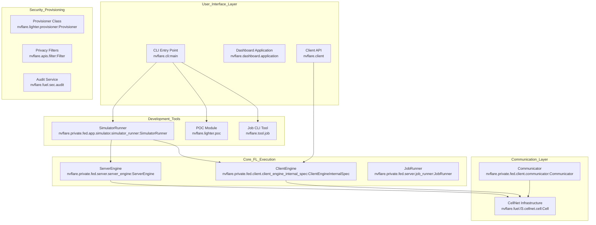
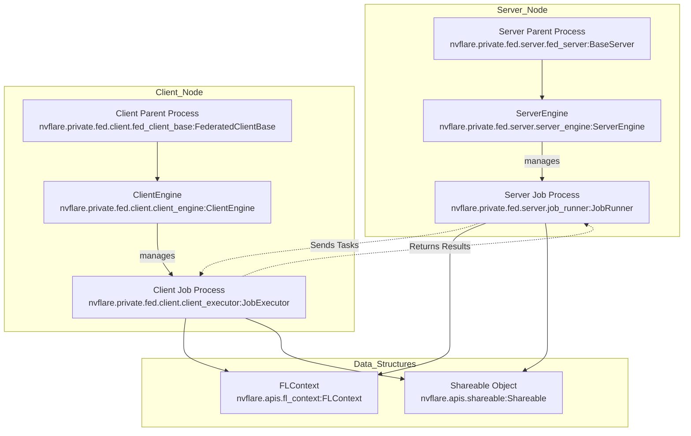

<!-- source: DeepWiki mcp.deepwiki.com · repo NVIDIA/NVFlare · page 1 Overview · fetched 2026-10-26 -->

# Overview

Relevant source files

The following files were used as context for generating this wiki page:

- [.dockerignore](.dockerignore)
- [.github/workflows/premerge.yml](.github/workflows/premerge.yml)
- [README.md](README.md)
- [codecov.yml](codecov.yml)
- [docs/examples/hello_cross_val.rst](docs/examples/hello_cross_val.rst)
- [docs/examples/hello_numpy.rst](docs/examples/hello_numpy.rst)
- [docs/faq.rst](docs/faq.rst)
- [docs/flare_overview.rst](docs/flare_overview.rst)
- [docs/index.rst](docs/index.rst)
- [docs/installation.rst](docs/installation.rst)
- [docs/programming_guide/filters.rst](docs/programming_guide/filters.rst)
- [docs/programming_guide/provisioning_system.rst](docs/programming_guide/provisioning_system.rst)
- [docs/programming_guide/system_architecture.rst](docs/programming_guide/system_architecture.rst)
- [docs/quickstart.rst](docs/quickstart.rst)
- [docs/resources/nvidia_eye.wwPt122j.png](docs/resources/nvidia_eye.wwPt122j.png)
- [examples/advanced/psi/README.md](examples/advanced/psi/README.md)
- [examples/advanced/psi/psi.jpg](examples/advanced/psi/psi.jpg)
- [nvflare/__init__.py](nvflare/__init__.py)
- [nvflare/apis/client_engine_spec.py](nvflare/apis/client_engine_spec.py)
- [nvflare/apis/fl_constant.py](nvflare/apis/fl_constant.py)
- [nvflare/apis/job_scheduler_spec.py](nvflare/apis/job_scheduler_spec.py)
- [nvflare/apis/server_engine_spec.py](nvflare/apis/server_engine_spec.py)
- [nvflare/app_common/job_schedulers/job_scheduler.py](nvflare/app_common/job_schedulers/job_scheduler.py)
- [nvflare/fuel/hci/chunk.py](nvflare/fuel/hci/chunk.py)
- [nvflare/lighter/poc.py](nvflare/lighter/poc.py)
- [nvflare/private/aux_runner.py](nvflare/private/aux_runner.py)
- [nvflare/private/fed/app/client/client_train.py](nvflare/private/fed/app/client/client_train.py)
- [nvflare/private/fed/app/client/sub_worker_process.py](nvflare/private/fed/app/client/sub_worker_process.py)
- [nvflare/private/fed/app/client/worker_process.py](nvflare/private/fed/app/client/worker_process.py)
- [nvflare/private/fed/app/server/runner_process.py](nvflare/private/fed/app/server/runner_process.py)
- [nvflare/private/fed/app/server/server_train.py](nvflare/private/fed/app/server/server_train.py)
- [nvflare/private/fed/app/utils.py](nvflare/private/fed/app/utils.py)
- [nvflare/private/fed/client/client_app_runner.py](nvflare/private/fed/client/client_app_runner.py)
- [nvflare/private/fed/client/client_engine.py](nvflare/private/fed/client/client_engine.py)
- [nvflare/private/fed/client/client_engine_executor_spec.py](nvflare/private/fed/client/client_engine_executor_spec.py)
- [nvflare/private/fed/client/client_engine_internal_spec.py](nvflare/private/fed/client/client_engine_internal_spec.py)
- [nvflare/private/fed/client/client_executor.py](nvflare/private/fed/client/client_executor.py)
- [nvflare/private/fed/client/client_run_manager.py](nvflare/private/fed/client/client_run_manager.py)
- [nvflare/private/fed/client/client_runner.py](nvflare/private/fed/client/client_runner.py)
- [nvflare/private/fed/client/command_agent.py](nvflare/private/fed/client/command_agent.py)
- [nvflare/private/fed/client/communicator.py](nvflare/private/fed/client/communicator.py)
- [nvflare/private/fed/client/fed_client.py](nvflare/private/fed/client/fed_client.py)
- [nvflare/private/fed/client/fed_client_base.py](nvflare/private/fed/client/fed_client_base.py)
- [nvflare/private/fed/server/fed_server.py](nvflare/private/fed/server/fed_server.py)
- [nvflare/private/fed/server/job_runner.py](nvflare/private/fed/server/job_runner.py)
- [nvflare/private/fed/server/server_command_agent.py](nvflare/private/fed/server/server_command_agent.py)
- [nvflare/private/fed/server/server_commands.py](nvflare/private/fed/server/server_commands.py)
- [nvflare/private/fed/server/server_engine.py](nvflare/private/fed/server/server_engine.py)
- [nvflare/private/fed/server/server_runner.py](nvflare/private/fed/server/server_runner.py)
- [nvflare/private/fed/utils/fed_utils.py](nvflare/private/fed/utils/fed_utils.py)
- [pyproject.toml](pyproject.toml)
- [runtest.sh](runtest.sh)
- [setup.cfg](setup.cfg)
- [setup.py](setup.py)
- [tests/unit_test/app_common/job_schedulers/job_scheduler_test.py](tests/unit_test/app_common/job_schedulers/job_scheduler_test.py)
- [tests/unit_test/app_common/utils/__init__.py](tests/unit_test/app_common/utils/__init__.py)
- [tests/unit_test/app_common/utils/fl_model_utils_test.py](tests/unit_test/app_common/utils/fl_model_utils_test.py)
- [tests/unit_test/fuel/f3/streaming/stream_types_test.py](tests/unit_test/fuel/f3/streaming/stream_types_test.py)
- [tests/unit_test/private/fed/client/client_executor_test.py](tests/unit_test/private/fed/client/client_executor_test.py)
- [tests/unit_test/private/fed/server/fed_server_test.py](tests/unit_test/private/fed/server/fed_server_test.py)
- [tests/unit_test/private/fed/server/job_runner_test.py](tests/unit_test/private/fed/server/job_runner_test.py)

## Purpose and Scope

This document provides a high-level architectural overview of **NVIDIA FLARE** (**NV**IDIA **F**ederated **L**earning **A**pplication **R**untime **E**nvironment), an open-source, domain-agnostic Python SDK [setup.cfg:3](). It enables researchers and data scientists to adapt existing machine learning workflows—including PyTorch, TensorFlow, XGBoost, and scikit-learn—to a federated paradigm with minimal code changes [README.md:16-18]().

NVIDIA FLARE is designed to support the entire federated learning lifecycle, from local simulation to large-scale production deployment [README.md:32-36](). It facilitates both institutional cross-silo and edge/mobile cross-device scenarios.

For specific topics:
- **System Architecture**: Detailed breakdown of server/client components and communication. See [System Architecture](#1.1).
- **Installation and Setup**: Guide for installing the `nvflare` package and environment setup. See [Installation and Setup](#1.2).
- **Deployment Modes**: Explanation of Simulator, POC, and Production modes. See [Deployment Modes](#1.3).

**Sources**: [README.md:1-74](), [setup.cfg:1-38](), [nvflare/private/fed/server/server_engine.py:89-128]()

## System Architecture

NVIDIA FLARE follows a layered architecture designed to transition workloads seamlessly between different environments [README.md:21-22]().

### High-Level Component Organization

The following diagram maps high-level system capabilities to their primary code entities.

The architecture is organized into functional layers:
1.  **User Interface Layer**: Entry points including the `nvflare` CLI [setup.cfg:154](), a web-based Dashboard for project management [setup.py:87](), and the high-level Client API for minimal code changes [README.md:33]().
2.  **Development Tools**: Tools for different development stages, including the `Simulator` for single-system testing and POC mode for local multi-process simulation [README.md:34]().
3.  **Core FL Execution**: The runtime orchestration engines (`ServerEngine` [nvflare/private/fed/server/server_engine.py:89](), `ClientEngine`) and the `JobRunner` [nvflare/private/fed/server/job_runner.py:94]() that manages the lifecycle of federated jobs.
4.  **Communication Layer**: The F3 (Fast, Flexible, Federated) infrastructure providing `Cell` networking [nvflare/private/fed/server/fed_server.py:188]() and `Communicator` abstractions [nvflare/private/fed/client/communicator.py:52]().
5.  **Security & Privacy**: Services including the `Provisioner` for PKI-based setup, privacy filters for data protection [nvflare/private/fed/client/communicator.py:57](), and auditing services for compliance [nvflare/private/fed/utils/fed_utils.py:39]().

**Sources**: [README.md:32-38](), [setup.cfg:152-154](), [nvflare/private/fed/server/server_engine.py:89-128](), [nvflare/private/fed/server/fed_server.py:188-200](), [nvflare/private/fed/client/communicator.py:52-95]()

## Core Components and Process Model

NVIDIA FLARE uses a multi-process architecture to ensure isolation between infrastructure management (Parent processes) and federated learning workload execution (Job processes).

### Process Architecture and Key Classes

### Key Process Roles

| Process Type | Role | Key Components |
| :--- | :--- | :--- |
| **Server Parent (SP)** | Orchestrates the system and manages client registrations. | `BaseServer` [nvflare/private/fed/server/fed_server.py:85](), `ServerEngine` [nvflare/private/fed/server/server_engine.py:89]() |
| **Server Job (SJ)** | Executes server-side logic for a specific job (e.g., aggregation). | `JobRunner` [nvflare/private/fed/server/job_runner.py:94]() |
| **Client Parent (CP)** | Manages site-level operations and launches job workers. | `FederatedClientBase` [nvflare/private/fed/client/fed_client_base.py:39](), `Communicator` [nvflare/private/fed/client/communicator.py:52]() |
| **Client Job (CJ)** | Executes client-side training or validation logic for a job. | `JobExecutor` [nvflare/private/fed/client/client_executor.py:171]() |

This isolation ensures that a failure in a training script (CJ) does not crash the site's main connection to the federated network (CP). Data is exchanged using the `Shareable` object [nvflare/apis/fl_constant.py:100]() and managed via `FLContext` [nvflare/apis/fl_constant.py:123]().

**Sources**: [nvflare/private/fed/server/fed_server.py:85-115](), [nvflare/private/fed/server/server_engine.py:89-128](), [nvflare/private/fed/server/job_runner.py:94-123](), [nvflare/private/fed/client/fed_client_base.py:39-58](), [nvflare/private/fed/client/client_executor.py:171-212]()

## Deployment Modes

FLARE supports three modes for different stages of the workflow [README.md:32-37]().

| Mode | Use Case | Communication | Deployment |
| :--- | :--- | :--- | :--- |
| **Simulator** | Rapid prototyping and algorithm development. | Local threads/processes. | Single machine [README.md:34](). |
| **POC** | Testing multi-process deployment and networking. | Local TCP/Processes. | Single machine; simulated multi-site [nvflare/lighter/poc.py:1](). |
| **Production** | Real-world distributed deployment. | Distributed; TLS/mTLS. | Multi-node; requires PKI provisioning [nvflare/private/fed/utils/fed_utils.py:73](). |

-   **Simulator**: Runs jobs locally for fast testing.
-   **POC Mode**: Simulates deployment on one host with separate processes for clients and server.
-   **Production**: Uses the provisioning system to generate "startup kits" containing certificates and configurations [nvflare/private/fed/utils/fed_utils.py:143-165]().

**Sources**: [README.md:32-37](), [nvflare/private/fed/utils/fed_utils.py:73-140](), [nvflare/private/fed/utils/fed_utils.py:143-165]()

## Key Features and Capabilities

NVIDIA FLARE is a general-purpose framework for collaborative computing, supporting various workflows beyond simple model aggregation.

### Federated Workflows
-   **Federated Training**: Support for `FedAvg`, `FedProx`, `FedOpt`, `SCAFFOLD`, and more [README.md:27]().
-   **Federated Analytics**: Compute statistics across distributed data [README.md:29]().
-   **Federated Evaluation**: Evaluate global models or perform cross-site validation [README.md:28]().

### Advanced Capabilities
-   **Client API**: Transition from local ML to FL with minimal changes [README.md:33]().
-   **Privacy & Security**: Built-in differential privacy, homomorphic encryption, and Private Set Intersection (PSI) [README.md:30]().
-   **Resiliency**: Built-in support for system resiliency and fault tolerance [README.md:39]().
-   **Authorization**: Security enforcement through federated authorization and privacy policy [README.md:38]().

**Sources**: [README.md:23-41](), [nvflare/apis/fl_constant.py:26-54](), [nvflare/private/fed/utils/fed_utils.py:47-50]()

---

