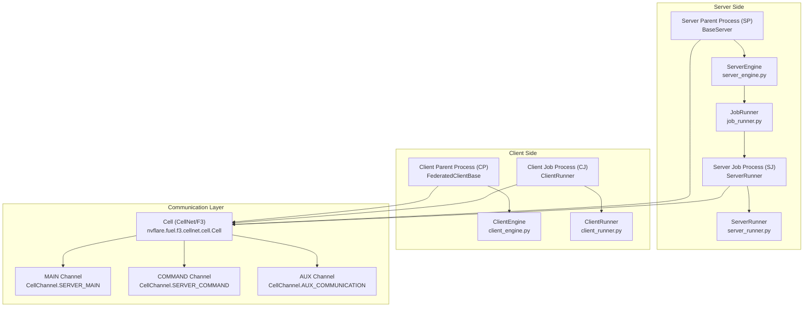
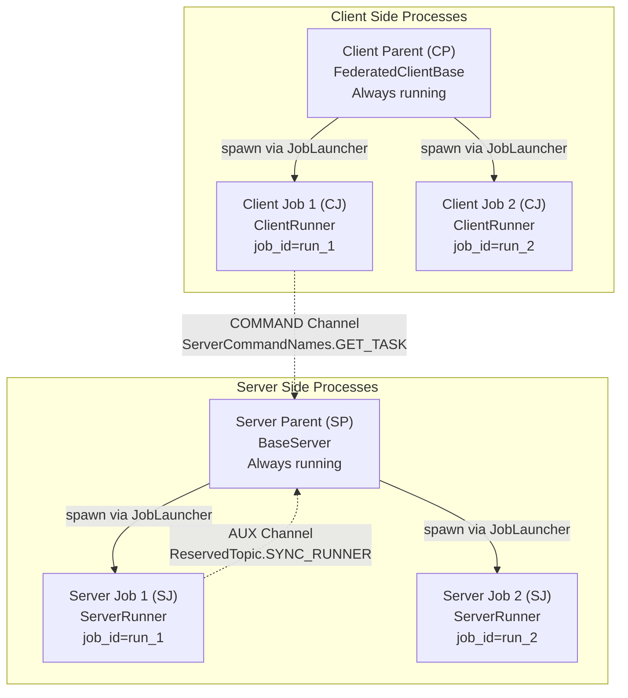

<!-- source: DeepWiki mcp.deepwiki.com · repo NVIDIA/NVFlare · page 1.1 System Architecture · fetched 2026-10-26 -->

# System Architecture

Relevant source files

The following files were used as context for generating this wiki page:

- [README.md](README.md)
- [docs/examples/hello_cross_val.rst](docs/examples/hello_cross_val.rst)
- [docs/examples/hello_numpy.rst](docs/examples/hello_numpy.rst)
- [docs/faq.rst](docs/faq.rst)
- [docs/flare_overview.rst](docs/flare_overview.rst)
- [docs/index.rst](docs/index.rst)
- [docs/installation.rst](docs/installation.rst)
- [docs/programming_guide/filters.rst](docs/programming_guide/filters.rst)
- [docs/programming_guide/provisioning_system.rst](docs/programming_guide/provisioning_system.rst)
- [docs/programming_guide/system_architecture.rst](docs/programming_guide/system_architecture.rst)
- [docs/quickstart.rst](docs/quickstart.rst)
- [docs/resources/nvidia_eye.wwPt122j.png](docs/resources/nvidia_eye.wwPt122j.png)
- [examples/advanced/psi/README.md](examples/advanced/psi/README.md)
- [examples/advanced/psi/psi.jpg](examples/advanced/psi/psi.jpg)
- [nvflare/apis/client_engine_spec.py](nvflare/apis/client_engine_spec.py)
- [nvflare/apis/event_type.py](nvflare/apis/event_type.py)
- [nvflare/apis/fl_component.py](nvflare/apis/fl_component.py)
- [nvflare/apis/fl_constant.py](nvflare/apis/fl_constant.py)
- [nvflare/apis/job_scheduler_spec.py](nvflare/apis/job_scheduler_spec.py)
- [nvflare/apis/server_engine_spec.py](nvflare/apis/server_engine_spec.py)
- [nvflare/apis/utils/fl_context_utils.py](nvflare/apis/utils/fl_context_utils.py)
- [nvflare/app_common/job_schedulers/job_scheduler.py](nvflare/app_common/job_schedulers/job_scheduler.py)
- [nvflare/fuel/f3/cellnet/cell.py](nvflare/fuel/f3/cellnet/cell.py)
- [nvflare/private/aux_runner.py](nvflare/private/aux_runner.py)
- [nvflare/private/defs.py](nvflare/private/defs.py)
- [nvflare/private/event.py](nvflare/private/event.py)
- [nvflare/private/fed/app/client/client_train.py](nvflare/private/fed/app/client/client_train.py)
- [nvflare/private/fed/app/client/sub_worker_process.py](nvflare/private/fed/app/client/sub_worker_process.py)
- [nvflare/private/fed/app/client/worker_process.py](nvflare/private/fed/app/client/worker_process.py)
- [nvflare/private/fed/app/server/runner_process.py](nvflare/private/fed/app/server/runner_process.py)
- [nvflare/private/fed/app/server/server_train.py](nvflare/private/fed/app/server/server_train.py)
- [nvflare/private/fed/client/client_app_runner.py](nvflare/private/fed/client/client_app_runner.py)
- [nvflare/private/fed/client/client_engine.py](nvflare/private/fed/client/client_engine.py)
- [nvflare/private/fed/client/client_engine_executor_spec.py](nvflare/private/fed/client/client_engine_executor_spec.py)
- [nvflare/private/fed/client/client_engine_internal_spec.py](nvflare/private/fed/client/client_engine_internal_spec.py)
- [nvflare/private/fed/client/client_executor.py](nvflare/private/fed/client/client_executor.py)
- [nvflare/private/fed/client/client_req_processors.py](nvflare/private/fed/client/client_req_processors.py)
- [nvflare/private/fed/client/client_run_manager.py](nvflare/private/fed/client/client_run_manager.py)
- [nvflare/private/fed/client/client_runner.py](nvflare/private/fed/client/client_runner.py)
- [nvflare/private/fed/client/command_agent.py](nvflare/private/fed/client/command_agent.py)
- [nvflare/private/fed/client/communicator.py](nvflare/private/fed/client/communicator.py)
- [nvflare/private/fed/client/fed_client.py](nvflare/private/fed/client/fed_client.py)
- [nvflare/private/fed/client/fed_client_base.py](nvflare/private/fed/client/fed_client_base.py)
- [nvflare/private/fed/client/sys_cmd.py](nvflare/private/fed/client/sys_cmd.py)
- [nvflare/private/fed/server/cmd_utils.py](nvflare/private/fed/server/cmd_utils.py)
- [nvflare/private/fed/server/fed_server.py](nvflare/private/fed/server/fed_server.py)
- [nvflare/private/fed/server/info_coll_cmd.py](nvflare/private/fed/server/info_coll_cmd.py)
- [nvflare/private/fed/server/job_runner.py](nvflare/private/fed/server/job_runner.py)
- [nvflare/private/fed/server/run_manager.py](nvflare/private/fed/server/run_manager.py)
- [nvflare/private/fed/server/server_command_agent.py](nvflare/private/fed/server/server_command_agent.py)
- [nvflare/private/fed/server/server_commands.py](nvflare/private/fed/server/server_commands.py)
- [nvflare/private/fed/server/server_engine.py](nvflare/private/fed/server/server_engine.py)
- [nvflare/private/fed/server/server_engine_internal_spec.py](nvflare/private/fed/server/server_engine_internal_spec.py)
- [nvflare/private/fed/server/server_runner.py](nvflare/private/fed/server/server_runner.py)
- [nvflare/private/fed/server/sys_cmd.py](nvflare/private/fed/server/sys_cmd.py)
- [nvflare/private/fed/server/training_cmds.py](nvflare/private/fed/server/training_cmds.py)
- [nvflare/private/fed/utils/fed_utils.py](nvflare/private/fed/utils/fed_utils.py)
- [nvflare/security/security.py](nvflare/security/security.py)
- [nvflare/widgets/info_collector.py](nvflare/widgets/info_collector.py)
- [tests/unit_test/app_common/job_schedulers/job_scheduler_test.py](tests/unit_test/app_common/job_schedulers/job_scheduler_test.py)
- [tests/unit_test/private/fed/client/client_executor_test.py](tests/unit_test/private/fed/client/client_executor_test.py)
- [tests/unit_test/private/fed/server/fed_server_test.py](tests/unit_test/private/fed/server/fed_server_test.py)
- [tests/unit_test/private/fed/server/job_runner_test.py](tests/unit_test/private/fed/server/job_runner_test.py)

## Purpose and Scope

This document describes the overall system architecture of NVIDIA FLARE (NVIDIA Federated Learning Application Runtime Environment), including the server/client component structure, process model, communication infrastructure, and deployment models. It provides a technical overview of how the major subsystems interact to enable federated learning workloads.

For detailed information about specific subsystems:
- For core runtime execution details, see **Core Runtime Architecture** (Section 3).
- For communication protocols and networking, see **Communication Framework** (Section 4).
- For workflow orchestration, see **Workflows and Controllers** (Section 5).
- For client-side execution, see **Client-Side Execution** (Section 6).
- For deployment and provisioning, see **Deployment Modes** (Section 1.3) and **Provisioning System** (Section 10).

## High-Level Architecture

NVIDIA FLARE follows a **client-server architecture** where a central server coordinates federated learning jobs across multiple distributed clients. The system is designed with a componentized, event-driven architecture that separates concerns into distinct layers.

### System Overview

NVIDIA FLARE's architecture is built around the `ServerEngine` [nvflare/private/fed/server/server_engine.py:89-90]() and `ClientEngine` [nvflare/private/fed/client/client_engine.py:58-61]() which manage the state and orchestration of federated jobs.

**Title: NVIDIA FLARE High-Level Component Mapping**

Sources: [nvflare/private/fed/server/server_engine.py:89-126](), [nvflare/private/fed/server/fed_server.py:85-112](), [nvflare/private/fed/client/fed_client_base.py:45-58](), [nvflare/private/fed/client/client_engine.py:58-75](), [nvflare/private/defs.py:59-67]()

### Core Architecture Principles

1. **Process Isolation**: Jobs run in separate processes (SJ/CJ) isolated from parent processes (SP/CP) for fault tolerance and resource management [nvflare/apis/fl_constant.py:118-119]().
2. **Event-Driven**: Components communicate through a comprehensive event system defined in `EventType` [nvflare/apis/event_type.py:19-20]().
3. **Pluggable Components**: Controllers, Executors, Filters, and other components follow well-defined interfaces like `FLComponent` [nvflare/apis/fl_component.py:20-21]().
4. **Multi-Channel Communication**: Dedicated channels for different message types ensure reliable delivery [nvflare/private/defs.py:59-67]().
5. **Stateful Orchestration**: `ServerEngine` [nvflare/private/fed/server/server_engine.py:89-100]() and `ClientRunner` [nvflare/private/fed/client/client_runner.py:125-165]() maintain system state and coordinate all operations.

Sources: [nvflare/apis/fl_constant.py:118-119](), [nvflare/private/fed/server/server_engine.py:89-126](), [nvflare/private/fed/client/client_runner.py:125-165](), [nvflare/apis/fl_component.py:20-21]()

## Process Model and Job Isolation

NVIDIA FLARE uses a **multi-process architecture** with strict separation between parent processes and job processes. This design provides job isolation and the ability to run multiple jobs concurrently.

### Process Types and Roles

The system distinguishes between long-running "Parent" processes and transient "Job" processes.

**Title: Process Interaction and Module Mapping**

Sources: [nvflare/private/fed/server/server_engine.py:191-210](), [nvflare/private/fed/server/server_runner.py:112-121](), [nvflare/private/fed/client/client_runner.py:125-165](), [nvflare/private/fed/client/communicator.py:133-144]()

### Process Lifecycle

| Process Type | Module | Lifecycle | Responsibilities |
|-------------|---------|-----------|-----------------|
| **SP (Server Parent)** | `nvflare.private.fed.server.fed_server` | Continuous | Client registration, Job scheduling via `JobRunner`, Admin command handling [nvflare/private/fed/server/fed_server.py:85-152](). |
| **SJ (Server Job)** | `nvflare.private.fed.server.server_runner` | Per-job | Running `ServerRunner` and workflows, executing `Controller.control_flow()` [nvflare/private/fed/server/server_runner.py:127-149](). |
| **CP (Client Parent)** | `nvflare.private.fed.client.fed_client_base` | Continuous | Registration, authentication, Spawning CJ processes [nvflare/private/fed/client/fed_client_base.py:45-112](). |
| **CJ (Client Job)** | `nvflare.private.fed.client.client_runner` | Per-job | Running `ClientRunner`, executing `Executor.execute()`, task fetch and result submission [nvflare/private/fed/client/client_runner.py:125-165](). |

Sources: [nvflare/private/fed/server/server_engine.py:191-295](), [nvflare/private/fed/server/fed_server.py:85-152](), [nvflare/private/fed/client/fed_client_base.py:45-112](), [nvflare/private/fed/client/client_runner.py:125-165]()

## Server-Side Architecture

### ServerEngine: The Orchestration Hub

`ServerEngine` [nvflare/private/fed/server/server_engine.py:89-90]() is the central orchestration component on the server side. It maintains system state and coordinates all major operations.

**Key Responsibilities**:
- **Job Process Management**: Tracks running jobs in `run_processes` dict [nvflare/private/fed/server/server_engine.py:102]().
- **Client Management**: Interfaces with `ClientManager` [nvflare/private/fed/server/server_engine.py:107]().
- **Job Lifecycle**: Coordinates with `JobRunner` [nvflare/private/fed/server/job_runner.py:94-95]() to deploy and start jobs [nvflare/private/fed/server/server_engine.py:125]().
- **Communication**: Owns the server `Cell` [nvflare/private/fed/server/server_engine.py:106]().
- **Admin Command Processing**: Handles various admin commands via `ServerCommands` [nvflare/private/fed/server/server_engine.py:84]().

Sources: [nvflare/private/fed/server/server_engine.py:89-157](), [nvflare/private/fed/server/job_runner.py:94-120]()

### JobRunner: Job Lifecycle Management

`JobRunner` [nvflare/private/fed/server/job_runner.py:94-95]() manages the complete lifecycle of federated learning jobs from submission through completion.

**Job Lifecycle Stages**:
1. **Deployment** (`_deploy_job`): Deploy app to server and clients [nvflare/private/fed/server/job_runner.py:125-160]().
2. **Start**: Launch server SJ and client CJs [nvflare/private/fed/server/job_runner.py:180-200]().
3. **Monitoring**: Track job status via `RunStatus` [nvflare/private/fed/server/job_runner.py:35]().
4. **Job Heartbeat**: Processes client job heartbeats via `_handle_job_heartbeat` [nvflare/private/fed/server/server_runner.py:117]().

Sources: [nvflare/private/fed/server/job_runner.py:94-200](), [nvflare/private/fed/server/server_runner.py:117]()

## Client-Side Architecture

### FederatedClientBase: Connection and Management

`FederatedClientBase` [nvflare/private/fed/client/fed_client_base.py:39-40]() runs in the CP process and manages the connection to the server. It handles authentication and the primary server endpoint (SP).

**Key Responsibilities**:
- **Authentication**: Manages `token`, `token_signature`, and `ssid` issued by the server [nvflare/private/fed/client/fed_client_base.py:75-77]().
- **Communicator**: Initializes the `Communicator` [nvflare/private/fed/client/communicator.py:52-63]() for message exchange [nvflare/private/fed/client/fed_client_base.py:87-96]().
- **Cell Management**: Creates and updates the client `Cell` based on server location [nvflare/private/fed/client/fed_client_base.py:141-192]().

Sources: [nvflare/private/fed/client/fed_client_base.py:45-112](), [nvflare/private/fed/client/communicator.py:52-110]()

### ClientRunner: Task Execution

`ClientRunner` [nvflare/private/fed/client/client_runner.py:125-126]() runs in the CJ subprocess and executes individual tasks. It uses a `TaskRouter` [nvflare/private/fed/client/client_runner.py:49-50]() to dispatch tasks to the appropriate `Executor` [nvflare/apis/executor.py:20]().

**Task Execution Flow**:
1. **Fetch Task**: `ClientRunner` pulls tasks via the `Communicator` which registers callbacks for `ServerCommandNames.GET_TASK` [nvflare/private/fed/client/communicator.py:133-137]().
2. **Route**: `TaskRouter.route()` finds the assigned `Executor` for the `task_name` [nvflare/private/fed/client/client_runner.py:67-76]().
3. **Execute**: The `Executor.execute()` method is triggered by task assignment events [nvflare/private/fed/client/client_runner.py:166-175]().
4. **Submit**: Results are returned to the server via `Communicator` using `ServerCommandNames.SUBMIT_UPDATE` [nvflare/private/fed/client/communicator.py:139-144]().

Sources: [nvflare/private/fed/client/client_runner.py:125-300](), [nvflare/private/fed/client/communicator.py:133-144]()

## Communication Infrastructure

NVIDIA FLARE uses a multi-layered communication framework built on **CellNet** (also called **F3** - FLARE Federated Framework).

### Cell Architecture and Addressing

A **Cell** [nvflare/fuel/f3/cellnet/cell.py:72]() is the fundamental communication primitive. Each process is identified by a **Fully Qualified Cell Name (FQCN)** [nvflare/fuel/f3/cellnet/fqcn.py:31]().

- **Server Root**: `FQCN.ROOT_SERVER` [nvflare/private/fed/server/fed_server.py:185]().
- **Client FQCN**: Determined based on connection topology and relay presence [nvflare/private/fed/client/fed_client_base.py:161-182]().

Sources: [nvflare/fuel/f3/cellnet/fqcn.py:31](), [nvflare/private/fed/server/fed_server.py:185-193](), [nvflare/private/fed/client/fed_client_base.py:161-182](), [nvflare/fuel/f3/cellnet/cell.py:72-144]()

### Communication Channels

CellNet uses dedicated channels for different message types [nvflare/private/defs.py:59-67]():

| Channel | Purpose | Direction |
|---------|---------|-----------|
| `CellChannel.SERVER_MAIN` | Registration and heartbeats | Client → Server |
| `CellChannel.SERVER_COMMAND` | Task fetch (`GET_TASK`) and result submission (`SUBMIT_UPDATE`) | Bidirectional |
| `CellChannel.AUX_COMMUNICATION` | Auxiliary/Custom messages (e.g., `SYNC_RUNNER`, `JOB_HEART_BEAT`) | Bidirectional |

Sources: [nvflare/private/defs.py:59-67](), [nvflare/private/fed/client/communicator.py:133-144](), [nvflare/private/fed/server/server_runner.py:112-121](), [nvflare/fuel/f3/cellnet/cell.py:37-46]()

## Deployment Models

NVIDIA FLARE supports three primary deployment modes:

- **Simulator Mode**: Runs jobs on a single system for fast testing and algorithm development. Mimics distributed execution using threads or IPC [nvflare/apis/fl_constant.py:108]().
- **POC Mode**: Simulates deployment on one host with separate processes for clients and server using `localhost` networking [nvflare/apis/fl_constant.py:153]().
- **Production Mode**: Distributed deployment using startup kits generated by the provisioning system, utilizing full TLS/mTLS security [nvflare/private/fed/server/fed_server.py:153-167]().

### Cloud and Orchestrated Deployment
NVIDIA FLARE supports advanced deployment scenarios:
- **Containerized**: Supports running in Docker with isolated job processes using the `JobLauncher` abstraction [nvflare/apis/fl_constant.py:118-119]().
- **Kubernetes**: Supports running in Kubernetes with specialized launchers for scaling across clusters.
- **Cloud**: Built-in support for AWS, GCP, and Azure deployment via infrastructure scripts.

Sources: [nvflare/private/fed/server/fed_server.py:148-193](), [nvflare/apis/fl_constant.py:108-153](), [nvflare/private/fed/server/server_engine.py:184-190]()

---

