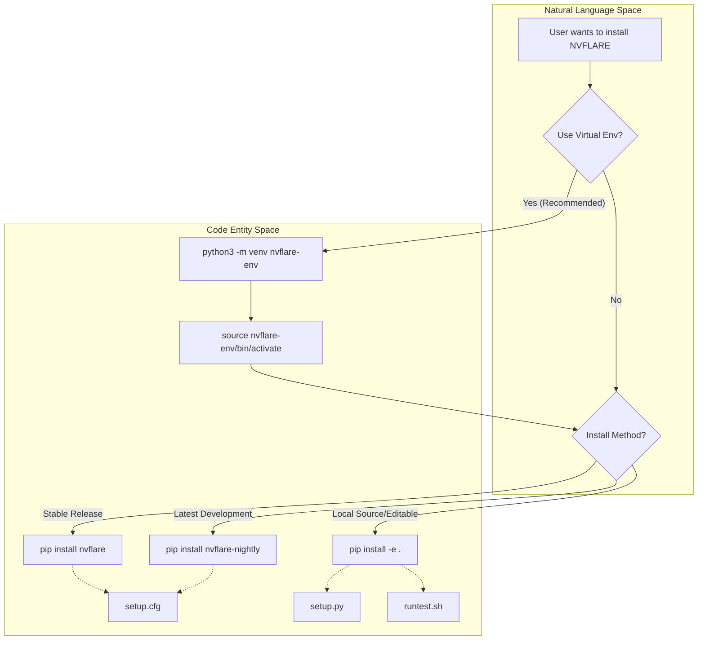
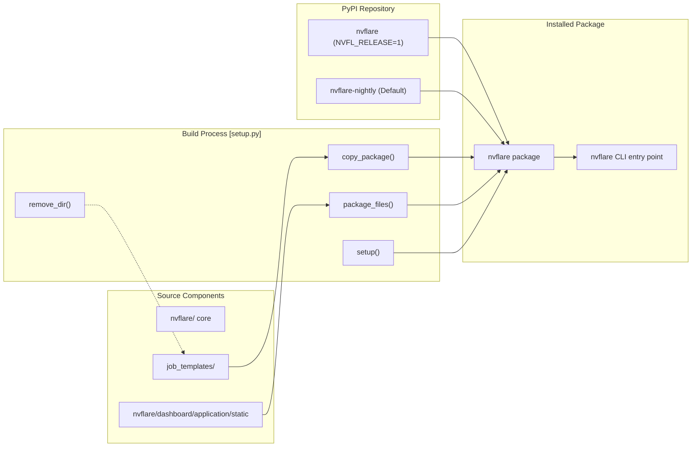
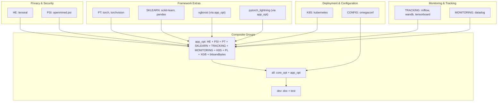

<!-- source: DeepWiki mcp.deepwiki.com · repo NVIDIA/NVFlare · page 1.2 Installation and Setup · fetched 2026-10-26 -->

# Installation and Setup

<details>
<summary>Relevant source files</summary>

The following files were used as context for generating this wiki page:

- [.dockerignore](.dockerignore)
- [.github/workflows/premerge.yml](.github/workflows/premerge.yml)
- [CODEOWNERS](CODEOWNERS)
- [CODE_OF_CONDUCT.md](CODE_OF_CONDUCT.md)
- [CONTRIBUTING.md](CONTRIBUTING.md)
- [codecov.yml](codecov.yml)
- [docs/contributing.rst](docs/contributing.rst)
- [nvflare/__init__.py](nvflare/__init__.py)
- [nvflare/fuel/hci/chunk.py](nvflare/fuel/hci/chunk.py)
- [nvflare/lighter/poc.py](nvflare/lighter/poc.py)
- [nvflare/private/fed/app/utils.py](nvflare/private/fed/app/utils.py)
- [pyproject.toml](pyproject.toml)
- [runtest.sh](runtest.sh)
- [setup.cfg](setup.cfg)
- [setup.py](setup.py)
- [tests/unit_test/app_common/utils/__init__.py](tests/unit_test/app_common/utils/__init__.py)
- [tests/unit_test/app_common/utils/fl_model_utils_test.py](tests/unit_test/app_common/utils/fl_model_utils_test.py)
- [tests/unit_test/fuel/f3/streaming/stream_types_test.py](tests/unit_test/fuel/f3/streaming/stream_types_test.py)

</details>


## Purpose and Scope

This document guides technical users through the installation of NVIDIA FLARE (NVFLARE), the configuration of Python virtual environments, and the management of optional dependencies. It details the package structure defined in the build system and provides a technical overview of how the library is distributed and verified.

For information on running FLARE after installation, see [Deployment Modes](1.3). For production deployment and provisioning, see [Provisioning System](10).

---

## Prerequisites

NVIDIA FLARE requires the following system environment:

| Requirement | Specification |
|------------|---------------|
| **Python** | 3.10 through 3.14 (tested) [setup.cfg:10-14](), [nvflare/private/fed/app/utils.py:30-31]() |
| **Package Manager** | `pip` [setup.cfg:21-22](), [runtest.sh:54]() or `uv` [runtest.sh:45-51]() |
| **Version Control** | Git (required for source installation and versioning) [setup.cfg:189-191]() |
| **Operating System** | POSIX Linux (Primary support) [setup.cfg:16](). macOS supported with limitations on specific extras [setup.cfg:75-80]() |

**Important Version Compatibility Note:** The system performs a strict version check at startup in `version_check()` to ensure the Python environment is within the supported range of 3.10 to 3.14 [nvflare/private/fed/app/utils.py:96-109](). The package version is managed via `versioneer` to ensure consistency across distributed components [setup.py:25-35]().

Sources: [setup.cfg:10-21](), [setup.py:25-35](), [nvflare/private/fed/app/utils.py:30-42](), [nvflare/private/fed/app/utils.py:96-109]()

---

## Installation Methods

### Installation Flow



Sources: [setup.py:53-57](), [setup.cfg:153-154](), [runtest.sh:29-58]()

---

## Virtual Environment Setup

Isolating NVFLARE dependencies is critical for avoiding conflicts with framework-specific requirements (e.g., conflicting PyTorch or TensorFlow versions).

**1. Create virtual environment:**
```bash
python3 -m venv nvflare-env
```
This creates a directory containing a copy of the Python interpreter and standard library.

**2. Activate the environment:**
```bash
source nvflare-env/bin/activate
```
Activation ensures that subsequent `pip` or `uv` commands target the isolated environment [runtest.sh:48-51]().

**3. Update package management tools:**
```bash
(nvflare-env) $ python3 -m pip install -U pip setuptools
```
Updating `pip` and `setuptools` ensures compatibility with modern wheel distributions and the `setup.cfg` metadata format.

Sources: [setup.cfg:19-22](), [runtest.sh:45-55]()

---

## Installing NVIDIA FLARE

### Package Structure and Distribution

The build process in `setup.py` dynamically assembles the package by collecting core code, dashboard assets, and job templates.



Sources: [setup.py:53-57](), [setup.py:87-91](), [setup.cfg:153-154](), [setup.py:117]()

### Method 1: PyPI Installation

Install the stable release:
```bash
pip install nvflare
```
The package name `nvflare` is used when the environment variable `NVFL_RELEASE` is set to `"1"` [setup.py:53-55](). Otherwise, the build defaults to `nvflare-nightly` [setup.py:57]().

### Method 2: Source Installation (Development)

For contributors or users needing the latest unreleased changes:
```bash
git clone https://github.com/NVIDIA/NVFlare.git
cd NVFlare
pip install -e .
```
The `setup.py` script uses `versioneer` to determine the version string from the git state [setup.py:35-51](). If no git information is available, it defaults to a `.dev` version based on the current date [setup.py:41-49](). Developers can also use `runtest.sh` to install dependencies with appropriate extras for their platform (e.g., `dev`, `dev_mac`, or `dev_cpu`) [runtest.sh:29-39]().

Sources: [setup.py:35-57](), [runtest.sh:29-58]()

---

## Dependency Management

### Core Dependencies

These packages are mandatory and defined in `install_requires` [setup.cfg:21-38]():

| Dependency | Purpose |
|-----------|---------|
| `cryptography` | Secure communication and PKI [setup.cfg:22]() |
| `grpcio` | High-performance RPC transport [setup.cfg:26]() |
| `numpy` | Tensor and data manipulation [setup.cfg:28]() |
| `protobuf` | Structured data serialization [setup.cfg:29]() |
| `msgpack` | Efficient binary serialization [setup.cfg:33]() |
| `Flask` & `SQLAlchemy` | Dashboard backend and persistence [setup.cfg:23-25]() |
| `pydantic` | Configuration validation [setup.cfg:37]() |
| `safetensors` | Secure tensor serialization [setup.cfg:38]() |
| `psutil` | Process monitoring and lifecycle management [setup.cfg:30](), [nvflare/private/fed/app/utils.py:20]() |

### Optional Feature Groups (Extras)

NVFLARE uses `options.extras_require` to manage framework-specific dependencies [setup.cfg:40-150]().



Sources: [setup.cfg:40-90](), [setup.cfg:119-121]()

### Platform and Version Limitations

- **macOS Compatibility:** The `HE` and `PSI` extras are excluded from the `app_opt_mac` group because `tenseal` and `openmined.psi` often lack compatible wheels for macOS [setup.cfg:75-80](), [setup.cfg:93-95]().
- **Python 3.14 Support:** `tenseal` (required for `HE`) is currently unavailable for Python 3.14 [setup.cfg:42-44](). Similarly, `openmined.psi` is restricted to versions below 3.14 [setup.cfg:45-46]().
- **CI/CD Validation:** The `premerge.yml` workflow verifies these dependencies across multiple Python versions (3.10-3.14) and operating systems (Ubuntu 22.04/24.04) [.github/workflows/premerge.yml:49-50]().

Sources: [setup.cfg:42-46](), [setup.cfg:75-80](), [.github/workflows/premerge.yml:42-67]()

---

## Package Verification

### CLI Entry Point

Installation registers the `nvflare` command-line interface via `console_scripts`. This is mapped to the `main` function in `nvflare.cli` [setup.cfg:153-154]().

```bash
nvflare --version
```

### Versioning Mechanism

The version is managed via `versioneer` [setup.py:25-35](). At runtime, the version is accessible via the `__version__` attribute in the root package [nvflare/__init__.py:17]().

### Internal Data Assets

The installation includes critical non-code assets required for runtime operation:
- **Job Templates:** Copied from `job_templates/` into `nvflare/tool/job/templates/` during build [setup.py:88-90]().
- **Dashboard Static Files:** Located in `nvflare/dashboard/application/static/` [setup.py:87]() via `extra_files` [setup.py:110]().
- **POC Data:** A `poc.zip` file is included in the package data for local simulation [setup.py:109]().
- **Entry Points:** The `nvflare` command is the primary interface for `poc`, `job`, and `provision` operations [setup.cfg:154]().

Sources: [setup.py:87-115](), [setup.cfg:153-154](), [nvflare/__init__.py:17]()

---

