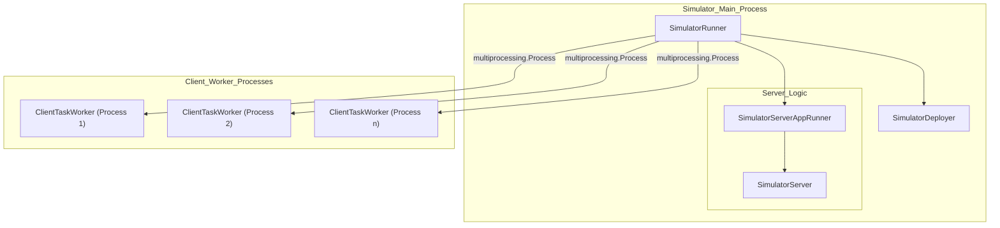
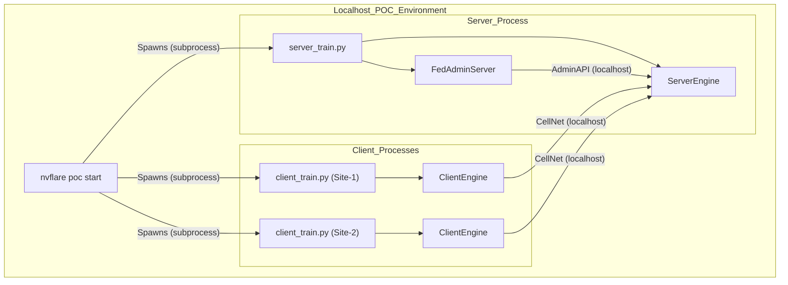
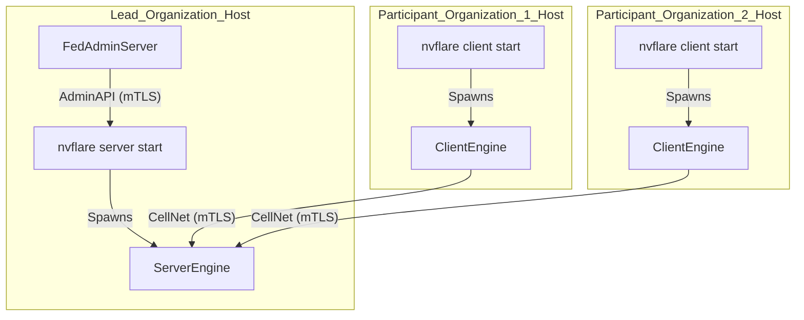

<!-- source: DeepWiki mcp.deepwiki.com · repo NVIDIA/NVFlare · page 1.3 Deployment Modes · fetched 2026-10-26 -->

# Deployment Modes

Relevant source files

The following files were used as context for generating this wiki page:

- [README.md](README.md)
- [docs/examples/hello_cross_val.rst](docs/examples/hello_cross_val.rst)
- [docs/examples/hello_numpy.rst](docs/examples/hello_numpy.rst)
- [docs/faq.rst](docs/faq.rst)
- [docs/flare_overview.rst](docs/flare_overview.rst)
- [docs/index.rst](docs/index.rst)
- [docs/installation.rst](docs/installation.rst)
- [docs/programming_guide/filters.rst](docs/programming_guide/filters.rst)
- [docs/programming_guide/provisioning_system.rst](docs/programming_guide/provisioning_system.rst)
- [docs/programming_guide/system_architecture.rst](docs/programming_guide/system_architecture.rst)
- [docs/quickstart.rst](docs/quickstart.rst)
- [docs/resources/nvidia_eye.wwPt122j.png](docs/resources/nvidia_eye.wwPt122j.png)
- [examples/advanced/psi/README.md](examples/advanced/psi/README.md)
- [examples/advanced/psi/psi.jpg](examples/advanced/psi/psi.jpg)
- [nvflare/cli.py](nvflare/cli.py)
- [nvflare/collab/runtime/controller.py](nvflare/collab/runtime/controller.py)
- [nvflare/fuel/common/multi_process_executor_constants.py](nvflare/fuel/common/multi_process_executor_constants.py)
- [nvflare/fuel/f3/connection.py](nvflare/fuel/f3/connection.py)
- [nvflare/private/fed/app/deployer/base_client_deployer.py](nvflare/private/fed/app/deployer/base_client_deployer.py)
- [nvflare/private/fed/app/deployer/server_deployer.py](nvflare/private/fed/app/deployer/server_deployer.py)
- [nvflare/private/fed/app/deployer/simulator_deployer.py](nvflare/private/fed/app/deployer/simulator_deployer.py)
- [nvflare/private/fed/app/simulator/simulator.py](nvflare/private/fed/app/simulator/simulator.py)
- [nvflare/private/fed/app/simulator/simulator_runner.py](nvflare/private/fed/app/simulator/simulator_runner.py)
- [nvflare/private/fed/app/simulator/simulator_worker.py](nvflare/private/fed/app/simulator/simulator_worker.py)
- [nvflare/private/fed/client/admin.py](nvflare/private/fed/client/admin.py)
- [nvflare/private/fed/server/admin.py](nvflare/private/fed/server/admin.py)
- [nvflare/private/fed/simulator/simulator_client_engine.py](nvflare/private/fed/simulator/simulator_client_engine.py)
- [nvflare/private/fed/simulator/simulator_server.py](nvflare/private/fed/simulator/simulator_server.py)
- [nvflare/tool/job/config/config_indexer.py](nvflare/tool/job/config/config_indexer.py)
- [nvflare/tool/job/config/configer.py](nvflare/tool/job/config/configer.py)
- [nvflare/tool/job/job_cli.py](nvflare/tool/job/job_cli.py)
- [nvflare/tool/job/job_client_const.py](nvflare/tool/job/job_client_const.py)
- [nvflare/tool/poc/poc_commands.py](nvflare/tool/poc/poc_commands.py)
- [nvflare/tool/poc/service_constants.py](nvflare/tool/poc/service_constants.py)
- [nvflare/utils/cli_utils.py](nvflare/utils/cli_utils.py)
- [tests/unit_test/collab/runtime/controller_test.py](tests/unit_test/collab/runtime/controller_test.py)
- [tests/unit_test/data/jobs/launch_everytime/app/config/config_fed_client.conf](tests/unit_test/data/jobs/launch_everytime/app/config/config_fed_client.conf)
- [tests/unit_test/data/jobs/launch_everytime/app/config/config_fed_server.conf](tests/unit_test/data/jobs/launch_everytime/app/config/config_fed_server.conf)
- [tests/unit_test/data/jobs/launch_everytime/meta.conf](tests/unit_test/data/jobs/launch_everytime/meta.conf)
- [tests/unit_test/data/jobs/launch_once/app/config/config_fed_client.conf](tests/unit_test/data/jobs/launch_once/app/config/config_fed_client.conf)
- [tests/unit_test/data/jobs/launch_once/app/config/config_fed_server.conf](tests/unit_test/data/jobs/launch_once/app/config/config_fed_server.conf)
- [tests/unit_test/data/jobs/launch_once/meta.conf](tests/unit_test/data/jobs/launch_once/meta.conf)
- [tests/unit_test/fuel/f3/streaming/streaming_test.py](tests/unit_test/fuel/f3/streaming/streaming_test.py)
- [tests/unit_test/lighter/poc_commands_test.py](tests/unit_test/lighter/poc_commands_test.py)
- [tests/unit_test/private/fed/app/deployer/simulator_deployer_test.py](tests/unit_test/private/fed/app/deployer/simulator_deployer_test.py)
- [tests/unit_test/private/fed/app/simulator/simulator_runner_test.py](tests/unit_test/private/fed/app/simulator/simulator_runner_test.py)
- [tests/unit_test/private/fed/server/server_engine_test.py](tests/unit_test/private/fed/server/server_engine_test.py)
- [tests/unit_test/tool/job/config/config_indexer_test.py](tests/unit_test/tool/job/config/config_indexer_test.py)
- [tests/unit_test/tool/job/config/configer_test.py](tests/unit_test/tool/job/config/configer_test.py)
- [tests/unit_test/tool/job/job_cli_test.py](tests/unit_test/tool/job/job_cli_test.py)
- [tests/unit_test/tool/poc/poc_force_test.py](tests/unit_test/tool/poc/poc_force_test.py)
- [tests/unit_test/tool/poc/poc_output_test.py](tests/unit_test/tool/poc/poc_output_test.py)

## Purpose and Scope

This document explains the three primary deployment modes in NVIDIA FLARE: **Simulator**, **POC**, and **Production**. These modes provide a progression path from rapid algorithm prototyping to secure, distributed federated learning across multiple organizations. Each mode utilizes different process architectures, communication mechanisms, and security configurations to balance development speed with operational realism. [nvflare/private/fed/app/simulator/simulator_runner.py:84-107]()

---

## Overview

NVIDIA FLARE supports three deployment modes to facilitate different stages of the Federated Learning (FL) workflow:

| Mode | Purpose | Process Model | Communication | Security | Typical Use |
|------|---------|---------------|---------------|----------|-------------|
| **Simulator** | Rapid prototyping | Single system, multi-process | In-memory / IPC | Optional | Algorithm development, fast debugging |
| **POC** | Local validation | Multi-process (Server + Clients) on one host | Local network (localhost) | Optional | Workflow testing, integration validation |
| **Production** | Distributed FL | Multi-process across machines | Network (TLS/mTLS) | Required | Real-world multi-party collaboration |

The recommended workflow is to start with the **Simulator** for development, then validate with **POC** mode on a single host before moving to a full **Production** distributed deployment. [docs/quickstart.rst:16-22]()

**Sources:** [nvflare/private/fed/app/simulator/simulator_runner.py:84-107](), [docs/quickstart.rst:16-22](), [README.md:32-39]()

---

## Simulator Mode

### Architecture

Simulator mode runs the entire federated learning system (Server and multiple Clients) within a single system. It mimics a distributed environment by using `SimulatorRunner` to orchestrate the lifecycle of a job locally. [nvflare/private/fed/app/simulator/simulator_runner.py:84-110]()

Title: Simulator Process Architecture

**Diagram: Simulator Process Architecture** associating `SimulatorRunner` [nvflare/private/fed/app/simulator/simulator_runner.py:84](), `SimulatorServer` [nvflare/private/fed/simulator/simulator_server.py:96](), and `ClientTaskWorker` [nvflare/private/fed/app/simulator/simulator_worker.py:48]().

**Sources:** [nvflare/private/fed/app/simulator/simulator_runner.py:26](), [nvflare/private/fed/app/simulator/simulator_worker.py:48-56](), [nvflare/private/fed/simulator/simulator_server.py:96-121]()

### Implementation Details
The `SimulatorRunner` initializes a `SimulatorDeployer` to set up a temporary workspace. [nvflare/private/fed/app/simulator/simulator_runner.py:113](). It uses `multiprocessing.Process` to spawn `ClientTaskWorker` instances, which execute client tasks in isolation. [nvflare/private/fed/app/simulator/simulator_runner.py:26](). Each `ClientTaskWorker` creates a `SimulatorClientAppRunner` to manage the local execution of the `ClientApp`. [nvflare/private/fed/app/simulator/simulator_worker.py:68-72]()

The `SimulatorRunner` manages a pool of `ClientTaskWorker` processes. When a task needs to be executed on a client, the `SimulatorRunner` sends the task to the appropriate `ClientTaskWorker` via an inter-process communication (IPC) channel using `multiprocessing.connection.Client`. [nvflare/private/fed/app/simulator/simulator_runner.py:27](). The `ClientTaskWorker` then executes the task using its `SimulatorClientAppRunner` and returns the result. This setup allows for concurrent execution of client tasks, mimicking a distributed environment. [nvflare/private/fed/app/simulator/simulator_runner.py:25-27](), [nvflare/private/fed/app/simulator/simulator_worker.py:157-158]()

**Sources:** [nvflare/private/fed/app/simulator/simulator_runner.py:84-121](), [nvflare/private/fed/app/simulator/simulator_runner.py:26](), [nvflare/private/fed/app/simulator/simulator_worker.py:68-72](), [nvflare/private/fed/app/simulator/simulator_worker.py:157-158]()

---

## POC Mode

### Architecture

POC (Proof of Concept) mode simulates a distributed deployment on a single host by running the server and clients as separate processes. This mode validates the multi-process communication and lifecycle management of the system using generated startup kits. [docs/quickstart.rst:19-19]()

Title: POC Multi-Process Architecture

**Diagram: POC Multi-Process Architecture** using `FedAdminServer` [nvflare/private/fed/server/admin.py:145]() and `ServerEngine` [nvflare/private/fed/simulator/simulator_server.py:31]().

**Sources:** [nvflare/tool/poc/poc_commands.py:142-176](), [nvflare/private/fed/server/admin.py:145-165](), [nvflare/private/fed/simulator/simulator_server.py:31-40](), [docs/quickstart.rst:19-19]()

### POC Management

The POC environment is managed via the `nvflare poc` CLI command group. It generates a local workspace where each participant (server and clients) has its own sub-folder and configuration files. [nvflare/tool/poc/poc_commands.py:74-80]()

The `nvflare poc prepare` command provisions the necessary startup kits and configurations for the server and clients within a designated POC workspace (default: `/tmp/nvflare/poc`). [nvflare/tool/poc/poc_commands.py:71-74](). The server and client processes communicate over localhost using CellNet. [nvflare/private/fed/app/deployer/simulator_deployer.py:88-103]()

| Component | Function | Implementation |
|---------|----------|----------------|
| **Server** | Aggregates and orchestrates. | `SimulatorServer` [nvflare/private/fed/simulator/simulator_server.py:96]() |
| **Client** | Executes training/inference. | `ClientEngine` [nvflare/private/fed/app/simulator/simulator_worker.py:50]() |
| **Admin** | Command and control. | `FedAdminServer` [nvflare/private/fed/server/admin.py:145]() |

**Sources:** [nvflare/tool/poc/poc_commands.py:71-94](), [nvflare/private/fed/simulator/simulator_server.py:96-121](), [nvflare/private/fed/server/admin.py:145-165](), [nvflare/private/fed/app/simulator/simulator_worker.py:50-55]()

---

## Production Mode

### Architecture

Production mode is a distributed deployment where participants (Server, Clients, Admins) run on different physical or virtual machines. It requires a **Provisioning** step to generate secure startup kits containing certificates and configurations. [docs/programming_guide/provisioning_system.rst:6-16]()

Title: Production Distributed Deployment

**Diagram: Production Distributed Deployment** associating `FedAdminServer` [nvflare/private/fed/server/admin.py:145]() with `ServerEngine` [nvflare/private/fed/simulator/simulator_server.py:31]() and `ClientEngine` [nvflare/private/fed/app/simulator/simulator_worker.py:50]().

**Sources:** [nvflare/private/fed/server/admin.py:145-165](), [nvflare/private/fed/app/simulator/simulator_worker.py:48-55](), [docs/programming_guide/provisioning_system.rst:6-16]()

### Provisioning and Security

In production, the system relies on signed packages and mutual TLS (mTLS). [docs/programming_guide/provisioning_system.rst:9-11]()
- **Provisioning**: The `Provisioner` class handles the lifecycle of generating startup kits by orchestrating various `Builder` modules. [docs/programming_guide/provisioning_system.rst:65-75]()
- **mTLS Enforcement**: Communication channels use shared TLS certificates generated during provisioning to establish secure identities between participants. [docs/programming_guide/provisioning_system.rst:9-11]()
- **Participant Types**: The system recognizes `server`, `client`, and `admin` as primary participant types. [docs/programming_guide/provisioning_system.rst:121-126]()
- **Workspace Structure**: Provisioning creates a structured workspace (e.g., `prod_01`) containing `startup` folders with certificates and configuration files for each site. [docs/programming_guide/provisioning_system.rst:12-16]()

**Sources:** [docs/programming_guide/provisioning_system.rst:9-75](), [docs/programming_guide/provisioning_system.rst:121-126]()

---

## Mode Comparison and Transition

### Feature Matrix

| Feature | Simulator | POC | Production |
|---------|-----------|-----|------------|
| **Entry Point** | `SimulatorRunner` [nvflare/private/fed/app/simulator/simulator_runner.py:84]() | `nvflare poc` [nvflare/tool/poc/poc_commands.py:74]() | `Provisioner` [docs/programming_guide/provisioning_system.rst:65]() |
| **Networking** | Internal IPC [nvflare/private/fed/app/simulator/simulator_runner.py:27]() | Localhost TCP [nvflare/tool/poc/poc_commands.py:90]() | Networked mTLS [docs/programming_guide/provisioning_system.rst:9]() |
| **Process Isolation** | `multiprocessing.Process` [nvflare/private/fed/app/simulator/simulator_runner.py:26]() | OS Processes (Subprocess) | Distributed OS Processes |
| **Security** | Optional | Optional | Required (mTLS/Certs) [docs/programming_guide/provisioning_system.rst:9]() |
| **Workspace** | `simulator_workspace` [nvflare/private/fed/app/simulator/simulator_runner.py:125]() | `/tmp/nvflare/poc` [nvflare/tool/poc/poc_commands.py:71]() | Provisioned Workspace [docs/programming_guide/provisioning_system.rst:15-16]() |

**Sources:** [nvflare/private/fed/app/simulator/simulator_runner.py:26-125](), [nvflare/tool/poc/poc_commands.py:71-90](), [docs/programming_guide/provisioning_system.rst:9-65](), [docs/quickstart.rst:18-20]()

### Transition Workflow

1. **Develop**: Use the **Simulator** for rapid iteration on a single machine without complex setup. This allows for quick algorithm development and debugging. [docs/quickstart.rst:22-22]()
2. **Validate**: Transition to **POC mode** to test multi-process behavior and separation of site-specific configurations on one host. [docs/quickstart.rst:22-22]()
3. **Deploy**: Use the **Provisioning System** to generate startup kits for a distributed **Production** environment across different organizations. [docs/quickstart.rst:22-22]()

**Sources:** [docs/quickstart.rst:16-22](), [docs/programming_guide/provisioning_system.rst:6-16]()

---

