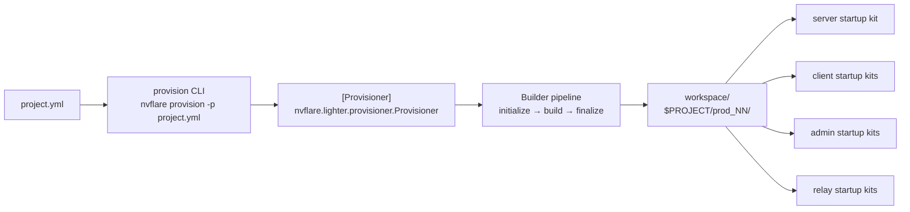
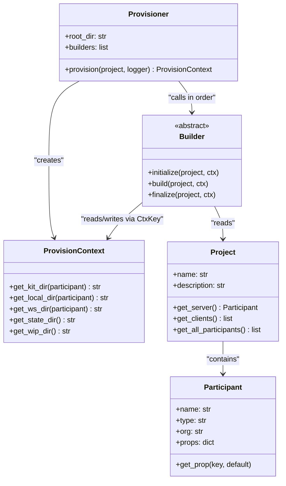
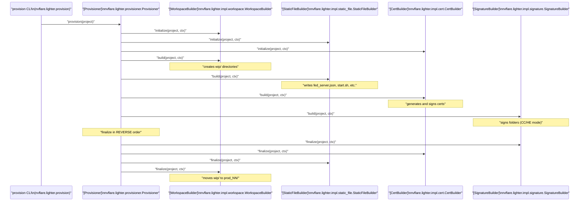

<!-- source: DeepWiki mcp.deepwiki.com · repo NVIDIA/NVFlare · page 10 Provisioning System · fetched 2026-10-26 -->

# Provisioning System

<details>
<summary>Relevant source files</summary>

The following files were used as context for generating this wiki page:

- [docs/user_guide/admin_guide/security/unsafe_component_detection.rst](docs/user_guide/admin_guide/security/unsafe_component_detection.rst)
- [docs/user_guide/nvflare_cli/provision_command.rst](docs/user_guide/nvflare_cli/provision_command.rst)
- [nvflare/apis/utils/format_check.py](nvflare/apis/utils/format_check.py)
- [nvflare/app_common/default_component_policy.py](nvflare/app_common/default_component_policy.py)
- [nvflare/app_common/widgets/component_path_authorizer.py](nvflare/app_common/widgets/component_path_authorizer.py)
- [nvflare/edge/simulation/README.md](nvflare/edge/simulation/README.md)
- [nvflare/fuel/f3/cellnet/cell_cipher.py](nvflare/fuel/f3/cellnet/cell_cipher.py)
- [nvflare/fuel/f3/cellnet/credential_manager.py](nvflare/fuel/f3/cellnet/credential_manager.py)
- [nvflare/fuel/hci/server/authz.py](nvflare/fuel/hci/server/authz.py)
- [nvflare/fuel/sec/admin_cert.py](nvflare/fuel/sec/admin_cert.py)
- [nvflare/fuel/sec/authz.py](nvflare/fuel/sec/authz.py)
- [nvflare/lighter/constants.py](nvflare/lighter/constants.py)
- [nvflare/lighter/ctx.py](nvflare/lighter/ctx.py)
- [nvflare/lighter/dummy_project.yml](nvflare/lighter/dummy_project.yml)
- [nvflare/lighter/edge_project.yml](nvflare/lighter/edge_project.yml)
- [nvflare/lighter/entity.py](nvflare/lighter/entity.py)
- [nvflare/lighter/impl/cert.py](nvflare/lighter/impl/cert.py)
- [nvflare/lighter/impl/docker.py](nvflare/lighter/impl/docker.py)
- [nvflare/lighter/impl/he.py](nvflare/lighter/impl/he.py)
- [nvflare/lighter/impl/signature.py](nvflare/lighter/impl/signature.py)
- [nvflare/lighter/impl/static_file.py](nvflare/lighter/impl/static_file.py)
- [nvflare/lighter/impl/workspace.py](nvflare/lighter/impl/workspace.py)
- [nvflare/lighter/provision.py](nvflare/lighter/provision.py)
- [nvflare/lighter/provisioner.py](nvflare/lighter/provisioner.py)
- [nvflare/lighter/spec.py](nvflare/lighter/spec.py)
- [nvflare/lighter/templates/master_template.yml](nvflare/lighter/templates/master_template.yml)
- [nvflare/lighter/tree_prov.py](nvflare/lighter/tree_prov.py)
- [nvflare/lighter/utils.py](nvflare/lighter/utils.py)
- [nvflare/private/fed/utils/app_authz.py](nvflare/private/fed/utils/app_authz.py)
- [nvflare/private/fed/utils/app_deployer.py](nvflare/private/fed/utils/app_deployer.py)
- [nvflare/private/fed/utils/site_config.py](nvflare/private/fed/utils/site_config.py)
- [nvflare/tool/verify_startup_kits.py](nvflare/tool/verify_startup_kits.py)
- [tests/unit_test/app_common/widgets/component_path_authorizer_test.py](tests/unit_test/app_common/widgets/component_path_authorizer_test.py)
- [tests/unit_test/fuel/flare_api_test.py](tests/unit_test/fuel/flare_api_test.py)
- [tests/unit_test/fuel/hci/server/authz_filter_test.py](tests/unit_test/fuel/hci/server/authz_filter_test.py)
- [tests/unit_test/fuel/sec/admin_cert_test.py](tests/unit_test/fuel/sec/admin_cert_test.py)
- [tests/unit_test/lighter/__init__.py](tests/unit_test/lighter/__init__.py)
- [tests/unit_test/lighter/cert_builder_test.py](tests/unit_test/lighter/cert_builder_test.py)
- [tests/unit_test/lighter/participant_test.py](tests/unit_test/lighter/participant_test.py)
- [tests/unit_test/lighter/project_test.py](tests/unit_test/lighter/project_test.py)
- [tests/unit_test/lighter/static_file_builder_test.py](tests/unit_test/lighter/static_file_builder_test.py)
- [tests/unit_test/lighter/utils_test.py](tests/unit_test/lighter/utils_test.py)
- [tests/unit_test/private/fed/utils/app_deployer_test.py](tests/unit_test/private/fed/utils/app_deployer_test.py)
- [tests/unit_test/private/fed/utils/site_config_test.py](tests/unit_test/private/fed/utils/site_config_test.py)

</details>


The provisioning system generates **startup kits** — per-participant packages containing certificates, configuration files, and startup scripts — that are required to run a production federated learning federation. This document covers the provisioning pipeline in `nvflare/lighter/`, including the `project.yml` input format, the `Builder` plugin interfaces, the standard set of builders, PKI generation, configuration file generation, the workspace directory layout, and the relay/client hierarchy system.

For the web-based provisioning interface, see the Dashboard pages [11]() and [11.3](). For POC-mode provisioning (which uses a simplified version of this pipeline), see [9.2](). For the runtime use of the generated startup kits, see [4.5]().

---

## How Provisioning Fits In

Provisioning is an **offline, operator-run step** that must happen before any FL participants can start. Its output — startup kit directories — is consumed at runtime by the server, clients, admins, and relays.

**Provisioning pipeline overview:**



Sources: [nvflare/lighter/provision.py:150-162](), [nvflare/lighter/provisioner.py:47-75](), [nvflare/lighter/spec.py:21-37]()

---

## Entry Points

### CLI

The `nvflare provision` command is defined in `nvflare/lighter/provision.py`. The primary flow:

```bash
nvflare provision -p project.yml -w workspace/
```

The `define_provision_parser` function configures the arguments, while the internal logic reads `project.yml`, calls `prepare_builders()` to instantiate the builder list from `project.yml`'s `builders:` section, and then runs `Provisioner.provision(project)`.

| CLI flag | Purpose |
|---|---|
| `-p project_file` | Input project definition file [nvflare/lighter/provision.py:155-162]() |
| `-w workspace` | Output workspace directory (default: `workspace`) [nvflare/lighter/provision.py:179-179]() |
| `-c custom_folder` | Extra Python path for custom builder classes [nvflare/lighter/provision.py:182-188]() |
| `--add-user` | YAML file to add an extra admin participant [nvflare/lighter/provision.py:190-196]() |
| `--add-client` | YAML file to add an extra client participant [nvflare/lighter/provision.py:198-204]() |
| `-g` | Generate a sample `project.yml` [nvflare/lighter/provision.py:164-168]() |
| `-e` | Generate a sample edge `project.yml` [nvflare/lighter/provision.py:170-176]() |

Sources: [nvflare/lighter/provision.py:150-204](), [nvflare/lighter/provisioner.py:47-56]()

---

## Project Configuration (`project.yml`)

The input to provisioning is a YAML file describing the FL project and all participants. The canonical schema uses `api_version: 3` (or `4` for multi-study deployments [nvflare/lighter/provision.py:62-63]()).

**Minimal example** (informed by [nvflare/lighter/dummy_project.yml]()):

```yaml
api_version: 3
name: example_project
description: NVIDIA FLARE sample project yaml file

participants:
  - name: server1
    type: server
    org: nvidia
    fed_learn_port: 8002
  - name: site-1
    type: client
    org: nvidia
  - name: site-2
    type: client
    org: nvidia
  - name: admin@nvidia.com
    type: admin
    org: nvidia
    role: project_admin

builders:
  - path: nvflare.lighter.impl.workspace.WorkspaceBuilder
    args:
      template_file:
        - master_template.yml
  - path: nvflare.lighter.impl.static_file.StaticFileBuilder
    args:
      config_folder: config
  - path: nvflare.lighter.impl.cert.CertBuilder
  - path: nvflare.lighter.impl.signature.SignatureBuilder
```

### Participant Properties

| Property | Applies To | Description |
|---|---|---|
| `name` | All | Unique name; server name becomes the TLS CN and hostname [nvflare/lighter/impl/cert.py:151-164]() |
| `type` | All | One of `server`, `client`, `admin`, `relay` [nvflare/lighter/constants.py:24-30]() |
| `org` | All | Organization name [nvflare/lighter/constants.py:44-44]() |
| `fed_learn_port` | Server | Port for FL client connections (default: 8002) [nvflare/lighter/dummy_project.yml:12-12]() |
| `admin_port` | Server | Port for admin connections (default: 8003) [nvflare/lighter/constants.py:55-55]() |
| `role` | Admin | One of `project_admin`, `org_admin`, `lead`, `member` [nvflare/lighter/constants.py:112-116]() |
| `connect_to` | Client, Relay | Which server or relay to connect to [nvflare/lighter/constants.py:49-49]() |
| `connection_security` | All | One of `clear`, `tls`, `mtls` (default: `mtls`) [nvflare/lighter/impl/static_file.py:113-128]() |

Sources: [nvflare/lighter/constants.py:24-81](), [nvflare/lighter/impl/static_file.py:113-128](), [nvflare/lighter/impl/cert.py:127-164](), [nvflare/lighter/dummy_project.yml:5-35]()

---

## Core Abstractions

**Class hierarchy and data flow:**



Sources: [nvflare/lighter/spec.py:21-85](), [nvflare/lighter/provisioner.py:28-45](), [nvflare/lighter/constants.py:84-98]()

### `Builder` (`nvflare/lighter/spec.py`)

All provisioning logic is implemented as `Builder` subclasses. Each builder is given three opportunities to act:

1. **`initialize(project, ctx)`** — run for all builders in forward order before any `build()` call [nvflare/lighter/spec.py:39-46]()
2. **`build(project, ctx)`** — run for all builders in forward order [nvflare/lighter/spec.py:48-55]()
3. **`finalize(project, ctx)`** — run for all builders in **reverse order** [nvflare/lighter/spec.py:57-64]()

---

## The Provisioner Pipeline



Sources: [nvflare/lighter/provisioner.py:47-75](), [nvflare/lighter/impl/workspace.py:51-86]()

---

## Standard Builders

### `WorkspaceBuilder` (`nvflare/lighter/impl/workspace.py`)

Manages the provisioned workspace directory structure. On `initialize`, it scans existing `prod_NN/` directories to determine the next production stage number. On `build`, it creates the directory skeleton for each participant. On `finalize`, it moves the temporary `wip/` folder to the final `prod_NN/` location.

For details, see [Workspace Structure](#10.6).

### `StaticFileBuilder` (`nvflare/lighter/impl/static_file.py`)

Generates the core configuration files (`fed_server.json`, `fed_client.json`, `fed_admin.json`) and shell scripts (`start.sh`, `sub_start.sh`, `stop_fl.sh`) for all participants. It uses templates from `master_template.yml` to render these files based on the project definition [nvflare/lighter/impl/static_file.py:37-63](). It also handles the configuration for `require_signed_jobs` [nvflare/lighter/impl/static_file.py:94-111]().

For details, see [Configuration File Generation](#10.4).

### `CertBuilder` (`nvflare/lighter/impl/cert.py`)

Handles PKI management, including root CA generation and certificate signing for all participants. It maintains state in `cert.json` via the `_CertState` class to allow incremental provisioning (e.g., adding a client later without regenerating the server cert) [nvflare/lighter/impl/cert.py:34-95]().

For details, see [Certificate and PKI Management](#10.3).

### `SignatureBuilder` (`nvflare/lighter/impl/signature.py`)

Signs files with the root CA's private key. In Homomorphic Encryption (HE) mode, it signs the startup and local directories to protect TenSEAL contexts.

For details, see [Security and Signature Verification](#10.7).

### `DockerBuilder` (`nvflare/lighter/impl/docker.py`)

Optional builder that generates a `compose.yaml` and `nvflare_compose/Dockerfile` for running the entire federation in Docker containers [nvflare/lighter/impl/docker.py:63-94]().

---

## Workspace Directory Structure

The workspace follows a strict organization to support versioning and persistence:

```text
$WORKSPACE/
  $PROJECT_NAME/
    prod_00/   <-- Successful provision output (version 0)
    prod_01/   <-- Version 1
    state/     <-- Persistent state (e.g., cert.json)
    wip/       <-- Temporary work-in-progress area
```

For details, see [Workspace Structure](#10.6).

Sources: [nvflare/lighter/constants.py:17-22](), [nvflare/lighter/impl/workspace.py:64-86]()

---

## Security and Verification

The provisioning system implements a "Chain of Trust" where:
1. A root CA is generated or loaded from state [nvflare/lighter/impl/cert.py:172-181]().
2. Every participant is issued a certificate signed by the root CA [nvflare/lighter/utils.py:74-143]().
3. In secure modes, folders are signed using the root CA's private key via `SignatureBuilder`.
4. At runtime, the `AppDeployer` verifies the signature of the deployed application against the `rootCA.pem` found in the startup kit [nvflare/private/fed/utils/app_deployer.py:72-83]().

The system also includes `Unsafe Component Detection` which checks component paths against an allow-list defined in `resources.json.default` [nvflare/lighter/templates/master_template.yml:69-70]().

For details, see [Security and Signature Verification](#10.7).

---

## Participant Hierarchies and Relays

NVFLARE supports hierarchical topologies where clients connect to relays instead of directly to the server. This is managed via `connect_to` properties and Fully Qualified Cell Names (FQCN) / Fully Qualified Site Names (FQSN) [nvflare/lighter/constants.py:76-78](). The `StaticFileBuilder` calculates these names to ensure correct message routing through the hierarchy [nvflare/lighter/impl/static_file.py:178-190]().

Edge provisioning can be automated for testing using `tree_prov.py`, which builds recursive relay and client hierarchies [nvflare/lighter/tree_prov.py:145-195]().

For details, see [Participant Hierarchies and Relays](#10.5).

Sources: [nvflare/lighter/tree_prov.py:30-30](), [nvflare/lighter/constants.py:76-78](), [nvflare/lighter/impl/static_file.py:178-190]()

---

