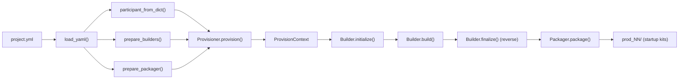
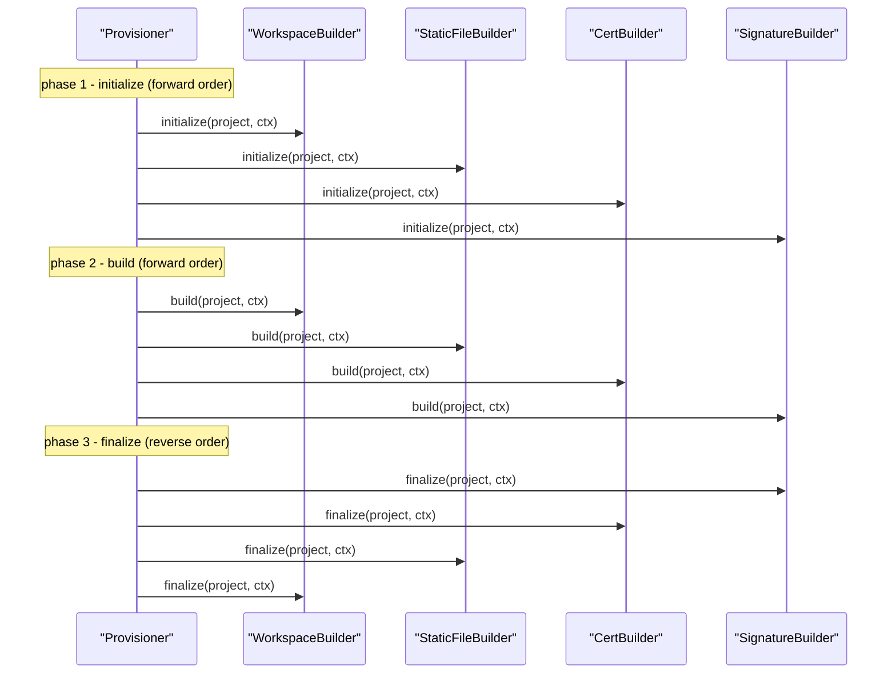
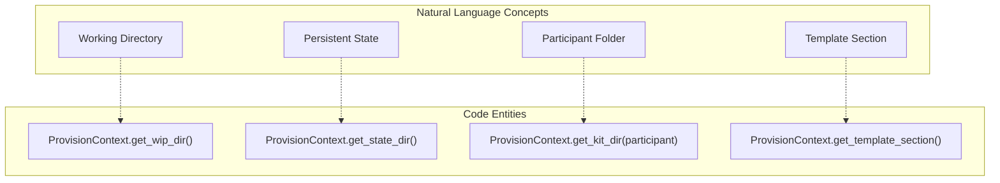

<!-- source: DeepWiki mcp.deepwiki.com · repo NVIDIA/NVFlare · page 10.1 Provisioning Overview and Workflow · fetched 2026-10-26 -->

# Provisioning Overview and Workflow

<details>
<summary>Relevant source files</summary>

The following files were used as context for generating this wiki page:

- [docs/user_guide/admin_guide/security/unsafe_component_detection.rst](docs/user_guide/admin_guide/security/unsafe_component_detection.rst)
- [docs/user_guide/nvflare_cli/provision_command.rst](docs/user_guide/nvflare_cli/provision_command.rst)
- [nvflare/apis/utils/format_check.py](nvflare/apis/utils/format_check.py)
- [nvflare/app_common/default_component_policy.py](nvflare/app_common/default_component_policy.py)
- [nvflare/app_common/widgets/component_path_authorizer.py](nvflare/app_common/widgets/component_path_authorizer.py)
- [nvflare/edge/simulation/README.md](nvflare/edge/simulation/README.md)
- [nvflare/fuel/f3/cellnet/cell_cipher.py](nvflare/fuel/f3/cellnet/cell_cipher.py)
- [nvflare/fuel/f3/cellnet/credential_manager.py](nvflare/fuel/f3/cellnet/credential_manager.py)
- [nvflare/fuel/hci/server/authz.py](nvflare/fuel/hci/server/authz.py)
- [nvflare/fuel/sec/admin_cert.py](nvflare/fuel/sec/admin_cert.py)
- [nvflare/fuel/sec/authz.py](nvflare/fuel/sec/authz.py)
- [nvflare/lighter/constants.py](nvflare/lighter/constants.py)
- [nvflare/lighter/ctx.py](nvflare/lighter/ctx.py)
- [nvflare/lighter/dummy_project.yml](nvflare/lighter/dummy_project.yml)
- [nvflare/lighter/edge_project.yml](nvflare/lighter/edge_project.yml)
- [nvflare/lighter/entity.py](nvflare/lighter/entity.py)
- [nvflare/lighter/impl/cert.py](nvflare/lighter/impl/cert.py)
- [nvflare/lighter/impl/docker.py](nvflare/lighter/impl/docker.py)
- [nvflare/lighter/impl/he.py](nvflare/lighter/impl/he.py)
- [nvflare/lighter/impl/signature.py](nvflare/lighter/impl/signature.py)
- [nvflare/lighter/impl/static_file.py](nvflare/lighter/impl/static_file.py)
- [nvflare/lighter/impl/workspace.py](nvflare/lighter/impl/workspace.py)
- [nvflare/lighter/provision.py](nvflare/lighter/provision.py)
- [nvflare/lighter/provisioner.py](nvflare/lighter/provisioner.py)
- [nvflare/lighter/spec.py](nvflare/lighter/spec.py)
- [nvflare/lighter/templates/master_template.yml](nvflare/lighter/templates/master_template.yml)
- [nvflare/lighter/tree_prov.py](nvflare/lighter/tree_prov.py)
- [nvflare/lighter/utils.py](nvflare/lighter/utils.py)
- [nvflare/private/fed/utils/app_authz.py](nvflare/private/fed/utils/app_authz.py)
- [nvflare/private/fed/utils/app_deployer.py](nvflare/private/fed/utils/app_deployer.py)
- [nvflare/private/fed/utils/site_config.py](nvflare/private/fed/utils/site_config.py)
- [nvflare/tool/verify_startup_kits.py](nvflare/tool/verify_startup_kits.py)
- [tests/unit_test/app_common/widgets/component_path_authorizer_test.py](tests/unit_test/app_common/widgets/component_path_authorizer_test.py)
- [tests/unit_test/fuel/flare_api_test.py](tests/unit_test/fuel/flare_api_test.py)
- [tests/unit_test/fuel/hci/server/authz_filter_test.py](tests/unit_test/fuel/hci/server/authz_filter_test.py)
- [tests/unit_test/fuel/sec/admin_cert_test.py](tests/unit_test/fuel/sec/admin_cert_test.py)
- [tests/unit_test/lighter/__init__.py](tests/unit_test/lighter/__init__.py)
- [tests/unit_test/lighter/cert_builder_test.py](tests/unit_test/lighter/cert_builder_test.py)
- [tests/unit_test/lighter/participant_test.py](tests/unit_test/lighter/participant_test.py)
- [tests/unit_test/lighter/project_test.py](tests/unit_test/lighter/project_test.py)
- [tests/unit_test/lighter/static_file_builder_test.py](tests/unit_test/lighter/static_file_builder_test.py)
- [tests/unit_test/lighter/utils_test.py](tests/unit_test/lighter/utils_test.py)
- [tests/unit_test/private/fed/utils/app_deployer_test.py](tests/unit_test/private/fed/utils/app_deployer_test.py)
- [tests/unit_test/private/fed/utils/site_config_test.py](tests/unit_test/private/fed/utils/site_config_test.py)

</details>


## Purpose and Scope

This page covers the end-to-end provisioning process that generates startup kits for a production NVIDIA FLARE deployment. Provisioning takes a `project.yml` file as input and produces a set of per-participant directories containing certificates, configuration files, startup scripts, and signatures.

This page focuses on the orchestration layer: how `project.yml` is parsed, how the `Provisioner` class drives the builder pipeline, and how `ProvisionContext` is used to share state.

---

## High-Level Data Flow

The provisioning system follows a linear pipeline where a project description is transformed into a structured workspace through a series of builder plugins.

**Provisioning system data flow: project.yml → startup kits**



Sources: `[nvflare/lighter/provision.py:26-31]()`, `[nvflare/lighter/provisioner.py:77-145]()`, `[nvflare/lighter/prov_utils.py:27-28]()`

---

## Input: project.yml

The `project.yml` file is the primary input. It must conform to `api_version: 3` or `4` [nvflare/lighter/provision.py:57-63](). It defines the project metadata, the list of participants (Server, Clients, Admins), and the sequence of builders to execute.

| Field | Description |
|---|---|
| `api_version` | Must be `3` or `4` (validated during parsing) [nvflare/lighter/provision.py:62-63](). |
| `name` | Project name, used as the workspace subdirectory [nvflare/lighter/provisioner.py:102-110](). |
| `participants` | List of participant definitions. Each entry must have a `type` [nvflare/lighter/constants.py:24-30](). |
| `builders` | Ordered list of builder class paths and constructor arguments [nvflare/lighter/dummy_project.yml:38-62](). |

### Participant Types

Defined in `ParticipantType` in `nvflare/lighter/constants.py`:

| `ParticipantType` value | Description |
|---|---|
| `server` | The FL server orchestrator [nvflare/lighter/constants.py:25-25](). |
| `client` | FL training sites [nvflare/lighter/constants.py:26-26](). |
| `admin` | Users of the admin console [nvflare/lighter/constants.py:27-27](). |
| `relay` | Network relay nodes for hierarchical topologies [nvflare/lighter/constants.py:29-29](). |
| `overseer` | HA service (obsolete: kept for backward compatibility) [nvflare/lighter/constants.py:28-28](). |

Sources: `[nvflare/lighter/constants.py:24-38]()`, `[nvflare/lighter/provision.py:57-135]()`

---

## Provision Entry Points

### CLI Invocation

The primary entry point is `nvflare provision -p project.yml`. The command-line arguments are parsed by `define_provision_parser` [nvflare/lighter/provision.py:150-213]().

1. The parser handles flags for generating sample configs (`-g`), edge configs (`-e`), or specifying a custom project file (`-p`) [nvflare/lighter/provision.py:154-176]().
2. `hierachical_provision` is invoked if an edge/hierarchical project is detected [nvflare/lighter/provision.py:30-30]().
3. The `Provisioner` is initialized with builders prepared via `prepare_builders` [nvflare/lighter/provision.py:27-28]().

### POC Mode Provisioning

The `nvflare poc` commands utilize the provisioning system to create a local simulation of a distributed environment. This mode uses the same builder logic but generates configurations suitable for local process execution rather than distributed TLS-secured deployment by setting `ProvisionMode.POC` [nvflare/lighter/constants.py:101-103]().

### Programmatic Invocation (Dashboard)

The `Provisioner` class can be instantiated directly. This is commonly used by the Dashboard or automated deployment scripts.

```python
from nvflare.lighter.provisioner import Provisioner
# builders and packager are prepared via nvflare.lighter.prov_utils or custom lists
provisioner = Provisioner(workspace_full_path, builders, packager)
provisioner.provision(project)
```

Sources: `[nvflare/lighter/provisioner.py:28-40]()`, `[nvflare/lighter/provision.py:142-147]()`

---

## The Provisioner Class

`Provisioner` (in `nvflare/lighter/provisioner.py`) drives the workflow. It manages the `ProvisionContext` and executes the three-phase lifecycle of each builder.

**`Provisioner.provision(project)` Workflow:**
1. **Initialize Context**: Creates a `ProvisionContext` and sets up the workspace directory structure (WIP, State) [nvflare/lighter/provisioner.py:102-110]().
2. **Phase 1: Initialize**: Calls `initialize(project, ctx)` on all builders in forward order [nvflare/lighter/provisioner.py:123-125]().
3. **Phase 2: Build**: Calls `build(project, ctx)` on all builders in forward order [nvflare/lighter/provisioner.py:127-129]().
4. **Phase 3: Finalize**: Calls `finalize(project, ctx)` on all builders in **reverse order** [nvflare/lighter/provisioner.py:131-133]().
5. **Packaging**: If successful, calls `packager.package(project, ctx)` [nvflare/lighter/provisioner.py:140-141]().

Sources: `[nvflare/lighter/provisioner.py:77-145]()`, `[nvflare/lighter/spec.py:21-65]()`

---

## The Builder Pipeline

Builders are modular components that handle specific parts of the provisioning logic.

**Builder lifecycle and execution order**



Sources: `[nvflare/lighter/provisioner.py:123-133]()`, `[nvflare/lighter/spec.py:21-65]()`

### Standard Builders and Their Responsibilities

| Builder class | Role | Key Functions |
|---|---|---|
| `StaticFileBuilder` | Config Generation | Generates `fed_server.json`, `fed_client.json`, and shell scripts (`start.sh`, `sub_start.sh`) from templates [nvflare/lighter/impl/static_file.py:48-63](). |
| `CertBuilder` | PKI / Security | Generates Root CA and signs participant certificates [nvflare/lighter/impl/cert.py:99-104](). Reuses state from `cert.json` [nvflare/lighter/impl/cert.py:34-45](). |
| `SignatureBuilder` | Integrity | Signs files in startup kits. Required for CC and HE modes to protect workspace or TenSEAL contexts [nvflare/lighter/impl/signature.py:23-36](). |
| `DockerBuilder` | Containerization | Generates `compose.yaml` and `Dockerfile` for running FLARE in containers [nvflare/lighter/impl/docker.py:63-94](). |

Sources: `[nvflare/lighter/impl/static_file.py:37-63]()`, `[nvflare/lighter/impl/cert.py:97-152]()`, `[nvflare/lighter/impl/signature.py:22-62]()`, `[nvflare/lighter/impl/docker.py:25-32]()`

---

## ProvisionContext

`ProvisionContext` is the shared state container passed between builders. It acts as a specialized dictionary with helper methods for path resolution and template processing.

**Key path methods on ProvisionContext:**

| Method | Description |
|---|---|
| `get_wip_dir()` | Returns the path to the temporary `wip` directory [nvflare/lighter/constants.py:19-19](). |
| `get_kit_dir(participant)` | Returns the `startup` folder path for a participant [nvflare/lighter/impl/static_file.py:103-103](). |
| `get_state_dir()` | Returns the `state` folder path for persistent data (e.g., certificates) [nvflare/lighter/impl/cert.py:155-156](). |

**Mapping Natural Language Space to Code Entity Space (Context)**



Sources: `[nvflare/lighter/impl/static_file.py:103-103]()`, `[nvflare/lighter/impl/cert.py:155-156]()`, `[nvflare/lighter/constants.py:84-98]()`, `[nvflare/lighter/impl/docker.py:88-88]()`

---

## Workspace Structure

The provisioning run creates a versioned directory structure [nvflare/lighter/constants.py:17-22]().

```text
$WORKSPACE/
  $PROJECT_NAME/
    prod_00/      <-- Successful run 1
    prod_01/      <-- Successful run 2
    state/        <-- Persistent certs/keys (cert.json)
    wip/          <-- Temporary folder during execution
```

Inside each participant's kit (e.g., `prod_00/site-1/`):
- `startup/`: Contains `fed_client.json`, `start.sh`, `client.crt`, `client.key`, and `rootCA.pem`.
- `local/`: Contains local resources and potentially privacy configurations.

Sources: `[nvflare/lighter/constants.py:17-22]()`, `[nvflare/lighter/impl/cert.py:32-45]()`

---

## Security and Integrity

The provisioning workflow ensures security through:
1. **mTLS**: `CertBuilder` generates unique certificates for every participant signed by a common Root CA [nvflare/lighter/impl/cert.py:99-104]().
2. **Signature Verification**: `SignatureBuilder` creates a `signature.json` to protect the integrity of the workspace. Required for CC and HE modes to protect workspace or TenSEAL contexts [nvflare/lighter/impl/signature.py:23-36]().
3. **State Persistence**: By saving the Root CA and serial numbers in `state/cert.json`, the system can add new participants later without invalidating existing kits [nvflare/lighter/impl/cert.py:32-94]().

Sources: `[nvflare/lighter/impl/cert.py:32-94]()`, `[nvflare/lighter/impl/signature.py:22-62]()`

---

