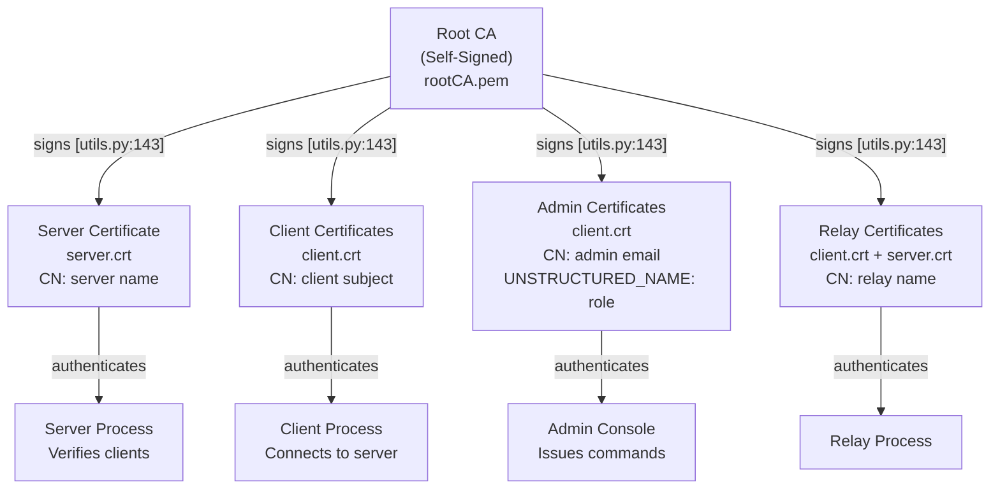
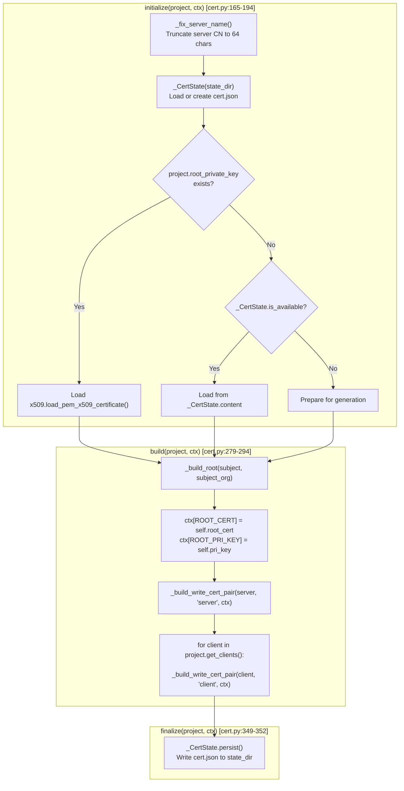
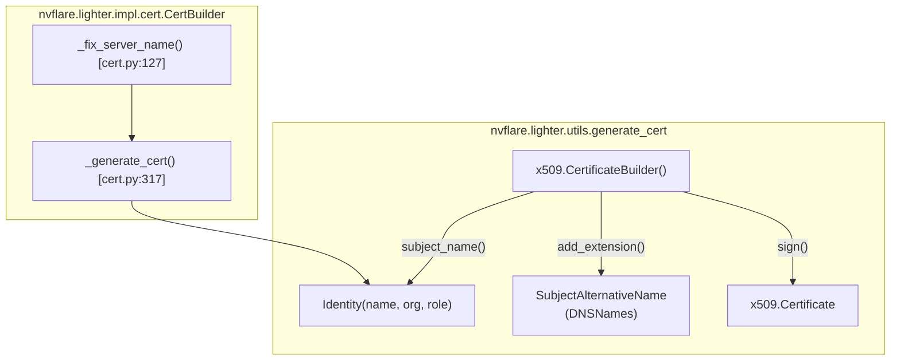

<!-- source: DeepWiki mcp.deepwiki.com · repo NVIDIA/NVFlare · page 10.3 Certificate and PKI Management · fetched 2026-10-26 -->

# Certificate and PKI Management

<details>
<summary>Relevant source files</summary>

The following files were used as context for generating this wiki page:

- [docs/user_guide/admin_guide/security/unsafe_component_detection.rst](docs/user_guide/admin_guide/security/unsafe_component_detection.rst)
- [docs/user_guide/nvflare_cli/provision_command.rst](docs/user_guide/nvflare_cli/provision_command.rst)
- [nvflare/apis/utils/format_check.py](nvflare/apis/utils/format_check.py)
- [nvflare/app_common/default_component_policy.py](nvflare/app_common/default_component_policy.py)
- [nvflare/app_common/widgets/component_path_authorizer.py](nvflare/app_common/widgets/component_path_authorizer.py)
- [nvflare/edge/simulation/README.md](nvflare/edge/simulation/README.md)
- [nvflare/fuel/f3/cellnet/cell_cipher.py](nvflare/fuel/f3/cellnet/cell_cipher.py)
- [nvflare/fuel/f3/cellnet/credential_manager.py](nvflare/fuel/f3/cellnet/credential_manager.py)
- [nvflare/fuel/hci/server/authz.py](nvflare/fuel/hci/server/authz.py)
- [nvflare/fuel/sec/admin_cert.py](nvflare/fuel/sec/admin_cert.py)
- [nvflare/fuel/sec/authz.py](nvflare/fuel/sec/authz.py)
- [nvflare/lighter/constants.py](nvflare/lighter/constants.py)
- [nvflare/lighter/ctx.py](nvflare/lighter/ctx.py)
- [nvflare/lighter/dummy_project.yml](nvflare/lighter/dummy_project.yml)
- [nvflare/lighter/edge_project.yml](nvflare/lighter/edge_project.yml)
- [nvflare/lighter/entity.py](nvflare/lighter/entity.py)
- [nvflare/lighter/impl/cert.py](nvflare/lighter/impl/cert.py)
- [nvflare/lighter/impl/docker.py](nvflare/lighter/impl/docker.py)
- [nvflare/lighter/impl/he.py](nvflare/lighter/impl/he.py)
- [nvflare/lighter/impl/signature.py](nvflare/lighter/impl/signature.py)
- [nvflare/lighter/impl/static_file.py](nvflare/lighter/impl/static_file.py)
- [nvflare/lighter/impl/workspace.py](nvflare/lighter/impl/workspace.py)
- [nvflare/lighter/provision.py](nvflare/lighter/provision.py)
- [nvflare/lighter/provisioner.py](nvflare/lighter/provisioner.py)
- [nvflare/lighter/spec.py](nvflare/lighter/spec.py)
- [nvflare/lighter/templates/master_template.yml](nvflare/lighter/templates/master_template.yml)
- [nvflare/lighter/tree_prov.py](nvflare/lighter/tree_prov.py)
- [nvflare/lighter/utils.py](nvflare/lighter/utils.py)
- [nvflare/private/fed/utils/app_authz.py](nvflare/private/fed/utils/app_authz.py)
- [nvflare/private/fed/utils/app_deployer.py](nvflare/private/fed/utils/app_deployer.py)
- [nvflare/private/fed/utils/site_config.py](nvflare/private/fed/utils/site_config.py)
- [nvflare/tool/verify_startup_kits.py](nvflare/tool/verify_startup_kits.py)
- [tests/unit_test/app_common/widgets/component_path_authorizer_test.py](tests/unit_test/app_common/widgets/component_path_authorizer_test.py)
- [tests/unit_test/fuel/flare_api_test.py](tests/unit_test/fuel/flare_api_test.py)
- [tests/unit_test/fuel/hci/server/authz_filter_test.py](tests/unit_test/fuel/hci/server/authz_filter_test.py)
- [tests/unit_test/fuel/sec/admin_cert_test.py](tests/unit_test/fuel/sec/admin_cert_test.py)
- [tests/unit_test/lighter/__init__.py](tests/unit_test/lighter/__init__.py)
- [tests/unit_test/lighter/cert_builder_test.py](tests/unit_test/lighter/cert_builder_test.py)
- [tests/unit_test/lighter/participant_test.py](tests/unit_test/lighter/participant_test.py)
- [tests/unit_test/lighter/project_test.py](tests/unit_test/lighter/project_test.py)
- [tests/unit_test/lighter/static_file_builder_test.py](tests/unit_test/lighter/static_file_builder_test.py)
- [tests/unit_test/lighter/utils_test.py](tests/unit_test/lighter/utils_test.py)
- [tests/unit_test/private/fed/utils/app_deployer_test.py](tests/unit_test/private/fed/utils/app_deployer_test.py)
- [tests/unit_test/private/fed/utils/site_config_test.py](tests/unit_test/private/fed/utils/site_config_test.py)

</details>


## Purpose and Scope

This document describes the Public Key Infrastructure (PKI) and certificate management system in NVIDIA FLARE's provisioning framework. The PKI system establishes a trust hierarchy using X.509 certificates to enable secure mutual TLS (mTLS) authentication between all federated learning participants: server, clients, admins, and relays.

**Scope:**
- Root CA generation and management via `CertBuilder` [nvflare/lighter/impl/cert.py:99-117]()
- Participant certificate creation and signing using `cryptography` [nvflare/lighter/utils.py:74-143]()
- Certificate state persistence in `cert.json` for identity stability [nvflare/lighter/impl/cert.py:34-96]()
- Distributed provisioning concepts and internal builder logic [nvflare/lighter/provisioner.py:28-28]()

**Related topics:**
- For provisioning workflow and builder architecture, see **10.1 Provisioning Overview and Workflow**.
- For communication security implementation, see **4.5 Security and Encryption**.
- For static file generation including certificate references, see **10.4 Configuration File Generation**.

---

## PKI Architecture

NVIDIA FLARE implements a hierarchical PKI based on a self-signed root Certificate Authority (CA). All participant certificates are signed by this root CA, establishing a chain of trust for secure communication.

### Certificate Hierarchy

Title: PKI Trust Chain and Authentication

**Sources:** [nvflare/lighter/impl/cert.py:99-352](), [nvflare/lighter/utils.py:74-143]()

### Connection Security Modes

The provisioning system supports three connection security modes, configured per participant via `StaticFileBuilder` [nvflare/lighter/impl/static_file.py:113-129]():

| Mode | Description | Certificate Requirements | Use Case |
|------|-------------|-------------------------|----------|
| **MTLS** (default) | Mutual TLS - both parties authenticate | Both client and server certs required | Production deployments |
| **TLS** | Server-only authentication | Only server cert required | Simplified client setup |
| **CLEAR** | No encryption or authentication | No certificates required | Development/testing only |

**Sources:** [nvflare/lighter/constants.py:106-110](), [nvflare/lighter/impl/static_file.py:113-129]()

---

## CertBuilder Implementation

The `CertBuilder` class at [nvflare/lighter/impl/cert.py:99-352]() orchestrates certificate generation through a three-phase lifecycle defined by the `Builder` base class at [nvflare/lighter/spec.py:21-65]().

### Class Structure and Core Components

| Component | Type | Purpose | Code Reference |
|-----------|------|---------|----------------|
| `CertBuilder` | Builder subclass | Main certificate orchestrator | [nvflare/lighter/impl/cert.py:99-352]() |
| `_CertState` | State manager | Persistent certificate storage | [nvflare/lighter/impl/cert.py:34-96]() |
| `Identity` | Data class | X.509 subject/issuer info | [nvflare/lighter/utils.py:43-48]() |
| `generate_cert()` | Utility function | X.509 certificate creation | [nvflare/lighter/utils.py:74-143]() |
| `generate_keys()` | Utility function | RSA key pair generation | [nvflare/lighter/utils.py:167-170]() |
| `serialize_cert()` | Utility function | PEM encoding | [nvflare/lighter/utils.py:163-164]() |
| `serialize_pri_key()` | Utility function | Private key PEM encoding | [nvflare/lighter/utils.py:146-160]() |

### CertBuilder Workflow

Title: CertBuilder Lifecycle and Method Flow

**Sources:** [nvflare/lighter/impl/cert.py:99-352](), [nvflare/lighter/spec.py:21-65]()

### Key Methods

#### CertBuilder.initialize()

The `initialize()` method at [nvflare/lighter/impl/cert.py:165-194]() prepares the certificate builder:

1. **Server name validation:** Calls `_fix_server_name()` at [nvflare/lighter/impl/cert.py:127-164]() to ensure server CN ≤ 64 characters (X.509 limit [nvflare/lighter/impl/cert.py:30]()).
2. **State initialization:** Creates `_CertState(state_dir)` to load existing certificates from `cert.json` [nvflare/lighter/impl/cert.py:43-52]().
3. **Root CA loading:** Checks for project-provided root CA or loads from persistent state [nvflare/lighter/impl/cert.py:172-193]().

#### CertBuilder._build_root()

The `_build_root()` method at [nvflare/lighter/impl/cert.py:195-207]() generates the self-signed root CA if one does not already exist:

- Calls `generate_keys()` at [nvflare/lighter/utils.py:167-170]() to create a 2048-bit RSA key pair.
- Calls `_generate_cert()` at [nvflare/lighter/impl/cert.py:317-347]() with `ca=True`.
- Stores serialized cert/key in `_CertState` using `serialize_cert()` and `serialize_pri_key()` [nvflare/lighter/utils.py:146-164]().

#### CertBuilder._build_write_cert_pair()

The `_build_write_cert_pair()` method at [nvflare/lighter/impl/cert.py:208-247]() creates certificates for each participant. It includes logic to reuse certificates if they exist in `cert.json` [nvflare/lighter/impl/cert.py:211-234]().

**File output:**
- `<base_name>.crt` - PEM-encoded certificate [nvflare/lighter/impl/cert.py:236]().
- `<base_name>.key` - PEM-encoded private key [nvflare/lighter/impl/cert.py:237]().
- `rootCA.pem` - Root CA certificate (copied to each participant) [nvflare/lighter/impl/cert.py:238]().

**Sources:** [nvflare/lighter/impl/cert.py:99-352](), [nvflare/lighter/utils.py:74-170]()

---

## Certificate State Management

Certificate state persistence enables reuse of certificates across multiple provisioning runs, which is critical for maintaining consistent participant identities.

### _CertState Class

The `_CertState` class at [nvflare/lighter/impl/cert.py:34-97]() manages persistent certificate storage in a `cert.json` file.

Title: _CertState Persistence Mechanism
```mermaid
graph LR
    subgraph "Memory: _CertState.content"
        RootKey["PROP_ROOT_PRI_KEY"]
        RootCert["PROP_ROOT_CERT"]
        SubjData["'subject_name': { 'cert', 'pri_key' }"]
    end
    
    subgraph "Disk: state/cert.json"
        JSONFile["JSON Object"]
    end
    
    Init["__init__() [cert.py:43]"] -->|"json.load()"| RootKey
    Persist["persist() [cert.py:93]"] <==|"json.dump()"| RootCert
    RootKey -.-> JSONFile
    RootCert -.-> JSONFile
    SubjData -.-> JSONFile
```
**Sources:** [nvflare/lighter/impl/cert.py:34-97]()

### State File Format

The `cert.json` file uses the following structure:

| Key | Value | Purpose |
|-----|-------|---------|
| `root_cert` | PEM string | The Root CA public certificate [nvflare/lighter/impl/cert.py:38]() |
| `root_pri_key` | PEM string | The Root CA private key [nvflare/lighter/impl/cert.py:39]() |
| `<subject_name>` | Object | Dictionary containing `cert` and `pri_key` for a participant [nvflare/lighter/impl/cert.py:68-73]() |

**Sources:** [nvflare/lighter/impl/cert.py:34-97]()

---

## Certificate Generation Process

### X.509 Certificate Creation

The certificate generation at [nvflare/lighter/utils.py:74-143]() uses the `cryptography` library to create X.509 certificates.

Title: Natural Language Subject to Code Entity Mapping


**Key Features:**
- **RSA Keys:** Generates 2048-bit keys [nvflare/lighter/utils.py:168]().
- **SAN Support:** Automatically adds `SubjectAlternativeName` extensions for servers using `server_default_host` and `server_additional_hosts` [nvflare/lighter/utils.py:137-142]().
- **Validity:** Default validity period of 360 days [nvflare/lighter/impl/cert.py:31]().
- **CA Constraints:** Sets `BasicConstraints(ca=True)` and appropriate `KeyUsage` (cert signing, CRL sign) for the root CA [nvflare/lighter/utils.py:111-125]().

**Sources:** [nvflare/lighter/utils.py:74-170](), [nvflare/lighter/impl/cert.py:317-347]()

---

## Security and Signatures

Beyond certificate generation, the PKI system supports file signing to ensure the integrity of the startup kits and submitted applications.

### SignatureBuilder

The `SignatureBuilder` at [nvflare/lighter/impl/signature.py:22-62]() uses the root CA's private key to sign files within the participant workspaces.

1. **Retrieval:** Gets `CtxKey.ROOT_PRI_KEY` from the `ProvisionContext` [nvflare/lighter/impl/signature.py:39]().
2. **Conditional Signing:**
   - **Confidential Computing (CC):** Signs the full workspace for CVM attestation if `PropKey.CC_ENABLED` is set [nvflare/lighter/impl/signature.py:44-48]().
   - **Homomorphic Encryption (HE):** Signs startup and local directories to protect TenSEAL contexts if `SERVER_CONTEXT_TENSEAL` or `CLIENT_CONTEXT_TENSEAL` exist [nvflare/lighter/impl/signature.py:50-58]().
3. **Persistence:** Generates `signature.json` via `sign_folders()` [nvflare/lighter/impl/signature.py:48, 57-58]().

**Sources:** [nvflare/lighter/impl/signature.py:22-62](), [nvflare/lighter/constants.py:69-71]()

### Runtime Verification

The authentication process at runtime verifies identities established during provisioning.

1. **App Verification:** During deployment, the `AppDeployer` checks for `signature.json` [nvflare/private/fed/utils/app_deployer.py:71-72](). It uses `verify_folder_signature_and_get_signers()` to ensure the application has not been tampered with [nvflare/private/fed/utils/app_deployer.py:74]().
2. **Admin Validation:** Special handling for admin certificates includes checking roles embedded in the certificate subject (e.g., `project_admin`, `org_admin`) [nvflare/lighter/constants.py:112-119]().

**Sources:** [nvflare/private/fed/utils/app_deployer.py:71-84](), [nvflare/lighter/constants.py:112-119]()

---

