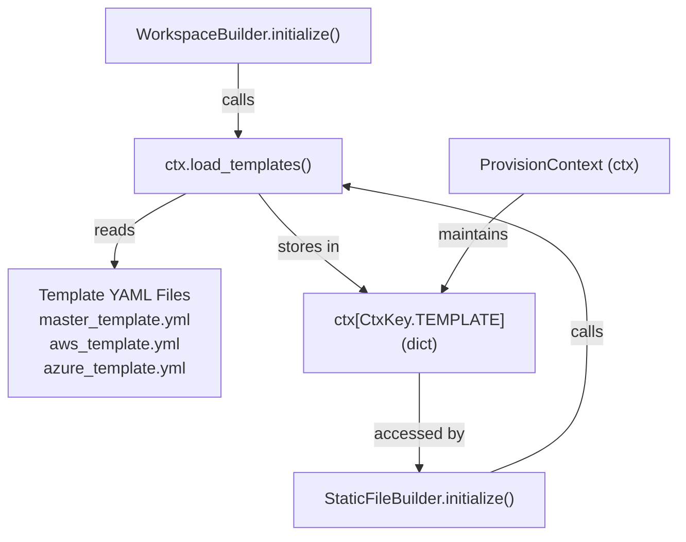
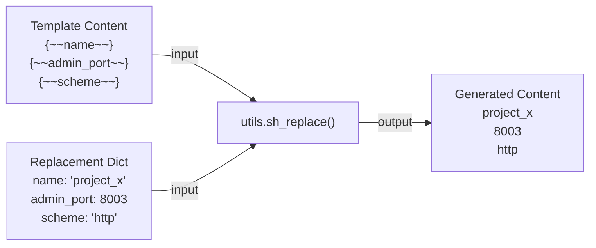
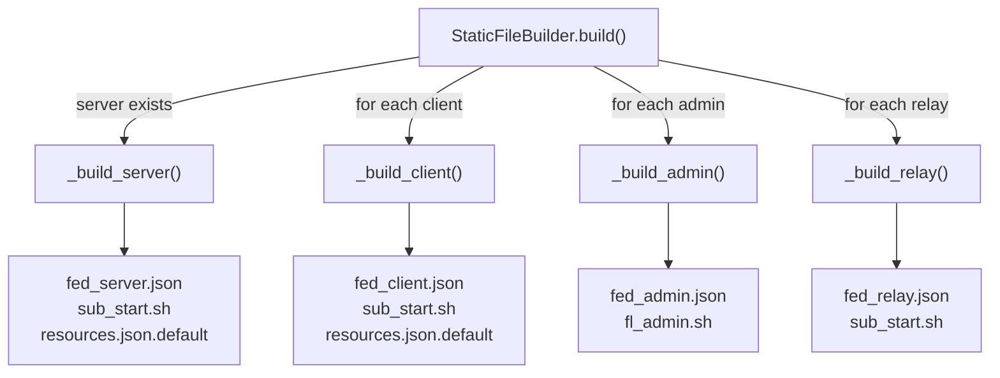
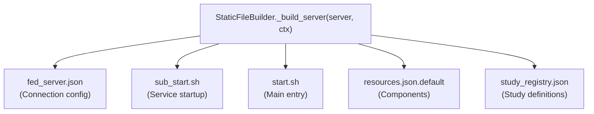
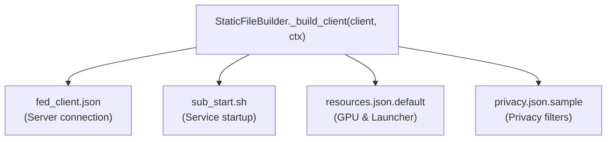
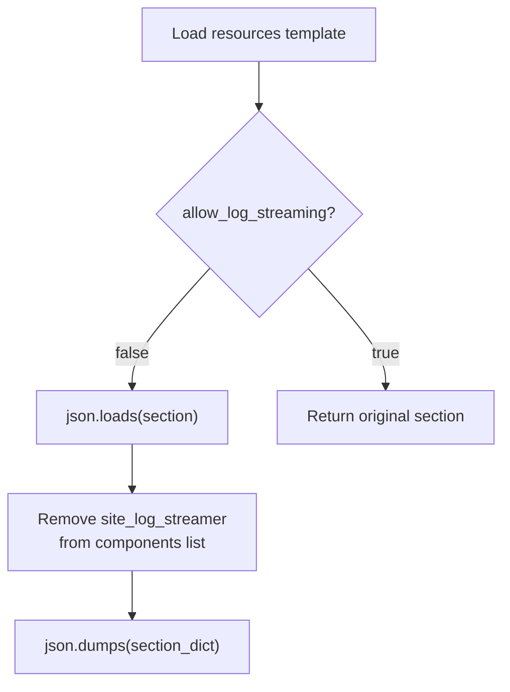
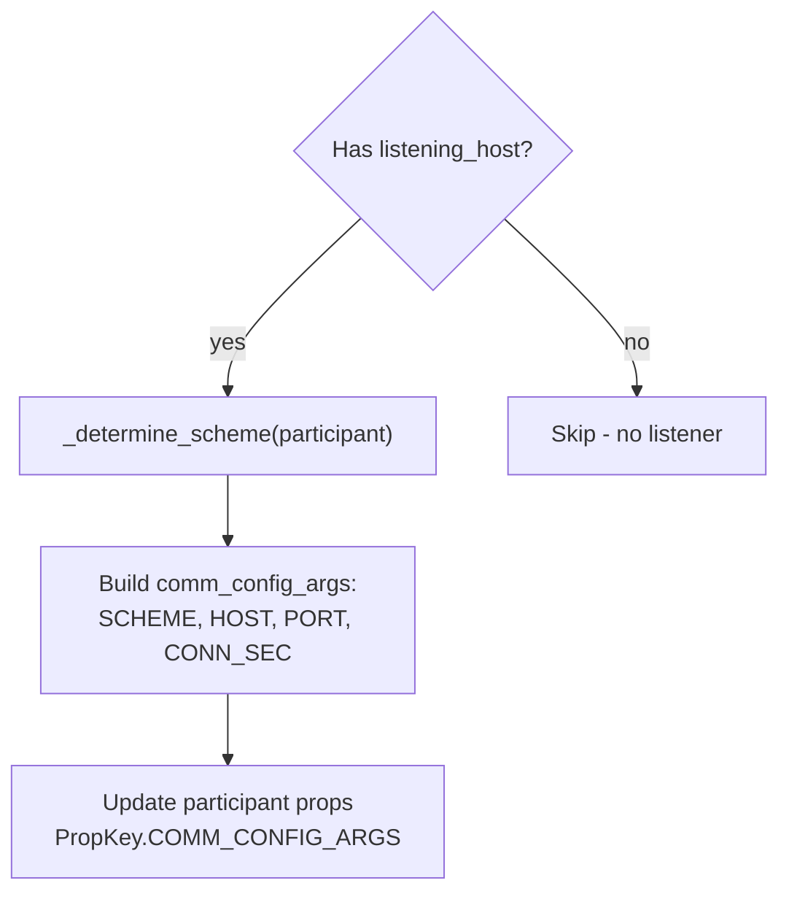
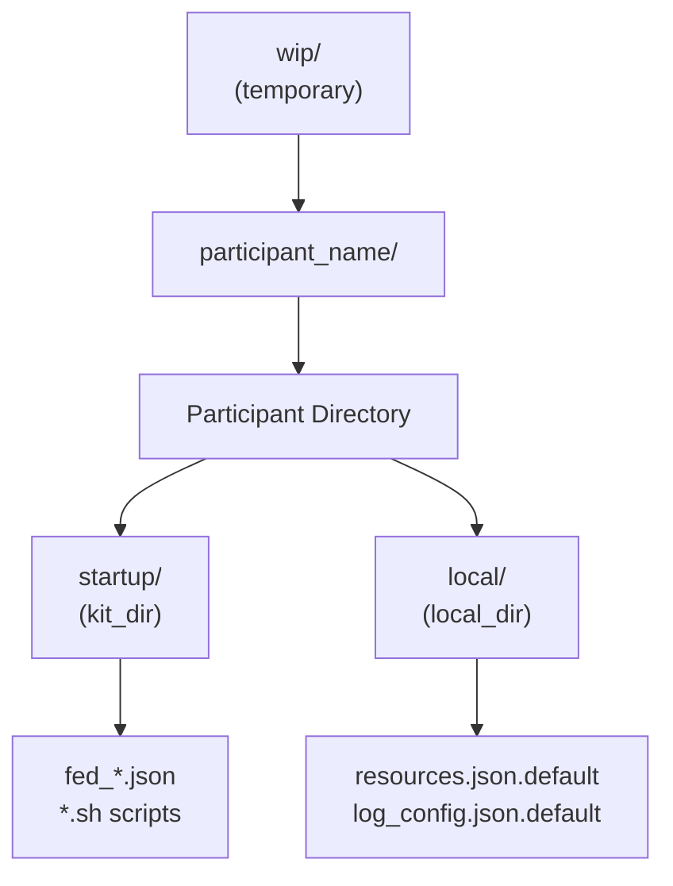

<!-- source: DeepWiki mcp.deepwiki.com · repo NVIDIA/NVFlare · page 10.4 Configuration File Generation · fetched 2026-10-26 -->

# Configuration File Generation

<details>
<summary>Relevant source files</summary>

The following files were used as context for generating this wiki page:

- [docs/user_guide/admin_guide/security/unsafe_component_detection.rst](docs/user_guide/admin_guide/security/unsafe_component_detection.rst)
- [docs/user_guide/nvflare_cli/provision_command.rst](docs/user_guide/nvflare_cli/provision_command.rst)
- [nvflare/apis/utils/format_check.py](nvflare/apis/utils/format_check.py)
- [nvflare/app_common/default_component_policy.py](nvflare/app_common/default_component_policy.py)
- [nvflare/app_common/widgets/component_path_authorizer.py](nvflare/app_common/widgets/component_path_authorizer.py)
- [nvflare/edge/simulation/README.md](nvflare/edge/simulation/README.md)
- [nvflare/fuel/hci/server/authz.py](nvflare/fuel/hci/server/authz.py)
- [nvflare/fuel/sec/authz.py](nvflare/fuel/sec/authz.py)
- [nvflare/lighter/constants.py](nvflare/lighter/constants.py)
- [nvflare/lighter/ctx.py](nvflare/lighter/ctx.py)
- [nvflare/lighter/dummy_project.yml](nvflare/lighter/dummy_project.yml)
- [nvflare/lighter/edge_project.yml](nvflare/lighter/edge_project.yml)
- [nvflare/lighter/entity.py](nvflare/lighter/entity.py)
- [nvflare/lighter/impl/cert.py](nvflare/lighter/impl/cert.py)
- [nvflare/lighter/impl/docker.py](nvflare/lighter/impl/docker.py)
- [nvflare/lighter/impl/static_file.py](nvflare/lighter/impl/static_file.py)
- [nvflare/lighter/provision.py](nvflare/lighter/provision.py)
- [nvflare/lighter/provisioner.py](nvflare/lighter/provisioner.py)
- [nvflare/lighter/templates/master_template.yml](nvflare/lighter/templates/master_template.yml)
- [nvflare/lighter/tree_prov.py](nvflare/lighter/tree_prov.py)
- [nvflare/private/fed/utils/site_config.py](nvflare/private/fed/utils/site_config.py)
- [tests/unit_test/app_common/widgets/component_path_authorizer_test.py](tests/unit_test/app_common/widgets/component_path_authorizer_test.py)
- [tests/unit_test/fuel/flare_api_test.py](tests/unit_test/fuel/flare_api_test.py)
- [tests/unit_test/fuel/hci/server/authz_filter_test.py](tests/unit_test/fuel/hci/server/authz_filter_test.py)
- [tests/unit_test/lighter/__init__.py](tests/unit_test/lighter/__init__.py)
- [tests/unit_test/lighter/cert_builder_test.py](tests/unit_test/lighter/cert_builder_test.py)
- [tests/unit_test/lighter/participant_test.py](tests/unit_test/lighter/participant_test.py)
- [tests/unit_test/lighter/project_test.py](tests/unit_test/lighter/project_test.py)
- [tests/unit_test/lighter/static_file_builder_test.py](tests/unit_test/lighter/static_file_builder_test.py)
- [tests/unit_test/private/fed/utils/site_config_test.py](tests/unit_test/private/fed/utils/site_config_test.py)

</details>


## Purpose and Scope

This document describes the configuration file generation system used during the NVIDIA FLARE provisioning process. The system transforms YAML templates into participant-specific configuration files (JSON, shell scripts, and other text files) through variable substitution and content modification. 

The primary logic resides in the `StaticFileBuilder` class [nvflare/lighter/impl/static_file.py:38-66](), which uses the `ProvisionContext` to manage templates and write files to the workspace.

## Template System Architecture

The provisioning system uses a template-based approach where configuration files are generated from reusable templates stored in YAML format. The `StaticFileBuilder` class orchestrates this process by loading templates, performing variable substitution, and writing the results to participant-specific directories.

### Template Loading Flow

The `WorkspaceBuilder` and `StaticFileBuilder` initialize the template system by loading YAML files into the `ProvisionContext`.

**Template Architecture Flow**

Sources: [nvflare/lighter/impl/static_file.py:831-833](), [nvflare/lighter/ctx.py:54-71]()

### Template Section Mapping

Templates are organized into named sections within the YAML files (e.g., `master_template.yml` [nvflare/lighter/templates/master_template.yml:1-125]()). These sections are identified by `TemplateSectionKey` constants [nvflare/lighter/constants.py:122-159]().

| Template Section Key | Generated File | Participant Types | Purpose |
|---------------------|----------------|-------------------|---------|
| `FED_SERVER` | `fed_server.json` | Server | Server connection configuration [nvflare/lighter/impl/static_file.py:128-138]() |
| `FED_CLIENT` | `fed_client.json` | Client | Client connection configuration [nvflare/lighter/impl/static_file.py:268-281]() |
| `FED_ADMIN` | `fed_admin.json` | Admin | Admin console configuration [nvflare/lighter/impl/static_file.py:545-560]() |
| `SUB_START_SH` | `sub_start.sh` | Server, Client, Relay | Service startup script [nvflare/lighter/impl/static_file.py:171-175]() |
| `LOG_CONFIG` | `log_config.json.default` | All | Logging configuration [nvflare/lighter/impl/static_file.py:182-182]() |
| `LOCAL_SERVER_RESOURCES` | `resources.json.default` | Server | Server resource definitions [nvflare/lighter/impl/static_file.py:184-186]() |
| `LOCAL_CLIENT_RESOURCES` | `resources.json.default` | Client | Client resource definitions [nvflare/lighter/impl/static_file.py:302-321]() |
| `COMM_CONFIG` | `comm_config.json` | All | Communication configuration [nvflare/lighter/impl/static_file.py:841-867]() |

Sources: [nvflare/lighter/constants.py:122-157](), [nvflare/lighter/templates/master_template.yml:1-125]()

## Variable Substitution Mechanism

### Substitution Syntax

The template system uses a custom variable substitution syntax: `{~~variable_name~~}`. When a template is processed, these placeholders are replaced with actual values from a replacement dictionary.

**Variable Substitution Logic**

Sources: [nvflare/lighter/utils.py:368-372](), [nvflare/lighter/ctx.py:156-176]()

### Variable Replacement Implementation

The `sh_replace` function in `nvflare/lighter/utils.py` performs string substitution by iterating through the replacement dictionary [nvflare/lighter/utils.py:368-372]().

```python
def sh_replace(src, mapping_dict):
    result = src
    for k, v in mapping_dict.items():
        result = result.replace("{~~" + k + "~~}", str(v))
    return result
```

Sources: [nvflare/lighter/utils.py:368-372]()

## Configuration Generation Process

### Build Method Workflow

The `StaticFileBuilder.build()` method orchestrates configuration file generation for all participant types defined in the `Project` entity [nvflare/lighter/impl/static_file.py:713-726]().

**Build Phase Orchestration**

Sources: [nvflare/lighter/impl/static_file.py:713-726]()

### ProvisionContext Build Methods

The `ProvisionContext` class provides helper methods that builders use to generate files from templates.

| Method | Purpose | Parameters |
|--------|---------|-----------|
| `build_from_template()` | Build a file from template section | `dest_dir`, `temp_section`, `file_name`, `replacement`, `exe` [nvflare/lighter/ctx.py:128-154]() |
| `build_section_from_template()` | Generate content from template | `temp_section`, `replacement`, `content_modify_cb` [nvflare/lighter/ctx.py:156-176]() |
| `yaml_load_template_section()` | Parse template as YAML | `section_key`, `replacement` [nvflare/lighter/ctx.py:186-193]() |

Sources: [nvflare/lighter/ctx.py:128-193]()

## Server Configuration Generation

### Server-Specific Files

The `_build_server()` method generates configuration files specific to the FL server, including the core `fed_server.json` and startup scripts [nvflare/lighter/impl/static_file.py:117-196](). It also handles the creation of the `study_registry.json` if studies are defined in the project [nvflare/lighter/impl/static_file.py:118-125]().

**Server Config Components**

Sources: [nvflare/lighter/impl/static_file.py:117-196]()

### Server Replacement Variables

The server configuration uses these replacement variables determined during the build process.

| Variable | Source | Purpose |
|----------|--------|---------|
| `name` | `project.name` | Project identifier [nvflare/lighter/impl/static_file.py:131]() |
| `target` | `server.name:fed_learn_port` | Server target address [nvflare/lighter/impl/static_file.py:123]() |
| `admin_port` | `ctx.get(CtxKey.ADMIN_PORT)` | Admin service port [nvflare/lighter/impl/static_file.py:121]() |
| `scheme` | `self._determine_scheme(server)` | Communication scheme (grpc/tcp/http) [nvflare/lighter/impl/static_file.py:135]() |
| `conn_sec` | `self._build_conn_properties()` | Connection security mode [nvflare/lighter/impl/static_file.py:136]() |

Sources: [nvflare/lighter/impl/static_file.py:117-138]()

## Client Configuration Generation

### Client-Specific Files

The `_build_client()` method generates client configuration files, including GPU resource management and connection info [nvflare/lighter/impl/static_file.py:229-410]().

**Client Config Components**

Sources: [nvflare/lighter/impl/static_file.py:229-410]()

### Client Replacement Variables

| Variable | Source | Purpose |
|----------|--------|---------|
| `server_identity` | `server.name` | Server to connect to [nvflare/lighter/impl/static_file.py:277]() |
| `fqsn` | `client.get_prop(PropKey.FQSN)` | Fully qualified site name [nvflare/lighter/impl/static_file.py:273]() |
| `is_leaf` | `client.get_prop(PropKey.IS_LEAF)` | Whether client is leaf node [nvflare/lighter/impl/static_file.py:274]() |
| `num_gpus` | `capacity.get(PropKey.NUM_GPUS)` | Number of GPUs [nvflare/lighter/impl/static_file.py:307]() |
| `gpu_mem` | `capacity.get(PropKey.GPU_MEM)` | GPU memory per GPU [nvflare/lighter/impl/static_file.py:308]() |

Sources: [nvflare/lighter/impl/static_file.py:268-318]()

## Content Modification Callbacks

The system allows for dynamic content modification via callbacks during template processing.

### Log Streaming Component Modification

The `_modify_log_streaming()` callback handles the configuration of the `SiteLogStreamer` based on the `allow_log_streaming` property [nvflare/lighter/impl/static_file.py:411-442]().

**Log Component Logic**

Sources: [nvflare/lighter/impl/static_file.py:411-442]()

### Undefined Port Removal

The `_remove_undefined_port()` callback removes port placeholders from `comm_config.json` if they are set to 0 or are missing, ensuring clean configuration files [nvflare/lighter/impl/static_file.py:907-932]().

Sources: [nvflare/lighter/impl/static_file.py:907-932]()

## Component Path Authorization

Standard provisioning includes a `class_allow_list` in `resources.json.default` to restrict which components can be built during job execution [nvflare/lighter/templates/master_template.yml:70]().

The `DEFAULT_CLASS_ALLOW_LIST` is imported from `nvflare.app_common.default_component_policy` [nvflare/lighter/impl/static_file.py:20]() and injected into the template during generation [nvflare/lighter/impl/static_file.py:186]().

Sources: [nvflare/lighter/impl/static_file.py:18-20](), [nvflare/lighter/templates/master_template.yml:66-71]()

## Communication Configuration

### Internal Listener Setup

The `_build_comm_config_for_internal_listener()` method prepares template arguments for participants that create internal listeners (servers, relays, and clients with `listening_host`) [nvflare/lighter/impl/static_file.py:197-228]().

**Internal Listener Flow**

Sources: [nvflare/lighter/impl/static_file.py:197-228]()

### Communication Config Finalization

The `finalize()` method generates `comm_config.json` files for all participants by processing the `PropKey.COMM_CONFIG_ARGS` collected during the build phase [nvflare/lighter/impl/static_file.py:841-867]().

Sources: [nvflare/lighter/impl/static_file.py:841-867]()

## File Write Operations

### Write Utility Function

The `utils.write()` function in `nvflare/lighter/utils.py` handles actual file writing with optional executable permissions [nvflare/lighter/utils.py:458-467]().

```python
def write(file_full_path, content, mode, exe=False):
    mode = mode + "w"
    with open(file_full_path, mode) as f:
        f.write(content)
    if exe:
        os.chmod(file_full_path, 0o755)
```

Sources: [nvflare/lighter/utils.py:458-467]()

### Directory Structure

Generated files are written to participant-specific directories within the workspace `wip/` folder [nvflare/lighter/impl/workspace.py:64-73]().

**Workspace Layout**

Sources: [nvflare/lighter/ctx.py:102-113](), [nvflare/lighter/impl/workspace.py:64-73]()

---

