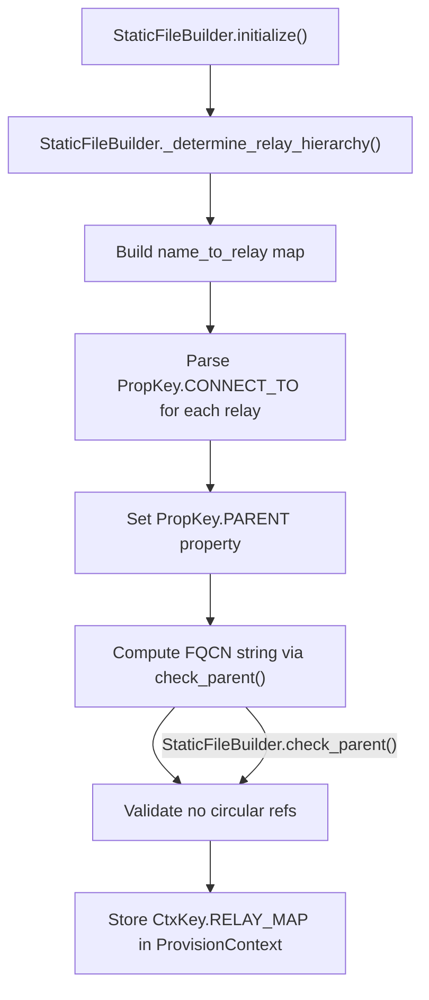
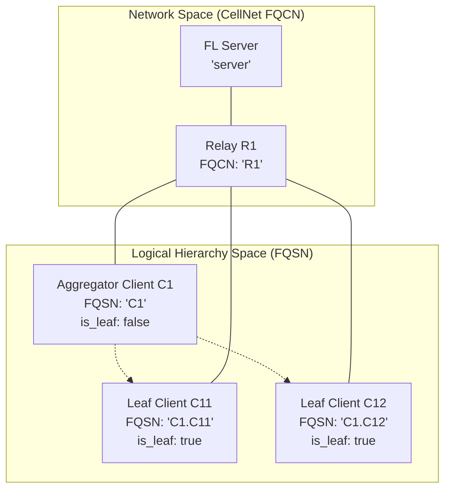
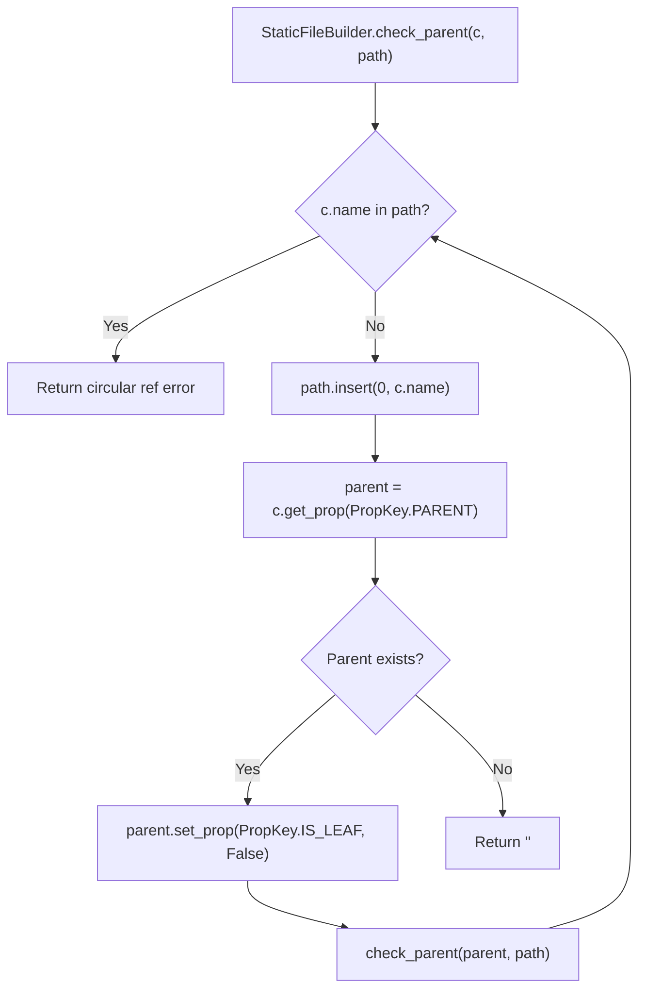
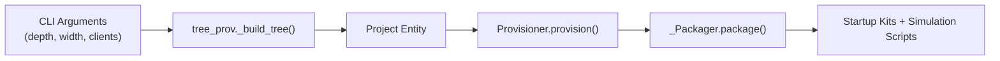

<!-- source: DeepWiki mcp.deepwiki.com · repo NVIDIA/NVFlare · page 10.5 Participant Hierarchies and Relays · fetched 2026-10-26 -->

# Participant Hierarchies and Relays

Relevant source files

The following files were used as context for generating this wiki page:

- [docs/user_guide/admin_guide/security/unsafe_component_detection.rst](docs/user_guide/admin_guide/security/unsafe_component_detection.rst)
- [docs/user_guide/nvflare_cli/provision_command.rst](docs/user_guide/nvflare_cli/provision_command.rst)
- [nvflare/apis/utils/format_check.py](nvflare/apis/utils/format_check.py)
- [nvflare/app_common/default_component_policy.py](nvflare/app_common/default_component_policy.py)
- [nvflare/app_common/widgets/component_path_authorizer.py](nvflare/app_common/widgets/component_path_authorizer.py)
- [nvflare/edge/simulation/README.md](nvflare/edge/simulation/README.md)
- [nvflare/fuel/f3/cellnet/cell_cipher.py](nvflare/fuel/f3/cellnet/cell_cipher.py)
- [nvflare/fuel/f3/cellnet/credential_manager.py](nvflare/fuel/f3/cellnet/credential_manager.py)
- [nvflare/fuel/hci/server/authz.py](nvflare/fuel/hci/server/authz.py)
- [nvflare/fuel/sec/admin_cert.py](nvflare/fuel/sec/admin_cert.py)
- [nvflare/fuel/sec/authz.py](nvflare/fuel/sec/authz.py)
- [nvflare/lighter/constants.py](nvflare/lighter/constants.py)
- [nvflare/lighter/ctx.py](nvflare/lighter/ctx.py)
- [nvflare/lighter/dummy_project.yml](nvflare/lighter/dummy_project.yml)
- [nvflare/lighter/edge_project.yml](nvflare/lighter/edge_project.yml)
- [nvflare/lighter/entity.py](nvflare/lighter/entity.py)
- [nvflare/lighter/impl/cert.py](nvflare/lighter/impl/cert.py)
- [nvflare/lighter/impl/docker.py](nvflare/lighter/impl/docker.py)
- [nvflare/lighter/impl/he.py](nvflare/lighter/impl/he.py)
- [nvflare/lighter/impl/signature.py](nvflare/lighter/impl/signature.py)
- [nvflare/lighter/impl/static_file.py](nvflare/lighter/impl/static_file.py)
- [nvflare/lighter/impl/workspace.py](nvflare/lighter/impl/workspace.py)
- [nvflare/lighter/provision.py](nvflare/lighter/provision.py)
- [nvflare/lighter/provisioner.py](nvflare/lighter/provisioner.py)
- [nvflare/lighter/spec.py](nvflare/lighter/spec.py)
- [nvflare/lighter/templates/master_template.yml](nvflare/lighter/templates/master_template.yml)
- [nvflare/lighter/tree_prov.py](nvflare/lighter/tree_prov.py)
- [nvflare/lighter/utils.py](nvflare/lighter/utils.py)
- [nvflare/private/fed/utils/app_authz.py](nvflare/private/fed/utils/app_authz.py)
- [nvflare/private/fed/utils/app_deployer.py](nvflare/private/fed/utils/app_deployer.py)
- [nvflare/private/fed/utils/site_config.py](nvflare/private/fed/utils/site_config.py)
- [nvflare/tool/verify_startup_kits.py](nvflare/tool/verify_startup_kits.py)
- [tests/unit_test/app_common/widgets/component_path_authorizer_test.py](tests/unit_test/app_common/widgets/component_path_authorizer_test.py)
- [tests/unit_test/fuel/flare_api_test.py](tests/unit_test/fuel/flare_api_test.py)
- [tests/unit_test/fuel/hci/server/authz_filter_test.py](tests/unit_test/fuel/hci/server/authz_filter_test.py)
- [tests/unit_test/fuel/sec/admin_cert_test.py](tests/unit_test/fuel/sec/admin_cert_test.py)
- [tests/unit_test/lighter/__init__.py](tests/unit_test/lighter/__init__.py)
- [tests/unit_test/lighter/cert_builder_test.py](tests/unit_test/lighter/cert_builder_test.py)
- [tests/unit_test/lighter/participant_test.py](tests/unit_test/lighter/participant_test.py)
- [tests/unit_test/lighter/project_test.py](tests/unit_test/lighter/project_test.py)
- [tests/unit_test/lighter/static_file_builder_test.py](tests/unit_test/lighter/static_file_builder_test.py)
- [tests/unit_test/lighter/utils_test.py](tests/unit_test/lighter/utils_test.py)
- [tests/unit_test/private/fed/utils/app_deployer_test.py](tests/unit_test/private/fed/utils/app_deployer_test.py)
- [tests/unit_test/private/fed/utils/site_config_test.py](tests/unit_test/private/fed/utils/site_config_test.py)

## Purpose and Scope

This document describes how NVIDIA FLARE supports hierarchical network topologies through **relays** and **participant hierarchies**. It covers:

- **Relay participants** that intermediate connections between the server and clients.
- **Client hierarchies** that enable hierarchical federated learning algorithms.
- **FQCN (Fully Qualified Cell Name)** and **FQSN (Fully Qualified Site Name)** computation.
- Configuration properties (`connect_to`, `listening_host`, `parent`) that define topologies.
- Provisioning-time hierarchy determination and validation via `StaticFileBuilder`.
- Automated tree provisioning for large-scale simulations using `tree_prov.py`.

For information about the general provisioning workflow, see [10.1](). For certificate generation, see [10.3](). For communication architecture, see [4]().

---

## Participant Types and Hierarchies

### Basic Participant Types

NVIDIA FLARE supports several participant types, defined in `nvflare/lighter/constants.py`: [nvflare/lighter/constants.py:24-30]()

| Participant Type | Purpose | Can Have Children |
|-----------------|---------|-------------------|
| `ParticipantType.SERVER` | FL server, orchestrates training | No |
| `ParticipantType.CLIENT` | Training site, executes tasks | Yes (in client hierarchy) |
| `ParticipantType.ADMIN` | Administrative console | No |
| `ParticipantType.RELAY` | Network relay, intermediates connections | Yes (other relays) |

### Why Hierarchies?

Hierarchical topologies serve two distinct purposes in the NVFlare ecosystem:

1. **Network Topology Control (Relays)**: Relays enable complex network architectures where clients cannot directly reach the server due to firewalls, NAT, or geographical distribution. Relays forward messages between the server and clients using the CellNet architecture. [nvflare/lighter/impl/static_file.py:585-610]()
2. **Hierarchical Federated Learning (Client Hierarchies)**: Algorithms organize clients into parent-child relationships. Non-leaf clients aggregate results from their children before sending them to the server. [nvflare/lighter/impl/static_file.py:781-800]()

---

## Relay Hierarchies

### Relay Overview

A **relay** is a participant that:
- Has a `listening_host` property, enabling it to accept incoming connections. [nvflare/lighter/constants.py:50-50]()
- Connects to either the server or another relay (via `connect_to`). [nvflare/lighter/constants.py:49-49]()
- Forwards messages between its parent and its children.
- Is identified by an **FQCN (Fully Qualified Cell Name)** that reflects its position in the network hierarchy. [nvflare/lighter/constants.py:77-77]()

### Relay Topology and FQCN Computation

**FQCN Computation**: Relays are organized hierarchically. The FQCN is constructed by concatenating relay names from the server down to the relay, separated by dots. [nvflare/lighter/impl/static_file.py:769-775]()

**Example**: If relay `R2` connects to relay `R1`, which connects to the server:
- `R1` FQCN: `"R1"`
- `R2` FQCN: `"R1.R2"`

**Relay Hierarchy Resolution**

**Sources**: [nvflare/lighter/impl/static_file.py:728-778](), [nvflare/lighter/impl/static_file.py:935-945](), [nvflare/lighter/constants.py:77-77]()

### Relay Configuration Properties

#### `connect_to` Property
The `connect_to` property specifies what a relay connects to. During provisioning, this is parsed to establish the parent-child relationship in the `RELAY_MAP`. [nvflare/lighter/impl/static_file.py:743-755]()

#### `listening_host` Property
The `listening_host` property enables a relay to accept connections. When defined, `StaticFileBuilder` generates an internal listener configuration. [nvflare/lighter/impl/static_file.py:197-210]()

When `listening_host` is present:
1. A **server certificate** is generated with host names in the SubjectAlternativeName. [nvflare/lighter/impl/cert.py:235-250]()
2. An **internal listener** is configured in `comm_config.json`. [nvflare/lighter/impl/static_file.py:215-227]()

**Sources**: [nvflare/lighter/constants.py:49-51](), [nvflare/lighter/impl/static_file.py:197-227](), [nvflare/lighter/impl/cert.py:235-276]()

---

## Client Hierarchies

### Client Hierarchy Overview

In addition to relays, **clients** can be organized hierarchically for logical aggregation. This is independent of relay hierarchies. [nvflare/lighter/impl/static_file.py:781-790]()

A client can be:
- A **leaf client** (`is_leaf=true`): Has no children, trains on local data. [nvflare/lighter/constants.py:79-79]()
- A **non-leaf client** (`is_leaf=false`): Has child clients, acts as an aggregator.

### FQSN (Fully Qualified Site Name)

Each client is identified by an **FQSN** reflecting its position in the client hierarchy. Similar to FQCN, it is constructed by concatenating client names from the root aggregator down to the leaf. [nvflare/lighter/impl/static_file.py:820-826]()

**Logical Client Hierarchy vs Network Topology**

**Note**: Dotted lines in the logical space represent the `parent` property. In the network space, all participants connect via the relay to the server. [nvflare/lighter/impl/static_file.py:334-350]()

---

## Provisioning Implementation Details

### FQCN and FQSN Computation Algorithm

Both relay FQCNs and client FQSNs are computed using the recursive `StaticFileBuilder.check_parent()` function. [nvflare/lighter/impl/static_file.py:935-945]()

**check_parent recursive logic**

**Sources**: [nvflare/lighter/impl/static_file.py:935-945](), [nvflare/lighter/impl/static_file.py:769-775](), [nvflare/lighter/impl/static_file.py:820-826]()

### Communication Configuration Generation

For participants accepting connections, a `comm_config.json` is generated via `StaticFileBuilder._build_comm_config()`. [nvflare/lighter/impl/static_file.py:841-866]()

**Backbone Connection Generation**: The `backbone_conn_gen` parameter in `comm_config.json` (mapped from `CommConfigArg.CONN_GEN`) controls how participants connect to the CellNet backbone. [nvflare/lighter/impl/static_file.py:851-851](), [nvflare/lighter/constants.py:205-205]()

| Value | Meaning | Applied To |
|-------|---------|------------|
| 2 | Connect to server backbone | Direct leaf clients, server |
| 1 | Do not connect to server backbone | Relays, clients connecting via relays |

**Sources**: [nvflare/lighter/impl/static_file.py:593-596](), [nvflare/lighter/impl/static_file.py:402-405](), [nvflare/lighter/impl/static_file.py:851-851]()

---

## Automated Hierarchical Provisioning

### Tree Provisioning Tool

The `tree_prov.py` script automatically generates hierarchical relay and client topologies for large-scale simulations. [nvflare/lighter/tree_prov.py:15-18]()

**Key Parameters**: [nvflare/lighter/tree_prov.py:36-45]()
- `depth`: Depth of relay tree.
- `width`: Number of children per relay node.
- `clients`: Number of leaf clients per leaf relay.
- `lcp_only`: If true, only generate leaf clients (no logical client hierarchy).

**Topology Generation**: The `hierachical_provision` function in `tree_prov.py` coordinates the generation of the relay and client structures, populating a `Project` object with `Participant` entities and invoking the `Provisioner`. [nvflare/lighter/tree_prov.py:145-238]()

**Tree Provisioning Workflow**

**Sources**: [nvflare/lighter/tree_prov.py:145-238](), [nvflare/lighter/provision.py:29-30](), [nvflare/lighter/provisioner.py:38-50](), [nvflare/lighter/tree_prov.py:90-143]()

---

## Summary Table: Configuration Artifacts

| Artifact | File Name | Generated For | Key Contents |
|----------|-----------|---------------|--------------|
| **Relay Config** | `fed_relay.json` | Relays | `fqcn`, `parent_identity`, `address` [nvflare/lighter/impl/static_file.py:615-630]() |
| **Relay Resource** | `relay__resources.json` | Clients via Relays | Relay address and `fqcn` [nvflare/lighter/impl/static_file.py:380-400]() |
| **Client Config** | `fed_client.json` | Clients | `fqsn`, `is_leaf` [nvflare/lighter/impl/static_file.py:340-360]() |
| **Comm Config** | `comm_config.json` | All with Listeners | `backbone_conn_gen`, `internal` listener [nvflare/lighter/impl/static_file.py:841-860]() |

**Sources**: [nvflare/lighter/impl/static_file.py:1-945](), [nvflare/lighter/constants.py:1-230]()

---

