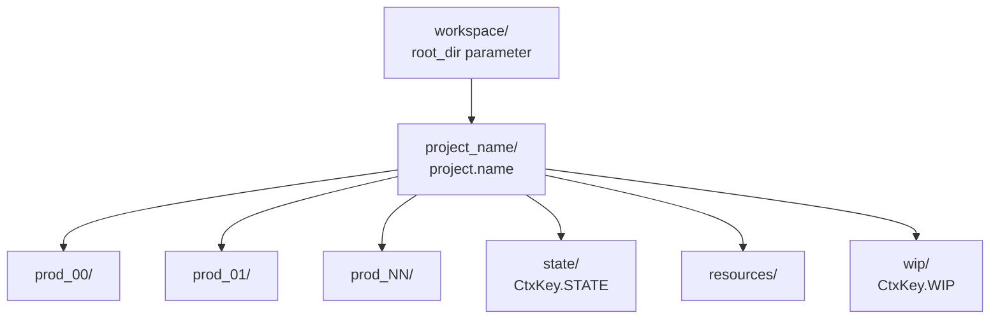
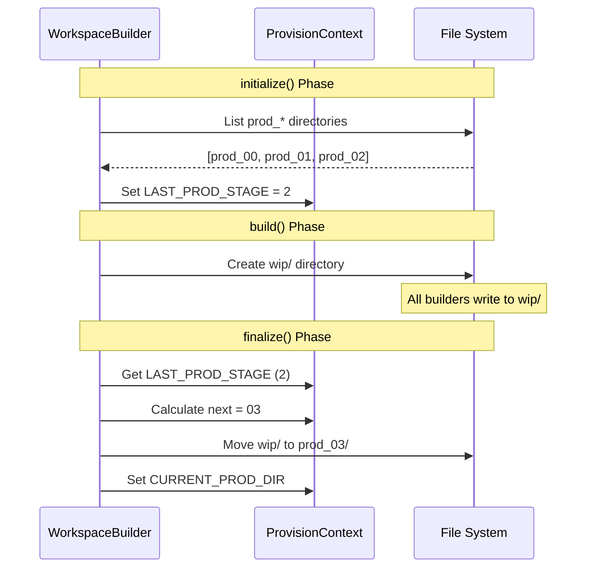
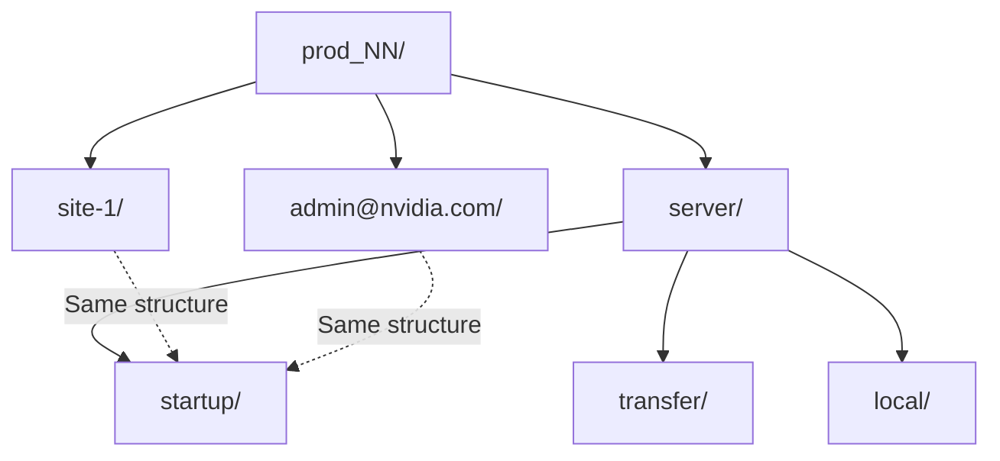
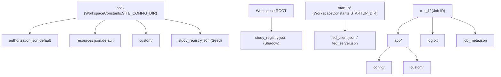

<!-- source: DeepWiki mcp.deepwiki.com · repo NVIDIA/NVFlare · page 10.6 Workspace Structure · fetched 2026-10-26 -->

# Workspace Structure

Relevant source files

The following files were used as context for generating this wiki page:

- [docs/design/multistudy_cli.md](docs/design/multistudy_cli.md)
- [docs/user_guide/admin_guide/multi_study_guide.rst](docs/user_guide/admin_guide/multi_study_guide.rst)
- [docs/user_guide/admin_guide/security/unsafe_component_detection.rst](docs/user_guide/admin_guide/security/unsafe_component_detection.rst)
- [docs/user_guide/nvflare_cli/provision_command.rst](docs/user_guide/nvflare_cli/provision_command.rst)
- [nvflare/apis/utils/format_check.py](nvflare/apis/utils/format_check.py)
- [nvflare/apis/workspace.py](nvflare/apis/workspace.py)
- [nvflare/app_common/default_component_policy.py](nvflare/app_common/default_component_policy.py)
- [nvflare/app_common/widgets/component_path_authorizer.py](nvflare/app_common/widgets/component_path_authorizer.py)
- [nvflare/edge/simulation/README.md](nvflare/edge/simulation/README.md)
- [nvflare/fuel/hci/server/authz.py](nvflare/fuel/hci/server/authz.py)
- [nvflare/fuel/sec/authz.py](nvflare/fuel/sec/authz.py)
- [nvflare/lighter/constants.py](nvflare/lighter/constants.py)
- [nvflare/lighter/ctx.py](nvflare/lighter/ctx.py)
- [nvflare/lighter/dummy_project.yml](nvflare/lighter/dummy_project.yml)
- [nvflare/lighter/edge_project.yml](nvflare/lighter/edge_project.yml)
- [nvflare/lighter/entity.py](nvflare/lighter/entity.py)
- [nvflare/lighter/impl/cert.py](nvflare/lighter/impl/cert.py)
- [nvflare/lighter/impl/docker.py](nvflare/lighter/impl/docker.py)
- [nvflare/lighter/impl/static_file.py](nvflare/lighter/impl/static_file.py)
- [nvflare/lighter/provision.py](nvflare/lighter/provision.py)
- [nvflare/lighter/provisioner.py](nvflare/lighter/provisioner.py)
- [nvflare/lighter/templates/master_template.yml](nvflare/lighter/templates/master_template.yml)
- [nvflare/lighter/tree_prov.py](nvflare/lighter/tree_prov.py)
- [nvflare/private/fed/server/study_cmds.py](nvflare/private/fed/server/study_cmds.py)
- [nvflare/private/fed/utils/site_config.py](nvflare/private/fed/utils/site_config.py)
- [tests/unit_test/apis/workspace_test.py](tests/unit_test/apis/workspace_test.py)
- [tests/unit_test/app_common/widgets/component_path_authorizer_test.py](tests/unit_test/app_common/widgets/component_path_authorizer_test.py)
- [tests/unit_test/fuel/flare_api_test.py](tests/unit_test/fuel/flare_api_test.py)
- [tests/unit_test/fuel/hci/server/authz_filter_test.py](tests/unit_test/fuel/hci/server/authz_filter_test.py)
- [tests/unit_test/lighter/__init__.py](tests/unit_test/lighter/__init__.py)
- [tests/unit_test/lighter/cert_builder_test.py](tests/unit_test/lighter/cert_builder_test.py)
- [tests/unit_test/lighter/participant_test.py](tests/unit_test/lighter/participant_test.py)
- [tests/unit_test/lighter/project_test.py](tests/unit_test/lighter/project_test.py)
- [tests/unit_test/lighter/static_file_builder_test.py](tests/unit_test/lighter/static_file_builder_test.py)
- [tests/unit_test/private/fed/server/study_cmds_test.py](tests/unit_test/private/fed/server/study_cmds_test.py)
- [tests/unit_test/private/fed/test_fed_utils.py](tests/unit_test/private/fed/test_fed_utils.py)
- [tests/unit_test/private/fed/utils/site_config_test.py](tests/unit_test/private/fed/utils/site_config_test.py)

## Purpose and Scope

This page documents the directory structure created by the NVIDIA FLARE provisioning system and the runtime workspace organization. The workspace serves as both a build environment for generating startup kits and a storage location for persistent state, application data, and execution logs.

For information about the provisioning workflow and builder pattern, see [10.1 Provisioning Overview and Workflow]() and [10.2 Builder Pattern and Components](). For details on the certificates and configuration files generated within this workspace, see [10.3 Certificate and PKI Management]() and [10.4 Configuration File Generation]().

## Workspace Root Organization

The provisioning system creates a hierarchical workspace directory structure under a root location specified by the `-w` or `--workspace` option [[nvflare/lighter/provision.py:179-179]](). Each project gets its own subdirectory named after the project [[nvflare/lighter/impl/workspace.py:38-39]]().

**Workspace Directory Hierarchy with Code Constants**

Sources: [[nvflare/lighter/impl/workspace.py:23-48]](), [[nvflare/lighter/constants.py:17-22]]()

The `WorkspaceBuilder` [[nvflare/lighter/impl/workspace.py:23-23]]() class manages this structure through `ProvisionContext`, which provides constants via `CtxKey` [[nvflare/lighter/constants.py:84-84]]():

| Directory | Purpose | Persistence | Created By | Context Key |
|-----------|---------|-------------|------------|-------------|
| `prod_NN/` | Versioned production output | Permanent | `WorkspaceBuilder.finalize()` | `CtxKey.CURRENT_PROD_DIR` |
| `state/` | Certificates, persistent data | Permanent | `ProvisionContext` | `CtxKey.STATE` |
| `resources/` | Optional resource files | Permanent | User/custom builders | N/A |
| `wip/` | Temporary build directory | Deleted after build | `WorkspaceBuilder` | `CtxKey.WIP` |

Sources: [[nvflare/lighter/impl/workspace.py:23-48]](), [[nvflare/lighter/impl/workspace.py:75-86]](), [[nvflare/lighter/constants.py:17-22]]()

## Production Directory Versioning

Each successful provisioning run creates a new `prod_NN` directory with an incrementing number (00-99). This versioning system allows multiple provision runs without overwriting previous results [[nvflare/lighter/impl/workspace.py:29-30]]().

**Production Directory Versioning Process**

Sources: [[nvflare/lighter/impl/workspace.py:51-86]]()

The versioning logic is implemented in `WorkspaceBuilder`:

- **Initialization**: Scans existing `prod_*` directories in the workspace and stores the highest number in `ctx[CtxKey.LAST_PROD_STAGE]` [[nvflare/lighter/impl/workspace.py:56-62]]().
- **Building**: All builders write to the `wip/` directory during the build phase via paths derived from the context [[nvflare/lighter/impl/workspace.py:64-73]]().
- **Finalization**: On successful completion, `wip/` is moved and renamed to `prod_{next_number}/` [[nvflare/lighter/impl/workspace.py:80-82]]().
- **Limit**: Maximum of 100 provision runs (prod_00 through prod_99). If the limit is reached, the user is prompted to clean up the workspace [[nvflare/lighter/impl/workspace.py:76-78]]().

Sources: [[nvflare/lighter/impl/workspace.py:56-62]](), [[nvflare/lighter/impl/workspace.py:75-85]]()

## Participant Directory Structure

Each provisioned participant (server, client, or admin) receives a dedicated directory within a production folder [[nvflare/lighter/impl/workspace.py:64-73]]().

**Participant Directory Organization**

Sources: [[nvflare/lighter/impl/workspace.py:64-73]](), [[nvflare/apis/workspace.py:28-50]]()

### Startup Directory (`startup/`)

The startup directory contains all files needed to launch the participant. Builders access this via `ProvisionContext.get_kit_dir(participant)` [[nvflare/lighter/impl/workspace.py:66-67]]().

**Key Files in Startup Directory:**

| File | Purpose | Builder | Constant |
|------|---------|---------|----------|
| `fed_server.json` | Server configuration | `StaticFileBuilder` | `ProvFileName.FED_SERVER_JSON` |
| `fed_client.json` | Client configuration | `StaticFileBuilder` | `ProvFileName.FED_CLIENT_JSON` |
| `rootCA.pem` | Root CA certificate | `CertBuilder` | N/A |
| `signature.json` | File signatures | `SignatureBuilder` | `ProvFileName.SIGNATURE_JSON` |
| `start.sh` | Entry point script | `StaticFileBuilder` | `ProvFileName.START_SH` |

Sources: [[nvflare/lighter/impl/workspace.py:73-73]](), [[nvflare/lighter/impl/static_file.py:38-38]](), [[nvflare/lighter/constants.py:160-194]](), [[nvflare/apis/workspace.py:173-178]]()

## Runtime Workspace Structure

Once a participant is started, the `Workspace` class [[nvflare/apis/workspace.py:22-22]]() manages the runtime file organization. This includes directories for job execution and site-specific configurations.

**Runtime Workspace Entity Mapping**

Sources: [[nvflare/apis/workspace.py:23-50]](), [[nvflare/apis/workspace.py:160-171]](), [[nvflare/apis/fl_constant.py:18-18]]()

### Key Runtime Components

- **`local/`**: Contains site-specific overrides and authorization policies [[nvflare/apis/workspace.py:70-75]]().
- **`run_<job_id>/`**: A dedicated directory for each job. It contains the application package and execution artifacts [[nvflare/apis/workspace.py:40-49]]().
- **`startup/`**: The provisioned startup kit. This folder must exist for the workspace to be valid [[nvflare/apis/workspace.py:64-68]]().
- **Study Registry**: Multi-study support uses a dual-path registry. A provisioned `study_registry.json` seeds the system from `local/`, but runtime mutations are persisted to the workspace root to support read-only `local/` mounts [[nvflare/apis/workspace.py:160-171]]().
- **Resource Management**: The `resources.json.default` file in `local/` defines the `class_allow_list` for component authorization [[nvflare/lighter/templates/master_template.yml:66-71]](), [[docs/user_guide/admin_guide/security/unsafe_component_detection.rst:74-80]]().

## State and Persistence

The `state/` directory stores persistent information preserved across multiple provisioning runs [[nvflare/lighter/impl/workspace.py:43-43]]().

- **Certificates**: `CertBuilder` uses this directory to store CA and participant certificate state in `cert.json`, allowing incremental provisioning without re-issuing all credentials [[nvflare/lighter/impl/cert.py:36-48]]().
- **Incremental Provisioning**: `WorkspaceBuilder` reloads the last production stage from the workspace during `initialize` to maintain the versioning sequence [[nvflare/lighter/impl/workspace.py:55-62]]().

Sources: [[nvflare/lighter/impl/workspace.py:55-62]](), [[nvflare/lighter/impl/workspace.py:43-43]](), [[nvflare/lighter/impl/cert.py:34-97]]()

## Security and Signature Verification

The workspace structure supports cryptographic verification to prevent tampering.

- **`signature.json`**: Generated by `SignatureBuilder`. It contains signatures for configuration files and binary artifacts to ensure integrity [[nvflare/lighter/constants.py:178-178]](), [[nvflare/lighter/templates/master_template.yml:57-57]]().
- **Component Authorization**: The `class_allow_list` in `resources.json.default` restricts which Python classes can be instantiated as components (executors, filters, etc.) [[nvflare/app_common/default_component_policy.py:20-20]](), [[docs/user_guide/admin_guide/security/unsafe_component_detection.rst:74-94]]().
- **Unsafe Component Detection**: The system fires `BEFORE_BUILD_COMPONENT` events to allow `FLComponent` objects to inspect configurations before instantiation [[docs/user_guide/admin_guide/security/unsafe_component_detection.rst:14-18]]().

Sources: [[nvflare/lighter/constants.py:178-178]](), [[docs/user_guide/admin_guide/security/unsafe_component_detection.rst:14-94]]()

---

