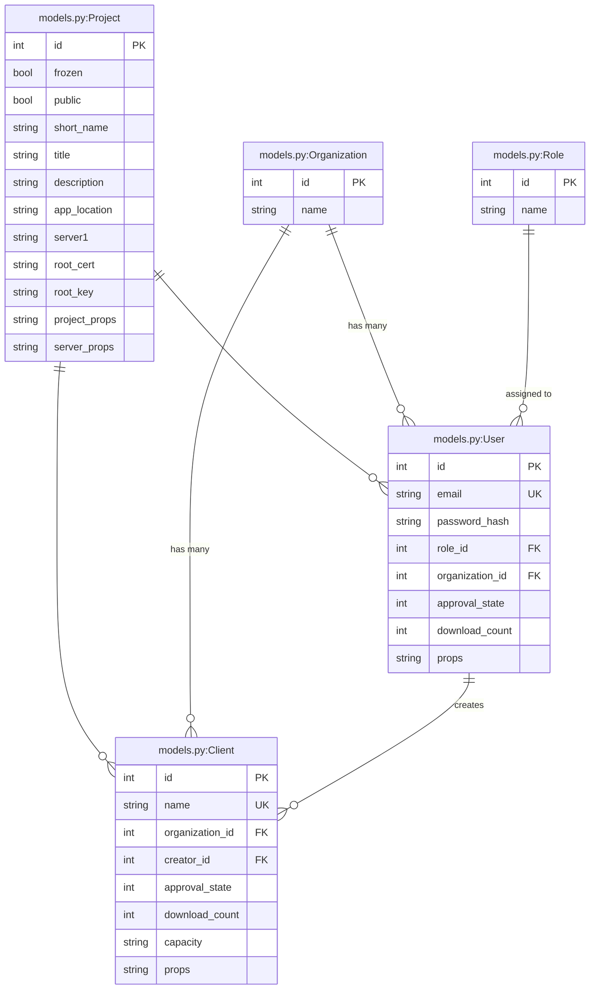
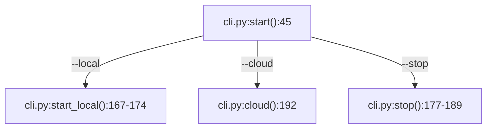

<!-- source: DeepWiki mcp.deepwiki.com · repo NVIDIA/NVFlare · page 11 Dashboard · fetched 2026-10-26 -->

# Dashboard

Relevant source files

The following files were used as context for generating this wiki page:

- [nvflare/dashboard/application/__init__.py](nvflare/dashboard/application/__init__.py)
- [nvflare/dashboard/application/blob.py](nvflare/dashboard/application/blob.py)
- [nvflare/dashboard/application/cert.py](nvflare/dashboard/application/cert.py)
- [nvflare/dashboard/application/clients.py](nvflare/dashboard/application/clients.py)
- [nvflare/dashboard/application/models.py](nvflare/dashboard/application/models.py)
- [nvflare/dashboard/application/project.py](nvflare/dashboard/application/project.py)
- [nvflare/dashboard/application/store.py](nvflare/dashboard/application/store.py)
- [nvflare/dashboard/application/users.py](nvflare/dashboard/application/users.py)
- [nvflare/dashboard/cli.py](nvflare/dashboard/cli.py)
- [nvflare/dashboard/config.py](nvflare/dashboard/config.py)
- [nvflare/dashboard/dashboard.yaml](nvflare/dashboard/dashboard.yaml)
- [nvflare/dashboard/utils.py](nvflare/dashboard/utils.py)
- [nvflare/dashboard/wsgi.py](nvflare/dashboard/wsgi.py)
- [nvflare/lighter/templates/aws_template.yml](nvflare/lighter/templates/aws_template.yml)
- [nvflare/lighter/templates/azure_template.yml](nvflare/lighter/templates/azure_template.yml)

The Dashboard is a Flask web application for federated learning project management and dynamic provisioning. It provides a web UI and REST API for participant registration, project configuration, and on-demand generation of password-protected startup kits.

## Overview

The Dashboard serves as a centralized management interface for FL projects with four primary functions:

1.  **Project Configuration**: Define project metadata, server settings, and root CA generation via `Store.set_project()` [nvflare/dashboard/application/store.py:122-154]() and `Store.build_project()` [nvflare/dashboard/application/store.py:105-112]().
2.  **Participant Registration**: Register clients and admin users through REST APIs backed by `Store.create_client()` [nvflare/dashboard/application/store.py:179-203]() and `Store.create_user()` [nvflare/dashboard/application/store.py:252-282]().
3.  **Startup Kit Generation**: Generate signed, password-protected startup kits on-demand through `_gen_kit()` [nvflare/dashboard/application/blob.py:81-147]() integration with the provisioning system.
4.  **Deployment Management**: Deploy Dashboard via Docker or cloud (AWS/Azure) using `nvflare.dashboard.cli` [nvflare/dashboard/cli.py:45-140]().

Data persists in SQLite by default [nvflare/dashboard/config.py:33-35](). Root CA private keys are managed via `deserialize_ca_key` [nvflare/dashboard/application/blob.py:100]() using the `DASHBOARD_PP` passphrase [nvflare/dashboard/application/cert.py:24-28](). The system supports three deployment modes: local development (`start_local()`), Docker container, and cloud provisioning.

**Sources**: [nvflare/dashboard/application/__init__.py:27-54](), [nvflare/dashboard/application/store.py:105-203](), [nvflare/dashboard/application/blob.py:81-147](), [nvflare/dashboard/cli.py:45-174](), [nvflare/dashboard/application/cert.py:24-28]()

## Dashboard Architecture

The Dashboard follows a layered architecture with Flask routes handling HTTP requests, the `Store` class implementing business logic, SQLAlchemy ORM models managing persistence, and integration with the `Provisioner` for startup kit generation.

#### Dashboard Component Architecture and Code Mapping

```mermaid
graph TB
    subgraph "Entry Points"
        CLIMain["cli.py:start():45-140"]
        DockerEntry["wsgi.py:app"]
    end
    
    subgraph "Flask Application Layer"
        InitApp["__init__.py:init_app():27-54"]
        DB["SQLAlchemy db instance:23"]
        JWT["JWTManager jwt instance:24"]
    end
    
    subgraph "REST API Routes"
        LoginRoute["project.py:login():87-109"]
        SetProjectRoute["project.py:set_project():126-134"]
        ServerBlobRoute["project.py:server_blob():111-124"]
        CreateClientRoute["clients.py:create_one_client():25-34"]
        UpdateClientRoute["clients.py:update_client():57-80"]
        ClientBlobRoute["clients.py:client_blob():83-98"]
    end
    
    subgraph "Data Access Layer"
        StoreClass["store.py:Store"]
        CreateClientMethod["Store.create_client():179-203"]
        SetProjectMethod["Store.set_project():122-154"]
        BuildProjectMethod["Store.build_project():105-112"]
        VerifyUserMethod["Store.verify_user():312-318"]
    end
    
    subgraph "Startup Kit Generation"
        GenKit["blob.py:_gen_kit():81-147"]
        GenServerBlob["blob.py:gen_server_blob():77-78"]
        GenClientBlob["blob.py:gen_client_blob():150-151"]
        GenUserBlob["blob.py:gen_user_blob():172-173"]
        GetProvisioner["blob.py:_get_provisioner():56-74"]
    end
    
    subgraph "Certificate Management"
        MakeRootCert["store.py:make_root_cert():107"]
        DeserializeKey["blob.py:deserialize_ca_key():100"]
    end
    
    subgraph "ORM Models"
        ProjectModel["models.py:Project:49-75"]
        ClientModel["models.py:Client:78-97"]
        UserModel["models.py:User:100-116"]
        OrgModel["models.py:Organization:32-34"]
        RoleModel["models.py:Role:37-38"]
    end
    
    subgraph "External Dependencies"
        ProvisionerClass["lighter.provisioner.Provisioner"]
        Builders["WorkspaceBuilder, StaticFileBuilder,<br/>CertBuilder, SignatureBuilder"]
    end
    
    CLIMain --> InitApp
    DockerEntry --> InitApp
    InitApp --> DB
    InitApp --> JWT
    
    LoginRoute --> VerifyUserMethod
    SetProjectRoute --> SetProjectMethod
    ServerBlobRoute --> GenServerBlob
    CreateClientRoute --> CreateClientMethod
    UpdateClientRoute --> StoreClass
    ClientBlobRoute --> GenClientBlob
    
    GenServerBlob --> GenKit
    GenClientBlob --> GenKit
    GenUserBlob --> GenKit
    GenKit --> GetProvisioner
    GetProvisioner --> Builders
    Builders --> ProvisionerClass
    
    SetProjectMethod --> BuildProjectMethod
    BuildProjectMethod --> MakeRootCert
    GenKit --> DeserializeKey
    
    StoreClass --> ProjectModel
    StoreClass --> ClientModel
    StoreClass --> UserModel
    StoreClass --> OrgModel
    StoreClass --> RoleModel
    
    ProjectModel --> DB
    ClientModel --> DB
    UserModel --> DB
```

This architecture maps HTTP requests through Flask routes to `Store` methods. Startup kit generation routes (`server_blob()`, `client_blob()`) invoke `_gen_kit()`, which creates a temporary `Provisioner` instance with builders (`WorkspaceBuilder`, `StaticFileBuilder`, `AWSBuilder`, `AzureBuilder`, `CertBuilder`, `SignatureBuilder`) to generate signed packages [nvflare/dashboard/application/blob.py:56-74]().

For details, see [Dashboard Architecture](#11.1).

**Sources**: [nvflare/dashboard/application/__init__.py:27-54](), [nvflare/dashboard/application/store.py:122-203](), [nvflare/dashboard/application/blob.py:56-147](), [nvflare/dashboard/application/models.py:32-116]()

### Flask Application Structure

The Flask application is initialized in `init_app()` [nvflare/dashboard/application/__init__.py:27-54]() and consists of route modules for projects, clients, and users.

| Route Module | File | Endpoints | Purpose |
| :--- | :--- | :--- | :--- |
| `project` | `nvflare/dashboard/application/project.py` | `/login`, `/project`, `/servers/{id}/blob` | Login, project config, server kit download [project.py:87-123]() |
| `clients` | `nvflare/dashboard/application/clients.py` | `/clients`, `/clients/{id}`, `/clients/{id}/blob` | Client registration and kit download [clients.py:25-98]() |
| `users` | `nvflare/dashboard/application/users.py` | `/users`, `/users/{id}`, `/users/{id}/blob` | Admin user registration and kit download [users.py:25-92]() |

**Sources**: [nvflare/dashboard/application/project.py:87-123](), [nvflare/dashboard/application/clients.py:25-98](), [nvflare/dashboard/application/users.py:25-92]()

## Project and User Management

The `Store` class provides a data access layer with business logic for CRUD operations on all entities, including projects, users, clients, and organizations.

### Database Schema and Models

The Dashboard uses SQLAlchemy ORM with five primary entity types:

**Sources**: [nvflare/dashboard/application/models.py:32-116]()

### JWT Authentication Flow

The Dashboard implements JWT-based authentication. The login flow verifies credentials via `Store.verify_user()` [nvflare/dashboard/application/store.py:312-318]() and returns an access token containing role, organization, and approval claims [nvflare/dashboard/application/project.py:94-99]().

For details, see [Project and User Management](#11.2).

**Sources**: [nvflare/dashboard/application/project.py:87-109](), [nvflare/dashboard/application/store.py:312-318](), [nvflare/dashboard/application/models.py:100-116]()

## Startup Kit Generation via Dashboard

The Dashboard generates startup kits on-demand through the `_gen_kit()` function [nvflare/dashboard/application/blob.py:81-147](). This function integrates with the `Provisioner` to create password-protected ZIP files containing certificates, configuration files, and startup scripts.

### Blob Generation Functions

Three wrapper functions call `_gen_kit()` with entity-specific callbacks:

| Function | Location | Callback | Purpose |
| :--- | :--- | :--- | :--- |
| `gen_server_blob(key)` | [blob.py:77-78]() | None | Server cert, `fed_server.json`, `start.sh` |
| `gen_client_blob(key, id)` | [blob.py:150-151]() | `_prepare_client()` | Client cert, `fed_client.json`, capacity props |
| `gen_user_blob(key, id)` | [blob.py:172-173]() | `_prepare_user()` | Admin cert with role, console config |

For details, see [Startup Kit Generation via Dashboard](#11.3).

**Sources**: [nvflare/dashboard/application/blob.py:77-189](), [nvflare/dashboard/application/store.py:64-69]()

## Dashboard Deployment

The Dashboard CLI in `nvflare/dashboard/cli.py` supports multiple deployment strategies.

### CLI Command Routing

### Deployment Modes
*   **Docker**: The `start()` function pulls the `nvflare/nvflare` image and runs the container with persistent volume mounting for the database [nvflare/dashboard/cli.py:92-140]().
*   **Local**: `start_local()` runs the Flask app directly for development using `nvflare/dashboard/wsgi.py` [nvflare/dashboard/cli.py:167-174]().
*   **Cloud**: `cloud()` generates and executes scripts for AWS or Azure deployment using templates like `aws_template.yml` [nvflare/lighter/templates/aws_template.yml:1]() and `azure_template.yml` [nvflare/lighter/templates/azure_template.yml:1]().

For details, see [Dashboard Deployment](#11.4).

**Sources**: [nvflare/dashboard/cli.py:45-192](), [nvflare/dashboard/application/__init__.py:27-54](), [nvflare/dashboard/config.py:32-35](), [nvflare/lighter/templates/aws_template.yml:1-181](), [nvflare/lighter/templates/azure_template.yml:1-219]()

---

