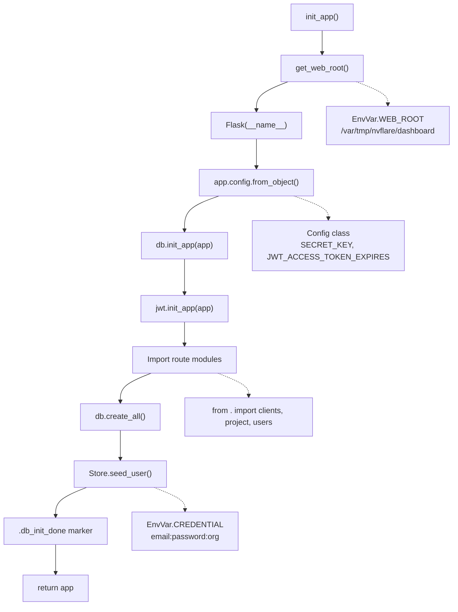
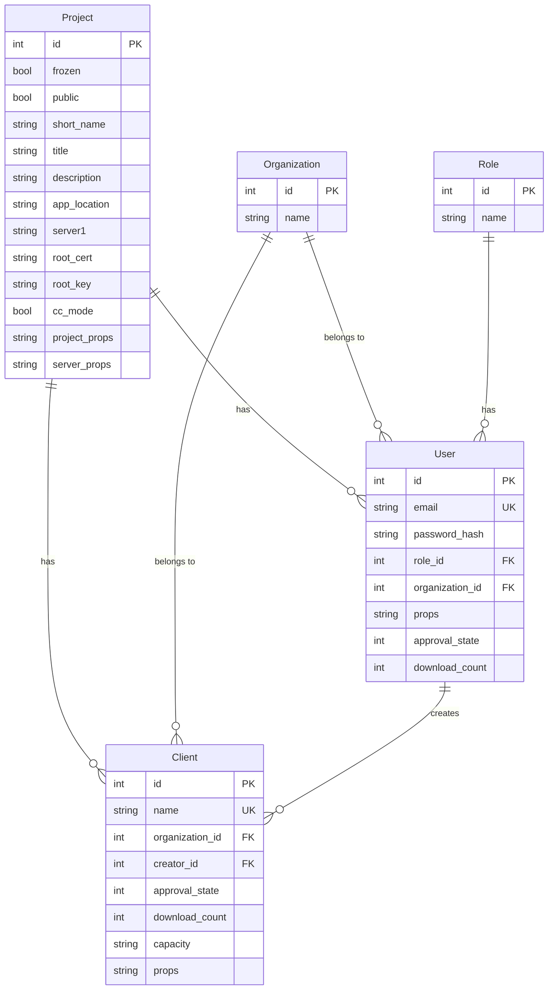
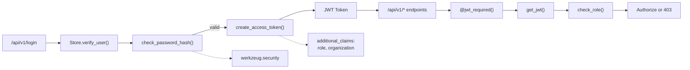
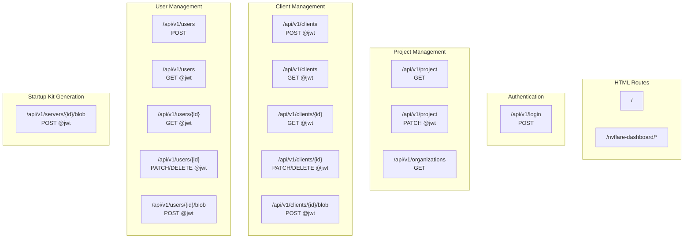
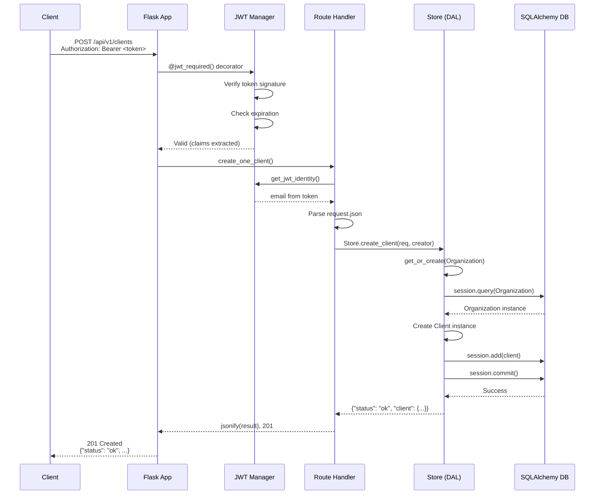
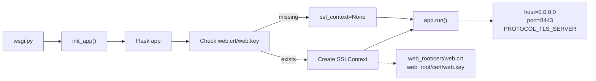

<!-- source: DeepWiki mcp.deepwiki.com · repo NVIDIA/NVFlare · page 11.1 Dashboard Architecture · fetched 2026-10-26 -->

# Dashboard Architecture

<details>
<summary>Relevant source files</summary>

The following files were used as context for generating this wiki page:

- [nvflare/dashboard/application/__init__.py](nvflare/dashboard/application/__init__.py)
- [nvflare/dashboard/application/blob.py](nvflare/dashboard/application/blob.py)
- [nvflare/dashboard/application/cert.py](nvflare/dashboard/application/cert.py)
- [nvflare/dashboard/application/clients.py](nvflare/dashboard/application/clients.py)
- [nvflare/dashboard/application/models.py](nvflare/dashboard/application/models.py)
- [nvflare/dashboard/application/project.py](nvflare/dashboard/application/project.py)
- [nvflare/dashboard/application/store.py](nvflare/dashboard/application/store.py)
- [nvflare/dashboard/application/users.py](nvflare/dashboard/application/users.py)
- [nvflare/dashboard/cli.py](nvflare/dashboard/cli.py)
- [nvflare/dashboard/config.py](nvflare/dashboard/config.py)
- [nvflare/dashboard/dashboard.yaml](nvflare/dashboard/dashboard.yaml)
- [nvflare/dashboard/utils.py](nvflare/dashboard/utils.py)
- [nvflare/dashboard/wsgi.py](nvflare/dashboard/wsgi.py)
- [nvflare/lighter/templates/aws_template.yml](nvflare/lighter/templates/aws_template.yml)
- [nvflare/lighter/templates/azure_template.yml](nvflare/lighter/templates/azure_template.yml)

</details>


## Purpose and Scope

This document describes the technical architecture of the NVIDIA FLARE Dashboard web application, including its Flask-based structure, JWT authentication system, SQLAlchemy ORM integration, and RESTful API organization. The Dashboard provides a web interface for managing federated learning projects, registering participants, and generating startup kits via the `Provisioner`.

For information about project and user management workflows, see [Project and User Management](#11.2). For details on startup kit generation, see [Startup Kit Generation via Dashboard](#11.3). For deployment instructions, see [Dashboard Deployment](#11.4).

## Technology Stack

The Dashboard is built on the following core technologies:

| Technology | Purpose | Configuration |
|------------|---------|---------------|
| **Flask** | Web application framework | Standard Flask patterns [nvflare/dashboard/application/__init__.py:17-31]() |
| **Flask-SQLAlchemy** | Database ORM | SQLite by default, configurable via `DATABASE_URL` [nvflare/dashboard/config.py:33-35]() |
| **Flask-JWT-Extended** | JWT-based authentication | 30-minute token expiration [nvflare/dashboard/config.py:29]() |
| **Werkzeug** | Password hashing | PBKDF2 for password storage [nvflare/dashboard/application/store.py:18]() |
| **Docker** | Containerization | Managed via `docker-py` in CLI [nvflare/dashboard/cli.py:93-127]() |

The application follows a standard Flask application factory pattern with route organization registered directly on the app object within the application context.

Sources: [nvflare/dashboard/application/__init__.py:17-34](), [nvflare/dashboard/config.py:26-38](), [nvflare/dashboard/cli.py:93-127]()

## Application Structure

The Dashboard codebase is organized into a hierarchical module structure:

```
nvflare/dashboard/
├── application/
│   ├── __init__.py       # Flask app factory
│   ├── models.py         # SQLAlchemy models
│   ├── store.py          # Data access layer (Store class)
│   ├── project.py        # Project API endpoints
│   ├── clients.py        # Client API endpoints
│   ├── users.py          # User API endpoints
│   ├── blob.py           # Startup kit generation (Provisioner integration)
│   ├── cert.py           # Certificate operations
│   └── constants.py      # Constants
├── cli.py                # Command-line interface
├── config.py             # Configuration classes
├── wsgi.py               # WSGI entry point
├── utils.py              # Utility functions
└── dashboard.yaml        # OpenAPI specification
```

**Module Responsibilities:**

- **`application/__init__.py`**: Flask app initialization, database setup, JWT configuration [nvflare/dashboard/application/__init__.py:27-54]().
- **`models.py`**: SQLAlchemy ORM models (`Project`, `Organization`, `Role`, `Client`, `User`) [nvflare/dashboard/application/models.py:21-119]().
- **`store.py`**: Database operations abstraction layer (`Store` class) [nvflare/dashboard/application/store.py:71-235]().
- **`project.py`/`clients.py`/`users.py`**: RESTful API route handlers [nvflare/dashboard/application/project.py:32-150]().
- **`blob.py`**: Integration with `nvflare.lighter.provisioner.Provisioner` for generating ZIP startup kits [nvflare/dashboard/application/blob.py:56-154]().
- **`cert.py`**: PKI certificate generation and serialization for the root CA [nvflare/dashboard/application/cert.py:30-64]().

Sources: [nvflare/dashboard/application/__init__.py:1-54](), [nvflare/dashboard/application/blob.py:31-34]()

## Flask Application Initialization

The Dashboard uses the application factory pattern in `init_app()`:

Title: Flask App Initialization Flow


**Initialization Sequence:**

1. **Determine web root**: Uses environment variable `NVFL_WEB_ROOT` or defaults via `get_web_root()` [nvflare/dashboard/application/__init__.py:28-29]().
2. **Create Flask instance**: Configures static folder from `NVFL_DASHBOARD_STATIC_FOLDER` [nvflare/dashboard/application/__init__.py:30-31]().
3. **Load configuration**: Applies settings from `Config` class [nvflare/dashboard/config.py:26-38]().
4. **Initialize extensions**: Sets up SQLAlchemy (`db`) and JWT (`jwt`) managers [nvflare/dashboard/application/__init__.py:33-34]().
5. **Register routes**: Imports `clients`, `project`, `users` modules within the app context [nvflare/dashboard/application/__init__.py:36]().
6. **Create database schema**: Calls `db.create_all()` to ensure tables exist [nvflare/dashboard/application/__init__.py:39]().
7. **Seed initial user**: If database is empty (checked via `Store.ready()`), creates project admin from `NVFL_CREDENTIAL` environment variable [nvflare/dashboard/application/__init__.py:40-51]().
8. **Create marker file**: Writes `.db_init_done` to prevent re-seeding on restart [nvflare/dashboard/application/__init__.py:52-53]().

Sources: [nvflare/dashboard/application/__init__.py:27-54](), [nvflare/dashboard/utils.py:17-28]()

## Database Architecture

The Dashboard uses SQLAlchemy ORM with the following entity-relationship model:

Title: Dashboard Entity Relationship Diagram


**Model Classes:**

- **`Project`**: Singleton entity storing project configuration, root CA certificates, and server properties [nvflare/dashboard/application/models.py:49-65]().
- **`Organization`**: Participant organizations (e.g., "nvidia", "hospital-a") [nvflare/dashboard/application/models.py:32-35]().
- **`Role`**: User roles (`project_admin`, `org_admin`, `user`) [nvflare/dashboard/application/models.py:37-38]().
- **`Client`**: Federated learning client sites with capacity specs and approval state [nvflare/dashboard/application/models.py:78-97]().
- **`User`**: Admin users with role-based permissions and approval state [nvflare/dashboard/application/models.py:100-116]().

**Key Fields:**

- `approval_state`: Integer flag (0=pending, 100+=approved, 200=super user) [nvflare/dashboard/application/models.py:83, 108]().
- `download_count`: Tracks how many times startup kit was downloaded [nvflare/dashboard/application/models.py:84, 109]().
- `capacity`: JSON string storing client resources (GPUs, memory) [nvflare/dashboard/application/models.py:85]().
- `props`: JSON string for extensible properties [nvflare/dashboard/application/models.py:86, 107]().
- `root_cert`/`root_key`: Serialized CA certificate and encrypted private key [nvflare/dashboard/application/models.py:60-61]().

Sources: [nvflare/dashboard/application/models.py:21-116]()

## Authentication System

The Dashboard implements JWT-based authentication with role-based access control:

Title: JWT Authentication and Authorization Flow


**Authentication Flow:**

1. **Login**: Client sends `email` and `password` to `/api/v1/login` [nvflare/dashboard/application/project.py:87-92]().
2. **Verification**: `Store.verify_user()` queries database and validates password hash using `check_password_hash` from Werkzeug [nvflare/dashboard/application/store.py:18, 315-320]().
3. **Token Generation**: `create_access_token()` generates JWT with claims: `identity` (email), `role` (role name), `organization` (org name), and `approved` status [nvflare/dashboard/application/project.py:94-99]().
4. **Token Expiration**: Set to 30 minutes via `JWT_ACCESS_TOKEN_EXPIRES` configuration [nvflare/dashboard/config.py:29]().
5. **Protected Endpoints**: Decorated with `@jwt_required()` to enforce authentication [nvflare/dashboard/application/clients.py:26]().
6. **Authorization**: Routes extract JWT claims via `get_jwt()` and check permissions using `check_role()` [nvflare/dashboard/application/clients.py:50-63]().

**Role-Based Authorization:**

| Role | Permissions |
|------|-------------|
| `project_admin` | Full access to all projects, clients, users; can approve registrations [nvflare/dashboard/application/store.py:40, 115-134](). |
| `org_admin` | Manage clients and users within their organization [nvflare/dashboard/application/store.py:206-212](). |
| `user` | View own profile, download own startup kit [nvflare/dashboard/application/store.py:38-41](). |

**Password Security:**

- Passwords hashed with `generate_password_hash()` using PBKDF2-SHA256 [nvflare/dashboard/application/store.py:18, 309]().
- Stored in `User.password_hash` field [nvflare/dashboard/application/models.py:102]().
- Never returned in API responses (stripped in `User.asdict()`) [nvflare/dashboard/application/models.py:115]().

Sources: [nvflare/dashboard/application/project.py:87-104](), [nvflare/dashboard/application/store.py:315-320](), [nvflare/dashboard/application/store.py:38-41]()

## API Organization and Routing

The Dashboard exposes a RESTful API organized by resource type:

Title: API Endpoint Architecture


**API Namespace:**

All API routes are prefixed with `FLARE_DASHBOARD_NAMESPACE` constant (`/nvflare-dashboard`) [nvflare/dashboard/application/constants.py:20](), resulting in full paths like `/nvflare-dashboard/api/v1/login`.

**Route Registration Pattern:**

Routes are registered using Flask's `@app.route()` decorator pattern:

```python
@app.route(FLARE_DASHBOARD_NAMESPACE + "/api/v1/clients", methods=["POST"])
@jwt_required()
def create_one_client():
    creator = get_jwt_identity()
    req = request.json
    result = Store.create_client(req, creator)
    if result is not None:
        return jsonify(result), 201
```
Sources: [nvflare/dashboard/application/clients.py:25-32]()

**Standard Response Format:**

All endpoints return JSON with a `status` field:

```json
{
  "status": "ok",
  "client": { ... }
}
```

Error responses use HTTP status codes:
- `401 Unauthorized`: Invalid credentials or expired token [nvflare/dashboard/application/project.py:108]().
- `403 Forbidden`: Insufficient permissions or not approved [nvflare/dashboard/application/project.py:123, 134](), [nvflare/dashboard/application/clients.py:42]().
- `404 Not Found`: Resource does not exist [nvflare/dashboard/application/clients.py:62]().
- `409 Conflict`: Duplicate resource [nvflare/dashboard/application/clients.py:34, 80]().

**Blob Download Endpoints:**

Special endpoints for downloading password-protected ZIP files via `_gen_kit` [nvflare/dashboard/application/blob.py:81-147]():

- `/api/v1/servers/{id}/blob`: Server startup kit (project_admin only) [nvflare/dashboard/application/project.py:111-123]().
- `/api/v1/clients/{id}/blob`: Client startup kit (creator or project_admin) [nvflare/dashboard/application/clients.py:83-98]().
- `/api/v1/users/{id}/blob`: Admin startup kit (creator or project_admin) [nvflare/dashboard/application/users.py:80-95]().

Sources: [nvflare/dashboard/application/project.py:87-145](), [nvflare/dashboard/application/clients.py:25-98](), [nvflare/dashboard/dashboard.yaml:13-255]()

## Request Flow Architecture

The following diagram illustrates a complete request flow for a protected client creation endpoint:

Title: Protected Request Sequence


Sources: [nvflare/dashboard/application/clients.py:25-34](), [nvflare/dashboard/application/store.py:179-203]()

## Configuration Management

Configuration is managed through two primary classes:

### Config Class

The `Config` class provides Flask application settings:

| Setting | Environment Variable | Default | Purpose |
|---------|---------------------|---------|---------|
| `SECRET_KEY` | `SECRET_KEY` | Random 16-char | JWT signing key [nvflare/dashboard/config.py:28](). |
| `JWT_ACCESS_TOKEN_EXPIRES` | N/A | 30 minutes | Token expiration [nvflare/dashboard/config.py:29](). |
| `SQLALCHEMY_DATABASE_URI` | `DATABASE_URL` | `sqlite:///db.sqlite` | Database connection [nvflare/dashboard/config.py:35](). |
| `SQLALCHEMY_TRACK_MODIFICATIONS` | N/A | `False` | Disable event tracking [nvflare/dashboard/config.py:36](). |

### PropertyManager Class

The `PropertyManager` class loads custom properties from `properties.yml` or `properties.json` in the web root [nvflare/dashboard/config.py:42-55]().

**PropertyManager API:**

- `get_project_props()`: Returns project-level properties [nvflare/dashboard/config.py:56-57]().
- `get_server_props()`: Returns server-level properties [nvflare/dashboard/config.py:70-71]().
- `get_client_props()`: Returns client-level properties [nvflare/dashboard/config.py:63-64]().
- `get_admin_props()`: Returns admin-level properties [nvflare/dashboard/config.py:77-78]().

These properties are merged into provisioned startup kits when generating blobs via the `Provisioner` [nvflare/dashboard/application/blob.py:56-74, 125-133]().

Sources: [nvflare/dashboard/config.py:26-83]()

## Environment Variables

The Dashboard uses the `EnvVar` class to define environment variable names:

| Variable | Purpose | Default |
|----------|---------|---------|
| `NVFL_WEB_ROOT` | Dashboard data directory | `/var/tmp/nvflare/dashboard` [nvflare/dashboard/utils.py:25]() |
| `NVFL_CREDENTIAL` | Initial user (email:pwd:org) | Required on first start [nvflare/dashboard/application/__init__.py:41]() |
| `NVFL_DASHBOARD_PP` | Root CA passphrase | None (unencrypted) [nvflare/dashboard/application/cert.py:24]() |
| `NVFL_WEB_PORT` | HTTP/HTTPS port | `8443` [nvflare/dashboard/cli.py:111]() |
| `NVFL_DASHBOARD_STATIC_FOLDER` | Static files directory | `static` [nvflare/dashboard/application/__init__.py:30]() |

**Credential Format:**

The `NVFL_CREDENTIAL` environment variable must be formatted as `email:password:organization` [nvflare/dashboard/application/__init__.py:45-50](). This creates the initial project admin user with `approval_state=200` [nvflare/dashboard/application/store.py:85]().

Sources: [nvflare/dashboard/utils.py:17-28](), [nvflare/dashboard/application/__init__.py:40-51]()

## WSGI Entry Point

The `wsgi.py` module provides the production deployment entry point:

Title: WSGI Startup and SSL Logic


**SSL/TLS Configuration:**

The Dashboard supports both HTTP and HTTPS modes:

1. **HTTPS Mode**: If `web.crt` and `web.key` exist in `{web_root}/cert/`, creates `SSLContext` with TLS server protocol [nvflare/dashboard/wsgi.py:22-29]().
2. **HTTP Mode**: If certificates are missing, runs without SSL (suitable for local development or reverse proxy) [nvflare/dashboard/wsgi.py:31]().

Sources: [nvflare/dashboard/wsgi.py:15-34]()

## Security Considerations

**Certificate Management:**

- Root CA private key deserialized on-demand for provisioning using `deserialize_ca_key()` [nvflare/dashboard/application/blob.py:100]().
- Certificate and key serialization handled by `serialize_cert` and `serialize_pri_key` utilities [nvflare/dashboard/application/cert.py:49-50]().

**Password Security:**

- PBKDF2-SHA256 hashing via Werkzeug [nvflare/dashboard/application/store.py:18, 309]().
- Never logged or exposed in API responses (stripped in `asdict()` methods) [nvflare/dashboard/application/models.py:115]().

**Input Validation:**

- Download keys validated with regex `^[A-Za-z0-9]+$` in `_gen_kit` to prevent directory traversal or injection [nvflare/dashboard/application/blob.py:83-85]().
- Admin email and organization names validated via `name_check()` in CLI [nvflare/dashboard/cli.py:67-85]().

Sources: [nvflare/dashboard/application/blob.py:81-86](), [nvflare/dashboard/cli.py:67-85](), [nvflare/dashboard/application/cert.py:48-52]()

---

