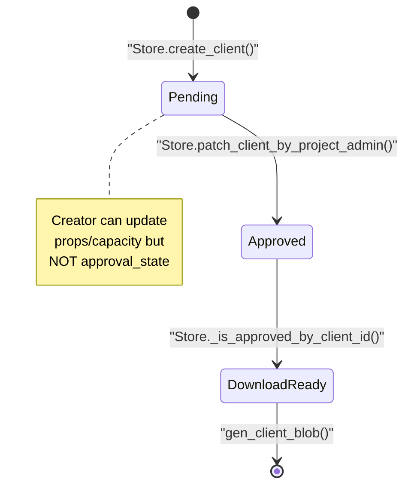

<!-- source: DeepWiki mcp.deepwiki.com · repo NVIDIA/NVFlare · page 11.2 Project and User Management · fetched 2026-10-26 -->

# Project and User Management

<details>
<summary>Relevant source files</summary>

The following files were used as context for generating this wiki page:

- [nvflare/dashboard/application/__init__.py](nvflare/dashboard/application/__init__.py)
- [nvflare/dashboard/application/blob.py](nvflare/dashboard/application/blob.py)
- [nvflare/dashboard/application/cert.py](nvflare/dashboard/application/cert.py)
- [nvflare/dashboard/application/clients.py](nvflare/dashboard/application/clients.py)
- [nvflare/dashboard/application/models.py](nvflare/dashboard/application/models.py)
- [nvflare/dashboard/application/project.py](nvflare/dashboard/application/project.py)
- [nvflare/dashboard/application/store.py](nvflare/dashboard/application/store.py)
- [nvflare/dashboard/application/users.py](nvflare/dashboard/application/users.py)
- [nvflare/dashboard/cli.py](nvflare/dashboard/cli.py)
- [nvflare/dashboard/config.py](nvflare/dashboard/config.py)
- [nvflare/dashboard/dashboard.yaml](nvflare/dashboard/dashboard.yaml)
- [nvflare/dashboard/utils.py](nvflare/dashboard/utils.py)
- [nvflare/dashboard/wsgi.py](nvflare/dashboard/wsgi.py)
- [nvflare/lighter/templates/aws_template.yml](nvflare/lighter/templates/aws_template.yml)
- [nvflare/lighter/templates/azure_template.yml](nvflare/lighter/templates/azure_template.yml)

</details>


## Purpose and Scope

This document details the database models, data access layer, and role-based access control (RBAC) system used by the NVIDIA FLARE Dashboard to manage projects, users, and clients. It covers the SQLAlchemy models defined in `models.py` [nvflare/dashboard/application/models.py:1-117](), the `Store` data access layer in `store.py` [nvflare/dashboard/application/store.py:1-435](), approval workflows, and the REST API endpoints for CRUD operations.

The Dashboard serves as a coordination point for provisioning federated learning participants. For information about the overall Dashboard architecture, see [Dashboard Architecture](11.1). For details on how these entities are transformed into certificates and configuration files, see [Startup Kit Generation via Dashboard](11.3).

## Database Schema and Models

### Entity Relationship Model

The Dashboard utilizes SQLAlchemy as an ORM to manage four core entities: `Project`, `User`, `Client`, and `Organization`. A fifth entity, `Role`, defines user permissions.

**Title: Dashboard Entity Relationship Diagram**
```mermaid
erDiagram
    "Project" ||--o{ "User" : "has many"
    "Project" ||--o{ "Client" : "has many"
    "Organization" ||--o{ "User" : "belongs to"
    "Organization" ||--o{ "Client" : "belongs to"
    "Role" ||--o{ "User" : "has"
    "User" ||--o{ "Client" : "creates"
    
    "Project" {
        int id PK
        bool "frozen"
        string "short_name"
        string "title"
        string "description"
        string "server1"
        string "root_cert"
        string "root_key"
        string "project_props"
        string "server_props"
        bool "cc_mode"
    }
    
    "User" {
        int id PK
        string "email" UK
        string "password_hash"
        int "role_id" FK
        int "organization_id" FK
        int "approval_state"
        int "download_count"
        string "props"
    }
    
    "Client" {
        int id PK
        string "name" UK
        int "organization_id" FK
        int "creator_id" FK
        int "approval_state"
        int "download_count"
        string "capacity"
        string "props"
    }
    
    "Organization" {
        int id PK
        string "name"
    }
    
    "Role" {
        int id PK
        string "name"
    }
```
Sources: [nvflare/dashboard/application/models.py:21-116]()

### Model Classes

#### CommonMixin
The `CommonMixin` provides shared fields for models that inherit from it, including `Organization`, `Role`, `Client`, and `User`.

| Field | Type | Description |
|-------|------|-------------|
| `id` | Integer | Primary key [nvflare/dashboard/application/models.py:22]() |
| `name` | String(512) | Entity name [nvflare/dashboard/application/models.py:23]() |
| `description` | String(512) | Description text [nvflare/dashboard/application/models.py:24]() |
| `created_at` | DateTime | Creation timestamp (UTC) [nvflare/dashboard/application/models.py:25]() |
| `updated_at` | DateTime | Last update timestamp [nvflare/dashboard/application/models.py:26]() |

The mixin provides an `asdict()` method to convert the model to a dictionary for JSON serialization [nvflare/dashboard/application/models.py:28-29]().

#### Project Model
The `Project` model stores configuration for the federated learning study. There is typically exactly one project per Dashboard instance.

| Field | Type | Description |
|-------|------|-------------|
| `frozen` | Boolean | If True, project is finalized and root certificates generated [nvflare/dashboard/application/models.py:51]() |
| `short_name` | String(128) | Short project identifier (max 16 chars) [nvflare/dashboard/application/models.py:53]() |
| `server1` | String(128) | Primary server hostname [nvflare/dashboard/application/models.py:59]() |
| `root_cert` | String(4096) | Serialized root CA certificate [nvflare/dashboard/application/models.py:60]() |
| `root_key` | String(4096) | Encrypted root CA private key [nvflare/dashboard/application/models.py:61]() |
| `project_props` | String(2048) | Additional properties as JSON string [nvflare/dashboard/application/models.py:63]() |
| `cc_mode` | Boolean | Confidential Computing mode flag [nvflare/dashboard/application/models.py:62]() |

When the `frozen` flag is set to `True`, the system generates root certificates via `Store.build_project()` [nvflare/dashboard/application/store.py:149-150]().

Sources: [nvflare/dashboard/application/models.py:49-75]()

#### User Model
The `User` model represents administrators and participants who manage the FL system.

| Field | Type | Description |
|-------|------|-------------|
| `email` | String(128) | Unique email address [nvflare/dashboard/application/models.py:101]() |
| `password_hash` | String(128) | Hashed password using `werkzeug.security` [nvflare/dashboard/application/models.py:102]() |
| `role_id` | Integer | Foreign key to `Role` [nvflare/dashboard/application/models.py:103]() |
| `approval_state` | Integer | Approval status (0=pending, ≥100=approved, 200=seeded) [nvflare/dashboard/application/models.py:108]() |

Passwords are verified using `check_password_hash` in `Store.verify_user` [nvflare/dashboard/application/store.py:383]().

Sources: [nvflare/dashboard/application/models.py:100-116]()

#### Client Model
The `Client` model represents federated learning client sites (e.g., edge locations).

| Field | Type | Description |
|-------|------|-------------|
| `name` | String(512) | Unique client name [nvflare/dashboard/application/models.py:79]() |
| `creator_id` | Integer | Foreign key to `User` who registered this client [nvflare/dashboard/application/models.py:82]() |
| `capacity` | String(2048) | Resource capacity as JSON (e.g., GPU count) [nvflare/dashboard/application/models.py:85]() |

Clients must be approved by a `project_admin` before they can participate [nvflare/dashboard/application/store.py:169-171]().

Sources: [nvflare/dashboard/application/models.py:78-97]()

## Store Data Access Layer

The `Store` class provides a static interface for database operations, abstracting SQLAlchemy complexity from the Flask routes.

### Initialization and Seeding

On first startup, the Dashboard checks if a superuser exists via `Store.ready()` [nvflare/dashboard/application/store.py:73-75](). If not, it reads the `CREDENTIAL` environment variable (format: `email:password:org`) and calls `Store.seed_user()` [nvflare/dashboard/application/store.py:78-89]().

**Title: Store Initialization and Seeding Logic**
```mermaid
graph TB
    "init_app()" --> "Store.ready()"
    "Store.ready()" -->|"User.query.get(1).approval_state < 100"| "get_credential"
    "Store.ready()" -->|"User.query.get(1).approval_state >= 100"| "write_marker"
    "get_credential" --> "Store.seed_user(email, pwd, org)"
    "Store.seed_user(email, pwd, org)" --> "Store.create_user()"
    "Store.seed_user(email, pwd, org)" --> "Store.create_project()"
    "Store.create_user()" --> "write_marker"
    
    "Store.create_user()" -->|"Sets approval_state=200 role=project_admin"| db[("db.sqlite")]
```
Sources: [nvflare/dashboard/application/__init__.py:40-54](), [nvflare/dashboard/application/store.py:72-91](), [nvflare/dashboard/config.py:33-35]()

### Key Store Operations

#### Project Operations
- `set_project(req)`: Updates project configuration. If `frozen` is set, it triggers `build_project` [nvflare/dashboard/application/store.py:122-154]().
- `get_project()`: Retrieves project details and appends counts for clients, organizations, and users [nvflare/dashboard/application/store.py:157-160]().
- `build_project(project)`: Generates root CA certificate and key using `make_root_cert` [nvflare/dashboard/application/store.py:105-112]().

#### User and Client Operations
- `create_client(req, creator)`: Registers a new client site and associates it with the creator's organization [nvflare/dashboard/application/store.py:179-203]().
- `create_user(req, seeding=False)`: Creates a new user. If `seeding` is False, it prevents creating `project_admin` roles [nvflare/dashboard/application/store.py:280-312]().
- `patch_client_by_project_admin(id, req)`: Allows admins to modify any client field, including `approval_state` [nvflare/dashboard/application/store.py:229-230]().

Sources: [nvflare/dashboard/application/store.py:105-312]()

## Role-Based Access Control

### Permission Check Function
The `check_role()` function determines if a requester has the authority to modify an entity based on ownership or admin status.

**Title: Role Verification Logic**
```mermaid
graph LR
    "HTTP Request" --> "jwt_required()"
    "jwt_required()" --> "get_jwt()"
    "get_jwt()" --> "check_role()"
    "check_role()" --> "authorize"
    "authorize" -->|"is_project_admin"| "Store.patch_user_by_project_admin()"
    "authorize" -->|"is_creator"| "Store.patch_user_by_creator()"
    "authorize" -->|"unauthorized"| error["403 Forbidden"]
```
Sources: [nvflare/dashboard/application/store.py:38-41](), [nvflare/dashboard/application/clients.py:57-66]()

### JWT Token Claims
When a user logs in via `/api/v1/login`, the system generates a JWT token containing `role`, `organization`, and `approved` status claims [nvflare/dashboard/application/project.py:94-98](). These claims are verified in route handlers using `@jwt_required()` [nvflare/dashboard/application/project.py:112]().

## Approval Workflows

### Approval States
The `approval_state` field (integer) controls the lifecycle of participants:
- `0`: Pending (default for new registrations) [nvflare/dashboard/application/models.py:83]().
- `≥100`: Approved (required for downloading startup kits) [nvflare/dashboard/application/store.py:171]().
- `200`: Seeded (reserved for the initial project admin) [nvflare/dashboard/application/store.py:85]().

### Client Approval Flow
**Title: Client Approval and Blob Access State Machine**

The client blob download endpoint strictly enforces the approval check before invoking the provisioner [nvflare/dashboard/application/clients.py:86-87]().

Sources: [nvflare/dashboard/application/store.py:169-171](), [nvflare/dashboard/application/clients.py:83-98]()

## REST API Endpoints

The Dashboard exposes a versioned API (`/api/v1`) for all management operations defined in `dashboard.yaml` [nvflare/dashboard/dashboard.yaml:1-250]().

### Core Endpoints

| Endpoint | Method | Role Required | Purpose |
|----------|--------|---------------|---------|
| `/api/v1/login` | POST | Public | Authenticate and get JWT [nvflare/dashboard/application/project.py:87]() |
| `/api/v1/project` | PATCH | `project_admin` | Configure study settings [nvflare/dashboard/application/project.py:126]() |
| `/api/v1/clients` | POST | Authenticated | Register a new site [nvflare/dashboard/application/clients.py:25]() |
| `/api/v1/clients/<id>/blob` | POST | Owner/Admin | Generate and download ZIP kit [nvflare/dashboard/application/clients.py:83]() |
| `/api/v1/users` | POST | Public | Self-registration [nvflare/dashboard/application/users.py:25]() |

### Data Flow for Blob Generation
When a blob (startup kit) is requested:
1. The route handler verifies approval and authorization [nvflare/dashboard/application/clients.py:86-90]().
2. `gen_client_blob` (or `gen_user_blob`) is called with a user-provided `pin` [nvflare/dashboard/application/blob.py:150-151]().
3. `_gen_kit` initializes a `Provisioner` with `WorkspaceBuilder`, `StaticFileBuilder`, `CertBuilder`, and `SignatureBuilder`. It also includes `AWSBuilder` and `AzureBuilder` for cloud deployments [nvflare/dashboard/application/blob.py:58-69]().
4. The resulting startup kit is zipped with the `pin` as a password and returned as a binary stream [nvflare/dashboard/application/blob.py:142-147]().

Sources: [nvflare/dashboard/application/blob.py:81-147](), [nvflare/dashboard/application/clients.py:83-98](), [nvflare/dashboard/dashboard.yaml:180-250]()

---

