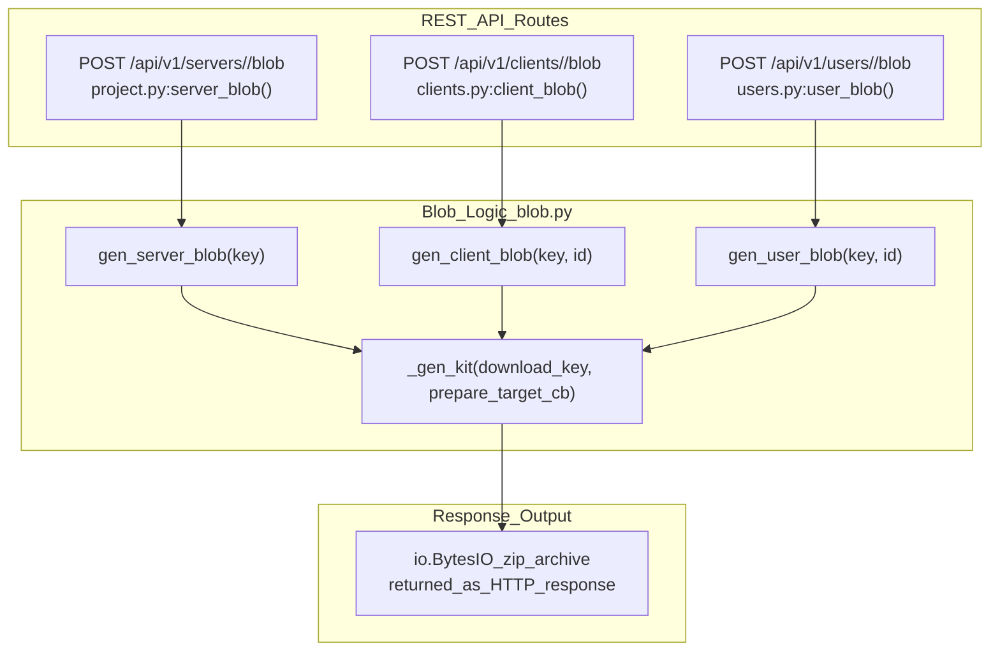
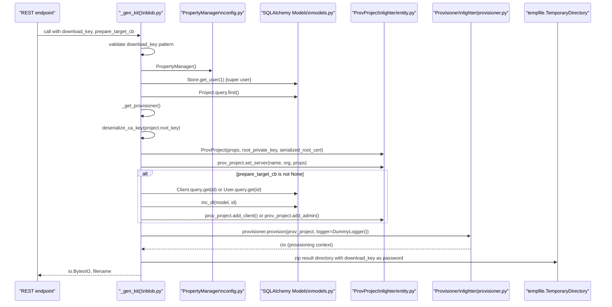
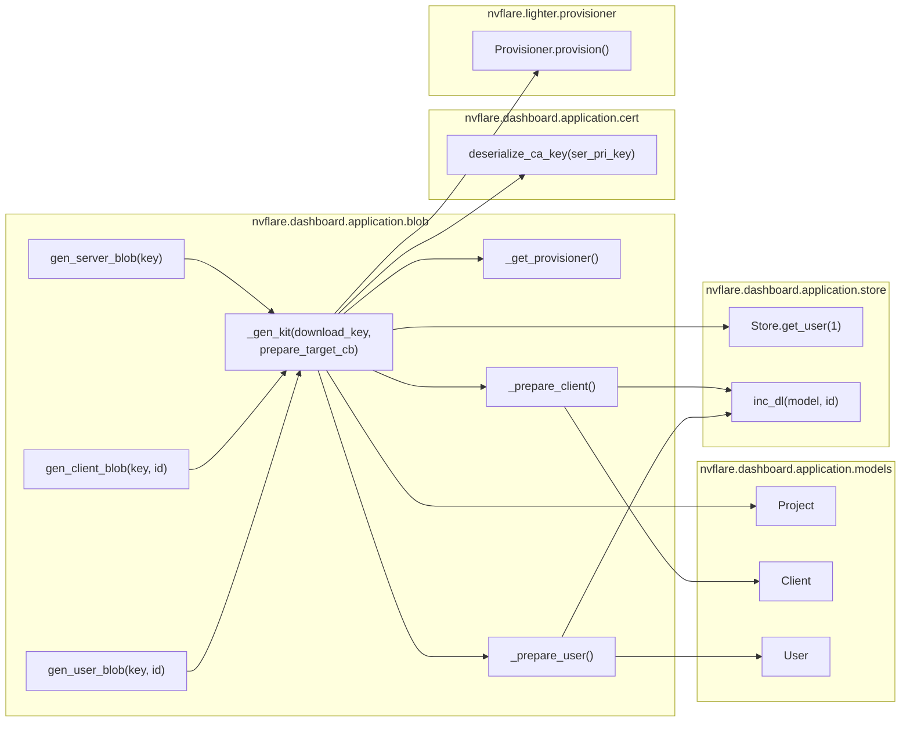

<!-- source: DeepWiki mcp.deepwiki.com · repo NVIDIA/NVFlare · page 11.3 Startup Kit Generation via Dashboard · fetched 2026-10-26 -->

# Startup Kit Generation via Dashboard

<details>
<summary>Relevant source files</summary>

The following files were used as context for generating this wiki page:

- [docs/user_guide/admin_guide/security/unsafe_component_detection.rst](docs/user_guide/admin_guide/security/unsafe_component_detection.rst)
- [docs/user_guide/nvflare_cli/provision_command.rst](docs/user_guide/nvflare_cli/provision_command.rst)
- [nvflare/apis/utils/format_check.py](nvflare/apis/utils/format_check.py)
- [nvflare/app_common/default_component_policy.py](nvflare/app_common/default_component_policy.py)
- [nvflare/app_common/widgets/component_path_authorizer.py](nvflare/app_common/widgets/component_path_authorizer.py)
- [nvflare/dashboard/application/__init__.py](nvflare/dashboard/application/__init__.py)
- [nvflare/dashboard/application/blob.py](nvflare/dashboard/application/blob.py)
- [nvflare/dashboard/application/cert.py](nvflare/dashboard/application/cert.py)
- [nvflare/dashboard/application/clients.py](nvflare/dashboard/application/clients.py)
- [nvflare/dashboard/application/models.py](nvflare/dashboard/application/models.py)
- [nvflare/dashboard/application/project.py](nvflare/dashboard/application/project.py)
- [nvflare/dashboard/application/store.py](nvflare/dashboard/application/store.py)
- [nvflare/dashboard/application/users.py](nvflare/dashboard/application/users.py)
- [nvflare/dashboard/cli.py](nvflare/dashboard/cli.py)
- [nvflare/dashboard/config.py](nvflare/dashboard/config.py)
- [nvflare/dashboard/dashboard.yaml](nvflare/dashboard/dashboard.yaml)
- [nvflare/dashboard/utils.py](nvflare/dashboard/utils.py)
- [nvflare/dashboard/wsgi.py](nvflare/dashboard/wsgi.py)
- [nvflare/edge/simulation/README.md](nvflare/edge/simulation/README.md)
- [nvflare/fuel/hci/server/authz.py](nvflare/fuel/hci/server/authz.py)
- [nvflare/fuel/sec/authz.py](nvflare/fuel/sec/authz.py)
- [nvflare/lighter/constants.py](nvflare/lighter/constants.py)
- [nvflare/lighter/ctx.py](nvflare/lighter/ctx.py)
- [nvflare/lighter/dummy_project.yml](nvflare/lighter/dummy_project.yml)
- [nvflare/lighter/edge_project.yml](nvflare/lighter/edge_project.yml)
- [nvflare/lighter/entity.py](nvflare/lighter/entity.py)
- [nvflare/lighter/impl/cert.py](nvflare/lighter/impl/cert.py)
- [nvflare/lighter/impl/docker.py](nvflare/lighter/impl/docker.py)
- [nvflare/lighter/impl/static_file.py](nvflare/lighter/impl/static_file.py)
- [nvflare/lighter/provision.py](nvflare/lighter/provision.py)
- [nvflare/lighter/provisioner.py](nvflare/lighter/provisioner.py)
- [nvflare/lighter/templates/aws_template.yml](nvflare/lighter/templates/aws_template.yml)
- [nvflare/lighter/templates/azure_template.yml](nvflare/lighter/templates/azure_template.yml)
- [nvflare/lighter/templates/master_template.yml](nvflare/lighter/templates/master_template.yml)
- [nvflare/lighter/tree_prov.py](nvflare/lighter/tree_prov.py)
- [nvflare/private/fed/utils/site_config.py](nvflare/private/fed/utils/site_config.py)
- [tests/unit_test/app_common/widgets/component_path_authorizer_test.py](tests/unit_test/app_common/widgets/component_path_authorizer_test.py)
- [tests/unit_test/fuel/flare_api_test.py](tests/unit_test/fuel/flare_api_test.py)
- [tests/unit_test/fuel/hci/server/authz_filter_test.py](tests/unit_test/fuel/hci/server/authz_filter_test.py)
- [tests/unit_test/lighter/__init__.py](tests/unit_test/lighter/__init__.py)
- [tests/unit_test/lighter/cert_builder_test.py](tests/unit_test/lighter/cert_builder_test.py)
- [tests/unit_test/lighter/participant_test.py](tests/unit_test/lighter/participant_test.py)
- [tests/unit_test/lighter/project_test.py](tests/unit_test/lighter/project_test.py)
- [tests/unit_test/lighter/static_file_builder_test.py](tests/unit_test/lighter/static_file_builder_test.py)
- [tests/unit_test/private/fed/utils/site_config_test.py](tests/unit_test/private/fed/utils/site_config_test.py)

</details>


This page explains how the NVFLARE dashboard generates downloadable startup kit archives for server participants, client sites, and admin users. The generation process bridges the dashboard's database-stored project data with the lower-level provisioning system.

For background on the provisioning system (builders, `Provisioner`, PKI, etc.) see [10.1: Provisioning Overview and Workflow](). For the dashboard's project and user data models, see [11.2: Project and User Management](). For dashboard deployment, see [11.4: Dashboard Deployment]().

---

## Overview

When a participant wants to join a federated learning project, they download a **startup kit** — a password-protected ZIP archive containing TLS certificates, configuration files, and startup scripts. The dashboard generates these on-demand by constructing a transient provisioning project from the database state, running the NVFLARE provisioning pipeline, and returning the resulting archive over HTTP.

The three participant types that can receive startup kits are:

| Participant Type | API Endpoint | Generator Function | Preparer Callback |
|---|---|---|---|
| Server | `POST /api/v1/servers/<id>/blob` | `gen_server_blob` | _(none)_ |
| Client site | `POST /api/v1/clients/<id>/blob` | `gen_client_blob` | `_prepare_client` |
| Admin user | `POST /api/v1/users/<int:id>/blob` | `gen_user_blob` | `_prepare_user` |

All three converge on a single internal function, `_gen_kit`, defined in `nvflare/dashboard/application/blob.py` [nvflare/dashboard/application/blob.py:81-81]().

**Sources:** [nvflare/dashboard/application/blob.py:77-173](), [nvflare/dashboard/application/project.py:111-124]()

---

## Request Routing

The following diagram maps the HTTP endpoints to their handler functions and the underlying blob module.

**Startup Kit API Routing**



**Sources:** [nvflare/dashboard/application/project.py:111-124](), [nvflare/dashboard/application/blob.py:77-151]()

---

## Authorization and Approval Checks

Before generating a kit, the endpoints enforce several checks:

1. **Authentication**: All blob endpoints require a valid JWT via the `@jwt_required()` decorator [nvflare/dashboard/application/project.py:112-112]().
2. **Role/ownership**: The requester must be either the `project_admin` or the creator/owner of the resource. This is verified via `check_role` from `store.py` [nvflare/dashboard/application/store.py:38-41]().
3. **Approval state**: Client and user blobs additionally verify that the participant's `approval_state >= 100` via `Store._is_approved_by_client_id(id)` or `Store._is_approved_by_user_id(id)` [nvflare/dashboard/application/store.py:169-177](). 

The server blob endpoint is restricted to users with the `project_admin` role [nvflare/dashboard/application/project.py:115-115]().

**Sources:** [nvflare/dashboard/application/project.py:111-124](), [nvflare/dashboard/application/store.py:38-41](), [nvflare/dashboard/application/store.py:169-177]()

---

## The `_gen_kit` Function

`_gen_kit` in `blob.py` is the central logic for all startup kit generation. Its signature is:

`def _gen_kit(download_key, prepare_target_cb=None, **cb_kwargs)` [nvflare/dashboard/application/blob.py:81-81]()

- `download_key`: The PIN supplied by the user in the request body; used to password-protect the ZIP.
- `prepare_target_cb`: An optional callback that adds a specific participant (client or user) to the provisioning project. If `None`, the server kit is generated.
- `**cb_kwargs`: Keyword arguments forwarded to the callback (e.g., `client_id`, `user_id`).

### Step-by-step execution

**Kit Generation Sequence**



**Sources:** [nvflare/dashboard/application/blob.py:81-147]()

---

## Provisioner Setup

The function `_get_provisioner` constructs a `Provisioner` instance configured with a fixed set of builders. This mirrors the offline provisioning pipeline (see page [10.2: Builder Pattern and Components]()), but is invoked programmatically rather than from a `project.yml` file.

`def _get_provisioner(prop_mgr: PropertyManager, root_dir: str, scheme, docker_image=None):` [nvflare/dashboard/application/blob.py:56-56]()

**Builders instantiated per kit generation:**

| Builder Class | Module | Purpose |
|---|---|---|
| `WorkspaceBuilder` | `nvflare.lighter.impl.workspace` | Creates the directory layout [nvflare/dashboard/application/blob.py:59-59]() |
| `StaticFileBuilder` | `nvflare.lighter.impl.static_file` | Generates `fed_server.json`, `fed_client.json`, etc. [nvflare/dashboard/application/blob.py:60-64]() |
| `AWSBuilder` | `nvflare.lighter.impl.aws` | Adds AWS cloud launch scripts [nvflare/dashboard/application/blob.py:65-65]() |
| `AzureBuilder` | `nvflare.lighter.impl.azure` | Adds Azure cloud launch scripts [nvflare/dashboard/application/blob.py:66-66]() |
| `CertBuilder` | `nvflare.lighter.impl.cert` | Signs participant certificates from the project root CA [nvflare/dashboard/application/blob.py:67-67]() |
| `SignatureBuilder` | `nvflare.lighter.impl.signature` | Signs configuration files [nvflare/dashboard/application/blob.py:68-68]() |

**Sources:** [nvflare/dashboard/application/blob.py:56-74]()

---

## Participant Preparation Callbacks

For client and user kits, a callback is invoked inside `_gen_kit` to add the specific participant to the `ProvProject` before provisioning runs.

**`_prepare_client(prop_mgr, prov_project, client_id)`**

1. Fetches the `Client` record from the database via `Client.query.get(client_id)` [nvflare/dashboard/application/blob.py:155-155]().
2. Calls `inc_dl(Client, client_id)` to increment the download counter [nvflare/dashboard/application/blob.py:156-156]().
3. Merges `client.props` (JSON) and `client.capacity` into the participant's property dict [nvflare/dashboard/application/blob.py:157-163]().
4. Merges any extra client props from `PropertyManager.get_client_props()` [nvflare/dashboard/application/blob.py:165-167]().
5. Calls `prov_project.add_client(name=client.name, org=client.organization.name, props=props)` [nvflare/dashboard/application/blob.py:169-169]().

**`_prepare_user(prop_mgr, prov_project, user_id)`**

1. Fetches the `User` record from the database via `User.query.get(user_id)` [nvflare/dashboard/application/blob.py:177-177]().
2. Calls `inc_dl(User, user_id)` to increment the download counter [nvflare/dashboard/application/blob.py:178-178]().
3. Sets `PropKey.ROLE` from `user.role.name` [nvflare/dashboard/application/blob.py:179-179]().
4. Merges `user.props` (JSON) and any extra admin props from `PropertyManager.get_admin_props()` [nvflare/dashboard/application/blob.py:180-185]().
5. Calls `prov_project.add_admin(name=user.email, org=user.organization.name, props=props)` [nvflare/dashboard/application/blob.py:187-187]().

**Sources:** [nvflare/dashboard/application/blob.py:154-188]()

---

## Code Entity Map

**blob.py: Functions and Their Database Dependencies**



**Sources:** [nvflare/dashboard/application/blob.py:56-188](), [nvflare/dashboard/application/store.py:64-69](), [nvflare/dashboard/application/models.py:49-75](), [nvflare/dashboard/application/cert.py:31-64]()

---

## Root CA Key Management

The dashboard stores the project's root CA private key in the `Project` database table (`Project.root_key` column), serialized as PEM and protected via internal logic.

**When the root key is created:**

`Store.build_project()` is called when a project is initialized or frozen. It calls `make_root_cert(entity)` from `cert.py`, which generates a new RSA key pair and a self-signed root certificate [nvflare/dashboard/application/store.py:105-107](). The serialized private key and certificate are stored in the database [nvflare/dashboard/application/store.py:108-110]().

**When the root key is used:**

Inside `_gen_kit`, the stored key is recovered via `deserialize_ca_key(project.root_key)` [nvflare/dashboard/application/blob.py:100-100](). This recovers the root private key from the serialized format stored in the `Project` model using the `DASHBOARD_PP` passphrase if provided [nvflare/dashboard/application/cert.py:67-69]().

The recovered private key is passed directly to `ProvProject` as `root_private_key=root_pri_key` [nvflare/dashboard/application/blob.py:105-111]().

**Sources:** [nvflare/dashboard/application/store.py:105-110](), [nvflare/dashboard/application/blob.py:100-111](), [nvflare/dashboard/application/cert.py:67-69]()

---

## PropertyManager and Configuration Overrides

`PropertyManager` (in `nvflare/dashboard/config.py`) reads configuration to allow operators to inject additional properties into any provisioned participant.

`_gen_kit` calls these methods to merge extra props:

| Method | Applied to |
|---|---|
| `get_project_prop("scheme", scheme)` | Communication scheme selection [nvflare/dashboard/application/blob.py:57-57]() |
| `get_server_prop(PropKey.FED_LEARN_PORT, 8002)` | Server federation port [nvflare/dashboard/application/blob.py:91-91]() |
| `get_server_prop(PropKey.ADMIN_PORT, fl_port)` | Server admin port [nvflare/dashboard/application/blob.py:92-92]() |
| `get_server_props()` | All extra server properties [nvflare/dashboard/application/blob.py:125-127]() |
| `get_client_props()` | All extra client properties [nvflare/dashboard/application/blob.py:165-167]() |
| `get_admin_props()` | All extra admin/user properties [nvflare/dashboard/application/blob.py:183-185]() |

**Sources:** [nvflare/dashboard/application/blob.py:57-185](), [nvflare/dashboard/config.py:40-83]()

---

## Download Key (PIN) and ZIP Security

The caller supplies a `pin` field in the POST request body. This PIN is used as a ZIP file password when `subprocess.run(["zip", "-rq", "-P", download_key, "tmp.zip", "."], cwd=ent_dir)` is called on the provisioned output directory [nvflare/dashboard/application/blob.py:142-142]().

The `zip` binary must be installed in the runtime environment.

Before use, the key is validated against the pattern `r"^[A-Za-z0-9]+$"` to prevent shell injection or path traversal:

```python
allowed_pattern = r"^[A-Za-z0-9]+$"
if not re.match(allowed_pattern, download_key):
    raise RuntimeError(f"ERROR: detected unsafe download key: {download_key}")
```
[nvflare/dashboard/application/blob.py:83-85]()

The resulting `tmp.zip` is read into an `io.BytesIO` buffer and streamed back to the client [nvflare/dashboard/application/blob.py:143-147]().

**Sources:** [nvflare/dashboard/application/blob.py:81-147]()

---

## Download Counter

Each time a startup kit is successfully generated for a `Client` or `User`, `inc_dl(model, id)` increments the `download_count` column in the respective table [nvflare/dashboard/application/store.py:64-69]().

`def inc_dl(model, id):` [nvflare/dashboard/application/store.py:64-64]()

This allows tracking how many times each participant has downloaded their kit.

**Sources:** [nvflare/dashboard/application/store.py:64-69](), [nvflare/dashboard/application/blob.py:156-156](), [nvflare/dashboard/application/blob.py:178-178]()

---

## DummyLogger

The `Provisioner` normally writes verbose log output. `DummyLogger` suppresses `info`, `debug`, and `warning` messages while still printing `error` messages to stdout [nvflare/dashboard/application/blob.py:38-54](). It is passed to `provisioner.provision(prov_project, logger=DummyLogger())` to keep the dashboard's internal logs focused on errors [nvflare/dashboard/application/blob.py:139-139]().

**Sources:** [nvflare/dashboard/application/blob.py:38-54]()

---

