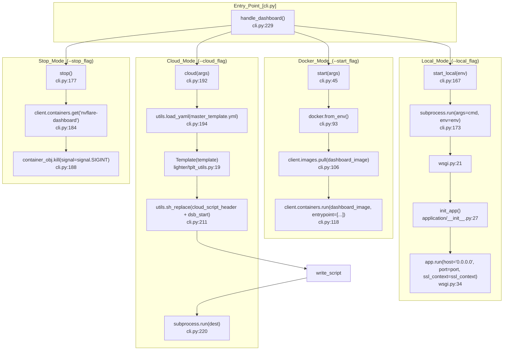
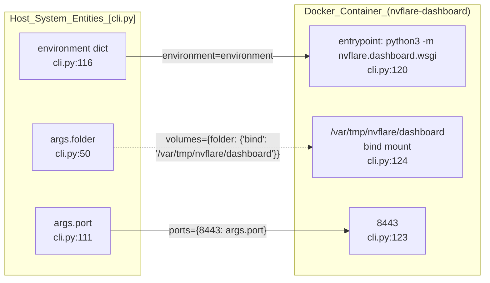
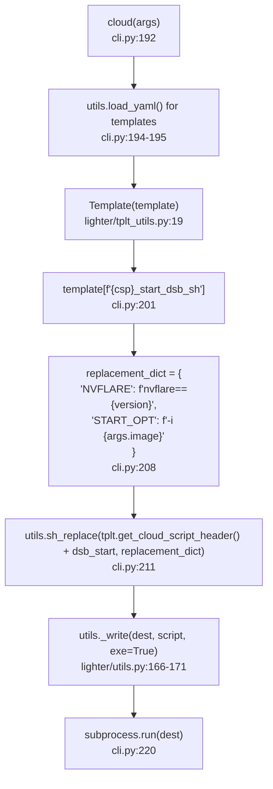
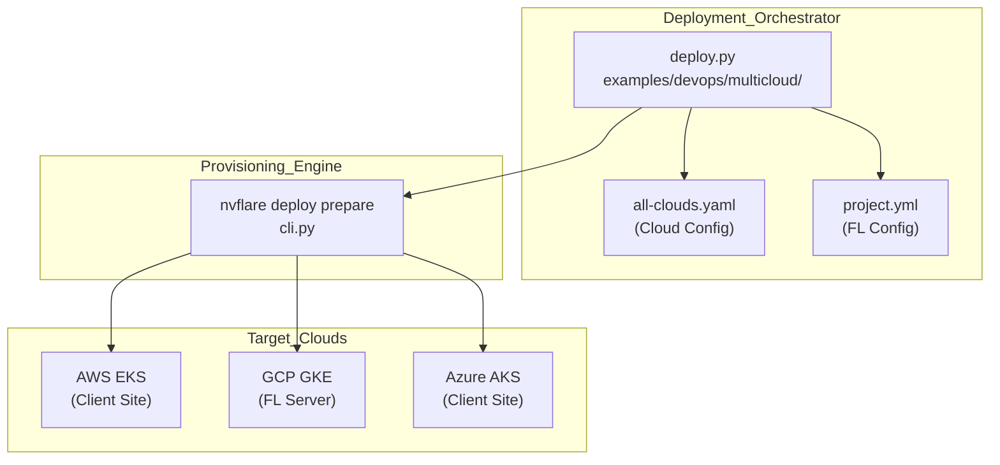

<!-- source: DeepWiki mcp.deepwiki.com · repo NVIDIA/NVFlare · page 11.4 Dashboard Deployment · fetched 2026-10-26 -->

# Dashboard Deployment

Relevant source files

The following files were used as context for generating this wiki page:

- [docker/Dockerfile.parent](docker/Dockerfile.parent)
- [docs/resources/brev_config_instance.png](docs/resources/brev_config_instance.png)
- [docs/resources/brev_creating.png](docs/resources/brev_creating.png)
- [docs/resources/brev_deploy.png](docs/resources/brev_deploy.png)
- [docs/resources/brev_instance.png](docs/resources/brev_instance.png)
- [docs/resources/brev_port.png](docs/resources/brev_port.png)
- [docs/resources/brev_select_k8s.png](docs/resources/brev_select_k8s.png)
- [docs/resources/brev_ssh.png](docs/resources/brev_ssh.png)
- [docs/user_guide/admin_guide/deployment/brev_deployment.rst](docs/user_guide/admin_guide/deployment/brev_deployment.rst)
- [docs/user_guide/admin_guide/deployment/brev_scripts/launch_brev_nvflare.sh](docs/user_guide/admin_guide/deployment/brev_scripts/launch_brev_nvflare.sh)
- [docs/user_guide/admin_guide/deployment/brev_scripts/prepare_brev_startup_kits.sh](docs/user_guide/admin_guide/deployment/brev_scripts/prepare_brev_startup_kits.sh)
- [docs/user_guide/admin_guide/deployment/index.rst](docs/user_guide/admin_guide/deployment/index.rst)
- [examples/devops/multicloud/README.md](examples/devops/multicloud/README.md)
- [examples/devops/multicloud/build_and_push.py](examples/devops/multicloud/build_and_push.py)
- [examples/devops/multicloud/deploy.py](examples/devops/multicloud/deploy.py)
- [examples/devops/multicloud/setting-up-dev-cluster.md](examples/devops/multicloud/setting-up-dev-cluster.md)
- [nvflare/dashboard/application/__init__.py](nvflare/dashboard/application/__init__.py)
- [nvflare/dashboard/application/blob.py](nvflare/dashboard/application/blob.py)
- [nvflare/dashboard/application/cert.py](nvflare/dashboard/application/cert.py)
- [nvflare/dashboard/application/clients.py](nvflare/dashboard/application/clients.py)
- [nvflare/dashboard/application/models.py](nvflare/dashboard/application/models.py)
- [nvflare/dashboard/application/project.py](nvflare/dashboard/application/project.py)
- [nvflare/dashboard/application/store.py](nvflare/dashboard/application/store.py)
- [nvflare/dashboard/application/users.py](nvflare/dashboard/application/users.py)
- [nvflare/dashboard/cli.py](nvflare/dashboard/cli.py)
- [nvflare/dashboard/config.py](nvflare/dashboard/config.py)
- [nvflare/dashboard/dashboard.yaml](nvflare/dashboard/dashboard.yaml)
- [nvflare/dashboard/utils.py](nvflare/dashboard/utils.py)
- [nvflare/dashboard/wsgi.py](nvflare/dashboard/wsgi.py)
- [nvflare/lighter/templates/aws_template.yml](nvflare/lighter/templates/aws_template.yml)
- [nvflare/lighter/templates/azure_template.yml](nvflare/lighter/templates/azure_template.yml)

## Purpose and Scope

This page describes deployment mechanisms for the NVIDIA FLARE Dashboard. The Dashboard is a Flask-based web application that provides project configuration, user/client registration, and startup kit generation via REST API and web UI [nvflare/dashboard/application/project.py:32-85]().

Three deployment modes are supported:
- **Local**: Direct Python execution via [nvflare/dashboard/cli.py:91-92]() calling [nvflare/dashboard/wsgi.py:15-34]().
- **Docker**: Containerized execution with the `nvflare/nvflare` image [nvflare/dashboard/cli.py:93-121]().
- **Cloud**: Automated VM provisioning using templates in `nvflare/lighter/templates/` processed by [nvflare/dashboard/cli.py:192-247]().

For Dashboard architecture and data models, see page 11.1. For project/user management APIs, see page 11.2. For startup kit generation via the `Provisioner` class, see page 11.3 [nvflare/dashboard/application/blob.py:56-74]().

## Deployment Modes Overview

The Dashboard supports three deployment strategies with different isolation levels and deployment complexity:

| Mode | Description | Use Case | Command |
|------|-------------|----------|---------|
| **Local** | Direct Python execution without Docker | Development and testing only | `nvflare dashboard --start --local` |
| **Docker** | Containerized deployment on local machine | Single-machine production or testing | `nvflare dashboard --start` |
| **Cloud** | Automated VM provisioning on AWS or Azure | Production deployment with cloud infrastructure | `nvflare dashboard --cloud <aws\|azure>` |

### Dashboard Deployment Control Flow

The following diagram illustrates how the CLI entry point dispatches to different deployment implementations based on user arguments.

**Title: Dashboard CLI Dispatch Flow**

Sources: [nvflare/dashboard/cli.py:45-247](), [nvflare/dashboard/wsgi.py:15-34](), [nvflare/dashboard/application/__init__.py:27-54]()

## Local Deployment Mode

Local deployment runs the Dashboard directly using Python without Docker isolation. This mode is explicitly marked for development and testing purposes only [nvflare/dashboard/cli.py:168]().

### Local Mode Execution Flow

The `start_local()` function at [nvflare/dashboard/cli.py:167-174]() executes `wsgi.py` via `subprocess.run()`:

1. `start_local()` sets `EnvVar.WEB_ROOT` to the Dashboard code directory [nvflare/dashboard/cli.py:172]().
2. `subprocess.run(args=cmd, env=env)` executes `wsgi.py` [nvflare/dashboard/cli.py:173]().
3. `wsgi.py` calls `init_app()` to initialize the Flask app [nvflare/dashboard/wsgi.py:21]().
4. `init_app()` initializes Flask, `JWTManager`, and `SQLAlchemy` [nvflare/dashboard/application/__init__.py:31-34]().
5. `db.create_all()` creates database tables [nvflare/dashboard/application/__init__.py:39]().
6. `Store.seed_user()` creates the initial admin if it does not exist [nvflare/dashboard/application/__init__.py:51]().
7. SSL context is loaded if `web.crt`/`web.key` exist at `{web_root}/cert/` [nvflare/dashboard/wsgi.py:26-33]().
8. `app.run(host="0.0.0.0", port=port)` starts the Flask development server [nvflare/dashboard/wsgi.py:34]().

### Environment Variables for Local Mode

| Variable | Purpose | Default | Set By | Read By |
|----------|---------|---------|--------|---------|
| `NVFL_WEB_ROOT` | Root directory for Dashboard files | `/var/tmp/nvflare/dashboard` | `start_local()` at [nvflare/dashboard/cli.py:172]() | `get_web_root()` at [nvflare/dashboard/utils.py:28]() |
| `NVFL_CREDENTIAL` | Initial admin credentials (email:password:org) | Prompted from user | `start()` at [nvflare/dashboard/cli.py:64-89]() | `init_app()` at [nvflare/dashboard/application/__init__.py:41]() |
| `NVFL_DASHBOARD_PP` | Passphrase for CA private key encryption | None | `start()` at [nvflare/dashboard/cli.py:61-62]() | `deserialize_ca_key()` at [nvflare/dashboard/application/blob.py:100]() |
| `NVFL_WEB_PORT` | Dashboard listening port | `8443` | N/A | `wsgi.py` at [nvflare/dashboard/wsgi.py:27]() |

Sources: [nvflare/dashboard/cli.py:61-89](), [nvflare/dashboard/cli.py:167-174](), [nvflare/dashboard/wsgi.py:26-34](), [nvflare/dashboard/application/__init__.py:41-51]()

## Docker Deployment Mode

Docker deployment provides process isolation and a consistent runtime environment. The Dashboard runs in the official `nvflare/nvflare` container image.

### Docker Container Configuration Mapping

The following diagram maps CLI arguments to Docker container runtime parameters.

**Title: CLI to Docker Parameter Mapping**

### Container Startup Process

Docker deployment execution at [nvflare/dashboard/cli.py:93-140]():

| Step | Function/Method | Line Reference |
|------|-----------------|----------------|
| 1. Initialize Docker client | `docker.from_env()` | [nvflare/dashboard/cli.py:93]() |
| 2. Check daemon connectivity | Try-except `docker.errors.DockerException` | [nvflare/dashboard/cli.py:94-96]() |
| 3. Determine image name | `f"nvflare/nvflare:{version}"` | [nvflare/dashboard/cli.py:97-98]() |
| 4. Pull image | `client.images.pull(dashboard_image)` | [nvflare/dashboard/cli.py:106]() |
| 5. Launch container | `client.containers.run()` with parameters | [nvflare/dashboard/cli.py:118-127]() |

Container configuration details:
- **Entrypoint**: `python3 -m nvflare.dashboard.wsgi` [nvflare/dashboard/cli.py:120]().
- **Port Mapping**: Maps host `args.port` to container `8443` [nvflare/dashboard/cli.py:123]().
- **Persistence**: Mounts the local `folder` to `/var/tmp/nvflare/dashboard` in the container [nvflare/dashboard/cli.py:124]().

Sources: [nvflare/dashboard/cli.py:93-140]()

## Cloud Deployment Mode

Cloud deployment automates provisioning of virtual machines on AWS or Azure and deploys the Dashboard in a Docker container on the provisioned infrastructure.

### Cloud Script Generation Flow

The `cloud()` function generates shell scripts by combining master and CSP-specific templates.

**Title: Cloud Script Generation Pipeline**

Script generation steps:
1. Load templates via `utils.load_yaml()` from the `lighter/templates` directory [nvflare/dashboard/cli.py:194-195]().
2. Create a `Template` object to handle cloud script headers (imported from `nvflare.lighter.tplt_utils`).
3. Build a replacement dictionary for version pinning and custom images [nvflare/dashboard/cli.py:208]().
4. Replace placeholders via `utils.sh_replace()` [nvflare/dashboard/cli.py:211]().
5. Execute the generated script via `subprocess.run(dest)` [nvflare/dashboard/cli.py:220]().

Sources: [nvflare/dashboard/cli.py:192-220]()

### Azure and AWS Deployment Specifics

The deployment scripts use provider-specific templates to provision the environment.

| Feature | Azure | AWS |
|---------|-------|-----|
| Template Key | `azure_start_dsb_sh` [nvflare/dashboard/cli.py:201]() | `aws_start_dsb_sh` [nvflare/dashboard/cli.py:201]() |
| Software Stack | Docker + NVFlare pip package | Docker + NVFlare pip package |
| VPC Support | Default | Custom via `--vpc-id` [nvflare/dashboard/cli.py:216-217]() |

Sources: [nvflare/dashboard/cli.py:192-220](), [nvflare/lighter/templates/aws_template.yml](), [nvflare/lighter/templates/azure_template.yml]()

## Containerized Job Execution

In addition to the Dashboard, NVFlare supports containerized deployment for FL sites and jobs using Docker.

### Site and Job Dockerfiles

NVFlare separates management infrastructure from training environments via specialized Dockerfiles.

| Dockerfile | Target Process | Description |
|------------|----------------|-------------|
| `Dockerfile.parent` | SP (Server Parent), CP (Client Parent) | A distroless NVIDIA image designed for long-running parent processes [docker/Dockerfile.parent:1-25](). |
| `Dockerfile.job` | SJ (Server Job), CJ (Client Job) | An NGC PyTorch-based image used for executing submitted jobs with framework dependencies [docker/Dockerfile.job:1-30](). |

### Kubernetes and Multicloud Deployment

For Kubernetes environments, the `deploy.py` tool orchestrates the deployment of NVFlare components across cloud providers (AWS EKS, GCP GKE, Azure AKS) [examples/devops/multicloud/deploy.py:1-50]().

**Title: Multicloud Deployment Architecture**

Key functions in the multicloud workflow:
- `build_and_push.py`: Reads image tags from config, builds `docker/Dockerfile.parent`, and pushes to cloud registries [examples/devops/multicloud/setting-up-dev-cluster.md:109-115]().
- `fetch_kubeconfigs.py`: Discovers and retrieves kubeconfigs for GKE, EKS, and AKS [examples/devops/multicloud/setting-up-dev-cluster.md:142-147]().
- `deploy.py up`: Executes `nvflare deploy prepare` to create runtime kits and deploys them as Helm releases [examples/devops/multicloud/setting-up-dev-cluster.md:157-173]().

Sources: [examples/devops/multicloud/setting-up-dev-cluster.md:1-214](), [examples/devops/multicloud/deploy.py:1-50](), [docker/Dockerfile.parent:1-25](), [docker/Dockerfile.job:1-30]()

## Configuration and Lifecycle

### Database and Admin Seeding

The Dashboard uses `SQLAlchemy` for persistence, defaulting to a SQLite database.

**Seeding Process** in `init_app()` [nvflare/dashboard/application/__init__.py:35-53]():
1. `db.create_all()` creates models defined in `models.py` including `User`, `Client`, and `Project` [nvflare/dashboard/application/models.py:49-120]().
2. `Store.ready()` checks if a superuser exists [nvflare/dashboard/application/store.py:73-75]().
3. If not ready, `Store.seed_user()` creates the project admin using credentials from `NVFL_CREDENTIAL` [nvflare/dashboard/application/store.py:78-89]().

### SSL/TLS Configuration

SSL/TLS setup in `wsgi.py` [nvflare/dashboard/wsgi.py:26-33]():
- Checks for `web.crt` and `web.key` in the web root `cert` folder.
- If found, initializes `ssl.SSLContext(ssl.PROTOCOL_TLS_SERVER)` [nvflare/dashboard/wsgi.py:30-31]().
- Passes `ssl_context` to `app.run()` [nvflare/dashboard/wsgi.py:34]().

### Dashboard CLI Arguments

| Parameter | Argument | Description |
|-----------|----------|-------------|
| Start flag | `--start` | Start Dashboard service [nvflare/dashboard/cli.py:45]() |
| Stop flag | `--stop` | Stop Docker Dashboard [nvflare/dashboard/cli.py:177]() |
| Port | `-p, --port` | Listening port (default 8443) [nvflare/dashboard/cli.py:111]() |
| Folder | `-f, --folder` | Persistence folder [nvflare/dashboard/cli.py:51]() |
| Passphrase | `--passphrase` | CA key passphrase [nvflare/dashboard/cli.py:61]() |
| Local flag | `--local` | Bypass Docker [nvflare/dashboard/cli.py:91]() |

Sources: [nvflare/dashboard/cli.py:45-247](), [nvflare/dashboard/wsgi.py:26-34](), [nvflare/dashboard/application/__init__.py:27-54]()

---

