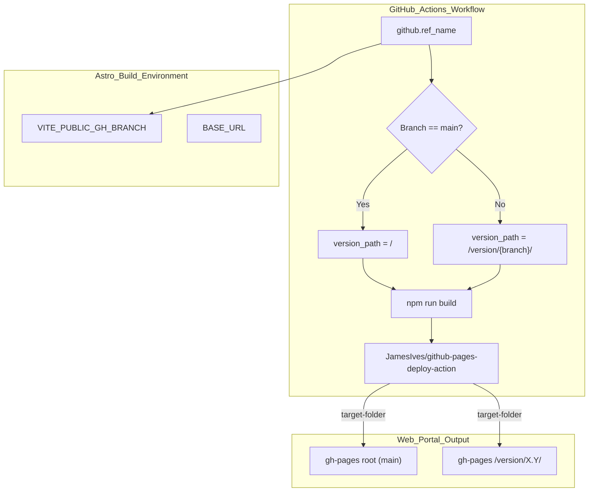
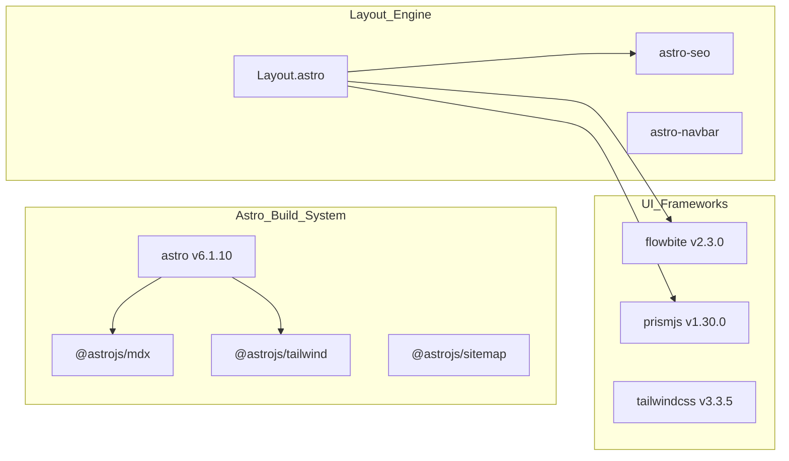
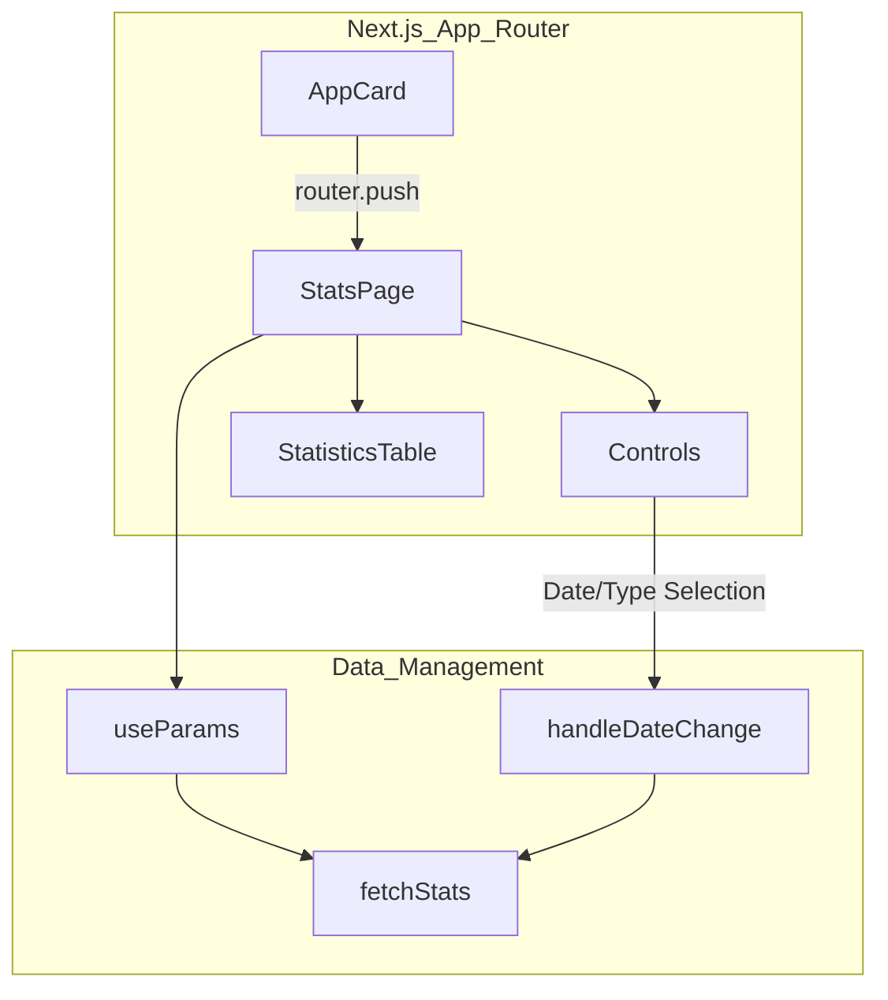

<!-- source: DeepWiki mcp.deepwiki.com · repo NVIDIA/NVFlare · page 12.2 Version Management · fetched 2026-10-26 -->

# Version Management

Relevant source files

The following files were used as context for generating this wiki page:

- [.github/workflows/deploy.yml](.github/workflows/deploy.yml)
- [.readthedocs.yaml](.readthedocs.yaml)
- [3rdParty/packaging.LICENSE.txt](3rdParty/packaging.LICENSE.txt)
- [build_doc.sh](build_doc.sh)
- [docs/conf.py](docs/conf.py)
- [docs/design/hf_trainer_client_api.md](docs/design/hf_trainer_client_api.md)
- [docs/hello-world/hello-huggingface/index.rst](docs/hello-world/hello-huggingface/index.rst)
- [docs/llms.txt.in](docs/llms.txt.in)
- [docs/programming_guide/llm_fine_tuning.rst](docs/programming_guide/llm_fine_tuning.rst)
- [examples/tutorials/self-paced-training/part-5_federated_learning_applications_in_industries/chapter-11_federated_learning_in_healthcare_lifescience/11.3_medical_devices/code/visualization/frontend/analytics-dashboard/next.config.mjs](examples/tutorials/self-paced-training/part-5_federated_learning_applications_in_industries/chapter-11_federated_learning_in_healthcare_lifescience/11.3_medical_devices/code/visualization/frontend/analytics-dashboard/next.config.mjs)
- [examples/tutorials/self-paced-training/part-5_federated_learning_applications_in_industries/chapter-11_federated_learning_in_healthcare_lifescience/11.3_medical_devices/code/visualization/frontend/analytics-dashboard/package.json](examples/tutorials/self-paced-training/part-5_federated_learning_applications_in_industries/chapter-11_federated_learning_in_healthcare_lifescience/11.3_medical_devices/code/visualization/frontend/analytics-dashboard/package.json)
- [examples/tutorials/self-paced-training/part-5_federated_learning_applications_in_industries/chapter-11_federated_learning_in_healthcare_lifescience/11.3_medical_devices/code/visualization/frontend/analytics-dashboard/pnpm-lock.yaml](examples/tutorials/self-paced-training/part-5_federated_learning_applications_in_industries/chapter-11_federated_learning_in_healthcare_lifescience/11.3_medical_devices/code/visualization/frontend/analytics-dashboard/pnpm-lock.yaml)
- [examples/tutorials/self-paced-training/part-5_federated_learning_applications_in_industries/chapter-11_federated_learning_in_healthcare_lifescience/11.3_medical_devices/code/visualization/frontend/analytics-dashboard/pnpm-workspace.yaml](examples/tutorials/self-paced-training/part-5_federated_learning_applications_in_industries/chapter-11_federated_learning_in_healthcare_lifescience/11.3_medical_devices/code/visualization/frontend/analytics-dashboard/pnpm-workspace.yaml)
- [examples/tutorials/self-paced-training/part-5_federated_learning_applications_in_industries/chapter-11_federated_learning_in_healthcare_lifescience/11.3_medical_devices/code/visualization/frontend/analytics-dashboard/src/app/components/AppCard.tsx](examples/tutorials/self-paced-training/part-5_federated_learning_applications_in_industries/chapter-11_federated_learning_in_healthcare_lifescience/11.3_medical_devices/code/visualization/frontend/analytics-dashboard/src/app/components/AppCard.tsx)
- [examples/tutorials/self-paced-training/part-5_federated_learning_applications_in_industries/chapter-11_federated_learning_in_healthcare_lifescience/11.3_medical_devices/code/visualization/frontend/analytics-dashboard/src/app/stats/[app_name]/page.tsx](examples/tutorials/self-paced-training/part-5_federated_learning_applications_in_industries/chapter-11_federated_learning_in_healthcare_lifescience/11.3_medical_devices/code/visualization/frontend/analytics-dashboard/src/app/stats/[app_name]/page.tsx)
- [examples/tutorials/self-paced-training/part-5_federated_learning_applications_in_industries/chapter-11_federated_learning_in_healthcare_lifescience/11.3_medical_devices/code/visualization/frontend/analytics-dashboard/tsconfig.json](examples/tutorials/self-paced-training/part-5_federated_learning_applications_in_industries/chapter-11_federated_learning_in_healthcare_lifescience/11.3_medical_devices/code/visualization/frontend/analytics-dashboard/tsconfig.json)
- [web/package-lock.json](web/package-lock.json)
- [web/package.json](web/package.json)
- [web/src/layouts/Layout.astro](web/src/layouts/Layout.astro)

This document details the multi-version documentation system for the NVIDIA FLARE web portal. It covers the technical implementation of branch-based builds, the version selection dropdown, and how the documentation system manages different versions (e.g., main, 2.5, 2.6) through environment configuration and CI/CD pipelines.

## Purpose and Scope

The NVIDIA FLARE documentation portal supports multiple concurrent versions of documentation corresponding to different release branches. This system enables users to view documentation and tutorials for their specific NVFLARE version while maintaining a single codebase for the portal itself. The portal is built using Astro [web/package.json:23](), which manages versioning primarily through environment variables and dynamic URL construction.

The version management system handles:
- Branch-based version identification via `VITE_PUBLIC_GH_BRANCH` [.github/workflows/deploy.yml:49]().
- Dynamic version switching via a UI dropdown.
- Automated deployment to GitHub Pages with version-specific path routing [.github/workflows/deploy.yml:52-58]().
- Version-aware link generation for GitHub source code and Google Colab notebooks.

## Version Strategy Overview

The documentation portal uses a **branch-based versioning strategy**. The active version is determined at build time via GitHub Actions environment variables, which then propagates through the Astro components to ensure all links point to the correct branch on GitHub.

| Variable | Source | Default | Purpose |
|----------|--------|---------|---------|
| `VITE_PUBLIC_GH_BRANCH` | `github.ref_name` | `main` | Determines the GitHub branch for source and tutorial links [.github/workflows/deploy.yml:49](). |
| `version_path` | `GITHUB_ENV` | `/` | Manages the root path for internal portal routing on GitHub Pages [.github/workflows/deploy.yml:16-30](). |
| `base_url` | `import.meta.env.BASE_URL` | N/A | Injected by Astro to handle asset paths [web/src/layouts/Layout.astro:16](). |

### Versioned Deployment Data Flow

Title: "Documentation Deployment Workflow"

Sources: [.github/workflows/deploy.yml:1-58](), [web/src/layouts/Layout.astro:16-24]()

## Automated Deployment Pipeline

The deployment process is managed by a GitHub Actions workflow that triggers on pushes to the `main`, `2.5`, and `2.6` branches [.github/workflows/deploy.yml:5-9]().

### Version Path Logic
The workflow dynamically calculates the `version_path` based on the branch name:
- If the branch is `main`, the `version_path` remains `/` [.github/workflows/deploy.yml:16]().
- For other branches (e.g., `2.5`), the `version_path` is updated to `/version/${{ github.ref_name }}/` [.github/workflows/deploy.yml:30]().

### Build and Deploy Execution
The build process uses Node.js 22.12 [.github/workflows/deploy.yml:38](), matching the engine requirements in the package configuration [web/package.json:7](). The `npm run build` command [.github/workflows/deploy.yml:47]() generates the static site, which is then deployed to the `gh-pages` branch [.github/workflows/deploy.yml:55](). The deployment action is configured to preserve existing versioned directories using `clean-exclude: version` [.github/workflows/deploy.yml:58]().

Sources: [.github/workflows/deploy.yml:1-59](), [web/package.json:6-15]()

## UI Implementation: Version Dropdown

The portal layout and components use the environment metadata to render version-specific content.

### Layout Integration
The `Layout.astro` component uses `import.meta.env.BASE_URL` to correctly resolve the favicon and analytics scripts regardless of whether the site is hosted at the root or in a versioned sub-directory [web/src/layouts/Layout.astro:24-53]().

### Version-Aware Components
Components utilize the `VITE_PUBLIC_GH_BRANCH` variable (typically mapped to a local `gh_branch` variable in component scripts) to construct URLs. This ensures that when a user is browsing the "2.5" version of the portal, all "View Source" or "Tutorial" links point to the `2.5` branch on GitHub [.github/workflows/deploy.yml:48-50]().

Sources: [web/src/layouts/Layout.astro:1-56](), [.github/workflows/deploy.yml:48-50]()

## Sphinx and API Versioning

The Python API documentation is built using Sphinx and is also version-aware. The `docs/conf.py` script reads the `READTHEDOCS_VERSION_NAME` environment variable to determine the `build_version` [docs/conf.py:57-58]().

### API Doc Generation
API documentation is generated automatically by the `generate_apidocs` function [docs/conf.py:147-161](), which uses `sphinx-apidoc` to trawl the `nvflare` module [docs/conf.py:152](). The version is explicitly set in the Sphinx configuration [docs/conf.py:54-55]().

### External Links
The `extlinks` configuration in Sphinx uses the `build_version` to create dynamic links to the GitHub repository [docs/conf.py:122](), ensuring that `:github_nvflare_link:` references in the documentation point to the correct branch version.

Sources: [docs/conf.py:49-161](), [build_doc.sh:62-71]()

## Build System and Dependencies

The web portal is a modern JavaScript application utilizing Astro for static site generation [web/package.json:23]().

### Portal Architecture Entities

Title: "Astro Portal Dependency Architecture"

| Dependency | Version | Purpose |
|------------|---------|---------|
| `astro` | `^6.1.10` | Core static site generator [web/package.json:23]() |
| `flowbite` | `^2.3.0` | UI library for dropdowns and interactive elements [web/package.json:27]() |
| `prismjs` | `^1.30.0` | Syntax highlighting for code examples [web/package.json:28]() |
| `tailwindcss` | `^3.3.5` | Utility-first CSS framework for styling [web/package.json:29]() |

The portal version is currently tracked as `0.0.2` [web/package.json:4]().

Sources: [web/package.json:1-31](), [web/package-lock.json:6-28]()

## Healthcare Dashboard Versioning

Beyond the documentation portal, specific research and industrial application examples implement their own frontend dashboards, such as the `analytics-dashboard` in the healthcare tutorials [examples/tutorials/self-paced-training/part-5_federated_learning_applications_in_industries/chapter-11_federated_learning_in_healthcare_lifescience/11.3_medical_devices/code/visualization/frontend/analytics-dashboard/package.json:2]().

These sub-applications use modern web stacks (Next.js 15.5.18, React 18.3.1) [examples/tutorials/self-paced-training/part-5_federated_learning_applications_in_industries/chapter-11_federated_learning_in_healthcare_lifescience/11.3_medical_devices/code/visualization/frontend/analytics-dashboard/package.json:26-27]() and are managed via `pnpm` [examples/tutorials/self-paced-training/part-5_federated_learning_applications_in_industries/chapter-11_federated_learning_in_healthcare_lifescience/11.3_medical_devices/code/visualization/frontend/analytics-dashboard/pnpm-lock.yaml:1]().

### Healthcare Dashboard Component Flow

Title: "Healthcare Analytics Dashboard Entity Flow"

Sources: [examples/tutorials/self-paced-training/part-5_federated_learning_applications_in_industries/chapter-11_federated_learning_in_healthcare_lifescience/11.3_medical_devices/code/visualization/frontend/analytics-dashboard/src/app/stats/[app_name]/page.tsx:37-191](), [examples/tutorials/self-paced-training/part-5_federated_learning_applications_in_industries/chapter-11_federated_learning_in_healthcare_lifescience/11.3_medical_devices/code/visualization/frontend/analytics-dashboard/src/app/components/AppCard.tsx:29-42]()

## Healthcare Dashboard Technical Implementation

The `StatsPage` component in the healthcare visualization frontend uses the `useParams` hook from `next/navigation` to identify the application context [examples/tutorials/self-paced-training/part-5_federated_learning_applications_in_industries/chapter-11_federated_learning_in_healthcare_lifescience/11.3_medical_devices/code/visualization/frontend/analytics-dashboard/src/app/stats/[app_name]/page.tsx:38](). It maintains state for hierarchical data using `setHierarchy` and `setGlobalData` [examples/tutorials/self-paced-training/part-5_federated_learning_applications_in_industries/chapter-11_federated_learning_in_healthcare_lifescience/11.3_medical_devices/code/visualization/frontend/analytics-dashboard/src/app/stats/[app_name]/page.tsx:40-42]().

The component dynamically renders selection boxes based on the data hierarchy via the `renderSelectBoxes` function [examples/tutorials/self-paced-training/part-5_federated_learning_applications_in_industries/chapter-11_federated_learning_in_healthcare_lifescience/11.3_medical_devices/code/visualization/frontend/analytics-dashboard/src/app/stats/[app_name]/page.tsx:104-153](). This hierarchy is traversed recursively using `isValueAtFinalLevel` to determine if the user has reached the leaf node of the statistics data [examples/tutorials/self-paced-training/part-5_federated_learning_applications_in_industries/chapter-11_federated_learning_in_healthcare_lifescience/11.3_medical_devices/code/visualization/frontend/analytics-dashboard/src/app/stats/[app_name]/page.tsx:56-88]().

Sources: [examples/tutorials/self-paced-training/part-5_federated_learning_applications_in_industries/chapter-11_federated_learning_in_healthcare_lifescience/11.3_medical_devices/code/visualization/frontend/analytics-dashboard/src/app/stats/[app_name]/page.tsx:37-191]()

---

