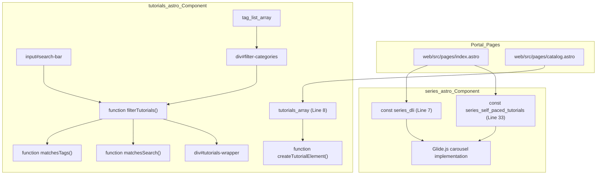
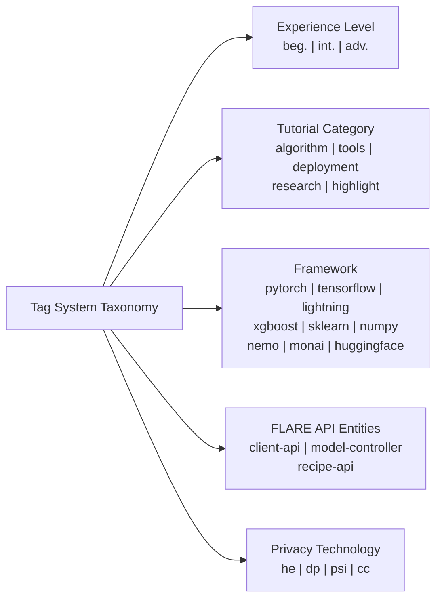
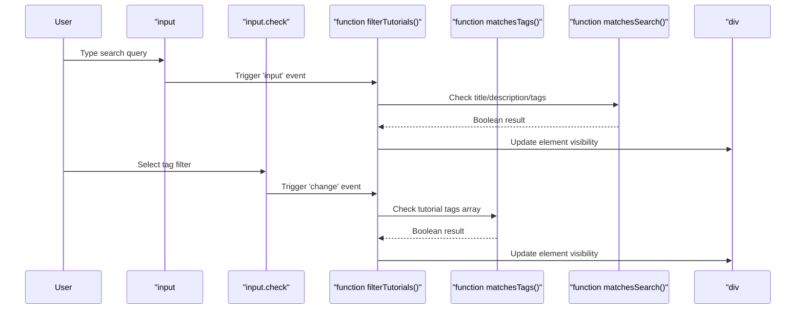

<!-- source: DeepWiki mcp.deepwiki.com · repo NVIDIA/NVFlare · page 12.3 Tutorial Catalog System · fetched 2026-10-26 -->

# Tutorial Catalog System

<details>
<summary>Relevant source files</summary>

The following files were used as context for generating this wiki page:

- [web/astro.config.mjs](web/astro.config.mjs)
- [web/src/components/code.astro](web/src/components/code.astro)
- [web/src/components/footer.astro](web/src/components/footer.astro)
- [web/src/components/gettingStarted.astro](web/src/components/gettingStarted.astro)
- [web/src/components/hero.astro](web/src/components/hero.astro)
- [web/src/components/learnMore.astro](web/src/components/learnMore.astro)
- [web/src/components/overview.astro](web/src/components/overview.astro)
- [web/src/components/series.astro](web/src/components/series.astro)
- [web/src/components/tutorials.astro](web/src/components/tutorials.astro)
- [web/src/pages/404.astro](web/src/pages/404.astro)
- [web/src/pages/index.astro](web/src/pages/index.astro)
- [web/src/pages/research.astro](web/src/pages/research.astro)
- [web/src/pages/security.astro](web/src/pages/security.astro)

</details>


## Purpose and Scope

This document describes the Tutorial Catalog System within the NVIDIA FLARE Documentation Portal, specifically the sophisticated filtering and tagging system that enables users to discover relevant tutorials and examples. The catalog provides a searchable, filterable interface for browsing over 100 tutorials organized by experience level, framework, algorithm type, and other dimensions.

For information about the overall documentation portal architecture, see [Portal Architecture](#12.1). For version management of the documentation site, see [Version Management](#12.2).

## System Overview

The Tutorial Catalog System has two distinct surface areas within the portal:

1.  **Tutorial Catalog Page** (`tutorials.astro`): A dedicated `/catalog` page with a searchable, multi-tag filterable grid of individual tutorials [web/src/components/tutorials.astro:8-142]().
2.  **Series Component** (`series.astro`): Curated collections of tutorials organized into numbered series, displayed on the portal homepage [web/src/components/series.astro:7-122]().

Both components are written in Astro and render content using data arrays defined in their frontmatter. Interactivity is handled by vanilla JavaScript inline scripts, while styling is managed via Tailwind CSS [web/src/pages/index.astro:1-21]().

**Architecture Diagram: Tutorial Catalog System Components**



Sources: [web/src/components/tutorials.astro:1-142](), [web/src/components/series.astro:1-122](), [web/src/pages/index.astro:1-21]()

## Data Model

### Tutorial Object Structure

Each tutorial in the system is represented as a JavaScript object with the following schema [web/src/components/tutorials.astro:8-15]():

| Field | Type | Required | Description |
| :--- | :--- | :--- | :--- |
| `title` | string | Yes | Tutorial display name |
| `tags` | string[] | Yes | Array of tag identifiers for filtering |
| `description` | string | Yes | Brief tutorial description |
| `link` | string | Yes | URL to tutorial content (GitHub or docs) |
| `colab_link` | string | No | Optional Google Colab notebook link |

Example tutorial object for the FL Simulator:
```javascript
{
    title: "Intro to the FL Simulator",
    tags: ["beg.", "tools"],
    description: "Use the NVIDIA FLARE Simulator to run a local simulation...",
    link: `https://github.com/NVIDIA/NVFlare/tree/${gh_branch}/examples/tutorials/flare_simulator.ipynb`,
    colab_link: `https://colab.research.google.com/github/NVIDIA/NVFlare/blob/${gh_branch}/examples/tutorials/flare_simulator.ipynb`
}
```

Sources: [web/src/components/tutorials.astro:9-15]()

## Tag System Architecture

The tag system organizes tutorials across several distinct dimensions, each representing a different facet of the tutorial's characteristics.

**Tag Category Hierarchy**



### Tag Category Definitions

The tag categories are defined as arrays and organized into a structured taxonomy used to generate the UI [web/src/components/tutorials.astro:11-142](), [web/src/components/series.astro:18-119]():

*   **Experience Level**: `beg.` (Beginner), `int.` (Intermediate), `adv.` (Advanced) [web/src/components/tutorials.astro:11]().
*   **Category**: `algorithm`, `tools`, `deployment`, `research`, `highlight` [web/src/components/tutorials.astro:135]().
*   **Frameworks**: `pytorch`, `tensorflow`, `lightning`, `xgboost`, `sklearn`, `numpy`, `nemo`, `monai`, `huggingface` [web/src/components/tutorials.astro:45,135,141]().
*   **FLARE APIs**: `client-api` (flare.init/send/receive), `model-controller` (Workflow-based), `recipe-api` (FedAvgRecipe) [web/src/components/tutorials.astro:135,141]().
*   **Privacy Technologies**: `he` (Homomorphic Encryption), `dp` (Differential Privacy), `psi` (Private Set Intersection), `cc` (Confidential Computing) [web/src/components/series.astro:82,101](), [web/src/pages/security.astro:64-67]().

Sources: [web/src/components/tutorials.astro:11-142](), [web/src/components/series.astro:18-119](), [web/src/pages/security.astro:64-67]()

## Filtering and Search Implementation

The filtering system uses a pure client-side approach with event-driven updates. The implementation consists of three main components: event listeners, filter logic, and DOM manipulation.

**Filtering Flow Diagram**



### Logic Components

*   **Tag Matching**: The `matchesTags()` function implements logic where a tutorial must contain selected tags to be displayed.
*   **Search Matching**: The `matchesSearch()` function performs a case-insensitive search across the tutorial's title, description, and tags.
*   **DOM Generation**: Tutorial cards are dynamically generated using `createTutorialElement()`. This function builds the HTML structure for each tutorial, including tag badges, titles, descriptions, and links to GitHub or Google Colab [web/src/components/tutorials.astro:2-14]().

Sources: [web/src/components/tutorials.astro:1-142]()

## Series and Learning Paths

The `series.astro` component organizes tutorials into curated learning paths displayed on the portal homepage as interactive carousels [web/src/components/series.astro:1-122]().

### Series Definitions

*   **DLI Courses**: NVIDIA Deep Learning Institute courses such as "Introduction to Federated Learning with NVIDIA FLARE" [web/src/components/series.astro:17-21]() and "Decentralized AI at Scale" [web/src/components/series.astro:23-27]().
*   **Self-Paced Tutorials**: A multi-part curriculum covering 12 chapters, from basic execution (Chapter 1) [web/src/components/series.astro:43-47]() to advanced LLM fine-tuning (Chapter 8) [web/src/components/series.astro:106-110]() and low-level APIs (Chapter 9) [web/src/components/series.astro:112-116]().

### Carousel Implementation

The series component uses the Glide.js library to manage the sliding interface. It is configured with responsive breakpoints to show 1 to 3 cards depending on screen size, and uses `ClickTracker` for analytics on user interactions [web/src/components/series.astro:2,129-131]().

Sources: [web/src/components/series.astro:7-122]()

## Integration with Documentation Portal

The Tutorial Catalog integrates with the broader portal via:

*   **Version Branching**: All components use `gh_branch` (derived from `VITE_PUBLIC_GH_BRANCH`) to ensure links point to the correct version of the codebase (e.g., `main`, `2.5`, `2.6`) [web/src/components/tutorials.astro:5](), [web/src/components/series.astro:4](), [web/src/components/hero.astro:6]().
*   **Version Dropdown**: The `hero.astro` component provides a `dropdownVersionButton` and `version-dropdown` to switch between versions, which updates the navigation context across the site [web/src/components/hero.astro:19-41]().
*   **Navigation**: Links to the catalog are provided in the `hero.astro` component via the "Tutorial Catalog" button [web/src/components/hero.astro:94-97]() and in the `gettingStarted.astro` walkthrough [web/src/components/gettingStarted.astro:55-56]().

Sources: [web/src/components/hero.astro:6-97](), [web/src/components/gettingStarted.astro:55-56](), [web/src/components/tutorials.astro:5](), [web/src/components/series.astro:4]()

---

