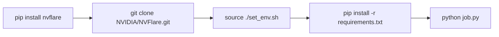
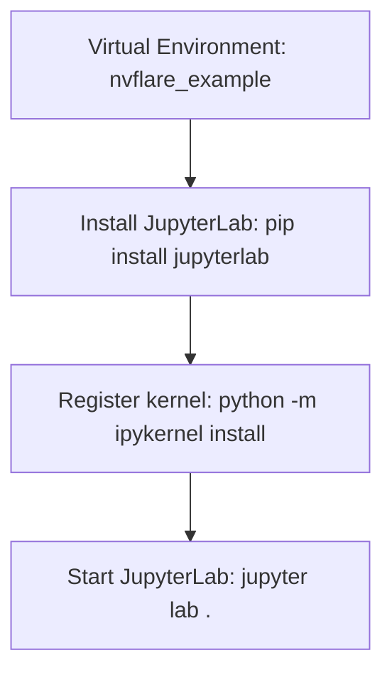

<!-- source: DeepWiki mcp.deepwiki.com · repo NVIDIA/NVFlare · page 13.1 Example Categories and Setup · fetched 2026-10-26 -->

# Example Categories and Setup

<details>
<summary>Relevant source files</summary>

The following files were used as context for generating this wiki page:

- [docs/example_applications_algorithms.rst](docs/example_applications_algorithms.rst)
- [docs/examples/federated_statistics_overview.rst](docs/examples/federated_statistics_overview.rst)
- [docs/examples/fl_algorithms.rst](docs/examples/fl_algorithms.rst)
- [docs/examples/hello_world_examples.rst](docs/examples/hello_world_examples.rst)
- [docs/examples/medical_image_analysis.rst](docs/examples/medical_image_analysis.rst)
- [docs/examples/tutorial_notebooks.rst](docs/examples/tutorial_notebooks.rst)
- [docs/programming_guide/controllers/cross_site_model_evaluation.rst](docs/programming_guide/controllers/cross_site_model_evaluation.rst)
- [docs/programming_guide/controllers/cyclic_workflow.rst](docs/programming_guide/controllers/cyclic_workflow.rst)
- [docs/programming_guide/controllers/scatter_and_gather_workflow.rst](docs/programming_guide/controllers/scatter_and_gather_workflow.rst)
- [docs/release_notes/flare_220.rst](docs/release_notes/flare_220.rst)
- [docs/release_notes/flare_240.rst](docs/release_notes/flare_240.rst)
- [docs/release_notes/flare_250.rst](docs/release_notes/flare_250.rst)
- [docs/whats_new.rst](docs/whats_new.rst)
- [examples/README.md](examples/README.md)
- [examples/advanced/README.md](examples/advanced/README.md)
- [examples/advanced/finance/README.md](examples/advanced/finance/README.md)
- [examples/advanced/job_api/tf/README.md](examples/advanced/job_api/tf/README.md)
- [examples/advanced/job_api/tf/run_jobs.sh](examples/advanced/job_api/tf/run_jobs.sh)
- [examples/advanced/monitoring/README.md](examples/advanced/monitoring/README.md)
- [examples/advanced/monitoring/jobs/README.md](examples/advanced/monitoring/jobs/README.md)
- [examples/hello-world/README.md](examples/hello-world/README.md)
- [examples/tutorials/README.md](examples/tutorials/README.md)

</details>


This page provides an overview of the example categories available in NVIDIA FLARE and describes how to set up your environment to run them. It covers virtual environment configuration, dependency installation, and JupyterLab setup for running notebook-based examples.

For detailed information about specific example types:
- Self-paced training course: See [13.2]()
- Federated learning algorithms: See [13.3]()
- Framework integration examples: See [13.4]()
- Domain-specific applications: See [13.5]()
- Privacy and security examples: See [13.6]()
- Federated statistics: See [13.7]()

---

## Example Categories

NVIDIA FLARE provides examples organized into major categories that demonstrate different aspects of federated learning, from basic "Hello World" examples to advanced domain-specific applications.

### Category Overview

| Category | Description | Location |
|----------|-------------|----------|
| **1. Hello World** | Basic examples demonstrating core workflows (FedAvg, Cyclic, Cross-Site Validation) with NumPy, PyTorch, TensorFlow, JAX, and HuggingFace using the Job Recipe API. | `examples/hello-world/` |
| **2. Tutorial Notebooks** | Interactive Jupyter notebooks covering FL Simulator, FLARE API, POC mode, Job CLI, and Job Recipes. | `examples/tutorials/` |
| **3. FL Algorithms** | Implementations of FedAvg, FedProx, FedOpt, SCAFFOLD, and Swarm Learning. | `examples/advanced/cifar10/`, `examples/advanced/swarm_learning/` |
| **4. Traditional ML** | Scikit-learn (Linear, K-Means, SVM) and XGBoost (horizontal, vertical, and secure) examples. | `examples/advanced/sklearn-*`, `examples/advanced/xgboost/` |
| **5. Medical Image Analysis** | MONAI integration, MedGemma fine-tuning, and image statistics. | `integration/monai/`, `examples/advanced/medgemma/`, `examples/advanced/federated-statistics/image_stats/` |
| **6. Federated Statistics** | Image histograms, DataFrame statistics, and hierarchical statistics. | `examples/advanced/federated-statistics/` |
| **7. Federated Policies** | Authorization, privacy filters, custom authentication, and KeyCloak integration. | `examples/advanced/federated-policies/` |
| **8. Experiment Tracking** | TensorBoard streaming, MLflow, and Weights & Biases integration. | `examples/advanced/experiment-tracking/` |
| **9. Distributed Optimization** | P2P algorithms, consensus, and gradient tracking using low-level APIs. | `examples/advanced/distributed_optimization/` |
| **10. Split Learning** | Vertical federated learning (VFL) where data/models are split across clients. | `examples/advanced/vertical_federated_learning/` |
| **11. Flower Integration** | Running Flower applications on NVFLARE infrastructure without modifications. | `examples/hello-world/hello-flower/` |

**Sources:** [examples/README.md:75-104](), [docs/example_applications_algorithms.rst:9-106](), [examples/advanced/README.md:9-84](), [docs/release_notes/flare_250.rst:43-52]()

---

## Directory Structure

The following diagram maps the high-level example categories to their corresponding directory locations and primary components.

### Example Directory Mapping
```mermaid
graph TB
    ["examples/"] --> ["hello-world/"]
    ["examples/"] --> ["tutorials/"]
    ["examples/"] --> ["advanced/"]
    
    ["hello-world/"] --> HelloNumpy["hello-numpy/ (FedAvgRecipe)"]
    ["hello-world/"] --> HelloPT["hello-pt/ (FedAvgRecipe)"]
    ["hello-world/"] --> HelloTF["hello-tf/ (FedAvgRecipe)"]
    ["hello-world/"] --> HelloHF["hello-huggingface/ (nvflare.client.hf)"]
    ["hello-world/"] --> HelloCollab["hello-collab/ (@collab.main)"]
    ["hello-world/"] --> HelloFlower["hello-flower/ (FlowerApplet)"]
    
    ["tutorials/"] --> SimNB["flare_simulator.ipynb"]
    ["tutorials/"] --> APINB["flare_api.ipynb"]
    ["tutorials/"] --> POCNB["setup_poc.ipynb"]
    
    ["advanced/"] --> CIFAR["cifar10/ (FL Algorithms)"]
    ["advanced/"] --> Stats["federated-statistics/ (Statistics)"]
    ["advanced/"] --> XGB["xgboost/ (FedXGB)"]
    ["advanced/"] --> VFL["vertical_federated_learning/ (SplitNN)"]
```

**Directory Organization:**

- **`examples/hello-world/`**: Simplest examples for getting started quickly using the **Job Recipe** API [examples/hello-world/README.md:1-3]() and the **Collab** API [examples/hello-world/README.md:214-221]().
- **`examples/tutorials/`**: Interactive notebooks demonstrating core features like the `fl_simulator` [docs/example_applications_algorithms.rst:38](), `flare_api` [docs/example_applications_algorithms.rst:39](), and `POC mode` [docs/example_applications_algorithms.rst:40]().
- **`examples/advanced/`**: Production-ready examples with complex scenarios like Scikit-learn integrations [docs/example_applications_algorithms.rst:63-65](), Federated Statistics [docs/example_applications_algorithms.rst:77-78](), and Vertical Federated Learning [examples/advanced/vertical_federated_learning/cifar10-splitnn/README.md:1-7]().

Each example directory typically contains:
- `README.md`: Instructions and documentation.
- `requirements.txt`: Python dependencies specific to that example [examples/README.md:17, 48]().
- `job.py`: Job recipe scripts that define and execute the FL job using high-level abstractions like `FedAvgRecipe` [examples/hello-world/README.md:57-70]().
- Training scripts (e.g., `client.py`): Client-side code using the `nvflare.client` API [examples/hello-world/README.md:243-253]().

**Sources:** [examples/README.md:75-104](), [docs/example_applications_algorithms.rst:1-106](), [examples/hello-world/README.md:231-253](), [docs/release_notes/flare_250.rst:43-52]()

---

## Environment Setup

### Virtual Environment Creation

NVIDIA FLARE examples require a Python virtual environment to isolate dependencies and avoid conflicts with system packages [examples/README.md:19-21]().

### Environment Lifecycle


**Step 1: Install NVFLARE**

```bash
pip install nvflare
```
[examples/hello-world/README.md:11]()

**Step 2: Get Example Code**

```bash
git clone https://github.com/NVIDIA/NVFlare.git
cd NVFlare/examples/hello-world/hello-pt
```
[examples/hello-world/README.md:16-17]()

**Step 3: Activate Environment**

The `set_env.sh` script is provided to automate environment activation and `PYTHONPATH` configuration [examples/README.md:35-38](). For advanced examples like Split Learning, manual `PYTHONPATH` exports may be required to include source directories [examples/advanced/vertical_federated_learning/cifar10-splitnn/README.md:20-23]().

**Sources:** [examples/README.md:19-43](), [examples/hello-world/README.md:9-18](), [examples/advanced/vertical_federated_learning/cifar10-splitnn/README.md:20-23]()

---

### Installing Example Dependencies

Each example has specific dependencies listed in `requirements.txt` files within the example directory.

**Per-Example Installation:**

```bash
cd hello-pt  # or hello-numpy, etc.
pip install -r requirements.txt
```
[examples/hello-world/README.md:21-24]()

Some examples may also include a `plot-requirements.txt` for visualization tools [examples/README.md:51-54]().

**Sources:** [examples/README.md:45-54](), [examples/hello-world/README.md:20-24]()

---

### JupyterLab Setup

Many tutorials use Jupyter notebooks. For a correct setup, the virtual environment kernel must be registered.

### Jupyter Integration Flow


**Registration Command:**
```bash
python3 -m ipykernel install --user --name="nvflare_example"
```
[examples/README.md:65-66]()

**Important:** You must set up the virtual environment, install `nvflare`, and set the `PYTHONPATH` before launching JupyterLab [examples/README.md:58-59]().

**Sources:** [examples/README.md:56-73]()

---

## Example Category Summary

### 1. Hello World Examples

Entry-point examples demonstrating basic workflows using the **Job Recipe** API [examples/hello-world/README.md:38-44]() and **Collab** API [examples/hello-world/README.md:214-221]():

- **`hello-numpy`**: Understanding FL basics with NumPy and `FedAvgRecipe` [examples/hello-world/README.md:199-206]().
- **`hello-pt`**: Image classification with CIFAR-10 using PyTorch and `FedAvgRecipe` [examples/hello-world/README.md:102-108]().
- **`hello-tf`**: MNIST digit classification with TensorFlow using `FedAvgRecipe` [examples/hello-world/README.md:149-156]().
- **`hello-huggingface`**: Federated Qwen SFT/PEFT using `nvflare.client.hf` [examples/hello-world/README.md:181-188]().
- **`hello-jax`**: MNIST classifier using JAX/Flax with the Client API [examples/hello-world/README.md:164-171]().
- **`hello-collab`**: NumPy workflow implemented with ordinary Python function calls and `@collab` decorators [examples/hello-world/README.md:214-221]().
- **`hello-flower`**: Integration allowing Flower applications to run on NVFLARE infrastructure [docs/release_notes/flare_250.rst:43-52]().

**Sources:** [examples/README.md:75-84](), [docs/example_applications_algorithms.rst:9-32](), [examples/hello-world/README.md:98-229](), [docs/release_notes/flare_250.rst:43-52]()

### 2. Tutorial Notebooks

Interactive feature demonstrations located in `examples/tutorials/`:

| Notebook | Purpose | Key Concept Covered |
|----------|---------|---------------------|
| `flare_simulator.ipynb` | Local FL simulation | `fl_simulator` [docs/example_applications_algorithms.rst:38]() |
| `flare_api.ipynb` | Programmatic admin commands | `flare_api` [docs/example_applications_algorithms.rst:39]() |
| `setup_poc.ipynb` | Local multi-process deployment | `POC mode` [docs/example_applications_algorithms.rst:40]() |
| `job_recipe.ipynb` | High-level job definition | `Job Recipes` [docs/example_applications_algorithms.rst:42]() |

**Sources:** [docs/example_applications_algorithms.rst:35-44](), [examples/README.md:86-94]()

### 3. Advanced and Domain-Specific Examples

- **Traditional ML**: Scikit-learn (Linear [docs/example_applications_algorithms.rst:64](), K-Means [docs/example_applications_algorithms.rst:65](), SVM [docs/example_applications_algorithms.rst:66]()) and XGBoost [docs/example_applications_algorithms.rst:67]().
- **Federated Statistics**: Generating global statistics (count, mean, histogram) from local client data using the `Statistics` spec [docs/examples/federated_statistics_overview.rst:8-14]().
- **Medical Imaging**: Calculating image histograms [docs/examples/federated_statistics_overview.rst:64-70]() and MONAI integration [docs/example_applications_algorithms.rst:72]().
- **Split Learning**: Vertical FL implementation using `CIFAR-10` where one client holds images and another holds labels [examples/advanced/vertical_federated_learning/cifar10-splitnn/README.md:1-7]().
- **Secure XGBoost**: Support for secure federated learning via homomorphic encryption for both horizontal and vertical schemes [docs/release_notes/flare_250.rst:53-62]().
- **BioNeMo Integration**: Federated learning for drug discovery using ESM-1nv models and protein representations [docs/release_notes/flare_250.rst:94-101]().

**Sources:** [docs/example_applications_algorithms.rst:61-81](), [docs/examples/federated_statistics_overview.rst:1-85](), [examples/advanced/vertical_federated_learning/cifar10-splitnn/README.md:1-35](), [docs/release_notes/flare_250.rst:53-101]()

---

