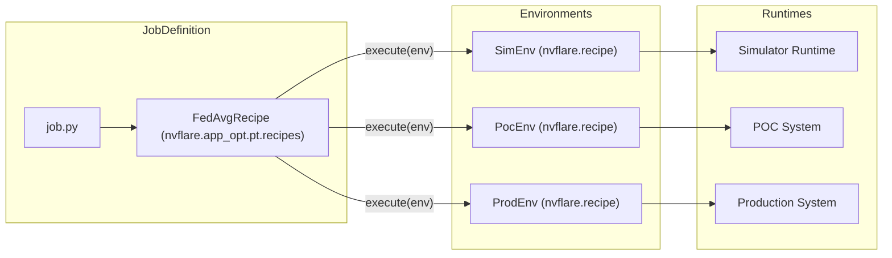
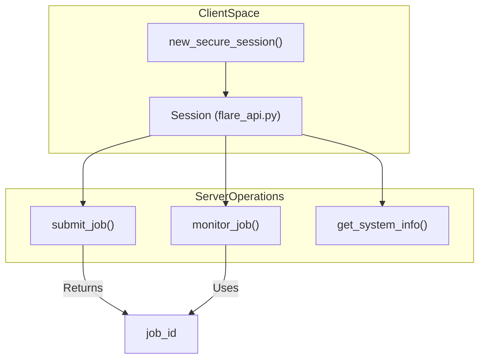

<!-- source: DeepWiki mcp.deepwiki.com · repo NVIDIA/NVFlare · page 13.2 Self-Paced Training Course · fetched 2026-10-26 -->

# Self-Paced Training Course

Relevant source files

The following files were used as context for generating this wiki page:

- [docs/example_applications_algorithms.rst](docs/example_applications_algorithms.rst)
- [docs/examples/federated_statistics_overview.rst](docs/examples/federated_statistics_overview.rst)
- [docs/examples/fl_algorithms.rst](docs/examples/fl_algorithms.rst)
- [docs/examples/hello_world_examples.rst](docs/examples/hello_world_examples.rst)
- [docs/examples/medical_image_analysis.rst](docs/examples/medical_image_analysis.rst)
- [docs/examples/tutorial_notebooks.rst](docs/examples/tutorial_notebooks.rst)
- [docs/programming_guide/controllers/cross_site_model_evaluation.rst](docs/programming_guide/controllers/cross_site_model_evaluation.rst)
- [docs/programming_guide/controllers/cyclic_workflow.rst](docs/programming_guide/controllers/cyclic_workflow.rst)
- [docs/programming_guide/controllers/scatter_and_gather_workflow.rst](docs/programming_guide/controllers/scatter_and_gather_workflow.rst)
- [docs/programming_guide/hierarchical_communication.rst](docs/programming_guide/hierarchical_communication.rst)
- [docs/release_notes/extra_270.rst](docs/release_notes/extra_270.rst)
- [docs/release_notes/flare_220.rst](docs/release_notes/flare_220.rst)
- [docs/release_notes/flare_240.rst](docs/release_notes/flare_240.rst)
- [docs/release_notes/flare_250.rst](docs/release_notes/flare_250.rst)
- [docs/release_notes/flare_270.rst](docs/release_notes/flare_270.rst)
- [docs/resources/FQSN_relay_hierarchy.png](docs/resources/FQSN_relay_hierarchy.png)
- [docs/resources/FQSN_server_directly.png](docs/resources/FQSN_server_directly.png)
- [docs/resources/client_hierarchy.png](docs/resources/client_hierarchy.png)
- [docs/resources/communication_hierarchy_clients.png](docs/resources/communication_hierarchy_clients.png)
- [docs/resources/communication_hierarchy_intermediary_nodes.png](docs/resources/communication_hierarchy_intermediary_nodes.png)
- [docs/self-paced-training/index.rst](docs/self-paced-training/index.rst)
- [docs/tutorials.rst](docs/tutorials.rst)
- [docs/user_guide/admin_guide/configurations/server_port_consolidation.rst](docs/user_guide/admin_guide/configurations/server_port_consolidation.rst)
- [docs/user_guide/edge_development/flare_mobile.rst](docs/user_guide/edge_development/flare_mobile.rst)
- [docs/user_guide/edge_development/index.rst](docs/user_guide/edge_development/index.rst)
- [docs/user_guide/edge_development/mobile_android.rst](docs/user_guide/edge_development/mobile_android.rst)
- [docs/whats_new.rst](docs/whats_new.rst)
- [examples/README.md](examples/README.md)
- [examples/advanced/README.md](examples/advanced/README.md)
- [examples/advanced/finance/README.md](examples/advanced/finance/README.md)
- [examples/advanced/job_api/tf/README.md](examples/advanced/job_api/tf/README.md)
- [examples/advanced/job_api/tf/run_jobs.sh](examples/advanced/job_api/tf/run_jobs.sh)
- [examples/advanced/monitoring/README.md](examples/advanced/monitoring/README.md)
- [examples/advanced/monitoring/jobs/README.md](examples/advanced/monitoring/jobs/README.md)
- [examples/hello-world/README.md](examples/hello-world/README.md)
- [examples/tutorials/README.md](examples/tutorials/README.md)
- [examples/tutorials/self-paced-training/README.md](examples/tutorials/self-paced-training/README.md)
- [examples/tutorials/self-paced-training/part-1_federated_learning_introduction/README.md](examples/tutorials/self-paced-training/part-1_federated_learning_introduction/README.md)
- [examples/tutorials/self-paced-training/part-1_federated_learning_introduction/part-1_introduction.ipynb](examples/tutorials/self-paced-training/part-1_federated_learning_introduction/part-1_introduction.ipynb)
- [examples/tutorials/self-paced-training/part-2_federated_learning_system/README.md](examples/tutorials/self-paced-training/part-2_federated_learning_system/README.md)
- [examples/tutorials/self-paced-training/part-2_federated_learning_system/part-2_introduction.ipynb](examples/tutorials/self-paced-training/part-2_federated_learning_system/part-2_introduction.ipynb)
- [examples/tutorials/self-paced-training/part-5_federated_learning_applications_in_industries/chapter-11_federated_learning_in_healthcare_lifescience/video.md](examples/tutorials/self-paced-training/part-5_federated_learning_applications_in_industries/chapter-11_federated_learning_in_healthcare_lifescience/video.md)

## Purpose and Scope

The Self-Paced Training Course is a comprehensive 5-part, 12-chapter educational program for learning NVIDIA FLARE, featuring 100+ Jupyter notebooks and over 80 video tutorials [examples/tutorials/self-paced-training/README.md:1-25](). The course provides structured learning from basic federated learning concepts through advanced algorithms, system architecture, security, and real-world industry use cases [docs/self-paced-training/index.rst:1-32]().

For quick introductory examples, see [Hello World Examples](#2.1). For feature-specific tutorials on simulator, CLI, and APIs, see [Example Categories and Setup](#13.1). This page documents the comprehensive self-paced course specifically [docs/tutorials.rst:31-39]().

Sources: [examples/tutorials/self-paced-training/README.md:1-25](), [docs/self-paced-training/index.rst:1-32](), [docs/tutorials.rst:31-39]()

## Course Location and Structure

The course materials are located at `examples/tutorials/self-paced-training/` in the repository, with documentation mirrored at `docs/self-paced-training/index.rst` [examples/tutorials/self-paced-training/README.md:32-142]().

### Course Hierarchy Diagram
Title: "Self-Paced Training Directory Structure"

```mermaid
graph TB
    Root["examples/tutorials/self-paced-training/"]
    
    Part1["part-1_federated_learning_introduction/"]
    Ch1["chapter-1_running_federated_learning_applications/"]
    Ch2["chapter-2_develop_federated_learning_applications/"]
    
    Part2["part-2_federated_learning_system/"]
    Ch3["chapter-3_federated_computing_platform/"]
    Ch4["chapter-4_setup_federated_system/"]
    
    Part3["part-3_security_and_privacy/"]
    Ch5["chapter-5_Privacy_In_Federated_Learning/"]
    Ch6["chapter-6_Security_in_federated_compute_system/"]
    
    Part4["part-4_advanced_federated_learning/"]
    Ch7["chapter-7_algorithms_and_workflows/"]
    Ch8["chapter-8_federated_LLM_training/"]
    Ch9["chapter-9_flare_low_level_apis/"]
    Ch10["chapter-10_federated_XGBoost/"]
    
    Part5["part-5_federated_learning_applications_in_industries/"]
    Ch11["chapter-11_federated_learning_in_healthcare_lifescience/"]
    Ch12["chapter-12_federated_learning_in_financial_services/"]
    
    Root --> Part1
    Root --> Part2
    Root --> Part3
    Root --> Part4
    Root --> Part5
    
    Part1 --> Ch1
    Part1 --> Ch2
    
    Part2 --> Ch3
    Part2 --> Ch4
    
    Part3 --> Ch5
    Part3 --> Ch6
    
    Part4 --> Ch7
    Part4 --> Ch8
    Part4 --> Ch9
    Part4 --> Ch10
    
    Part5 --> Ch11
    Part5 --> Ch12
```

Each chapter directory contains multiple notebooks (e.g., `01.0_introduction/introduction.ipynb` [examples/tutorials/self-paced-training/part-1_federated_learning_introduction/chapter-1_running_federated_learning_applications/01.0_introduction/introduction.ipynb:1-10]()) and a `video.md` file with links to video tutorials [examples/tutorials/self-paced-training/README.md:46-142]().

Sources: [examples/tutorials/self-paced-training/README.md:32-142](), [docs/self-paced-training/index.rst:38-231](), [examples/tutorials/self-paced-training/part-1_federated_learning_introduction/chapter-1_running_federated_learning_applications/01.0_introduction/introduction.ipynb:1-10]()

## Course Content Overview

| Part | Chapters | Topics Covered | Notebooks Focus |
|------|----------|----------------|-----------------|
| Part 1: Introduction | Ch 1-2 | FL basics, job structure, PyTorch integration, experiment tracking, federated statistics | Running and developing FL applications |
| Part 2: System | Ch 3-4 | Architecture, deployment, admin tools, monitoring | Setting up and managing FL systems |
| Part 3: Security | Ch 5-6 | Privacy attacks, differential privacy, homomorphic encryption, authentication, RBAC | Security and privacy protections |
| Part 4: Advanced | Ch 7-10 | FedOpt, FedProx, SCAFFOLD, cyclic/split/swarm learning, LLMs, XGBoost | Advanced algorithms and workflows |
| Part 5: Industry | Ch 11-12 | Medical imaging, drug discovery, fraud detection, anomaly detection | Healthcare and financial applications |

Sources: [examples/tutorials/self-paced-training/README.md:10-26](), [docs/self-paced-training/index.rst:16-32]()

## Part 1: Introduction to Federated Learning

### Chapter 1: Running Federated Learning Applications
Demonstrates basic FL workflow by training an image classifier with PyTorch using the `FedAvg` algorithm [examples/hello-world/README.md:102-115]().

*   **Job Structure:** A job encapsulates configurations, scripts, and resources. It typically includes a `meta.conf` (or `meta.json`) and application folders [examples/hello-world/README.md:245-250]().
*   **Conversion:** Transitioning from centralized PyTorch training code to FL code using the Client API [docs/release_notes/flare_240.rst:10-48]().
*   **Experiment Tracking:**
    *   **TensorBoard:** Uses `add_experiment_tracking` with `tracking_type="tensorboard"` in recipes [docs/release_notes/flare_270.rst:65-65]().
*   **Job Recipes:** Introduced in FLARE v2.7, recipes like `FedAvgRecipe` allow building jobs in ~6 lines of code [docs/release_notes/flare_270.rst:44-80]().

Sources: [examples/hello-world/README.md:102-250](), [docs/release_notes/flare_270.rst:44-80](), [docs/release_notes/flare_240.rst:10-48]()

## Part 2: Federated Learning System

### Chapter 4: Setup Federated Computing System
Covers the lifecycle of provisioning and deploying a federated system [docs/example_applications_algorithms.rst:35-43]().

*   **Provisioning:**
    *   **POC Mode:** Using `nvflare poc prepare` to generate local packages for server and clients [docs/example_applications_algorithms.rst:40-40]().
    *   **Configuration:** The `nvflare config` command manages setup for local workspaces [docs/example_applications_algorithms.rst:41-41]().
*   **Deployment:**
    *   **Simulator:** Runs jobs locally without provisioned daemons using the `nvflare simulator` command or `SimEnv` [docs/example_applications_algorithms.rst:38-38]().

Sources: [docs/example_applications_algorithms.rst:35-43]()

## Technical Implementation Mapping

Title: "Recipe Execution and Environment Mapping"

Title: "FLARE API Session and Job Management"

Sources: [docs/release_notes/flare_270.rst:51-73](), [docs/example_applications_algorithms.rst:38-42]()

## Setup and Execution

### Execution Methods
1.  **Simulator:** Rapid prototyping by executing `python job.py` which uses `SimEnv` internally [examples/hello-world/README.md:28-34]().
2.  **POC Mode:** Local multi-process deployment using `nvflare poc` commands [docs/example_applications_algorithms.rst:40-40]().
3.  **FLARE API:** Programmatic job submission and monitoring using the `flare_api` [docs/example_applications_algorithms.rst:39-39]().

### Framework Integrations
The course covers a wide range of framework-specific implementations:
*   **Scikit-learn:** Federated Linear Models, SVM, and K-Means [docs/example_applications_algorithms.rst:61-66]().
*   **PyTorch Lightning:** Integration for streamlined FL workflows [examples/hello-world/README.md:117-131]().
*   **Flower:** Running Flower applications on FLARE infrastructure [docs/release_notes/flare_250.rst:43-52]().

### Edge & Mobile
FLARE 2.7 extends FL to millions of devices via hierarchical architecture [docs/release_notes/flare_270.rst:150-151](). It supports iOS and Android deployment without requiring native device programming, utilizing ExecuTorch for on-device training [docs/release_notes/flare_270.rst:156-158]().

Sources: [docs/release_notes/flare_270.rst:2-158](), [docs/example_applications_algorithms.rst:61-66](), [examples/hello-world/README.md:117-131]()

---

